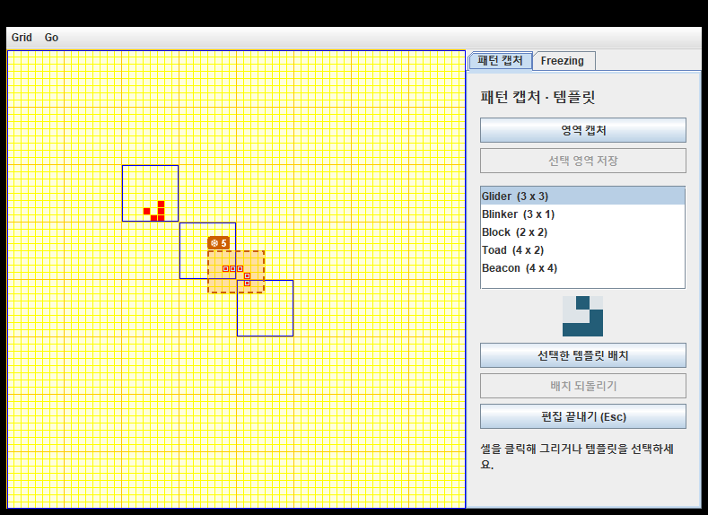
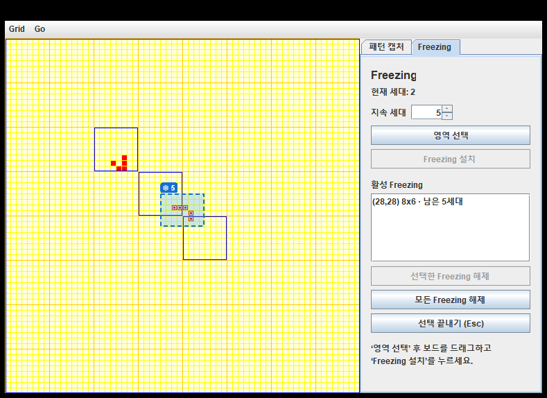

# DP_team_project

Allen Holub의 Java Swing 라이프게임에 **영역 캡처·템플릿 재배치**와 **Freezing(영역 고정)** 기능을 추가한 작업본입니다.
기준 브랜치: `experiment/capture-templates` (`cd2fdb1`), 작업 브랜치: `feature/freezing`.
Freezing 설계와 검증 결과는 [docs/FREEZING.md](docs/FREEZING.md)에 정리했습니다.

## 실행

Windows에서 이 폴더의 **`run.cmd`를 더블클릭**하면 컴파일 후 게임이 열립니다.
JDK 17 이상과 PATH에 등록된 `java`, `javac`, `jar`가 필요합니다. JDK 17.0.6과 JDK 21.0.7에서 확인했습니다.
외부 라이브러리나 Maven/Gradle 설치는 필요하지 않습니다.

```powershell
.\run.cmd
```

빌드한 JAR만 실행하려면 다음 명령을 사용합니다. 사용자 템플릿 경로가 일정하도록 저장소 폴더에서 실행하세요.

```powershell
java -jar build\HolubLife.jar
```

게임을 종료한 뒤 다시 빌드하세요. Windows에서는 실행 중인 JAR 파일을 교체할 수 없습니다.

## 화면 구성

| 영역 | 내용 |
| --- | --- |
| 왼쪽 | 64 x 64 보드 (셀 클릭으로 그리기) |
| 위쪽 메뉴 | 기존 **Grid** (Clear / Load / Store / Exit), **Go** (Halt / Tick / Agonizing / Slow / Medium / Fast) |
| 오른쪽 **패턴 캡처** 탭 | 영역 캡처, 템플릿 저장·배치·되돌리기 |
| 오른쪽 **Freezing** 탭 | 현재 세대, 지속 세대 설정, 영역 선택·설치, 활성 Freezing 목록, 해제 |

두 탭은 같은 레이아웃(제목, 전체 폭 버튼, 목록, 안내 문구)을 씁니다. 탭을 바꾸면 진행 중인 선택 모드가 끝납니다.

| 패턴 캡처 탭 | Freezing 탭 |
| --- | --- |
|  |  |

## 사용: 패턴 캡처 탭

1. 보드의 셀을 클릭해 살아 있는 셀을 그립니다.
2. **영역 캡처**를 누르고 보드에서 드래그합니다. 역방향 드래그도 되고, 보드 바깥으로 드래그하면 보드 끝에 맞춰집니다.
3. **선택 영역 저장**을 누르고 이름을 입력합니다. 선택한 사각형의 크기와 빈 여백도 유지됩니다.
4. 저장 직후 보드를 클릭하면 캡처한 패턴이 배치됩니다. 목록에서 다른 템플릿을 고른 뒤 **선택한 템플릿 배치**를 눌러도 됩니다.
5. 클릭한 칸이 패턴의 왼쪽 위가 됩니다. 초록 미리보기는 배치 가능, 빨강은 보드 바깥이거나 **Freezing 영역과 겹침**입니다.
6. **배치 되돌리기** 또는 `Ctrl+Z`로 최근 배치를 되돌립니다. 최대 100회까지 보관합니다.
7. **Esc**, 오른쪽 클릭, **편집 끝내기**로 일반 그리기 모드로 돌아갑니다.

템플릿의 살아 있는 셀만 추가하므로 빈 칸이 기존 셀을 지우지 않습니다.
패턴이 보드 밖으로 나가거나 Freezing 영역과 겹치면 배치 전체를 거부합니다.
기본 템플릿은 Glider, Blinker, Block, Toad, Beacon입니다.
사용자 패턴은 `templates/*.lifepattern`에 저장되고 다음 실행 때 자동으로 읽힙니다. 다른 폴더를 쓰려면 `-Dlife.templates=경로`로 지정합니다.

## 사용: Freezing 탭

1. **지속 세대**(1~999, 기본 5)를 정합니다.
2. **영역 선택**을 누르고 보드에서 드래그합니다. 선택 중에는 시뮬레이션이 멈추고, 선택 영역은 회색 점선으로 표시됩니다.
3. **Freezing 설치**를 누르면 그 순간의 셀 상태(살아 있는 셀과 죽은 셀 모두)가 지정한 세대 수 동안 유지됩니다.
4. **Go > Slow / Medium / Fast** 또는 **Tick (Single Step)** 으로 진행합니다. Freezing 영역 바깥은 B3/S23 규칙으로 정상 진화합니다.
5. 남은 세대가 0이 되면 자동으로 해제되고 표시도 사라집니다. 바로 다음 세대부터 정상 규칙을 적용합니다.
6. 목록에서 고른 뒤 **선택한 Freezing 해제**, 또는 **모든 Freezing 해제**로 강제 해제할 수 있습니다.
7. **Grid > Clear / Load**는 Freezing 정보와 세대 카운터도 초기화합니다.

표시 방법:
- Freezing 영역은 반투명 하늘색 배경과 파란 점선 테두리로 표시됩니다.
- 고정된 살아 있는 셀에는 하늘색 테두리가 붙습니다.
- 영역 위의 파란 배지 `❄ n`이 남은 세대를 보여 줍니다.
- 겹치는 선택은 빨간 점선으로 표시되고 설치할 수 없습니다.
- Freezing 영역 안의 셀은 해제 전까지 클릭으로 바꿀 수 없습니다.

예: 현재 세대 10에서 5세대짜리 Freezing을 설치하면 11~15세대 업데이트 동안 고정되고, 16세대 업데이트부터 정상 진화합니다.

## 구조와 설계 패턴

| 클래스 | 역할 |
| --- | --- |
| `Life` | Swing 창, 메뉴, 보드와 오른쪽 탭 패널 조립 |
| `Universe` | 이벤트를 Cell 트리로 전달하는 기존 Mediator / Singleton. 세대 업데이트에 Freezing 단계를 연결 |
| `Cell`, `Neighborhood`, `Resident` | 보드와 단일 셀의 공통 동작을 제공하는 기존 Composite (`holdNextState` 추가) |
| `Clock`, `Publisher` | Observer 방식의 세대 갱신 알림 |
| `Cell.Memento`, `NeighborhoodState`, `Storable` | 기존 상태 저장·복원 계약 |
| `PatternTools` / `PatternTemplate` / `PatternLibrary` / `BoardEditor` / `PlacePatternCommand` | 캡처·템플릿 (Command + Memento) |
| `FreezingState` | **State** 인터페이스 |
| `NormalState`, `FrozenState` | **ConcreteState**: 정상 / 고정 |
| `FreezingRegion` | **Context**: 영역, 스냅샷, 시작 세대, 지속 시간, 현재 상태 |
| `FreezingManager` | Freezing 영역 목록, 세대 카운터, 설치·해제·초기화 (Swing 없음) |
| `FreezingTools` | Freezing 탭 UI, 드래그 선택, 오버레이 그리기 |

```text
Life -> Universe -> Cell (Neighborhood -> Neighborhood -> Resident)
          |  ^             ^              ^
          |  | tick        |              | holdNextState
          |  Clock         |              |
          |                BoardEditor    FreezingManager -> FreezingRegion -> FreezingState
          |                   ^                 ^                              /        \
          +-> JTabbedPane: PatternTools     FreezingTools              NormalState  FrozenState
```

## 검증

```powershell
# 빌드 + 핵심 동작 테스트 (캡처 10개 + Freezing 8개)
powershell -NoProfile -ExecutionPolicy Bypass -File .\build.ps1 -Test

# 위 테스트 + 실제 Swing 컴포넌트 통합 검사 (캡처 14개 + Freezing 20개)
powershell -NoProfile -ExecutionPolicy Bypass -File .\build.ps1 -UiTest
```

- 캡처 검증: 영역 좌표·여백, 비파괴 캡처, 병합 배치, 되돌리기, 경계 거부, 저장·재로딩, 손상 파일 격리, 독립 Life 구현과 비교.
- Freezing 검증: 아래 6개 시나리오와 무작위 비교.
  - A 고정된 살아 있는 셀이 죽지 않음
  - B 고정된 죽은 셀이 태어나지 않음
  - C 영역 바깥은 정상 진화
  - D 경계에서 고정 셀이 이웃 수에 포함됨
  - E 자동 해제와 세대 카운터
  - F 강제 해제와 초기화
  - 무작위 보드 3,000세대를 독립 Life + Freezing 구현과 매 세대 비교
- Freezing Swing 검증: 탭, 드래그 선택, 설치, 겹침 거부, Esc, 고정 셀 클릭 차단, Tick, 자동 해제, 템플릿 배치 차단, 해제 버튼, Grid > Clear.
- UI 렌더링 PNG는 `build/life-selection.png`, `build/life-placement.png`, `build/life-freezing.png`에 생성됩니다.

원본 코드의 deprecated API와 raw collection 경고는 남아 있으며 컴파일 오류는 아닙니다.
