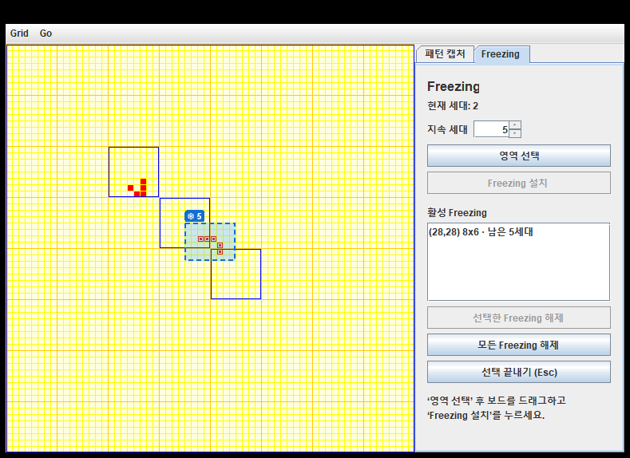
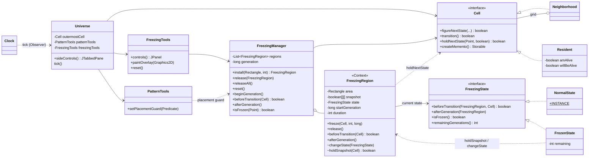

# Freezing 기능: 설계와 검증

사용자가 보드에서 사각형 영역을 지정하면, 그 영역의 셀이 **설치 순간의 상태 그대로 N세대 동안 유지**됩니다.
살아 있는 셀은 죽지 않고, 죽은 셀은 태어나지 않습니다.
기준 코드는 `experiment/capture-templates` 브랜치(Holub Life + 패턴 캡처)이고, 작업 브랜치는 `feature/freezing`입니다.
UI는 캡처 기능과 같은 오른쪽 패널 형식이며, **패턴 캡처** 탭과 **Freezing** 탭으로 나뉩니다.



---

## 0. 기존 구조 분석

| 항목 | 위치 | 내용 |
| --- | --- | --- |
| 세대 업데이트 | `Universe`의 `Clock.Listener.tick()` | `outermostCell.figureNextState(DUMMY x 8)`로 전체 셀의 다음 상태를 계산한 뒤 `transition()`으로 한꺼번에 전이합니다. 계산과 전이가 분리되어 있어 모든 셀이 같은 이전 세대를 기준으로 계산됩니다. |
| 생존·사망 판정 | `Resident.figureNextState()` | `willBeAlive = (neighbors==3 \|\| (amAlive && neighbors==2))` (B3/S23) |
| 계산 최적화 | `Neighborhood` | 변화가 없는 블록은 건너뛰고, `amActive`와 `activeEdges`로 인접 블록에 변화를 전파합니다. |
| GUI / 입력 | `Life`, `Universe`, `PatternTools` | 보드 클릭은 `userClicked`로 셀을 토글합니다. 캡처 브랜치에서 오른쪽 패널과 드래그 선택이 추가되었습니다. |
| 실행 / 정지 / 한 세대 | `Clock` | 캡처 브랜치에서 `javax.swing.Timer`로 바뀌어, 모든 세대 계산이 **Swing 이벤트 스레드**에서 실행됩니다. Go 메뉴는 Halt / Tick / 속도 선택입니다. |
| 초기화 | `Grid > Clear`, `Grid > Load` | `outermostCell.clear()`를 호출하고 상태를 복원합니다. |
| 세대 카운터 | 없음 | 원본에는 세대 카운터가 없어서 `FreezingManager`에 추가했습니다. Universe tick이 실제로 실행될 때마다 1씩 증가하며, 편집 모드에서 tick이 무시되면 증가하지 않습니다. |

---

## 1. 수정하거나 추가한 Java 파일

### 수정 (원본 대비 `git diff --stat`: 7개 파일, +119 / -7)

| 파일 | 변경 |
| --- | --- |
| `Cell.java` | `boolean holdNextState(Point location, boolean alive)` 추가. `DUMMY`는 `false` 반환 |
| `Resident.java` | `holdNextState` 구현: `willBeAlive`(계산된 다음 상태)만 바꾸고 `amAlive`는 그대로 둡니다. `figureNextState()`는 변경하지 않았습니다. |
| `Neighborhood.java` | `holdNextState`를 하위 셀로 위임합니다. 다음 상태가 바뀌었으면 `amActive = true`로 표시해서, 해제 직후 이 블록이 반드시 다시 계산되게 합니다. |
| `Universe.java` | 아래 표 참고 |
| `Life.java` | 오른쪽에 `patternControls()` 대신 `sideControls()`(탭)를 붙입니다. |
| `PatternTools.java` | 배치 가드 추가: Freezing 영역과 겹치는 템플릿 배치를 거부하고 미리보기를 빨강으로 표시합니다. |
| `build.ps1` | `-Test`에 `FreezingFeatureTest`, `-UiTest`에 `FreezingUiTest` 추가 |

`Universe.java` 변경 내용:

| 위치 | 변경 |
| --- | --- |
| 필드 | `FreezingTools freezingTools`, `JTabbedPane sideControls` |
| 생성자 | `FreezingTools`와 `FreezingManager`를 생성합니다. 영역 선택을 시작하면 캡처 모드를 끝내고 undo 이력을 비웁니다. `PatternTools`에 배치 가드를 연결합니다. |
| Esc | `cancel-editing` 동작으로 캡처나 Freezing 선택 중 켜져 있는 모드를 끝냅니다. |
| 마우스 | Freezing 선택 중에는 셀을 토글하지 않습니다. 고정된 칸을 클릭하면 바꾸지 않고 안내만 표시합니다. |
| Clock tick | 아래 3장 참고 |
| `Grid > Clear` / `Load` | `freezingTools.reset()`: 영역 제거, 세대 0 |
| `paintComponent` | 보드를 그린 뒤 Freezing 오버레이, 그 위에 캡처 오버레이를 그립니다. |
| 새 메서드 | `freezingControls()`, `freezing()`, `sideControls()`(탭 2개. 탭을 바꾸면 편집 모드 종료, 높이는 보드와 같게) |

### 추가

| 파일 | 역할 |
| --- | --- |
| `FreezingState.java` | State 인터페이스 |
| `NormalState.java` | 정상 상태 (싱글턴) |
| `FrozenState.java` | 고정 상태 (영역마다 카운트다운 하나) |
| `FreezingRegion.java` | Context: 영역, 스냅샷, 시작 세대, 지속 시간, 현재 상태 |
| `FreezingManager.java` | 영역 목록, 세대 카운터, 설치·해제·초기화, 세대 단계 호출 (Swing 없음) |
| `FreezingTools.java` | Freezing 탭 UI, 드래그 선택, 오버레이 그리기 |
| `test/.../FreezingFeatureTest.java` | 시나리오 A~F, 상태 전이, 무작위 기준 구현 비교 |
| `test/.../FreezingUiTest.java` | 실제 Swing 패널과 Universe tick 통합 검사 |

---

## 2. State 패턴 적용

| GoF 역할 | 클래스 | 하는 일 |
| --- | --- | --- |
| State | `FreezingState` | `beforeTransition(region, board)`, `afterGeneration(region)`, `isFrozen()`, `remainingGenerations()` |
| ConcreteState | `NormalState` | 아무것도 하지 않습니다. 계산된 B3/S23 결과가 그대로 적용됩니다. 상태가 없어서 `INSTANCE` 하나를 공유합니다. |
| ConcreteState | `FrozenState` | `beforeTransition`에서 영역의 다음 상태를 스냅샷으로 덮어씁니다. `afterGeneration`에서 남은 세대를 줄이고, 0이 되면 `region.changeState(NormalState.INSTANCE)`를 호출합니다. |
| Context | `FreezingRegion` | 세대 업데이트에서는 `state.beforeTransition(this, …)`와 `state.afterGeneration(this)`만 호출합니다. `if (frozen)` 분기가 없습니다. |

상태 전이:

```
          freeze(board, N, gen)            남은 세대 0 (afterGeneration)
NormalState ─────────────────▶ FrozenState ─────────────────────────────▶ NormalState
                                    │            release() (강제 해제)          ▲
                                    └──────────────────────────────────────────┘
```

설계 포인트:
- **형식적인 클래스 분리가 아닙니다.** 세대마다 `Universe`, `FreezingManager`, `FreezingRegion`, 현재 State 객체 순으로 호출이 이어집니다. 셀을 고정할지, 카운트다운할지, 해제할지는 모두 State 객체가 정합니다.
- **상태는 영역 단위입니다.** 셀마다 State 객체를 만들지 않습니다. `FrozenState`는 설치할 때 영역당 하나 만들어지고, `NormalState`는 공유 싱글턴입니다.
- **Conway 규칙을 다시 구현하지 않았습니다.** 생존 판정은 기존 `Resident.figureNextState()`가 그대로 합니다. Freezing은 계산된 결과를 전이 직전에 덮어쓰기만 합니다.
- 새 상태를 추가하기 쉽습니다. 예를 들어 "살아 있는 셀만 보호" 상태가 필요하면 `FreezingState` 구현 하나만 추가하면 되고, Universe와 Manager는 바꿀 필요가 없습니다 (OCP).

---

## 3. 세대 업데이트에서 Freezing을 처리하는 방법

`Universe`의 Clock 리스너 (Swing 이벤트 스레드):

```java
if (patternTools.isEditing() || freezingTools.isEditing()) return;   // 선택 중에는 진행 안 함
patternTools.boardChanged();
FreezingManager freezing = freezingTools.manager();
freezing.beginGeneration();                                     // ① 세대 카운터 +1
boolean unstable = outermostCell.figureNextState(DUMMY x 8);    // ② 기존 B3/S23 계산 (변경 없음)
boolean held = freezing.beforeTransition(outermostCell);        // ③ 각 영역 → State
if (unstable || held)                                           //    (Frozen이면 스냅샷 유지)
    if (outermostCell.transition()) refreshNow();               // ④ 기존 전이 (변경 없음)
freezing.afterGeneration();                                     // ⑤ 각 영역 → State: 카운트다운, Frozen → Normal
```

규칙별로 어떻게 보장되는지:

| 요구 사항 | 보장 방법 |
| --- | --- |
| 모든 셀은 같은 이전 세대를 기준으로 동시에 계산 | ②에서 모든 셀의 `willBeAlive`를 먼저 계산하고, ③은 그 결과만 바꿉니다. `amAlive`는 ④ 전까지 바뀌지 않습니다. |
| 내부의 살아 있는 셀은 죽지 않고, 죽은 셀은 태어나지 않음 | ③에서 `willBeAlive = 스냅샷 값`으로 덮어씁니다. |
| 내부의 살아 있는 셀은 외부 셀의 이웃 수에 포함됨 | 내부 셀의 `amAlive`는 실제로 살아 있으므로, ②의 이웃 계산에 그대로 포함됩니다. |
| 외부 셀은 내부 상태를 바꿀 수 없음 | 외부 영향은 내부 셀의 `willBeAlive`에만 반영되는데, ③에서 덮어쓰입니다. |
| 외부 셀은 B3/S23으로 정상 진화 | ②와 ④는 원본 그대로이고, ③은 영역 안의 셀만 건드립니다. |
| N세대 후 자동 해제, 다음 세대부터 정상 규칙 | ⑤에서 카운트다운이 끝나면 `NormalState`가 됩니다. 다음 tick의 ③은 아무것도 하지 않습니다. |
| 해제 직후 블록이 다시 계산됨 | 고정 중에 셀의 다음 상태가 바뀌면 `Neighborhood.amActive`가 유지되어, 해제 다음 tick에 그 블록이 계산됩니다. |
| 세대 카운터는 Freezing 중에도 증가 | ①이 Freezing과 상관없이 매 tick 실행됩니다. |
| 타이머/스레드와 충돌 없음 | 캡처 브랜치의 Swing Timer 구조를 그대로 쓰므로, 모든 계산·입력·그리기가 한 스레드에서 실행됩니다. |

`unstable || held`로 바꾼 이유: 원본 코드는 `figureNextState`가 `false`이면 `transition()`을 건너뜁니다. Freezing이 다음 상태를 덮어쓴 경우에도 전이가 일어나야 스냅샷이 반영되므로 조건을 하나 추가했습니다. 덮어쓴 셀이 없으면 원본과 똑같이 동작합니다.

세대 의미 예시 (스펙의 예): 카운터가 10일 때 5세대 Freezing을 설치하면 11, 12, 13, 14, 15세대 업데이트 동안 고정되고, 15세대가 끝날 때 해제됩니다. 16세대 업데이트부터는 정상 진화합니다. 테스트 E에서 그대로 검증합니다.

---

## 4. Freezing 설치와 해제 과정

### 설치
1. Freezing 탭에서 **지속 세대**를 정하고 **영역 선택**을 누릅니다. 이때 캡처 모드가 끝나고, 배치 undo 이력이 비워지고, Clock이 멈춥니다.
2. 보드를 드래그하면 셀 단위 사각형이 선택됩니다. 역방향 드래그도 되고, 보드 밖으로 드래그하면 가장자리에 맞춰집니다. 기존 Freezing과 겹치면 빨간 점선으로 표시되고 설치 버튼이 비활성화됩니다.
3. **Freezing 설치**를 누르면 `FreezingManager.install(area, N)`이 실행됩니다.
   - 보드 범위로 자르고, 빈 영역, 지속 세대 1 미만, 겹침을 검사합니다.
   - `new FreezingRegion(area).freeze(board, N, generation)`이 호출됩니다. 기존 Memento로 영역 안의 **모든 셀(살아 있는 셀과 죽은 셀)** 상태를 스냅샷하고, `NormalState`에서 `FrozenState(N)`으로 전환합니다.
4. 보드에 하늘색 반투명 배경, 파란 점선 테두리, 파란 `❄ N` 배지가 표시되고, 활성 목록에 `(x,y) w x h · 남은 N세대`가 추가됩니다.

### 해제
| 방법 | 처리 |
| --- | --- |
| 자동 | 매 세대 ⑤에서 `FrozenState`가 카운트다운하고, 0이 되면 `NormalState`로 전환합니다. Manager가 목록에서 제거하고, 오버레이도 사라집니다. |
| 선택한 Freezing 해제 | `manager.release(region)`이 `region.release()`로 `NormalState`로 바꾸고 목록에서 제거합니다. |
| 모든 Freezing 해제 | `manager.releaseAll()` |
| `Grid > Clear` / `Load` | `freezingTools.reset()`: 선택 모드를 끝내고, 모든 영역을 제거하고, 세대 카운터를 0으로 만듭니다. |

### 편집 보호
- Freezing 영역 안의 셀을 클릭하면 상태가 바뀌지 않고 "해제 전까지 바꿀 수 없습니다"라는 안내가 나옵니다.
- 패턴 캡처 탭에서 Freezing 영역과 겹치는 템플릿 배치는 거부됩니다.
- 혹시 다른 경로로 내부 셀이 바뀌더라도, 다음 세대에 ③에서 스냅샷으로 되돌아갑니다.

---

## 5. 기존 Life 규칙이 유지된다는 검증 결과

`powershell -File .\build.ps1 -UiTest` 실행 결과 (모두 통과):

```
All 10 behavioral scenarios passed.                       ← 기존 캡처 테스트 (변경 없이 통과)
PASS A frozen live cells do not die
PASS B frozen dead cells are not born
PASS C cells outside Freezing follow B3/S23
PASS D frozen live cells are counted by outside neighbors
PASS E automatic release after N generations, counter keeps counting
PASS F forced release, release all, and reset clean up state
PASS State transitions Normal -> Frozen -> Normal, overlap/duration/bounds validation
PASS 3000 random generations match an independent Life + Freezing reference
All 8 Freezing scenarios passed.
PASS 14 Swing integration checks ...                      ← 기존 캡처 Swing 테스트 (변경 없이 통과)
PASS 20 Freezing Swing checks: tabs, select, reverse drag, install, overlap, Esc,
     blocked click, ticks, auto release, placement guard, forced release, Grid > Clear.
```

| 테스트 | 상황 | 확인 내용 |
| --- | --- | --- |
| A 살아 있는 셀 고정 | 이웃이 0인 고립 셀 (원래 다음 세대에 죽음) | 3세대 동안 살아 있음. 영역 밖의 고립 셀은 정상적으로 죽음 |
| B 죽은 셀 고정 | L자 3셀의 빈 모서리 (원래 다음 세대에 탄생) | 4세대 동안 죽은 상태 유지 |
| C 외부 정상 진화 | 영역 밖 블링커와 영역 안 블링커 | 밖은 매 세대 정상 진동하고, 안은 수평 상태로 고정 |
| D 경계 상호작용 | 고정 셀 2개(중첩 Neighborhood 경계 x=7/8에 걸침)와 외부 셀 1개 | 외부의 빈 칸이 이웃 3개로 탄생함. 고정 셀이 이웃 수에 포함된다는 뜻 |
| E 자동 해제 | 세대 10에 5세대 설치 | 11~15세대 유지, 카운터는 계속 증가, 15세대 후 `NormalState`, 16세대에 정상 소멸 |
| F 강제 해제·초기화 | 영역 2개 중 1개 해제, 그다음 reset, releaseAll | 해제된 영역만 바로 진화하고, reset 후 영역 0개와 세대 0 |
| 무작위 비교 | 12개 보드 × 250세대, 무작위 설치와 강제 해제 | 매 세대 64×64 전체를 독립 구현 `next = B3/S23(prev)` + 고정 셀 = 스냅샷과 셀 단위로 비교. **3,000세대 불일치 0건** |

기존 `PatternFeatureTest`의 "360 random-board generations match an independent Life implementation"도 그대로 통과합니다. Freezing이 없을 때 원본 규칙이 바뀌지 않았다는 뜻입니다.

---

## 6. 실행 방법

JDK 17 이상이 필요합니다.

```powershell
.\run.cmd                                       # 빌드 후 실행
java -jar build\HolubLife.jar                   # 빌드된 JAR 실행
powershell -NoProfile -ExecutionPolicy Bypass -File .\build.ps1 -Test     # 동작 테스트
powershell -NoProfile -ExecutionPolicy Bypass -File .\build.ps1 -UiTest   # + Swing 통합 테스트
```

시연 순서:
1. 셀 몇 개를 그리거나, 패턴 캡처 탭에서 Glider나 Beacon을 배치합니다.
2. Freezing 탭으로 이동해 지속 세대를 5로 정합니다.
3. **영역 선택**을 누르고, 패턴 일부가 들어가게 드래그한 뒤 **Freezing 설치**를 누릅니다.
4. **Go > Tick**을 여러 번 누릅니다. 영역 안은 그대로이고, 밖은 진화하고, 배지 숫자가 줄어듭니다.
5. 5세대 뒤 표시가 사라지고 영역 안도 다시 진화합니다.
6. **선택한 Freezing 해제**나 **Grid > Clear**로 강제 해제·초기화를 확인합니다.

---

## 7. UML 클래스 다이어그램


