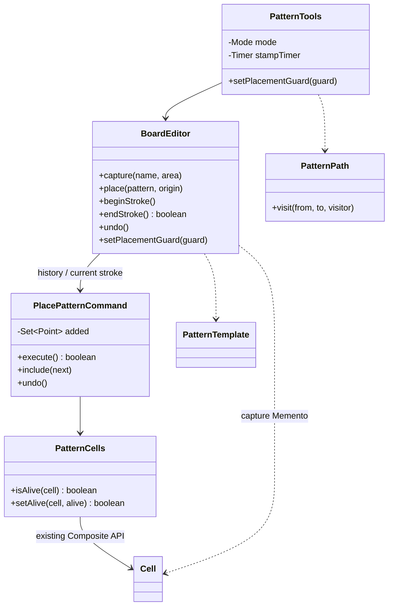
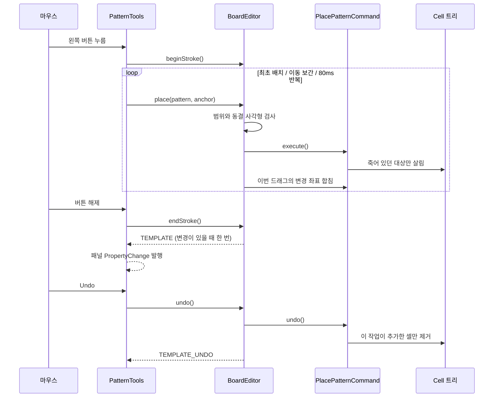

# 템플릿 드래그 배치 설계·검증 기록

## 문제와 범위

기준은 dev `5600239`다. 일반 셀 그리기에는 드래그가 있지만 템플릿은 mousePressed에서 한 번만 배치됐다.
사용자는 왼쪽 버튼을 누른 채 같은 위치에 계속 찍거나, 이동하면서 여러 위치에 찍기를 원했다.
캡처는 색·나이·프리징을 저장하지 않고 살아 있는 셀 모양만 저장한다는 합의를 유지한다.

이번 보완은 캡처 브랜치의 후속 PR이다. dev나 프리징·통계 브랜치에는 직접 push하지 않는다.
회의록의 남은 순서인 프리징 → 통계를 유지하며, 이 보완을 먼저 검토할 수 있도록 연결 계약을 정리한다.

## 사용자 동작

- 선택한 템플릿의 왼쪽 위가 마우스 칸에 놓인다. 한 칸짜리 템플릿도 같은 규칙이다.
- 누르는 즉시 한 번 배치한다. 누르고 있으면 Swing Timer가 80ms 간격으로 현재 위치에 배치를 시도한다.
- 이동 이벤트 사이를 보간해 빠른 이동에도 기준점이 빠지지 않는다. 기준점 간격은 한 칸이며 템플릿끼리 겹칠 수 있다.
- 이미 살아 있는 셀은 유지한다. 같은 위치의 반복 시도는 생사·나이·Undo 이력을 바꾸지 않는다.
- 빈칸은 투명하다. 범위를 벗어나는 템플릿은 그 한 번의 배치 전체를 거부한다.
- 버튼 해제·창 포커스 상실·컴포넌트 제거·모드 전환 시 반복을 멈춘다. 보드 밖에 있는 동안은 찍지 않는다.
- 보드를 벗어났다 돌아오면 바깥 구간을 가로질러 보간하지 않는다. 버튼을 놓았다면 새로 눌러야 한다.
- 클릭 한 번 또는 누름부터 해제까지 드래그 한 번이 Undo 한 건이다. 겹쳤던 기존 셀은 되돌리지 않는다.
- Esc는 편집 종료다. 이미 적용한 배치는 남기고 하나의 작업으로 확정한다. 되돌리기는 Undo가 담당한다.
- 일반 그리기 모드에서 Esc·오른쪽 클릭은 시계를 멈추지 않는다.

## 변경 전후와 선택한 대안

| 문제 | 이전 | 이번 선택 | 다른 대안과 판단 |
|---|---|---|---|
| 보드 수정 | Command가 가상 화면 좌표로 userClicked를 직접 호출 | PatternCells가 조회 후 필요한 셀만 편집 | Cell.setAliveAt을 공용 인터페이스에 추가하면 프리징·통계 브랜치의 병합 범위가 커져 보류 |
| Undo 상태 | 전체 보드 Memento 저장·전체 칸 비교 | 새로 살아난 좌표만 Set에 기록 | 나이까지 담는 전체 스냅샷은 완전한 게임 Undo에는 유리하지만 추가 배치에는 범위가 큼 |
| 이동 입력 | 클릭 한 번만 처리 | 누름·드래그·해제와 반복 Timer | mouseDragged만 쓰면 마우스를 가만히 누르고 있는 요구를 표현하지 못함 |
| 빠른 이동 | 샘플 위치만 찍음 | 두 샘플 사이의 칸을 정수 좌표로 보간 | 템플릿 폭만큼 띄워 찍는 방식은 도장 배열 기능에 가깝고 이번 한 칸 기준 이동 요구와 다름 |
| Undo 단위 | 각 배치 한 번 | 드래그 중 Command의 변경 좌표를 합침 | 타이머마다 이력을 넣으면 한 번의 드래그를 수십 번 Undo해야 함 |
| 제약 검사 | 프리징 PR에서 mousePressed에 검사 | BoardEditor에서 모든 배치 검사, UI 미리보기에도 동일 조건 | UI에만 두면 Timer·보간·직접 모델 호출이 제한을 우회할 수 있음 |
| 통계 연결 | 배치 후 repaint만 수행 | 완료된 편집 종류를 콜백으로 전달 | Command가 Statistics를 직접 호출하면 모델이 다른 기능에 결합됨 |

PatternCells는 기존 Composite의 userClicked 경로를 재사용한다. 그 경로의 이웃 재계산과 나이 초기화 동작을 유지한다.
실제 게임 코드에 테스트용 접근 메서드를 추가하지 않는다. 공용 Cell, Universe, Clock, Life, Resident는 이번 PR에서 수정하지 않는다.

## 객체 구조



Command 패턴은 실제로 추가한 셀의 변경을 캡슐화한다. Memento는 캡처 조회와 기존 파일 저장·복원에 남아 있으며 배치 Undo에서는 제거했다.
PatternTools의 모드 enum과 프리징 State 패턴을 혼동하지 않는다. 패턴 이름을 늘리기 위한 상속 계층은 추가하지 않았다.

## 이벤트와 Undo 흐름



- BoardEditor는 `Consumer<EditKind>`를 받으며, PatternTools는 이를 JPanel의 표준 PropertyChange로 전달한다.
- 속성 이름은 `TEMPLATE`, `TEMPLATE_UNDO`다. 값의 false→true는 변경 완료 신호이고 게임판 데이터 자체는 아니다.
- 콜백은 실제 보드 변경 뒤, UI 경로에서는 EDT에서 실행된다. 구독자는 그 시점의 보드를 읽는다.
- 드래그 동안은 세대 진행이 차단된다. 완료 알림이 세대 번호를 증가시키지 않는다.
- 무변경 배치·거부·빈 Undo·셀 변경 없는 캡처/저장은 알림이 없다.
- Undo가 가능한 최대 100건의 실제 작업만 보관한다. 일반 편집·세대 진행·Clear·Load는 기존 boardChanged 경로로 이력을 무효화한다.

## 프리징 PR #7과의 연결

검토한 head: `ee1e763`. 기존 연결 코드는 그대로 사용할 수 있다.

```java
patternTools.setPlacementGuard(area -> freezingTools.manager().overlapsFrozen(area));
```

제한의 의미도 유지한다. 살아 있는 칸만이 아니라 빈 여백까지 포함한 템플릿 사각형이 동결 영역과 겹치면 그 한 번의 찍기를 거부한다.
한 드래그가 금지 영역을 통과하면 허용된 위치는 배치하고 금지된 위치는 건너뛴다. Undo는 실제 추가된 셀만 되돌린다.

시험 병합에서 기존 dev와 #7의 충돌은 `.gitignore`, `README.md`, `build.ps1`, `Resident.java`, `Universe.java`에 있었다.
이번 캡처 보완은 `PatternTools.java` 조정이 추가된다. #7 쪽 이 파일의 변경은 배치 guard·setter·미리보기 검사이며,
이번 버전에는 같은 계약이 모델까지 적용되어 있다. 후속 병합에서는 **이 PR의 PatternTools 버전과 #7의 Universe guard 연결을 함께 유지**한다.
옛 mousePressed 전용 검사로 되돌리면 반복 Timer와 보간 배치가 검사를 우회할 수 있다.
탭 전환 시 cancel/boardChanged로 활성 드래그를 종료하고 이력을 비우는 #7의 연결도 유지한다.

## 통계 PR #10과의 연결

검토한 head: `4021231`. 통계가 dev에 들어온 뒤 기존 Universe 완료 알림에 다음과 같이 연결한다.
아래는 **후속 병합용 코드이며 이번 PR에서 실행 중인 통계 연결은 아니다.**

```java
universe.patternControls().addPropertyChangeListener("TEMPLATE",
    e -> universe.notifyBoardChanged(BoardChangeEvent.Kind.TEMPLATE));
universe.patternControls().addPropertyChangeListener("TEMPLATE_UNDO",
    e -> universe.notifyBoardChanged(BoardChangeEvent.Kind.TEMPLATE_UNDO));
```

초기 조립 때 한 번 등록하고, 탭을 바꿀 때마다 중복 등록하지 않는다. 한 번의 드래그 완료당 한 번만 알린다.
실제 Statistics와의 통합 검사는 그 PR 병합 단계에서 배치 후 생존 수, Undo 후 복원, 다음 세대 탄생·사망 계산으로 확인한다.
시험 병합의 통계 충돌 파일 목록은 보완 전후 동일했다. 공용 클래스 변경을 피했지만 기존 충돌 자체가 사라졌다는 의미는 아니다.

## 검증

환경: Windows, JDK 17.0.6, Gradle Wrapper 9.5.1, JUnit Jupiter 6.0.3.
최종 전체 JUnit 145개, 실패·오류·건너뜀 0. 실제 Swing 검사 17개 통과. 실행용 JAR 빌드 확인.
145는 색상·일반 드래그·사운드 등 기존 검사까지 포함한 전체 수이며 모두 캡처 신규 검사는 아니다.
기존 캡처 시나리오 10개를 독립 JUnit 검사로 분리한 것은 새 시나리오 10개를 추가했다는 뜻이 아니다.

| 검사 | 목적 |
|---|---|
| PatternFeatureTest | 기존 캡처·파일·Undo·경계·독립 Life 계산 시나리오를 서로 독립 실행 |
| PatternCellsTest | 행/열 방향, 동일 상태 편집의 무변경, 범위 검증 |
| PatternHistoryTest | 변경 좌표 Undo, 중첩 보존, 실제 작업 100건 제한, 드래그 묶음과 이력 무효화 |
| PatternPathTest | 가로·세로·대각선·역방향·같은 위치의 보간 |
| PatternToolsTest | 실제 Swing 컴포넌트와 Timer, 연속 찍기, 경계·포커스 종료, 일반 모드 취소, 색상 보존 |
| PatternCompletionTest | 완료된 상태에서 한 번 알림, 무변경·거부 알림 제외, 모델 수준 동결 사각형 제한 |
| PatternUiTest | 실제 Universe와 캡처 저장 대화상자·배치·Undo, 드래그 중 틱 차단, 드래그 전체 복원 |

```powershell
.\gradlew.bat test patternUiTest --no-daemon --console=plain
powershell -NoProfile -ExecutionPolicy Bypass -File .\build.ps1
```

Swing 검사는 데스크톱 환경이 필요하다. `build/life-template-drag.png`와 `build/life-template-drag-undo.png`를 생성한다.
이 PC에서는 기존 테스트 결과 폴더 잠금 때문에 단계별 별도 빌드 폴더로 검증했다. 테스트 선택과 assertion은 저장소 설정 그대로 사용했다.
프리징 제약은 같은 Predicate 계약으로 검증했고, 통계는 완료 알림 계약까지 검증했다. 두 PR 전체를 실제로 병합한 검증으로 표시하지 않는다.

## 열 번의 커밋

1. 기존 시나리오의 독립 JUnit 실행
2. 캡처 내부 셀 좌표 편집 분리
3. 실제 변경 좌표를 기록하는 Command Undo
4. 버튼을 누른 동안 템플릿 반복 찍기
5. 빠른 드래그 경로 보간
6. 한 번의 드래그를 한 번의 Undo로 묶기
7. 버튼 해제·포커스 상실 시 반복 종료
8. 일반 모드의 불필요한 취소·시계 정지 방지
9. 프리징 guard·완료 알림 연결 계약과 통합 회귀 검사
10. 사용법·설계 대안·검증·후속 병합 기록

각 구현 커밋은 관련 테스트 통과 뒤 생성했다. 시간 간격이나 줄 수를 늘리기 위한 커밋은 넣지 않았다.
