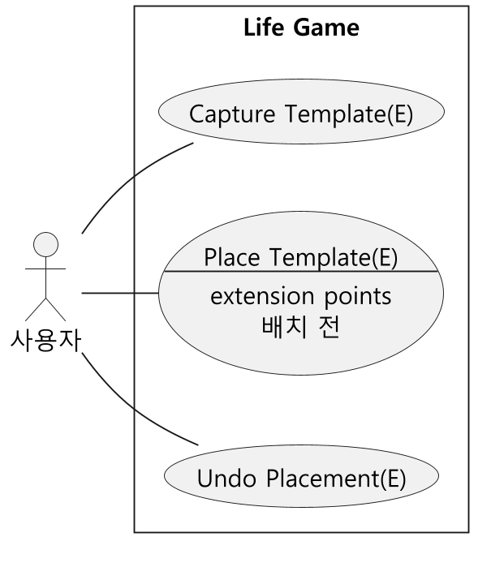
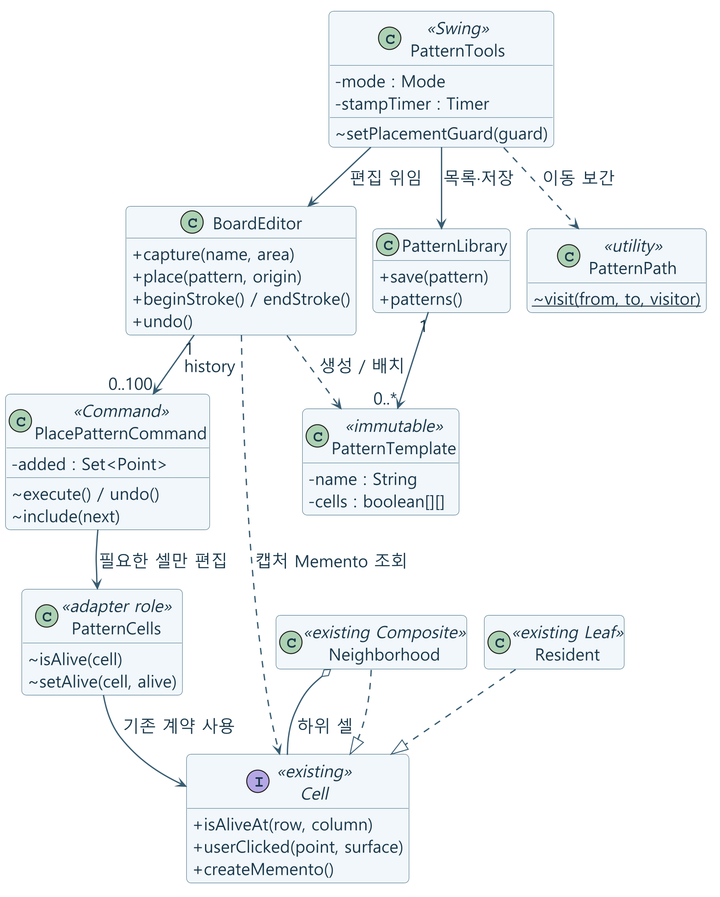
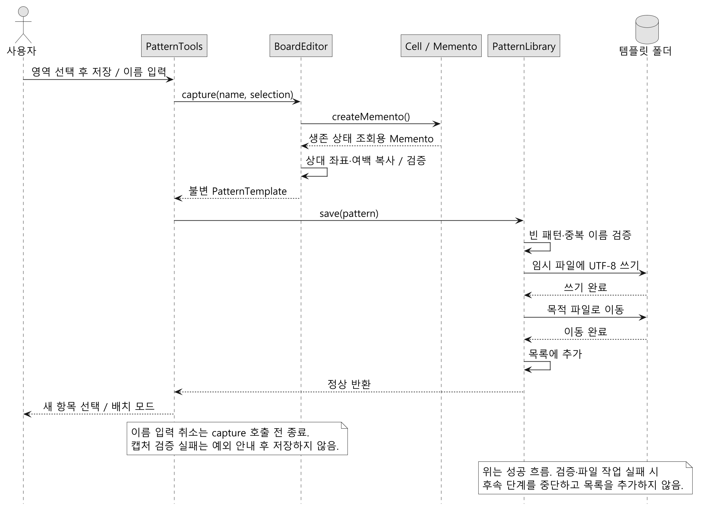
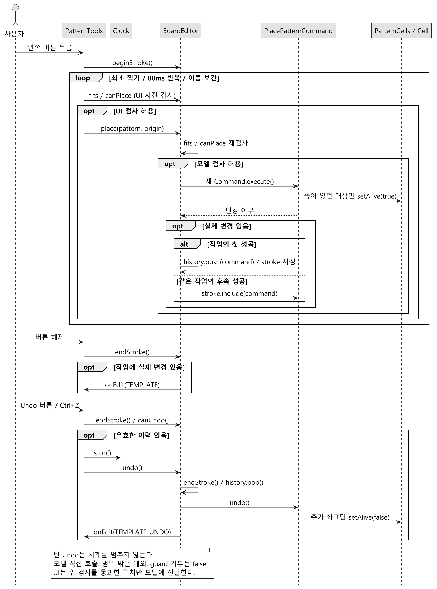
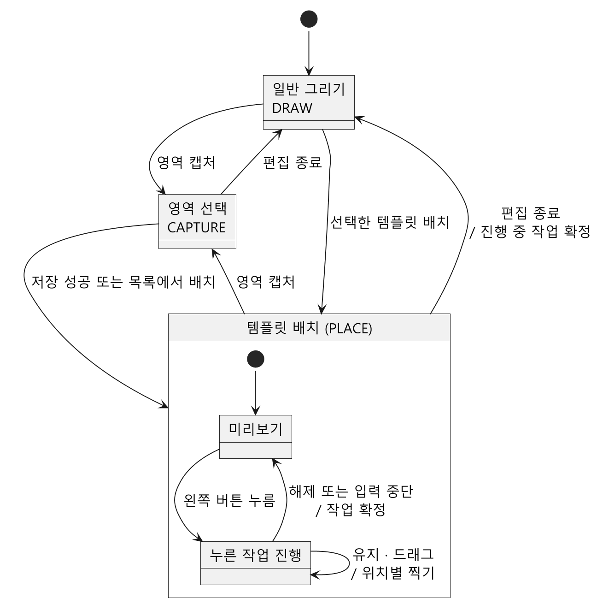
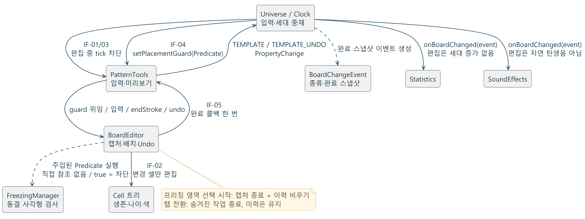

# 캡처와 템플릿 상세 문서

영역의 생존 모양을 저장하고 재사용하는 캡처 기능의 기준 문서다. 기능 요구, 설계 선택, 타 기능 연결, 테스트 근거를 한곳에서 관리한다.

- 문서 확인일·기능 검사 실행일: 2026-11-26 (Asia/Seoul).
- 전체 JUnit **375**회, Pattern 계열 **39**회 포함, 실패·오류·건너뜀 0. 별도 Swing **17 checks** 통과.
- 팀 보고서용: [캡처 기능 명세 및 설계](capture.md). 이 상세 문서는 전체 근거와 유지보수 설명을 보관한다.
- 실행 방법: [프로젝트 README](../../README.md). 코드·테스트 기준이 바뀌면 해당 계약과 결과를 함께 갱신한다.

## 목차

1. [사용법과 저장 범위](#usage)
2. [기능 명세와 유스케이스](#spec)
3. [설계와 GoF 패턴](#design)
4. [연산 계약](#contracts)
5. [타 기능 통합](#integration)
6. [검증 방법과 실행 결과](#verification)
7. [전체 테스트 케이스](#test-cases)
8. [UML과 도식](#diagrams)
9. [요구사항 추적표](#traceability)
10. [문서와 그림 관리](#artifacts)

<a id="usage"></a>

## 사용법과 저장 범위

1. 보드의 셀을 클릭해 살아 있는 셀을 그린다. 보드는 64 x 64다.
2. **영역 캡처**를 누르고 보드에서 드래그한다. 역방향 드래그도 되고, 바깥으로 드래그하면 보드 끝에 맞춰진다.
3. **선택 영역 저장**을 누르고 이름을 입력한다. 선택한 사각형의 크기와 빈 여백도 유지된다.
4. 저장 직후 보드를 클릭하면 캡처한 패턴이 배치된다. 목록에서 다른 템플릿을 고른 뒤 **선택한 템플릿 배치**를 눌러도 된다.
5. 클릭한 칸이 패턴의 왼쪽 위가 된다. 초록 미리보기는 배치 가능, 빨강은 범위 또는 연결된 배치 제한에 걸린 상태다. 왼쪽 버튼을 누르고 있으면 현재 위치에 반복해서 찍고, 이동하면 경로를 따라 찍는다.
6. **배치 되돌리기** 또는 `Ctrl+Z`로 최근 클릭 또는 드래그 한 번 전체를 되돌린다. 실제 변경이 있는 작업을 최대 100회까지 보관한다.
7. **Esc**, 오른쪽 클릭, **편집 끝내기**로 일반 그리기 모드로 돌아간다. **Go > Slow / Medium / Fast**로 진행하고 **Halt**로 멈춘다. **Tick (Single Step)**은 한 세대만 진행한다.

같은 곳에 반복해서 찍어도 기존 셀을 지우거나 나이를 초기화하지 않는다. 새 셀만 나이 0으로 추가된다.
드래그가 끝날 때까지 적용한 셀은 유지되며, Esc는 편집을 종료한다. 이미 찍은 것을 취소하려면 Undo를 사용한다.
일반 그리기 모드의 Esc·오른쪽 클릭은 시뮬레이션을 멈추지 않는다.

캡처·배치 모드에서는 시뮬레이션이 멈춘다. 편집을 끝낸 뒤 Go 메뉴에서 다시 시작한다.
템플릿의 살아 있는 셀만 추가하므로 빈 칸이 기존 셀을 지우지 않는다.
패턴이 보드 밖으로 나가면 전체 배치를 거부한다. 빈 영역과 중복 이름은 저장하지 않는다.
실제 일반 셀 변경, 세대 진행, Grid > Clear / Load 성공 이후에는 오래된 배치 이력을 비운다.
기존 **Grid > Store / Load**는 전체 보드를 `.life` 파일로 저장하고 불러오는 별도 기능이다.

기본 템플릿은 Glider, Blinker, Block, Toad, Beacon이다.
사용자가 저장한 패턴은 저장소의 `templates/*.lifepattern`에 남고, 다음 실행 때 자동으로 읽는다.
`templates/`와 `build/`는 Git에서 제외된다. 새 템플릿 파일은 UTF-8 텍스트이며 `O`는 살아 있음, `.`은 빈 칸이다.
테스트나 별도 보관 폴더가 필요하면 `java "-Dlife.templates=경로" -jar build\HolubLife.jar`로 지정할 수 있다.

<a id="spec"></a>

## 기능 명세와 유스케이스

### 1. 해결하려는 문제와 범위

반복해서 사용할 셀 모양을 매번 직접 그리면 배치가 번거롭다. 보드의 일부를 사각형으로 선택해 이름 있는 템플릿으로 저장하고, 원하는 위치에 재사용한다. 일반 셀 드래그가 병합된 뒤 템플릿은 클릭에서만 배치됐으므로, 왼쪽 버튼을 누른 동안 반복하고 이동 경로를 따라 찍도록 보완했다.

사용자가 지정한 기준은 **색상과 무관하게 살아 있는 셀 모양을 저장**하는 것이다. 나이·색·동결 상태는 템플릿에 넣지 않는다. 전체 게임 상태 저장은 기존 Grid > Store/Load의 역할로 남긴다.

### 2. 요구사항과 수용 조건

| ID | 요구사항 | 관찰 가능한 수용 조건 |
|---|---|---|
| R-01 | 선택 영역의 생존 모양 캡처 | 원본 보드는 변하지 않으며 선택 크기·여백·상대 좌표를 보존한다. 역방향 선택과 보드 끝 보정이 가능하다. |
| R-02 | 템플릿 검증·파일 저장·재로딩 | 이름과 직사각형을 검증한다. 빈 캡처·중복 이름을 거부한다. 저장에 성공한 뒤 목록에 추가한다. 손상 파일이 정상 파일의 로딩을 막지 않는다. |
| R-03 | 비파괴 단일 배치 | 마우스 칸을 왼쪽 위로 삼고 살아 있는 대상만 추가한다. 템플릿 빈칸은 투명하고 기존 생존 셀의 나이·색을 유지한다. |
| R-04 | 누름·드래그 연속 배치 | 누르는 즉시 배치하고 80ms Timer로 현재 위치를 재시도한다. 빠른 이동 구간의 기준점은 한 칸씩 보간한다. 마우스 이동만으로는 배치하지 않는다. |
| R-05 | 범위·제약의 일관된 검사 | 템플릿 사각형 전체가 보드 안에 있어야 한다. 연결된 guard가 거부하면 그 한 번의 찍기 전체를 거부한다. 미리보기와 실제 배치가 같은 조건을 쓴다. |
| R-06 | 한 번의 작업을 한 번에 Undo | 누름부터 해제까지 추가한 셀만 복원한다. 기존 셀은 남긴다. 무변경 반복은 이력을 늘리지 않으며 실제 작업 최대 100건을 저장한다. |
| R-07 | 입력 종료와 편집 취소 | 해제·포커스 상실·컴포넌트 제거로 반복을 멈춘다. Esc/오른쪽 클릭/편집 끝내기는 모드를 종료하고 적용한 셀을 남긴다. 일반 모드의 취소는 시계를 정지시키지 않는다. |
| R-08 | 기존 기능과 상태 일관성 | 편집 모드에서는 세대 진행을 막는다. 실제 일반 셀 변경·세대 진행·Clear/Load 성공은 과거 배치 이력을 비운다. 생명 규칙·색상·일반 드래그·기존 저장 기능을 보존한다. |
| R-09 | 완료 알림과 타 기능 연결 | 실제 변경이 있는 드래그 종료에 TEMPLATE 한 번, 실제 Undo에 TEMPLATE_UNDO 한 번을 전달한다. 캡처·무변경·거부에는 알리지 않는다. 통계 세대 증가와 구분한다. |

### 3. 유스케이스 상세

주 액터 이름은 사용자다. 파일 저장은 내부 협력 동작이며 별도의 인간 액터로 모델링하지 않는다. 도식에는 전체 시스템 유스케이스 다이어그램에서 가져온 캡처 담당의 사용자 목표 세 개만 표시한다.

| ID | 이름 | 사용자 관점의 의미 |
|---|---|---|
| E-01 | Capture Template(E) | 선택 영역의 생존 모양을 템플릿으로 저장 |
| E-02 | Place Template(E) | 선택한 템플릿을 한 위치 또는 드래그한 경로에 배치 |
| E-03 | Undo Placement(E) | 마지막 배치 작업 되돌리기 |

`E-01` 등의 ID는 본문의 요구사항 추적용이며 유스케이스 이름의 일부가 아니다. 그림에서는 앞 번호를 빼고 이름 끝의 `(E)`로 확장 기능을 표시한다. 누른 채 연속 배치는 같은 템플릿을 놓는 입력 방식이므로 E-02의 흐름에 포함하고, 편집 종료는 캡처와 배치의 공통 종료 흐름으로 아래에 따로 적는다.


#### E-01 Capture Template(E)

- 목표/전제: 화면의 생존 모양을 재사용한다. 보드가 열려 있다.
- 기본 흐름: 영역 캡처 선택 → 시계 정지 → 드래그로 영역 선택 → 선택 영역 저장 → 이름 입력 → 생존 모양 추출 → 파일 저장 → 목록 선택 → 배치 모드 진입.
- 대안: 이름 입력 취소는 저장하지 않고 선택을 남긴다. 빈 영역·잘못된 이름·중복 이름·I/O 오류는 안내하고 목록을 늘리지 않는다.
- 사후 조건: 성공 시 `.lifepattern` 파일과 목록 항목이 생긴다. 원본 셀은 바뀌지 않는다.
- 연결: R-01, R-02, R-08.

#### E-02 Place Template(E)

- 전제: 기본 또는 사용자 템플릿이 선택돼 있다.
- 기본 흐름: 배치 버튼/목록 더블클릭 → 시계 정지 → 미리보기 이동 → 왼쪽 버튼 누름 → 범위·guard 검사 → 죽어 있던 대상 셀만 살림 → 버튼을 유지하면 같은 위치를 주기적으로 재시도하고, 끌면 이전 기준점부터 현재 기준점까지 보간해 각 기준점을 따로 검사·배치 → 해제하여 작업 확정.
- 대안: 경계 밖 또는 guard 거부는 그 위치의 보드·Undo를 바꾸지 않는다. 이미 같은 생존 모양이면 무변경이다. 드래그 중 보드 밖에서는 찍지 않고 보간 기준점을 비우며, 버튼을 유지해 돌아오면 바깥을 가로지르는 선을 연결하지 않는다. 포커스를 잃었으면 다시 눌러야 한다.
- 사후 조건: 새 셀은 나이 0이며 기존 셀의 나이·색은 유지된다. 허용된 위치의 변경만 한 작업에 묶이며, 금지 위치를 지나도 허용된 위치의 배치는 취소되지 않는다. Undo 가능한 실제 변경만 기록된다.
- 연결: R-03, R-04, R-05, R-06, R-07, R-09.

#### E-03 Undo Placement(E)

- 전제: 배치 이력이 있다. 버튼 또는 Ctrl+Z로 실행한다.
- 기본 흐름: 활성 드래그 종료 → 시계 정지 → 마지막 Command가 기록한 추가 셀만 제거 → Undo 완료 알림 → 화면 갱신.
- 대안: 빈 이력은 아무 변경도 하지 않는다. 일반 편집·세대 진행 뒤에는 이력이 무효화돼 이전 배치를 되돌릴 수 없다.
- 사후 조건: 그 작업 전부터 있던 셀은 보존되고, 같은 작업의 중복 좌표는 한 번만 복원된다.
- 연결: R-06, R-08, R-09.

#### 공통 종료 흐름: 캡처·배치 편집 종료

- 적용: E-01과 E-02의 편집 중 언제든 일어난다. Esc, 오른쪽 클릭, 편집 끝내기로 요청한다.
- 흐름: 활성 반복과 전역 리스너 종료 → 작업 확정 → 선택/미리보기 초기화 → DRAW로 복귀.
- 사후 조건: 적용된 배치는 남아 Undo할 수 있다. 자동 재생하지 않으며 사용자가 Go 메뉴로 다시 시작한다.
- 예외: 이미 DRAW라면 부작용 없이 반환한다. 이는 보드 변경을 되돌리는 취소가 아니다.
- 연결: R-07, R-08.

### 4. 제공하지 않는 범위

템플릿 회전·반전·크기 조절, 잘라내기, 덮어쓰기, Redo, 임의 과거 세대로 되돌리기, 색·나이·동결 상태 복제는 현재 기능이 아니다. 이러한 동작은 별도 요구와 Undo 정책 검토가 필요하다.

### 5. 구현 근거

| 책임 | 실제 소스 |
|---|---|
| 입력·선택·미리보기·모드 | [PatternTools.java](../../src/com/holub/life/PatternTools.java) |
| 캡처·제약·이력 | [BoardEditor.java](../../src/com/holub/life/BoardEditor.java) |
| 불변 템플릿·저장 | [PatternTemplate.java](../../src/com/holub/life/PatternTemplate.java), [PatternLibrary.java](../../src/com/holub/life/PatternLibrary.java) |
| 추가 좌표 Undo·셀 편집·보간 | [PlacePatternCommand.java](../../src/com/holub/life/PlacePatternCommand.java), [PatternCells.java](../../src/com/holub/life/PatternCells.java), [PatternPath.java](../../src/com/holub/life/PatternPath.java) |

[소스 폴더](../../src/com/holub/life)에서 같은 이름을 확인할 수 있다.

<a id="design"></a>

## 설계와 GoF 패턴

### 1. 설계 문제와 개선 방향

| 설계 문제 | 선택한 구조 | 이유 |
|---|---|---|
| 읽기와 저장의 혼합 | Memento로 영역을 읽고 불변 템플릿·파일 저장을 분리 | 캡처가 원본 보드나 저장 실패의 영향을 받지 않음 |
| 전체 보드 복원의 부작용 | 추가한 좌표만 기록하는 Command | 관련 없는 셀의 나이·색을 보존 |
| 정지 입력과 빠른 이동의 누락 | 누름 Timer와 경로 보간을 분리 | 멈춰 누르기와 이동 중 빈 구간을 각각 처리 |
| 한 드래그에 여러 번 필요한 Undo | 누름부터 해제까지 한 작업으로 묶음 | 사용자의 한 제스처와 한 번의 복원이 대응 |
| 숨겨진 반복 입력과 타 기능 결합 | 종료 경로·모델 guard·완료 콜백 분리 | 포커스 상실을 처리하고 UI 입력 방식과 무관하게 제약·알림을 유지 |

초기 전체 복원은 단순했지만 `Resident`의 복원 과정이 나이를 보존하지 않는다. 추가 배치의 Undo를 위해 관련 없는 셀까지 복원할 필요도 없다. 현재 설계는 실제 변경 좌표만 기록하는 쪽으로 책임과 복원 범위를 좁혔다.

원본 기능·구조는 기능 확장 전 Holub 코드를 뜻한다. 현재 게임은 [기본 오류 수정](../original-improvements.md#1-기능-오류-수정)을 포함한다. 수정된 상태 보고·저장 동작은 원본과 구분하며, 캡처의 회귀 검사는 오류를 고친 현재 셀 동작을 기준으로 한다.

### 2. 객체의 책임과 경계

| 객체 | 책임 | 맡기지 않는 책임 |
|---|---|---|
| `PatternTools` | Swing 입력, 모드, Timer, 좌표 변환, 선택/배치 미리보기, 상태 안내 | 파일 포맷, 셀 변경 이력의 내용, 생명 규칙 |
| `BoardEditor` | 캡처, 범위·guard 검사, 작업 묶음, 최대 100건 이력, 완료 콜백 | 마우스 픽셀, 대화상자, 통계 계산 |
| `PlacePatternCommand` | 새로 살아난 좌표를 기록·병합하고 그 좌표만 Undo | GUI, 파일 저장, 세대 계산 |
| `PatternCells` | `Point(x,y)`와 `Cell.isAliveAt(row,column)` 사이의 편집 어댑터 | 공용 Cell API 확장, 색상 정책 결정 |
| `PatternPath` | 두 마우스 샘플 사이의 정수 기준점 열거 | 보드 수정, Timer, Undo |
| `PatternTemplate` | 이름·크기·생존 배열의 불변 값, 입력 검증 | 상속에 의한 알고리즘 재정의, 색·나이 저장 |
| `PatternLibrary` | 기본 목록, 사용자 파일 입출력, 중복·손상 파일 처리 | 캡처 선택, 현재 보드 참조 |
| 기존 `Universe` / `Cell` 트리 | 입력 중재, 생명 계산, 전체 저장/복원, 화면 갱신 | 템플릿 파일 목록과 개별 명령의 좌표 집합 |

`BoardEditor` 이하 모델 테스트는 실제 `Neighborhood`/`Resident`로 실행하면서 JFrame이나 메뉴에 의존하지 않는다. UI 테스트만 EDT에서 이벤트와 Clock 의존성을 다룬다. 실제 게임 소스에는 테스트만을 위한 접근 메서드를 넣지 않았다.

### 3. 패턴을 어디에 적용했는가

| 패턴/원칙 | 실제 역할과 근거 | 구분 및 효과 |
|---|---|---|
| Command | `PlacePatternCommand.execute/undo`, `BoardEditor.history` | 캡처 확장에서 사용. 요청과 복원 좌표를 묶어 UI와 Undo를 분리한다. 별도 Command 인터페이스는 현재 명령 종류가 하나라 추가하지 않았다. |
| Memento | `Cell.createMemento`, `Cell.Memento`, `NeighborhoodState`, `Storable` | 원래 게임의 패턴을 캡처 읽기에 재사용한다. **현재 배치 Undo는 Memento를 사용하지 않는다.** |
| Composite | `Cell`을 구현한 `Resident`와 재귀 `Neighborhood` | 기존 구조를 재사용한다. 캡처는 내부 하위 셀 배열을 직접 순회하지 않고 공개 계약으로 조회·편집한다. |
| Adapter 역할 | `PatternCells`가 좌표·멱등 편집을 기존 `Cell.userClicked`에 연결 | 캡처 내부 경계다. 별도 Target 인터페이스를 갖춘 전형적 GoF 클래스 계층으로 과장하지 않는다. |
| Observer 방식 | `Consumer<EditKind>` → JPanel의 PropertyChange → 외부 구독자 | 완료된 편집만 전달해 통계 구현에 직접 의존하지 않는다. 기존 Clock/Publisher의 Observer와는 별도 연결이다. |
| SRP·관심사 분리 | 입력, 변경 이력, 값 객체, 저장, 보간을 나눔 | 오류를 해당 책임 단위에서 검증할 수 있다. |
| 불변 값 | 생성 시 배열 복사, 템플릿 내부 배열 미공개 | 호출자의 배열 변경이 저장·미리보기 내용을 몰래 바꾸지 못한다. |

이름이 `PatternTemplate`이라고 Template Method 패턴인 것은 아니다. `Mode` enum도 GoF State 패턴의 구현으로 세지 않는다. 색상 `CellColorPolicy`의 Strategy, 기존 Universe/Clock의 Singleton 등은 팀·기존 코드의 역할이며 캡처가 새로 도입한 공적으로 계산하지 않는다.

<a id="gof-alternatives"></a>

### 다른 GoF 패턴의 고려사항

다음은 현재 코드에 대한 대안 비교다. 배치 Undo는 전체 Memento 복원에서 변경 좌표 Command로 개선했다. 나머지 후보는 설계 대안이며 별도로 구현하거나 실험했다는 뜻은 아니다.

| 판단 대상 | 적용 가능성 | 현재 선택과 이유 | 다시 검토할 조건 |
|---|---|---|---|
| Command와 Memento | 전체 상태 스냅샷으로 배치 전 상태를 복원할 수 있다 | 추가 셀 좌표를 기록하는 Command 채택. 기존 셀의 나이·색까지 복원해 바꾸는 문제를 피한다. 기존 Memento는 캡처 조회에 재사용 | 색·나이·동결을 포함한 범용 게임 상태 Undo가 필요할 때 |
| State | DRAW/CAPTURE/PLACE마다 입력 처리를 별도 객체로 나눌 수 있다 | 현재 세 모드는 enum과 분기로 충분하다. 상태도는 행동을 설명하며 GoF State를 새로 구현한 것은 아니다 | 도구 모드와 상태별 행동이 늘어 전이 규칙을 분리할 때 |
| Strategy | 배치 제약이나 편집 방식을 교체하는 인터페이스를 둘 수 있다 | 프리징 제약은 Predicate 주입으로 분리했다. 여러 전략 클래스 계층은 두지 않았다. 색상 Strategy는 팀의 다른 기능 | 회전·덮어쓰기·영역별 배치 정책이 여러 개 생길 때 |
| Adapter | 기존 Cell의 좌표·토글 API를 캡처의 멱등 편집에 맞출 수 있다 | PatternCells가 어댑터 역할을 담당한다. 별도 Target 인터페이스를 가진 전형적 GoF 구조로 세지 않는다 | 팀 공용 셀 편집 API를 정비할 때 |
| Template Method | 저장·배치 단계의 골격을 상속으로 고정할 수 있다 | 서로 다른 하위 알고리즘이 없어서 적용하지 않는다. PatternTemplate은 불변 데이터이며 Template Method가 아니다 | 실제 변형 알고리즘 간 공통 처리 순서가 생길 때 |
| Observer와 직접 호출 | 완료 뒤 통계·사운드를 직접 갱신할 수 있다 | Consumer → PropertyChange → BoardChangeEvent 구독으로 연결. 캡처가 통계·사운드 구현에 직접 의존하지 않는다 | 구독 순서·오류 처리 정책을 공통 이벤트 계층에서 확장할 때 |

### 4. 설계 결정과 대안

#### ADR-01 생존 모양만 캡처한다 (R-01, R-03)

- 문제: 색·나이·동결까지 복제하면 템플릿이 게임의 순간 상태와 결합한다.
- 선택: 선택 크기와 `boolean[][]`만 복사하고, 새 셀은 기존 편집 경로로 나이 0에서 시작한다.
- 대안: 색/나이를 포함한 스냅샷은 시점 복원에는 적합하지만 사용자의 모양 재사용 요구보다 넓다. 생존 셀의 최소 경계로 자르는 방식은 선택 여백과 기준점을 바꾼다.
- 비용: 정밀한 상태 복제는 제공하지 않는다. 세대/동결 복원은 별도 기능으로 설계해야 한다.
- 근거: `BoardEditor.capture`, `PatternTemplate`, `CellAgeColorTest`의 색·나이 독립 캡처 검사.

#### ADR-02 공용 Cell API를 바꾸지 않는다 (R-03, R-08)

- 문제: `Cell`의 새 setter를 추가하면 Composite 모든 구현과 프리징·통계 기능이 함께 영향을 받는다.
- 선택: `PatternCells`에서 현재 생존 상태를 조회하고 달라질 때만 기존 `userClicked`를 호출한다. 논리 좌표 한 칸을 1픽셀로 취급해 기존 재귀 경로를 재사용한다.
- 대안: 공용 `setAliveAt`은 의도가 더 직접적이지만 변경 범위가 넓다. 내부 Resident를 직접 얻는 방법은 Composite 캡슐화를 깨뜨린다.
- 비용: UI 명칭의 메서드에 모델 편집을 의존하는 한계가 있다. 팀이 편집 API를 공통 정리한다면 이 어댑터가 교체 지점이다.
- 근거: `PatternCellsTest`. 기존 Neighborhood의 재계산 경로를 유지한다.

#### ADR-03 추가한 좌표만 Undo한다 (R-03, R-06)

- 문제: 전체 스냅샷 복원은 관련 없는 셀까지 건드리고 나이 보존에 불리하다.
- 선택: 죽음→생존으로 바뀐 좌표를 `LinkedHashSet<Point>`에 기록한다. Undo는 그 좌표만 죽인다. 공간 사용은 그 작업이 새로 만든 셀 수에 비례한다.
- 대안: 전체 Memento는 범용 복원에는 간단하지만 전체 보드 규모의 상태를 저장한다. 셀별 이전/이후 상태 쌍은 덮어쓰기 편집까지 지원할 때 더 적합하다.
- 비용: 세대 진행이나 외부 편집 후에는 좌표의 의미가 달라지므로 이력을 무효화한다. Redo와 범용 시간 여행을 지원하지 않는다.
- 근거: `PatternHistoryTest`; 실제 성능 벤치마크를 한 주장은 아니다.

#### ADR-04 누름 반복과 이동 보간을 분리한다 (R-04, R-05)

- 선택: press에서 즉시 배치, Swing Timer 80ms에서 현재 위치 재시도, drag에서 `PatternPath`로 중간 기준점을 열거한다. 모두 EDT에서 수행한다.
- 대안: drag 이벤트만 쓰면 정지한 채 누르는 요구를 표현하지 못한다. Timer만 쓰면 빠른 이동에서 간격이 생긴다. 템플릿 폭만큼 띄우는 방식은 겹치는 연속 찍기와 다른 동작이다.
- 보간: `steps=max(abs(dx),abs(dy))`로 두 끝점을 포함해 반올림한 정수 좌표를 방문한다. 한 칸 이하 간격을 보장하지만 브러시 두께나 물리 시간 기반 속도를 모델링하지 않는다.
- 비용: 80ms는 현재 조작 정책이지 정밀 시간 보장이 아니다. 같은 위치 재시도는 무변경으로 처리한다.
- 근거: `PatternPathTest`, `PatternToolsTest`.

#### ADR-05 사용자 제스처를 Undo 한 건으로 묶는다 (R-06, R-09)

- 선택: `beginStroke` 이후 최초 유효 Command를 이력에 넣고 다음 명령의 추가 좌표를 합친다. `endStroke`에서 한 번 완료 알림을 보낸다.
- 대안: 각 찍기를 독립 이력으로 저장하면 짧은 드래그에도 Undo를 여러 번 해야 한다. 편집 전체를 한 건으로 묶으면 별도 클릭을 따로 복원할 수 없다.
- 비용: Undo 중 활성 드래그가 있다면 먼저 끝내므로 TEMPLATE 뒤 TEMPLATE_UNDO가 순서대로 발생할 수 있다. 빈 작업은 이력·알림이 없다.
- 근거: `PatternHistoryTest`, `PatternCompletionTest`.

#### ADR-06 편집 종료와 복원을 분리한다 (R-07, R-08)

- 선택: Esc는 적용된 셀을 남기고 DRAW로 돌아간다. Undo가 셀 복원을 담당한다. 일반 DRAW에서 cancel은 즉시 반환한다.
- 대안: Esc에서 전체 드래그를 되돌리면 모드 종료와 데이터 복원을 한 키에 결합한다. 편집 전 재생 상태를 기억해 자동 재개할 수도 있지만, 사용자가 결과를 확인할 시간을 잃을 수 있다.
- 비용: 편집 종료 뒤 Go 메뉴에서 다시 시작해야 한다. 보드 외부 해제를 받는 전역 AWT 리스너는 활성 작업 때만 등록하고 종료 시 제거한다.
- 근거: `PatternToolsTest`. 상태도는 enum과 `stamping`의 조합을 표현하며 새 State 클래스가 존재한다는 뜻이 아니다.

#### ADR-07 제약은 모델에서, 알림은 완료 뒤 전달한다 (R-05, R-09)

- 선택: `Predicate<Rectangle>` guard를 BoardEditor가 모든 배치에서 검사한다. `Consumer<EditKind>`는 실제 변경 뒤 호출하고 UI가 PropertyChange로 외부에 전달한다.
- 대안: mousePressed에서만 검사하면 Timer/보간이 우회한다. Command가 FreezingManager·Statistics를 직접 호출하면 다른 기능의 변경에 결합한다.
- 비용: 문자열 속성 이름의 연결은 컴파일러가 모두 검사하지 못하므로 이벤트 이름·횟수·시점의 계약 검사가 필요하다. 외부 구독자는 콜백에서 보드를 재편집하지 않는 정책이 필요하다.
- 근거: `PatternCompletionTest`, `PatternToolsTest`. 실제 타 기능의 조립 상태는 [타 기능 통합](#integration)에서 설명한다.

#### ADR-08 저장 성공 후 목록을 갱신한다 (R-02)

- 선택: 임시 파일에 UTF-8 텍스트를 쓰고 목적 파일로 이동한 뒤 메모리 목록에 추가한다. 원자 이동을 지원하지 않으면 일반 이동으로 대체한다.
- 대안: 목록부터 갱신하면 저장 실패 뒤 재시작 시 항목이 사라진다. 데이터베이스는 이 규모의 단일 폴더 저장에 추가 운영 부담이 있다.
- 비용: 원자 이동 미지원 파일시스템까지 전원 장애 안전성을 보장하는 것은 아니다. 오류 파일은 경고로 격리하지만 자동 복구하지 않는다.
- 근거: `PatternLibrary.save/read`, `PatternFeatureTest.corruptFilesAndSaveFailure`.

### 5. 설명·검증의 한계

위의 판단은 현재 범위에 맞춘 설계 선택이며 모든 대안보다 항상 우수하다는 결론이 아니다. 대용량 성능·OS별 실제 마우스 입력·프로세스 강제 종료 중 저장은 별도 실험이 필요하다. 현재 모델·Swing·통합 회귀 검사와 실제 OS 수동 조작의 검증 범위를 구별한다.

<a id="contracts"></a>

## Operation Contract

연산 계약은 호출 전후의 관찰 가능한 상태를 규정한다. 보드 생존 집합을 B, 새로 추가한 좌표를 A, Undo 이력을 H, 템플릿 목록을 L로 쓴다. 배열은 `[row][column]`, Point는 `(column,row)`다. 모델 호출 자체는 Clock을 제어하지 않으며 편집 진입·종료는 PatternTools와 Universe가 조립한다.

### OC-01 생존 모양 캡처

| 항목 | 계약 |
|---|---|
| 연산 / 관련 UC | `BoardEditor.capture(name, area)` / E-01 |
| 입력·사전조건 | 보드가 존재한다. area는 보드 안의 양수 크기 사각형이고 생존 셀을 포함한다. 이름은 앞뒤 공백 제거 후 1~80자이며 제어문자가 없다 |
| 성공 사후조건 | 독립적인 PatternTemplate 객체가 생성된다. 선택 크기·여백·상대 좌표가 유지된다. B, H, L과 파일은 그대로이며 완료 이벤트가 없다 |
| 실패·예외 | 잘못된 영역·이름·빈 캡처는 IllegalArgumentException. 저장·보드 변경 없음. 이름 대화상자 취소는 이 연산을 호출하지 않음 |
| 근거 | T-01,T-02,T-04,T-05; D-03 |

### OC-02 템플릿 저장

| 항목 | 계약 |
|---|---|
| 연산 / 관련 UC | `PatternLibrary.save(pattern)` / E-01 |
| 입력·사전조건 | 유효한 비어 있지 않은 PatternTemplate. 목록에 대소문자 무시 기준 같은 이름이 없음. 정상 저장에는 폴더 쓰기 권한이 필요 |
| 성공 사후조건 | UTF-8 `.lifepattern` 파일을 임시 파일에서 목적 경로로 이동한 뒤 L에 항목 하나가 추가된다. B와 H는 불변. UI는 성공 후 새 항목을 선택하고 PLACE로 진입 |
| 실패·예외 | 빈 모양·중복 이름은 IllegalArgumentException, 파일 오류는 IOException. UI는 오류를 안내하며 새 항목을 추가하지 않음. 원자 이동 미지원 시 일반 이동으로 대체하므로 전원 장애 안전성 전체를 보장하지 않음 |
| 근거 | T-06,T-07,T-25; D-03 |

### OC-03 한 위치에 배치

| 항목 | 계약 |
|---|---|
| 연산 / 관련 UC | `BoardEditor.place(pattern, origin)` / E-02 |
| 입력·사전조건 | 유효한 템플릿과 기준점. 정상 배치에는 템플릿 사각형 전체가 보드 안이고 guard가 false여야 함 |
| 성공 사후조건 | A는 템플릿 생존 칸 중 기존에 죽어 있던 대상이다. B는 B∪A가 되고 A의 셀은 나이 0. 기존 생존 셀·투명 빈칸 밑 셀·색·나이는 보존. A가 있으면 true 반환 |
| 이력·이벤트 | 작업 묶음 밖에서는 새 Command 한 건과 TEMPLATE 한 번. 묶음 안에서는 첫 성공을 한 건으로 저장하고 후속 A를 합친다. 알림은 작업 종료까지 미룬다. H는 최대 100건 |
| 실패·무변경 | 범위 밖은 IllegalArgumentException. guard true 또는 A가 비었으면 false. B,H와 완료 알림에 변화 없음. UI는 fits/canPlace로 먼저 검사하고 안내 |
| 근거 | T-03,T-04,T-10~T-12,T-15,T-23,IT-01,IT-02; D-04 |

### OC-04 연속 작업 시작과 확정

| 항목 | 계약 |
|---|---|
| 연산 / 관련 UC | `BoardEditor.beginStroke()` / `BoardEditor.endStroke()` / E-02 |
| 사전조건 | 편집이 같은 EDT 흐름에서 직렬 실행된다. UI가 PLACE에서 왼쪽 버튼 누름을 받으면 작업 시작 |
| 시작 사후조건 | 이전 작업이 있다면 먼저 끝내고 grouping=true. 시작 자체는 B나 새 H 항목을 만들지 않음 |
| 종료 사후조건 | grouping=false, 현재 stroke 참조 초기화. 실제 추가가 있었으면 TEMPLATE 한 번과 true, 아니면 이벤트 없이 false. B와 이미 기록된 H는 유지 |
| 중단 | 해제·포커스 상실·컴포넌트 제거·편집 모드 전환에서도 UI가 같은 종료 경로를 호출. 두 번째 종료는 중복 알림 없음 |
| 근거 | T-12,T-14,T-18~T-23,IT-03,IT-04; D-04,D-05 |

### OC-05 마지막 배치 Undo

| 항목 | 계약 |
|---|---|
| 연산 / 관련 UC | `BoardEditor.undo()` / E-03 |
| 사전조건 | H가 외부 편집 이전의 유효한 이력이다. 실제 일반 셀 변경·세대 진행·Clear/Load 성공·프리징 영역 선택 시작은 기존 H를 무효화한다 |
| 성공 사후조건 | 활성 작업을 먼저 확정하고 H의 마지막 Command를 제거한다. 그 명령의 A만 죽여 B를 B−A로 만든다. 이전 셀의 나이·색은 유지. TEMPLATE_UNDO 한 번 |
| 빈 이력·진행 중 작업 | 확정 후 H가 비면 무변경. 진행 중 변경 작업을 Undo하면 TEMPLATE 후 TEMPLATE_UNDO가 순서대로 발생할 수 있음. 일반 UI의 stopStamping이 먼저 확정하므로 중복 알림 없음 |
| 근거 | T-03,T-10~T-12,T-19,T-24,IT-02,IT-05; D-04 |

### OC-06 편집 종료

| 항목 | 계약 |
|---|---|
| 연산 / 관련 UC | `PatternTools.cancel()` / E-01, E-02 (공통 종료 흐름) |
| 입력·사전조건 | Esc·오른쪽 클릭·편집 끝내기 또는 숨겨진 도구의 탭 전환. DRAW에서도 호출 가능 |
| 편집 중 사후조건 | 전역 해제 리스너 제거와 Timer 정지 후 현재 작업 확정, 선택·기준점·미리보기 초기화, DRAW 전환. 적용된 B와 H는 유지하고 시계는 정지 상태. 자동 재개하지 않음 |
| DRAW에서 호출 | 즉시 반환. 시계·보드·이력에 부작용 없음. 일반 모드의 Esc가 실행 중 시뮬레이션을 멈추지 않음 |
| 근거 | T-20~T-22,T-25,IT-03; D-05 |

<a id="integration"></a>

## 타 기능 통합

| 대상 | 현재 조립 | 검증 근거 |
|---|---|---|
| 캡처 | BoardEditor → PatternTools 완료 알림 | PatternCompletionTest, PatternToolsTest |
| 프리징 | Universe가 FreezingManager의 영역 검사를 배치 guard에 연결 | FreezingIntegrationTest 37회 |
| 통계·사운드 | Universe의 BoardChangeEvent를 각 구독자가 수신 | MergedFeaturesIntegrationTest 12회 및 별도 사운드 검사 |

### IF-01 일반 드래그와 입력 소유권 (R-04, R-07, R-08)

`Universe`의 일반 그리기 리스너는 `patternTools.isEditing()`이면 입력을 처리하지 않는다. `PatternTools`는 DRAW일 때 일반 왼쪽 입력을 처리하지 않는다. 따라서 같은 클릭이 일반 셀 토글과 템플릿 배치에 중복 적용되지 않는다.

일반 그리기는 첫 셀의 상태에 따라 그리기/지우기 방향을 정한다. 템플릿 배치는 살아 있는 칸만 추가한다. 한 칸짜리 템플릿도 지우개가 아니다. 두 입력의 목적이 달라 알고리즘을 무리하게 공통화하지 않았다.

현재 Life의 탭 변경은 숨겨진 도구의 cancel을 호출하며, **프리징 영역 선택 시작**은 캡처 cancel과 boardChanged를 호출해 Undo 이력까지 비운다. 탭 전환 자체가 항상 모든 이력을 비운다고 설명하면 코드와 다르다.

### IF-02 색상·나이와 좌표 편집 (R-01, R-03, R-06)

`PatternTemplate`에는 색·나이가 없고 생존 배열만 있다. `PatternCells.setAlive`는 현재 상태가 같으면 `userClicked`를 호출하지 않는다. 따라서 살아 있던 셀의 나이와 색이 유지되고 새 셀만 나이 0이 된다. Undo도 그 작업이 추가한 셀만 제거한다.

기존 `Resident`의 색상 Strategy를 캡처에서 교체하거나 계산하지 않는다. 전체 Memento를 clear/load하는 방식으로 돌아가면 기존 셀 나이 보존이 깨질 수 있다. 실제 렌더링 픽셀과 기존 셀 보존을 함께 검사한다.

### IF-03 시계·보드 변경·이력 (R-06, R-07, R-08)

편집 진입 시 Clock을 멈추고, Universe tick은 편집 중이면 즉시 반환한다. 단일 Tick 요청도 차단된다. UI 입력·반복 Timer·실제 시계 갱신은 EDT에서 처리하므로 배치 도중 세대 전이가 끼어들지 않는다.

일반 셀 변경·tick·Clear·Load 성공 경로는 `boardChanged`로 오래된 이력을 무효화한다. 무효화 전에는 활성 작업을 끝낸다. 이후 Undo가 새 게임 상태를 과거 좌표로 훼손하지 않게 한다. Load 취소·읽기 실패는 판과 기존 이력을 유지한다.

편집 종료는 자동 재생하지 않는다. 캡처 저장 취소, 편집 종료, Undo, 전체 Clear를 같은 의미로 섞지 않는다. 빈 DRAW 취소는 Clock에 영향을 주지 않는다.

### IF-04 프리징 제약 (R-05, R-06)

BoardEditor의 guard 기본값은 허용이며, 실제 게임의 Universe 생성 시 다음과 같이 FreezingManager에 연결한다.

```java
patternTools.setPlacementGuard(area -> freezingTools.manager().overlapsFrozen(area));
```

- 단위: `Rectangle(x,y,width,height)`의 셀 좌표. 픽셀 좌표가 아니다.
- 의미: **true가 차단**이다. 템플릿의 빈 여백도 포함한 사각형이 동결 영역과 겹치면 그 찍기를 거부한다.
- 위치: `BoardEditor.place`에서 검사해 press·Timer·보간·직접 모델 호출을 모두 막는다. `canPlace`는 미리보기에도 쓰인다.
- 드래그가 경계를 가로지르면 허용 위치만 추가한다. 실패한 찍기는 이력·완료 알림을 만들지 않는다.
- Undo 뒤에 동결된 셀을 손상하지 않도록, 프리징 영역 선택을 시작할 때 캡처 작업을 종료하고 기존 이력을 비우는 조립을 유지한다.

살아 있는 대상 좌표만 검사하면 공간 사용은 덜 제한되지만 프리징의 영역 단위 정책과 달라진다. 정책을 바꾸려면 양쪽 명세·미리보기·테스트를 함께 바꿔야 한다. 이번 문서는 그런 변경을 결정하지 않는다.

현재 통합본은 Timer·보간·모델 guard와 Universe 연결을 모두 유지한다. 빈 여백 충돌, 동결 영역을 통과하는 드래그와 Undo, 영역 선택 시 이력 무효화를 FreezingIntegrationTest로 확인했다.

### IF-05 통계 완료 이벤트 (R-09)

현재 흐름은 `BoardEditor.EditKind` → PatternTools의 PropertyChange → Universe의 BoardChangeEvent → 통계·사운드 구독자다. Universe 생성 시 다음 연결을 한 번씩 등록한다.

```java
patternTools.controls().addPropertyChangeListener("TEMPLATE",
    event -> notifyBoardChanged(BoardChangeEvent.Kind.TEMPLATE));
patternTools.controls().addPropertyChangeListener("TEMPLATE_UNDO",
    event -> notifyBoardChanged(BoardChangeEvent.Kind.TEMPLATE_UNDO));
```

| 계약 | 이유 |
|---|---|
| 드래그 완료 뒤 실제 보드 상태를 관찰 | 중간 상태를 최종 통계로 잘못 읽는 문제 방지 |
| 한 작업당 TEMPLATE 1회, Undo당 TEMPLATE_UNDO 1회 | 타이머 횟수가 작업 수나 세대 수로 집계되는 문제 방지 |
| 무변경·거부·캡처에는 완료 이벤트 없음 | 보드 변경 없이 통계 이력이 늘어나는 문제 방지 |
| 세대 번호는 편집 때문에 증가하지 않음 | 자연 세대와 사용자 편집을 구분 |
| GENERATION만 births/deaths를 가짐 | 새 템플릿 셀을 자연 탄생·사망 통계로 오인하지 않음 |
| 구독자는 콜백에서 보드를 재편집하지 않음 | 재진입·중복 알림·관찰 순서 문제 방지 |

현재 `BoardChangeEvent`는 행렬을 `[row][column]`, Point를 `(column,row)`로 사용한다. 이벤트의 생존 배열과 좌표를 방어적으로 복사한다. 캡처 템플릿의 `[y][x]`와 동일한 방향인지 통합 검사로 확인한다.

`MergedFeaturesIntegrationTest`에는 `templateStrokePublishesOnlyAtCompletionAndBlocksGenerationProgress`, `templateUndoRestoresStatisticsAndNextGenerationUsesTheRestoredBoard`, `captureSelectionDoesNotChangeStatisticsOrAdvanceGenerations` 검사가 있다. 이 메서드들은 2026-11-26 JUnit 실행에서 모두 통과했다.

### IF-06 사운드·전체 파일 저장 (R-02, R-08, R-09)

캡처는 사운드 구현을 직접 호출하지 않는다. SoundEffects는 BoardChangeEvent를 받으며 TEMPLATE와 TEMPLATE_UNDO를 자연 세대의 births/deaths로 연주하지 않는다. 편집은 재생선이 읽는 보드 스냅샷에는 반영된다. 음 매핑·반복 감쇠·통합 이벤트 검사는 통과했으며 실제 출력 장치의 청취 검증은 별도다.

`.lifepattern`은 부분 모양 재사용용이고 `.life`는 기존 보드 저장용이다. 템플릿 포맷에 프리징·통계 데이터를 몰래 추가하지 않는다. 새 필드나 버전이 필요하면 파일 호환성과 손상 파일 처리를 따로 설계한다.

### 통합 검사와 유지보수

IT-01~IT-06의 실제 검사 연결은 [테스트 계획](#verification)에 있다. 공용 코드가 바뀌면 동결 경계 드래그 → Undo → 편집 종료 → 다음 세대 진행의 회귀를 확인한다. 리스너를 탭 전환마다 재등록하지 않으며, 탭 전환만으로 Undo 이력을 지우지 않는다. 프리징 영역 선택 시작은 이력을 지운다.

<a id="verification"></a>

## 검증 방법과 실행 결과

### 1. 왜 이런 검사가 필요한가

캡처는 단순히 그림을 옮기는 기능처럼 보이지만 좌표계, 기존 셀의 나이, 파일 실패, 마우스 이벤트 순서, Undo 이력, 세대 진행을 동시에 다룬다. 화면에 모양이 보이는 것만으로는 기존 셀을 지웠는지·나이를 초기화했는지·이력을 여러 번 넣었는지 판단하기 어렵다.

따라서 순수한 결과 상태를 먼저 검사하고, 입력 연결과 실제 Swing 조립을 단계적으로 확인한다. 정상 입력만 반복하지 않고 경계값·무변경·실패·중단·타 기능 전환을 포함한다. 테스트 수를 늘리는 것이 아니라 관찰 가능한 실패 위험을 나누는 것이 목적이다.

### 2. 계층별 전략

| 계층 | 실제 대상·격리 | 검증 목적 | 한계 |
|---|---|---|---|
| 모델 | 실제 Neighborhood/Resident + BoardEditor/Command | 좌표, 비파괴 캡처, 변경 집합, 경계·guard, 이력·콜백 | 실제 OS 입력·메뉴 조립은 확인하지 않음 |
| 값·저장 | PatternTemplate/Library + 임시 파일 | 불변성, 형식 검증, 재로딩, 실패 후 목록 일관성 | 전원 장애·모든 파일시스템 장애를 재현하지 않음 |
| 계산 회귀 | 실제 셀 트리와 독립 boolean 배열 Life 계산 비교 | 배치 후 하위 Neighborhood 경계의 생명 규칙·캐시 문제 탐지 | 전수 증명이 아니며 고정 표본에 대한 회귀 검사 |
| headless Swing JUnit | 실제 패널/버튼/마우스 이벤트/Timer, Clock만 Mockito | 입력 소유권, 반복, 보간, 취소, 종료 리스너, 알림, 색 픽셀 | 실제 창 관리자 포커스 이동이나 물리 마우스 조작을 모두 대체하지 않음 |
| 데스크톱 Swing 실행 | 실제 JFrame/Universe와 저장 대화상자 | 조립, 저장·재배치, 단축키, 편집 중 Tick 차단, 드래그 전체 Undo | 이벤트는 프로그램에서 주입한다. 사람의 사용성 평가가 아님 |
| 기존 전체 회귀 | 색상·셀·이웃·Store·일반 드래그·사운드 테스트 | 캡처 개선이 다른 기능을 깨뜨리지 않았는지 확인 | 실제 Freezing/Statistics 통합을 포함하며 OS 수동 조작은 별도 |

모델을 UI에서 분리했기 때문에 검사 대부분이 화면 없이 실행된다. Singleton Universe를 쓰는 클래스는 Gradle `forkEvery=1`로 서로 다른 JVM에서 실행한다. PatternTools 테스트는 EDT에서 생성·입력·검증하고, 임시 템플릿 폴더와 색상 정책·모의 Clock을 정리한다.

모델 검사는 실제 게임이 쓰는 `BoardEditor(Cell, Consumer<EditKind>)` 생성 경로를 사용한다. 완료 알림이 필요한 검사는 전달한 콜백에서 결과를 수집하고, 보드 상태만 검사할 때는 동작 없는 콜백을 전달한다. 테스트에서만 쓰던 단일 인자 생성자는 두지 않으며 검사를 위해 운영 코드에 별도 접근자를 추가하지 않는다.

캡처 소유 클래스 7개(`PatternTools`, `BoardEditor`, `PatternTemplate`, `PatternLibrary`, `PlacePatternCommand`, `PatternCells`, `PatternPath`)의 필드·연산을 실제 호출, 내부 상태 사용, 등록된 Swing 콜백과 대조했다. 단일 인자 생성자를 제거한 뒤 추가 테스트 전용 멤버는 발견하지 않았다. `endStroke()`는 실제 입력 종료 처리를 수행하므로 반환값을 테스트에서 관찰한다는 이유로 제거하지 않는다.

### 3. 재현 절차와 통과 조건

저장소 루트, JDK 17 환경에서 실행한다. 처음에는 Wrapper와 의존성 다운로드가 필요하다.

```powershell
.\gradlew.bat test --console=plain
.\gradlew.bat patternUiTest --console=plain
```

한 번에 실행하려면 `test patternUiTest`를 지정한다. 두 번째 작업은 화면이 있는 환경이 필요하다. 재검증 시 이전 결과를 재사용하지 않으려면 `--rerun-tasks`를 붙인다.

- JUnit: 실패·오류·건너뜀 0을 기준으로 한다. 파라미터화 테스트는 입력별 실행 수로 집계한다.
- Swing: `PASS 17 Swing integration checks...` 메시지와 프로세스 정상 종료를 확인한다. 이는 JUnit 17개가 아니라 별도 실행기의 check 17개다.
- XML: `build/test-results/test/TEST-*.xml`, HTML: `build/reports/tests/test/index.html`.
- 결과 이미지: `build/life-selection.png`, `life-placement.png`, `life-template-drag.png`, `life-template-drag-undo.png`.
- 보드 상태 assertion과 화면을 함께 확인한다. 렌더링 이미지 한 장만으로 모든 요구가 통과했다고 판정하지 않는다.
- 일반 코드·다른 기능이 바뀌면 전체 회귀를 실행한다. 문장 수정만으로 같은 테스트를 반복 실행할 필요는 없으며 문서 링크·기준·그림 일치 여부를 검증한다.

### 4. 실행 결과와 증거

실행일: 2026-11-26 (Asia/Seoul). 명령: `.\gradlew.bat test patternUiTest --rerun-tasks --no-daemon --console=plain`.
환경: Windows, Temurin JDK 17.0.6+10, Gradle 9.5.1, JUnit Jupiter 6.0.3, Mockito 5.23.0.
아래 수치는 테스트 전용 생성자 제거와 통계·프리징의 최신 변경을 통합한 코드로 2026-11-26에 전체 검사를 다시 실행한 결과다. 캡처 테스트는 이름·개수·기존 검증 조건을 유지했으며, 11개 생성자 호출에만 콜백 인자를 명시했다. 통계 기능의 검사 정리가 반영돼 전체 집계는 이전 실행보다 9회 줄었지만, 캡처의 Pattern 계열 39회와 별도 Swing 17 checks는 그대로다.

| 결과 | 수치/상태 |
|---|---|
| 전체 JUnit | **375**, 실패 0, 오류 0, 건너뜀 0 |
| Pattern 이름의 JUnit | **39**: Feature 10 + Cells 2 + History 4 + Path 9 + Tools 12 + Completion 2 |
| 실제 프리징 통합 클래스 | FreezingIntegrationTest **37** (375에 포함) |
| 색상·캡처·통계·사운드 통합 클래스 | MergedFeaturesIntegrationTest **12** (375에 포함) |
| 별도 Swing 실행기 | **17 checks 통과** (JUnit 수에 포함하지 않음) |

[결과 JSON](evidence/2026-11-26-integrated/results.json), [전체 콘솔 기록](evidence/2026-11-26-integrated/verification.log), [원본 JUnit XML](evidence/2026-11-26-integrated/xml)에 수치·메서드·검증값을 보관한다. 아래 화면 4개는 같은 실행에서 생성한 원본 이미지다.

| 같은 실행의 화면 | 확인할 내용 |
|---|---|
| [영역 선택](evidence/2026-11-26-integrated/life-selection.png) | 역방향 선택과 저장 활성화 |
| [저장·재배치](evidence/2026-11-26-integrated/life-placement.png) | 저장한 모양의 재배치 |
| [연속 배치](evidence/2026-11-26-integrated/life-template-drag.png) | 이동 경로의 추가 셀 |
| [드래그 Undo](evidence/2026-11-26-integrated/life-template-drag-undo.png) | 이전 셀을 유지하며 한 작업 복원 |

### 5. 완료된 통합 검사

다음 메서드는 위 375회 실행에 포함돼 통과했다. IT는 시나리오 묶음이며 별도의 실행 수가 아니다.

| ID | 실제 검사 | 검증 내용 |
|---|---|---|
| IT-01 | `FreezingIntegrationTest.aTemplateWhoseEmptyMarginAloneOverlapsIsRejectedWhole` | 빈 여백만 동결 영역에 겹쳐도 전체 배치·이력·알림 거부 |
| IT-02 | `FreezingIntegrationTest.aHeldTemplateStrokeSkipsEveryStampThatWouldTouchTheFrozenArea` | 동결 구간을 통과하는 드래그에서 허용 구간만 배치하고 Undo로 복원 |
| IT-03 | `FreezingIntegrationTest.startingAnAreaSelectionDuringAHeldStrokeEndsTheStroke` | 숨겨진 드래그 종료, 프리징 선택 시작 시 이력 무효화 |
| IT-04 | `MergedFeaturesIntegrationTest.templateStrokePublishesOnlyAtCompletionAndBlocksGenerationProgress`, `unchangedOrOutsideTemplatePlacementsDoNotDuplicateNotificationsOrHistory` | 완료 이벤트 한 번, 무변경·거부 알림 없음, 생존 수 일치·세대 번호 유지 |
| IT-05 | `MergedFeaturesIntegrationTest.templateUndoRestoresStatisticsAndNextGenerationUsesTheRestoredBoard` | Undo 뒤 통계 복원, 다음 세대의 탄생·사망과 사운드 전달 |
| IT-06 | `MergedFeaturesIntegrationTest.clearEndsHeldStampingAndLeavesStatisticsEmpty`, `loadEndsPatternEditingAndNotifiesBothObserversOnTheNextActualGeneration`; `UniverseColorTest.placementAndUndoPreserveExistingCellAge`; `UniverseStoreTest` | Clear/Load 뒤 편집·이력 종료, Store 회귀, 기존 셀 나이·색 보존 |

수동 추가 확인 범위: 실제 마우스로 창 밖에서 놓기, Alt-Tab, 창 닫기·재표시, 화면 배율 변경, 장시간 누르기. 자동 이벤트 주입만으로 모든 OS 입력·청취·장기 성능을 검증했다고 주장하지 않는다.

<a id="test-cases"></a>

## 전체 테스트 케이스

소스 위치: [캡처 테스트](../../test/capture/com/holub/life) · [통합 테스트](../../test/integration/com/holub/life). 표의 `클래스.메서드`는 그대로 검색할 수 있는 이름이다.

### 모델·저장·규칙 검사

| ID / 요구 | 실제 테스트 | 입력·절차 → 기대값 | 왜 필요한가 |
|---|---|---|---|
| T-01 / R-01 | `PatternFeatureTest.capturePreservesOffsetsAndMargins` | (3,4)의 Glider를 (2,3,5,5)로 캡처 → 5×5, 생존 5개, 상대 좌표와 원본 보존 | 최소 경계로 잘라내거나 x/y를 뒤바꾸는 오류 탐지 |
| T-02 / R-01,R-03 | `CellAgeColorTest.captureCopiesOnlyLivingCellsRegardlessOfColorAndAge` | 나이·색이 다른 시점의 같은 모양 캡처 → 같은 생존 모양 | 사용자 요구인 색 독립성을 별도로 증명 |
| T-03 / R-03,R-06 | `PatternFeatureTest.repeatPlacementAndUndo`, `transparentOverlapAndNoOp` | 원본 옆에 복사·중첩·같은 위치 반복 후 Undo → 원본/빈칸 밑 셀 보존, 무변경 이력 없음 | 배치를 토글 또는 덮어쓰기로 구현하는 실수 탐지 |
| T-04 / R-01,R-05 | `PatternFeatureTest.boundsAndEmptyCapture` | 음수·초과·빈 캡처 거부, 16×16 보드 (13,13)의 3×3 허용 | 경계에서 일부만 찍히는 오류와 끝 칸의 off-by-one 탐지 |
| T-05 / R-02 | `PatternFeatureTest.templateValidation` | 생성 뒤 입력 배열 수정, 불규칙 행·잘못된 문자·줄바꿈 이름 → 복사 보존 또는 거부 | 템플릿이 외부 배열과 공유돼 변하거나 포맷이 깨지는 문제 방지 |
| T-06 / R-02 | `PatternFeatureTest.saveReloadAndDuplicateNames` | 임시 폴더 저장 후 Library 재생성 → 이름·크기·셀 동일, 중복 거부 | 메모리 목록만 성공하고 실제 재시작은 실패하는 문제 탐지 |
| T-07 / R-02 | `PatternFeatureTest.corruptFilesAndSaveFailure` | 정상+손상 파일, 폴더 자리에 일반 파일 → 정상 항목 유지·경고 1개, 실패 시 목록 불변 | 외부 파일 오류를 정상 자료 손상으로 전파하지 않기 위해 |
| T-08 / R-08 | `PatternFeatureTest.gliderAcrossNeighborhoods`, `randomLifeComparison` | Glider 40세대, seed 1972의 12개 16×16 표본×30세대 → 독립 배열 알고리즘과 셀별 일치 | 편집 후 Composite 경계·캐시 문제는 정적인 화면만으로 발견하기 어려움 |
| T-09 / R-03,R-05 | `PatternCellsTest.editsUseColumnRowCoordinatesAndAreIdempotent`, `invalidCoordinatesCannotEditBoard` | Point(7,8) → row8/col7만 변경; 동일 상태·잘못된 좌표 → 무변경/거부 | 어댑터의 좌표 순서와 toggle 우회 조건을 검증 |
| T-10 / R-06 | `PatternHistoryTest.overlappingCommandsUndoOnlyTheirOwnAdditions` | 겹치는 두 배치를 순서대로 Undo → 각 작업의 추가분만 제거 | 여러 작업의 공유 셀을 잘못 지우지 않게 하기 위해 |
| T-11 / R-06 | `PatternHistoryTest.historyKeepsOnlyTheLastHundredChangedPlacements` | 101개 유효 작업+150회 무변경, 100회 Undo → 가장 오래된 작업만 남음 | 무변경 시도가 이력을 밀어내는 문제와 제한 경계 검사 |
| T-12 / R-06,R-08 | `PatternHistoryTest.aStrokeIsOneCommandEvenWithRepeatedAndOverlappingStamps`, `emptyStrokeAndInvalidationDoNotLeaveAnUndoCommand`; `PatternFeatureTest.historyInvalidation` | 중복 포함 제스처·빈 제스처·clearHistory → 한 번 복원/빈 이력/과거 복원 금지 | 사용자 작업 단위와 내부 찍기 횟수의 차이를 검증 |
| T-13 / R-04 | `PatternPathTest.visitsEveryStepWithoutGaps` | 가로·세로·대각선·역방향·경사·동일점의 9입력 → 양끝 포함, max거리+1개, 인접 차≤1 | 이벤트가 건너뛴 구간을 보완하되 방향에 따라 끊기지 않게 하기 위해 |
| T-14 / R-09 | `PatternCompletionTest.observersSeeCompletedStateAndNoEventsForNoOps` | 작업 중/완료/Undo/빈 Undo/무변경 → 완료 시 실제 상태 관찰, TEMPLATE·UNDO 각각 1회 | 화면 재그리기와 모델 완료 시점을 혼동하지 않게 하기 위해 |
| T-15 / R-05,R-09 | `PatternCompletionTest.modelRejectsGuardedRectanglesIncludingTransparentMargins` | 템플릿 빈 여백만 금지 사각형과 겹침 → 보드·이력·이벤트 불변 | UI에서만 검사하거나 실제 생존 칸만 검사하는 우회 방지 |

### 입력·색상·통합 검사

아래 T-16~T-24는 `PatternToolsTest`다. Clock만 모의 객체이며 패널·보드·Timer는 실제 객체다. 대부분 이벤트를 EDT에서 주입한다.

| ID / 요구 | 실제 메서드 | 입력·절차 → 기대값 | 왜 필요한가 |
|---|---|---|---|
| T-16 / R-03,R-04 | `dotAndLargerTemplatesStampWithoutErasing` | 한 칸·다중 칸 템플릿 press/drag/release, 단순 hover → 누른 경로만 추가, 기존 셀 보존 | 일반 셀 드래그와 템플릿 조작의 입력 분기 확인 |
| T-17 / R-04 | `fastDragFillsIntermediateAnchorsInBothDirections` | 큰 가로 이동 뒤 반대 대각 이동 → 중간 기준점 전부 생존 | 순수 보간 함수가 실제 입력 경로에도 연결됐는지 확인 |
| T-18 / R-04,R-06 | `holdingStillDoesNotToggleOrCreateExtraUndoEntries` | 누르고 260ms 동안 실제 Swing Timer 처리 후 해제·Undo → 한 번에 제거, 추가 이력 없음 | 정지한 채 누름이 토글·중복 Undo를 만들지 않게 하기 위해. 정확한 Timer 호출 횟수를 보장하는 검사는 아님 |
| T-19 / R-06 | `oneUndoRevertsOneWholeDragButKeepsPreviousClick` | 앞선 클릭 뒤 중첩 드래그, Undo → 드래그만 제거, 앞선 클릭 유지 | 모델의 묶음 정책이 UI 버튼에서 지켜지는지 확인 |
| T-20 / R-07 | `outsideReleaseStopsStampingAndRemovesGlobalListener`, `focusLossStopsHeldGesture` | 보드 밖 좌표 해제/포커스 리스너 호출 후 drag → 추가 없음, 리스너 제거 | 버튼 놓침으로 계속 찍히거나 전역 리스너가 누적되는 문제 탐지 |
| T-21 / R-05,R-07 | `invalidLargeStampLeavesBoardUntouchedAndCanReturnInside` | 끝 칸에 2×2 거부, 바깥 경유 후 내부 복귀 → 부분 배치·바깥 구간 연결 없음 | 범위 검사와 보간 기준점 초기화가 함께 맞아야 함 |
| T-22 / R-07,R-08 | `cancelInDrawModeDoesNotStopSimulation`, `cancelEndsStrokeButKeepsItUndoable`, `captureAndExternalBoardChangesDoNotLeaveAStaleStroke` | DRAW 취소·활성 작업 Esc·boardChanged·캡처 전환 → 시계 부작용 없음/작업 보존/이력 종료/원본 불변 | 종료·Undo·캡처의 의미가 서로 섞이는 문제 방지 |
| T-23 / R-05,R-09 | `guardAppliesToEveryStampAndCompletionEventsFireOnce` | x4~5 금지 영역을 가로질러 드래그, 해제, 거부/무변경, Undo → 금지 칸 불변·완료별 1회 | 반복·보간·PropertyChange를 실제 UI 경로에서 검증 |
| T-24 / R-03,R-06,R-08 | `dragAndUndoPreserveTheAgeColorsOfExistingCells` | 10세대 생존 블록(파랑)에 빨강 새 셀을 드래그 추가 후 Undo → 기존 파랑 유지, 새 셀 제거 | 생존 배열이 같아도 나이를 초기화하는 회귀를 픽셀로 탐지 |
| T-25 / R-01~R-08 | `PatternUiTest.main` (별도 실행기) | 실제 Universe에서 기본 배치·역방향 선택·대화상자 저장·재로딩·Ctrl+Z·Esc·단일 Tick·드래그 → 17 checks | 객체 단위 검사가 통과해도 잘못된 리스너/레이아웃 조립이 있을 수 있음 |

### 기존 기능 보존과 추적

`UniverseColorTest.placementAndUndoPreserveExistingCellAge`는 실제 Universe의 색상 보존 경로를 추가로 확인한다. `UniverseStoreTest`는 일반 드래그·지우기·보드 밖 처리·Store·playhead를, `ResidentTest`와 `NeighborhoodTest`는 생명 규칙과 셀 조회를, `sound` 패키지 검사는 음 매핑·반복 감쇠·설정을 담당한다. 이들은 팀의 기존 회귀 증거이며 캡처 신규 테스트로 재명명하지 않는다.

| 요구 | 대표 검사 | 설계 결정 |
|---|---|---|
| R-01 | T-01,T-02,T-04,T-25 | ADR-01 |
| R-02 | T-05~T-07,T-25 | ADR-08 |
| R-03 | T-02,T-03,T-09,T-16,T-24 | ADR-01~ADR-03 |
| R-04 | T-13,T-16~T-18 | ADR-04 |
| R-05 | T-04,T-09,T-15,T-21,T-23 | ADR-07 |
| R-06 | T-03,T-10~T-12,T-18,T-19,T-24 | ADR-03,ADR-05 |
| R-07 | T-20~T-22,T-25 | ADR-06 |
| R-08 | T-08,T-12,T-22,T-24,T-25와 기존 회귀 | ADR-02,ADR-06 |
| R-09 | T-14,T-15,T-23 | ADR-05,ADR-07 |

T-15/T-23은 주입한 Predicate 계약 검사다. 실제 프리징 관리자를 사용한 IT-01/IT-02와 같지 않다. 실제 프리징·통계 통합 검사는 별도의 IT 항목에 연결하며 현재 전체 375회 실행에 포함된다.

<a id="diagrams"></a>

## UML과 도식

공유용 문서와 상세 문서는 D-02를 빼고 같은 PNG를 사용한다. D-02는 상세 문서에서 멤버를 모두 적은 그림을, 공유용 문서에서 저장·배치·Undo에 필요한 타입만 남긴 그림을 쓴다. 편집 원본은 같은 이름의 puml이며, 확대할 때는 PNG를 연다. 연산 계약은 [OC-01~OC-06](#contracts)에 표로 명시한다.

### D-01 캡처·템플릿 유스케이스



전체 시스템 유스케이스 다이어그램에서 캡처 담당의 사용자 목표 세 개를 가져왔다. 시스템 경계는 Life Game 하나이며 다른 담당 기능은 넣지 않는다. Place Template(E)의 확장 지점은 배치 전이며, 이 지점을 쓰는 동결 보호의 확장 관계는 Freezing 그림에 있다. 누른 채 연속 배치와 편집 종료는 별도 유스케이스로 두지 않고 E-02의 흐름과 공통 종료 흐름에 포함했다.

[원본](diagrams/report/01-use-cases.puml)

### D-02 캡처 객체의 책임과 협력



입력·저장·편집 이력을 분리하고 기존 Cell Composite를 공개 계약으로 재사용한다. 현재 배치 Undo는 변경 좌표 Command다. 캡처 조회에만 기존 Memento를 사용한다. 일부 메서드는 가독성을 위해 생략했다. 표시한 속성·연산에는 실제 코드의 가시성과 타입을 적되, 반환값이 없는 연산은 `void`를 생략한다. 안쪽 타입은 `PatternTools.Mode`, `Cell.Memento`처럼 바깥 타입을 붙인다. 연관과 합성에는 양끝 다중성과 코드의 필드 역할 이름을 표시한다. 패턴 역할은 위 GoF 표에서 설명하고, Cell은 인터페이스로 표시한다. Neighborhood–Cell은 합성이며 현재 게임의 8×8 구성에 맞춰 1–64로 표시한다. Neighborhood 생성자는 다른 gridSize도 지원한다.

[원본](diagrams/02-classes.puml)

### D-03 영역 캡처와 파일 저장의 흐름



캡처는 원본을 읽고 상대 생존 모양을 만든다. 파일 저장이 성공해야 목록과 배치 모드를 갱신한다. 중복 이름은 실제 파일 쓰기 전에 거부한다. 원자 이동 미지원 시 일반 이동으로 대체하며 전원 장애 안전성 전체를 보장하지는 않는다.

[원본](diagrams/03-capture-save.puml)

### D-04 연속 배치와 작업 단위 Undo



많은 찍기를 하나의 작업에 합치고 변경 완료를 한 번 알린다. Undo는 그 작업이 추가한 좌표만 되돌린다. UI가 범위·guard를 먼저 검사하고 모델에서도 재검사한다. 무변경 찍기·빈 작업·빈 Undo는 이력과 알림을 만들지 않는다.

[원본](diagrams/04-stroke-undo.puml)

### D-05 편집 모드와 누른 작업의 상태



편집 종료는 셀 복원이 아니다. 반복 입력을 끝내고 DRAW로 돌아가며, 복원은 Undo가 담당한다. 실제 Mode enum은 DRAW/CAPTURE/PLACE의 3개다. 내부 두 상태는 stamping 값의 설명이며 State 패턴 클래스가 아니다.

[원본](diagrams/report/05-edit-states.puml)

### D-06 타 기능과의 설계 접점



캡처는 모델 guard와 완료 알림으로 연결한다. 프리징·통계 구현을 직접 소유하거나 세대 이벤트를 만들어내지 않는다. Universe가 PatternTools를 통해 guard를 주입하고 BoardChangeEvent를 구독자에게 전달한다. guard true는 차단이며 완료 이벤트는 세대 진행과 구분된다.

[원본](diagrams/06-integration.puml)


<a id="traceability"></a>

## 요구사항 추적표

### 요구사항에서 근거 찾기

| 요구 | 설계 결정 | 구현의 주요 진입점 | 대표 검사 | 도식 |
|---|---|---|---|---|
| R-01 생존 모양 캡처 | ADR-01 | BoardEditor.capture / PatternTemplate | T-01,T-02,T-04 | D-01,D-03 |
| R-02 검증·저장 | ADR-08 | PatternLibrary.save/read | T-05~T-07 | D-02,D-03 |
| R-03 비파괴 배치 | ADR-01~ADR-03 | PatternCells.setAlive / PlacePatternCommand.execute | T-03,T-09,T-24 | D-02,D-04 |
| R-04 반복·보간 | ADR-04 | PatternTools의 mouse/Timer / PatternPath.visit | T-13,T-16~T-18 | D-04,D-05 |
| R-05 배치 제약 | ADR-07 | BoardEditor.fits/canPlace/place | T-04,T-15,T-21,T-23 | D-04,D-06 |
| R-06 Undo | ADR-03,ADR-05 | BoardEditor.beginStroke/endStroke/undo | T-10~T-12,T-19 | D-02,D-04 |
| R-07 종료·취소 | ADR-06 | PatternTools.stopStamping/cancel | T-20~T-22 | D-05 |
| R-08 기존 기능 보존 | ADR-02,ADR-06 | Universe tick/setCell/Clear/Load | T-08,T-22,T-24,T-25 + 기존 회귀 | D-02,D-05,D-06 |
| R-09 완료 알림 | ADR-05,ADR-07 | BoardEditor.onEdit → JPanel PropertyChange | T-14,T-23 | D-04,D-06 |

소스는 [캡처 패키지](../../src/com/holub/life), 검사 메서드는 [케이스 표](#test-cases)에서 찾는다. 행 번호는 코드 이동에 따라 바뀌므로 클래스·메서드 이름으로 추적한다.

<a id="artifacts"></a>

## 문서와 그림 관리

그림 산출물은 PlantUML `.puml` 원본과 PNG 6쌍이다. `theme.puml`은 공통 흑백 설정이다. `diagrams/manifest.json`은 도식과 요구사항·검사 연결을, `diagrams/artifacts.json`은 재생성한 입력·PNG의 해시와 크기를 관리한다. SVG·PDF와 인쇄용 합본은 관리하지 않는다.

2026-11-26에 전달된 팀 UML 통일안을 따른다. 유스케이스는 담당 범위·경계 하나·사용자 액터·영어 동사형 이름·`(E)`·확장 지점과 조건을 통일한다. 클래스는 아이콘과 패턴 역할 스테레오타입을 빼고 타입·가시성·다중성·합성을 표시한다. `void`는 생략하고 안쪽 타입은 바깥 타입으로 한정한다. 연관의 역할 이름은 가시성 기호 없는 필드 이름을 쓴다. GoF 역할은 본문 표에서 설명한다.

### PNG 다시 생성하기

JDK 17+, Python 3.10+ 표준 라이브러리, PlantUML 1.2026.10 JAR, 설치된 한글 폰트가 필요하다. 도구 바이너리는 저장소에 넣지 않는다. [공식 배포](https://github.com/plantuml/plantuml/releases/tag/v1.2026.10)에서 받은 JAR의 SHA-256:

```text
e9bc9e6b2eb715e8c0c929f3dcb5fc1923be13f37599b09c293c66d354e88686
```

저장소 루트에서 실행한다. 아래 JAR 경로는 자신의 설치 경로로 바꾼다.

```powershell
python docs/capture/tools/build_diagrams.py --jar C:\tools\plantuml-1.2026.10.jar --all
```

공통 테마 변경이 일부 그림에만 반영되지 않도록 항상 6개를 모두 다시 만든 뒤 해시를 기록한다. PNG가 렌더러의 크기 제한에 닿으면 잘림 가능성으로 실패한다. 다른 OS에서는 `theme.puml`의 `defaultFontName`을 설치된 한글 폰트로 바꾼다.

Smetana 내장 레이아웃을 사용하므로 별도 Graphviz가 필요 없다. 내용은 로컬에서 렌더링한다. [PlantUML의 Smetana 설명](https://plantuml.com/smetana02)

폴더 규칙: 공유 문서는 `capture.md`, 상세 문서는 `README.md`, 원본·PNG는 `diagrams/` 바로 아래, 실행 증거는 `evidence/<실행일>/`에 둔다. 원본 수정 → PNG 전체 재생성 → 그림 검토 → 문서 검증 순서로 관리한다. 두 문서는 같은 R/E/ADR/IF/T/IT/D 식별자와 코드·검증 기준을 사용한다.

### Markdown·링크·증거 다시 검증하기

이 단계는 기록된 JUnit XML·실행 로그·스크린샷과 현재 소스의 일치를 확인한다. JUnit을 새로 실행하지는 않는다. 기능 검사 명령은 [검증 방법](#verification)에 있다.

Python 검증기는 표준 라이브러리만 사용한다. 브라우저 검증은 Node.js, `marked` 17.0.5, `playwright` 1.62.1과 Chrome 또는 Edge가 필요하다. 다른 브라우저 실행 파일은 `CAPTURE_BROWSER`로 지정한다.

```powershell
npm install --no-save --prefix build/capture-docs/deps marked@17.0.5 playwright@1.62.1
$env:NODE_PATH = (Resolve-Path 'build/capture-docs/deps/node_modules').Path
node docs/capture/tools/verify_markdown.cjs
python docs/capture/tools/verify_documents.py
```

- 저장소 README와 `docs`의 로컬 파일·그림·문서 앵커 링크를 확인한다. 외부 웹사이트 전체의 가용성은 검사하지 않는다.
- 두 문서의 연산 계약 6개·유스케이스 이름 5개, 구현 심볼·Java 인용·대표 JUnit 8개를 대조한다.
- 유스케이스의 범위·경계·이름·확장 표기, 클래스의 인터페이스·합성·다중성·표시한 멤버의 실제 Java 타입을 확인한다.
- 두 Markdown을 GFM으로 변환한 브라우저에서 본문 그림 12개의 로딩·목차·가로 잘림을 검사한다. GitHub 서버 화면과 동일하다고 가정하지 않는다.
- 원본 XML 30개의 JUnit 375회, 별도 Swing 17 checks 로그·결과 화면 해시와 기준 코드 유지 여부를 검사한다.
- PNG 6개와 원본·테마·생성기의 해시, 기록된 PNG 크기와 렌더러 제한을 검사한다. 제거한 형식이 다이어그램 폴더에 다시 생기면 실패한다.

미리보기와 화면 기록은 `build/capture-docs/preview/`, 검사 결과는 `build/capture-docs/verification.json`에 생성한다. 재생성 가능한 미리보기는 Git에 넣지 않는다. 자동 검사 뒤에도 PNG 6개와 본문 그림의 한글·겹침·가독성을 직접 확인한다.

### UML과 코드의 정합성 기준

- D-01은 캡처 기능과 원본 Edit Cells를 표시한다. 행위자 이름은 사용자이며 앞 번호는 본문 추적 ID로만 남기고 이름 끝을 `(E)`로 통일한다. 확장 대상 안의 `extension points`와 선 옆 조건을 표시한다.
- D-02는 실제 멤버 타입·가시성, 인터페이스, 양끝 다중성·필드 역할 이름, Neighborhood–Cell의 합성을 반영한다. 반환값이 없으면 반환 타입 표기를 생략하고 안쪽 타입에는 바깥 타입 이름을 붙인다. `PatternPath.visit`의 static 밑줄을 유지한다.
- D-03~D-06의 실행 흐름·상태·통합 계약은 유지하고 공통 흑백 테마로 PNG를 다시 생성한다. D-06의 다른 담당 객체는 연결 지점의 이름만 표시한다.
- 코드와 대조하는 내용은 guard·작업 묶음·Undo·완료 알림·저장 순서·편집 종료·Freezing/통계/사운드 연결이다. Holub 원본과 기본 오류를 고친 현재 동작을 구분한다.
- 테스트 증거에는 실제 실행일과 결과를 남긴다. 과거 XML·로그·화면을 변경해 새 실행 결과처럼 취급하지 않는다. 생성자나 테스트 호출을 바꾸면 변경된 코드로 기능 검사를 다시 실행한다.
- 실제 OS 마우스의 창 밖 해제·Alt-Tab·배율·장시간 사용·오디오 청취와 팀 전체 유스케이스 최종 취합은 별도 확인 범위다.
