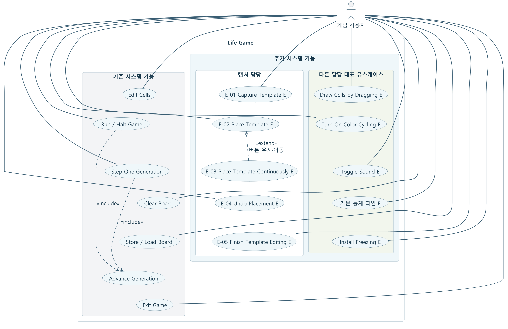
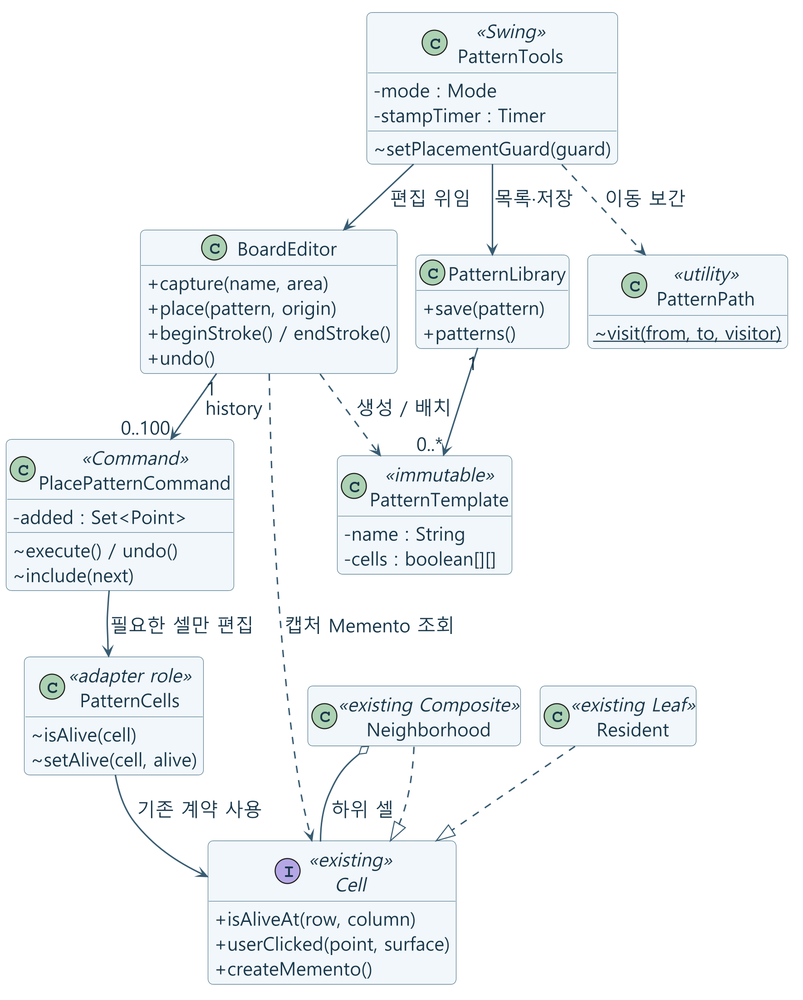
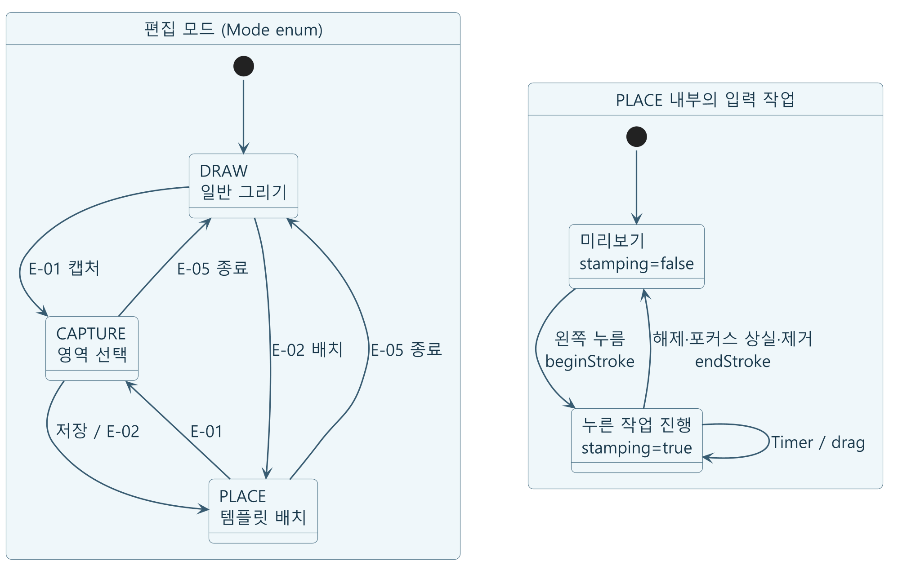
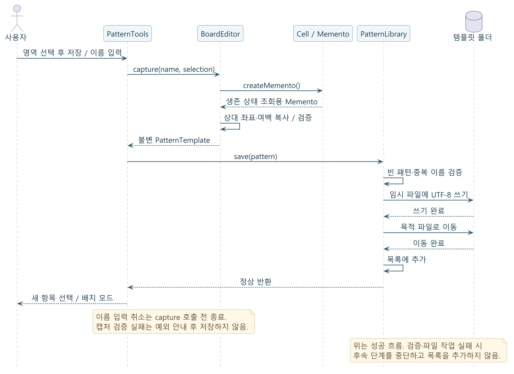

# 캡처와 템플릿 기능 명세 및 설계

Life Game의 보드 일부를 템플릿으로 저장하고 반복 배치하는 추가 기능을 설명한다. 팀 전체 보고서에 포함할 캡처 담당 장으로, 기능 유스케이스·GoF 적용과 대안·UML·Operation Contract·대표 JUnit 목적과 결과를 함께 담는다.

- 코드 기준: dev `cfba2ed27be43eb09cff295154960fb8a276fa7e` (통계·프리징 통합 완료).
- 문서 확인일: 2026-11-23 / 기능 검사 실행일: 2026-11-23 (Asia/Seoul).
- 전체 JUnit **384**회 중 Pattern 계열 **39**회 포함. 실패·오류·건너뜀 0. 별도 Swing **17 checks** 통과.
- 상세 구현 결정·전체 테스트·개발 이력: [캡처 상세 문서](README.md).

## 제출 요구사항과 본문 위치

| 요구사항 | 이 문서에서 확인할 내용 |
|---|---|
| 기능 명세와 기능 유스케이스 | [요구사항](#spec), [E-01~E-05](#use-cases) |
| 주요 GoF 적용 내역과 다른 GoF 고려사항 | [적용 패턴과 대안 비교](#gof) |
| 일부 JUnit 선정 및 테스트 내용 명시 | [대표 검사 8개와 실행 결과](#tests) |
| 클래스·State·Sequence 다이어그램 | [본문 UML](#uml) |
| Operation Contract | [OC-01~OC-06](#contracts) |
| 기존 기능과 추가 기능을 구분한 유스케이스 그림 | [팀 통합 유스케이스 초안](#system-use-cases) |

<a id="spec"></a>

## 1. 기능 명세

사용자가 반복해서 쓰는 생존 모양을 매번 그리지 않도록, 사각형 선택 영역을 이름 있는 템플릿으로 저장한다. 저장한 패턴은 클릭하거나 버튼을 누른 채 이동하여 여러 위치에 배치할 수 있다. 드래그 한 번은 Undo 한 번으로 복원한다.

템플릿은 **이름·선택 크기·생존 형태**만 저장한다. 색·나이·동결 상태는 복제하지 않는다. 템플릿 빈칸은 투명하며 기존 셀은 지우지 않는다. 전체 보드 저장·불러오기는 기존 Grid의 Store/Load 기능을 유지한다. 회전·반전·잘라내기·Redo·과거 세대 복원은 현재 범위에 포함하지 않는다.

사용 흐름은 **영역 캡처 → 드래그 선택 → 선택 영역 저장 → 이름 입력 → 배치 → 필요 시 Undo → 편집 종료**다. 캡처·배치 중에는 세대 진행이 차단되고, 편집 종료 후 사용자가 Go 메뉴로 다시 시작한다.


### 요구사항과 수용 조건

| ID | 요구사항 | 관찰 가능한 수용 조건 |
|---|---|---|
| R-01 | 선택 영역의 생존 모양 캡처 | 원본 보드는 변하지 않으며 선택 크기·여백·상대 좌표를 보존한다. 역방향 선택과 보드 끝 보정이 가능하다. |
| R-02 | 템플릿 검증·파일 저장·재로딩 | 이름과 직사각형을 검증한다. 빈 캡처·중복 이름을 거부한다. 저장에 성공한 뒤 목록에 추가한다. 손상 파일이 정상 파일의 로딩을 막지 않는다. |
| R-03 | 비파괴 단일 배치 | 마우스 칸을 왼쪽 위로 삼고 살아 있는 대상만 추가한다. 템플릿 빈칸은 투명하고 기존 생존 셀의 나이·색을 유지한다. |
| R-04 | 누름·드래그 연속 배치 | 누르는 즉시 배치하고 80ms Timer로 현재 위치를 재시도한다. 빠른 이동 구간의 기준점은 한 칸씩 보간한다. 마우스 이동만으로는 배치하지 않는다. |
| R-05 | 범위·제약의 일관된 검사 | 템플릿 사각형 전체가 보드 안에 있어야 한다. 연결된 guard가 거부하면 그 한 번의 찍기 전체를 거부한다. 미리보기와 실제 배치가 같은 조건을 쓴다. |
| R-06 | 한 번의 작업을 한 번에 Undo | 누름부터 해제까지 추가한 셀만 복원한다. 기존 셀은 남긴다. 무변경 반복은 이력을 늘리지 않으며 실제 작업 최대 100건을 저장한다. |
| R-07 | 입력 종료와 편집 취소 | 해제·포커스 상실·컴포넌트 제거로 반복을 멈춘다. Esc/오른쪽 클릭/편집 끝내기는 모드를 종료하고 적용한 셀을 남긴다. 일반 모드의 취소는 시계를 정지시키지 않는다. |
| R-08 | 기존 기능과 상태 일관성 | 편집 모드에서는 세대 진행을 막는다. 실제 일반 셀 변경·세대 진행·Clear/Load 성공은 과거 배치 이력을 비운다. 생명 규칙·색상·일반 드래그·기존 저장 기능을 보존한다. |
| R-09 | 완료 알림과 타 기능 연결 | 실제 변경이 있는 드래그 종료에 TEMPLATE 한 번, 실제 Undo에 TEMPLATE_UNDO 한 번을 전달한다. 캡처·무변경·거부에는 알리지 않는다. 통계 세대 증가와 구분한다. |

<a id="use-cases"></a>

## 2. 기능 유스케이스

주 액터는 게임 사용자다. 파일 저장은 내부 협력 동작이며 별도의 인간 액터로 모델링하지 않는다. 기존 일반 그리기·시뮬레이션은 확장 기능과 구별해 도식에 표시한다.

| ID | 이름 | 사용자 관점의 의미 |
|---|---|---|
| E-01 | Capture Template E | 선택 영역의 생존 모양을 템플릿으로 저장 |
| E-02 | Place Template E | 선택한 템플릿 배치 |
| E-03 | Place Template Continuously E | 누른 채 연속 배치 |
| E-04 | Undo Placement E | 마지막 배치 작업 되돌리기 |
| E-05 | Finish Template Editing E | 캡처·배치 편집 종료 |

`E-01` 등의 ID와 이름 끝의 `E`는 별개다. 앞의 ID는 요구사항 추적용이고, 끝의 `E`는 확장 기능 표기다. 팀 공통 그림의 Capture Template·Place Template·Undo Placement 명칭을 사용하며 연속 배치와 편집 종료를 별도 상세 유스케이스로 명시한다.


### E-01 Capture Template E

- 목표/전제: 화면의 생존 모양을 재사용한다. 보드가 열려 있다.
- 기본 흐름: 영역 캡처 선택 → 시계 정지 → 드래그로 영역 선택 → 선택 영역 저장 → 이름 입력 → 생존 모양 추출 → 파일 저장 → 목록 선택 → 배치 모드 진입.
- 대안: 이름 입력 취소는 저장하지 않고 선택을 남긴다. 빈 영역·잘못된 이름·중복 이름·I/O 오류는 안내하고 목록을 늘리지 않는다.
- 사후 조건: 성공 시 `.lifepattern` 파일과 목록 항목이 생긴다. 원본 셀은 바뀌지 않는다.
- 연결: R-01, R-02, R-08.

### E-02 Place Template E

- 전제: 기본 또는 사용자 템플릿이 선택돼 있다.
- 기본 흐름: 배치 버튼/목록 더블클릭 → 시계 정지 → 미리보기 이동 → 왼쪽 버튼 누름 → 범위·guard 검사 → 죽어 있던 대상 셀만 살림 → 해제하여 작업 확정.
- 대안: 경계 밖 또는 guard 거부는 보드·Undo를 바꾸지 않는다. 이미 같은 생존 모양이면 무변경이다.
- 사후 조건: 새 셀은 나이 0이며 기존 셀의 나이·색은 유지된다. Undo 가능한 실제 변경만 기록된다.
- 연결: R-03, R-05, R-06, R-09.

### E-03 Place Template Continuously E

- 관계: E-02의 확장이다. 버튼을 유지하거나 끌 때 추가되는 선택적 흐름이다.
- 기본 흐름: 최초 배치 후 같은 위치를 주기적으로 재시도 → 이동하면 이전 기준점부터 현재 기준점까지 보간 → 각 기준점을 별도로 검사·배치 → 버튼 해제로 전체 작업 확정.
- 대안: 보드 밖에서는 찍지 않고 보간 기준점을 비운다. 버튼을 유지해 돌아오면 바깥을 가로지르는 선을 연결하지 않는다. 포커스를 잃었으면 다시 눌러야 한다.
- 사후 조건: 허용된 위치의 변경만 한 작업에 묶인다. 금지 위치를 통과해도 허용된 위치의 배치를 모두 취소하지는 않는다.
- 연결: R-04, R-05, R-06, R-07, R-09.

### E-04 Undo Placement E

- 전제: 배치 이력이 있다. 버튼 또는 Ctrl+Z로 실행한다.
- 기본 흐름: 활성 드래그 종료 → 시계 정지 → 마지막 Command가 기록한 추가 셀만 제거 → Undo 완료 알림 → 화면 갱신.
- 대안: 빈 이력은 아무 변경도 하지 않는다. 일반 편집·세대 진행 뒤에는 이력이 무효화돼 이전 배치를 되돌릴 수 없다.
- 사후 조건: 그 작업 전부터 있던 셀은 보존되고, 같은 작업의 중복 좌표는 한 번만 복원된다.
- 연결: R-06, R-08, R-09.

### E-05 Finish Template Editing E

- 전제: 캡처 또는 배치 모드다. Esc, 오른쪽 클릭, 편집 끝내기로 요청한다.
- 기본 흐름: 활성 반복과 전역 리스너 종료 → 작업 확정 → 선택/미리보기 초기화 → DRAW로 복귀.
- 사후 조건: 적용된 배치는 남아 Undo할 수 있다. 자동 재생하지 않으며 사용자가 Go 메뉴로 다시 시작한다.
- 예외: 이미 DRAW라면 부작용 없이 반환한다. 이는 보드 변경을 되돌리는 취소가 아니다.
- 연결: R-07, R-08.

<a id="gof"></a>

## 3. GoF 적용 내역과 대안

| 패턴/원칙 | 실제 역할과 근거 | 구분 및 효과 |
|---|---|---|
| Command | `PlacePatternCommand.execute/undo`, `BoardEditor.history` | 캡처 확장에서 사용. 요청과 복원 좌표를 묶어 UI와 Undo를 분리한다. 별도 Command 인터페이스는 현재 명령 종류가 하나라 추가하지 않았다. |
| Memento | `Cell.createMemento`, `Cell.Memento`, `NeighborhoodState`, `Storable` | 원래 게임의 패턴을 캡처 읽기에 재사용한다. **현재 배치 Undo는 Memento를 사용하지 않는다.** |
| Composite | `Cell`을 구현한 `Resident`와 재귀 `Neighborhood` | 기존 구조를 재사용한다. 캡처는 내부 하위 셀 배열을 직접 순회하지 않고 공개 계약으로 조회·편집한다. |
| Adapter 역할 | `PatternCells`가 좌표·멱등 편집을 기존 `Cell.userClicked`에 연결 | 캡처 내부 경계다. 별도 Target 인터페이스를 갖춘 전형적 GoF 클래스 계층으로 과장하지 않는다. |
| Observer 방식 | `Consumer<EditKind>` → JPanel의 PropertyChange → 외부 구독자 | 완료된 편집만 전달해 통계 구현에 직접 의존하지 않는다. 기존 Clock/Publisher의 Observer와는 별도 연결이다. |
| SRP·관심사 분리 | 입력, 변경 이력, 값 객체, 저장, 보간을 나눔 | 오류를 해당 책임 단위에서 검증할 수 있다. |
| 불변 값 | 생성 시 배열 복사, 템플릿 내부 배열 미공개 | 호출자의 배열 변경이 저장·미리보기 내용을 몰래 바꾸지 못한다. |

이름이 `PatternTemplate`이라고 Template Method 패턴인 것은 아니다. `Mode` enum도 GoF State 패턴의 구현으로 세지 않는다. 색상 `CellColorPolicy`의 Strategy, 기존 Universe/Clock의 Singleton 등은 팀·기존 코드의 역할이며 캡처가 새로 도입한 공적으로 계산하지 않는다.

### 다른 GoF 패턴의 고려사항

다음은 현재 코드에 대한 대안 비교다. 전체 Memento에서 변경 좌표 Command로 바뀐 과정은 구현 이력으로 확인되며, 나머지 후보를 별도로 구현하거나 실험했다는 뜻은 아니다.

| 판단 대상 | 적용 가능성 | 현재 선택과 이유 | 다시 검토할 조건 |
|---|---|---|---|
| Command와 Memento | 전체 상태 스냅샷으로 배치 전 상태를 복원할 수 있다 | 추가 셀 좌표를 기록하는 Command 채택. 기존 셀의 나이·색까지 복원해 바꾸는 문제를 피한다. 기존 Memento는 캡처 조회에 재사용 | 색·나이·동결을 포함한 범용 게임 상태 Undo가 필요할 때 |
| State | DRAW/CAPTURE/PLACE마다 입력 처리를 별도 객체로 나눌 수 있다 | 현재 세 모드는 enum과 분기로 충분하다. 상태도는 행동을 설명하며 GoF State를 새로 구현한 것은 아니다 | 도구 모드와 상태별 행동이 늘어 전이 규칙을 분리할 때 |
| Strategy | 배치 제약이나 편집 방식을 교체하는 인터페이스를 둘 수 있다 | 프리징 제약은 Predicate 주입으로 분리했다. 여러 전략 클래스 계층은 두지 않았다. 색상 Strategy는 팀의 다른 기능 | 회전·덮어쓰기·영역별 배치 정책이 여러 개 생길 때 |
| Adapter | 기존 Cell의 좌표·토글 API를 캡처의 멱등 편집에 맞출 수 있다 | PatternCells가 어댑터 역할을 담당한다. 별도 Target 인터페이스를 가진 전형적 GoF 구조로 세지 않는다 | 팀 공용 셀 편집 API를 정비할 때 |
| Template Method | 저장·배치 단계의 골격을 상속으로 고정할 수 있다 | 서로 다른 하위 알고리즘이 없어서 적용하지 않는다. PatternTemplate은 불변 데이터이며 Template Method가 아니다 | 실제 변형 알고리즘 간 공통 처리 순서가 생길 때 |
| Observer와 직접 호출 | 완료 뒤 통계·사운드를 직접 갱신할 수 있다 | Consumer → PropertyChange → BoardChangeEvent 구독으로 연결. 캡처가 통계·사운드 구현에 직접 의존하지 않는다 | 구독 순서·오류 처리 정책을 공통 이벤트 계층에서 확장할 때 |

<a id="system-use-cases"></a>

## 4. 기존 시스템과 추가 시스템 유스케이스

주 액터는 게임 사용자다. 기존 기능은 Edit Cells, Run / Halt Game, Step One Generation, Advance Generation, Clear Board, Store / Load Board, Exit Game으로 구분한다. 추가 기능 구역 안에서 캡처 E-01~E-05와 다른 담당 기능을 구별한다. 일반 셀 드래그도 원본 클릭 편집에 추가된 기능으로 표시한다.



기존 시스템과 추가 시스템을 구역으로 구별한다. 캡처 E-01~E-05와 다른 팀 기능을 같은 경계 안에 배치한다. 캡처 E-01~E-05와 다른 담당의 대표 유스케이스를 표시한다. 다른 기능의 전체 목록·세부 관계는 담당 문서를 따른다. E-03은 E-02의 선택적 확장이다.

[확대 SVG](diagrams/svg/01-use-cases.svg) · [편집 원본](diagrams/01-use-cases.puml) · [PDF](diagrams/pdf/01-use-cases.pdf)

이 그림은 캡처 담당의 통합 개요이며 팀 전체 기능의 완전한 목록은 아니다. 최종 공통 그림은 담당별 세부 유스케이스를 취합해 확정한다. 다른 기능의 세부 명세는 [색상](../color-gen/feature-color-gen-changes.md), [일반 드래그 구현](../../src/com/holub/life/Universe.java), [사운드](../sound-effects/sound-effects.md), [통계](../statistics/statistics.md), [프리징](../freezing/FREEZING.md)에서 확인한다.


<a id="uml"></a>

## 5. 추가 기능 UML

### 클래스 다이어그램



입력·저장·편집 이력을 분리하고 기존 Cell Composite를 공개 계약으로 재사용한다. 현재 배치 Undo는 변경 좌표 Command다. 캡처 조회에만 기존 Memento를 사용한다. 일부 메서드는 가독성을 위해 생략했다.

[확대 SVG](diagrams/svg/02-classes.svg) · [편집 원본](diagrams/02-classes.puml) · [PDF](diagrams/pdf/02-classes.pdf)

### 편집 State 다이어그램



편집 종료는 셀 복원이 아니다. 반복 입력을 끝내고 DRAW로 돌아가며, 복원은 Undo가 담당한다. 실제 Mode enum은 DRAW/CAPTURE/PLACE의 3개다. 내부 두 상태는 stamping 값의 설명이며 State 패턴 클래스가 아니다.

[확대 SVG](diagrams/svg/05-edit-states.svg) · [편집 원본](diagrams/05-edit-states.puml) · [PDF](diagrams/pdf/05-edit-states.pdf)

### 캡처와 저장 Sequence 다이어그램



캡처는 원본을 읽고 상대 생존 모양을 만든다. 파일 저장이 성공해야 목록과 배치 모드를 갱신한다. 중복 이름은 실제 파일 쓰기 전에 거부한다. 원자 이동 미지원 시 일반 이동으로 대체하며 전원 장애 안전성 전체를 보장하지는 않는다.

[확대 SVG](diagrams/svg/03-capture-save.svg) · [편집 원본](diagrams/03-capture-save.puml) · [PDF](diagrams/pdf/03-capture-save.pdf)

### 연속 배치와 Undo Sequence 다이어그램


많은 찍기를 하나의 작업에 합치고 변경 완료를 한 번 알린다. Undo는 그 작업이 추가한 좌표만 되돌린다. UI가 범위·guard를 먼저 검사하고 모델에서도 재검사한다. 무변경 찍기·빈 작업·빈 Undo는 이력과 알림을 만들지 않는다.

[확대 SVG](diagrams/svg/04-stroke-undo.svg) · [편집 원본](diagrams/04-stroke-undo.puml) · [PDF](diagrams/pdf/04-stroke-undo.pdf)

### 타 기능 연결


캡처는 모델 guard와 완료 알림으로 연결한다. 프리징·통계 구현을 직접 소유하거나 세대 이벤트를 만들어내지 않는다. Universe가 PatternTools를 통해 guard를 주입하고 BoardChangeEvent를 구독자에게 전달한다. guard true는 차단이며 완료 이벤트는 세대 진행과 구분된다.

[확대 SVG](diagrams/svg/06-integration.svg) · [편집 원본](diagrams/06-integration.puml) · [PDF](diagrams/pdf/06-integration.pdf)

배치 제약은 BoardEditor에서 검사하고, 완료 알림은 PatternTools를 거쳐 Universe의 통계·사운드 구독자에 전달한다. 프리징 영역 선택 시작은 캡처 이력을 비우며, 단순 탭 전환은 진행 중 작업을 끝내되 Undo 이력을 유지한다.


<a id="contracts"></a>

## 6. Operation Contract

연산 계약은 호출 전후의 관찰 가능한 상태를 규정한다. 보드 생존 집합을 B, 새로 추가한 좌표를 A, Undo 이력을 H, 템플릿 목록을 L로 쓴다. 배열은 `[row][column]`, Point는 `(column,row)`다. 모델 호출 자체는 Clock을 제어하지 않으며 편집 진입·종료는 PatternTools와 Universe가 조립한다.

### OC-01 생존 모양 캡처

| 항목 | 계약 |
|---|---|
| 연산 / 관련 UC | `BoardEditor.capture(name, area)` / E-01 |
| 입력·사전조건 | 보드가 존재한다. area는 보드 안의 양수 크기 사각형이고 생존 셀을 포함한다. 이름은 앞뒤 공백 제거 후 1~80자이며 제어문자가 없다 |
| 성공 사후조건 | 독립적인 PatternTemplate 객체가 생성된다. 선택 크기·여백·상대 좌표가 유지된다. B, H, L과 파일은 그대로이며 완료 이벤트가 없다 |
| 실패·예외 | 잘못된 영역·이름·빈 캡처는 IllegalArgumentException. 저장·보드 변경 없음. 이름 대화상자 취소는 이 연산을 호출하지 않음 |
| 근거 | T-01,T-02,T-04,T-05; D-03 |

### OC-02 템플릿 저장

| 항목 | 계약 |
|---|---|
| 연산 / 관련 UC | `PatternLibrary.save(pattern)` / E-01 |
| 입력·사전조건 | 유효한 비어 있지 않은 PatternTemplate. 목록에 대소문자 무시 기준 같은 이름이 없음. 정상 저장에는 폴더 쓰기 권한이 필요 |
| 성공 사후조건 | UTF-8 `.lifepattern` 파일을 임시 파일에서 목적 경로로 이동한 뒤 L에 항목 하나가 추가된다. B와 H는 불변. UI는 성공 후 새 항목을 선택하고 PLACE로 진입 |
| 실패·예외 | 빈 모양·중복 이름은 IllegalArgumentException, 파일 오류는 IOException. UI는 오류를 안내하며 새 항목을 추가하지 않음. 원자 이동 미지원 시 일반 이동으로 대체하므로 전원 장애 안전성 전체를 보장하지 않음 |
| 근거 | T-06,T-07,T-25; D-03 |

### OC-03 한 위치에 배치

| 항목 | 계약 |
|---|---|
| 연산 / 관련 UC | `BoardEditor.place(pattern, origin)` / E-02,E-03 |
| 입력·사전조건 | 유효한 템플릿과 기준점. 정상 배치에는 템플릿 사각형 전체가 보드 안이고 guard가 false여야 함 |
| 성공 사후조건 | A는 템플릿 생존 칸 중 기존에 죽어 있던 대상이다. B는 B∪A가 되고 A의 셀은 나이 0. 기존 생존 셀·투명 빈칸 밑 셀·색·나이는 보존. A가 있으면 true 반환 |
| 이력·이벤트 | 작업 묶음 밖에서는 새 Command 한 건과 TEMPLATE 한 번. 묶음 안에서는 첫 성공을 한 건으로 저장하고 후속 A를 합친다. 알림은 작업 종료까지 미룬다. H는 최대 100건 |
| 실패·무변경 | 범위 밖은 IllegalArgumentException. guard true 또는 A가 비었으면 false. B,H와 완료 알림에 변화 없음. UI는 fits/canPlace로 먼저 검사하고 안내 |
| 근거 | T-03,T-04,T-10~T-12,T-15,T-23,IT-01,IT-02; D-04 |

### OC-04 연속 작업 시작과 확정

| 항목 | 계약 |
|---|---|
| 연산 / 관련 UC | `BoardEditor.beginStroke()` / `BoardEditor.endStroke()` / E-03 |
| 사전조건 | 편집이 같은 EDT 흐름에서 직렬 실행된다. UI가 PLACE에서 왼쪽 버튼 누름을 받으면 작업 시작 |
| 시작 사후조건 | 이전 작업이 있다면 먼저 끝내고 grouping=true. 시작 자체는 B나 새 H 항목을 만들지 않음 |
| 종료 사후조건 | grouping=false, 현재 stroke 참조 초기화. 실제 추가가 있었으면 TEMPLATE 한 번과 true, 아니면 이벤트 없이 false. B와 이미 기록된 H는 유지 |
| 중단 | 해제·포커스 상실·컴포넌트 제거·편집 모드 전환에서도 UI가 같은 종료 경로를 호출. 두 번째 종료는 중복 알림 없음 |
| 근거 | T-12,T-14,T-18~T-23,IT-03,IT-04; D-04,D-05 |

### OC-05 마지막 배치 Undo

| 항목 | 계약 |
|---|---|
| 연산 / 관련 UC | `BoardEditor.undo()` / E-04 |
| 사전조건 | H가 외부 편집 이전의 유효한 이력이다. 실제 일반 셀 변경·세대 진행·Clear/Load 성공·프리징 영역 선택 시작은 기존 H를 무효화한다 |
| 성공 사후조건 | 활성 작업을 먼저 확정하고 H의 마지막 Command를 제거한다. 그 명령의 A만 죽여 B를 B−A로 만든다. 이전 셀의 나이·색은 유지. TEMPLATE_UNDO 한 번 |
| 빈 이력·진행 중 작업 | 확정 후 H가 비면 무변경. 진행 중 변경 작업을 Undo하면 TEMPLATE 후 TEMPLATE_UNDO가 순서대로 발생할 수 있음. 일반 UI의 stopStamping이 먼저 확정하므로 중복 알림 없음 |
| 근거 | T-03,T-10~T-12,T-19,T-24,IT-02,IT-05; D-04 |

### OC-06 편집 종료

| 항목 | 계약 |
|---|---|
| 연산 / 관련 UC | `PatternTools.cancel()` / E-05 |
| 입력·사전조건 | Esc·오른쪽 클릭·편집 끝내기 또는 숨겨진 도구의 탭 전환. DRAW에서도 호출 가능 |
| 편집 중 사후조건 | 전역 해제 리스너 제거와 Timer 정지 후 현재 작업 확정, 선택·기준점·미리보기 초기화, DRAW 전환. 적용된 B와 H는 유지하고 시계는 정지 상태. 자동 재개하지 않음 |
| DRAW에서 호출 | 즉시 반환. 시계·보드·이력에 부작용 없음. 일반 모드의 Esc가 실행 중 시뮬레이션을 멈추지 않음 |
| 근거 | T-20~T-22,T-25,IT-03; D-05 |

<a id="tests"></a>

## 7. 대표 JUnit 테스트와 결과

아래 8개는 실제 실행된 JUnit 메서드에서 고른 대표 사례다. 입력과 기대 상태를 통해 어떤 요구를 검증하는지 설명한다. 전체 케이스는 상세 문서에 있으며 이 목록을 전체 검사 수로 해석하지 않는다.

### T-01 캡처 좌표와 원본 보존

`PatternFeatureTest.capturePreservesOffsetsAndMargins`

(3,4)의 Glider를 (2,3,5,5) 영역으로 캡처한다. 결과가 5×5, 생존 셀 5개이고 상대 좌표·여백이 유지되며 원본 보드가 바뀌지 않는지 검사한다. R-01 / E-01 / OC-01에 대응한다.

### T-07 손상 파일과 저장 실패

`PatternFeatureTest.corruptFilesAndSaveFailure`

정상 파일과 손상 파일을 함께 읽어 정상 패턴은 남고 경고가 기록되는지 확인한다. 폴더 대신 일반 파일 경로에 저장을 시도해 IOException 뒤 목록이 늘지 않는지도 검사한다. R-02 / E-01 / OC-02에 대응한다.

### T-12 한 드래그를 한 번에 Undo

`PatternHistoryTest.aStrokeIsOneCommandEvenWithRepeatedAndOverlappingStamps`

반복·중첩 배치를 같은 작업에 묶은 뒤 한 번 Undo하여 그 작업의 추가분만 복원한다. 개별 찍기가 여러 Undo 항목으로 쌓이지 않는지 확인한다. R-06 / E-03,E-04 / OC-03~OC-05에 대응한다.

### T-14 완료 알림과 무변경 처리

`PatternCompletionTest.observersSeeCompletedStateAndNoEventsForNoOps`

작업 진행 중에는 완료 알림이 없고, 종료·Undo 시 관찰자가 완료된 보드를 보는지 확인한다. 무변경 배치·빈 Undo가 추가 알림을 만들지 않는지도 검사한다. R-09 / OC-04,OC-05에 대응한다.

### T-24 기존 셀의 나이와 색 보존

`PatternToolsTest.dragAndUndoPreserveTheAgeColorsOfExistingCells`

10세대 생존한 파란 블록 옆에 새 셀을 드래그 배치하고 Undo한다. 기존 블록의 파란색은 유지되고 새 셀만 제거되는지 실제 렌더링 픽셀로 확인한다. R-03,R-06,R-08 / OC-03,OC-05에 대응한다.

### IT-01 프리징과 투명 여백 충돌

`FreezingIntegrationTest.aTemplateWhoseEmptyMarginAloneOverlapsIsRejectedWhole`

Glider의 빈 모서리만 실제 동결 영역과 겹치도록 배치한다. 생존 칸이 겹치지 않아도 템플릿 사각형 전체가 거부되고 보드·Undo·이벤트가 불변인지 확인한다. R-05 / OC-03에 대응한다.

### IT-03 입력 소유권 전환과 편집 종료

`FreezingIntegrationTest.startingAnAreaSelectionDuringAHeldStrokeEndsTheStroke`

마우스를 누른 작업 도중 프리징 탭으로 이동하고 영역 선택을 시작한다. 기존 작업의 완료 알림이 한 번 발생하고 캡처 Undo 이력이 비워지며, 이후 드래그가 템플릿을 더 찍지 않는지 검사한다. R-07,R-08 / OC-04,OC-06에 대응한다.

### IT-05 Undo 이후 통계와 다음 세대

`MergedFeaturesIntegrationTest.templateUndoRestoresStatisticsAndNextGenerationUsesTheRestoredBoard`

원래 생존 셀 3개에 템플릿 작업을 더해 8개가 된 뒤 Undo하면 통계가 3개로 돌아오는지 확인한다. 편집 종료 후 첫 세대에서 복원된 보드 기준 탄생 2개·사망 2개와 사운드 이벤트가 계산되는지도 검사한다. R-06,R-08,R-09 / OC-05에 대응한다.

### 실행 결과와 재현

| 구분 | 결과 |
|---|---|
| 전체 JUnit | **384**회, 실패 0, 오류 0, 건너뜀 0 |
| Pattern 계열 JUnit | **39**회, 위 384회에 포함 |
| 별도 Swing 검사 | **17 checks** 통과, JUnit 개수에 포함하지 않음 |
| 실행 코드·실행일 | dev `cfba2ed`, 2026-11-23 (Asia/Seoul) |
| 환경 | Windows, JDK 17.0.6+10, Gradle 9.5.1, JUnit Jupiter 6.0.3, Mockito 5.23.0 |

```powershell
.\gradlew.bat test patternUiTest --rerun-tasks --no-daemon --console=plain
```

[날짜·커밋을 표시한 결과 화면](evidence/2026-11-23/test-results.png)과 원본 [결과 JSON](evidence/2026-11-23/results.json), [JUnit XML](evidence/2026-11-23/xml), [실행 로그](evidence/2026-11-23/verification.log)에 근거를 보관한다. 최신 dev의 폴더 구조를 반영한 뒤 전체 검사를 새로 실행했다. 게임 소스·테스트·빌드 설정은 기준 dev와 동일하다. 과거 145회 기록과 합산하지 않는다.

자동 Swing 검사는 실제 컴포넌트에 이벤트를 주입한다. 물리 마우스로 창 밖에서 놓기, Alt-Tab, 화면 배율, 장시간 사용과 실제 청취는 별도 수동 확인 범위다.

<a id="sources"></a>

## 8. 구현 근거와 문서 관리

| 책임 | 소스 |
|---|---|
| 입력·상태·미리보기 | [PatternTools](../../src/com/holub/life/PatternTools.java) |
| 캡처·배치·이력 | [BoardEditor](../../src/com/holub/life/BoardEditor.java), [PlacePatternCommand](../../src/com/holub/life/PlacePatternCommand.java) |
| 값·파일 저장 | [PatternTemplate](../../src/com/holub/life/PatternTemplate.java), [PatternLibrary](../../src/com/holub/life/PatternLibrary.java) |
| 좌표 편집·경로 보간 | [PatternCells](../../src/com/holub/life/PatternCells.java), [PatternPath](../../src/com/holub/life/PatternPath.java) |
| 다른 기능과의 조립 | [Universe](../../src/com/holub/life/Universe.java), [Life](../../src/com/holub/life/Life.java) |
| 테스트 소스 | [캡처 테스트](../../test/capture/com/holub/life) · [통합 테스트](../../test/integration/com/holub/life) |

이 공유용 문서와 [상세 문서](README.md)는 같은 계약·도식·코드 기준을 사용한다. 상세 문서에서 변경 내용을 확인한 뒤 공유용에도 반영한다. 그림 원본을 수정할 때 PNG·SVG·PDF를 함께 재생성한다. Markdown을 파일로 전달할 때는 같은 폴더의 `diagrams/`와 인용한 `evidence/`를 함께 전달한다.
