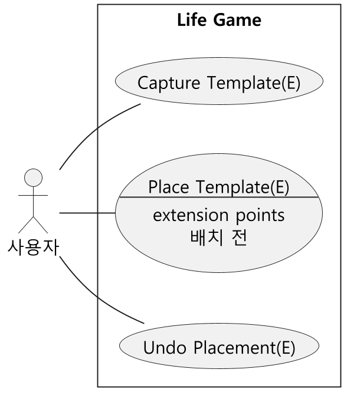
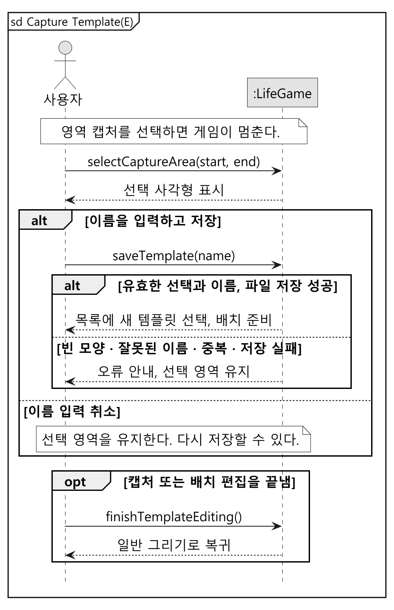
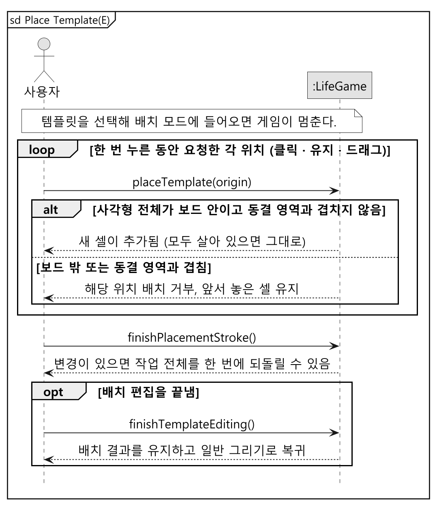
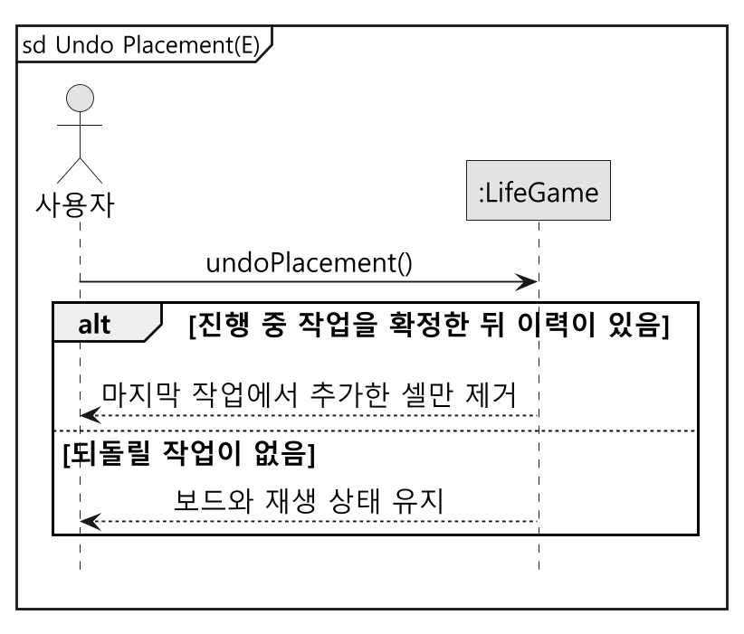
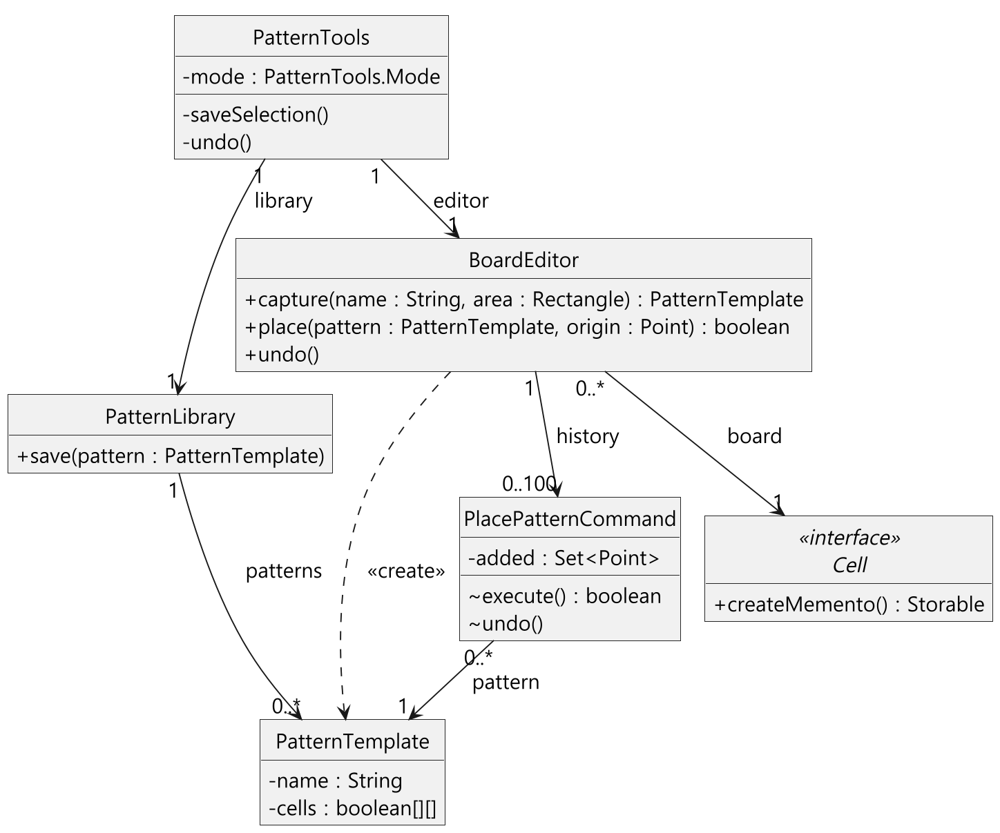
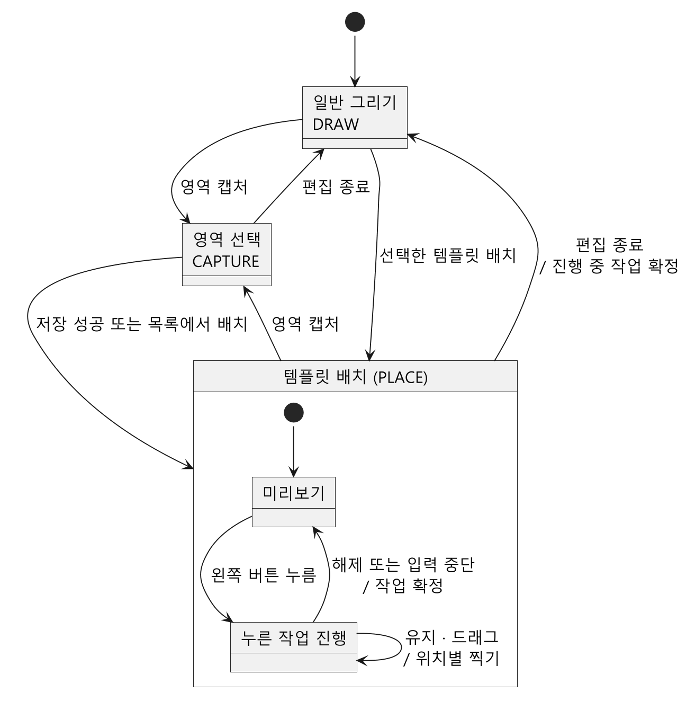
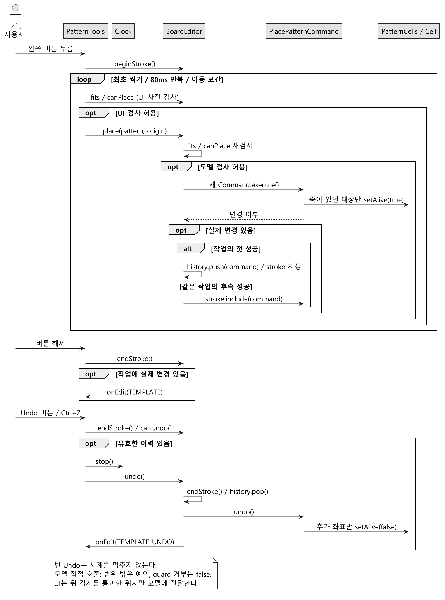
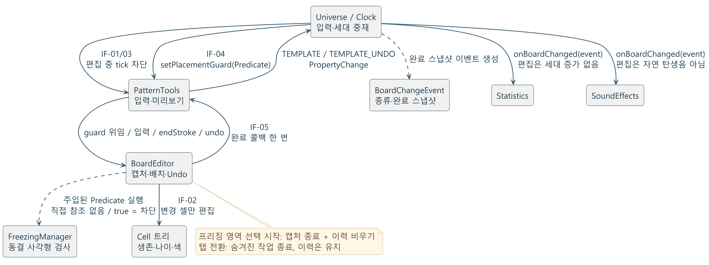

# 캡처와 템플릿 기능 명세 및 설계

Life Game의 보드 일부를 템플릿으로 저장하고 반복 배치하는 추가 기능을 설명한다. 팀 전체 보고서에 포함할 캡처 담당 장으로, 기능 유스케이스·GoF 적용과 대안·UML·Operation Contract·대표 JUnit 목적과 결과를 함께 담는다.

- 문서 개정일 2026-11-27. 본문에 인용한 기능 검사 기록은 2026-11-26 기준이다.
- 전체 JUnit **375**회 중 Pattern 계열 **39**회 포함. 실패·오류·건너뜀 0. 별도 Swing **17 checks** 통과.
- 상세 구현 결정·전체 테스트·재검증 방법: [캡처 상세 문서](README.md).

## 제출 요구사항과 본문 위치

| 요구사항 | 이 문서에서 확인할 내용 |
|---|---|
| 기능 명세와 기능 유스케이스 | [요구사항](#spec), [캡처·배치·Undo](#use-cases) |
| 주요 GoF 적용 내역과 다른 GoF 고려사항 | [적용 패턴과 대안 비교](#gof) |
| 일부 JUnit 선정 및 테스트 내용 명시 | [대표 검사 8개와 실행 결과](#tests) |
| 클래스·State·Sequence 다이어그램 | [본문 UML](#uml) |
| Operation Contract | [OC-01~OC-06](#contracts) |
| 기존 기능과 추가 기능을 구분한 유스케이스 그림 | [전체 그림과 캡처의 확장 지점](#system-use-cases) |

<a id="spec"></a>

## 1. 기능 명세

사용자는 보드의 생존 모양을 이름으로 저장해 다른 위치에서 재사용한다. 캡처하지 않고도 기본 템플릿을 배치할 수 있고, 마지막 배치는 따로 되돌릴 수 있다.

템플릿에 저장되는 값은 이름, 선택 사각형의 크기와 그 안의 생존 칸이다. 배치할 때 빈칸은 투명하고, 이미 살아 있는 셀의 나이·색은 유지된다. 동결 상태는 복제하지 않는다. 전체 보드의 저장과 불러오기는 기존 Grid 메뉴가 담당한다. 캡처·배치 편집에 들어가면 게임이 멈추고, 편집 종료 후 재생은 사용자가 Go 메뉴에서 시작한다.

### 요구사항과 수용 조건

| ID | 요구사항 | 관찰 가능한 수용 조건 |
|---|---|---|
| R-01 | 선택 영역의 생존 모양 캡처 | 원본 보드는 변하지 않으며 선택 크기·여백·상대 좌표를 보존한다. 역방향 선택과 보드 끝 보정이 가능하다. |
| R-02 | 템플릿 검증·파일 저장·재로딩 | 이름과 직사각형을 검증한다. 빈 캡처·중복 이름을 거부한다. 저장에 성공한 뒤 목록에 추가한다. 손상 파일이 정상 파일의 로딩을 막지 않는다. |
| R-03 | 비파괴 단일 배치 | 마우스 칸을 왼쪽 위로 삼고, 템플릿의 생존 칸 중 보드에서 죽어 있던 칸만 살린다. 템플릿 빈칸은 투명하고 기존 생존 셀의 나이·색을 유지한다. |
| R-04 | 누름·드래그 연속 배치 | 누르는 즉시 배치하고 80ms Timer로 현재 위치를 재시도한다. 빠른 이동 구간의 기준점은 한 칸씩 보간한다. 마우스 이동만으로는 배치하지 않는다. |
| R-05 | 범위·제약의 일관된 검사 | 템플릿 사각형 전체가 보드 안에 있어야 한다. 동결 영역과 겹치면 그 위치의 찍기 전체를 거부한다. 미리보기와 실제 배치가 같은 조건을 쓴다. |
| R-06 | 한 번의 작업을 한 번에 Undo | 누름부터 해제까지 추가한 셀만 복원한다. 기존 셀은 남긴다. 무변경 반복은 이력을 늘리지 않으며 실제 작업 최대 100건을 저장한다. |
| R-07 | 입력 종료와 편집 취소 | 해제·포커스 상실·컴포넌트 제거로 반복을 멈춘다. Esc/오른쪽 클릭/편집 끝내기는 모드를 종료하고 적용한 셀을 남긴다. 일반 모드의 취소는 시계를 정지시키지 않는다. |
| R-08 | 기존 기능과 상태 일관성 | 편집 모드에서는 세대 진행을 막는다. 실제 일반 셀 변경·세대 진행·Clear/Load 성공은 과거 배치 이력을 비운다. 생명 규칙·색상·일반 드래그·기존 저장 기능을 보존한다. |
| R-09 | 완료 알림과 타 기능 연결 | 실제 변경이 있는 드래그 종료에 TEMPLATE 한 번, 실제 Undo에 TEMPLATE_UNDO 한 번을 전달한다. 캡처·무변경·거부에는 알리지 않는다. 통계 세대 증가와 구분한다. |

<a id="use-cases"></a>

## 2. 기능 유스케이스

주 액터는 세 유스케이스 모두 **사용자**다. E-01~E-03은 기존 요구사항과 테스트를 찾기 위한 문서 ID다.

| 유스케이스 | 사용자가 얻는 결과 | 요구사항 | 시스템 연산 계약 |
|---|---|---|---|
| E-01 Capture Template(E) | 보드의 모양을 목록에 저장해 다시 선택할 수 있다. | R-01, R-02, R-07, R-08 | OC-01, OC-02, OC-06 |
| E-02 Place Template(E) | 선택한 모양을 한 위치 또는 드래그한 경로에 놓는다. | R-03~R-09 | OC-03, OC-04, OC-06 |
| E-03 Undo Placement(E) | 마지막 클릭이나 드래그에서 추가한 셀만 되돌린다. | R-06, R-08, R-09 | OC-05 |

### E-01 Capture Template(E)

1. 사용자가 영역 캡처를 선택한다. 게임이 멈추고, 사용자는 보드에서 저장할 사각형을 드래그한다.
2. 선택 영역 저장을 누르고 이름을 입력한다. 게임은 선택 크기와 상대 생존 좌표를 저장한다.
3. 저장이 성공하면 새 항목이 목록에서 선택되고 배치 모드가 열린다. 원본 보드와 배치 이력은 그대로다.

이름 입력을 취소하면 선택 영역에서 다시 시작할 수 있다. 생존 셀이 없거나 이름이 잘못되었거나 중복된 경우, 또는 파일 저장에 실패한 경우에는 목록이 늘어나지 않는다. 저장 전 편집을 끝내면 선택을 해제하고 일반 그리기로 돌아간다.

### E-02 Place Template(E)

1. 사용자가 목록에서 기본 또는 저장한 템플릿을 선택해 배치 모드에 들어간다. 마우스를 움직이면 미리보기가 따라온다.
2. 왼쪽 버튼을 누르면 해당 칸을 왼쪽 위로 삼아 템플릿 사각형 전체를 검사한다. **배치 전**에 동결 영역과 조금이라도 겹치면 빈 여백만 겹쳤더라도 그 위치의 찍기를 전부 거부한다. 보드 경계를 벗어난 찍기도 거부한다.
3. 허용된 위치에서는 템플릿의 생존 칸 중 대상이 죽어 있던 칸만 살아난다. 버튼을 유지하면 현재 위치를 다시 시도하고, 끌면 지나간 위치에도 같은 규칙을 적용한다. 거부된 위치 앞뒤의 허용된 배치는 유지된다.
4. 버튼을 놓으면 한 작업이 확정된다. 변경이 있으면 클릭 한 번 또는 드래그 한 번 전체가 Undo 한 건이 된다. 포커스 상실도 진행 중 작업을 확정한다.

편집 중 Esc·오른쪽 클릭·편집 끝내기를 선택하면 진행 중 작업을 확정하고 일반 그리기로 돌아간다. 이미 놓은 셀과 유효한 이력은 남는다.

### E-03 Undo Placement(E)

1. 사용자가 Undo 버튼 또는 Ctrl+Z로 마지막 배치를 되돌린다. 진행 중인 드래그가 있으면 먼저 확정한다.
2. 이력이 있으면 게임을 멈추고 가장 최근 작업이 추가한 셀만 제거한다. 같은 드래그에서 여러 번 찍힌 칸도 한 번만 되돌린다.
3. 이전부터 있던 생존 셀의 나이와 색은 유지된다. 이력이 비어 있으면 보드와 재생 상태는 그대로다.

일반 셀 변경, 세대 진행, Clear, 성공한 Load, 프리징 영역 선택 시작으로 기존 이력이 비워지면 그 이전 배치는 되돌릴 수 없다.

<a id="gof"></a>

## 3. GoF 적용 내역과 대안

| 패턴/원칙 | 실제 역할과 근거 | 구분 및 효과 |
|---|---|---|
| Command | `PlacePatternCommand.execute/undo`, `BoardEditor.history` | 캡처 확장에서 사용. 요청과 복원 좌표를 묶어 UI와 Undo를 분리한다. 별도 Command 인터페이스는 현재 명령 종류가 하나라 추가하지 않았다. |
| Memento | `Cell.createMemento`, `Cell.Memento`, `NeighborhoodState`, `Storable` | 원래 게임의 패턴을 캡처 읽기에 재사용한다. **현재 배치 Undo는 Memento를 사용하지 않는다.** |
| Composite | `Cell`을 구현한 `Resident`와 재귀 `Neighborhood` | 기존 구조를 재사용한다. 캡처는 내부 하위 셀 배열을 직접 순회하지 않고 공개 계약으로 조회·편집한다. |
| Adapter 역할 | `PatternCells`가 좌표·멱등 편집을 기존 `Cell.userClicked`에 연결 | 캡처 내부 경계다. 별도 Target 인터페이스를 갖춘 전형적 GoF 클래스 계층으로 과장하지 않는다. |
| Observer 방식 | `Consumer<EditKind>` → JPanel의 PropertyChange → 외부 구독자 | 완료된 편집만 전달해 통계 구현에 직접 의존하지 않는다. 기존 Clock/Publisher의 Observer와는 별도 연결이다. |
| SRP·관심사 분리 | 입력, 변경 이력, 값 객체, 저장, 보간을 나눔 | 오류를 해당 책임 단위에서 검증할 수 있다. |
| 불변 값 | 생성 시 배열 복사, 템플릿 내부 배열 미공개 | 호출자의 배열 변경이 저장·미리보기 내용을 몰래 바꾸지 못한다. |

이름이 `PatternTemplate`이라고 Template Method 패턴인 것은 아니다. `Mode` enum도 GoF State 패턴의 구현으로 세지 않는다. 색상 `CellColorPolicy`의 Strategy, 기존 Universe/Clock의 Singleton 등은 팀·기존 코드의 역할이며 캡처가 새로 도입한 공적으로 계산하지 않는다.

### 다른 GoF 패턴의 고려사항

다음은 현재 코드에 대한 대안 비교다. 배치 Undo는 전체 Memento 복원에서 변경 좌표 Command로 개선했다. 나머지 후보는 설계 대안이며 별도로 구현하거나 실험했다는 뜻은 아니다.

| 판단 대상 | 적용 가능성 | 현재 선택과 이유 | 다시 검토할 조건 |
|---|---|---|---|
| Command와 Memento | 전체 상태 스냅샷으로 배치 전 상태를 복원할 수 있다 | 추가 셀 좌표를 기록하는 Command 채택. 기존 셀의 나이·색까지 복원해 바꾸는 문제를 피한다. 기존 Memento는 캡처 조회에 재사용 | 색·나이·동결을 포함한 범용 게임 상태 Undo가 필요할 때 |
| State | DRAW/CAPTURE/PLACE마다 입력 처리를 별도 객체로 나눌 수 있다 | 현재 세 모드는 enum과 분기로 충분하다. 상태도는 행동을 설명하며 GoF State를 새로 구현한 것은 아니다 | 도구 모드와 상태별 행동이 늘어 전이 규칙을 분리할 때 |
| Strategy | 배치 제약이나 편집 방식을 교체하는 인터페이스를 둘 수 있다 | 프리징 제약은 Predicate 주입으로 분리했다. 여러 전략 클래스 계층은 두지 않았다. 색상 Strategy는 팀의 다른 기능 | 회전·덮어쓰기·영역별 배치 정책이 여러 개 생길 때 |
| Adapter | 기존 Cell의 좌표·토글 API를 캡처의 멱등 편집에 맞출 수 있다 | PatternCells가 어댑터 역할을 담당한다. 별도 Target 인터페이스를 가진 전형적 GoF 구조로 세지 않는다 | 팀 공용 셀 편집 API를 정비할 때 |
| Template Method | 저장·배치 단계의 골격을 상속으로 고정할 수 있다 | 서로 다른 하위 알고리즘이 없어서 적용하지 않는다. PatternTemplate은 불변 데이터이며 Template Method가 아니다 | 실제 변형 알고리즘 간 공통 처리 순서가 생길 때 |
| Observer와 직접 호출 | 완료 뒤 통계·사운드를 직접 갱신할 수 있다 | Consumer → PropertyChange → BoardChangeEvent 구독으로 연결. 캡처가 통계·사운드 구현에 직접 의존하지 않는다 | 구독 순서·오류 처리 정책을 공통 이벤트 계층에서 확장할 때 |

<a id="system-use-cases"></a>

## 4. 캡처·템플릿 유스케이스 다이어그램

[전체 시스템 그림](../usecase-overview.png)에서 캡처 담당의 사용자 목표 세 개를 가져왔다. 사용자는 기본 템플릿도 놓을 수 있으므로 캡처와 배치 사이에 선행 관계를 두지 않는다.



[편집 원본](diagrams/report/01-use-cases.puml)

`Place Template(E)`의 확장 지점은 **배치 전**이다. 동결 영역과 겹칠 때 작동하는 `Protect Frozen Region(E)`의 확장 화살표는 [Freezing 유스케이스 그림](../freezing/diagram/usecase-freezing.png)에서 확인할 수 있다. 일반 셀 그리기는 전체 그림의 `Edit Cells`가 담당한다.

<a id="uml"></a>

## 5. 추가 기능 UML

<a id="ssd"></a>

### 시스템 시퀀스 다이어그램

사용자와 `:LifeGame` 사이의 요청과 결과를 유스케이스마다 한 장에 담았다. 화살표의 연산 이름은 [6절 계약](#contracts)과 같다. 이어지는 객체 시퀀스 그림은 이 요청을 내부에서 어떻게 처리하는지 보여준다.



[캡처 SSD 원본](diagrams/report/07-ssd-capture.puml)



[배치 SSD 원본](diagrams/report/08-ssd-place.puml)



[Undo SSD 원본](diagrams/report/09-ssd-undo.puml)

### 클래스 다이어그램



| 협력 | 관계와 코드 근거 |
|---|---|
| 입력 → 편집·저장 | `PatternTools`는 `editor`와 `library` 필드에 각각 편집기와 목록 하나를 보관한다. 저장 성공 뒤에만 새 항목을 선택한다. |
| 캡처 → 보드·템플릿 | `BoardEditor.board`는 기존 `Cell` 하나를 가리킨다. 편집기는 보드의 Memento에서 선택 영역을 읽어 새 `PatternTemplate`을 만든다. |
| 목록 → 템플릿 | `PatternLibrary.patterns`는 여러 템플릿을 참조한다. 생성 직후의 템플릿은 아직 목록에 없고, 같은 객체를 다른 목록에도 저장할 수 있다. |
| 배치·Undo → 명령 | `BoardEditor.history`는 최대 100개의 `PlacePatternCommand`를 보관한다. 변경 없는 찍기는 이력에 들어가지 않고, 같은 드래그의 후속 추가분은 첫 명령에 합쳐진다. 각 명령은 템플릿 하나를 참조하며 `added`에 새로 살린 좌표를 기록한다. |

그림에는 사용자 입력에서 저장·배치·Undo까지 따라가는 데 필요한 여섯 타입을 표시했다. 개별 셀 편집을 중계하는 `PatternCells`와 드래그 경로를 보간하는 `PatternPath`는 배치의 구현 세부다. 원본 `Cell`의 구현체와 GoF 역할은 [3절](#gof), 동결·통계 연결은 아래의 타 기능 연결 그림에서 설명한다.

[편집 원본](diagrams/report/02-classes.puml)

### 편집 State 다이어그램



편집 종료는 진행 중 작업을 확정하고 DRAW로 돌아간다. 보드 복원은 Undo가 담당한다. 실제 Mode enum은 DRAW/CAPTURE/PLACE의 3개다. PLACE의 두 하위 상태는 왼쪽 버튼을 누른 작업이 진행 중인지 나타내는 stamping 값에 대응한다.

[편집 원본](diagrams/report/05-edit-states.puml)

### 캡처와 저장 Sequence 다이어그램


캡처는 원본을 읽고 상대 생존 모양을 만든다. 파일 저장이 성공해야 목록과 배치 모드를 갱신한다. 중복 이름은 실제 파일 쓰기 전에 거부한다. 원자 이동 미지원 시 일반 이동으로 대체하며 전원 장애 안전성 전체를 보장하지는 않는다.

[편집 원본](diagrams/03-capture-save.puml)

### 연속 배치와 Undo Sequence 다이어그램



많은 찍기를 하나의 작업에 합치고 변경 완료를 한 번 알린다. Undo는 그 작업이 추가한 좌표만 되돌린다. UI가 범위·guard를 먼저 검사하고 모델에서도 재검사한다. 무변경 찍기·빈 작업·빈 Undo는 이력과 알림을 만들지 않는다.

[편집 원본](diagrams/04-stroke-undo.puml)

### 타 기능 연결



캡처는 모델 guard와 완료 알림으로 연결한다. 프리징·통계 구현을 직접 소유하거나 세대 이벤트를 만들어내지 않는다. Universe가 PatternTools를 통해 guard를 주입하고 BoardChangeEvent를 구독자에게 전달한다. guard true는 차단이며 완료 이벤트는 세대 진행과 구분된다.

[편집 원본](diagrams/06-integration.puml)

배치 제약은 BoardEditor에서 검사하고, 완료 알림은 PatternTools를 거쳐 Universe의 통계·사운드 구독자에 전달한다. 프리징 영역 선택 시작은 캡처 이력을 비우며, 단순 탭 전환은 진행 중 작업을 끝내되 Undo 이력을 유지한다.


<a id="contracts"></a>

## 6. Operation Contract

시스템 연산은 사용자 입력이 끝난 시점에 어떤 상태를 관찰할 수 있는지 정한다. 연산 이름은 SSD에서 사용한 이름이며, 각 표의 구현 근거는 실제 Java 호출을 가리킨다. B는 보드의 생존 좌표 집합, H는 배치 이력, L은 템플릿 목록이다.

### OC-01 캡처 영역 선택

| 항목 | 계약 |
|---|---|
| 시스템 연산 / 관련 UC | `selectCaptureArea(start, end)` / E-01 |
| 사전조건 | 캡처 모드이며 사용자가 보드 안의 칸에서 왼쪽 버튼을 누른다. |
| 사후조건 | 시작·끝 칸을 모두 포함하는 선택 사각형이 설정된다. 역방향 선택도 같은 사각형을 만들며, 드래그가 보드를 벗어나면 끝 칸은 경계로 보정된다. B, H, L과 파일은 그대로다. |
| 구현·검증 | `PatternTools.selectThrough`, `PatternTools.cellAt` · D-05, D-07. 실제 캡처 좌표와 여백 보존은 T-01에서 확인한다. |

### OC-02 선택한 모양 저장

| 항목 | 계약 |
|---|---|
| 시스템 연산 / 관련 UC | `saveTemplate(name)` / E-01 |
| 사전조건 | 캡처 영역이 선택되어 있다. 저장 가능한 모양은 가로·세로 1~64칸에 생존 셀이 있고, 이름은 앞뒤 공백 제거 후 1~80자이며 제어문자가 없어야 한다. |
| 성공 사후조건 | 선택 크기·여백·상대 생존 좌표를 가진 독립 템플릿이 생성된다. UTF-8 `.lifepattern` 파일 저장이 끝나면 L에 한 항목이 추가되고, 새 항목이 선택된 배치 모드가 된다. B와 H는 유지된다. |
| 실패·취소 | 대소문자를 무시한 중복 이름, 유효하지 않은 이름·모양, 파일 오류는 L에 항목을 추가하지 않는다. 이름 입력을 취소하면 저장 요청 없이 선택 영역을 유지한다. |
| 구현·검증 | `PatternTools.saveSelection` → `BoardEditor.capture` → `PatternLibrary.save` · T-01, T-07, T-25 · D-03, D-07. |

### OC-03 한 위치에 배치

| 항목 | 계약 |
|---|---|
| 시스템 연산 / 관련 UC | `placeTemplate(origin)` / E-02 |
| 사전조건 | 배치 모드에 선택한 템플릿이 있다. 누른 칸 또는 드래그 중의 각 기준점이 템플릿의 왼쪽 위다. |
| 성공 사후조건 | 템플릿의 생존 칸 중 대상이 죽어 있던 좌표 집합을 A라 하면 B는 B∪A가 된다. 새 셀의 나이는 0이다. 기존 생존 셀의 나이·색과 투명 여백 아래 셀은 유지된다. |
| 이력 | 이번 누름에서 처음으로 A가 생기면 H에 한 건을 넣고, 후속 찍기의 A는 같은 건에 합친다. H는 최근 100건을 보관한다. 완료 알림은 작업 확정까지 미룬다. |
| 거부·무변경 | 사각형이 보드 밖이거나 동결 영역과 겹치면 해당 찍기 전체가 거부된다. A가 비어도 B와 H는 그대로다. 세 경우 모두 이 찍기에 대한 완료 알림은 없다. 같은 드래그에서 앞서 허용된 결과는 유지된다. |
| 구현·검증 | `PatternTools.stampAt`, `BoardEditor.canPlace`, `BoardEditor.place` · T-10~T-12, T-24, IT-01 · D-04, D-08. |

### OC-04 배치 작업 확정

| 항목 | 계약 |
|---|---|
| 시스템 연산 / 관련 UC | `finishPlacementStroke()` / E-02 |
| 사전조건 | 버튼을 놓거나 포커스를 잃거나 컴포넌트가 제거되어 진행 중인 배치 입력을 끝낸다. 이미 끝난 입력에도 호출할 수 있다. |
| 사후조건 | 반복 입력과 작업 묶음이 종료된다. 보드와 이미 기록된 이력은 유지된다. 이번 작업에서 새 셀이 생겼다면 TEMPLATE 완료 알림이 정확히 한 번 발생한다. |
| 무변경 | 실제 추가가 없거나 이미 확정한 작업이면 새 이력과 완료 알림이 생기지 않는다. |
| 구현·검증 | `PatternTools.stopStamping`, `BoardEditor.beginStroke`, `BoardEditor.endStroke` · T-12, T-14, IT-03 · D-04, D-05, D-08. |

### OC-05 마지막 배치 되돌리기

| 항목 | 계약 |
|---|---|
| 시스템 연산 / 관련 UC | `undoPlacement()` / E-03 |
| 사전조건 | 사용자가 Undo를 요청한다. 진행 중인 배치가 있으면 먼저 확정한다. |
| 성공 사후조건 | 확정 후 H가 있으면 게임이 멈추고 마지막 건을 H에서 제거한다. 그 건이 추가한 좌표를 A라 하면 B는 B−A가 된다. 이전부터 있던 셀의 나이·색은 유지되며 TEMPLATE_UNDO 알림이 한 번 발생한다. |
| 빈 이력·진행 중 요청 | 확정 후 H가 비면 보드·시계·이력에 변화가 없다. 진행 중 변경 작업을 바로 되돌리면 TEMPLATE 다음에 TEMPLATE_UNDO가 전달된다. |
| 구현·검증 | `PatternTools.undo`, `BoardEditor.undo`, `PlacePatternCommand.undo` · T-12, T-14, T-24, IT-05 · D-04, D-09. |

### OC-06 캡처·배치 편집 종료

| 항목 | 계약 |
|---|---|
| 시스템 연산 / 관련 UC | `finishTemplateEditing()` / E-01, E-02 |
| 사전조건 | Esc·오른쪽 클릭·편집 끝내기 또는 캡처 도구를 떠나는 탭 전환으로 편집을 종료한다. |
| 사후조건 | 진행 중인 배치를 OC-04대로 확정하고 선택·미리보기를 지운 뒤 일반 그리기 모드로 돌아간다. 적용된 B와 유효한 H는 유지되고 시계는 정지 상태다. 사용자가 Go 메뉴에서 재생을 재개할 수 있다. |
| 예외 | 이미 일반 그리기 모드라면 아무 변화가 없다. 프리징 영역 선택을 새로 시작할 때의 이력 초기화는 별도 입력의 효과다. |
| 구현·검증 | `PatternTools.cancel`, `PatternTools.begin`, `PatternTools.stopStamping` · T-20~T-22, IT-03 · D-05, D-07, D-08. |

<a id="tests"></a>

## 7. 대표 JUnit 테스트와 결과

아래 8개는 실제 실행된 JUnit 메서드에서 고른 대표 사례다. 입력과 기대 상태를 통해 어떤 요구를 검증하는지 설명한다. 전체 케이스는 상세 문서에 있으며 이 목록을 전체 검사 수로 해석하지 않는다.

### T-01 캡처 좌표와 원본 보존

`PatternFeatureTest.capturePreservesOffsetsAndMargins`

(3,4)의 Glider를 (2,3,5,5) 영역으로 캡처한다. 결과가 5×5, 생존 셀 5개이고 상대 좌표·여백이 유지되며 원본 보드가 바뀌지 않는지 검사한다. R-01 / E-01 / OC-02에 대응한다.

### T-07 손상 파일과 저장 실패

`PatternFeatureTest.corruptFilesAndSaveFailure`

정상 파일과 손상 파일을 함께 읽어 정상 패턴은 남고 경고가 기록되는지 확인한다. 폴더 대신 일반 파일 경로에 저장을 시도해 IOException 뒤 목록이 늘지 않는지도 검사한다. R-02 / E-01 / OC-02에 대응한다.

### T-12 한 드래그를 한 번에 Undo

`PatternHistoryTest.aStrokeIsOneCommandEvenWithRepeatedAndOverlappingStamps`

반복·중첩 배치를 같은 작업에 묶은 뒤 한 번 Undo하여 그 작업의 추가분만 복원한다. 개별 찍기가 여러 Undo 항목으로 쌓이지 않는지 확인한다. R-06 / E-02, E-03 / OC-03~OC-05에 대응한다.

### T-14 완료 알림과 무변경 처리

`PatternCompletionTest.observersSeeCompletedStateAndNoEventsForNoOps`

작업 진행 중에는 완료 알림이 없고, 종료·Undo 시 관찰자가 완료된 보드를 보는지 확인한다. 무변경 배치·빈 Undo가 추가 알림을 만들지 않는지도 검사한다. R-09 / OC-04,OC-05에 대응한다.

### T-24 기존 셀의 나이와 색 보존

`PatternToolsTest.dragAndUndoPreserveTheAgeColorsOfExistingCells`

10세대 생존한 파란 블록 옆에 새 셀을 드래그 배치하고 Undo한다. 기존 블록의 파란색은 유지되고 새 셀만 제거되는지 실제 렌더링 픽셀로 확인한다. R-03,R-06,R-08 / OC-03,OC-05에 대응한다.

### IT-01 프리징과 투명 여백 충돌

`FreezingIntegrationTest.aTemplateWhoseEmptyMarginAloneOverlapsIsRejectedWhole`

Glider의 빈 모서리만 실제 동결 영역과 겹치도록 배치한다. 생존 칸이 겹치지 않아도 템플릿 사각형 전체가 거부되고 보드·Undo·이벤트가 불변인지 확인한다. R-05 / OC-03에 대응한다.

### IT-03 입력 소유권 전환과 편집 종료

`FreezingIntegrationTest.startingAnAreaSelectionDuringAHeldStrokeEndsTheStroke`

마우스를 누른 작업 도중 프리징 탭으로 이동하고 영역 선택을 시작한다. 기존 작업의 완료 알림이 한 번 발생하고 캡처 Undo 이력이 비워지며, 이후 드래그가 템플릿을 더 찍지 않는지 검사한다. R-07,R-08 / OC-04,OC-06에 대응한다.

### IT-05 Undo 이후 통계와 다음 세대

`MergedFeaturesIntegrationTest.templateUndoRestoresStatisticsAndNextGenerationUsesTheRestoredBoard`

원래 생존 셀 3개에 템플릿 작업을 더해 8개가 된 뒤 Undo하면 통계가 3개로 돌아오는지 확인한다. 편집 종료 후 첫 세대에서 복원된 보드 기준 탄생 2개·사망 2개와 사운드 이벤트가 계산되는지도 검사한다. R-06,R-08,R-09 / OC-05에 대응한다.

### 실행 결과와 재현

| 구분 | 결과 |
|---|---|
| 전체 JUnit | **375**회, 실패 0, 오류 0, 건너뜀 0 |
| Pattern 계열 JUnit | **39**회, 위 375회에 포함 |
| 별도 Swing 검사 | **17 checks** 통과, JUnit 개수에 포함하지 않음 |
| 실행일 | 2026-11-26 (Asia/Seoul) |
| 환경 | Windows, JDK 17.0.6+10, Gradle 9.5.1, JUnit Jupiter 6.0.3, Mockito 5.23.0 |

```powershell
.\gradlew.bat test patternUiTest --rerun-tasks --no-daemon --console=plain
```

[결과 JSON](evidence/2026-11-26-integrated/results.json), [JUnit XML](evidence/2026-11-26-integrated/xml), [실행 로그](evidence/2026-11-26-integrated/verification.log), [실제 Swing 결과 화면](evidence/2026-11-26-integrated/life-template-drag-undo.png)에 해당 실행의 근거를 보관한다. 테스트 전용 생성자 제거와 통계·프리징의 최신 변경을 통합한 코드로 2026-11-26에 전체 검사를 다시 실행했다.

모델 검사는 실제 게임이 쓰는 `BoardEditor(Cell, Consumer<EditKind>)` 생성 경로를 사용한다. 완료 알림이 필요한 검사는 전달한 콜백에서 결과를 수집하고, 보드 상태만 검사할 때는 동작 없는 콜백을 전달한다. 테스트에서만 쓰던 단일 인자 생성자는 두지 않는다.

자동 Swing 검사는 실제 컴포넌트에 이벤트를 주입한다. 물리 마우스로 창 밖에서 놓기, Alt-Tab, 화면 배율, 장시간 사용과 실제 청취는 별도 수동 확인 범위다.

<a id="sources"></a>

## 8. 구현 근거와 문서 관리

| 책임 | 소스 |
|---|---|
| 입력·상태·미리보기 | [PatternTools](../../src/com/holub/life/PatternTools.java) |
| 캡처·배치·이력 | [BoardEditor](../../src/com/holub/life/BoardEditor.java), [PlacePatternCommand](../../src/com/holub/life/PlacePatternCommand.java) |
| 값·파일 저장 | [PatternTemplate](../../src/com/holub/life/PatternTemplate.java), [PatternLibrary](../../src/com/holub/life/PatternLibrary.java) |
| 좌표 편집·경로 보간 | [PatternCells](../../src/com/holub/life/PatternCells.java), [PatternPath](../../src/com/holub/life/PatternPath.java) |
| 다른 기능과의 조립 | [Universe](../../src/com/holub/life/Universe.java), [Life](../../src/com/holub/life/Life.java) |
| 테스트 소스 | [캡처 테스트](../../test/capture/com/holub/life) · [통합 테스트](../../test/integration/com/holub/life) |

이 문서는 팀 공통 유스케이스에 맞춘 제출본이다. [상세 구현 기록](README.md)에는 이전 분류와 당시의 그림이 남아 있다. 제출본 전용 그림은 `diagrams/report/`에, 두 문서가 함께 참조하는 객체 시퀀스와 통합 그림은 `diagrams/`에 있다.
