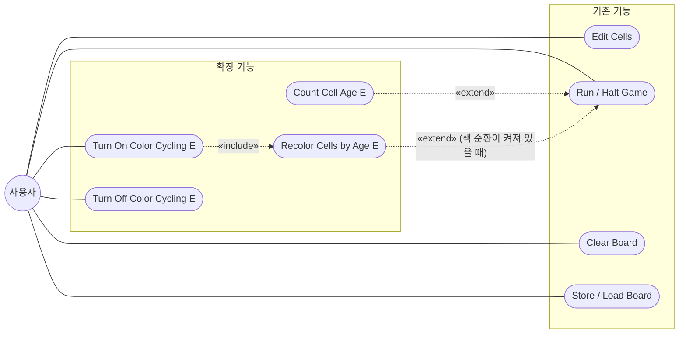

# 세대에 따른 셀 색 순환 기능 명세

- 대상 코드: dev 브랜치 (`5600239` 기준)
- 관련 문서: 설계 문서 「세대에 따른 셀 색 순환 기능」(설계 결정과 대안), 변경 기록 [feature-color-gen-changes.md](feature-color-gen-changes.md), 화면 갱신 지연 [color-gen-redraw-lag.md](color-gen-redraw-lag.md)

이 문서는 기능이 무엇을 해야 하는지와, 그것을 어떤 테스트로 확인하는지를 적는다. 왜 그렇게 설계했는지는 설계 문서에 있다.

## 1. 개요

색 순환을 켜면 살아 있는 셀이 10세대마다 빨강 → 파랑 → 초록 → 빨강 순서로 색을 바꾼다. Color 메뉴로 켜고 끄며, 처음에는 꺼져 있어 원본처럼 모두 빨강이다. 생사 규칙과 저장 파일 형식은 바꾸지 않는다.

## 2. 용어

| 용어 | 뜻 |
| --- | --- |
| 세대 | 시계가 한 번 틱을 보내 판 전체의 다음 생사가 확정되는 단위 |
| 나이 | 셀이 지금 살아 있는 동안 연속해서 살아남은 세대 수. 태어나거나 살려진 세대에 0이다 |
| 색 규칙 | 나이를 받아 살아 있는 셀의 색을 돌려주는 객체(`CellColorPolicy`). 고정 색(`FixedColorPolicy`)과 순환(`CyclingColorPolicy`) 두 가지가 있다 |
| 색 순환 켜짐 / 꺼짐 | 현재 색 규칙이 순환 / 고정 색인 상태 |

## 3. 기능 요구사항

| ID | 요구사항 |
| --- | --- |
| FR-1 | Color > Cycle by Generation을 고르면 색 순환이 켜지고, 틱을 기다리지 않고 바로 판 전체가 각 셀의 나이에 맞는 색으로 다시 그려진다 |
| FR-2 | Color > Single Color를 고르면 색 순환이 꺼지고, 바로 살아 있는 셀이 모두 원본 빨강으로 다시 그려진다 |
| FR-3 | 프로그램을 시작하면 색 순환은 꺼져 있다 |
| FR-4 | 세대가 진행될 때마다 전후 모두 살아 있는 셀은 나이가 1 늘고, 새로 태어난 셀은 0이다. 색 순환이 꺼져 있어도 나이를 센다 |
| FR-5 | 색 순환이 켜져 있으면 색은 `c[⌊나이 / 10⌋ mod 3]`, c = [빨강 `#FF0000`, 파랑 `#0072B2`, 초록 `#009E73`]이다. 나이 0\~9 빨강, 10\~19 파랑, 20\~29 초록, 30부터 다시 빨강 |
| FR-6 | 색 순환이 켜져 있으면 생사가 바뀌지 않은 세대에도 판 전체를 다시 그린다. 2×2 블록처럼 멈춘 패턴도 10세대마다 색이 바뀐다 |
| FR-7 | 마우스 클릭으로 살린 셀, Grid > Load로 불러온 셀, 템플릿 배치로 새로 생긴 셀은 나이 0(빨강)에서 시작한다 |
| FR-8 | 템플릿 배치와 그 되돌리기는 이미 살아 있던 다른 셀의 나이를 바꾸지 않는다 |
| FR-9 | 죽은 셀은 원본의 죽은 칸 색으로 그린다 |

## 4. 비기능 요구사항

| ID | 요구사항 | 기준 |
| --- | --- | --- |
| NFR-1 | 생사 규칙이 바뀌지 않는다 | 색 순환을 켜든 끄든 매 세대 생사가 Life 규칙을 직접 계산한 결과와 같다 |
| NFR-2 | 색 순환이 꺼져 있으면 원본과 같게 동작한다 | 기존 기능 테스트가 고치지 않고 통과한다. 화면은 셀이 바뀐 틱에만 다시 그린다 |
| NFR-3 | 저장 파일 형식을 바꾸지 않는다 | 나이는 저장하지 않는다. 기존 .life 파일을 그대로 읽는다 |
| NFR-4 | 색 순환을 켜고 Fast·Medium으로 계속 돌려도 클릭과 메뉴가 밀리지 않는다 | 이벤트 큐 대기 10 ms 이하. 2026-11-17 측정 최대 3 ms |
| NFR-5 | 색 규칙과 나이 계산은 게임 창 없이 테스트할 수 있다 | 모델(Neighborhood, Resident, 색 규칙)만으로 도는 테스트가 있다 |
| NFR-6 | 세 색이 서로, 그리고 판의 다른 색과 구분된다 | 가장 비슷한 두 색의 CIELAB 색차가 일반 57.9, 제2색맹 32.2, 제1색맹 35.2 (20 이상이면 아주 뚜렷함) |
| NFR-7 | 색 규칙 객체는 만들 때 잘못된 값을 거부하고, 만든 뒤에는 바뀌지 않는다 | 간격 0 이하, 색 2개 미만, null을 `IllegalArgumentException`으로 거부. 넘겨받은 색 배열은 복사해 둔다 |

## 5. 유스케이스

과제 안내문의 규칙대로 확장 유스케이스 이름에 'E'를 붙였다.

### Turn On Color Cycling E

| 항목 | 내용 |
| --- | --- |
| 행위자 | 사용자 |
| 사전 조건 | 게임 창이 떠 있다. 시계가 돌고 있든 멈춰 있든 상관없다 |
| 기본 흐름 | 1. 사용자가 Color > Cycle by Generation을 고른다. 2. Universe가 순환 규칙(간격 10, 빨강·파랑·초록)을 만들어 `Resident.setColorPolicy()`로 현재 규칙을 바꾼다. 3. Universe가 `repaint()`로 판 전체 다시 그리기를 요청한다(«include» Recolor Cells by Age E). 4. 살아 있는 셀이 각자의 나이에 맞는 색으로 그려진다. |
| 대안 흐름 | 2a. 이미 켜져 있으면 같은 내용의 규칙으로 바뀌어 화면은 그대로다. |
| 사후 조건 | 이후 세대마다 Recolor Cells by Age E가 일어난다. |
| 요구사항 | FR-1, FR-5 |

### Turn Off Color Cycling E

| 항목 | 내용 |
| --- | --- |
| 행위자 | 사용자 |
| 사전 조건 | 게임 창이 떠 있다 |
| 기본 흐름 | 1. 사용자가 Color > Single Color를 고른다. 2. Universe가 원본 빨강(`Resident.LIVE_COLOR`)의 고정 색 규칙으로 현재 규칙을 바꾼다. 3. Universe가 `repaint()`로 판 전체 다시 그리기를 요청한다. 4. 살아 있는 셀이 모두 빨강으로 그려진다. |
| 사후 조건 | 프로그램을 처음 켰을 때와 같은 상태다. 나이는 계속 세므로, 다시 켜면 그때의 나이에 맞는 색이 바로 나온다. |
| 요구사항 | FR-2, FR-4 |

### Count Cell Age E

| 항목 | 내용 |
| --- | --- |
| 시작 | Run / Halt Game에서 세대가 하나 진행될 때(Go 메뉴의 속도 선택 또는 Tick (Single Step)) |
| 사전 조건 | 없음. 색 순환이 꺼져 있어도 일어난다 |
| 기본 흐름 | 1. 시계가 Universe에 틱을 보낸다. 2. Universe가 판 전체의 다음 생사를 계산한다(`figureNextState()`). 3. 바뀌는 셀이 없어도 Universe가 `transition()`을 부른다. 4. 각 Resident가 다음 생사를 확정하면서 나이를 정한다. 전후 모두 살아 있으면 +1, 그 밖에는 0이다. |
| 대안 흐름 | 1a. 캡처·배치 편집 중이면 Universe가 틱을 건너뛴다. 세대가 진행되지 않으므로 나이도 그대로다. |
| 사후 조건 | 모든 셀의 생사와 나이가 확정됐다. |
| 요구사항 | FR-4 |

### Recolor Cells by Age E

| 항목 | 내용 |
| --- | --- |
| 시작 | Count Cell Age E 바로 뒤, 같은 틱 안 |
| 사전 조건 | 색 순환이 켜져 있다 |
| 기본 흐름 | 1. Universe가 `Resident.colorChangesWithAge()`로 현재 규칙에 묻는다. 2. true이므로 생사 변화와 상관없이 `refreshNow()`(→ `repaint()`)로 판 전체 다시 그리기를 요청한다. 3. Swing이 `paintComponent()`를 부르고, 판의 모든 Resident가 `redraw()`로 자기 칸을 칠한다. 4. 살아 있는 셀은 `colorOf(나이)`의 색, 죽은 셀은 죽은 칸 색이다. |
| 대안 흐름 | 1a. 색 순환이 꺼져 있으면 false이므로, 셀이 바뀐 틱에만 2\~4를 한다(원본과 같음). 3a. 이벤트 스레드가 바쁘면 Swing이 아직 처리하지 않은 요청을 하나로 합친다. 중간 세대의 화면은 보이지 않을 수 있지만 세대 계산은 매 틱 그대로다. |
| 사후 조건 | 화면의 색이 각 셀의 현재 나이와 맞다. |
| 요구사항 | FR-5, FR-6, FR-9, NFR-4 |

## 6. 요구사항과 테스트

JUnit 테스트는 모두 `test/com/holub/life`에 있다. 색 기능 테스트는 39개(CellColorPolicyTest 22, CellAgeColorTest 9, DefaultCellColorTest 1, UniverseColorTest 7)이고, dev 전체 107개와 함께 통과한다. 화면에 실제로 그려지는지와 응답 시간은 JUnit으로 볼 수 없어 실제 게임 창에서 확인했다.

| ID | JUnit 테스트 | 실제 창 확인 |
| --- | --- | --- |
| FR-1 | UniverseColorTest.ageIsCountedWhileCyclingIsOffSoSwitchingOnShowsTheRightColor | 시계를 멈춘 채 메뉴를 고르면 바로 초록. `repaint()`를 지운 사본에서는 빨강에 머묾 |
| FR-2 | UniverseColorTest.singleColorBringsBackTheOriginalRed | 메뉴를 고르면 바로 빨강 |
| FR-3 | DefaultCellColorTest.liveCellsStayRedWhenNoColorPolicyIsChosen, UniverseColorTest.stillLifeStaysRedWhileCyclingIsOff | |
| FR-4 | CellAgeColorTest.survivorAgesNewbornStartsAtZeroAndRebornCellStartsOver, UniverseColorTest.ageIsCountedWhileCyclingIsOffSoSwitchingOnShowsTheRightColor | |
| FR-5 | CellColorPolicyTest.cyclingPolicyStepsEveryTenGenerationsAndWrapsAround, CellColorPolicyTest.fixedPolicyReturnsTheSameColorForEveryAge, CellAgeColorTest.stillLifeChangesColorEveryTenGenerationsAndWrapsAround | |
| FR-6 | UniverseColorTest.stillLifeCyclesThroughColorsWhenNothingElseChanges, UniverseColorTest.cyclingTickRequestsRepaintEvenWhenNothingChanges | 블록이 9틱 빨강, 10틱 파랑, 20틱 초록, 30틱 빨강. 다시 그리기 요청을 뺀 사본은 계속 빨강 |
| FR-7 | CellAgeColorTest.cellRevivedByClickStartsAtAgeZero, CellAgeColorTest.cellClickedAfterClearStartsRed, CellAgeColorTest.storeThenLoadKeepsCellsAndRestartsColor, CellAgeColorTest.captureCopiesOnlyLivingCellsRegardlessOfColorAndAge | |
| FR-8 | UniverseColorTest.placementAndUndoPreserveExistingCellAge | |
| FR-9 | CellAgeColorTest.survivorAgesNewbornStartsAtZeroAndRebornCellStartsOver, CellAgeColorTest.cellClickedAfterClearStartsRed | |
| NFR-1 | CellAgeColorTest.lifeRuleIsUnchanged (무작위 판 32개 × 100세대) | |
| NFR-2 | UniverseColorTest.tickWithCyclingOffRepaintsOnlyWhenCellsChange, 기존 ResidentTest·NeighborhoodTest·UniverseStoreTest | |
| NFR-3 | CellAgeColorTest.storeThenLoadKeepsCellsAndRestartsColor, UniverseStoreTest | |
| NFR-4 | UniverseColorTest.cyclingTickRequestsRepaintEvenWhenNothingChanges (판 전체를 직접 그리지 않고 `repaint()`로 요청하는지) | Fast·Medium으로 6초 돌리며 0.1초마다 이벤트 큐 대기 시간 측정, 최대 3 ms ([color-gen-redraw-lag.md](color-gen-redraw-lag.md)) |
| NFR-5 | CellColorPolicyTest, CellAgeColorTest, DefaultCellColorTest (Universe 창을 쓰지 않음) | |
| NFR-6 | (측정) 설계 문서 결정 5의 색차 계산 | |
| NFR-7 | CellColorPolicyTest.policiesRejectInvalidArguments, CellColorPolicyTest.cyclingPolicyKeepsItsOwnCopyOfTheColors, CellAgeColorTest.setColorPolicyRejectsNullAndKeepsThePreviousPolicy | |

`Resident.colorChangesWithAge()`가 현재 규칙을 따르는지는 CellAgeColorTest.colorChangesWithAgeFollowsTheCurrentPolicy가, 규칙 종류별 `changesWithAge()` 값은 CellColorPolicyTest.onlyTheCyclingPolicyChangesWithAge가 확인한다. 두 값이 FR-6의 다시 그리기 여부를 정한다.

## 7. 범위 밖

- 나이를 저장 파일에 넣는 것. Load 뒤 색은 빨강부터 다시 시작한다(NFR-3).
- 셀을 특정 나이에 죽게 하는 수명 기능.
- 새로 태어난 셀이 부모의 색을 물려받는 것. 새 셀은 부모 색과 상관없이 나이 0이다.
- 간격, 색, 색 개수를 사용자가 바꾸는 메뉴. 값은 Universe의 Color 메뉴 코드 한 곳에 있다.
