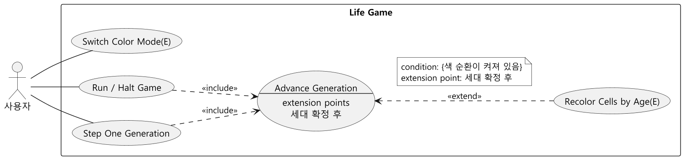
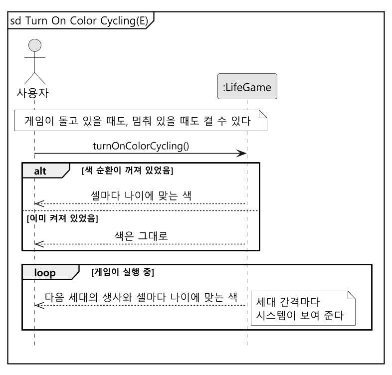
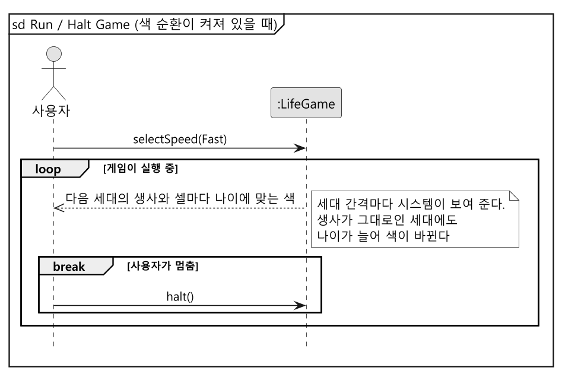
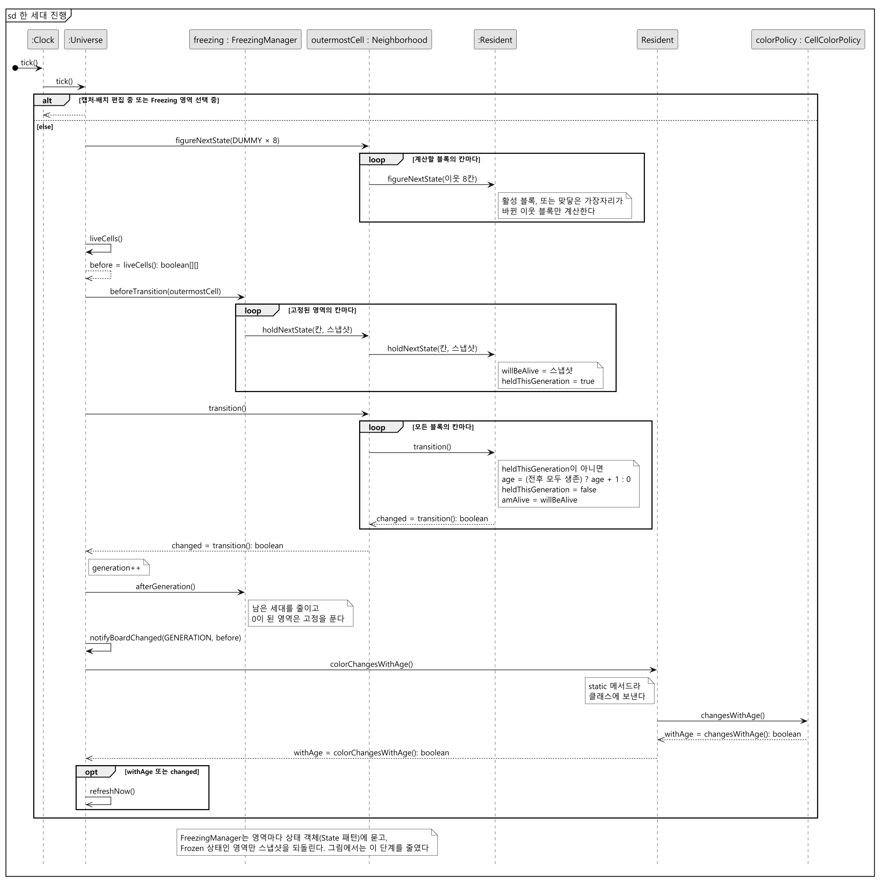
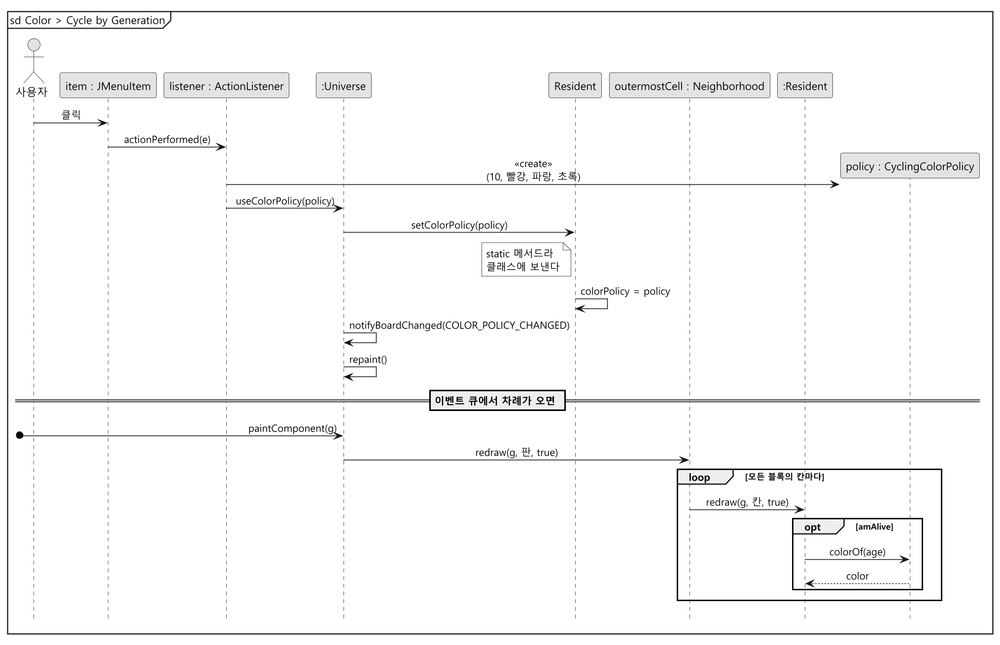
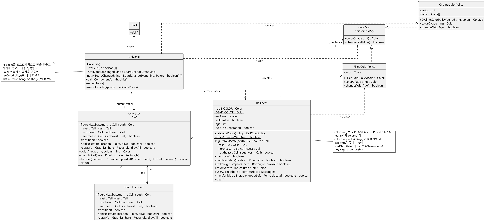
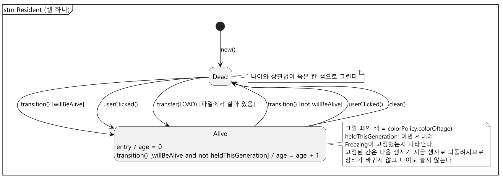

# 세대에 따른 셀 색 순환

살아 있는 셀의 색이 그 셀이 살아온 세대 수(나이)에 따라 바뀌고, 정해진 색을 돌아가며 순환하는 확장 기능이다. 원본 Life Game은 살아 있는 셀을 모두 빨강으로 그려서, 막 태어난 셀과 오래 살아남은 구조를 화면에서 구분할 수 없다. 이 기능은 셀의 나이를 색으로 보여 준다.

## 1. 기능 명세

### 1.1 기능 개요

Color 메뉴에서 Cycle by Generation을 고르면, 각 셀은 태어난 뒤 10세대마다 빨강 → 파랑 → 초록 → 빨강 순서로 색을 바꾼다. 기준은 게임 전체의 세대 수가 아니라 셀마다의 나이라서, 판 전체가 한꺼번에 바뀌지 않고 셀마다 태어난 시점에 따라 따로 바뀐다. Single Color를 고르면 원본처럼 모두 빨강으로 돌아간다. 처음에는 Single Color 상태라서 프로그램을 켠 직후의 화면은 원본과 같다.

나이는 색 순환이 꺼져 있을 때도 센다. 그래서 색 순환을 켜는 순간 각 셀이 살아온 세대 수에 맞는 색이 바로 나온다.

| 구분 | 내용 |
| --- | --- |
| 새로 만든 것 | 색을 정하는 규칙 `CellColorPolicy`와 그 구현 `FixedColorPolicy`(한 가지 색), `CyclingColorPolicy`(순환), Color 메뉴 |
| 고친 원본 클래스 | `Resident`(셀 하나): 나이를 세고, 칠할 색을 규칙에 묻는다<br>`Universe`(게임 판): 원본은 바뀌는 셀이 없으면 세대를 확정하지 않았는데, 멈춘 패턴도 나이를 먹도록 매 세대 확정하게 바꿨다. 원본은 바뀐 블록만 화면에 직접 그렸는데, 색 순환 중에는 매 세대 판 전체의 색이 바뀔 수 있어 판 전체 다시 그리기를 Swing의 `repaint()`로 요청하게 했다(5.9절). Color 메뉴로 색 규칙을 바꾼다 |
| 바꾸지 않은 것 | 생사 규칙, 저장 파일 형식, 기존 메뉴 항목과 동작 |

### 1.2 유스케이스

확장 유스케이스는 과제 안내문의 규칙대로 이름 끝에 `(E)`를 붙였다. 그림에는 색 순환 유스케이스와, 이들이 맞물리는 원본 유스케이스(Run / Halt Game, Step One Generation, Advance Generation)만 그렸다.



| 유스케이스 | 시작하는 곳 | 기존 유스케이스와의 관계 | 내용 |
| --- | --- | --- | --- |
| Turn On Color Cycling(E) | Color > Cycle by Generation | Recolor Cells by Age(E)를 «include» | 색 순환을 켜고, 고르는 즉시 판 전체를 각 셀의 나이에 맞는 색으로 다시 그린다 |
| Turn Off Color Cycling(E) | Color > Single Color | | 원본 빨강으로 되돌린다. 프로그램을 처음 실행했을 때와 같은 상태다 |
| Count Cell Age(E) | 세대가 진행될 때마다 | Advance Generation이 «include» | 살아남은 셀은 나이 +1, 새로 태어난 셀은 0. 색 순환이 꺼져 있어도 센다 |
| Recolor Cells by Age(E) | Color > Cycle by Generation을 고를 때, 그리고 색 순환이 켜져 있을 때 세대마다 | Advance Generation을 «extend» (조건: 색 순환이 켜져 있음) | 판 전체를 나이에 맞는 색으로 다시 그린다. 멈춘 패턴도 10세대마다 색이 바뀐다 |

- Advance Generation은 원본에서 한 세대를 계산하고 확정하는 부분이다. Run / Halt Game(Go 메뉴의 속도 선택)과 Step One Generation(Go > Tick)이 모두 이것을 «include»한다. 나이 세기와 색 다시 그리기는 이 공통 부분에 붙으므로, Run과 Step에 따로 그리지 않았다.
- Count Cell Age(E)는 «include»다. 나이는 색 순환을 켜든 끄든 매 세대 조건 없이 세고, 세대를 확정하는 단계 안에서 함께 계산되기 때문이다. 나이를 세려고 원본의 세대 진행에서 바꾼 것은 한 가지다. 바뀌는 셀이 없는 세대에도 세대를 확정하게 한 것이다(2.2절). 세대 진행의 결과(생사)는 원본 그대로다.
- Recolor Cells by Age(E)는 «extend»다. 색 순환이 켜져 있으면 확장 지점 "세대 확정 후"에서, 생사가 바뀐 셀이 없는 세대에도 판 전체를 다시 그린다. 꺼져 있으면 이 유스케이스는 일어나지 않고, Advance Generation은 원본처럼 셀이 바뀐 세대에만 다시 그린다.
- Recolor Cells by Age(E)는 Turn On Color Cycling(E)가 «include»하기도 한다. 켜는 순간 한 번 다시 그리는 것도 같은 동작이기 때문이다.

각 명세는 유스케이스 이름, 범위, 수준, 주 행위자, 사전 조건, 메인 성공 시나리오, 대체 시나리오, 연관 요구사항 순서로 적었다. 수준은 사용자가 직접 이루려는 목표(User goal)와, 다른 유스케이스 안에서 일어나는 부분(Subfunction)으로 나눴다. Subfunction 유스케이스의 주 행위자는 그것을 포함하는 쪽(확장이면 확장 대상) 유스케이스의 주 행위자를 따랐다. 시나리오는 메뉴 같은 화면 조작 대신 사용자의 의도와 시스템이 하는 일로 적었다. 메뉴 경로는 위 표에, 클래스 사이의 메시지는 3.3절의 시퀀스 다이어그램에 있다.

Advance Generation은 원본 유스케이스지만, 색 순환 유스케이스가 붙는 자리(포함하는 단계와 확장 지점)를 보이려고 먼저 적었다. 확장 지점은 강의 표기대로 번호 없이 단계 사이에 적었다.

| 유스케이스 이름 | Advance Generation |
| --- | --- |
| 범위 | Life Game |
| 수준 | Subfunction (Run / Halt Game, Step One Generation이 «include») |
| 주 행위자 | 사용자 (포함하는 Run / Halt Game, Step One Generation의 주 행위자를 따른다) |
| 사전 조건 | 영역 캡처·템플릿 배치 중이거나 Freezing 영역을 고르는 중이 아니다 |
| 메인 성공 시나리오 | 1. 시스템이 원본 규칙대로 판 전체의 다음 세대 생사를 계산한다.<br>2. 시스템이 다음 세대를 확정한다. 바뀌는 셀이 없는 세대에도 확정한다(원본에서 바꾼 점, 2.2절). Count Cell Age(E)를 포함한다(«include»).<br>extension point: 세대 확정 후<br>3. 시스템이 판 전체를 다시 그린다(원본에서 바꾼 점, 5.9절). |
| 대체 시나리오 | 1a. Freezing으로 고정된 셀이다:<br>&emsp;1. 시스템이 계산한 다음 세대 대신 고정한 순간의 생사로 확정한다.<br>3a. 생사가 바뀐 셀이 없다:<br>&emsp;1. 시스템이 판을 다시 그리지 않는다. |
| 연관 요구사항 | FR-4, NFR-1, NFR-2 |

| 유스케이스 이름 | Turn On Color Cycling(E) |
| --- | --- |
| 범위 | Life Game |
| 수준 | User goal |
| 주 행위자 | 사용자 |
| 사전 조건 | 없음. 게임이 돌고 있을 때도 멈춰 있을 때도 쓸 수 있다 |
| 메인 성공 시나리오 | 1. 사용자가 색 순환을 켜겠다고 요청한다.<br>2. 시스템이 색 규칙을 순환 규칙(셀의 나이 10세대마다 빨강 → 파랑 → 초록)으로 바꾼다.<br>3. Recolor Cells by Age(E)를 포함한다(«include»). |
| 대체 시나리오 | 2a. 색 순환이 이미 켜져 있다:<br>&emsp;1. 시스템이 같은 순환 규칙으로 다시 바꾼다. 화면의 색은 그대로다. |
| 연관 요구사항 | FR-1, FR-5 |

| 유스케이스 이름 | Turn Off Color Cycling(E) |
| --- | --- |
| 범위 | Life Game |
| 수준 | User goal |
| 주 행위자 | 사용자 |
| 사전 조건 | 없음. 게임이 돌고 있을 때도 멈춰 있을 때도 쓸 수 있다 |
| 메인 성공 시나리오 | 1. 사용자가 색 순환을 끄겠다고 요청한다.<br>2. 시스템이 색 규칙을 원본 빨강 한 가지 색으로 바꾼다.<br>3. 시스템이 판 전체를 다시 그려 살아 있는 셀을 모두 빨강으로 보여 준다. |
| 대체 시나리오 | 2a. 색 순환이 이미 꺼져 있다(프로그램을 켠 직후 포함):<br>&emsp;1. 시스템이 같은 빨강 규칙으로 다시 바꾼다. 화면의 색은 그대로다. |
| 연관 요구사항 | FR-2 |

| 유스케이스 이름 | Count Cell Age(E) |
| --- | --- |
| 범위 | Life Game |
| 수준 | Subfunction (Advance Generation이 매 세대 «include») |
| 주 행위자 | 사용자 (포함하는 Advance Generation의 주 행위자를 따른다) |
| 사전 조건 | Advance Generation이 다음 세대의 생사를 계산했고, 그 세대를 확정하는 중이다(Advance Generation 2단계). 색 순환이 꺼져 있어도 일어난다 |
| 메인 성공 시나리오 | 1. 시스템이 이번 세대 전후로 계속 살아 있는 셀의 나이를 1 늘린다.<br>2. 시스템이 새로 태어난 셀과 죽은 셀의 나이를 0으로 한다. |
| 대체 시나리오 | 1a. Freezing으로 고정된 셀이다:<br>&emsp;1. 시스템이 그 셀의 나이를 세지 않고 그대로 둔다.<br>&emsp;2. 고정이 풀리면 멈춘 나이에서 다시 센다. |
| 연관 요구사항 | FR-4, NFR-1 |

| 유스케이스 이름 | Recolor Cells by Age(E) |
| --- | --- |
| 범위 | Life Game |
| 수준 | Subfunction (Advance Generation의 확장 지점 "세대 확정 후"에서 «extend», Turn On Color Cycling(E)가 «include») |
| 주 행위자 | 사용자 (포함하는 Turn On Color Cycling(E)와, 확장 대상인 Advance Generation의 주 행위자를 따른다) |
| 사전 조건 | 색 순환이 켜져 있다(확장 조건) |
| 메인 성공 시나리오 | 1. 시스템이 판 전체를 다시 그린다.<br>2. 시스템이 살아 있는 셀은 나이에 맞는 색(1.3절)으로, 죽은 셀은 원본의 죽은 칸 색으로 칠한다. |
| 대체 시나리오 | 없음 |
| 연관 요구사항 | FR-5, FR-6, FR-9, NFR-4 |

FR-7과 FR-8은 이 기능의 유스케이스가 아니라, 셀을 살리거나 죽이는 다른 유스케이스(Edit Cells, Store / Load Board, Draw Cells by Dragging(E), Place Template(E), Undo Placement(E))에 "나이 0에서 시작한다"는 결과가 더해진 것이다. 나이가 바뀌는 경우 전체는 3.5.2절 표에 있다.

### 1.3 색을 정하는 규칙

```math
\mathrm{age}_{t+1}(x) = \begin{cases} \mathrm{age}_t(x) + 1 & \text{if } \mathrm{alive}_t(x) \wedge \mathrm{alive}_{t+1}(x) \\ 0 & \text{otherwise} \end{cases}
```

```math
\mathrm{color}(x) = c\left[ \left\lfloor \mathrm{age}(x) / N \right\rfloor \bmod K \right]
```

- N은 색이 바뀌는 세대 간격, K는 색의 개수다. N = 10, K = 3, c = \[빨강 `#FF0000`, 파랑 `#0072B2`, 초록 `#009E73`\]이다.
- 나이 0\~9는 빨강, 10\~19는 파랑, 20\~29는 초록, 30\~39는 다시 빨강이다. 한 바퀴는 30세대다.
- 빨강은 원본의 살아 있는 셀 색과 같다. 그래서 막 태어난 셀은 원본과 똑같이 보인다.
- 새로 태어난 셀, 마우스 클릭이나 드래그로 살린 셀, Grid > Load로 불러온 셀, 템플릿 배치로 새로 생긴 셀은 나이 0(빨강)에서 시작한다. 새로 태어난 셀은 부모 셀의 색을 물려받지 않는다.
- 죽은 셀은 원본의 죽은 칸 색으로 그린다. 죽으면 나이도 함께 사라진다.
- Freezing으로 고정된 칸은 고정된 동안 첫 번째 식을 따르지 않고 나이가 그대로다. 그래서 고정한 순간의 색을 유지한다.
- N, K, 색을 고른 근거와 부모 색을 물려받지 않게 한 이유는 5.5절에 있다.

### 1.4 요구사항

**기능 요구사항**

| ID | 요구사항 | 유스케이스 |
| --- | --- | --- |
| FR-1 | Color > Cycle by Generation을 고르면 색 순환이 켜지고, 세대를 기다리지 않고 바로 판 전체가 각 셀의 나이에 맞는 색으로 다시 그려진다 | Turn On Color Cycling(E) |
| FR-2 | Color > Single Color를 고르면 색 순환이 꺼지고, 바로 살아 있는 셀이 모두 원본 빨강으로 다시 그려진다 | Turn Off Color Cycling(E) |
| FR-3 | 프로그램을 시작하면 색 순환은 꺼져 있다 | 없음 (프로그램 시작 시 기본값) |
| FR-4 | 세대가 진행될 때마다 전후 모두 살아 있는 셀은 나이가 1 늘고, 새로 태어난 셀과 죽은 셀은 0이다. 색 순환이 꺼져 있어도 나이를 센다. Freezing으로 고정된 셀은 고정된 동안 나이가 멈춘다 | Count Cell Age(E) |
| FR-5 | 색 순환이 켜져 있으면 색은 1.3절의 공식을 따른다 | Turn On Color Cycling(E), Recolor Cells by Age(E) |
| FR-6 | 색 순환이 켜져 있으면 생사가 바뀌지 않은 세대에도 판 전체를 다시 그린다. 2×2 블록처럼 멈춘 패턴도 10세대마다 색이 바뀐다 | Recolor Cells by Age(E) |
| FR-7 | 클릭이나 드래그 그리기로 살린 셀, Load로 불러온 셀, 템플릿 배치로 새로 생긴 셀은 나이 0에서 시작한다 | Edit Cells, Store / Load Board, Draw Cells by Dragging(E), Place Template(E) (다른 기능) |
| FR-8 | 템플릿 배치와 그 되돌리기는 이미 살아 있던 다른 셀의 나이를 바꾸지 않는다 | Place Template(E), Undo Placement(E) (캡처·템플릿 기능) |
| FR-9 | 죽은 셀은 원본의 죽은 칸 색으로 그린다 | Recolor Cells by Age(E) |

**비기능 요구사항**

| ID | 요구사항 | 기준 |
| --- | --- | --- |
| NFR-1 | 생사 규칙이 바뀌지 않는다 | 색 순환을 켜든 끄든 매 세대 생사가 Life 규칙을 직접 계산한 결과와 같다 |
| NFR-2 | 색 순환이 꺼져 있으면 원본과 같게 동작한다 | 원본 동작을 검사하는 기존 테스트(`ResidentTest`, `NeighborhoodTest`, `UniverseStoreTest`)를 색 기능 때문에 고친 곳 없이 모두 통과한다 |
| NFR-3 | 저장 파일 형식을 바꾸지 않는다 | 나이는 저장하지 않는다. 기존 .life 파일을 그대로 읽는다 |
| NFR-4 | 색 순환을 켜고 Fast·Medium으로 계속 돌려도 클릭과 메뉴가 밀리지 않는다 | 입력 처리 대기 10 ms 이하 (측정 최대 3 ms, 5.9절) |
| NFR-5 | 색 규칙과 나이 계산은 게임 창 없이 테스트할 수 있다 | 모델(셀, 블록, 색 규칙)만으로 도는 테스트가 있다 |
| NFR-6 | 세 색이 서로, 그리고 판의 다른 색과 구분된다 | 판 색상과 구분되면서 서로 다른 색상 |
| NFR-7 | 색 규칙 객체는 만들 때 잘못된 값을 거부하고, 만든 뒤에는 바뀌지 않는다 | 간격 0 이하, 색 2개 미만, 빈 값(null)은 객체를 만들 때 예외로 거부한다 |
| NFR-8 | 새 색 규칙을 더할 때 셀의 나이 세기와 그리기 코드를 고치지 않는다 | `CellColorPolicy` 구현 클래스 하나와 Color 메뉴 항목 한 줄만 더한다. `Resident`는 처음 값으로 `FixedColorPolicy`를 하나 만들 뿐 색은 `CellColorPolicy` 인터페이스로만 묻고, 틱 처리도 `changesWithAge()`로만 다시 그릴지를 정한다(4.1절) |

### 1.5 기존 기능에 미치는 영향

다음 세대의 생사는 원본 규칙대로 자기 상태와 살아 있는 이웃 수만으로 정해진다. 나이와 색은 이 계산에 쓰이지 않으므로, 색 순환을 켜든 끄든 다음 세대의 생사는 원본과 같다(NFR-1\~3).

| 기존 기능 | 색 순환 꺼짐 (기본) | 색 순환 켜짐 |
| --- | --- | --- |
| 마우스 클릭으로 셀 켜기·끄기 | 변화 없음 | 그대로 동작. 새로 켠 셀은 나이 0이라 빨강 |
| Go > Tick, Halt, Agonizing·Slow·Medium·Fast | 변화 없음 | 생사 결과 그대로. 세대 간격은 손대지 않음 |
| Grid > Clear | 변화 없음 | 그대로 동작. 그 뒤 다시 살린 셀은 빨강 |
| Grid > Store / Load | 변화 없음 | 살아 있는 셀은 그대로 복원. 나이는 저장되지 않아 불러온 셀은 빨강부터 다시 시작 |
| Grid > Exit | 변화 없음 | 변화 없음 |
| 활성 블록의 파란 테두리 | 변화 없음. 판이 멈춘 뒤에도 남음 | 판이 멈추면 한 세대 뒤에 지워짐 |

메뉴에는 Grid, Go 뒤에 Color 메뉴가 생긴다. 생사가 원본과 같은지는 JUnit으로 확인한다(NFR-1 `lifeRuleIsUnchanged`, NFR-2 기존 테스트, 6.5절).

## 2. 기존 코드에서 바뀐 부분

원본 클래스 중 `Resident`와 `Universe`를 고쳤다. 아래에는 코드를 옮기는 대신 원본과 무엇이 달라졌는지를 적었다. 여기서 원본은 색 기능을 붙이기 전의 코드다. Holub 원본에 있던 오류(`transition()`이 반대 값을 돌려주던 것 등)는 그 전에 따로 고쳤다([fix-life-game-changes.md](../fixes/fix-life-game-changes.md)). 테스트 설정(`build.gradle`의 `forkEvery = 1`)을 바꾼 이유는 5.10절에 있다.

### 2.1 Resident: 나이를 세고 색을 규칙에 묻는다

원본 Resident는 셀의 생사(`amAlive`, `willBeAlive`)만 가지고, 살아 있는 셀을 상수 `LIVE_COLOR`(빨강)로 칠했다. 여기에 셀마다의 나이와, 모든 셀이 함께 쓰는 색 규칙을 더했다.

| 부분 | 원본 | 바뀐 뒤 |
| --- | --- | --- |
| 필드 | `amAlive`, `willBeAlive` | 셀마다 `age`(연속으로 살아남은 세대 수)를 더했다. 모든 셀이 함께 쓰는 static `colorPolicy`를 더했고, 처음 값은 원본 빨강 한 가지 색(`FixedColorPolicy(LIVE_COLOR)`)이다<br>이유: 색을 나이로 정하려면 셀마다 나이가 있어야 한다. 색 규칙은 판 전체에 하나라서 모든 셀이 참조 하나를 함께 쓴다(5.3절) |
| `LIVE_COLOR` | Resident 안에서만 쓰는 상수(`private`) | `private`을 떼어 같은 패키지 안에서 쓸 수 있게 했다. 값(빨강)은 그대로다<br>이유: Color 메뉴가 같은 빨강을 쓰게 해서, 처음 값과 Single Color, 순환의 첫 색이 어긋나지 않게 한다(5.8절) |
| 새 메서드 | | `setColorPolicy()`: 규칙을 바꾼다. null은 거부한다<br>`colorChangesWithAge()`: 지금 규칙이 나이에 따라 색이 바뀌는지 알려 준다<br>둘 다 같은 패키지 안에서만 쓴다<br>이유: Color 메뉴가 규칙을 바꾸고, Universe가 구체 규칙을 몰라도 다시 그릴지를 정하게 한다(5.6절) |
| `transition()` | 다음 생사로 바꾸고, 생사가 바뀌었는지 돌려준다 | 바꾸기 전에 나이를 정한다. 전후 모두 살아 있으면 1을 더하고, 그 밖에는 0이다. 돌려주는 값은 원본과 같다<br>이유: 세대를 넘길 때 모든 셀에 한 번씩 불린다. 다음 상태 계산(`figureNextState()`)은 멈춘 블록을 건너뛰어 그곳에서는 멈춘 셀의 나이를 셀 수 없다(5.1절) |
| `redraw()` | 살아 있으면 `LIVE_COLOR`, 죽었으면 죽은 칸 색 | 살아 있으면 `colorPolicy.colorOf(age)`, 죽었으면 죽은 칸 색<br>이유: 색을 정하는 방법을 규칙 객체에 맡겨, 규칙이 늘어도 Resident를 고치지 않는다(4.1절) |
| `userClicked()` | 생사를 뒤집는다 | 뒤집은 뒤 나이를 0으로 둔다<br>이유: 클릭으로 살린 셀은 막 생긴 셀이다. 죽인 셀의 나이는 쓰지 않으므로 조건 없이 0으로 둔다(5.7절) |
| `transfer()`의 Load | 불러온 생사를 넣는다 | 넣기 전에 나이를 0으로 둔다. 나이는 저장하지 않는다<br>이유: 저장 파일 형식을 바꾸지 않으므로 파일에 나이가 없다(5.4절) |
| `clear()`, 생성자, `create()` | | 바뀌지 않음<br>이유: 죽은 셀의 나이는 그리지 않고, 다시 살아날 때 위 경로 중 하나가 0으로 둔다(5.7절) |

`transition()`이 돌려주는 값(생사가 바뀌었는가)이 원본과 같으므로, Resident와 Neighborhood가 주고받는 "변화"의 뜻도 그대로다. 블록 계산 건너뛰기와 활성 블록 표시가 원본처럼 동작한다.

Freezing 기능은 고정된 칸의 다음 생사를 `holdNextState()`로 고정한 순간의 상태로 되돌리고, 그 칸은 이번 `transition()`에서 나이를 세지 않게 했다. 고정된 칸은 클릭·드래그·템플릿 배치가 막혀 있어서, 고정된 동안 생사가 뒤집히지 않는다.

### 2.2 Universe: 매 틱 세대를 확정한다

원본 Universe의 틱 처리는 다음 상태를 계산해 바뀔 셀이 있을 때만 세대를 확정했고, 확정해서 바뀐 셀이 있을 때만 바뀐 블록을 다시 그렸다. 여기에 멈춘 패턴도 나이를 세고 색이 바뀌도록, 세대는 매 틱 확정하고 색 순환이 켜져 있으면 판 전체를 매 틱 다시 그리게 했다.

| 단계 | 원본 | 바뀐 뒤 |
| --- | --- | --- |
| 다음 상태 계산(`figureNextState()`) | 바뀔 셀이 없으면 여기서 멈췄다 | 결과와 상관없이 다음 단계로 간다<br>이유: 바뀔 셀이 없는 세대에도 나이를 세려면 확정까지 가야 한다 |
| 세대 확정(`transition()`) | 바뀔 셀이 있을 때만 | 매 틱. 바뀌는 셀이 없어도 나이를 센다<br>이유: 멈춘 패턴도 나이를 먹어야 10세대마다 색이 바뀐다(FR-6). 생사 결과는 원본과 같다(5.1절) |
| 다시 그리는 조건 | 확정해서 바뀐 셀이 있을 때 | 색 순환이 켜져 있으면 매 틱(`Resident.colorChangesWithAge()`로 묻는다). 꺼져 있으면 원본처럼 바뀐 셀이 있을 때<br>이유: 색 순환 중에는 생사가 그대로여도 색이 바뀔 수 있다. 꺼져 있을 때는 원본과 같게 그린다(NFR-2) |
| 다시 그리는 방법(`refreshNow()`) | 바뀐 블록만 화면에 바로 그렸다 | 판 전체 다시 그리기를 Swing의 `repaint()`로 요청한다<br>이유: 원본 방식으로 판 전체를 그리면 Fast에서 클릭과 메뉴가 수 초씩 밀렸다. `repaint()`는 밀린 요청을 하나로 합친다(5.9절) |

캡처·템플릿 기능도 편집 오버레이를 그리려고 `refreshNow()`를 같은 방식으로 바꿔서, 지금은 `refreshNow()`가 `repaint()`만 부른다.

다른 기능도 틱 처리에 단계를 더했다. 통계는 확정 전에 판을 복사해 두었다가 확정 뒤 알리고, Freezing은 계산과 확정 사이에서 고정된 칸의 다음 생사를 되돌리고, 캡처·템플릿 편집이나 Freezing 영역 선택 중이면 틱을 건너뛴다. 이 단계들은 위 표의 규칙(매 틱 확정, 다시 그리는 조건)을 바꾸지 않는다. 전체 순서는 3.3.1절의 시퀀스 다이어그램에 있다.

### 2.3 Universe: Color 메뉴

원본의 Grid, Go 메뉴와 같은 방식(`MenuSite.addLine()`)으로 Color 메뉴를 더했다. Go 메뉴는 시계가 처음 만들어질 때 생기므로, 시계 리스너를 등록한 뒤에 추가해 Color 메뉴가 Go 뒤에 오게 했다.

| 메뉴 항목 | 만드는 색 규칙 |
| --- | --- |
| Single Color | `FixedColorPolicy(LIVE_COLOR)`: 원본 빨강 한 가지 색 |
| Cycle by Generation | `CyclingColorPolicy(10, 빨강, 파랑 #0072B2, 초록 #009E73)`: 10세대마다 다음 색 |

두 항목은 모두 새로 만든 `useColorPolicy()`를 거친다. 이 메서드는 `Resident.setColorPolicy()`로 규칙을 바꾸고, 통계 기능에 규칙이 바뀌었음을 알린 뒤, `repaint()`로 판 전체를 다시 그리게 요청한다. 그래서 시계가 멈춰 있어도 고른 규칙의 색이 바로 보인다.

### 2.4 새로 만든 클래스

| 클래스 | 하는 일 |
| --- | --- |
| `CellColorPolicy` | 색 규칙의 인터페이스. 나이로 색을 정하는 `colorOf(age)`와, 나이에 따라 색이 바뀌는 규칙인지 알려 주는 `changesWithAge()`가 있다 |
| `FixedColorPolicy` | 나이와 상관없이 한 가지 색. `changesWithAge()`는 false다. 원본 빨강에 쓴다 |
| `CyclingColorPolicy` | `period` 세대마다 다음 색, 마지막 색 다음에는 처음 색(`colors[(age / period) % colors.length]`). `changesWithAge()`는 true다 |

| 정한 것 | 이유 |
| --- | --- |
| 두 구현 모두 만든 뒤 바뀌지 않는 객체다(`final` 클래스, `private final` 필드, setter 없음) | 4,096개 셀이 규칙 객체 하나를 함께 쓰고, 그리기와 틱 처리가 함께 읽는다. 내용이 바뀔 수 있으면 `setColorPolicy()`와 다시 그리기 요청 없이 모든 셀의 색이 바뀐다 |
| 생성자에서 색 배열을 복사한다 | 넘긴 배열을 바깥에서 바꿔도 규칙이 바뀌지 않게 한다 |
| 잘못된 값(간격 0 이하, 색 2개 미만, 빈 값)은 생성자에서 거부한다 | 거부하지 않으면 그리는 도중에 예외가 나거나 엉뚱한 색이 칠해진다. 실수가 객체를 만드는 줄에서 바로 드러나게 한다 |
| `CyclingColorPolicy`는 색이 2개 이상이어야 한다 | 색이 1개면 색이 바뀌지 않는데도 매 틱 판 전체를 다시 그리게 된다. 한 가지 색은 `FixedColorPolicy`가 맡는다 |

### 2.5 다른 기능과 맞물린 부분

| 기능 | 맞물린 곳 | 지금 상태 |
| --- | --- | --- |
| 캡처·템플릿 | 템플릿 배치와 되돌리기가 셀을 살리고 죽이는 경로 | 바뀌는 칸만 `userClicked()`로 편집한다. 새로 생긴 셀은 나이 0이고, 기존 셀의 나이는 그대로다 |
| 캡처·템플릿 | `refreshNow()`, 시계 | `refreshNow()`가 `repaint()`를 부르고, 시계가 Swing 타이머로 바뀌어 틱이 이벤트 스레드에서 돈다 |
| 사운드 | 틱 처리 | 통계 기능과 같은 `GENERATION` 이벤트로 생긴 셀과 사라진 셀을 받는다. 매 틱 `transition()`을 부르는 순서는 그대로다 |
| Freezing | 틱 처리, `Resident.transition()`의 나이 계산 | `figureNextState()`와 `transition()` 사이에서 고정된 칸의 다음 생사를 되돌리고, 그 칸은 나이를 세지 않는다. 그래서 고정된 셀은 색 순환 중에도 고정한 순간의 색을 유지하고, 풀리면 멈춘 나이에서 다시 센다(2.1절) |
| 통계 | 틱 처리, 색별 집계 | 매 틱 확정 전에 판을 복사해 두고, 확정 뒤 `GENERATION` 이벤트로 통계와 사운드에 알린다. `Cell.colorAt()`을 더해 살아 있는 셀을 화면 색별로 세고, `useColorPolicy()`가 `COLOR_POLICY_CHANGED`로 규칙이 바뀌었음을 알린다(5.11절) |

## 3. 구조와 동작(UML 다이어그램)

설계 순서대로 다이어그램을 둔다. 유스케이스(1.2절)로 정한 사용자 목표에서 시스템 시퀀스 다이어그램으로 시스템 연산을 뽑고, 연산 계약으로 각 연산이 끝난 뒤의 상태를 정한다. 이어서 시퀀스 다이어그램으로 객체 사이의 메시지를 그리고, 거기에 나온 클래스와 관계를 클래스 다이어그램으로 모은다. 상태에 따라 동작이 달라지는 색 모드와 셀의 나이는 마지막에 상태 다이어그램으로 그렸다.

### 3.1 시스템 시퀀스 다이어그램

게임을 블랙박스로 보면, 이 기능이 새로 만들거나 바꾼 시스템 연산은 셋이다. 시스템 시퀀스 다이어그램은 유스케이스마다 한 장씩 그렸다. 이벤트 이름은 메뉴 항목이 아니라 사용자의 의도로 적었고, 반환은 화면 모습이 아니라 사용자가 받는 정보로 적었다. 세대를 넘기는 시계는 게임 안에 있으므로 입력으로 그리지 않았다. 사용자가 속도를 고르면 시스템이 세대 간격마다 다음 세대를 보여 주므로, 이 부분은 시스템에서 사용자로 가는 출력만 loop로 그렸다. 켜기와 끄기는 이미 그 상태였을 때(대체 시나리오 2a)를 alt로 나누고, 그 뒤 게임이 돌면 세대마다 어떤 색을 받는지까지 그렸다. Run / Halt Game에서 halt()는 세대 진행을 끝내는 입력이라 loop 안의 break로 그렸다.






| 시스템 연산 | 실제 입력 | 이 기능과의 관계 |
| --- | --- | --- |
| `turnOnColorCycling()` | Color > Cycle by Generation | 새로 생김 |
| `turnOffColorCycling()` | Color > Single Color | 새로 생김 |
| `advanceGeneration()` | Go 메뉴에서 속도를 고른 뒤 세대 간격마다, 또는 Go > Tick (Single Step) | 원본에 있던 연산(Advance Generation)이고 사후 조건이 바뀜 |

### 3.2 연산 계약

3.1절의 시스템 연산마다 연산 계약을 적었다. 사후 조건은 모델 객체의 상태 변화만 적는다. 화면을 다시 그리는 것은 객체 상태의 변화가 아니므로 넣지 않았다.

**CO1: turnOnColorCycling()**

- Operation: `turnOnColorCycling()`
- Cross References: Turn On Color Cycling(E)
- Preconditions:
  - Resident가 색 규칙 하나와 연관되어 있다(모든 셀이 함께 쓰는 연관). 프로그램을 켠 직후에는 원본 빨강의 `FixedColorPolicy`다
  - 살아 있는 Resident마다 `age`가 세어져 있다. 색 순환이 꺼져 있던 동안에도 세대마다 셌다
- Postconditions:
  - `CyclingColorPolicy` 인스턴스 cp가 생성되었다 (인스턴스 생성)
  - cp.period가 10이 되었다 (속성 변경)
  - cp.colors가 \[빨강, 파랑, 초록\]이 되었다 (속성 변경)
  - Resident와 이전 색 규칙의 연관이 끊어졌다 (연관 해제)
  - Resident가 cp와 연관되었다. 모든 셀이 함께 쓰는 연관이다 (연관 형성)

**CO2: turnOffColorCycling()**

- Operation: `turnOffColorCycling()`
- Cross References: Turn Off Color Cycling(E)
- Preconditions:
  - Resident가 색 규칙 하나와 연관되어 있다(모든 셀이 함께 쓰는 연관)
- Postconditions:
  - `FixedColorPolicy` 인스턴스 fp가 생성되었다 (인스턴스 생성)
  - fp.color가 `Resident.LIVE_COLOR`(빨강)가 되었다 (속성 변경)
  - Resident와 이전 색 규칙의 연관이 끊어졌다 (연관 해제)
  - Resident가 fp와 연관되었다. 모든 셀이 함께 쓰는 연관이다 (연관 형성)

CO1과 CO2는 색 규칙만 바꾸고 셀의 나이는 건드리지 않는다. 그래서 켜는 순간 각 셀이 살아온 세대 수에 맞는 색이 바로 나온다.

**CO3: advanceGeneration()**

- Operation: `advanceGeneration()`
- Cross References: Run / Halt Game, Step One Generation, Advance Generation, Count Cell Age(E), Recolor Cells by Age(E)
- Preconditions:
  - 캡처·배치 편집 중이 아니다
  - Freezing 영역을 고르는 중이 아니다
- Postconditions:
  - Freezing으로 고정되지 않은 모든 Resident r의 r.amAlive가 이번 세대에 계산된 다음 생사가 되었다 (속성 변경)
  - 그중 세대 전후 모두 살아 있는 r의 r.age가 이전 r.age + 1이 되었다. 생사가 바뀐 셀이 없는 세대에도 그렇다 (속성 변경)
  - 그 밖의 r의 r.age가 0이 되었다 (속성 변경)

`advanceGeneration()`은 사용자가 직접 부르는 연산이 아니라, 속도를 고른 뒤 시스템이 세대 간격마다 일으키거나 Go > Tick이 한 번 일으키는 연산이다. 원본의 세대 진행은 바뀔 셀이 없으면 확정하지 않았다. 원본에는 나이가 없어서 그래도 상태가 같았지만, 이 기능에서는 멈춘 패턴도 나이를 먹어야 하므로 "생사가 바뀐 셀이 없는 세대에도"라는 사후 조건이 생겼다. 사후 조건에서 Freezing으로 고정된 Resident를 빼는 조건은 Freezing 기능이 더한 것이다. 고정된 Resident는 amAlive와 age가 고정한 순간의 값 그대로다. 셀을 살리거나 죽이는 다른 유스케이스의 연산에도 "생사가 바뀐 셀의 `age`가 0이 되었다"는 사후 조건이 하나씩 더해졌다. 클릭(Edit Cells), 드래그 그리기(Draw Cells by Dragging(E)), 템플릿 배치와 되돌리기(Place Template(E), Undo Placement(E)), Load(Store / Load Board)가 여기에 해당한다. 생사가 바뀌지 않은 다른 셀의 나이는 그대로다(FR-7, FR-8).

### 3.3 시퀀스 다이어그램

#### 3.3.1 한 세대가 진행되는 순서

시스템 연산 `advanceGeneration()`(3.2절 CO3)이 객체 사이에서 어떻게 처리되는지 원본과 지금을 비교한다. 필드에 값을 넣는 것은 메시지가 아니라서 해당 객체 옆 노트로 적었고, `refreshNow()`와 `repaint()`는 다시 그리기 요청만 넣고 바로 돌아오므로 비동기 메시지(열린 화살촉)로 그렸다. 시계 리스너와 메뉴 리스너는 Universe 안의 익명 객체라 그림에서는 `:Universe`로 합쳐 그렸다. Neighborhood는 블록 안의 블록을 거쳐 Resident까지 내려가지만, 그림에서는 이 Composite 재귀를 "칸마다" loop 하나로 줄였다. 지금 그림의 `FreezingManager`도 영역마다 상태 객체에 묻는 단계를 줄여, 고정된 칸마다 `holdNextState()`를 부르는 loop로 그렸다.




1. Swing 타이머가 `Clock.tick()`을 부르고, 시계가 Universe의 틱 리스너를 부른다.
2. 캡처·배치 편집 중이거나 Freezing 영역을 고르는 중이면 여기서 끝난다.
3. `outermostCell.figureNextState()`: 블록마다, 셀마다 다음 생사를 계산한다. 원본처럼 활성 블록과, 맞닿은 가장자리가 바뀐 이웃 블록만 계산하고 나머지 블록은 건너뛴다. 이어서 확정 전의 판을 복사해 둔다(통계 기능).
4. `freezing.beforeTransition()`: 고정된 영역의 칸마다 다음 생사를 고정한 순간의 상태로 되돌린다(`holdNextState()`, Freezing 기능).
5. `outermostCell.transition()`: 모든 블록, 모든 셀이 다음 생사를 확정한다. 이때 각 Resident가 나이를 정하고, 4에서 고정된 칸은 나이를 세지 않는다. 확정이 도는 동안 그리기는 원본의 `readingPermitted` 장치로 막힌다.
6. 세대 수를 1 늘리고 `freezing.afterGeneration()`이 각 영역의 남은 세대를 줄인다. 0이 된 영역은 고정이 풀린다(Freezing 기능).
7. `GENERATION` 이벤트로 통계와 사운드에 생긴 셀, 사라진 셀, 살아 있는 셀의 색을 알린다(통계 기능).
8. `Resident.colorChangesWithAge()`가 true면, 또는 바뀐 셀이 있으면 `repaint()`를 요청한다.
9. 이벤트 큐에서 차례가 오면 Swing이 `paintComponent()`를 부른다. `outermostCell.redraw(g, 판, true)`가 블록을 거쳐 각 Resident의 `redraw()`를 부르고, 살아 있는 셀은 `colorPolicy.colorOf(age)`의 색으로 칠해진다.

이 기능이 원본과 다르게 만든 곳은 5(바뀌는 셀이 없어도 확정), 8(색 순환 중에는 바뀐 셀이 없어도 다시 그림), 9(바뀐 블록만 직접 그리던 것을 판 전체 `repaint()` 요청으로 바꿈, 5.9절)이다. 1의 Swing 타이머, 2, 3의 판 복사, 4, 6, 7은 다른 기능이 바꾸거나 더한 것이다.

#### 3.3.2 Color 메뉴를 고를 때

시스템 연산 `turnOnColorCycling()`(3.2절 CO1)의 상호작용이다. `turnOffColorCycling()`(CO2)은 만드는 객체가 `FixedColorPolicy`라는 것만 다르다.



1. 메뉴 항목을 고르면 Universe 안의 메뉴 리스너가 규칙 객체를 만든다. Single Color는 `new FixedColorPolicy(Resident.LIVE_COLOR)`, Cycle by Generation은 `new CyclingColorPolicy(10, 빨강, 파랑, 초록)`이다.
2. `useColorPolicy()`가 `Resident.setColorPolicy()`로 static 참조를 바꾼다. 셀의 나이는 바뀌지 않는다. 이어서 `COLOR_POLICY_CHANGED` 이벤트로 통계 기능에 알린다.
3. `repaint()`로 판 전체를 다시 그리도록 요청한다. 시계가 멈춰 있어도 새 규칙의 색이 바로 보인다.
4. 다음 틱부터 Universe는 `colorChangesWithAge()`로 새 규칙에 물어 다시 그릴지를 정한다. 메뉴는 규칙만 바꾸고, 다시 그리는 방식을 따로 바꾸지 않는다.

### 3.4 클래스 다이어그램

색 기능을 붙이기 전(원본)과 지금의 클래스 다이어그램이다. 3.3절 시퀀스 다이어그램의 클래스 중 Freezing 관리자와 메뉴 항목을 뺀 것과 상위 타입 `Cell`, 그리고 `FixedColorPolicy`를 그렸다. 멤버는 색 순환 기능과 관련된 것만 빠짐없이 적었고, 원본 그림에는 그중 원본에도 있던 것을 적었다. 관련 멤버는 다음 셋 중 하나에 드는 것이다.

- 이 기능이 더하거나 바꾼 멤버
- 셀의 생사·나이·색을 담거나 바꾸거나, 그 값으로 색을 정하는 멤버
- 3.3절 시퀀스 다이어그램이 부르는 메서드

멤버는 가시성과 이름만 적었다. 바뀐 내용은 2장에, 패턴 역할은 아래 표와 4.1절에 있다.




- 밑줄은 static 멤버다.
- `LIVE_COLOR`는 Color 메뉴도 쓰므로 private(`-`)에서 package(`~`)로 바뀌었다.
- `Cell.colorAt()`은 통계 기능이 더한 메서드다. 같은 `colorPolicy.colorOf(age)`로 색을 받으므로 함께 그렸다.
- `holdNextState()`와 `heldThisGeneration`은 Freezing 기능이 더한 멤버다. 고정된 칸의 나이 계산을 막으므로 함께 그렸다(2.1절).
- Universe의 `paint()`가 `paintComponent()`로 바뀐 것은 캡처·템플릿 기능의 변경이다. 그래서 원본 그림에는 `paint()`를 적었다.
- Universe의 `liveCells()`는 사운드 기능이, `notifyBoardChanged()`는 통계 기능이 더한 메서드다. 틱 처리와 Color 메뉴(3.3절)가 부르므로 함께 그렸다.
- 틱 리스너와 Color 메뉴의 리스너는 Universe 생성자 안의 익명 객체라 Universe의 메서드로는 나오지 않는다. 그래서 생성자 `Universe()`를 적었다. `repaint()`는 JPanel에서 물려받은 메서드라 적지 않았다.
- Neighborhood는 셀의 생사·나이·색을 직접 갖지 않으므로, 3.3절의 시퀀스 다이어그램이 부르는 메서드만 적었다.

| 클래스 | 원본에서의 역할 | 이 기능에서 바뀐 역할 |
| --- | --- | --- |
| `Cell` (인터페이스) | Composite의 Component | 바뀌지 않음 |
| `Neighborhood` | Composite. 8×8 칸을 가진 블록. 판은 블록 8×8개 | 바뀌지 않음 |
| `Resident` | Composite의 Leaf. 셀 하나. 판을 만들 때 프로토타입으로 `create()`된다 | Strategy의 Context. 나이를 세고, static `colorPolicy`에 색을 묻는다 |
| `Universe` | Singleton. 판을 그리고 시계 틱을 받는다 | Strategy의 Client. Color 메뉴에서 규칙을 만들어 바꿔 끼우고, 틱마다 다시 그릴지를 정한다 |
| `CellColorPolicy` | (없음) | Strategy |
| `FixedColorPolicy`, `CyclingColorPolicy` | (없음) | ConcreteStrategy |

- Resident에서 CellColorPolicy로 가는 연관은 static이다. 셀 하나가 아니라 Resident 클래스가 규칙 참조를 하나 가진다. 그래서 메뉴에서 한 번 바꾸면 4,096칸이 모두 같은 규칙을 쓴다.
- Universe는 구체 규칙을 만들 때(Color 메뉴)만 두 구현 클래스를 안다. 틱 처리는 `Resident.colorChangesWithAge()`만 묻는다.

### 3.5 상태 다이어그램

#### 3.5.1 색 모드

Color 메뉴로 고른 색 규칙을 상태로 보면 아래와 같다. 두 상태의 차이는 바뀐 셀이 없는 틱에도 다시 그리는지(내부 전이 `tick()`)뿐이다.


- 같은 메뉴를 다시 고르면 같은 내용의 새 규칙 객체로 바뀐다. 자기 전이라서 전이 액션의 `repaint()`도 다시 일어나지만 화면은 그대로다.
- 이 상태는 Strategy 객체를 바꿔 끼운 결과다. State 패턴으로 만들지 않은 이유는 5.2절에 있다.

#### 3.5.2 셀의 나이



- Alive로 들어오는 길은 셋(세대 진행으로 태어남, 클릭, Load)이고, 모두 들어오는 순간 나이가 0이 된다. 드래그 그리기와 템플릿 배치도 클릭과 같은 `userClicked()`를 거친다. 그래서 `entry / age = 0` 하나로 적었다.
- Alive에 머무는 동안에는 세대 진행이 내부 전이로 나이를 1씩 늘린다. 상태를 나가고 다시 들어오는 것이 아니라서 entry 동작은 일어나지 않는다.
- Freezing으로 고정된 칸(`heldThisGeneration`이 true)은 다음 생사가 지금 생사로 되돌려져 상태가 바뀌지 않고, 내부 전이의 조건 `[not heldThisGeneration]`에 걸려 나이도 늘지 않는다.
- Clear는 셀을 죽이기만 하고 나이는 고치지 않는다. 죽은 셀은 나이를 쓰지 않고, 다시 살아날 때 0이 되므로 남은 값이 보이지 않는다.

| 사건 | 생사 | 나이 | 코드 |
| --- | --- | --- | --- |
| 세대 진행, 살아남음 | 산다 → 산다 | +1 | `transition()` |
| 세대 진행, 태어남 | 죽음 → 산다 | 0 | `transition()` |
| 세대 진행, 죽음 | 산다 → 죽음 | 0 (그리지 않음) | `transition()` |
| 클릭, 드래그 그리기 | 뒤집힘 (드래그는 상태가 다른 칸만) | 0 | `userClicked()` |
| Grid > Load | 파일대로 | 0 | `transfer()` |
| Grid > Clear | 모두 죽음 | 그대로 둠 (그리지 않음) | `clear()` (원본 그대로) |
| 템플릿 배치, 드래그 연속 배치 | 새로 생긴 칸만 산다 | 새 셀만 0 | `userClicked()` (캡처·템플릿 기능이 부름) |
| 배치 되돌리기 | 이번에 생긴 칸만 죽음 | 그 칸만 0 | `userClicked()` |
| 세대 진행, Freezing으로 고정된 칸 | 고정한 순간 그대로 | 그대로 (세지 않음) | `holdNextState()` 뒤 `transition()` (Freezing 기능) |
| Freezing이 풀린 뒤 세대 진행 | Life 규칙대로 | 멈췄던 나이에서 다시 +1 | `transition()` |
| Color 메뉴 | 바뀌지 않음 | 바뀌지 않음 | `setColorPolicy()` |

죽음에서 산다로 가는 모든 길이 나이를 0으로 만든다. 그래서 살아 있는 셀의 나이는 언제나 "지금 살아난 뒤 지난 세대 수"다.

## 4. 적용한 설계 패턴

### 4.1 Strategy

| 역할 | 클래스 | 이 코드에서 하는 일 |
| --- | --- | --- |
| Strategy | `CellColorPolicy` | 나이로 색을 정하는 방법과, 나이에 따라 색이 바뀌는지를 정한다 |
| ConcreteStrategy | `FixedColorPolicy`, `CyclingColorPolicy` | 고정 색(원본 빨강) / `period` 세대마다 다음 색 |
| Context | `Resident` | `redraw()`가 static `colorPolicy`의 `colorOf(age)`로 칸의 색을 받는다. 규칙의 종류는 모른다 |
| Client | `Universe` | Color 메뉴에서 ConcreteStrategy를 만들어 `Resident.setColorPolicy()`로 바꿔 끼운다 |

- 바뀌는 부분(색 규칙)과 바뀌지 않는 부분(생사 규칙, 그리기 위치 계산)을 분리했다(2강 13쪽, 10강 10쪽).
- Strategy는 알고리즘을 쓰는 쪽과 독립적으로 바꿀 수 있게 하고, 상속 대신 구성과 위임을 쓴다(2강 38쪽). 메뉴에서 규칙을 고르는 동작이 "규칙 객체를 바꾼다"로 그대로 옮겨진다.
- 색 규칙이 늘거나 바뀌어도 Resident를 고치지 않는다. Resident는 생사 규칙, 그리기, 저장을 이미 맡고 있고, 다른 확장 기능도 함께 고치는 파일이다.
- `changesWithAge()`도 Strategy에 두었다. Universe의 틱 처리가 구체 규칙 클래스를 몰라도 다시 그릴지를 정할 수 있다.
- 색 규칙만 따로 단위 테스트할 수 있다(`CellColorPolicyTest`).

교과서의 Strategy와 다른 점은 Context가 객체 하나가 아니라 클래스의 static 참조라는 것이다. 판 전체에 규칙이 하나뿐이기 때문이며, 이렇게 고른 이유는 5.3절에 있다.

### 4.2 원본 구조와 맞물린 패턴

이 기능은 원본의 패턴을 새로 바꾸지 않고 그 안에 들어갔다. 설계 결정은 대부분 아래 구조가 만드는 제약에서 나왔다.

| 원본 패턴 | 원본 코드 | 이 기능과의 관계 |
| --- | --- | --- |
| Composite | `Cell`, `Neighborhood`, `Resident` | `transition()`과 `redraw()`가 블록을 거쳐 셀까지 내려간다. 나이 계산과 색 결정은 Leaf(Resident) 안에서만 하므로 Neighborhood는 고치지 않았다 |
| Prototype | `Resident.create()` | 판은 Resident 하나를 복제해 4,096칸을 만든다. 실행 중에 셀 객체를 바꿔 넣는 수단이 없어서, 셀을 다른 클래스로 바꾸는 방법(상속, Decorator)을 쓸 수 없었다(5.2절) |
| Singleton | `Universe`, `Clock` | Universe가 JVM에서 한 번만 만들어져 테스트 준비에 영향을 줬다(5.10절) |
| Observer | `Clock`의 리스너, `Publisher` | 틱 처리는 Universe가 시계에 등록한 리스너다. 이 기능은 새 리스너를 만들지 않고 기존 리스너의 내용만 바꿨다 |
| Command | 메뉴 항목의 `ActionListener` (`MenuSite.addLine()`으로 등록) | Color 메뉴의 두 항목을 원본의 Grid, Go 메뉴와 같은 방법의 Command로 더했다. 메뉴 코드는 고치지 않았다 |

Color 메뉴의 Command는 다음과 같이 나뉜다.

| 역할 | 이 코드 |
| --- | --- |
| Command | `ActionListener`의 `actionPerformed()` |
| ConcreteCommand | "Single Color", "Cycle by Generation" 항목의 익명 클래스 |
| Invoker | 메뉴 항목. 누르면 `actionPerformed()`만 부르고 안에서 하는 일은 모른다 |
| Receiver | `Universe.useColorPolicy()` → `Resident.setColorPolicy()` |
| Client | 두 Command를 만들어 메뉴에 거는 Universe 생성자 |

Command가 하는 일은 ConcreteStrategy를 만들어 바꿔 끼우는 것이다. 메뉴 쪽은 Command, 색 규칙 쪽은 Strategy로 나뉘어서, 색 규칙을 더해도 메뉴 구조는 그대로이고 메뉴를 바꿔도 Resident는 그대로다.

Command 인터페이스와 메뉴에 거는 방법은 원본(Swing의 `ActionListener`, Holub의 `MenuSite`)에 이미 있었고, 이 기능은 거기에 ConcreteCommand 두 개를 더했다. 두 Command는 상태를 갖지 않고 실행 취소(undo)나 기록도 하지 않는다. 그래서 Strategy처럼 대안과 비교해 고른 구조가 아니라, 원본의 메뉴 방식을 따른 것으로 본다.

### 4.3 설계 원칙

- **개방-폐쇄 원칙(5강 8쪽):** 새 색 규칙(예: 마지막 색에서 멈추는 규칙)은 `CellColorPolicy`를 구현하는 클래스 하나와 메뉴 항목 하나로 더한다. Resident와 틱 처리는 고치지 않는다.
- **같은 정보는 한 곳에:** "매 틱 판 전체를 다시 그리는가"를 Universe가 따로 저장하지 않고 현재 규칙에 묻는다(5.6절). 원본 빨강도 `Resident.LIVE_COLOR` 한 곳에만 둔다.
- **불변 객체:** 여러 셀과 두 스레드가 함께 쓰는 규칙 객체를 바뀌지 않게 만들어 동기화가 필요 없게 했다.
- **테스트만을 위한 코드 금지:** 나이를 읽는 메서드를 따로 만들지 않고, 게임이 쓰는 `redraw()`로 그린 색에서 나이를 읽는다(6.2절).

## 5. 고민했던 설계 결정

### 5.1 나이를 계산하는 위치와 틱 처리

원본은 "생사가 안 바뀐 곳은 다시 계산하지도 다시 그리지도 않는다"는 최적화를 세 군데에 갖고 있다.

1. `Neighborhood.figureNextState()`: 블록이 활성 상태가 아니고 이웃 블록의 맞닿은 가장자리도 바뀌지 않았으면 블록 안의 셀을 계산하지 않는다.
2. `Universe`의 틱 처리: `figureNextState()`가 false면 `transition()`을 부르지 않고, `transition()`이 false면 화면을 갱신하지 않는다.
3. `Neighborhood.redraw()`: 활성 상태가 아닌 블록은 다시 그리지 않는다.

2×2 블록 같은 고정 패턴은 생사가 바뀌지 않지만 셀이 계속 살아 있으므로, 색 순환이 켜져 있으면 10세대마다 색이 바뀌어야 한다. Universe를 고치지 않으면 블록이 계속 빨강으로 남아 100틱 중 61틱 동안 틀린 색이 보인다.

| 방법 | 내용 |
| --- | --- |
| 대안 | 다음 상태 계산 단계(`figureNextState`)에서 나이를 세고, 살아 있는 셀은 항상 "변화 있음"으로 보고한다 |
| 선택 | 확정 단계(`transition`)에서 나이를 세고, Universe가 매 틱 `transition()`을 부른다 |

색을 켠 상태에서 변경을 하나씩 더하며, 0틱에 놓은 블록의 화면 색이 100틱 중 몇 번 틀렸는지 셌다.

| 변경 (위에서부터 하나씩 추가) | 블록만 있는 판 | 블록 + 멀리 있는 블링커 |
| --- | --- | --- |
| (대안) `figureNextState`에서 나이 계산, 살아 있는 셀은 항상 "변화 있음" | 61 | 0 |
| + 계산한 틱마다 화면 갱신 | 0 | 0 |
| (선택) `transition`에서 나이 계산, Universe는 원본 그대로 | 61 | 61 |
| + 매 틱 `transition()` 호출 | 61 | 61 |
| + 색 순환이 켜져 있으면 매 틱 화면 전체 다시 그리기 | 0 | 0 |

두 방법 모두 Universe를 고쳐야 색이 맞는다. 차이는 아래에서 갈린다.

| 항목 | 대안 | 선택 |
| --- | --- | --- |
| Resident 변경 | `figureNextState` 2줄, `transition` 1줄 | `transition` 1줄 |
| 색 순환을 껐을 때 화면이 원본과 다른 판 (100판 중) | 98판 | 0판 |
| 변화가 멈춘 판의 틱당 셀 계산 횟수 (원본 496회) | 1,334회 | 496회 |
| 활성 블록의 파란 테두리 | 살아 있는 셀이 있는 블록에 항상 표시 | 꺼짐: 원본과 같음. 켜짐: 판이 멈추면 한 틱 뒤에 지워짐 |
| 틱당 계산 시간 (원본 0.08 ms) | 0.11 ms | 0.09\~0.12 ms |

- 대안은 살아 있는 셀을 항상 "변화 있음"으로 보고해야 나이를 셀 수 있다. 그러면 살아 있는 셀이 든 블록이 계속 활성 상태로 남아, 색 순환을 꺼도 화면이 원본과 달라진다.
- 대안에서 꺼져 있는 동안 나이를 세지 않게 하면 화면은 원본과 같아지지만, 켜는 순간의 나이가 셀이 실제로 살아온 세대 수와 맞지 않는다.
- 선택안은 Resident와 Neighborhood가 주고받는 "변화"의 뜻(생사가 바뀌었는가)을 건드리지 않는다. 그래서 블록 계산 건너뛰기와 활성 블록 표시가 원본 그대로 남는다.
- 선택안의 비용은 그리기다. 색 순환이 켜져 있으면 매 틱 4,096칸을 모두 다시 그린다. 이 비용이 실제 창에서 문제를 일으킨 과정은 5.9절에 있다.
- `transition()`이 도는 동안에는 그리기를 건너뛴다(`readingPermitted`). 원본에서는 생사가 바뀌는 틱에만 있던 이 구간이 변화가 없는 틱에도 생긴다. 길이는 틱당 0.1 ms 안팎이다.

### 5.2 색을 정하는 구조

**설계 문제**

- 살아 있는 셀의 색을 정하는 규칙이 둘(원본 빨강, 순환)이고, 사용자가 메뉴로 실행 중에 바꾼다.
- 원본에서 색은 `Resident.redraw()` 한 곳에서 상수로 정한다.
- Resident는 `final` 클래스다. 4,096개 셀은 판을 만들 때 프로토타입으로 한 번 만들어지고, 실행 중에 바꿔 넣는 수단이 없다.

| 선택지 | 내용 | 판단 |
| --- | --- | --- |
| Strategy | `CellColorPolicy`와 구현 2개. Resident는 색을 규칙 객체에 물어본다 | 선택 |
| 패턴 없이 값으로만 | 색 목록과 간격을 값으로 보관하고 `colors[(age / N) % K]`를 Resident 안에서 계산한다. 고정 색은 "색이 1개인 순환"으로 표현한다 | 차선책 |
| State | 셀마다 색 상태 객체(빨강, 파랑, 초록)를 두고, 정해진 세대가 지나면 다음 상태로 넘어간다 | 제외 |
| Decorator | Resident를 감싸는 객체가 나이를 세고 색을 칠한다 | 제외 |

상속으로 색을 바꾸는 방법은 처음부터 쓸 수 없었다. Resident가 `final`이고, 실행 중에 4,096개 객체의 클래스를 바꿀 수도 없다.

**차선책(패턴 없이 값으로만)과의 대조**

- 차선책은 타입이 늘지 않고 코드가 가장 적다. 규칙이 지금의 두 개뿐이라면 동작에는 문제가 없다.
- 고정 색을 "색이 1개인 순환"으로 표현하면 고정 색에 의미 없는 간격 값이 생긴다. 두 규칙의 차이(세대가 지나면 색이 바뀌는가)도 "색이 1개인가"라는 값 검사에 숨는다. Strategy에서는 이 차이가 타입과 `changesWithAge()`로 드러난다.
- 개방-폐쇄 원칙의 주의 문구(5강 8쪽)는 모든 곳에 적용하지 말고 가능하면 단순하게 하라는 것이다. 색 순환이 항상 켜져 있어 규칙이 하나뿐이라면 차선책이 맞다. 색 순환을 켜고 끄는 기능으로 정하면서 규칙이 둘이 되고 실행 중 교체가 필요해져서 Strategy를 택했다.

**State를 제외한 이유**

- 색은 나이에서 바로 계산된다. 상태 객체는 나이가 이미 담고 있는 정보를 한 번 더 보관하게 된다. 언제 다음 상태로 넘어갈지 알려면 어차피 나이가 필요하다.
- State는 객체가 자기 내부 상태에 따라 스스로 행동을 바꾸는 구조다. 색 순환을 켜고 끄는 것은 셀 안에서 일어나는 전이가 아니라 사용자가 판 전체의 규칙을 밖에서 고르는 일이다. 결국 교체할 수 있는 규칙 객체가 따로 필요하다.
- 색 개수만큼 상태가 필요하고, 간격이나 색 순서를 바꾸면 전이 관계를 다시 짜야 한다. Strategy에서는 생성자 인자만 바꾼다.
- 4,096개 셀이 저마다 상태 참조를 갖고 매 틱 전이를 확인해야 한다. Strategy에서는 셀을 그릴 때 한 번 계산한다.

**Decorator를 제외한 이유**

- 색은 `Resident.redraw()`가 칸을 칠할 때 정해진다. 감싸는 객체가 색을 바꾸려면 Resident가 칠한 칸 위에 한 번 더 칠해야 하고, 칸의 위치와 크기를 정하는 그리기 코드가 두 곳에 생긴다.
- `Resident.figureNextState()`는 이웃 8칸이 Resident(또는 `Cell.DUMMY`)인지 단언문으로 확인한다. 격자에 감싼 객체가 들어가면 감싸는 객체가 이웃 8개를 매번 풀어서 넘겨야 한다.
- `Cell` 인터페이스의 메서드를 모두 넘겨주는 코드가 필요하다. 이 기능과 관계있는 것은 `transition()`과 `redraw()` 둘뿐이다.
- 색 순환을 켜고 끄려면 감싸는 객체 안에 교체할 수 있는 규칙이 다시 필요하다. Decorator는 Strategy를 대신하지 못하고 그 위에 층을 하나 더할 뿐이다.

**선택한 구조의 비용**

- 작은 타입 3개가 늘었다. 차선책은 타입이 늘지 않는다.
- 셀을 그릴 때마다 규칙 객체를 한 번 거친다.
- 실제로 실행 중 교체되는 경우는 두 메뉴 항목뿐이다. Strategy의 이점은 교체의 가짓수보다, 규칙의 차이를 타입으로 드러내고 Resident를 고치지 않고 규칙을 더할 수 있다는 데 있다.

### 5.3 모든 셀이 규칙을 함께 쓰는 방법

메뉴에서 규칙을 고르면 4,096개 셀이 한 번에 같은 규칙으로 바뀌어야 한다. 셀마다 `final` 참조로 규칙을 들고 있으면 실행 중에 바꿀 수 없다.

| 선택지 | 이 코드에서의 결과 | 판단 |
| --- | --- | --- |
| Resident 클래스에 규칙 참조를 하나 둠 (static) | `new Resident()`, `create()`, 판 생성 코드, 기존 테스트가 그대로다. 타입이 늘지 않는다 | 선택 |
| 규칙을 들고 있는 공유 객체를 만들어 프로토타입(`create()`)으로 전달 | 전역 상태가 없다. 타입 1개가 늘고 생성자와 판 생성 코드가 바뀐다. `Resident()` 생성자를 게임이 쓰지 않게 된다 | 차선책 |
| `Cell` 인터페이스에 규칙 설정 메서드 추가 | 원본 인터페이스와 `Neighborhood`, `Resident`, `Cell.DUMMY`를 모두 고쳐야 한다 | 제외 |
| `redraw()`의 매개변수로 규칙 전달 | `redraw()`의 시그니처와 이를 쓰는 모든 곳이 바뀐다 | 제외 |

- 색 규칙은 셀 하나의 상태가 아니라 판 전체에 하나뿐인 설정이다.
- 원본도 판 전체에 하나뿐인 값을 같은 방식으로 둔다(`Neighborhood`의 `readingPermitted`, `nestingLevel`).
- 판을 만드는 코드와 `Resident()` 생성자가 그대로라서, 기존 테스트(`ResidentTest`, `NeighborhoodTest`)와 다른 기능 브랜치의 코드가 영향을 받지 않는다.
- 차선책에서는 게임이 `Resident()`를 쓰지 않게 되어, 테스트만 쓰는 생성자가 실제 코드에 남는다.
- 비용: 전역 상태라서 색 규칙을 바꾸는 테스트는 끝날 때 규칙을 되돌려야 한다. 한 프로그램 안의 모든 판이 같은 규칙을 쓰지만, 게임에는 판이 하나뿐이다.

### 5.4 나이를 저장 파일에 넣을지

넣지 않는다. 기존 .life 파일과 호환되는 쪽을 택하고, Load 뒤 색이 빨강부터 다시 시작하는 것을 받아들였다.

| 대안 | 장점 | 단점 |
| --- | --- | --- |
| 저장하지 않음 (선택) | 저장 파일 형식과 `NeighborhoodState`가 그대로라 기존 .life 파일과 호환된다 | Load 뒤 색이 빨강부터 다시 시작한다 |
| 스냅샷에 나이 포함 | Load 뒤에도 색이 그대로다 | `Cell.Memento`와 `NeighborhoodState`를 바꿔야 하고, 파일 형식이 바뀌어 기존 파일 호환을 따로 처리해야 한다 |

### 5.5 나이의 기준, 색이 바뀌는 간격, 색의 개수, 색

**나이의 기준 (연속 나이와 칸별 누적)**

셀이 죽으면 나이는 0으로 돌아간다. 칸마다 살아 있던 세대를 누적해서, 죽었다 다시 살아나도 이어서 세는 방법(칸별 누적)도 검토했다. 통계 기능의 색별 파이 차트에서 빨강이 너무 많이 나온다는 의견이 계기였다. 무작위 판 100개(64×64, 처음에 칸의 30%가 살아 있음)를 돌려 비교했다. 활동 정도는 그 세대에 태어난 셀 수를 살아 있는 셀 수로 나눈 값이다.

| 100세대 / 300세대 | 연속 나이 (선택) | 칸별 누적 |
| --- | --- | --- |
| 살아 있는 셀 중 빨강 | 85.7% / 70.6% | 30.9% / 32.7% |
| 막 태어난 셀 중 빨강 | 100% / 100% | 30.7% / 32.3% |
| 이웃한 두 셀이 같은 색 | 92.7% / 85.3% | 50.0% / 43.2% |
| 떨어져 있는 2×2 블록 하나가 한 색 | 55.3% / 51.5% | 26.9% / 19.2% |
| 판마다 빨강 비율과 활동 정도의 상관계수 | +0.66 / +0.88 | −0.05 / +0.13 |

- 연속 나이는 "빨강은 막 생긴 셀, 다른 색은 오래 산 구조"라는 뜻을 지킨다. 빨강 비율은 판이 활발할수록 높고, 판이 자리 잡을수록 낮아진다(판마다 평균 100세대 84.9%, 300세대 67.1%, 1000세대 46.0%).
- 칸별 누적은 세 색이 고르게 섞이지만, 어느 판이든 몇 세대가 지나든 빨강이 약 1/3로 고정돼 판의 상태를 보여 주지 않는다. 같은 무리 안에서도 칸마다 이력이 달라 블록 하나가 여러 색으로 보인다.
- 칸별 누적의 장점은 칸마다 생명이 머문 이력을 보여 주고, 셀을 새로 살리는 다른 기능이 나이를 0으로 되돌리지 않아도 된다는 점이다. 그래도 색이 판의 상태를 보여 주는 연속 나이를 택했다. 빨강이 많다는 것은 판이 아직 활발하다는 뜻이다.

**부모 색을 물려받지 않는 이유**

다음 세대는 무리 단위가 아니라 칸 단위로 계산된다. 그래서 색이 다른 무리가 맞닿아도 한 칸에서 색을 고르거나 버리는 일이 생기지 않는다. 아래는 나이 15인 파랑 무리(세로 3칸)와 나이 25인 초록 무리(가로 3칸)가 맞닿은 판이다. 좌표는 (x, y) = (열, 행)이다.

| y \\ x | 0 | 1 | 2 | 3 | 4 |
| --- | --- | --- | --- | --- | --- |
| 1 |  | 파랑 15 |  |  |  |
| 2 |  | 파랑 15 |  |  |  |
| 3 |  | 파랑 15 | 초록 25 | 초록 25 | 초록 25 |
| 4 |  |  |  |  |  |

다음 세대:

| y \\ x | 0 | 1 | 2 | 3 | 4 |
| --- | --- | --- | --- | --- | --- |
| 1 |  | 죽음 |  |  |  |
| 2 | 빨강 0 (탄생) | 파랑 16 |  | 빨강 0 (탄생) |  |
| 3 |  | 파랑 16 | 초록 26 | 초록 26 | 죽음 |
| 4 |  |  | 빨강 0 (탄생) | 빨강 0 (탄생) |  |

- 살아남은 셀은 자기 나이 + 1로 자기 색을 유지한다. (1,3) 파랑은 초록 이웃 (2,3) 덕분에 살아남지만 색은 파랑 16이다.
- 새로 태어난 셀은 부모 색과 상관없이 나이 0이라 모두 빨강이다. 파랑 1칸과 초록 2칸이 부모인 (2,4)도 다르지 않다.
- 한 칸에는 Resident 객체가 하나뿐이고 결과도 하나라서, 두 무리가 한 칸을 두고 다투는 일이 없다.

부모 색을 물려받게 하려면 고르는 규칙이 따로 필요하다. 예를 들어 Immigration 규칙처럼 세 부모 중 다수 색을 주면 (2,4)는 초록이 된다. 어느 쪽이든 색은 생사가 정해진 뒤에 붙는 값이라 생사 결과는 같다. [Colourised Life](https://conwaylife.njohnston.ca/wiki/QuadLife) 문서도 "If the colours of the live cells are ignored, these rules behave identically to Life."라고 설명한다.

**간격 (N = 10)**

무작위 판 100개를 300세대 돌리며 살아 있는 셀의 나이를 셌다.

| 구간 | 평균 살아 있는 셀 | 나이 0\~4 | 나이 5 이상 | 나이 10 이상 | 나이 20 이상 | 나이 60 이상 |
| --- | --- | --- | --- | --- | --- | --- |
| 1\~50세대 | 682개 | 91.7% | 8.3% | 3.0% | 1.1% | 0.0% |
| 51\~150세대 | 355개 | 75.9% | 24.1% | 18.0% | 14.0% | 5.1% |
| 151\~300세대 | 244개 | 60.4% | 39.6% | 35.2% | 32.3% | 24.8% |

셀은 대부분 5세대 안에 죽거나, 블록이나 블링커의 가운데 칸처럼 수십 세대 넘게 산다. 그래서 N을 5, 10, 20 중 무엇으로 해도 색이 한 번이라도 바뀌는 셀의 비율은 크게 다르지 않다(151\~300세대에 39.6%, 35.2%, 32.3%). N이 주로 정하는 것은 색이 바뀌는 속도다.

| N | Agonizing (500 ms) | Slow (150 ms) | Medium (70 ms) | Fast (30 ms) |
| --- | --- | --- | --- | --- |
| 5 | 2.5초 | 0.75초 | 0.35초 | 0.15초 |
| 10 (선택) | 5초 | 1.5초 | 0.7초 | 0.3초 |
| 20 | 10초 | 3초 | 1.4초 | 0.6초 |

(색이 한 번 바뀌는 데 걸리는 시간)

- N = 5는 Fast에서 0.15초마다 색이 바뀌어 깜빡이듯 보이고, 금방 죽는 셀도 색이 바뀌기 시작한다.
- N = 20은 Agonizing에서 첫 색 변화까지 10초가 걸린다.
- N = 10이면 생겼다 사라지는 셀은 거의 빨강으로 남고, 자리 잡은 구조만 색이 돈다.

**색의 개수 (K = 3)**

| K | 한 바퀴 | 판단 |
| --- | --- | --- |
| 2 | 20세대 | 두 색을 번갈아 보일 뿐이라 순환으로 보이기 약하다 |
| 3 (선택) | 30세대 | 순환으로 보이는 가장 작은 수이고, 세 색이 모두 뚜렷하게 구분된다 |
| 4 | 40세대 | 구분해야 할 색이 늘어 가장 비슷한 두 색의 차이가 줄어든다. 오래 사는 셀은 60세대가 넘어 어차피 한 바퀴를 돌므로 얻는 것이 적다 |

**색**

후보 색이 서로, 그리고 판의 다른 색(죽은 칸 `#FFFFDD`, 격자선 `#FFFF00`, 블록 경계 `#FFCC00`, 활성 블록 테두리 `#0000FF`)과 구분되는지를 비교했다.

| 안 | 색 | 판단 |
| --- | --- | --- |
| A | 빨강, 파랑 `#0000FF`, 초록 `#00AA00` | 파랑이 활성 블록 테두리와 같은 색이라 블록 가장자리의 파란 셀이 테두리 선과 붙어 보인다 |
| B | 빨강, 남색 `#000099`, 초록 `#009900` (`Colors`의 상수) | 세 색이 C보다 덜 뚜렷하게 구분된다 |
| C (선택) | 빨강, 파랑 `#0072B2`, 초록 `#009E73` | 빨강 → 파랑 → 초록 구성을 그대로 두고 농도만 바꿔, 판의 다른 색과도 서로도 뚜렷하게 구분된다 |
| D | 빨강, 파랑 `#0072B2`, 검정 `#000000` | 초록이 검정으로 바뀌어 구성이 달라지고, 검정은 타 버린 셀처럼 읽힐 수 있다 |

### 5.6 다시 그릴지를 정하는 값

"매 틱 판 전체를 다시 그리는가"를 Universe가 필드로 따로 저장하는 방법과, 매 틱 `Resident.colorChangesWithAge()`로 현재 규칙에 묻는 방법을 비교했다. 묻는 쪽을 택했다.

- 색 규칙(Resident)과 다시 그리기 방식(Universe)을 따로 저장하면 둘을 늘 같이 바꿔야 한다. `useColorPolicy()`를 거치지 않고 `setColorPolicy()`만 부르면 둘이 어긋나서, 멈춘 블록이 다시 그려지지 않고 옛 색으로 남는다.
- 이 어긋남은 화면에만 나타나서, 색을 `paint()`로 이미지에 그려 읽는 테스트로는 잡히지 않는다. 값을 하나만 두면 어긋날 수 없다.
- `setColorPolicy()`만 같은 패키지 전용으로 좁히는 방법은 같은 패키지 안의 호출을 막지 못한다.

### 5.7 나이를 0으로 되돌리는 곳

셀이 살아나는 길마다 한 곳씩 둔다(태어남은 `transition()`, 클릭은 `userClicked()`, 불러오기는 `transfer()`의 Load). `clear()`에는 넣지 않았다.

- Clear는 셀을 죽이기만 한다. 죽은 셀의 나이는 그리지도 저장하지도 않고, 다시 살아날 때 위 세 곳 중 하나가 0으로 덮어쓴다. 그래서 `clear()`에 `age = 0`을 넣어도 화면과 저장 파일이 같고, 그 줄을 확인하는 테스트도 만들 수 없다.
- Universe는 Load 전에 Clear를 하므로, 넣으면 `transfer()`의 `age = 0`과 하는 일이 겹친다.
- `userClicked()`는 셀을 죽일 때도 조건 없이 0으로 만든다. 죽은 셀의 나이는 쓰지 않으므로 살릴 때만 0으로 만드는 조건문이 필요 없다.

### 5.8 색 전환을 둘 곳과 이름

- 원본의 Grid, Go 메뉴처럼 `MenuSite.addLine()`으로 등록하는 Color 메뉴에 두었다. 원본 UI와 같은 방식이고 새 클래스가 필요 없다. 다른 팀원 기능이 쓰는 창 오른쪽 패널은 구현 당시 dev에 없었다. 규칙을 바꾸는 코드는 `useColorPolicy()` 호출 하나라서 위치를 옮기기 쉽다.
- 이름은 원본 메뉴처럼 영어로 쓰고(Single Color, Cycle by Generation), 간격과 색 수를 넣지 않아 값을 바꿔도 이름은 그대로다.
- 지금 고른 항목은 표시하지 않는다. `MenuSite.addLine()`은 일반 메뉴 항목만 만들고, 원본의 Go 메뉴도 지금 속도를 표시하지 않는다. 쓰고 있는 항목을 비활성화해 보이게 하는 방법은 "지금 못 씀"으로 읽힐 수 있어서 쓰지 않았다.
- 원본 빨강은 `Resident.LIVE_COLOR` 한 곳에 두고 `private`을 뗐다. 처음 값, Single Color, 순환의 첫 색이 모두 이 상수를 쓰므로 세 곳이 어긋날 수 없다.

### 5.9 판 전체를 다시 그리는 방법 (화면 갱신 지연)

**문제.** 원본은 세대가 바뀌면 바뀐 블록만 화면에 직접 그린다(`refreshNow()`). 색 순환이 켜져 있으면 생사가 바뀌지 않은 블록도 색이 바뀔 수 있으므로 매 세대 판 전체를 그려야 한다. 처음 구현은 원본의 그리기 방식을 그대로 두고 범위만 판 전체로 넓혔다. 그러자 실제 창에서 Fast·Medium으로 돌릴 때 셀 클릭과 메뉴 선택이 수 초씩 늦게 반영되고, 오래 돌릴수록 더 늦어졌다. Halt도 늦게 먹었다.

**원인.**

1. 시계는 30 ms(Fast)나 70 ms(Medium)마다 세대를 진행한다.
2. 원본의 `refreshNow()`는 그리기 작업을 이벤트 큐에 넣고 바로 돌아온다. 앞에 넣은 작업이 끝났는지는 보지 않는다.
3. 그 작업은 화면에 4,096칸을 바로 그린다(`getGraphics()`). 판 전체를 그리면 한 장면에 75\~143 ms가 걸려 세대 간격보다 길다.
4. 그래서 그리기 작업이 큐에 계속 쌓이고, 같은 큐에서 기다리는 클릭, 메뉴, Halt가 늦어진다.

**측정.** 실제 게임 창을 6초 동안 돌리며 0.1초마다 이벤트 큐에 빈 작업을 넣고, 그 작업이 실행되기까지 걸린 시간을 쟀다. 클릭과 메뉴도 같은 큐에서 기다리므로 이 시간만큼 늦게 반영된다. 패턴 판은 2×2 블록 6개와 블링커 2개, 무작위 판은 64×64 전체에서 30%의 셀을 살린 판이다.

| 그리기 방식 | 판 | 속도 | 마지막 1초 지연 | 최대 지연 |
| --- | --- | --- | --- | --- |
| 원본 방식으로 판 전체, 색 순환 켬 | 패턴 | Fast | 14.1초 | 15.4초 |
| 원본 방식으로 판 전체, 색 순환 켬 | 패턴 | Medium | 4.5초 | 4.7초 |
| 원본 방식으로 판 전체, 색 순환 켬 | 무작위 | Fast | 20.5초 | 21.8초 |
| 원본 방식, 색 순환 끔 | 패턴 | Fast | 0 ms | 6 ms |
| 원본 Life Game (참고) | 무작위 | Fast | 6.5초 | 6.8초 |

| 판 전체를 한 번 그리는 방법 | 한 장면 |
| --- | --- |
| 화면에 바로 그리기 (원본 `refreshNow()`) | 75\~143 ms |
| Swing 이중 버퍼를 거쳐 그리기 (`repaint()`) | 1.7\~5.5 ms |

원본도 무작위 판처럼 바뀌는 블록이 많으면 늦어진다. 바뀐 블록만 그리는 원본의 최적화는 판이 대부분 멈춰 있을 때만 효과가 있다.

**대안.**

| 방안 | 내용 | 결과 | 판단 |
| --- | --- | --- | --- |
| A. 판 전체는 `repaint()`로 요청 | 아직 처리하지 않은 요청은 Swing이 하나로 합치고, 그리기는 이중 버퍼로 한다 | 지연 10 ms 안쪽 | 선택 |
| B. `refreshNow()` 요청 합치기 | 이미 기다리는 갱신이 있으면 새 요청을 버린다 | 지연 0.34\~0.48초. 화면에 바로 그리는 비용이 남아 화면이 초당 7\~8장만 바뀐다 | 제외 |
| C. 색이 바뀐 블록만 다시 그리기 | 셀의 색이 바뀐 블록에 표시를 남겨 그 블록만 그린다 | 원본의 Neighborhood와 Cell을 고쳐야 한다. 무작위 판에서는 거의 매 세대 어딘가의 색이 바뀌어 판 전체에 가까운 그리기가 남는다 | 제외 |

**결과.** A를 택했다. 지금 Universe의 `refreshNow()`는 `repaint()`만 부른다. 캡처·템플릿 기능도 편집 오버레이를 판과 함께 그리려고 같은 변경을 했기 때문에, 두 기능이 같은 그리기 경로를 쓴다. 이렇게 바꾼 뒤에는 색 순환을 켜든 끄든, 패턴 판이든 무작위 판이든 최대 지연이 3 ms였다(NFR-4).

**설계 단계에서 놓친 이유.** 5.1절 비교표의 그리기 시간(색 순환 켬 2.0\~2.3 ms)은 화면 대신 이미지에 그려서 잰 값이었다. 화면에 바로 그리는 비용은 그보다 30배 넘게 컸다. JUnit은 창이 없어 실제 화면 그리기를 하지 않았고, 실제 창 확인은 세대를 하나씩 보내며 색만 봐서 작업이 쌓이지 않았다. 그래서 다시 그리기 요청을 세는 테스트(6.3절)와 연속 실행 지연 측정(6.6절)을 더했다.

**비용.** 이벤트 스레드가 바쁘면 Swing이 요청을 합치므로 중간 세대의 화면이 보이지 않을 수 있다. 세대 계산은 매 세대 그대로 한다.

자세한 측정과 처음 코드는 [color-gen-redraw-lag.md](color-gen-redraw-lag.md)에 있다.

### 5.10 테스트에서 Universe가 Singleton인 문제

Universe는 JVM에서 한 번만 만들어지고, 그때 메뉴와 시계 리스너도 한 번만 등록한다. 기존 `UniverseStoreTest`는 Universe가 만들어지는 순간 Mockito로 `MenuSite`와 `Clock`을 대신하고 등록되는 메뉴 콜백을 기록한다. 같은 방법으로 Universe를 준비하는 `UniverseColorTest`를 더하면, 한 JVM에서는 먼저 실행된 클래스만 등록 순간을 기록하고 나중 클래스는 `@BeforeAll`에서 실패했다.

| 실행 순서 | 통과 | 실패 |
| --- | --- | --- |
| UniverseColorTest → UniverseStoreTest | UniverseColorTest | UniverseStoreTest (`expected: not <null>`) |
| UniverseStoreTest → UniverseColorTest | UniverseStoreTest | UniverseColorTest (`Wanted but not invoked: clock.addClockListener(...)`) |

| 대안 | 판단 | 이유 |
| --- | --- | --- |
| 테스트 클래스마다 JVM 분리 (`forkEvery = 1`) | 선택 | 기존 테스트를 고치지 않는다. 다른 기능 브랜치에서 Universe 테스트를 더해도 같은 설정으로 해결된다. static 상태(Universe, 색 규칙)가 테스트 클래스 사이로 넘어가지 않는다 |
| Universe 준비 코드 공유 | 제외 | `UniverseStoreTest`를 고쳐야 한다. 모든 테스트 클래스가 판 하나와 색 규칙을 함께 써서, 하나라도 되돌리지 않으면 다른 클래스의 결과가 바뀐다 |
| Universe 코드 변경 (Singleton 제거, 다시 만드는 메서드) | 제외 | 원본 설계를 이 기능의 범위 밖에서 바꾼다. 다시 만드는 메서드는 테스트에서만 쓰인다 |

비용: 테스트 시간이 늘었다(테스트 클래스 3개일 때 약 5초 → 약 8초). `gradlew test`처럼 Gradle로 실행할 때만 적용되어, IDE 자체의 JUnit 실행기로 여러 클래스를 한 번에 돌리면 같은 실패가 날 수 있다.

### 5.11 알려진 한계와 남은 일

- **통계 기능(#10)과의 연계.** 처음 통계 브랜치는 바뀐 셀이 있을 때만 `transition()`을 불러 멈춘 패턴이 나이를 먹지 않았고, 바뀐 셀이 없어도 세대마다 다시 그렸다. 병합된 #10은 두 가지 모두 이 기능과 같은 규칙으로 맞췄고, 병합 후 dev에서 색 순환 테스트 39개가 모두 통과한다.
- **통계의 색별 집계.** 통계 기능은 `Cell.colorAt()`으로 화면 색을 세어 색별 생존 셀 수를 보여 준다. 빨강 조각은 주로 10세대 미만 셀이지만, 색은 30세대마다 처음으로 돌아가므로 30\~39세대 셀도 빨강에 들어간다. 오래된 구조를 따로 보려면 색 대신 순환하지 않는 나이 구간(예: 0\~9, 10\~29, 30 이상)으로 세야 한다. 이 차이는 집계 화면의 설명에 적어 두는 것이 좋다.
- **`colorPolicy`의 `volatile`.** 붙일 때는 시계(`java.util.Timer`) 스레드가 규칙을 읽었다. #9로 시계가 Swing 타이머가 되어 읽고 쓰는 곳이 모두 이벤트 스레드라 지금은 꼭 필요하지 않지만, 동작이 같아 그대로 둔다.
- **Load 뒤 진행이 Life 규칙과 다른 문제 (원본에서 온 것).** 원본의 `Neighborhood.transfer()`는 불러온 셀을 "안정"으로 두어 인접 블록에 변화를 알리지 않았다. 원본 기준으로 Store → Load 뒤 무작위 판 100개 중 59판이 Life 규칙 계산과 달라졌다. 색 기능과는 관계없고, 이후 캡처·템플릿 기능(#9)이 Load 때 블록을 다시 계산하도록 고쳤다.
- **활성 블록의 파란 테두리.** 색 순환이 켜져 있으면 판 전체를 매 틱 다시 그리므로, 판이 멈추면 원본과 달리 테두리가 한 틱 뒤에 지워진다.
- **더할 수 있는 규칙.** "마지막 색에서 멈추는 규칙"(0\~9 빨강, 10\~19 파랑, 20 이상 초록)을 검토했다. 오래 산 구조가 끝까지 구분되고, 판마다 초록 비율이 활동 정도와 반대로 움직였다(상관계수 300세대 −0.91). `CellColorPolicy` 구현 하나와 메뉴 항목 하나로 더할 수 있으며, 아직 넣지 않았다.

## 6. 테스트

### 6.1 실행 결과

```
./gradlew test
```

dev `838182c`(Freezing #7까지 병합) 기준으로 전체 384개 테스트가 모두 통과한다(Gradle 9.7.1, JDK 17 툴체인). 이 중 색 순환 기능의 테스트는 39개다. 고정된 셀의 나이와 색이 멈췄다가 다시 이어지는지는 Freezing 기능의 테스트(`FreezingModelTest`, `FreezingIntegrationTest`)가 확인한다.

| 테스트 클래스 | 개수 | 대상 | 게임 창 |
| --- | --- | --- | --- |
| `CellColorPolicyTest` | 22 (메서드 5개, 매개변수화 포함) | 색 규칙 클래스 | 쓰지 않음 |
| `CellAgeColorTest` | 9 | Neighborhood와 Resident (판 모델) | 쓰지 않음 |
| `DefaultCellColorTest` | 1 | Resident의 처음 값 | 쓰지 않음 |
| `UniverseColorTest` | 7 | Universe의 실제 틱 처리와 메뉴 | 창 없이 실제 Universe |

색 기능을 붙일 때(PR #8) 원래 있던 테스트 32개(`ResidentTest`, `NeighborhoodTest`, `UniverseStoreTest`)는 고치지 않고 통과했다. `CellAgeColorTest`와 `UniverseColorTest`의 각 1개는 캡처·템플릿 기능을 붙인 팀원이 색 기능과의 연계를 확인하려고 더한 것이다. 통계 기능(#10)은 `CellAgeColorTest`의 색 읽기 도우미에, 그린 색과 `colorAt()`이 같은지 확인하는 줄을 더했다. PR #8의 커밋은 하나씩 빌드하고 테스트를 돌려, 중간 커밋에서도 실패가 없게 했다.

### 6.2 화면 없이 테스트하는 방법

- **색은 그려서 읽는다.** 게임이 실제로 쓰는 `redraw()`로 판을 이미지에 그린 뒤 셀 한가운데 픽셀의 색을 읽는다. 창이 없어도 동작한다.
- **나이는 간격 1인 규칙으로 읽는다.** `CyclingColorPolicy(1, 빨강, 파랑, 초록)`이면 1세대마다 색이 달라져 그려진 색이 곧 나이다. 게임이 쓰는 생성자에 값만 다르게 넣는다. 그래서 나이를 읽는 메서드를 게임 코드에 넣지 않았다.
- **살아 있는 셀은 저장 경로로 읽는다.** Grid > Store와 같은 `transfer()` 경로로 테스트 쪽 Memento에 받아 읽는다.
- **Universe는 창 없이 만든다.** `UniverseStoreTest`와 같은 방법으로 Mockito가 `MenuSite`와 `Clock`을 대신하고, Universe가 등록한 메뉴 콜백과 시계 리스너를 받아 둔다. 받아 둔 리스너의 `tick()`을 직접 불러 Universe의 실제 틱 처리를 확인한다.
- **다시 그리기 요청은 RepaintManager로 센다.** 테스트 안에서 RepaintManager를 바꿔 끼워, 틱을 보내는 동안 Universe가 요청한 판 전체 다시 그리기를 센다. 다른 기능이 화면 일부만 다시 그리는 요청(사운드의 재생선)은 세지 않는다.
- **규칙은 준비 단계에서 직접 되돌린다.** `@BeforeEach`, `@AfterEach`는 메뉴를 거치지 않고 `Resident.setColorPolicy()`로 규칙을 되돌린다. 메뉴가 고장 났을 때 메뉴 테스트만 실패하게 하기 위해서다.

### 6.3 테스트 케이스와 목적

| 확인하려는 것 | 테스트 | 확인 내용 |
| --- | --- | --- |
| 고정 색은 나이와 상관없다 | `CellColorPolicyTest.fixedPolicyReturnsTheSameColorForEveryAge` | 나이 0, 9, 10, 30, 1000에서 모두 빨강 |
| 순환 공식과 경계 | `CellColorPolicyTest.cyclingPolicyStepsEveryTenGenerationsAndWrapsAround` | 0·9 빨강, 10·19 파랑, 20·29 초록, 30 빨강, 1000 파랑 (색이 바뀌는 경계 포함 8가지) |
| 다시 그리기를 정하는 값 | `CellColorPolicyTest.onlyTheCyclingPolicyChangesWithAge` | 고정 색은 `changesWithAge()`가 false, 순환은 true |
| 불변 객체 | `CellColorPolicyTest.cyclingPolicyKeepsItsOwnCopyOfTheColors` | 생성자에 넘긴 배열을 나중에 바꿔도 색이 그대로 |
| 잘못된 값 거부 | `CellColorPolicyTest.policiesRejectInvalidArguments` | 고정 색 null, 간격 0, 간격 −10, 색 0개, 색 1개, 배열 null, null 색 포함 7가지 모두 `IllegalArgumentException` |
| 멈춘 패턴의 색 순환 | `CellAgeColorTest.stillLifeChangesColorEveryTenGenerationsAndWrapsAround` | 2×2 블록이 9틱까지 빨강, 10틱 파랑, 20틱 초록, 30틱 빨강 |
| 나이 계산 규칙 | `CellAgeColorTest.survivorAgesNewbornStartsAtZeroAndRebornCellStartsOver` | 블링커에서 살아남은 칸은 나이 1, 2, 태어난 칸과 다시 태어난 칸은 0, 죽은 칸은 죽은 칸 색 |
| 클릭으로 살린 셀 | `CellAgeColorTest.cellRevivedByClickStartsAtAgeZero` | 초록 블록의 한 칸을 두 번 눌러 죽였다 살리면 그 칸만 빨강 |
| Store / Load | `CellAgeColorTest.storeThenLoadKeepsCellsAndRestartsColor` | 초록 블록을 Store → Load하면 같은 네 칸이 빨강으로 복원되고, 10틱 뒤 파랑 |
| Clear 뒤 | `CellAgeColorTest.cellClickedAfterClearStartsRed` | Clear 뒤 초록이던 칸은 죽은 칸 색, 다시 클릭한 칸은 빨강 |
| 생사 규칙 불변 | `CellAgeColorTest.lifeRuleIsUnchanged` | 무작위 판 32개 × 100세대가 매 세대 Life 규칙을 직접 계산한 결과와 같음 |
| null 규칙 거부 | `CellAgeColorTest.setColorPolicyRejectsNullAndKeepsThePreviousPolicy` | null이면 예외, 그 뒤에도 이전 규칙으로 그림 |
| 현재 규칙을 따르는 값 | `CellAgeColorTest.colorChangesWithAgeFollowsTheCurrentPolicy` | 순환이면 `Resident.colorChangesWithAge()`가 true, 고정이면 false |
| 캡처는 모양만 저장 | `CellAgeColorTest.captureCopiesOnlyLivingCellsRegardlessOfColorAndAge` | 파랑일 때와 초록일 때 캡처한 모양이 같고, 배치한 셀은 빨강 |
| 처음 화면이 원본과 같음 | `DefaultCellColorTest.liveCellsStayRedWhenNoColorPolicyIsChosen` | 규칙을 한 번도 정하지 않은 판의 블록이 25세대 동안 빨강 |
| 꺼진 상태는 원본 색 | `UniverseColorTest.stillLifeStaysRedWhileCyclingIsOff` | 색 순환이 꺼져 있으면 블록이 30틱 뒤에도 빨강 |
| 매 틱 확정 | `UniverseColorTest.stillLifeCyclesThroughColorsWhenNothingElseChanges` | 블록만 있는 판에서 Universe의 실제 틱으로 10틱 파랑, 20틱 초록, 30틱 빨강 |
| 꺼진 동안에도 나이를 셈 | `UniverseColorTest.ageIsCountedWhileCyclingIsOffSoSwitchingOnShowsTheRightColor` | 원본 규칙으로 25틱 뒤 Cycle by Generation을 고르면 틱 없이 바로 초록 |
| Single Color | `UniverseColorTest.singleColorBringsBackTheOriginalRed` | 초록인 블록이 Single Color를 고르면 바로 빨강, 10틱 뒤에도 빨강 |
| 템플릿 편집은 기존 나이 유지 | `UniverseColorTest.placementAndUndoPreserveExistingCellAge` | 배치와 되돌리기 뒤에도 기존 셀의 나이가 그대로 |
| 색 순환 중 다시 그리기 요청 | `UniverseColorTest.cyclingTickRequestsRepaintEvenWhenNothingChanges` | 색 순환을 켜고 블록만 둔 판에 10틱을 보내면 판 전체 `repaint()` 요청 10번 |
| 꺼진 상태의 다시 그리기 | `UniverseColorTest.tickWithCyclingOffRepaintsOnlyWhenCellsChange` | 블록만 있으면 10틱 동안 0번, 블링커를 더하면 10번 |
| 드래그 배치와 되돌리기 | `PatternToolsTest.dragAndUndoPreserveTheAgeColorsOfExistingCells` (팀원 테스트) | 순환 규칙에서 드래그로 찍고 되돌려도 기존 셀은 파랑, 새 셀은 빨강 |

- 생사 규칙 비교에서는 판을 그리지 않는다. 색 규칙은 그리기에서만 읽으므로, 그리지 않으면 켜든 끄든 같은 계산이 된다. 매 세대 그리면서 켬과 끔을 비교하면 약 27초, 그리지 않으면 약 1.3초 걸렸다.
- 생사 규칙 비교의 판은 클릭으로 만든다. Load로 만들면 원본의 Load 문제(5.11절) 때문에 Life 규칙 계산과 달라졌다.
- `DefaultCellColorTest`를 따로 둔 것은, `CellAgeColorTest`가 테스트마다 규칙을 바꿨다가 되돌려 처음 값을 볼 수 없기 때문이다. `forkEvery = 1`이라 이 클래스는 새 JVM에서 규칙을 한 번도 바꾸지 않은 판을 확인한다.

### 6.4 줄마다 지키는 테스트

처음 두 테스트만 있을 때 확인해 보니, 처음 값을 순환 규칙으로 바꾸거나 `userClicked()`·`transfer()`의 `age = 0`을 지워도 테스트가 모두 통과했다. 그래서 추가한 줄마다 그 줄을 지우거나 바꾸면 실패하는 테스트를 하나 이상 두고, 결함을 하나씩 넣은 사본에서 확인했다. 결함 사본은 저장소 밖에서만 만들었다.

| 바꾼 줄 | 넣은 결함 | 실패한 테스트 |
| --- | --- | --- |
| 색 규칙의 처음 값 | 고정 빨강 대신 순환 규칙으로 시작 | `liveCellsStayRedWhenNoColorPolicyIsChosen` |
| `setColorPolicy()`의 null 검사 | 검사를 지움 | `setColorPolicyRejectsNullAndKeepsThePreviousPolicy` |
| `transition()`의 나이 계산 | 줄을 지움 | `lifeRuleIsUnchanged`를 뺀 `CellAgeColorTest` 6개 |
| `transition()`의 나이 계산 | 태어난 셀이 나이 1부터 시작 | `survivorAgesNewbornStartsAtZeroAndRebornCellStartsOver` |
| `redraw()`의 색 | 규칙 대신 원래 빨강 | `lifeRuleIsUnchanged`를 뺀 `CellAgeColorTest` 6개 |
| `userClicked()`의 `age = 0` | 줄을 지움 | `cellRevivedByClickStartsAtAgeZero`, `cellClickedAfterClearStartsRed` |
| `transfer()` Load의 `age = 0` | 줄을 지움 | `storeThenLoadKeepsCellsAndRestartsColor` |
| 매 틱 `transition()` 호출 | 원본처럼 바뀔 셀이 있을 때만 부름 | `stillLifeCyclesThroughColorsWhenNothingElseChanges` |
| `colorChangesWithAge()` | 늘 false | `colorChangesWithAgeFollowsTheCurrentPolicy` |
| Single Color 항목 | 빨강 대신 파랑 | `singleColorBringsBackTheOriginalRed` |
| Cycle by Generation 항목 | 색 순서를 바꿈, 간격 20 | 메뉴 테스트 2개 |
| `useColorPolicy()`의 `setColorPolicy()` | 호출을 지움 | 메뉴 테스트 2개 |
| 색 순환 중 다시 그리기 요청 | 요청을 지움 | `cyclingTickRequestsRepaintEvenWhenNothingChanges` |
| 꺼진 상태의 다시 그리기 | 바뀐 셀이 없어도 매 틱 그림 | `tickWithCyclingOffRepaintsOnlyWhenCellsChange` |
| 색 배열 복사, 색 2개 이상 | 복사하지 않음, 색 1개 허용 | `cyclingPolicyKeepsItsOwnCopyOfTheColors`, "only one color" 경우 |

`lifeRuleIsUnchanged`는 특정 줄이 아니라 생사 규칙이 그대로인지를 지킨다. 위 결함은 모두 색에만 영향을 주므로 이 테스트는 통과했다.

### 6.5 요구사항과 테스트

| ID | JUnit 테스트 | 실제 창 확인 (6.6절) |
| --- | --- | --- |
| FR-1 | `ageIsCountedWhileCyclingIsOffSoSwitchingOnShowsTheRightColor` | 시계를 멈춘 채 메뉴를 고르면 바로 초록 |
| FR-2 | `singleColorBringsBackTheOriginalRed` | 메뉴를 고르면 바로 빨강 |
| FR-3 | `liveCellsStayRedWhenNoColorPolicyIsChosen`, `stillLifeStaysRedWhileCyclingIsOff` | |
| FR-4 | `survivorAgesNewbornStartsAtZeroAndRebornCellStartsOver`, `ageIsCountedWhileCyclingIsOffSoSwitchingOnShowsTheRightColor` | |
| FR-5 | `cyclingPolicyStepsEveryTenGenerationsAndWrapsAround`, `fixedPolicyReturnsTheSameColorForEveryAge`, `stillLifeChangesColorEveryTenGenerationsAndWrapsAround` | |
| FR-6 | `stillLifeCyclesThroughColorsWhenNothingElseChanges`, `cyclingTickRequestsRepaintEvenWhenNothingChanges` | 블록이 10틱 파랑, 20틱 초록, 30틱 빨강 |
| FR-7 | `cellRevivedByClickStartsAtAgeZero`, `cellClickedAfterClearStartsRed`, `storeThenLoadKeepsCellsAndRestartsColor`, `captureCopiesOnlyLivingCellsRegardlessOfColorAndAge`, `dragAndUndoPreserveTheAgeColorsOfExistingCells` | |
| FR-8 | `placementAndUndoPreserveExistingCellAge`, `dragAndUndoPreserveTheAgeColorsOfExistingCells` | |
| FR-9 | `survivorAgesNewbornStartsAtZeroAndRebornCellStartsOver`, `cellClickedAfterClearStartsRed` | |
| NFR-1 | `lifeRuleIsUnchanged` | |
| NFR-2 | `tickWithCyclingOffRepaintsOnlyWhenCellsChange`, 기존 `ResidentTest`·`NeighborhoodTest`·`UniverseStoreTest` | |
| NFR-3 | `storeThenLoadKeepsCellsAndRestartsColor`, `UniverseStoreTest` | |
| NFR-4 | `cyclingTickRequestsRepaintEvenWhenNothingChanges` (판 전체를 `repaint()`로 요청하는지) | Fast·Medium 연속 실행 중 이벤트 큐 대기 최대 3 ms |
| NFR-5 | `CellColorPolicyTest`, `CellAgeColorTest`, `DefaultCellColorTest` (Universe 창을 쓰지 않음) | |
| NFR-6 | (검토) 5.5절의 색 비교 | |
| NFR-7 | `policiesRejectInvalidArguments`, `cyclingPolicyKeepsItsOwnCopyOfTheColors`, `setColorPolicyRejectsNullAndKeepsThePreviousPolicy` | |
| NFR-8 | (구조) 4.1절의 역할 표와 3.4절의 클래스 다이어그램: 색은 `CellColorPolicy`로만 묻는다 | |

### 6.6 JUnit으로 확인할 수 없는 것과 실제 창 확인

창이 없는 테스트에서는 `repaint()`가 화면에 그리지 않고, 테스트는 색을 읽을 때 직접 `paint()`를 부른다. 시계도 대신 넣으므로 Go 메뉴가 생기지 않는다. 그래서 아래는 실제 게임 창을 띄워 확인했다. 화면 픽셀은 `paint()`를 부르지 않고 `java.awt.Robot`으로 읽었고, 확인할 부분을 지운 대조 사본도 함께 돌려 이 방법이 차이를 잡아내는지 봤다.

| 확인 | 결과 | 대조 사본 |
| --- | --- | --- |
| 색 순환 중 판 전체 다시 그리기 | 블록이 9틱 빨강, 10틱 파랑, 20틱 초록, 30틱 빨강 | 다시 그리기 요청을 지우면 계속 빨강 |
| 메뉴를 고른 순간의 다시 그리기 | 25틱 뒤 시계를 멈춘 채 Cycle by Generation을 고르면 바로 초록, Single Color를 고르면 바로 빨강 | `useColorPolicy()`의 `repaint()`를 지우면 빨강에 머묾 |
| 메뉴 순서 | Grid, Go, Color | |
| 연속 실행 지연 | Fast·Medium으로 6초 동안 돌리며 0.1초마다 이벤트 큐 대기를 잼. 색 순환을 켜든 끄든 최대 3 ms, 멈춘 뒤 큐가 비기까지 8 ms 안쪽 | PR #8 코드는 마지막 1초에 4.5\~20.5초 |

`colorPolicy`의 `volatile`은 스레드 사이에 값이 보이는지를 재현할 수 없어 테스트하지 않았다.

측정 환경: Windows 11(1920×1080, 배율 100%), 실행 JDK 21.0.12, 테스트 JDK 17, Gradle 9.5.1, JUnit Jupiter 6.0.3, Mockito 5.23.0. 실제 창 확인은 2026-11-12(색, 메뉴)와 2026-11-17(merge 뒤 코드), 지연 측정은 2026-11-15와 2026-11-17에 했다. 5.1절의 판 100개 실험은 2026-11-11에 창을 띄우지 않고 Universe의 틱 처리 순서를 그대로 따라 판을 돌렸다(64×64 전체 30%, 24×24 35%, 10×10 40%, 4×4 50% 크기의 무작위 무늬를 25개씩).

### 6.7 테스트 코드 예시

멈춘 블록이 10세대마다 색을 바꾸고 30세대에 처음 색으로 돌아오는지 보는 테스트다. 색이 바뀌는 경계(9와 10)를 함께 확인한다.

```java
@Test
void stillLifeChangesColorEveryTenGenerationsAndWrapsAround() {
    useCyclingColors();
    placeBlock(0, 0);

    tick(9);
    assertEquals(Color.RED, colorAt(0, 0));
    tick(1);
    assertEquals(BLUE, colorAt(0, 0));                 // 10세대
    tick(10);
    assertEquals(GREEN, colorAt(0, 0));                // 20세대
    tick(10);
    assertEquals(Color.RED, colorAt(0, 0));            // 30세대: 다시 처음 색
}
```

간격이 1인 규칙으로 나이를 직접 읽는 테스트다. 살아남은 칸, 새로 태어난 칸, 죽었다 다시 태어난 칸의 나이를 구분한다.

```java
@Test
void survivorAgesNewbornStartsAtZeroAndRebornCellStartsOver() {
    // 주기가 1이면 나이마다 색이 달라서 색으로 나이를 알 수 있다
    Color age0 = Color.RED, age1 = BLUE, age2 = GREEN;
    Resident.setColorPolicy(new CyclingColorPolicy(1, age0, age1, age2));
    click(20, 20); click(21, 20); click(22, 20);       // 가로 블링커

    tick(1);
    assertEquals(age1, colorAt(21, 20));               // 가운데: 살아남음
    assertEquals(DEAD, colorAt(20, 20));               // 왼쪽 끝: 죽음
    assertEquals(age0, colorAt(21, 19));               // 위: 새로 태어남

    tick(1);
    assertEquals(age2, colorAt(21, 20));
    assertEquals(age0, colorAt(20, 20));               // 다시 태어나면 0부터
}
```

판을 이미지에 그려 셀 가운데 픽셀을 읽는 도우미다. 게임이 쓰는 `redraw()`를 그대로 쓴다.

```java
private Color colorAt(int x, int y) {
    BufferedImage image = new BufferedImage(BOARD, BOARD, BufferedImage.TYPE_INT_RGB);
    Graphics2D g = image.createGraphics();
    board.redraw(g, new Rectangle(0, 0, BOARD, BOARD), true);
    g.dispose();
    return new Color(image.getRGB(x * CELL + 4, y * CELL + 4));
}
```

## 7. GitHub 작업 기록

- [PR #8](https://github.com/mckimR1972/DP_team_project/pull/8) `feature/color-gen` → `dev`, 2026-11-16 병합 (`6db01c9`)
- [PR #11](https://github.com/mckimR1972/DP_team_project/pull/11) `fix/color-gen-redraw-lag` → `dev`, 2026-11-17 병합 (`0da5a52`)

기능을 한 번에 넣지 않고 조각마다 테스트와 함께 커밋했다. 어느 조각까지 넣어도 빌드와 테스트가 통과하고, Color 메뉴를 넣기 전까지 화면은 원본과 같았다.

| 커밋 | 날짜 | 내용 |
| --- | --- | --- |
| `5ca3e3c` | 11-11 | 테스트 클래스마다 JVM 분리 (`forkEvery = 1`) |
| `169d3bd` | 11-11 | README에 게임 실행 방법 추가 |
| `86cc212` | 11-11 | 색 규칙 Strategy 타입 3개와 `CellColorPolicyTest` |
| `630eb50` | 11-12 | Resident에 셀 나이와 공유 색 규칙 (`CellAgeColorTest`, `DefaultCellColorTest`) |
| `3eb9237` | 11-12 | Universe가 매 틱 나이를 늘리고 색 순환 때 판 전체를 다시 그림 (`UniverseColorTest`) |
| `806dc0e` | 11-12 | Color 메뉴 (메뉴 테스트) |
| `c4c0f0b` | 11-12 | README 정리 |
| `37d667f`, `ba5e84c` | 11-15 | 화면 갱신 지연 문제와 해결 방안 문서 |
| `c75d6bd` | 11-16 | 주석 한글화와 정리 |
| `62504a5` | 11-17 | 색 순환 중 판 전체를 `repaint()`로 다시 그림, 다시 그리기 요청 테스트 |
| `e2ebb08` | 11-17 | dev(#9 병합 뒤) merge. `Universe.java`는 dev 쪽을 씀 |
| `c1f741d` | 11-17 | 지연 기록을 #9 병합 뒤 상태에 맞게 고침 |
| `bb62da0` | 11-17 | README를 기존 구조로 정리하고 캡처·템플릿 안내를 docs로 옮김 |
| `867a196` | 11-17 | `colorPolicy` 주석을 Swing 타이머로 바뀐 시계에 맞게 고침 |

## 8. 실행 방법

```
./gradlew compileJava
java -cp build/classes/java/main com.holub.life.Life
```

1. 판을 클릭해 2×2 블록을 몇 개 놓는다.
2. Color > Cycle by Generation을 고른다.
3. Go > Medium을 고르면, 블록이 약 0.7초마다 빨강 → 파랑 → 초록으로 바뀐다.
4. Color > Single Color를 고르면 모두 빨강으로 돌아간다.
