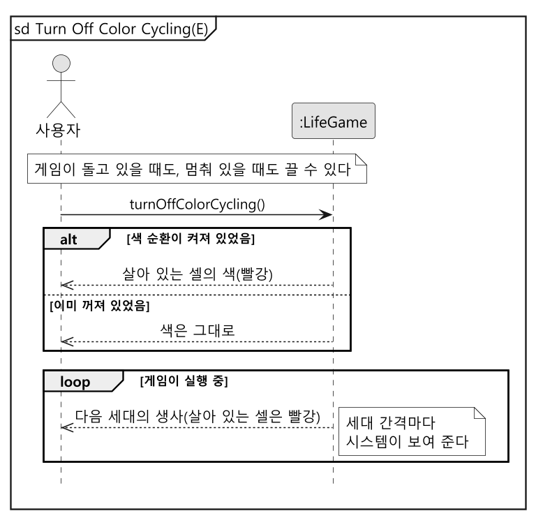
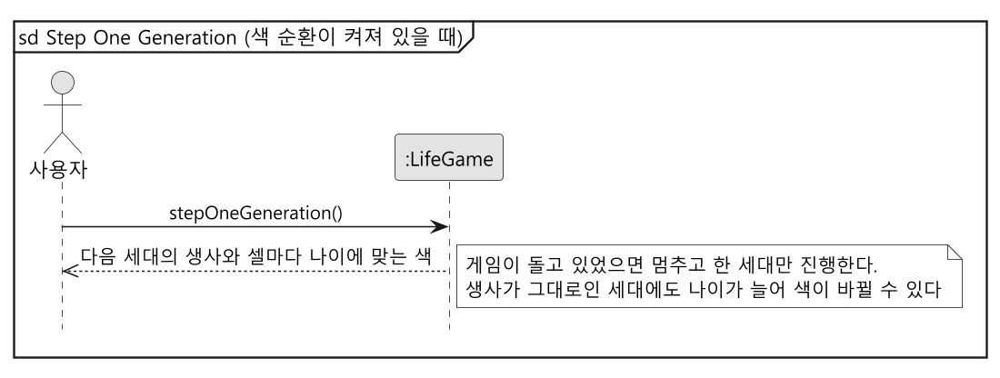
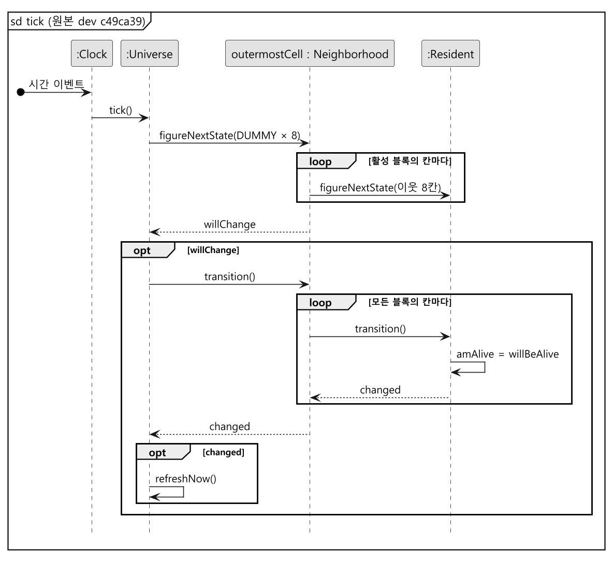
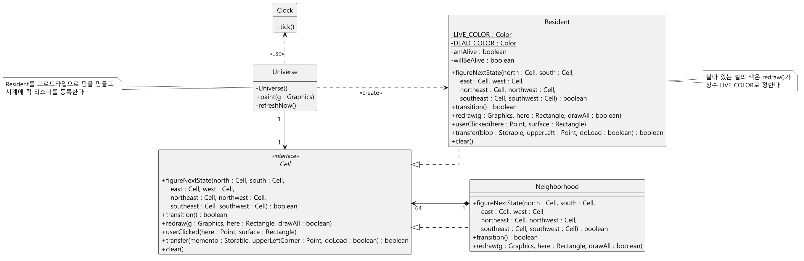
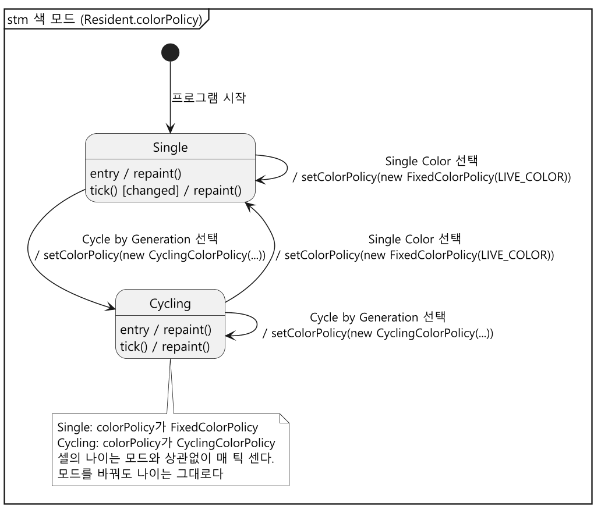

# 세대에 따른 셀 색 순환

살아 있는 셀의 색이 그 셀이 살아온 세대 수(나이)에 따라 바뀌고, 정해진 색을 돌아가며 순환하는 확장 기능이다. 원본 Life Game은 살아 있는 셀을 모두 빨강으로 그려서, 막 태어난 셀과 오래 살아남은 구조를 화면에서 구분할 수 없다. 이 기능은 셀의 나이를 색으로 보여 준다.

## 1. 기능 명세

### 1.1 기능 개요

Color 메뉴에서 Cycle by Generation을 고르면, 각 셀은 태어난 뒤 10세대마다 빨강 → 파랑 → 초록 → 빨강 순서로 색을 바꾼다. 기준은 게임 전체의 세대 수가 아니라 셀마다의 나이라서, 판 전체가 한꺼번에 바뀌지 않고 셀마다 태어난 시점에 따라 따로 바뀐다.

Single Color를 고르면 원본처럼 모두 빨강으로 돌아간다. 처음에는 Single Color 상태라서 프로그램을 켠 직후의 화면은 원본과 같다.

나이는 색 순환이 꺼져 있을 때도 센다. 그래서 색 순환을 켜는 순간 각 셀이 살아온 세대 수에 맞는 색이 바로 나온다.

| 구분 | 내용 |
| --- | --- |
| 새로 만든 것 | 색을 정하는 규칙 `CellColorPolicy`와 그 구현 `FixedColorPolicy`(한 가지 색), `CyclingColorPolicy`(순환), Color 메뉴 |
| 고친 원본 클래스 | `Resident`(셀 하나): 나이를 세고, 칠할 색을 규칙에 묻는다<br>`Universe`(게임 판):<br>· 바뀌는 셀이 없는 세대에도 확정한다. 멈춘 패턴도 나이를 먹어야 한다<br>· 바뀐 블록(판을 8×8칸씩 묶은 단위, `Neighborhood`)만 직접 그리던 것을 판 전체 다시 그리기 요청(`repaint()`)으로 바꿨다. 색 순환 중에는 매 세대 판 전체의 색이 바뀔 수 있다(4.4절)<br>· Color 메뉴로 색 규칙을 바꾼다 |
| 바꾸지 않은 것 | 생사 규칙, 저장 파일 형식, 기존 메뉴 항목과 동작 |

### 1.2 유스케이스

확장 유스케이스는 과제 안내문의 규칙대로 이름 끝에 `(E)`를 붙였다. 그림에는 색 순환 유스케이스와, 이들이 맞물리는 원본 유스케이스(Run / Halt Game, Step One Generation, Advance Generation)만 그렸다.


| 유스케이스 | 시작하는 곳 | 다른 유스케이스와의 관계 | 내용 |
| --- | --- | --- | --- |
| Turn On Color Cycling(E) | Color > Cycle by Generation | Recolor Cells by Age(E)를 «include» | 색 순환을 켜고, 고르는 즉시 판 전체를 각 셀의 나이에 맞는 색으로 다시 그린다 |
| Turn Off Color Cycling(E) | Color > Single Color | | 원본 빨강으로 되돌린다. 프로그램을 처음 실행했을 때와 같은 상태다 |
| Count Cell Age(E) | 세대가 진행될 때마다 | Advance Generation이 «include» | 살아남은 셀은 나이 +1, 새로 태어난 셀은 0. 색 순환이 꺼져 있어도 센다 |
| Recolor Cells by Age(E) | Color > Cycle by Generation을 고를 때, 그리고 색 순환이 켜져 있을 때 세대마다 | Advance Generation을 «extend» (조건: 색 순환이 켜져 있음) | 판 전체를 나이에 맞는 색으로 다시 그린다. 멈춘 패턴도 10세대마다 색이 바뀐다 |

- Advance Generation은 원본에서 한 세대를 계산하고 확정하는 부분이다. Run / Halt Game(Go 메뉴의 속도 선택)과 Step One Generation(Go > Tick (Single Step))이 모두 이것을 «include»한다. 나이 세기와 색 다시 그리기는 이 공통 부분에 붙으므로, Run과 Step에 따로 그리지 않았다.
- Count Cell Age(E)는 «include»다. 나이는 색 순환을 켜든 끄든 매 세대 조건 없이 세고, 세대를 확정하는 단계 안에서 함께 계산되기 때문이다. 나이를 세려고 원본의 세대 진행에서 바꾼 것은 한 가지다. 바뀌는 셀이 없는 세대에도 세대를 확정하게 한 것이다(2.2절). 세대 진행의 결과(생사)는 원본 그대로다.
- Recolor Cells by Age(E)는 «extend»다. 색 순환이 켜져 있으면 확장 지점 "세대 확정 후"에서 판 전체를 다시 그린다. 생사가 바뀐 셀이 없어 원래는 다시 그리지 않는 세대에도 그리고, 생사가 바뀐 세대에는 원래 하던 다시 그리기와 합쳐 한 번만 그린다. 꺼져 있으면 이 유스케이스는 일어나지 않고, Advance Generation은 원본처럼 셀이 바뀐 세대에만 다시 그린다.
- Recolor Cells by Age(E)는 Turn On Color Cycling(E)가 «include»하기도 한다. 켜는 순간 한 번 다시 그리는 것도 같은 동작이기 때문이다.

각 명세는 유스케이스 이름, 범위, 수준, 주 행위자, 사전 조건, 메인 성공 시나리오, 대체 시나리오, 연관 요구사항 순서로 적었다.

- 수준은 사용자가 직접 이루려는 목표(User goal)와, 다른 유스케이스 안에서 일어나는 부분(Subfunction)으로 나눴다.
- Subfunction 유스케이스의 주 행위자는 그것을 포함하는 쪽(확장이면 확장 대상) 유스케이스의 주 행위자를 따랐다.
- 시나리오는 메뉴 같은 화면 조작 대신 사용자의 의도와 시스템이 하는 일로 적었다. 메뉴 경로는 위 표에, 클래스 사이의 메시지는 3.3절의 시퀀스 다이어그램에 있다.

Advance Generation은 원본 유스케이스지만, 색 순환 유스케이스가 붙는 자리(포함하는 단계와 확장 지점)를 보이려고 먼저 적었다. 확장 지점은 번호 없이 단계 사이에 적었다.

| 유스케이스 이름 | Advance Generation |
| --- | --- |
| 범위 | Life Game |
| 수준 | Subfunction (Run / Halt Game, Step One Generation이 «include») |
| 주 행위자 | 사용자 (포함하는 Run / Halt Game, Step One Generation의 주 행위자를 따른다) |
| 사전 조건 | 캡처·배치 편집 중이거나 Freezing 영역을 고르는 중이 아니다 |
| 메인 성공 시나리오 | 1. 시스템이 원본 규칙대로 판 전체의 다음 세대 생사를 계산한다.<br>2. 시스템이 다음 세대를 확정한다. 바뀌는 셀이 없는 세대에도 확정한다(원본에서 바꾼 점, 2.2절). Count Cell Age(E)를 포함한다(«include»).<br>extension point: 세대 확정 후<br>3. 시스템이 판 전체를 다시 그린다(원본에서 바꾼 점, 4.4절). |
| 대체 시나리오 | 1a. Freezing 영역 안의 셀이다:<br>&emsp;1. 시스템이 그 셀의 다음 생사를 계산 결과 대신 Freezing을 건 순간의 생사로 둔다.<br>3a. 생사가 바뀐 셀이 없다:<br>&emsp;1. 시스템이 판을 다시 그리지 않는다. |
| 연관 요구사항 | FR-4, NFR-1, NFR-2 |

| 유스케이스 이름 | Turn On Color Cycling(E) |
| --- | --- |
| 범위 | Life Game |
| 수준 | User goal |
| 주 행위자 | 사용자 |
| 사전 조건 | 없음. 게임이 돌고 있을 때도 멈춰 있을 때도 쓸 수 있다 |
| 메인 성공 시나리오 | 1. 사용자가 색 순환을 켜겠다고 요청한다.<br>2. 시스템이 색 규칙을 순환 규칙(셀의 나이 10세대마다 빨강 → 파랑 → 초록)으로 바꾼다.<br>3. Recolor Cells by Age(E)를 포함한다(«include»). |
| 대체 시나리오 | 2a. 색 순환이 이미 켜져 있다:<br>&emsp;1. 시스템이 같은 순환 규칙으로 다시 바꾼다. 화면의 색은 그대로다. |
| 연관 요구사항 | FR-1, FR-5 |

| 유스케이스 이름 | Turn Off Color Cycling(E) |
| --- | --- |
| 범위 | Life Game |
| 수준 | User goal |
| 주 행위자 | 사용자 |
| 사전 조건 | 없음. 게임이 돌고 있을 때도 멈춰 있을 때도 쓸 수 있다 |
| 메인 성공 시나리오 | 1. 사용자가 색 순환을 끄겠다고 요청한다.<br>2. 시스템이 색 규칙을 원본 빨강 한 가지 색으로 바꾼다.<br>3. 시스템이 판 전체를 다시 그려 살아 있는 셀을 모두 빨강으로 보여 준다. |
| 대체 시나리오 | 2a. 색 순환이 이미 꺼져 있다(프로그램을 켠 직후 포함):<br>&emsp;1. 시스템이 같은 빨강 규칙으로 다시 바꾼다. 화면의 색은 그대로다. |
| 연관 요구사항 | FR-2 |

| 유스케이스 이름 | Count Cell Age(E) |
| --- | --- |
| 범위 | Life Game |
| 수준 | Subfunction (Advance Generation이 매 세대 «include») |
| 주 행위자 | 사용자 (포함하는 Advance Generation의 주 행위자를 따른다) |
| 사전 조건 | Advance Generation이 다음 세대의 생사를 계산했고, 그 세대를 확정하는 중이다(Advance Generation 2단계). 색 순환이 꺼져 있어도 일어난다 |
| 메인 성공 시나리오 | 1. 시스템이 이번 세대 전후로 계속 살아 있는 셀의 나이를 1 늘린다.<br>2. 시스템이 새로 태어난 셀과 죽은 셀의 나이를 0으로 한다. |
| 대체 시나리오 | 1a. Freezing 영역 안의 셀이다:<br>&emsp;1. 시스템이 그 셀의 나이를 세지 않고 그대로 둔다. |
| 연관 요구사항 | FR-4, NFR-1 |

| 유스케이스 이름 | Recolor Cells by Age(E) |
| --- | --- |
| 범위 | Life Game |
| 수준 | Subfunction (Advance Generation의 확장 지점 "세대 확정 후"에서 «extend», Turn On Color Cycling(E)가 «include») |
| 주 행위자 | 사용자 (포함하는 Turn On Color Cycling(E)와, 확장 대상인 Advance Generation의 주 행위자를 따른다) |
| 사전 조건 | 색 순환이 켜져 있다(확장 조건) |
| 메인 성공 시나리오 | 1. 시스템이 판 전체를 다시 그린다.<br>2. 시스템이 살아 있는 셀은 나이에 맞는 색(1.3절)으로, 죽은 셀은 원본의 죽은 칸 색으로 칠한다. |
| 대체 시나리오 | 없음 |
| 연관 요구사항 | FR-5, FR-6, FR-9, NFR-4 |

FR-7과 FR-8은 이 기능의 유스케이스가 아니라, 셀을 살리거나 죽이는 다른 유스케이스(Edit Cells, Store / Load Board, Draw Cells by Dragging(E), Place Template(E), Undo Placement(E))에 "나이 0에서 시작한다"는 결과가 더해진 것이다. 나이가 바뀌는 경우 전체는 3.5.2절 표에 있다.

### 1.3 색을 정하는 규칙

```math
\mathrm{age}_{t+1}(x) = \begin{cases} \mathrm{age}_t(x) + 1 & \text{if } \mathrm{alive}_t(x) \wedge \mathrm{alive}_{t+1}(x) \\ 0 & \text{otherwise} \end{cases}
```

```math
\mathrm{color}(x) = c\left[ \left\lfloor \mathrm{age}(x) / N \right\rfloor \bmod K \right]
```

- N은 색이 바뀌는 세대 간격, K는 색의 개수다. N = 10, K = 3, c = \[빨강 `#FF0000`, 파랑 `#0072B2`, 초록 `#009E73`\]이다.
- 나이 0\~9는 빨강, 10\~19는 파랑, 20\~29는 초록, 30\~39는 다시 빨강이다. 한 바퀴는 30세대다.
- 빨강은 원본의 살아 있는 셀 색과 같다. 그래서 막 태어난 셀은 원본과 똑같이 보인다.
- 새로 태어난 셀, 마우스 클릭이나 드래그로 살린 셀, Grid > Load로 불러온 셀, 템플릿 배치로 새로 생긴 셀은 나이 0(빨강)에서 시작한다. 새로 태어난 셀은 부모 셀의 색을 물려받지 않는다.
- 죽은 셀은 원본의 죽은 칸 색으로 그린다. 죽은 셀의 나이는 쓰지 않고, 다시 살아나면 0에서 시작한다.
- Freezing으로 고정된 칸은 고정된 동안 첫 번째 식을 따르지 않고 나이가 그대로다. 그래서 고정한 순간의 색을 유지한다.
- 값을 고른 근거는 다음과 같다. 나이의 기준(연속 나이)과 부모 색을 물려받지 않게 한 이유는 4.3절에 있다.
  - N = 10: 셀은 대부분 몇 세대 안에 죽거나 오래 산다. 10이면 금방 죽는 셀은 빨강으로 남고 자리 잡은 구조만 색이 돈다. Fast(30 ms)에서도 0.3초에 한 번 바뀌어 깜빡이지 않고, Agonizing(500 ms)에서도 5초면 첫 변화가 보인다.
  - K = 3: 두 색은 번갈아 보일 뿐이라 순환으로 보이기 약하고, 넷 이상은 가장 비슷한 두 색의 차이가 줄어든다.
  - 색: 파랑과 초록은 판의 다른 색(죽은 칸, 격자선, 블록 경계, 활성 블록 테두리 `#0000FF`)과 구분되는 `#0072B2`, `#009E73`을 골랐다. 파랑을 `#0000FF`로 하면 활성 블록 테두리와 같은 색이 된다. 빨강은 원본 `Resident.LIVE_COLOR`를 그대로 쓴다.

### 1.4 요구사항

**기능 요구사항**

| ID | 요구사항 | 유스케이스 |
| --- | --- | --- |
| FR-1 | Color > Cycle by Generation을 고르면 색 순환이 켜지고, 세대를 기다리지 않고 바로 판 전체가 각 셀의 나이에 맞는 색으로 다시 그려진다 | Turn On Color Cycling(E) |
| FR-2 | Color > Single Color를 고르면 색 순환이 꺼지고, 바로 살아 있는 셀이 모두 원본 빨강으로 다시 그려진다 | Turn Off Color Cycling(E) |
| FR-3 | 프로그램을 시작하면 색 순환은 꺼져 있다 | 없음 (프로그램 시작 시 기본값) |
| FR-4 | 세대가 진행될 때마다 전후 모두 살아 있는 셀은 나이가 1 늘고, 새로 태어난 셀과 죽은 셀은 0이다. 색 순환이 꺼져 있어도 나이를 센다. Freezing으로 고정된 셀은 고정된 동안 나이가 멈춘다 | Count Cell Age(E) |
| FR-5 | 색 순환이 켜져 있으면 색은 1.3절의 공식을 따른다 | Turn On Color Cycling(E), Recolor Cells by Age(E) |
| FR-6 | 색 순환이 켜져 있으면 생사가 바뀌지 않은 세대에도 판 전체를 다시 그린다. 2×2 블록처럼 멈춘 패턴도 10세대마다 색이 바뀐다 | Recolor Cells by Age(E) |
| FR-7 | 클릭이나 드래그 그리기로 살린 셀, Load로 불러온 셀, 템플릿 배치로 새로 생긴 셀은 나이 0에서 시작한다 | Edit Cells, Store / Load Board, Draw Cells by Dragging(E), Place Template(E) (다른 기능) |
| FR-8 | 템플릿 배치와 그 되돌리기는 이미 살아 있던 다른 셀의 나이를 바꾸지 않는다 | Place Template(E), Undo Placement(E) (캡처·템플릿 기능) |
| FR-9 | 죽은 셀은 원본의 죽은 칸 색으로 그린다 | Recolor Cells by Age(E) |

**비기능 요구사항**

| ID | 요구사항 | 기준 |
| --- | --- | --- |
| NFR-1 | 생사 규칙이 바뀌지 않는다 | 색 순환을 켜든 끄든 매 세대 생사가 Life 규칙을 직접 계산한 결과와 같다 |
| NFR-2 | 색 순환이 꺼져 있으면 원본과 같게 동작한다 | 원본 동작을 검사하는 기존 테스트(`ResidentTest`, `NeighborhoodTest`, `UniverseStoreTest`)를 색 기능 때문에 고친 곳 없이 모두 통과한다 |
| NFR-3 | 저장 파일 형식을 바꾸지 않는다 | 나이는 저장하지 않는다. 기존 .life 파일을 그대로 읽는다 |
| NFR-4 | 색 순환을 켜고 Fast·Medium으로 계속 돌려도 클릭과 메뉴가 밀리지 않는다 | 입력 처리 대기 10 ms 이하 (측정 최대 3 ms, 5.4절) |
| NFR-5 | 색 규칙과 나이 계산은 게임 창 없이 테스트할 수 있다 | 모델(셀, 블록, 색 규칙)만으로 도는 테스트가 있다 |
| NFR-6 | 세 색이 서로, 그리고 판의 다른 색과 구분된다 | 판 색상과 구분되면서 서로 다른 색상 |
| NFR-7 | 색 규칙 객체는 만들 때 잘못된 값을 거부하고, 만든 뒤에는 바뀌지 않는다 | 간격 0 이하, 색 2개 미만, 빈 값(null)은 객체를 만들 때 예외로 거부한다 |
| NFR-8 | 새 색 규칙을 더할 때 셀의 나이 세기와 그리기 코드를 고치지 않는다 | `CellColorPolicy` 구현 클래스 하나와 Color 메뉴 항목 하나만 더한다. `Resident`는 처음 값으로 `FixedColorPolicy`를 하나 만들 뿐 색은 `CellColorPolicy` 인터페이스로만 묻고, Universe의 세대 진행도 `changesWithAge()`로만 다시 그릴지를 정한다(4.2절) |

### 1.5 기존 기능에 미치는 영향

다음 세대의 생사는 원본 규칙대로 자기 상태와 살아 있는 이웃 수만으로 정해진다. 나이와 색은 이 계산에 쓰이지 않으므로, 색 순환을 켜든 끄든 다음 세대의 생사는 원본과 같다(NFR-1).

| 기존 기능 | 색 순환 꺼짐 (기본) | 색 순환 켜짐 |
| --- | --- | --- |
| 마우스 클릭으로 셀 켜기·끄기 | 변화 없음 | 그대로 동작. 새로 켠 셀은 나이 0이라 빨강 |
| Go > Tick, Halt, Agonizing·Slow·Medium·Fast | 변화 없음 | 생사 결과 그대로. 세대 간격은 손대지 않음 |
| Grid > Clear | 변화 없음 | 그대로 동작. 그 뒤 다시 살린 셀은 빨강 |
| Grid > Store / Load | 변화 없음 | 살아 있는 셀은 그대로 복원. 나이는 저장되지 않아 불러온 셀은 빨강부터 다시 시작 |
| Grid > Exit | 변화 없음 | 변화 없음 |
| 활성 블록(생사가 바뀐 셀이 있는 블록)의 파란 테두리 | 변화 없음. 판 전체에서 생사가 바뀌는 셀이 없어져도 남음 | 판 전체에서 생사가 바뀌는 셀이 없는 첫 세대에 지워짐 |

메뉴에는 Grid, Go 뒤에 Color 메뉴가 생긴다. 생사가 원본과 같은지는 JUnit으로 확인한다(NFR-1 `lifeRuleIsUnchanged`, NFR-2 기존 테스트, 5.3절).

## 2. 기존 코드에서 바뀐 부분

원본 클래스 중 `Resident`와 `Universe`를 고쳤다. 아래에는 코드를 옮기는 대신 원본과 무엇이 달라졌는지를 적었다.

- 이 문서에서 원본은 색 기능을 붙이기 전의 코드다.
- Holub 원본에 있던 오류(`transition()`이 반대 값을 돌려주던 것 등)는 그 전에 따로 고쳤다([fix-life-game-changes.md](../fixes/fix-life-game-changes.md)).
- 테스트 설정(`build.gradle`의 `forkEvery = 1`)을 바꾼 이유는 5.2절에 있다.

### 2.1 Resident: 나이를 세고 색을 규칙에 묻는다

원본 Resident는 셀의 생사(`amAlive`, `willBeAlive`)만 가지고, 살아 있는 셀을 상수 `LIVE_COLOR`(빨강)로 칠했다. 여기에 셀마다의 나이와, 모든 셀이 함께 쓰는 색 규칙을 더했다.

| 부분 | 원본 | 바뀐 뒤 |
| --- | --- | --- |
| 필드 | `amAlive`, `willBeAlive` | 셀마다 `age`(연속으로 살아남은 세대 수)를 더했다. 모든 셀이 함께 쓰는 static `colorPolicy`를 더했고, 처음 값은 원본 빨강 한 가지 색(`FixedColorPolicy(LIVE_COLOR)`)이다<br>이유: 색을 나이로 정하려면 셀마다 나이가 있어야 한다. 색 규칙은 판 전체에 하나라서 모든 셀이 참조 하나를 함께 쓴다(4.2절) |
| `LIVE_COLOR` | Resident 안에서만 쓰는 상수(`private`) | `private`을 떼어 같은 패키지 안에서 쓸 수 있게 했다. 값(빨강)은 그대로다<br>이유: Color 메뉴가 같은 빨강을 쓰게 해서, 처음 값과 Single Color, 순환의 첫 색이 어긋나지 않게 한다 |
| 새 메서드 | | `setColorPolicy()`: 규칙을 바꾼다. null은 거부한다<br>`colorChangesWithAge()`: 지금 규칙이 나이에 따라 색이 바뀌는지 알려 준다<br>둘 다 같은 패키지 안에서만 쓴다<br>이유: Color 메뉴가 규칙을 바꾸고, Universe가 구체 규칙을 몰라도 다시 그릴지를 정하게 한다(4.2절) |
| `transition()` | 다음 생사로 바꾸고, 생사가 바뀌었는지 돌려준다 | 바꾸기 전에 나이를 정한다. 전후 모두 살아 있으면 1을 더하고, 그 밖에는 0이다. 돌려주는 값은 원본과 같다<br>이유: 세대를 넘길 때 모든 셀에 한 번씩 불린다. 다음 상태 계산(`figureNextState()`)은 멈춘 블록을 건너뛰어 그곳에서는 멈춘 셀의 나이를 셀 수 없다(4.1절) |
| `redraw()` | 살아 있으면 `LIVE_COLOR`, 죽었으면 죽은 칸 색 | 살아 있으면 `colorPolicy.colorOf(age)`, 죽었으면 죽은 칸 색<br>이유: 색을 정하는 방법을 규칙 객체에 맡겨, 규칙이 늘어도 Resident를 고치지 않는다(4.2절) |
| `userClicked()` | 생사를 뒤집는다 | 뒤집은 뒤 나이를 0으로 둔다<br>이유: 클릭으로 살린 셀은 막 생긴 셀이다. 죽인 셀의 나이는 쓰지 않으므로 조건 없이 0으로 둔다(4.3절) |
| `transfer()`의 Load | 불러온 생사를 넣는다 | 넣기 전에 나이를 0으로 둔다. 나이는 저장하지 않는다<br>이유: 저장 파일 형식을 바꾸지 않으므로 파일에 나이가 없다(4.3절) |
| `clear()`, 생성자, `create()` | | 바뀌지 않음<br>이유: 죽은 셀의 나이는 그리지 않고, 다시 살아날 때 위 경로 중 하나가 0으로 둔다(4.3절) |

`transition()`이 돌려주는 값(생사가 바뀌었는가)이 원본과 같으므로, Resident와 Neighborhood가 주고받는 "변화"의 뜻도 그대로다. 블록 계산 건너뛰기와, 활성 블록을 고르는 기준이 원본처럼 동작한다.

Freezing 기능은 고정된 칸의 다음 생사를 `holdNextState()`로 고정한 순간의 상태로 되돌리고, 그 칸은 이번 `transition()`에서 나이를 세지 않게 했다. 고정된 칸은 클릭·드래그·템플릿 배치가 막혀 있어서, 고정된 동안 생사가 뒤집히지 않는다.

### 2.2 Universe: 매 틱 세대를 확정한다

원본 Universe의 틱 처리(시계가 세대를 하나 진행시킬 때마다 하는 일)는 다음 상태를 계산해 바뀔 셀이 있을 때만 세대를 확정했고, 확정해서 바뀐 셀이 있을 때만 바뀐 블록을 다시 그렸다. 여기에 멈춘 패턴도 나이를 세고 색이 바뀌도록, 세대는 매 틱 확정하고 색 순환이 켜져 있으면 판 전체를 매 틱 다시 그리게 했다.

| 단계 | 원본 | 바뀐 뒤 |
| --- | --- | --- |
| 다음 상태 계산(`figureNextState()`) | 바뀔 셀이 없으면 여기서 멈췄다 | 결과와 상관없이 다음 단계로 간다<br>이유: 바뀔 셀이 없는 세대에도 나이를 세려면 확정까지 가야 한다 |
| 세대 확정(`transition()`) | 바뀔 셀이 있을 때만 | 매 틱. 바뀌는 셀이 없어도 나이를 센다<br>이유: 멈춘 패턴도 나이를 먹어야 10세대마다 색이 바뀐다(FR-6, 4.1절). 생사 결과는 원본과 같다(NFR-1) |
| 다시 그리는 조건 | 확정해서 바뀐 셀이 있을 때 | 색 순환이 켜져 있으면 매 틱(`Resident.colorChangesWithAge()`로 묻는다). 꺼져 있으면 원본처럼 바뀐 셀이 있을 때<br>이유: 색 순환 중에는 생사가 그대로여도 색이 바뀔 수 있다. 꺼져 있을 때는 원본과 같게 그린다(NFR-2) |
| 다시 그리는 방법(`refreshNow()`) | 바뀐 블록만 화면에 바로 그렸다 | 판 전체 다시 그리기를 Swing의 `repaint()`로 요청한다<br>이유: 원본 방식으로 판 전체를 그리면 Fast에서 클릭과 메뉴가 수 초씩 밀렸다. `repaint()`는 밀린 요청을 하나로 합치고, 이중 버퍼로 빠르게 그린다(4.4절) |

캡처·템플릿 기능도 편집 오버레이를 그리려고 `refreshNow()`를 같은 방식으로 바꿔서, 지금은 `refreshNow()`가 `repaint()`만 부른다.

다른 기능도 틱 처리에 단계를 더했다. 통계는 확정 전에 판을 복사해 두었다가 확정 뒤 알리고, Freezing은 계산과 확정 사이에서 고정된 칸의 다음 생사를 되돌리고, 캡처·배치 편집 중이거나 Freezing 영역을 고르는 중이면 틱을 건너뛴다. 이 단계들은 위 표의 규칙(매 틱 확정, 다시 그리는 조건)을 바꾸지 않는다. 전체 순서는 3.3.1절의 시퀀스 다이어그램에 있다.

### 2.3 Universe: Color 메뉴

원본의 Grid, Go 메뉴와 같은 방식(`MenuSite.addLine()`)으로 Color 메뉴를 더해, 새 클래스 없이 메뉴를 만들었다. Go 메뉴는 시계가 처음 만들어질 때 생기므로, 시계 리스너를 등록한 뒤에 추가해 Color 메뉴가 Go 뒤에 오게 했다.

| 메뉴 항목 | 만드는 색 규칙 |
| --- | --- |
| Single Color | `FixedColorPolicy(LIVE_COLOR)`: 원본 빨강 한 가지 색 |
| Cycle by Generation | `CyclingColorPolicy(10, 빨강, 파랑 #0072B2, 초록 #009E73)`: 10세대마다 다음 색 |

두 항목은 모두 새로 만든 `useColorPolicy()`를 거친다. 이 메서드는 `Resident.setColorPolicy()`로 규칙을 바꾸고, 통계 기능에 규칙이 바뀌었음을 알린 뒤, `repaint()`로 판 전체를 다시 그리게 요청한다. 그래서 시계가 멈춰 있어도 고른 규칙의 색이 바로 보인다.

- 메뉴 이름에는 간격과 색 수를 넣지 않았다. 값을 바꿔도 이름을 고치지 않아도 된다.
- 지금 고른 항목은 따로 표시하지 않는다. 원본 Go 메뉴와 같고, 어느 쪽을 골랐는지는 판의 색으로 바로 알 수 있다.

### 2.4 새로 만든 클래스

| 클래스 | 하는 일 |
| --- | --- |
| `CellColorPolicy` | 색 규칙의 인터페이스. 나이로 색을 정하는 `colorOf(age)`와, 나이에 따라 색이 바뀌는 규칙인지 알려 주는 `changesWithAge()`가 있다 |
| `FixedColorPolicy` | 나이와 상관없이 한 가지 색. `changesWithAge()`는 false다. 원본 빨강에 쓴다 |
| `CyclingColorPolicy` | `period` 세대마다 다음 색, 마지막 색 다음에는 처음 색(`colors[(age / period) % colors.length]`). `changesWithAge()`는 true다 |

| 정한 것 | 이유 |
| --- | --- |
| 두 구현 모두 만든 뒤 바뀌지 않는 객체다(`final` 클래스, `private final` 필드, setter 없음) | 4,096개 셀이 규칙 객체 하나를 함께 쓰고, 그리기와 틱 처리가 함께 읽는다. 내용이 바뀔 수 있으면 `setColorPolicy()`와 다시 그리기 요청 없이 모든 셀의 색이 바뀐다 |
| 생성자에서 색 배열을 복사한다 | 넘긴 배열을 바깥에서 바꿔도 규칙이 바뀌지 않게 한다 |
| 잘못된 값(간격 0 이하, 색 2개 미만, 빈 값)은 생성자에서 거부한다 | 거부하지 않으면 그리는 도중에 예외가 나거나 엉뚱한 색이 칠해진다. 실수가 객체를 만드는 줄에서 바로 드러나게 한다 |
| `CyclingColorPolicy`는 색이 2개 이상이어야 한다 | 색이 1개면 색이 바뀌지 않는데도 매 틱 판 전체를 다시 그리게 된다. 한 가지 색은 `FixedColorPolicy`가 맡는다 |

### 2.5 다른 기능과 맞물린 부분

| 기능 | 맞물린 곳 | 지금 상태 |
| --- | --- | --- |
| 캡처·템플릿 | 템플릿 배치와 되돌리기가 셀을 살리고 죽이는 경로 | 바뀌는 칸만 `userClicked()`로 편집한다. 새로 생긴 셀은 나이 0이고, 기존 셀의 나이는 그대로다 |
| 캡처·템플릿 | `refreshNow()`, 시계 | `refreshNow()`가 `repaint()`를 부르고, 시계가 Swing 타이머로 바뀌어 틱이 이벤트 스레드에서 돈다 |
| 사운드 | 틱 처리 | 통계 기능과 같은 `GENERATION` 이벤트로 생긴 셀과 사라진 셀을 받는다. 매 틱 `transition()`을 부르는 순서는 그대로다 |
| Freezing | 틱 처리, `Resident.transition()`의 나이 계산 | `figureNextState()`와 `transition()` 사이에서 고정된 칸의 다음 생사를 되돌리고, 그 칸은 나이를 세지 않는다. 그래서 고정된 셀은 색 순환 중에도 고정한 순간의 색을 유지하고, 풀리면 멈춘 나이에서 다시 센다(2.1절, 3.5.2절) |
| 통계 | 틱 처리, 색별 집계 | 매 틱 확정 전에 판을 복사해 두고, 확정 뒤 `GENERATION` 이벤트로 통계와 사운드에 알린다. `Cell.colorAt()`을 더해 살아 있는 셀을 화면 색별로 세고(4.6절), `useColorPolicy()`가 `COLOR_POLICY_CHANGED`로 규칙이 바뀌었음을 알린다 |

### 2.6 원본 설계 패턴과 맞물린 부분

이 기능은 원본의 패턴을 새로 바꾸지 않고 그 안에 들어갔다. 설계 결정은 대부분 아래 구조가 만드는 제약에서 나왔다.

| 원본 패턴 | 원본 코드 | 이 기능과의 관계 |
| --- | --- | --- |
| Composite | `Cell`, `Neighborhood`, `Resident` | `transition()`과 `redraw()`가 블록을 거쳐 셀까지 내려간다. 나이 계산과 색 결정은 Leaf(Resident) 안에서만 하므로 Neighborhood는 고치지 않았다 |
| Prototype | `Resident.create()` | 판은 Resident 하나를 복제해 4,096칸을 만든다. 실행 중에 셀 객체를 바꿔 넣는 수단이 없어서, 색 규칙을 바꾸려면 셀이 아니라 셀이 묻는 규칙 객체를 바꿔야 했다(4.2절) |
| Singleton | `Universe`, `Clock` | Universe가 JVM에서 한 번만 만들어져, Universe를 준비하는 테스트 클래스 두 개가 한 JVM에서 함께 돌지 못했다. 테스트 클래스마다 JVM을 나눠 해결했다(5.2절) |
| Observer | `Clock`의 리스너, `Publisher` | 틱 처리는 Universe가 시계에 등록한 리스너다. 이 기능은 새 리스너를 만들지 않고 기존 리스너의 내용만 바꿨다 |
| Command | 메뉴 항목의 `ActionListener` (`MenuSite.addLine()`으로 등록) | Color 메뉴의 두 항목을 원본의 Grid, Go 메뉴와 같은 방법으로 더했다(표 아래) |

Color 메뉴는 원본 메뉴의 Command 구조를 그대로 따른다.

- ConcreteCommand: 두 메뉴 항목의 익명 `ActionListener`
- Invoker: 메뉴 항목. 누르면 `actionPerformed()`만 부른다
- Receiver: `Universe.useColorPolicy()`. ConcreteStrategy를 `Resident.setColorPolicy()`로 바꿔 끼운다

메뉴 쪽은 Command, 색 규칙 쪽은 Strategy(4.2절)로 나뉜다. 그래서 색 규칙을 더할 때는 구현 클래스 하나와 메뉴 항목 하나만 더하고, 메뉴를 거는 코드(`MenuSite`)와 Resident는 그대로다.

두 Command는 상태도, 실행 취소(undo)나 기록도 없다. 대안과 비교해 고른 구조가 아니라 원본의 메뉴 방식을 따른 것으로 본다.

## 3. 구조와 동작(UML 다이어그램)

설계 순서대로 다이어그램을 둔다. 유스케이스(1.2절)로 정한 사용자 목표에서 시스템 시퀀스 다이어그램으로 시스템 연산을 뽑고, 연산 계약으로 각 연산이 끝난 뒤의 상태를 정한다. 이어서 시퀀스 다이어그램으로 객체 사이의 메시지를 그리고, 거기에 나온 클래스와 관계를 클래스 다이어그램으로 모은다. 상태에 따라 동작이 달라지는 색 모드와 셀의 나이는 마지막에 상태 다이어그램으로 그렸다.

### 3.1 시스템 시퀀스 다이어그램

게임을 블랙박스로 보면, 이 기능이 새로 만들거나 바꾼 시스템 연산은 셋이다. 시스템 시퀀스 다이어그램은 유스케이스마다 한 장씩 그렸고, 그린 규칙은 다음과 같다.

- 이벤트 이름은 메뉴 항목이 아니라 사용자의 의도로 적었다.
- 반환은 화면 모습이 아니라 사용자가 받는 정보로 적었다.
- 세대를 넘기는 시계는 게임 안에 있으므로 입력으로 그리지 않았다. 게임이 돌고 있는 동안 세대 간격마다 다음 세대를 보여 주는 부분은 시스템에서 사용자로 가는 출력만 loop로 그렸다.
- 켜기와 끄기는 이미 그 상태였을 때(대체 시나리오 2a)를 alt로 나누고, 그 뒤 게임이 돌면 세대마다 어떤 색을 받는지까지 그렸다.






| 시스템 연산 | 실제 입력 | 이 기능과의 관계 |
| --- | --- | --- |
| `turnOnColorCycling()` | Color > Cycle by Generation | 새로 생김 |
| `turnOffColorCycling()` | Color > Single Color | 새로 생김 |
| `stepOneGeneration()` | Go > Tick (Single Step) | 원본에 있던 연산이고 사후 조건이 바뀜 |

### 3.2 연산 계약

3.1절의 시스템 연산마다 연산 계약을 적었다. 사후 조건은 모델 객체의 상태 변화만 적는다. 화면을 다시 그리는 것은 객체 상태의 변화가 아니므로 넣지 않았다.

**CO1: turnOnColorCycling()**

- Operation: `turnOnColorCycling()`
- Cross References: Turn On Color Cycling(E)
- Preconditions:
  - Resident가 색 규칙 하나와 연관되어 있다(모든 셀이 함께 쓰는 연관). 프로그램을 켠 직후에는 원본 빨강의 `FixedColorPolicy`다
  - 살아 있는 Resident마다 `age`가 세어져 있다. 색 순환이 꺼져 있던 동안에도 세대마다 셌다
- Postconditions:
  - `CyclingColorPolicy` 인스턴스 cp가 생성되었다 (인스턴스 생성)
  - cp.period가 10이 되었다 (속성 변경)
  - cp.colors가 \[빨강, 파랑, 초록\]이 되었다 (속성 변경)
  - Resident와 이전 색 규칙의 연관이 끊어졌다 (연관 해제)
  - Resident가 cp와 연관되었다. 모든 셀이 함께 쓰는 연관이다 (연관 형성)

**CO2: turnOffColorCycling()**

- Operation: `turnOffColorCycling()`
- Cross References: Turn Off Color Cycling(E)
- Preconditions:
  - Resident가 색 규칙 하나와 연관되어 있다(모든 셀이 함께 쓰는 연관)
- Postconditions:
  - `FixedColorPolicy` 인스턴스 fp가 생성되었다 (인스턴스 생성)
  - fp.color가 `Resident.LIVE_COLOR`(빨강)가 되었다 (속성 변경)
  - Resident와 이전 색 규칙의 연관이 끊어졌다 (연관 해제)
  - Resident가 fp와 연관되었다. 모든 셀이 함께 쓰는 연관이다 (연관 형성)

CO1과 CO2는 색 규칙만 바꾸고 셀의 나이는 건드리지 않는다. 그래서 켜는 순간 각 셀이 살아온 세대 수에 맞는 색이 바로 나온다.

**CO3: stepOneGeneration()**

- Operation: `stepOneGeneration()`
- Cross References: Step One Generation, Advance Generation, Count Cell Age(E), Recolor Cells by Age(E)
- Preconditions:
  - 캡처·배치 편집 중이 아니다
  - Freezing 영역을 고르는 중이 아니다
- Postconditions:
  - 시계(Clock)가 돌고 있었다면 멈췄다 (속성 변경)
  - Freezing 영역 밖의 모든 Resident r의 r.amAlive가 Life 규칙에 따른 다음 세대의 생사가 되었다 (속성 변경)
  - 그중 세대 전후 모두 살아 있는 r의 r.age가 이전 r.age + 1이 되었다. 생사가 바뀐 셀이 없는 세대에도 그렇다 (속성 변경)
  - Freezing 영역 밖의 나머지 r의 r.age가 0이 되었다 (속성 변경)

원본의 세대 진행은 바뀔 셀이 없으면 확정하지 않았다. 원본에는 나이가 없어서 그래도 상태가 같았지만, 이 기능에서는 멈춘 패턴도 나이를 먹어야 하므로 "생사가 바뀐 셀이 없는 세대에도"라는 사후 조건이 생겼다.

사후 조건에서 Freezing 영역 안의 Resident를 빼는 조건은 Freezing 기능이 더한 것이다. Freezing 영역 안의 Resident는 amAlive와 age가 Freezing을 건 순간의 값 그대로다. 다른 기능이 더한 상태 변화(세대 수, Freezing 영역의 남은 세대, 템플릿 되돌리기 기록)는 색 기능과 관계가 없어 적지 않았다.

셀을 살리거나 죽이는 다른 유스케이스의 연산에도 "생사가 바뀐 셀의 `age`가 0이 되었다"는 사후 조건이 하나씩 더해졌다. 해당하는 유스케이스는 다음과 같다.

- 클릭: Edit Cells
- 드래그 그리기: Draw Cells by Dragging(E)
- 템플릿 배치와 되돌리기: Place Template(E), Undo Placement(E)
- Load: Store / Load Board

클릭, 드래그, 템플릿 배치와 되돌리기에서는 생사가 바뀌지 않은 다른 셀의 나이는 그대로다(FR-7, FR-8). Load는 판 전체를 파일대로 바꾸므로 불러온 셀의 나이가 모두 0이 된다.

### 3.3 시퀀스 다이어그램

#### 3.3.1 한 세대가 진행되는 순서

한 세대가 진행될 때(Go > Tick, 또는 속도를 고른 뒤 시계가 세대 간격마다) 객체 사이에서 어떻게 처리되는지 원본과 지금을 비교한다. 사후 조건은 3.2절 CO3과 같다. 그림에서 정한 표기는 다음과 같다.

- 필드에 값을 넣는 것은 메시지가 아니라서 해당 객체 옆 노트로 적었다.
- `refreshNow()`와 `repaint()`는 다시 그리기 요청만 넣고 바로 돌아오므로 비동기 메시지(열린 화살촉)로 그렸다.
- 시계 리스너와 메뉴 리스너는 Universe 안의 익명 객체라 `:Universe`로 합쳐 그렸다.
- Neighborhood는 블록 안의 블록을 거쳐 Resident까지 내려가지만, 이 Composite 재귀를 "칸마다" loop 하나로 줄였다. 지금 그림의 `FreezingManager`도 영역마다 상태 객체에 묻는 단계를 줄여, Freezing 영역 안의 칸마다 `holdNextState()`를 부르는 loop로 그렸다.
- 시계는 메뉴가 열려 있으면 틱을 Universe에 넘기지 않는다(원본 그대로). 두 그림에서는 이 조건을 생략했다.
- 편집 중인지 확인한 뒤 캡처·템플릿 기능이 되돌리기 기록을 지운다(`patternTools.boardChanged()`). 색 기능과 관계가 없어 지금 그림에서 뺐다.




1. Swing 타이머가, 또는 Go > Tick 메뉴가 `Clock.tick()`을 부르고, 시계가 Universe의 틱 리스너를 부른다.
2. 캡처·배치 편집 중이거나 Freezing 영역을 고르는 중이면 여기서 끝난다.
3. `outermostCell.figureNextState()`: 블록마다, 셀마다 다음 생사를 계산한다. 원본처럼 활성 블록과, 맞닿은 가장자리가 바뀐 이웃 블록만 계산하고 나머지 블록은 건너뛴다. 이어서 확정 전의 판을 복사해 둔다(통계 기능).
4. `freezing.beforeTransition()`: Freezing 영역 안의 칸마다 다음 생사를 Freezing을 건 순간의 상태로 되돌린다(`holdNextState()`, Freezing 기능).
5. `outermostCell.transition()`: 모든 블록, 모든 셀이 다음 생사를 확정한다. 이때 각 Resident가 나이를 정하고, 4에서 되돌린 칸은 나이를 세지 않는다.
6. 세대 수를 1 늘리고 `freezing.afterGeneration()`이 각 영역의 남은 세대를 줄인다. 0이 된 영역은 Freezing이 풀린다(Freezing 기능).
7. `GENERATION` 이벤트로 통계와 사운드에 생긴 셀, 사라진 셀, 살아 있는 셀의 색을 알린다(통계 기능).
8. `Resident.colorChangesWithAge()`가 true면, 또는 바뀐 셀이 있으면 `refreshNow()`로 `repaint()`를 요청한다.
9. 이벤트 큐에서 차례가 오면 Swing이 `paintComponent()`를 부른다. `outermostCell.redraw(g, 판, true)`가 블록을 거쳐 각 Resident의 `redraw()`를 부르고, 살아 있는 셀은 `colorPolicy.colorOf(age)`의 색으로 칠해진다. 이 부분은 3.3.2절 그림의 아래쪽에 있다.

원본과 다른 단계는 다음과 같다.

- 이 기능이 바꾼 단계: 5(바뀌는 셀이 없어도 확정), 8(색 순환 중에는 바뀐 셀이 없어도 다시 그림), 9(바뀐 블록만 직접 그리던 것을 판 전체 `repaint()` 요청으로 바꿈, 4.4절)
- 다른 기능이 바꾸거나 더한 단계: 1의 Swing 타이머, 2, 3의 판 복사, 4, 6, 7

#### 3.3.2 Color 메뉴를 고를 때

시스템 연산 `turnOnColorCycling()`(3.2절 CO1)의 상호작용이다. `turnOffColorCycling()`(CO2)은 만드는 객체가 `FixedColorPolicy`라는 것만 다르다.


1. 메뉴 항목을 고르면 Universe 안의 메뉴 리스너가 규칙 객체를 만든다. Single Color는 `new FixedColorPolicy(Resident.LIVE_COLOR)`, Cycle by Generation은 `new CyclingColorPolicy(10, 빨강, 파랑, 초록)`이다.
2. `useColorPolicy()`가 `Resident.setColorPolicy()`로 static 참조를 바꾼다. 셀의 나이는 바뀌지 않는다. 이어서 `COLOR_POLICY_CHANGED` 이벤트로 통계 기능에 알린다.
3. `repaint()`로 판 전체를 다시 그리도록 요청한다. 시계가 멈춰 있어도 새 규칙의 색이 바로 보인다.
4. 다음 틱부터 Universe는 `colorChangesWithAge()`로 새 규칙에 물어 다시 그릴지를 정한다. 메뉴는 규칙만 바꾸고, 다시 그리는 방식을 따로 바꾸지 않는다.

### 3.4 클래스 다이어그램

색 기능을 붙이기 전(원본)과 지금의 클래스 다이어그램이다. 3.3절 시퀀스 다이어그램의 클래스 중 Freezing 관리자와 메뉴 항목을 뺀 것과 상위 타입 `Cell`, 그리고 `FixedColorPolicy`를 그렸다. 멤버는 색 순환 기능과 관련된 것만 빠짐없이 적었고, 원본 그림에는 그중 원본에도 있던 것을 적었다. 관련 멤버는 다음 셋 중 하나에 드는 것이다.

- 이 기능이 더하거나 바꾼 멤버
- 셀의 생사·나이·색을 담거나 바꾸거나, 그 값으로 색을 정하는 멤버
- 3.3절 시퀀스 다이어그램이 부르는 메서드

멤버는 가시성과 이름만 적었다. 바뀐 내용은 2장에, 패턴 역할은 아래 표와 4.2절에 있다.




- 밑줄은 static 멤버다.
- 다른 클래스를 가리키는 필드(`colorPolicy`, `outermostCell`, `grid`)는 속성 대신 연관으로 그렸다.
- `LIVE_COLOR`는 Color 메뉴도 쓰므로 private(`-`)에서 package(`~`)로 바뀌었다.
- `Cell.colorAt()`은 통계 기능이 더한 메서드다. 같은 `colorPolicy.colorOf(age)`로 색을 받으므로 함께 그렸다.
- `holdNextState()`와 `heldThisGeneration`은 Freezing 기능이 더한 멤버다. 고정된 칸의 나이 계산을 막으므로 함께 그렸다(2.1절).
- Universe의 `paint()`가 `paintComponent()`로 바뀐 것은 캡처·템플릿 기능의 변경이다. 그래서 원본 그림에는 `paint()`를 적었다.
- Universe의 `liveCells()`는 사운드 기능이, `notifyBoardChanged()`는 통계 기능이 더한 메서드다. 틱 처리와 Color 메뉴(3.3절)가 부르므로 함께 그렸다.
- 틱 리스너와 Color 메뉴의 리스너는 Universe 생성자 안의 익명 객체라 Universe의 메서드로는 나오지 않는다. 그래서 생성자 `Universe()`를 적었다. `repaint()`는 JPanel에서 물려받은 메서드라 적지 않았다.
- Neighborhood는 셀의 생사·나이·색을 직접 갖지 않으므로, 3.3절의 시퀀스 다이어그램이 부르는 메서드만 적었다.

| 클래스 | 원본에서의 역할 | 이 기능에서 바뀐 역할 |
| --- | --- | --- |
| `Cell` (인터페이스) | Composite의 Component | 바뀌지 않음 |
| `Neighborhood` | Composite. 8×8 칸을 가진 블록. 판은 블록 8×8개 | 바뀌지 않음 |
| `Resident` | Composite의 Leaf. 셀 하나. 판을 만들 때 프로토타입으로 `create()`된다 | Strategy의 Context. 나이를 세고, static `colorPolicy`에 색을 묻는다 |
| `Universe` | Singleton. 판을 그리고 시계 틱을 받는다 | Strategy의 Client. Color 메뉴에서 규칙을 만들어 바꿔 끼우고, 틱마다 다시 그릴지를 정한다 |
| `CellColorPolicy` | (없음) | Strategy |
| `FixedColorPolicy`, `CyclingColorPolicy` | (없음) | ConcreteStrategy |

- Resident에서 CellColorPolicy로 가는 연관은 static이다. 셀 하나가 아니라 Resident 클래스가 규칙 참조를 하나 가진다. 그래서 메뉴에서 한 번 바꾸면 4,096칸이 모두 같은 규칙을 쓴다.
- Universe는 구체 규칙을 만들 때(Color 메뉴)만 두 구현 클래스를 안다. 틱 처리는 `Resident.colorChangesWithAge()`만 묻는다.

### 3.5 상태 다이어그램

#### 3.5.1 색 모드

Color 메뉴로 고른 색 규칙을 상태로 보면 아래와 같다. 두 상태의 차이는 바뀐 셀이 없는 틱에도 다시 그리는지(내부 전이 `tick()`)뿐이다.



- `turnOnColorCycling()`과 `turnOffColorCycling()`은 3.1절의 시스템 연산이다. `tick()`은 Go > Tick과 시계 양쪽에서 오는 틱이라(3.3.1절) 메서드 이름으로 적었다.
- 같은 메뉴를 다시 고르면 같은 내용의 새 규칙 객체로 바뀐다. 자기 전이라서 전이 액션의 `repaint()`도 다시 일어나지만 화면은 그대로다.
- 이 상태는 Strategy 객체를 바꿔 끼운 결과다. State 패턴으로 만들지 않은 이유는 4.2절에 있다.

#### 3.5.2 셀의 나이


- Alive로 들어오는 길은 셋(세대 진행으로 태어남, 클릭, Load)이고, 모두 들어오는 순간 나이가 0이 된다. 드래그 그리기와 템플릿 배치도 클릭과 같은 `userClicked()`를 거친다. 그래서 `entry / age = 0` 하나로 적었다.
- Load는 Universe가 먼저 `clear()`로 모든 셀을 죽인 뒤 `transfer(LOAD)`를 부른다. 그래서 `transfer(LOAD)`는 Dead에서만 일어나고, 그림에도 Dead → Alive만 그렸다.
- Alive에 머무는 동안에는 세대 진행이 내부 전이로 나이를 1씩 늘린다. 상태를 나가고 다시 들어오는 것이 아니라서 entry 동작은 일어나지 않는다.
- Freezing 영역 안의 칸(`heldThisGeneration`이 true)은 다음 생사가 지금 생사로 되돌려져 상태가 바뀌지 않고, 내부 전이의 조건 `[not heldThisGeneration]`에 걸려 나이도 늘지 않는다.
- Clear는 셀을 죽이기만 하고 나이는 고치지 않는다. 죽은 셀은 나이를 쓰지 않고, 다시 살아날 때 0이 되므로 남은 값이 보이지 않는다.

| 사건 | 생사 | 나이 | 코드 |
| --- | --- | --- | --- |
| 세대 진행, 살아남음 | 산다 → 산다 | +1 | `transition()` |
| 세대 진행, 태어남 | 죽음 → 산다 | 0 | `transition()` |
| 세대 진행, 죽음 | 산다 → 죽음 | 0 (그리지 않음) | `transition()` |
| 클릭, 드래그 그리기 | 뒤집힘 (드래그는 상태가 다른 칸만) | 0 | `userClicked()` |
| Grid > Load | 파일대로 | 0 | `transfer()` |
| Grid > Clear | 모두 죽음 | 그대로 둠 (그리지 않음) | `clear()` (원본 그대로) |
| 템플릿 배치, 드래그 연속 배치 | 새로 생긴 칸만 산다 | 새 셀만 0 | `userClicked()` (캡처·템플릿 기능이 부름) |
| 배치 되돌리기 | 이번에 생긴 칸만 죽음 | 그 칸만 0 | `userClicked()` |
| 세대 진행, Freezing 영역 안의 칸 | Freezing을 건 순간 그대로 | 그대로 (세지 않음) | `holdNextState()` 뒤 `transition()` (Freezing 기능) |
| Freezing이 풀린 뒤 세대 진행 | Life 규칙대로 | 멈췄던 나이에서 다시 +1 | `transition()` |
| Color 메뉴 | 바뀌지 않음 | 바뀌지 않음 | `setColorPolicy()` |

죽음에서 산다로 가는 모든 길이 나이를 0으로 만든다. 그래서 살아 있는 셀의 나이는 언제나 "지금 살아난 뒤 지난 세대 수"다.

## 4. 설계 패턴과 설계 결정

색 기능을 만들며 내린 주요 설계 결정과, 적용한 설계 패턴과 설계 원칙이다. 결정마다 고른 것을 먼저 요약하고, 고민한 설계 문제와 대안의 비교는 각 절에 둔다. 원본 코드에 있던 설계 패턴과 이 기능이 어떻게 맞물리는지는 2.6절에 있다.

| 결정 | 고른 것 | 고른 이유 | 절 |
| --- | --- | --- | --- |
| 나이를 계산하는 위치와 틱 처리 | 확정 단계(`Resident.transition()`)에서 세고, Universe가 매 틱 세대를 확정 | 생사 "변화"의 뜻을 그대로 둬, 원본의 계산 건너뛰기와 화면이 유지된다 | 4.1 |
| 색을 정하는 구조 | Strategy (`CellColorPolicy`와 구현 2개) | 두 규칙의 차이를 타입으로 드러내고, Resident를 고치지 않고 규칙을 더한다 | 4.2 |
| 나이의 기준 | 연속 나이 (죽었다 다시 살아나면 0부터) | 빨강이 주로 막 생긴 셀이라, 색으로 판의 상태를 알 수 있다 | 4.3 |
| 판 전체를 다시 그리는 방법 | Swing의 `repaint()`로 요청 | 밀린 요청을 하나로 합치고 이중 버퍼로 빠르게 그려 지연이 사라진다 | 4.4 |

적용한 설계 원칙(SOLID)은 4.5절에, 알려진 한계와 남은 일은 4.6절에 있다.

### 4.1 나이를 계산하는 위치와 틱 처리

**설계 문제**

원본은 "생사가 안 바뀐 곳은 다시 계산하지도 다시 그리지도 않는다"는 최적화를 세 군데에 갖고 있다.

1. `Neighborhood.figureNextState()`: 블록이 활성 상태가 아니고 이웃 블록의 맞닿은 가장자리도 바뀌지 않았으면 블록 안의 셀을 계산하지 않는다.
2. `Universe`의 틱 처리: 가장 바깥 Neighborhood의 `figureNextState()`가 false면 `transition()`을 부르지 않고, `transition()`이 false면 화면을 갱신하지 않는다.
3. `Neighborhood.redraw()`: 활성 상태가 아닌 블록은 다시 그리지 않는다.

이 기능에서는 셀이 살아 있는 동안 나이가 매 세대 1씩 늘고, 색 순환이 켜져 있으면 그 나이에 따라 10세대마다 색이 바뀐다. 그래서 생사가 그대로인 셀도 나이는 늘고 색은 바뀔 수 있다. 이 점이 위 원본 최적화와 충돌한다.

2×2 블록 같은 고정 패턴이 대표적이다. 생사는 계속 그대로지만, 셀이 살아 있으므로 나이는 늘고 색도 바뀌어야 한다. 그런데 원본은 생사가 바뀐 셀이 없으면 세대를 확정하지 않고, 활성 상태가 아닌 블록은 다시 그리지 않는다. Universe를 그대로 두면 블록의 나이가 늘지 않거나, 늘어도 다시 그려지지 않아 계속 빨강으로 보인다.

그래서 두 가지를 정해야 했다.

- **나이를 늘릴 곳:** 셀의 다음 생사를 계산하는 `Resident.figureNextState()`와, 계산한 생사를 확정하는 `Resident.transition()` 중 어디서 나이를 1 늘릴지
- **Universe의 틱 처리:** 생사가 바뀐 셀이 없는 틱에도 나이가 늘고 바뀐 색이 화면에 보이도록, 세대를 확정하는 조건과 다시 그리는 조건을 어떻게 바꿀지

**비교한 두 방법**

| 정할 것 | 대안 | 선택 |
| --- | --- | --- |
| 나이를 늘릴 곳 | `Resident.figureNextState()`. 살아 있는 셀은 항상 "변화 있음"으로 보고한다 | `Resident.transition()` |
| Universe의 틱 처리 | 가장 바깥 Neighborhood의 `figureNextState()`가 true인 틱마다 화면을 갱신한다 | 매 틱 가장 바깥 Neighborhood의 `transition()`을 부르고, 색 순환이 켜져 있으면 매 틱 판 전체를 다시 그린다 |
| 바꾸는 Resident 코드 | `figureNextState` 2줄, `transition` 1줄 | `transition` 1줄 |

**두 방법의 차이와 선택**

두 방법 모두 위 표대로 Universe를 고치면 고정 패턴의 색이 맞는다. 차이는 원본 동작을 지킬 수 있는지에서 갈린다.

대안에는 다음 문제가 있다.

- 대안은 `Resident.figureNextState()`에서 나이를 센다. 생사가 그대로인 셀도 이 단계를 거치게 하려면 살아 있는 셀을 항상 "변화 있음"으로 보고해야 한다.
- 그러면 살아 있는 셀이 든 블록은 생사가 바뀌지 않아도 계속 활성 상태로 남는다. 원본의 블록 계산 건너뛰기가 효과를 잃어, 멈춘 블록도 매 틱 다시 계산한다.
- 활성 블록에는 파란 테두리가 그려지므로, 색 순환을 꺼도 멈춘 블록마다 원본에 없던 테두리가 보인다. NFR-2(색 순환이 꺼져 있으면 원본과 같게 동작)를 지킬 수 없다.
- 이를 피하려고 색 순환이 꺼져 있는 동안 나이를 세지 않게 하면 화면은 원본과 같아진다. 하지만 켜는 순간의 나이가 셀이 실제로 살아온 세대 수와 맞지 않는다. FR-4(꺼져 있어도 나이를 센다)를 지킬 수 없다.

선택안은 NFR-2와 FR-4를 모두 지킨다.

- 선택안은 `Resident.transition()`에서 나이를 센다. Resident와 Neighborhood가 주고받는 "변화"의 뜻(생사가 바뀌었는가)을 건드리지 않으므로, 블록 계산 건너뛰기와 파란 테두리를 그릴 블록을 고르는 기준이 원본 그대로다(테두리가 지워지는 시점이 다른 점은 4.6절).
- 생사가 바뀐 셀이 없는 틱에도 나이를 세도록 Universe가 매 틱 가장 바깥 Neighborhood의 `transition()`을 불러 모든 Resident까지 확정하고, 색 순환이 켜져 있을 때만 매 틱 판 전체를 다시 그린다.
- 이 동작은 JUnit으로 확인한다(5.3절).
  - 색 순환이 꺼져 있을 때 원본과 같게 동작하는지: 기존 테스트와 `tickWithCyclingOffRepaintsOnlyWhenCellsChange`
  - 꺼진 동안에도 나이를 세는지: `ageIsCountedWhileCyclingIsOffSoSwitchingOnShowsTheRightColor`
  - 바뀌는 셀이 없어도 색이 도는지: `stillLifeCyclesThroughColorsWhenNothingElseChanges`

그래서 확정 단계(`Resident.transition()`)에서 나이를 세고, Universe가 매 틱 가장 바깥 Neighborhood의 `transition()`을 부르는 쪽을 택했다.

**비용**

- 가장 큰 비용은 그리기다. 색 순환이 켜져 있으면 매 틱 4,096칸을 모두 다시 그린다. 이 비용이 실제 창에서 문제를 일으킨 과정은 4.4절에 있다.
- 그 밖에, `Neighborhood.transition()`이 도는 동안 그리기를 막는 원본 장치(`readingPermitted`)가 변화가 없는 틱에도 켜진다. 다만 확장한 코드에서는 틱 처리와 그리기가 모두 Swing 이벤트 스레드에서 차례로 돌아 겹치지 않으므로, 실제 영향은 없다.

### 4.2 색을 정하는 구조 (Strategy 패턴)

**설계 문제**

원본은 살아 있는 셀의 색을 `Resident.redraw()` 한 곳에서 상수(`LIVE_COLOR`)로 정한다. Resident는 `final` 클래스라 상속으로 색을 바꿀 수 없다. 4,096개 셀은 판을 만들 때 프로토타입으로 한 번 만들어지고, 실행 중에 다른 클래스의 객체로 바꿔 넣는 수단도 없다.

이 기능에서는 색을 정하는 규칙이 둘(원본 빨강, 세대에 따른 순환)이고, 사용자가 메뉴로 실행 중에 바꾼다. 바꾸면 4,096칸이 한 번에 같은 규칙을 써야 한다.

그래서 색을 정하는 방법을 어디에 두고, 실행 중에 어떻게 바꿔 끼울지를 정해야 했다.

**비교한 방법**

| 선택지 | 내용 | 판단 |
| --- | --- | --- |
| Strategy | 색 규칙 인터페이스 `CellColorPolicy`와 구현 2개. Resident는 색을 규칙 객체에 물어본다 | 선택 |
| 패턴 없이 값으로만 | 색 목록과 간격을 값으로 보관하고 `colors[(age / N) % K]`를 Resident 안에서 계산한다. 고정 색은 "색이 1개인 순환"으로 표현한다 | 차선책 |
| State | 셀마다 색 상태 객체(빨강, 파랑, 초록)를 두고, 정해진 세대가 지나면 다음 상태로 넘어간다 | 제외 |
| Decorator | Resident를 감싸는 객체가 나이를 세고 색을 칠한다 | 제외 |

**선택한 구조: Strategy**

색을 정하는 방법을 객체로 떼어 내고, 셀은 그 객체에 색을 묻게 했다. 클래스 사이의 관계는 3.4절의 클래스 다이어그램에 있다.

| 역할 | 클래스 | 이 코드에서 하는 일 |
| --- | --- | --- |
| Strategy | `CellColorPolicy` | 나이로 색을 정하는 방법과, 나이에 따라 색이 바뀌는지를 정한다 |
| ConcreteStrategy | `FixedColorPolicy`, `CyclingColorPolicy` | `FixedColorPolicy`는 나이와 상관없이 한 가지 색(원본 빨강)을, `CyclingColorPolicy`는 `period` 세대마다 다음 색을 돌려준다 |
| Context | `Resident` | `redraw()`와 `colorAt()`은 static `colorPolicy`의 `colorOf(age)`로 칸의 색을 받고, 규칙의 종류는 모른다. 처음 값으로 쓸 `FixedColorPolicy`(원본 빨강) 하나만 직접 만든다 |
| Client | `Universe` | Color 메뉴에서 ConcreteStrategy를 만들어 `Resident.setColorPolicy()`로 바꿔 끼운다 |

Strategy를 고른 이유는 다음과 같다.

- **실행 중 교체:** 상속 대신 구성과 위임을 쓰므로, 실행 중에 규칙 객체만 바꿔 끼우면 된다. 메뉴에서 규칙을 고르는 동작이 곧 이 교체다.
- **규칙 차이가 타입으로 드러남:** 두 규칙의 차이(세대가 지나면 색이 바뀌는가)가 타입과 `changesWithAge()`로 드러난다. Universe의 틱 처리는 구체 규칙 클래스를 몰라도 이 값으로 다시 그릴지를 정한다. 이 값을 Universe에 따로 저장하지 않고 매 틱 묻게 해서, 규칙과 저장한 값이 어긋날 일이 없게 했다.
- **색 규칙만 따로 테스트:** 색 규칙만 따로 단위 테스트할 수 있다(`CellColorPolicyTest`).
- **바뀌는 부분의 분리:** 색 규칙을 셀에서 떼어 냈다. 생사 규칙, 나이 세기, 칸 그리기는 그대로 Resident에 남는다.
- **Open-Closed Principle (OCP):** 새 색 규칙(예: 마지막 색에서 멈추는 규칙)은 `CellColorPolicy` 구현 클래스 하나와 메뉴 항목 하나로 더하고, Resident와 틱 처리는 고치지 않는다. 다만 이는 지금의 나이(연속 나이)로 색을 정하는 규칙에 한한다(4.6절). 적용한 설계 원칙은 4.5절에 모았다.

**모든 셀이 규칙 하나를 함께 쓰는 방법**

셀마다 색은 나이에 따라 다르지만, 그 색을 정하는 규칙은 셀마다 따로 두지 않고 판 전체에 하나만 적용한다. Color 메뉴로 규칙을 바꾸면 4,096개 셀이 한 번에 같은 규칙으로 바뀐다. 그래서 보통의 Strategy와 달리 셀(Context)마다 규칙 참조를 두지 않고, Resident 클래스의 static 필드 하나를 모든 셀이 함께 쓰게 했다.

- 원본도 판 전체에 하나뿐인 값(`Neighborhood`의 `readingPermitted`)을 static 필드로 둔다.
- 규칙 객체를 프로토타입(`create()`)으로 넘겨 셀마다 들게 하는 방법도 있었다. 전역 상태는 없어지지만 생성자와 판 생성 코드가 바뀌고, 게임이 쓰지 않는 `Resident()` 생성자가 테스트용으로만 남는다.

**차선책(패턴 없이 값으로만)과의 대조**

- 차선책은 타입이 늘지 않고 코드가 가장 적다. 규칙이 지금처럼 두 개뿐이면 차선책으로도 똑같이 동작한다.
- 대신 고정 색을 "색이 1개인 순환"으로 표현해야 한다. 고정 색에 의미 없는 간격 값이 생기고, 두 규칙의 차이(세대가 지나면 색이 바뀌는가)가 "색이 1개인가"라는 값 검사에 숨는다.

색 순환이 항상 켜져 있어 규칙이 하나뿐이라면 차선책이 맞다. 그래도 차선책 대신 Strategy를 택한 이유는 다음 두 가지다.

1. **켜고 끄는 두 규칙을 각자의 클래스로 다룬다.** 차선책도 값을 바꿔 켜고 끌 수는 있지만, 원본 빨강을 "색이 1개인 순환"으로 흉내 내야 한다. Strategy에서는 원본 빨강(`FixedColorPolicy`)과 순환(`CyclingColorPolicy`)이 각자의 클래스이고, 메뉴는 규칙 객체 하나만 바꿔 끼운다.
2. **세대에 따라 색을 정하는 다른 규칙으로 넓히기 쉽다.** 색이나 간격만 바꾸는 것은 두 방법 모두 값만 바꾸면 된다. 하지만 마지막 색에서 멈추는 규칙(4.6절)처럼 계산 방식이 다른 규칙은, 차선책에서는 Resident의 색 계산 코드를 고쳐야 한다. Strategy에서는 `CellColorPolicy` 구현 클래스 하나와 메뉴 항목 하나로 더하고, Resident와 틱 처리는 고치지 않는다(OCP).

**State를 제외한 이유**

색이 빨강 → 파랑 → 초록으로 넘어가는 모습은 상태 전이처럼 보여서 State도 검토했다. 하지만 이 기능에서 사용자가 바꿔 끼우는 것은 셀의 상태가 아니라 판 전체에 적용할 색 규칙이고, 색은 나이에서 바로 계산된다. 그래서 Strategy가 더 맞는다.

- **바꾸는 주체가 다르다.** State는 객체가 자기 내부 상태에 따라 스스로 행동을 바꾸는 구조다. 색 순환을 켜고 끄는 것은 셀 안에서 일어나는 전이가 아니라, 사용자가 메뉴로 판 전체의 규칙을 밖에서 고르는 일이다. State로 만들어도 이 교체를 위해 결국 교체할 수 있는 규칙 객체가 따로 필요하다.
- **같은 정보를 두 번 들고 있게 된다.** 색은 나이에서 바로 계산되므로, 셀마다 색 상태 객체를 두면 나이가 이미 담은 정보를 한 번 더 보관한다. 다음 상태로 넘어갈 때를 알려면 어차피 나이가 필요하다. Strategy는 나이만 받아 색을 계산한다.
- **규칙을 바꾸기 어렵다.** State는 색 개수만큼 상태 클래스가 필요하고, 간격이나 색 순서를 바꾸면 전이 관계를 다시 짜야 한다. Strategy에서는 생성자 인자(간격, 색 목록)만 바꾼다.
- **셀마다 비용이 생긴다.** State에서는 4,096개 셀이 저마다 상태 참조를 갖고 매 틱 전이를 확인해야 한다. Strategy에서는 규칙 객체 하나를 모든 셀이 함께 쓰고, 셀을 그릴 때 한 번 계산한다.

**Decorator를 제외한 이유**

Resident를 감싸는 객체로 나이와 색을 덧붙이면 원본 Resident를 건드리지 않을 수 있어 보여서 Decorator도 검토했다. 하지만 색은 Resident 안의 그리기 코드에서 정해지고, 원본 판은 격자의 셀이 Resident라고 가정한다. 감싸는 객체를 끼우면 맞춰야 할 곳이 오히려 늘고, 켜고 끄기에는 여전히 규칙 객체가 필요하다. 그래서 Strategy가 더 맞는다.

- **켜고 끄기에는 여전히 Strategy가 필요하다.** 색 순환을 켜고 끄려면 감싸는 객체 안에 교체할 수 있는 규칙이 다시 필요하다. Decorator는 Strategy를 대신하지 못하고 그 위에 층을 하나 더할 뿐이다.
- **그리기 코드가 두 곳에 생긴다.** 색은 `Resident.redraw()`가 칸을 칠할 때 정해진다. 감싸는 객체가 색을 바꾸려면 Resident가 칠한 칸 위에 한 번 더 칠해야 하고, 칸의 위치와 크기를 정하는 코드가 두 곳에 생긴다. Strategy에서는 `redraw()`가 색만 규칙 객체에 묻는다.
- **원본 판과 맞지 않는다.** `Resident.figureNextState()`는 이웃 8칸이 Resident(또는 `Cell.DUMMY`)인지 단언문으로 확인한다. 격자에 감싼 객체가 들어가면 감싸는 객체가 이웃 8개를 매번 풀어서 넘겨야 한다. Strategy에서는 격자의 셀이 그대로 Resident다.
- **넘겨주는 코드가 많다.** 감싸는 객체는 `Cell` 인터페이스의 메서드를 모두 Resident에 넘겨줘야 한다. 그중 이 기능과 관계있는 것은 나이를 세거나 0으로 되돌리는 `transition()`, `userClicked()`, `transfer()`와, 색을 정하는 `redraw()`, `colorAt()`뿐이다.

**선택한 구조(Strategy 패턴 적용)의 비용**

- 색 규칙 인터페이스 `CellColorPolicy`와 그 구현 `FixedColorPolicy`, `CyclingColorPolicy`가 새 타입으로 추가되었다. 차선책은 Resident 안에 값만 두므로 타입이 늘지 않는다.
- Resident는 칸을 칠할 때(`redraw()`)와 통계에 색을 알려 줄 때(`colorAt()`)마다 규칙 객체 `colorPolicy`의 `colorOf(age)`를 한 번 더 부른다.
- 규칙 참조(Resident의 static `colorPolicy`)가 전역 상태라서, 테스트에서 `Resident.setColorPolicy()`로 바꾼 규칙이 같은 테스트 클래스의 다음 테스트까지 남는다. 그래서 색 규칙을 바꾸는 테스트는 끝날 때 규칙을 되돌려야 한다(5.2절).
- 실행 중에 바꿔 끼우는 규칙은 지금 Color 메뉴의 두 항목(Single Color의 `FixedColorPolicy`, Cycle by Generation의 `CyclingColorPolicy`)뿐이라, 구조에 비해 쓰임이 작다.

### 4.3 나이의 기준 (연속 나이와 칸별 누적)

**설계 문제**

색은 나이로 정하므로, 나이를 어떻게 세는지가 곧 색의 뜻이 된다. 처음에는 셀이 마지막으로 살아난 뒤 연속으로 살아남은 세대 수를 나이로 정했다. 셀이 죽었다 다시 살아나면 0부터 센다(연속 나이).

그런데 통계 기능이 보여 주는 색별 생존 셀 수에서 빨강이 너무 많다는 의견이 있었다. 연속 나이에서는 죽었다 다시 살아난 셀도 빨강부터 다시 시작해, 활발한 판에서는 빨강이 많아진다. 그래서 나이의 기준을 다시 정해야 했다. 비교한 대안은 칸마다 살아 있던 세대를 누적해, 셀이 죽었다 다시 살아나도 이전 값에 이어서 세는 방법(칸별 누적)이다.

**비교한 두 방법**

| 항목 | 연속 나이 (선택) | 칸별 누적 (대안) |
| --- | --- | --- |
| 막 태어난 셀의 색 | 항상 빨강 | 그 칸에 전에 살았던 세대 수에 따라 정해진다 |
| 함께 생긴 무리의 색 | 함께 태어나 함께 살아남은 셀은 같은 색 | 칸마다 이력이 달라 같은 무리도 여러 색으로 보일 수 있다(예: 함께 생긴 2×2 셀 네 개가 서로 다른 색) |
| 판 전체의 빨강 비율 | 판이 활발하면 높고, 자리 잡을수록 낮아진다 | 판이 활발한지와 관계없이 세 색이 섞인다 |
| 세대 진행 밖에서 셀을 살리는 동작(클릭, 드래그, 템플릿 배치, Load) | 나이를 0으로 되돌려야 한다 | 되돌리지 않아도 된다 |

**선택과 이유**

- 연속 나이는 "빨강은 주로 막 생긴 셀, 다른 색은 오래 산 구조"라는 뜻을 지킨다. 다만 색은 30세대마다 처음으로 돌아가므로, 나이 30\~39인 오래 산 구조도 다시 빨강이 된다(1.3절, 4.6절). 그래도 빨강이 얼마나 많은지로 판이 아직 활발한지, 자리 잡았는지를 알 수 있다. 통계에서 빨강이 많이 보이는 것도 대개 판이 아직 활발하기 때문이라, 결함으로 보지 않았다.
- 칸별 누적은 죽었다 다시 살아난 셀이 이전 값에 이어서 세므로 빨강이 줄어든다. 또 칸마다 생명이 머문 이력을 보여 주고, 세대 진행 밖에서 셀을 살리는 동작이 나이를 0으로 되돌리지 않아도 된다. 하지만 판이 활발한지와 관계없이 세 색이 섞여, 색으로 판의 상태를 알 수 없다.

그래서 처음 설계 방향처럼 연속 나이를 택했다.

**부모 색을 물려받지 않는 이유**

태어난 셀이 부모(살아 있는 이웃 세 칸)의 색을 물려받게 하는 방법도 검토했다. 색은 생사 계산에 쓰이지 않으므로, 물려받든 아니든 생사 결과는 같다(1.5절). 따라서 물려받는 쪽과 물려받지 않는 쪽은 색이 무엇을 뜻하게 되느냐만 다르다.

- **색의 뜻이 바뀐다.** 이 기능은 막 태어난 셀과 오래 산 구조를 색으로 구분하려고 만들었다. 부모 색을 물려받으면, 부모가 초록인 셀은 태어나자마자 초록으로 그려져 오래 산 구조와 구분되지 않는다. 연속 나이로 지키려던 "빨강은 주로 막 생긴 셀"이라는 뜻도 깨진다.
- **나이의 뜻이나 색을 정하는 방법을 바꿔야 한다.** 지금은 색을 나이로만 계산한다(`colorOf(age)`). 태어난 셀에 부모 색을 주는 방법은 둘이고, 둘 다 비용이 있다. 태어난 셀의 나이를 부모의 나이로 두면, 나이가 더는 연속으로 살아남은 세대 수가 아니게 되어 FR-4(새로 태어난 셀은 나이 0)와 어긋난다. 물려받은 색을 셀마다 따로 저장하면, 나이 하나만 받는 `colorOf(age)`와 Resident를 함께 고쳐야 한다.
- **고르는 규칙이 하나 더 필요하다.** 부모 셋의 색이 같지 않으면 어느 색을 줄지 정해야 한다. 두 색을 쓰는 Life 변형인 Immigration 규칙은 세 부모 중 많은 쪽의 색을 준다. 하지만 이 기능의 색은 셋이라, 세 부모가 빨강, 파랑, 초록으로 모두 다를 수 있다. 이때는 많은 쪽이 없어 다수결로 정할 수 없다.

그래서 부모 색을 물려받지 않고, 태어난 셀은 모두 나이 0(빨강)에서 시작하게 했다.

**나이를 0으로 되돌리는 곳과 저장**

- 셀이 살아나는 세 길에서 나이를 0으로 되돌린다. 세대 진행으로 태어날 때(`Resident.transition()`), 클릭·드래그·템플릿 배치(`Resident.userClicked()`), 불러오기(`Resident.transfer()`의 Load)다.
- `Resident.userClicked()`는 살릴 때와 죽일 때를 나누지 않고 나이를 0으로 만든다. 죽은 셀의 나이는 쓰지 않으므로 조건문을 두지 않았다.
- 나이를 0으로 만드는 코드는 `Resident.clear()`에 넣지 않았다. Clear로 죽은 셀에는 옛 나이가 남지만 그리지도 저장하지도 않고, 다시 살아날 때 위 세 길 중 하나가 0으로 덮어쓴다.
- 나이는 저장 파일에 넣지 않는다. 기존 .life 파일과의 호환을 우선했기 때문이다(NFR-3). 그래서 Load 뒤에는 색이 빨강부터 다시 시작한다.

### 4.4 판 전체를 다시 그리는 방법 (화면 갱신 지연)

**설계 문제**

원본은 세대가 바뀌면 활성 블록(생사가 바뀐 셀이 있는 블록)만 화면에 바로 그린다(`refreshNow()`). 색 순환이 켜져 있으면 생사가 바뀌지 않은 블록도 색이 바뀔 수 있으므로 매 세대 판 전체를 그려야 한다. 처음 구현은 원본의 그리기 방식을 그대로 두고 범위만 판 전체로 넓혔다. 그러자 실제 창에서 Fast·Medium으로 돌릴 때 다음 문제가 생겼다.

- 셀 클릭과 메뉴 선택이 늦게 반영되거나 창이 멈춘 것처럼 됐다.
- 오래 돌릴수록 더 늦어졌다.
- Halt도 늦게 적용되고, 멈춘 뒤에도 한동안 클릭과 메뉴가 반응하지 않았다.

고치기 전 코드에서의 재현 방법은 다음과 같다.

1. 게임을 실행하고 2×2 블록을 몇 개 놓는다.
2. Color > Cycle by Generation을 고른다.
3. Go > Fast를 고르고 몇 초 뒤에 셀을 클릭하거나 메뉴를 연다.

같은 판을 Single Color로 돌리면 지연이 없었다.

**원인**

Swing은 그리기, 클릭, 메뉴 선택 같은 화면 작업을 이벤트 큐에 넣고, 이벤트 스레드 하나가 들어온 순서대로 하나씩 처리한다. 지연은 판 전체 그리기 작업이 처리되는 속도보다 빠르게 큐에 들어와 쌓였기 때문에 생겼다.

1. **틱마다 판 전체 그리기가 큐에 하나씩 들어갔다.** 처음 구현은 매 틱 원본 `refreshNow()`의 방식 그대로 판 전체 그리기 작업을 `SwingUtilities.invokeLater()`로 큐에 넣었다. 원본 시계는 이벤트 스레드와 따로 도는 스레드(`java.util.Timer`)라, 앞 작업이 처리되지 않았어도 틱마다 새 작업이 들어갔었다.
2. **판 전체 그리기 하나가 틱 간격보다 오래 걸렸다.** 그 작업은 `getGraphics()`로 얻은 화면에 4,096칸을 한 칸씩 바로 그려, 장면(판 전체를 화면에 한 번 그리는 것) 하나에 약 80\~140 ms가 걸렸다. Fast(30 ms)와 Medium(70 ms)의 틱 간격보다 길었다.
3. **그리지 못한 작업이 계속 쌓였다.** 이벤트 스레드는 1초에 7\~12장만 그릴 수 있었는데, Fast는 1초에 33번쯤, Medium은 14번쯤 그리기를 요청했다. 그래서 1초마다 그리지 못한 작업이 남아 큐가 계속 길어지고, 오래 돌릴수록 더 늦어졌다.
4. **클릭, 메뉴 선택, Halt는 쌓인 그리기 뒤에서 기다렸다.** 이들도 같은 큐의 맨 뒤에 들어가, 앞에 쌓인 그리기를 모두 처리한 뒤에야 반영되었다. Halt도 이 줄에서 기다려 늦게 적용되었다. 시계가 멈춘 뒤에도 Halt보다 뒤에 들어온 그리기가 남아 있어, 한동안 클릭과 메뉴가 반응하지 않았다.

반대로 Slow(150 ms)와 Agonizing(500 ms)은 틱 간격이 장면 하나를 그리는 시간보다 길어, 다음 틱 전에 앞 장면을 다 그릴 수 있었다. 그래서 작업이 쌓인 것은 Fast와 Medium뿐이었다.

색 순환이 꺼져 있을 때는 원본처럼 활성 블록만 그려, 판의 일부만 움직이면 한 번에 그리는 칸이 적어 작업이 쌓이지 않았다. 다만 판 대부분이 계속 바뀌면 거의 판 전체를 바로 그리게 되어, 원본에서도 같은 일이 생겼다.

그래서 매 틱 판 전체를 그리면서도, 그리기 작업이 이벤트 큐에 쌓이지 않게 하는 방법을 정해야 했다.

**비교한 세 방법**

| 방안 | 내용 | 결과 | 판단 |
| --- | --- | --- | --- |
| A. 판 전체 다시 그리기를 `repaint()`로 요청 | 화면에 바로 그리지 않고 Swing에 맡긴다. Swing은 밀린 요청을 하나로 합치고 이중 버퍼로 그린다 | Fast·Medium에서도 지연이 없다. 그리기가 쌓이지 않고, 장면 하나가 약 2\~5 ms로 틱 간격보다 훨씬 짧다 | 선택 |
| B. 원본 `refreshNow()` 요청 합치기 | 원본처럼 화면에 바로 그리되, 기다리는 갱신이 있으면 새 요청을 버린다 | 지연이 줄지만 남는다(최대 약 0.3\~0.5초). 장면 하나를 화면에 바로 그리는 데 여전히 약 80\~140 ms가 걸려 틱 간격보다 길다 | 제외 |
| C. 색이 바뀐 블록만 다시 그리기 | 원본처럼 화면에 바로 그리되, 생사나 색이 바뀐 블록만 골라 그린다 | 판 대부분이 계속 바뀌면 지연이 남는다. 그릴 블록이 판 대부분이 되어 판 전체를 바로 그리는 것과 같아진다. Neighborhood와 Cell도 고쳐야 한다 | 제외 |

**선택과 이유**

A를 택했다. 기능을 확장한 코드에서 Universe의 틱 처리는 색 순환이 켜져 있으면 매 틱, 꺼져 있으면 생사가 바뀐 셀이 있는 틱에만 `refreshNow()`를 부른다. `refreshNow()`는 `repaint()`만 부른다.

| 단계 | 하는 일 |
| --- | --- |
| 틱 | `repaint()`는 바로 그리지 않고, Universe를 다시 그려야 한다는 표시만 Swing의 RepaintManager에 남긴다. 아직 처리되지 않은 표시가 있으면 새 요청은 거기에 합쳐진다. 그래서 큐에는 판 전체 그리기가 최대 하나만 기다린다 |
| 그리기 | 차례가 오면 Swing이 `paintComponent()`를 부르고, `redraw(g, 판, true)`로 판 전체를 그린다. 이중 버퍼에 그린 뒤 한 번에 화면으로 옮기므로, 칸을 하나씩 화면에 바로 그리는 원본 방식보다 훨씬 빠르다 |

- 바꾼 뒤에는 색 순환을 켜든 끄든 Fast·Medium으로 계속 돌려도 클릭과 메뉴가 밀리지 않았다(NFR-4). 실제 창에서 잰 입력 대기는 최대 약 3 ms였다(5.4절).
- `refreshNow()`가 `repaint()`만 부르므로 색 순환을 끈 상태도 같은 경로로 그린다. 그래서 판 대부분이 계속 바뀔 때 원본에서도 생기던 지연이 함께 사라졌다.
- 캡처·템플릿 기능도 편집 오버레이를 판과 함께 그리려고 같은 경로(`repaint()`)를 쓴다(2.5절).
- 셀 클릭과 드래그, Grid > Clear와 Load, Color 메뉴(`useColorPolicy()`)도 `repaint()`로 다시 그린다.
- 활성 블록의 파란 테두리도 같은 `redraw()`로 그린다. 색 순환이 켜져 있으면 판 전체에서 생사가 바뀌는 셀이 없는 첫 틱에 테두리가 지워지는 점만 원본과 다르다(4.6절).

**설계 단계에서 놓친 이유**

- 설계 단계에서는 판 전체 그리기 시간을 화면 대신 이미지에 그려 쟀고, 약 2 ms라 문제가 없어 보였다. 하지만 화면에 칸을 하나씩 바로 그리는 비용은 그보다 수십 배 컸다.
- JUnit 테스트는 창이 없어서 실제 화면 그리기를 하지 않는다.
- 실제 창 확인은 세대를 하나씩 보내며 색만 봤다. 시계를 계속 돌리지 않아 작업이 쌓이지 않았다.

그래서 다시 그리기 요청을 세는 테스트(5.3절)와 연속 실행 지연 측정(5.4절)을 더했다.

**비용**

이벤트 스레드가 바쁘면 Swing이 요청을 합치므로 중간 세대의 화면이 보이지 않을 수 있다. 화면 몇 장을 건너뛸 뿐, 세대 계산은 매 세대 그대로 한다. 장면 하나를 그리는 시간(약 2\~5 ms)이 틱 간격(Fast 30 ms)보다 훨씬 짧아서 보통은 틱마다 장면이 하나씩 그려진다.

### 4.5 적용한 설계 원칙 (SOLID)

색 기능에서 핵심이 된 원칙은 Single Responsibility Principle(SRP), Dependency Inversion Principle(DIP), Open-Closed Principle(OCP) 셋이다. 세 원칙은 4.2절의 Strategy 구조 안에서 차례로 이어진다. 색을 정하는 책임을 Resident에서 떼어 내고(SRP), Resident가 그 책임을 인터페이스로만 부르게 하면(DIP), 새 색 규칙을 더할 때 Resident와 틱 처리를 고치지 않아도 된다(OCP).

| 원칙 | 적용한 곳 | 적용한 이유 |
| --- | --- | --- |
| Single Responsibility Principle (SRP) | 색을 정하는 일을 `Resident.redraw()`에서 떼어 `CellColorPolicy` 구현 클래스로 옮겼다. Resident에는 원본이 맡던 생사 계산과 칸 그리기에 나이 세기만 더했고, 바뀔 이유가 다른 색 규칙은 넣지 않았다 | 색을 정하는 방식을 고쳐도 Resident의 생사 계산, 나이 세기, 칸 그리기 코드를 건드리지 않게 하려고 |
| Dependency Inversion Principle (DIP) | Resident의 `redraw()`와 `colorAt()`은 구체 클래스가 아니라 `CellColorPolicy` 인터페이스로 색을 묻는다. 구체 클래스는 규칙을 고르는 Universe의 Color 메뉴가 만든다 | 어떤 규칙이 들어와도 Resident가 같은 코드로 색을 칠하게 하려고 |
| Open-Closed Principle (OCP) | 새 색 규칙은 `CellColorPolicy` 구현 클래스 하나와 Color 메뉴 항목 하나로 더한다. Resident와 틱 처리는 고치지 않는다(NFR-8). 다만 이는 지금의 나이(연속 나이)로 색을 정하는 규칙에 한한다(4.6절) | Resident는 다른 확장 기능도 함께 고치는 파일이라, 색 규칙 때문에 이 파일을 고칠 일을 없애려고 |

- DIP에는 예외가 한 곳 있다. Resident는 처음 값으로 쓸 `FixedColorPolicy`(원본 빨강) 하나를 직접 만든다. 프로그램을 켰을 때의 화면을 원본과 같게 하려는 것이며, 처음 값을 바꿀 때만 이 한 줄을 고친다.
- OCP도 모든 곳에 적용하지는 않았다. 새 규칙을 Color 메뉴에 올리려면 Universe에 메뉴 항목 하나(`MenuSite.addLine()` 호출)를 더해야 한다. 규칙이 둘뿐이라 이것까지 없애는 구조는 두지 않았다. 또 나이를 세는 방법이 다른 규칙은 Resident도 고쳐야 한다(4.6절).

### 4.6 알려진 한계와 남은 일

**알려진 한계**

- **통계의 색별 집계.** 통계 기능은 `Cell.colorAt()`으로 화면 색을 세어 색별 생존 셀 수를 보여 준다. 빨강 항목에는 주로 나이 0\~9인 셀이 들어가지만, 색은 30세대마다 처음으로 돌아가므로 나이 30\~39, 60\~69인 셀도 빨강에 들어간다. 오래된 구조를 따로 보려면 색 대신 순환하지 않는 나이 구간(예: 0\~9, 10\~29, 30 이상)으로 세야 한다. 이 차이는 집계 화면의 설명에 적어 두는 것이 좋다.
- **`colorPolicy`의 `volatile`.** 원본 시계는 이벤트 스레드와 따로 도는 시계 스레드(`java.util.Timer`)에서 틱을 보내, 틱 처리가 시계 스레드에서 규칙을 읽었기 때문에 `volatile`을 붙였다. 시계가 Swing 타이머로 바뀐 뒤(2.5절)에는 규칙을 읽고 쓰는 곳이 모두 이벤트 스레드라 꼭 필요하지는 않지만, 동작에 영향이 없어 그대로 둔다.
- **활성 블록의 파란 테두리.** 색 순환이 켜져 있으면 판 전체를 매 틱 다시 그린다. 그래서 판 전체에서 생사가 바뀌는 셀이 없는 첫 틱에 테두리가 지워진다. 원본은 이때 다시 그리지 않아 테두리가 남는다.
- **나이를 세는 방법이 다른 색 규칙.** 칸별 누적(4.3절)처럼 나이를 세는 방법 자체가 다른 규칙은 `CellColorPolicy` 구현만으로 더할 수 없고, Resident의 나이 계산을 고쳐야 한다. 나이 계산을 `CellColorPolicy`에 넣지 않은 것은, 넣으면 실행 중에 규칙을 바꾼 직후 Resident에 남은 나이가 이전 규칙으로 센 값이라 색이 맞지 않기 때문이다. 이런 규칙이 필요해지면 Resident가 두 나이를 함께 세고, `colorOf()`가 그 값을 받게 바꾸는 쪽이 낫다.

**참고: 원본에서 온 문제**

- **Load 뒤 진행이 Life 규칙과 다르던 문제.** 원본의 Load는 불러온 셀을 "안정"(지금 생사와 다음 생사가 같음)으로 두어, `Neighborhood.transfer()`가 인접 블록에 변화를 알리지 않았다. 그래서 Store → Load 뒤 블록 경계에서 태어나야 할 셀이 빠질 수 있었다. 색 기능과는 관계없고, 이후 캡처·템플릿 기능이 Load 때 블록을 다시 계산하도록 고쳤다.

**남은 일**

- **더할 수 있는 규칙.** "마지막 색에서 멈추는 규칙"(0\~9 빨강, 10\~19 파랑, 20 이상 초록)을 검토했다. 오래 산 구조가 끝까지 초록으로 남아 구분되고, 판이 자리 잡을수록 초록이 늘어난다. `CellColorPolicy` 구현 하나와 메뉴 항목 하나로 더할 수 있으며, 아직 넣지 않았다.

## 5. 테스트

### 5.1 실행 결과

전체 테스트는 다음 명령으로 돌린다.

```
./gradlew test
```

지금 코드 기준으로 전체 384개 테스트가 모두 통과한다. 이 중 색 순환 기능의 테스트는 39개다.

| 테스트 클래스 | 메서드 수 | 실행 수 | 대상 |
| --- | --- | --- | --- |
| `CellColorPolicyTest` | 5 | 22 | 색 규칙 클래스 |
| `CellAgeColorTest` | 9 | 9 | Neighborhood와 Resident (판 모델) |
| `DefaultCellColorTest` | 1 | 1 | Resident의 처음 값 |
| `UniverseColorTest` | 7 | 7 | Universe의 틱 처리와 메뉴 (실제 Universe 객체) |
| 합계 | 22 | 39 | |

실행 수는 입력값을 바꿔 여러 번 돌리는 테스트를 입력값마다 따로 센 수다.

색 기능을 붙이기 전부터 있던, 원본 동작을 검사하는 테스트(`ResidentTest`, `NeighborhoodTest`, `UniverseStoreTest`)는 색 기능 때문에 고친 곳 없이 모두 통과한다(NFR-2). 이 세 테스트는 Holub 원본에 딸린 것이 아니라, 원본의 오류를 고친 뒤 팀이 원본 동작을 지키려고 만든 것이다.

### 5.2 JUnit 테스트를 만드는 방법

JUnit 테스트는 게임 창을 띄우지 않고 돈다(NFR-5). 그래서 테스트를 다음과 같이 만들었다.

- **색은 그려서 읽는다.** 게임이 실제로 쓰는 `redraw()`로 판을 이미지에 그린 뒤 셀 한가운데 픽셀의 색을 읽는다.
- **나이는 간격 1인 규칙으로 읽는다.** `CyclingColorPolicy(1, 빨강, 파랑, 초록)`이면 나이 0, 1, 2가 각각 빨강, 파랑, 초록으로 그려져, 색으로 나이를 읽을 수 있다. 게임이 쓰는 생성자에 값만 다르게 넣는다. 그래서 나이를 읽는 메서드를 게임 코드에 넣지 않았다.
- **살아 있는 셀은 저장 경로로 읽는다.** Grid > Store가 판을 저장할 때 쓰는 `transfer()`를 그대로 불러, 살아 있는 셀의 위치를 테스트가 만든 저장용 객체(Memento)에 받아 읽는다.
- **Universe는 창 없이 만든다.** `UniverseStoreTest`와 같은 방법으로 Mockito가 `MenuSite`와 `Clock`을 대신하고, Universe가 등록한 메뉴 콜백과 시계 리스너를 받아 둔다. 받아 둔 리스너의 `tick()`을 직접 불러 Universe의 실제 틱 처리를 확인한다.
- **Universe 테스트 클래스마다 JVM을 나눈다(`forkEvery = 1`).**
  - Universe는 Singleton(2.6절)이라 JVM에서 한 번만 만들어지고, 메뉴와 시계 리스너도 그때 한 번만 등록한다. 그래서 `UniverseStoreTest`와 `UniverseColorTest`를 한 JVM에서 돌리면 나중에 실행된 클래스가 등록 순간을 받지 못해 `@BeforeAll`에서 실패했다.
  - 준비 코드를 공유하거나 Universe의 Singleton을 없애는 방법은 기존 테스트나 원본 설계를 고쳐야 해서, 테스트 설정 한 줄로 JVM을 나눴다.
  - 대신 전체 테스트 시간이 늘고, IDE 자체의 JUnit 실행기로 여러 클래스를 한 번에 돌리면 같은 실패가 날 수 있다.
- **다시 그리기 요청은 RepaintManager로 센다.** 테스트 안에서 RepaintManager를 바꿔 끼워, 틱을 보내는 동안 Universe가 요청한 판 전체 다시 그리기를 센다. 다른 기능이 화면 일부만 다시 그리는 요청(사운드의 재생선)은 세지 않는다.
- **규칙은 준비·정리 단계에서 직접 되돌린다.** `@BeforeEach`, `@AfterEach`는 메뉴를 거치지 않고 `Resident.setColorPolicy()`로 규칙을 되돌린다. 메뉴가 고장 났을 때 메뉴 테스트만 실패하게 하기 위해서다.

### 5.3 테스트 케이스와 요구사항

색 기능 테스트 메서드 22개(실행 수 39개, 5.1절)와, 색 기능과의 연계를 확인하는 캡처·템플릿 기능의 테스트 1개를 클래스별로 정리했다. 표의 "틱"은 세대를 하나 진행하는 것을 말한다. "블록"은 네 칸이 모인 2×2 블록 패턴이다.

**색 규칙** (`CellColorPolicyTest`)

| 확인하려는 것 | 테스트 | 확인 내용 | 요구사항 |
| --- | --- | --- | --- |
| 고정 색은 나이와 상관없다 | `fixedPolicyReturnsTheSameColorForEveryAge` | 나이 0, 9, 10, 30, 1000에서 모두 빨강 | FR-2 |
| 순환 공식과 경계 | `cyclingPolicyStepsEveryTenGenerationsAndWrapsAround` | 0·9 빨강, 10·19 파랑, 20·29 초록, 30 빨강, 1000 파랑 (색이 바뀌는 경계 포함 8가지) | FR-5 |
| 다시 그리기를 정하는 값 | `onlyTheCyclingPolicyChangesWithAge` | 고정 색은 `changesWithAge()`가 false, 순환은 true | FR-6 |
| 불변 객체 | `cyclingPolicyKeepsItsOwnCopyOfTheColors` | 생성자에 넘긴 배열을 나중에 바꿔도 색이 그대로 | NFR-7 |
| 잘못된 값 거부 | `policiesRejectInvalidArguments` | 고정 색 null, 간격 0, 간격 −10, 색 0개, 색 1개, 배열 null, null 색 포함 7가지 모두 `IllegalArgumentException` | NFR-7 |

**판 모델 (Neighborhood와 Resident)** (`CellAgeColorTest`)

| 확인하려는 것 | 테스트 | 확인 내용 | 요구사항 |
| --- | --- | --- | --- |
| 멈춘 패턴의 색 순환 | `stillLifeChangesColorEveryTenGenerationsAndWrapsAround` | 블록이 9틱에 빨강, 10틱 파랑, 20틱 초록, 30틱 빨강 | FR-5 |
| 나이 계산 규칙 | `survivorAgesNewbornStartsAtZeroAndRebornCellStartsOver` | 블링커에서 살아남은 칸은 1틱 뒤 나이 1, 2틱 뒤 나이 2, 태어난 칸과 다시 태어난 칸은 0, 죽은 칸은 죽은 칸 색 | FR-4, FR-9 |
| 클릭으로 살린 셀 | `cellRevivedByClickStartsAtAgeZero` | 초록 블록의 한 칸을 두 번 눌러 죽였다 살리면 그 칸만 빨강 | FR-7 |
| Store / Load | `storeThenLoadKeepsCellsAndRestartsColor` | 초록 블록을 Store → Load하면 같은 네 칸이 빨강으로 복원되고, 10틱 뒤 파랑 | FR-7, NFR-3 |
| Clear 뒤 | `cellClickedAfterClearStartsRed` | Clear 뒤 초록이던 칸은 죽은 칸 색, 다시 클릭한 칸은 빨강 | FR-7, FR-9 |
| 생사 규칙 불변 | `lifeRuleIsUnchanged` | 무작위 판 32개 × 100세대가 매 세대 Life 규칙을 직접 계산한 결과와 같음 | NFR-1 |
| null 규칙 거부 | `setColorPolicyRejectsNullAndKeepsThePreviousPolicy` | null이면 예외, 그 뒤에도 이전 규칙으로 그림 | NFR-7 |
| 현재 규칙을 따르는 값 | `colorChangesWithAgeFollowsTheCurrentPolicy` | 순환이면 `Resident.colorChangesWithAge()`가 true, 고정이면 false | FR-6 |
| 캡처는 모양만 저장 | `captureCopiesOnlyLivingCellsRegardlessOfColorAndAge` | 파랑일 때와 초록일 때 캡처한 모양이 같고, 배치한 셀은 빨강 | FR-7 |

**처음 값** (`DefaultCellColorTest`)

| 확인하려는 것 | 테스트 | 확인 내용 | 요구사항 |
| --- | --- | --- | --- |
| 처음 화면이 원본과 같음 | `liveCellsStayRedWhenNoColorPolicyIsChosen` | 규칙을 한 번도 정하지 않은 판의 블록이 25틱 동안 빨강 | FR-3 |

**Universe의 틱 처리와 메뉴** (`UniverseColorTest`)

| 확인하려는 것 | 테스트 | 확인 내용 | 요구사항 |
| --- | --- | --- | --- |
| 꺼진 상태는 원본 색 | `stillLifeStaysRedWhileCyclingIsOff` | 색 순환이 꺼져 있으면 블록이 30틱 뒤에도 빨강 | FR-3 |
| 바뀌는 셀이 없어도 매 틱마다 나이를 셈 | `stillLifeCyclesThroughColorsWhenNothingElseChanges` | 블록만 있는 판에서 Universe의 실제 틱으로 10틱 파랑, 20틱 초록, 30틱 빨강 | FR-6 |
| 꺼진 동안에도 나이를 셈 | `ageIsCountedWhileCyclingIsOffSoSwitchingOnShowsTheRightColor` | 색 순환을 끈 채(원본 빨강) 25틱 뒤 Cycle by Generation을 고르면 틱 없이 바로 초록 | FR-1, FR-4 |
| Single Color | `singleColorBringsBackTheOriginalRed` | 초록인 블록이 Single Color를 고르면 바로 빨강, 10틱 뒤에도 빨강 | FR-2 |
| 템플릿 편집은 기존 나이 유지 | `placementAndUndoPreserveExistingCellAge` | 배치와 되돌리기 뒤에도 기존 셀의 나이가 그대로 | FR-8 |
| 색 순환 중 다시 그리기 요청 | `cyclingTickRequestsRepaintEvenWhenNothingChanges` | 색 순환을 켜고 블록만 둔 판에 10틱을 보내면 판 전체 `repaint()` 요청 10번 | FR-6, NFR-4 |
| 꺼진 상태의 다시 그리기 | `tickWithCyclingOffRepaintsOnlyWhenCellsChange` | 판 전체 `repaint()` 요청이 블록만 있으면 10틱 동안 0번, 블링커를 더하면 10번 | NFR-2 |

**캡처·템플릿 기능과의 연계** (`PatternToolsTest`)

| 확인하려는 것 | 테스트 | 확인 내용 | 요구사항 |
| --- | --- | --- | --- |
| 드래그 배치와 되돌리기 | `dragAndUndoPreserveTheAgeColorsOfExistingCells` | 순환 규칙에서 템플릿을 드래그로 찍으면 기존 셀은 파랑 그대로, 새 셀은 빨강이고, 되돌린 뒤에도 기존 셀은 파랑 | FR-7, FR-8 |

표의 테스트 밖에서 함께 확인하는 요구사항은 다음과 같다.

- 원본 동작을 검사하는 테스트(`ResidentTest`, `NeighborhoodTest`, `UniverseStoreTest`, 5.1절)도 NFR-2를, `UniverseStoreTest`는 NFR-3을 함께 확인한다.
- NFR-5는 `CellColorPolicyTest`, `CellAgeColorTest`, `DefaultCellColorTest`가 게임 창 없이 돈다는 것으로 확인한다.
- NFR-6은 1.3절의 색을 고른 근거로, NFR-8은 3.4절의 클래스 다이어그램과 4.2절의 역할 표로 확인한다. 테스트로 확인하지 않는다.
- FR-4의 Freezing 부분은 Freezing 기능의 테스트(`FreezingModelTest`, `FreezingIntegrationTest`)가 확인한다. FR-7의 드래그 그리기는 클릭과 같은 `userClicked()`를 거치므로 클릭 테스트로 함께 확인한다.

몇몇 테스트는 다음 이유로 이렇게 만들었다.

- 생사 규칙 비교(`lifeRuleIsUnchanged`)는 색 순환을 끈 상태로 한 번만 돌리고, 판을 그리지 않는다. 생사 계산(`figureNextState()`, `transition()`)은 색 규칙을 읽지 않아, 색 순환을 켜든 끄든 생사가 같기 때문이다. 무작위 판 32개 × 100세대를 돌릴 때, 색 순환을 켜고 끄기를 바꿔 가며 매 세대 판을 그리면 약 27초가 걸리지만, 판을 그리지 않는 이 방법은 약 1.3초면 끝난다.
- 생사 규칙 비교의 판은 클릭으로 만든다. 원본 Load에는 Life 규칙 계산과 달라지는 문제가 있었다(4.6절). 지금은 고쳐졌지만, 이 테스트가 Load 동작에 기대지 않게 클릭으로 둔다.
- `DefaultCellColorTest`를 따로 둔 것은, `CellAgeColorTest`가 테스트마다 규칙을 바꿨다가 되돌려 처음 값을 볼 수 없기 때문이다. `forkEvery = 1`이라 이 클래스는 새 JVM에서 규칙을 한 번도 바꾸지 않은 판을 확인한다.

### 5.4 JUnit으로 확인할 수 없는 것과 실제 창 확인

창이 없는 테스트에서는 `repaint()`가 화면에 그리지 않고, Universe를 쓰는 테스트는 색을 읽을 때 직접 `paint()`를 부른다. 시계도 대신 넣으므로 Go 메뉴가 생기지 않는다. 그래서 아래는 실제 게임 창을 띄워 확인했다. 화면 픽셀은 `paint()`를 부르지 않고 `java.awt.Robot`으로 읽었다.

| 확인 | 결과 |
| --- | --- |
| 색 순환 중 판 전체 다시 그리기 | 블록이 9틱 빨강, 10틱 파랑, 20틱 초록, 30틱 빨강 |
| 메뉴를 고른 순간의 다시 그리기 | 25틱 뒤 시계를 멈춘 채 Cycle by Generation을 고르면 바로 초록, Single Color를 고르면 바로 빨강 |
| 메뉴 순서 | Grid, Go, Color |
| 연속 실행 지연 | Fast·Medium으로 6초 동안 돌리며 0.1초마다 이벤트 큐 대기를 잼. 색 순환을 켜든 끄든 최대 3 ms, 멈춘 뒤 큐가 비기까지 8 ms 안쪽 (지연이 생긴 원인과 고친 방법은 4.4절) |

**확인하지 않은 것:** `colorPolicy`의 `volatile`은 스레드 사이에 값이 보이는지를 재현할 수 없어 JUnit으로 테스트하지는 않았다.

**측정 환경:** Windows 11, JDK 21에서 실제 게임 창을 띄워 쟀다.

### 5.5 테스트 코드 예시

5.3절의 테스트 중 두 개를 골라 싣는다. 하나는 이 기능의 핵심 동작을, 다른 하나는 5.2절에서 설명한 테스트 방법을 가장 잘 보여 준다.

**예시 1. 멈춘 패턴의 색 순환** (이 기능의 핵심 동작)

멈춘 블록이 10세대마다 색을 바꾸고 30세대에 처음 색으로 돌아오는지 보는 테스트다(FR-5). 생사가 바뀌지 않아도 나이를 먹어 색이 바뀐다는, 이 기능에서 가장 눈에 띄는 동작이다. 색이 바뀌는 경계(9와 10)를 함께 확인한다.

```java
@Test
void stillLifeChangesColorEveryTenGenerationsAndWrapsAround() {
    useCyclingColors();
    placeBlock(0, 0);

    tick(9);
    assertEquals(Color.RED, colorAt(0, 0));
    tick(1);
    assertEquals(BLUE, colorAt(0, 0));                 // 10세대
    tick(10);
    assertEquals(GREEN, colorAt(0, 0));                // 20세대
    tick(10);
    assertEquals(Color.RED, colorAt(0, 0));            // 30세대: 다시 처음 색
}
```

**예시 2. 나이 계산 규칙** (5.2절에서 설명한 테스트 방법)

간격이 1인 규칙으로 나이를 직접 읽는 테스트다(FR-4). 5.2절처럼 게임 코드에 나이를 읽는 메서드를 두지 않고, 그려진 색만으로 살아남은 칸, 새로 태어난 칸, 죽었다 다시 태어난 칸의 나이를 구분한다.

```java
@Test
void survivorAgesNewbornStartsAtZeroAndRebornCellStartsOver() {
    // 주기가 1이면 나이마다 색이 달라서 색으로 나이를 알 수 있다
    Color age0 = Color.RED, age1 = BLUE, age2 = GREEN;
    Resident.setColorPolicy(new CyclingColorPolicy(1, age0, age1, age2));
    click(20, 20); click(21, 20); click(22, 20);       // 가로 블링커

    tick(1);
    assertEquals(age1, colorAt(21, 20));               // 가운데: 살아남음
    assertEquals(DEAD, colorAt(20, 20));               // 왼쪽 끝: 죽음
    assertEquals(age0, colorAt(21, 19));               // 위: 새로 태어남

    tick(1);
    assertEquals(age2, colorAt(21, 20));
    assertEquals(age0, colorAt(20, 20));               // 다시 태어나면 0부터
}
```

## 6. Life Game 실행 방법

```
./gradlew classes
java -cp build/classes/java/main com.holub.life.Life
```

Windows PowerShell에서는 `./gradlew` 대신 `.\gradlew.bat`을 쓴다.

1. 판을 클릭해 2×2 블록을 몇 개 놓는다.
2. Color > Cycle by Generation을 고른다.
3. Go > Medium을 고르면, 블록이 약 0.7초마다 빨강 → 파랑 → 초록으로 바뀐다.
4. Color > Single Color를 고르면 모두 빨강으로 돌아간다.
