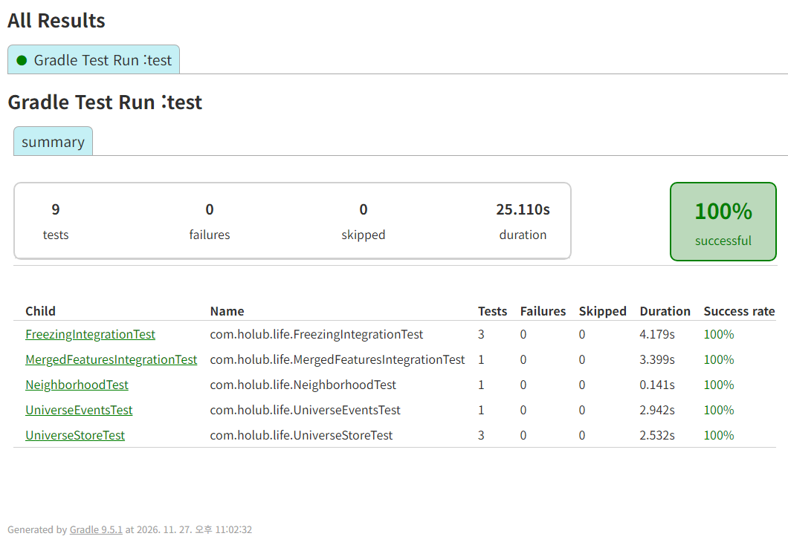
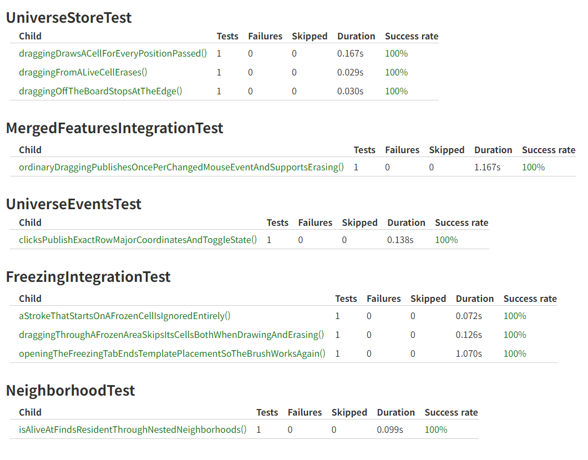

# 드래그 그리기 (Draw Cells by Dragging)

원본 Life Game은 셀을 한 번 클릭할 때마다 하나씩만 바꿀 수 있다. 이 기능은 마우스를 누른 채 끌어 지나가는 셀을 한 번에 그리거나 지우게 한다.

## 1. 유스케이스


| 유스케이스 이름 | Draw Cells by Dragging(E) |
| --- | --- |
| 범위 | Life Game |
| 수준 | Subfunction (Edit Cells의 확장 지점 "끌기"에서 «extend») |
| 주 행위자 | 사용자 (확장 대상인 Edit Cells의 주 행위자를 따른다) |
| 사전 조건 | 사용자가 보드 안의 셀을 왼쪽 버튼으로 눌렀다(Edit Cells). 버튼을 누른 채 끈다(확장 조건) |
| 메인 성공 시나리오 | 1. 시스템이 처음 누른 셀의 상태를 보고 그릴지 지울지 정한다. 죽은 셀이면 그리고, 살아 있는 셀이면 지운다.<br>2. 사용자가 버튼을 누른 채 마우스를 움직인다.<br>3. 시스템이 지나간 셀을 모두 1의 상태로 바꾼다. 빠르게 끌어 마우스 위치가 건너뛴 칸도 채운다.<br>4. 사용자가 버튼을 놓으면 끝난다. |
| 대체 시나리오 | 3a. 보드 밖으로 끈다:<br>&emsp;1. 시스템이 가장 가까운 가장자리 칸까지만 바꾼다.<br>3b. 지나간 셀이 이미 1의 상태다:<br>&emsp;1. 시스템이 그 셀을 그대로 둔다. |
| 연관 요구사항 | FR-1 ~ FR-5, NFR-1 ~ NFR-4 |

## 2. 요구사항

기능 요구사항은 1절 명세의 단계와 대체 시나리오에서, 비기능 요구사항은 이 확장이 원본 Edit Cells와 다른 기능을 깨지 않기 위한 조건에서 뽑았다.

**기능 요구사항**

| ID | 요구사항 | 명세 | 확인하는 테스트 |
| --- | --- | --- | --- |
| FR-1 | 보드 안을 왼쪽 버튼으로 누른 채 끌면, 지나가는 셀을 모두 같은 상태로 바꾼다 | 사전 조건, 2~3단계 | `UniverseStoreTest.draggingDrawsACellForEveryPositionPassed` |
| FR-2 | 그릴지 지울지는 처음 누른 셀로 정한다. 죽은 셀이면 그리고, 살아 있는 셀이면 지운다. 한 번 끄는 동안에는 바뀌지 않는다 | 1단계 | `UniverseStoreTest.draggingFromALiveCellErases` |
| FR-3 | 빠르게 끌어 마우스 위치가 칸을 건너뛰어도, 두 위치 사이의 칸을 모두 바꾼다 | 3단계 | `UniverseStoreTest.draggingDrawsACellForEveryPositionPassed` |
| FR-4 | 보드 밖으로 끌면 가장 가까운 가장자리 칸까지만 바꾼다 | 3a | `UniverseStoreTest.draggingOffTheBoardStopsAtTheEdge` |
| FR-5 | 이미 바꾸려는 상태인 셀은 그대로 둔다 | 3b | `MergedFeaturesIntegrationTest.ordinaryDraggingPublishesOncePerChangedMouseEventAndSupportsErasing` |

**비기능 요구사항**

| ID | 요구사항 | 기준 | 확인하는 테스트 |
| --- | --- | --- | --- |
| NFR-1 | 원본 Edit Cells(클릭)의 동작을 바꾸지 않는다 | 누르기만 하고 끌지 않으면 원본처럼 셀 하나만 바뀐다. 드래그는 Edit Cells의 확장 지점 "끌기"에서만 일어난다 | `UniverseEventsTest.clicksPublishExactRowMajorCoordinatesAndToggleState` |
| NFR-2 | 끄는 동안 다른 기능이 바뀐 판을 바로 받는다 | 셀이 바뀐 마우스 이벤트마다 `EDIT` 이벤트를 한 번 보내고, 바뀐 셀이 없으면 보내지 않는다. 세대 수는 바뀌지 않는다 | `MergedFeaturesIntegrationTest.ordinaryDraggingPublishesOncePerChangedMouseEventAndSupportsErasing` |
| NFR-3 | 다른 편집 모드와 섞이지 않는다 | 캡처·배치 편집 중이나 Freezing 영역을 고르는 중에는 동작하지 않는다. 고정 영역 안의 셀은 건너뛰고, 고정된 셀에서 시작한 획은 무시한다 | `FreezingIntegrationTest.draggingThroughAFrozenAreaSkipsItsCellsBothWhenDrawingAndErasing`, `aStrokeThatStartsOnAFrozenCellIsIgnoredEntirely`, `openingTheFreezingTabEndsTemplatePlacementSoTheBrushWorksAgain` |
| NFR-4 | 원본 Cell 계층(Composite)의 구조를 바꾸지 않는다 | 좌표로 생사를 묻는 `isAliveAt()`만 더하고, 생사 규칙과 셀을 바꾸는 방법(`userClicked()`)은 그대로 쓴다 | `NeighborhoodTest.isAliveAtFindsResidentThroughNestedNeighborhoods` |

## 3. 바뀐 코드

| 파일 | 바뀐 것 |
| --- | --- |
| `Cell`, `Neighborhood`, `Resident` | 좌표로 셀 하나의 생사를 묻는 `isAliveAt(row, column)`을 더했다. 처음 누른 셀의 상태를 알아내는 데 쓴다 |
| `Universe` | 마우스 리스너(`brush`)가 누를 때 그리기·지우기를 정하고(`paintsAlive`), 끌 때 직전 위치와 지금 위치 사이의 칸을 모두 `setCell()`로 바꾼다. 보드 밖 좌표는 `cellAt()`이 가장자리 칸으로 맞춘다 |

## 4. 다른 기능과 맞물린 부분

| 기능 | 맞물린 곳 |
| --- | --- |
| 패턴 캡처·템플릿 배치 | 캡처·배치 편집 중에는 드래그 그리기가 동작하지 않는다 |
| Freezing | 고정 영역 안의 셀은 건너뛴다. 고정된 셀에서 시작한 획은 무시한다(Protect Frozen Region(E)) |
| 통계, 음향 효과 | 셀이 바뀐 마우스 이벤트마다 `EDIT` 이벤트를 한 번 보내 통계와 재생선이 바뀐 판을 받는다 |
| 나이 기반 색상 표시 | 새로 그린 셀은 나이 0에서 시작한다 |

## 5. 테스트

2절의 요구사항을 확인하는 기존 JUnit 테스트 9개를 골라 실행했다. 모두 통과했다.

```
.\gradlew.bat clean test --rerun --tests "com.holub.life.UniverseStoreTest.dragging*" --tests ...
```

(나머지 `--tests`는 아래 표의 테스트 이름을 그대로 넘긴다.)

| 테스트 | 확인하는 것 | 요구사항 |
| --- | --- | --- |
| `UniverseStoreTest.draggingDrawsACellForEveryPositionPassed` | 끌면서 지나간 위치마다 셀이 그려지고, 건너뛴 칸도 채워진다 | FR-1, FR-3 |
| `UniverseStoreTest.draggingFromALiveCellErases` | 살아 있는 셀에서 시작하면 지운다 | FR-2 |
| `UniverseStoreTest.draggingOffTheBoardStopsAtTheEdge` | 보드 밖으로 끌면 가장자리에서 멈춘다 | FR-4 |
| `MergedFeaturesIntegrationTest.ordinaryDraggingPublishesOncePerChangedMouseEventAndSupportsErasing` | 셀이 바뀐 마우스 이벤트마다 `EDIT` 이벤트를 한 번 보내고, 같은 칸을 다시 지나면 보내지 않는다. 지우기도 된다 | FR-5, NFR-2 |
| `UniverseEventsTest.clicksPublishExactRowMajorCoordinatesAndToggleState` | 클릭 한 번은 셀 하나만 바꾼다 | NFR-1 |
| `FreezingIntegrationTest.draggingThroughAFrozenAreaSkipsItsCellsBothWhenDrawingAndErasing` | 끌기가 고정 영역 안의 셀은 건너뛴다 | NFR-3 |
| `FreezingIntegrationTest.aStrokeThatStartsOnAFrozenCellIsIgnoredEntirely` | 고정된 셀에서 시작한 획은 무시한다 | NFR-3 |
| `FreezingIntegrationTest.openingTheFreezingTabEndsTemplatePlacementSoTheBrushWorksAgain` | 템플릿 배치가 끝나면 드래그 그리기가 다시 동작한다 | NFR-3 |
| `NeighborhoodTest.isAliveAtFindsResidentThroughNestedNeighborhoods` | `isAliveAt()`이 블록 안의 셀까지 찾아 생사를 돌려준다 | NFR-4 |





Gradle HTML 보고서(`build/reports/tests/test/`)를 캡처했다. 위는 전체 요약이고, 아래는 테스트 클래스별 화면에서 메서드 표만 모은 것이다.
