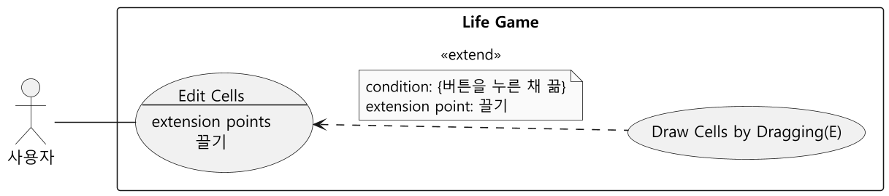

# 드래그 그리기 (Draw Cells by Dragging)

원본 Life Game은 셀을 한 번 클릭할 때마다 하나씩만 바꿀 수 있다. 이 기능은 마우스를 누른 채 끌어 지나가는 셀을 한 번에 그리거나 지우게 한다.

## 1. 유스케이스

| 유스케이스 이름 | Draw Cells by Dragging(E) |
| --- | --- |
| 범위 | Life Game |
| 수준 | Subfunction (Edit Cells의 확장 지점 "끌기"에서 «extend») |
| 주 행위자 | 사용자 (확장 대상인 Edit Cells의 주 행위자를 따른다) |
| 사전 조건 | 사용자가 보드 안의 셀을 왼쪽 버튼으로 눌렀다(Edit Cells). 버튼을 누른 채 끈다(확장 조건) |
| 메인 성공 시나리오 | 1. 시스템이 처음 누른 셀의 상태를 보고 그릴지 지울지 정한다. 죽은 셀이면 그리고, 살아 있는 셀이면 지운다. 2. 사용자가 버튼을 누른 채 마우스를 움직인다. 3. 시스템이 지나간 셀을 모두 1의 상태로 바꾼다. 빠르게 끌어 마우스 위치가 건너뛴 칸도 채운다. 4. 사용자가 버튼을 놓으면 끝난다. |
| 대체 시나리오 | 3a. 보드 밖으로 끈다: &emsp;1. 시스템이 가장 가까운 가장자리 칸까지만 바꾼다. 3b. 지나간 셀이 이미 1의 상태다: &emsp;1. 시스템이 그 셀을 그대로 둔다. |
| 연관 요구사항 | 한 번 끌어 여러 셀을 그리거나 지울 수 있어야 한다 |

## 2. 바뀐 코드

| 파일 | 바뀐 것 |
| --- | --- |
| `Cell`, `Neighborhood`, `Resident` | 좌표로 셀 하나의 생사를 묻는 `isAliveAt(row, column)`을 더했다. 처음 누른 셀의 상태를 알아내는 데 쓴다 |
| `Universe` | 마우스 리스너(`brush`)가 누를 때 그리기·지우기를 정하고(`paintsAlive`), 끌 때 직전 위치와 지금 위치 사이의 칸을 모두 `setCell()`로 바꾼다. 보드 밖 좌표는 `cellAt()`이 가장자리 칸으로 맞춘다 |

## 3. 다른 기능과 맞물린 부분

| 기능 | 맞물린 곳 |
| --- | --- |
| 패턴 캡처·템플릿 배치 | 캡처·배치 편집 중에는 드래그 그리기가 동작하지 않는다 |
| Freezing | 고정 영역 안의 셀은 건너뛴다. 고정된 셀에서 시작한 획은 무시한다(Protect Frozen Region(E)) |
| 통계, 음향 효과 | 셀이 바뀐 마우스 이벤트마다 `EDIT` 이벤트를 한 번 보내 통계와 재생선이 바뀐 판을 받는다 |
| 나이 기반 색상 표시 | 새로 그린 셀은 나이 0에서 시작한다 |

## 4. 테스트

| 테스트 | 확인하는 것 |
| --- | --- |
| `UniverseStoreTest.draggingDrawsACellForEveryPositionPassed` | 끌면서 지나간 위치마다 셀이 그려진다 |
| `UniverseStoreTest.draggingFromALiveCellErases` | 살아 있는 셀에서 시작하면 지운다 |
| `UniverseStoreTest.draggingOffTheBoardStopsAtTheEdge` | 보드 밖으로 끌면 가장자리에서 멈춘다 |
| `MergedFeaturesIntegrationTest.ordinaryDraggingPublishesOncePerChangedMouseEventAndSupportsErasing` | 셀이 바뀐 마우스 이벤트마다 `EDIT` 이벤트를 한 번 보내고, 지우기도 된다 |
