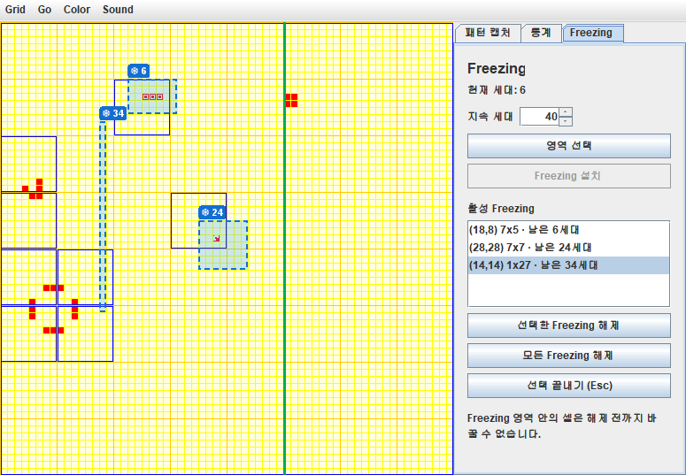
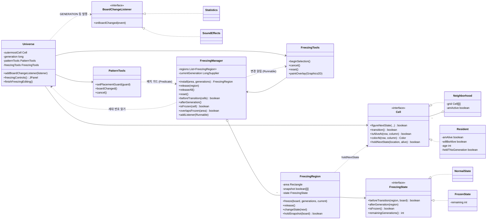
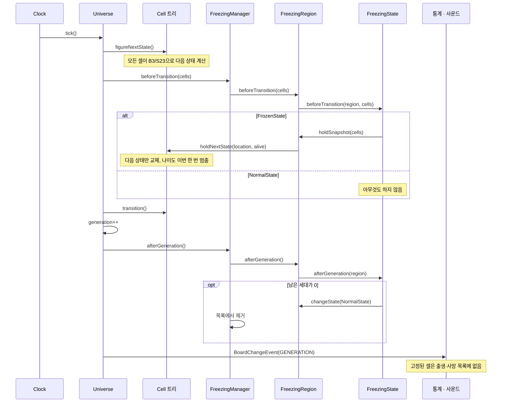
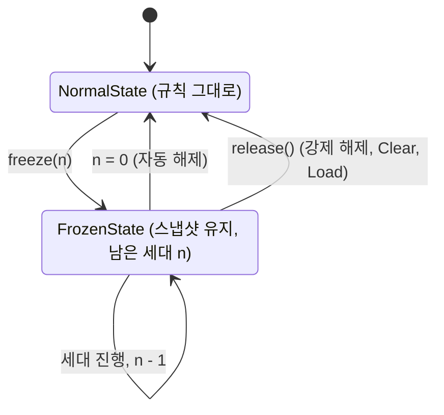
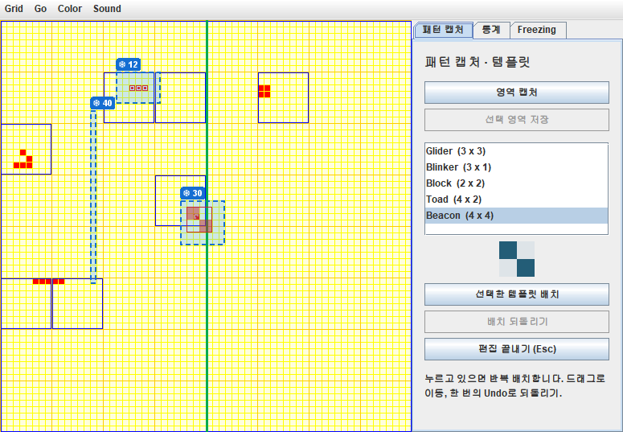

# Freezing 기능 설계 및 통합 기록

기준: 2026-11-20 `feature/freezing`. `dev`(`d215c7a`, PR #16까지)를 병합한 뒤의 코드다. Freezing의 설계, 다른 기능과 연결되는 부분, 검증 결과를 이 문서에서 관리한다.

1. [기능 개요](#overview)
2. [사용법](#usage)
3. [구조](#structure)
4. [세대 처리](#generation)
5. [State 패턴](#state)
6. [다른 기능과 연결되는 부분](#integration)
7. [State 외에 쓴 패턴과 그 이유](#patterns)
8. [설계 결정과 대안](#decisions)
9. [테스트와 검증 결과](#tests)
10. [실제 창에서 확인한 데모](#demo)
11. [변경 파일](#files)
12. [한계와 남은 일](#limits)

<a id="overview"></a>
## 1. 기능 개요

보드에서 사각형 영역을 고르면, 그 영역의 셀을 **설치한 순간 그대로 N세대 동안 고정**한다.

- 고정된 영역 안에서는 살아 있는 셀이 죽지 않고, 죽은 셀이 태어나지 않는다.
- 영역 바깥은 기존 규칙(B3/S23)대로 진화한다. 고정된 살아 있는 셀은 바깥 셀의 이웃으로 센다.
- 영향은 한 방향이다. 고정된 셀은 바깥에 영향을 주지만, 바깥 셀은 고정된 셀을 바꾸지 못한다.
- N세대가 지나면 저절로 풀리고, 버튼으로 언제든 풀 수 있다.
- 영역은 여러 개 둘 수 있고, 영역마다 지속 세대가 다를 수 있다. 서로 겹칠 수는 없다.

규칙을 계산하는 코드(`figureNextState()`)와 전이하는 코드(`transition()`의 생존 판정)는 바꾸거나 복사하지 않았다.

<a id="usage"></a>
## 2. 사용법

오른쪽 사이드바의 **Freezing** 탭에서 쓴다.



1. **지속 세대**(1~999, 기본 5)를 정한다.
2. **영역 선택**을 누르고 보드에서 드래그한다. 반대 방향으로 끌어도 되고, 보드 밖으로 끌면 보드 끝에 맞춘다. 선택하는 동안 시뮬레이션은 멈춘다.
3. **Freezing 설치**를 누른다. 그 순간의 셀 상태(살아 있는 셀과 죽은 셀 모두)가 고정된다.
4. `Go` 메뉴에서 속도를 고르거나 `Tick (Single Step)`으로 진행한다.
5. 남은 세대가 0이 되면 저절로 풀린다. **선택한 Freezing 해제**, **모든 Freezing 해제**로 바로 풀 수도 있다.

예: 현재 세대가 10일 때 지속 세대 5로 설치하면, 11~15세대 갱신 동안 고정되고 16세대 갱신부터 정상 진화한다.

| 화면 표시 | 뜻 |
| --- | --- |
| 반투명 하늘색 배경 + 파란 점선 테두리 | 고정된 영역 |
| 영역 위의 파란 배지 `❄ n` | 남은 세대 수 |
| 살아 있는 셀 안의 하늘색 테두리 | 고정된 살아 있는 셀 |
| 회색 점선 | 지금 드래그하고 있는 선택 영역 |
| 빨간 점선 | 기존 영역과 겹쳐서 설치할 수 없는 선택 |

고정된 동안 못 하는 것:

- 영역 안의 셀은 클릭이나 드래그로 바꿀 수 없다.
- 패턴 템플릿은 영역과 겹치는 자리에 놓을 수 없다.
- `Grid > Clear`와 `Grid > Load`는 Freezing도 모두 지운다.

<a id="structure"></a>
## 3. 구조

### 클래스와 책임

| 클래스 | 책임 |
| --- | --- |
| [FreezingState](../../src/com/holub/life/FreezingState.java) | State 인터페이스. 세대 처리의 두 시점(`beforeTransition`, `afterGeneration`)에서 할 일을 정의한다 |
| [NormalState](../../src/com/holub/life/NormalState.java) | 고정되지 않은 상태. 아무것도 하지 않는다. 값이 없어서 객체 하나를 공유한다 |
| [FrozenState](../../src/com/holub/life/FrozenState.java) | 고정 상태. 스냅샷을 적용하고 남은 세대를 줄인다. 0이 되면 Context를 `NormalState`로 바꾼다 |
| [FreezingRegion](../../src/com/holub/life/FreezingRegion.java) | Context. 영역, 스냅샷, 시작 세대, 지속 세대, 현재 State를 가진다 |
| [FreezingManager](../../src/com/holub/life/FreezingManager.java) | 영역 목록, 설치 검증(빈 영역, 지속 세대, 겹침), 해제, 초기화. Swing 코드가 없다 |
| [FreezingTools](../../src/com/holub/life/FreezingTools.java) | Freezing 탭 화면, 드래그 선택, 보드 위 표시 |
| [Cell](../../src/com/holub/life/Cell.java) 계층 | `holdNextState(location, alive)` 하나를 추가했다 |
| [Universe](../../src/com/holub/life/Universe.java) | 세대 처리에 Freezing 단계를 끼우고, 다른 기능과의 규칙(편집 차단, 배치 제한, 초기화)을 연결한다 |
| [Life](../../src/com/holub/life/Life.java) | 사이드바에 Freezing 탭을 추가한다 |

### 클래스 다이어그램



<a id="generation"></a>
## 4. 세대 처리

`Universe`의 시계 리스너가 한 세대를 아래 순서로 처리한다. `[Freezing]` 표시가 붙은 세 줄만 추가했다.

```java
if (patternTools.isEditing() || freezingTools.isEditing()) return;   // [Freezing] 영역 선택 중에는 멈춤
patternTools.boardChanged();
outermostCell.figureNextState( DUMMY, ... );      // 기존: 모든 셀이 B3/S23으로 다음 상태 계산
boolean[][] before = liveCells();

freezing.beforeTransition( outermostCell );       // [Freezing] 고정 영역의 다음 상태를 스냅샷으로 되돌림

boolean changed = outermostCell.transition();     // 기존: 한꺼번에 전이
generation++;
freezing.afterGeneration();                       // [Freezing] 남은 세대 감소, 0이면 해제
notifyBoardChanged( GENERATION, before );         // 기존: 통계와 사운드에 알림
```

핵심은 **계산과 전이 사이**에 끼어든다는 점이다.

- `figureNextState()`가 끝난 시점에는 모든 셀이 "다음 상태"를 정해 두었지만 아직 바뀌지 않았다. 이때 고정된 셀의 다음 상태만 설치 순간의 값으로 바꾼다.
- 셀이 실제로 죽었다가 되살아나는 일이 없다. 그래서 바깥 셀은 항상 고정된 셀의 원래 상태를 이웃으로 본다.
- 모든 셀이 같은 이전 세대를 기준으로 계산된다는 Life의 전제가 유지된다.



`Cell.holdNextState()`는 Composite 구조를 따라 내려간다.

- `Neighborhood`: 좌표가 속한 하위 셀에 넘기기만 한다(`isAliveAt()`, `colorAt()`과 같은 방식). 블록의 활성 표시(`amActive`)는 건드리지 않는다. 다음 상태가 실제로 덮어써지는 경우는 방금 `figureNextState()`가 그 블록을 "변화 있음"으로 계산한 경우뿐이라, 블록은 이미 활성이고 다음 세대에도 다시 계산된다.
- `Resident`: `willBeAlive`만 바꾸고, 이웃이 읽는 `amAlive`는 건드리지 않는다. 이어지는 `transition()` 한 번 동안은 나이(`age`)도 세지 않는다([6.3](#link-color)).
- `Cell.DUMMY`: 아무것도 하지 않고 `false`를 돌려준다.

<a id="state"></a>
## 5. State 패턴

| 역할 | 클래스 |
| --- | --- |
| Context | `FreezingRegion` |
| State | `FreezingState` |
| ConcreteState | `NormalState`, `FrozenState` |



- `FreezingRegion`은 자기가 고정 중인지 `if`로 확인하지 않는다. `beforeTransition()`과 `afterGeneration()`을 현재 State 객체에 그대로 넘긴다.
- 전환 조건도 State 안에 있다. `FrozenState`가 남은 세대를 세다가 0이 되면 스스로 `region.changeState(NormalState.INSTANCE)`를 부른다.
- State 객체는 셀마다가 아니라 **영역마다 하나**다. 4,096개 셀에 필드를 달 필요가 없고, 영역 단위로 풀고 표시하기 쉽다.

Strategy가 아니라 State를 고른 이유: 고정은 사용자가 골라 끼우는 규칙이 아니라, 시간이 지나면 스스로 끝나는 상태다. 전환 시점을 바깥에서 관리하지 않고 상태 객체가 직접 결정하는 구조가 맞다.

<a id="integration"></a>
## 6. 다른 기능과 연결되는 부분

`dev`에 있는 기능은 각자 다른 패턴으로 만들어졌다. Freezing은 그 구조를 바꾸지 않고, 이미 열려 있는 연결 지점에 붙였다.

### 6.1 한눈에 보기

| 기능 (PR) | 그 기능의 패턴 | Freezing과 만나는 곳 | 통합 방식 | 그 기능 코드 수정 |
| --- | --- | --- | --- | --- |
| 통계 (#10) | Observer (`BoardChangeListener`) | 세대 번호, 출생·사망 수, 생존 수 | 세대 번호를 `Universe` 하나로 통일. 고정은 이벤트를 만들기 전에 끝남 | 없음 |
| 사운드 (#3) | Observer + Command | 세대마다 받는 출생·사망 좌표 | 통계와 같은 이벤트를 받으므로 자동으로 맞음 | 없음 |
| 세대별 색상 (#8, #11) | Strategy (`CellColorPolicy`) | 셀의 나이와 색 | 고정된 셀은 나이도 멈춤 | `Resident.transition()`에 조건 1개 |
| 패턴 캡처·템플릿 (#9, #13) | Command (`PlacePatternCommand`), 배치 가드 | 템플릿 배치, 되돌리기 | 팀이 열어 둔 `setPlacementGuard`에 연결. 선택 시작 때 되돌리기 이력 비움 | 없음 |
| 드래그 그리기 (#5) | `Universe`의 브러시 | 고정된 셀 편집 | 브러시가 고정된 셀을 건너뜀 | `Universe` 브러시에 검사 2곳 |
| Tick 수정 (#16) | `Clock` | 한 세대 진행 | 그대로 동작 | 없음 |
| 사이드바 (#10) | `Life.createSidebar` | 탭 | Freezing 탭을 세 번째로 추가 | `Life`에 4줄 |

### 6.2 통계와 사운드: 같은 이벤트, 같은 세대 번호

`Universe`는 세대가 끝날 때 `BoardChangeEvent(GENERATION)`을 만들어 모든 `BoardChangeListener`에 보낸다. 통계와 사운드는 이 이벤트만 본다.

- **세대 번호를 하나로 맞췄다.** 병합 전 `FreezingManager`는 세대 카운터를 따로 가지고 있었다. 병합 후 `Universe`에도 카운터가 생겨서 둘이 어긋날 수 있었다. 그래서 `FreezingManager`의 카운터를 없애고 `Universe`의 값을 읽게 했다(`new FreezingManager(outermostCell, () -> generation)`). 통계 탭의 "세대"와 Freezing 탭의 "현재 세대", 영역의 시작 세대가 항상 같은 숫자다.
- **고정된 셀은 소리를 내지 않는다.** 실제 `SoundEffects`로 확인했다. 고정된 블링커는 음을 예약하지 않고, 풀린 첫 세대에 다시 소리가 난다. 재생선은 고정된 살아 있는 셀을 계속 연주한다.
- **고정된 셀은 출생·사망 목록에 들어가지 않는다.** 이벤트는 전이 전(`before`)과 전이 후의 보드를 비교해 만든다. 고정된 셀은 전이 전후가 같으므로, 이벤트 쪽 코드를 고치지 않아도 목록에서 빠진다. 통계의 출생·사망 수와 사운드가 내는 소리에 고정된 셀이 섞이지 않는다.
- **고정된 살아 있는 셀은 생존 수에 포함된다.** 실제로 보드에 살아 있기 때문이다.
- **설치와 해제는 `BoardChangeEvent`를 보내지 않는다.** 셀이 하나도 바뀌지 않기 때문이다. 이 이벤트는 "보드가 바뀌었다"는 뜻이고, 통계는 받을 때마다 다시 집계한다.
- **Freezing은 이 이벤트의 구독자가 될 수 없다.** 구독자는 전이가 끝난 뒤에 불리고, 콜백에서 보드를 바꾸면 안 된다는 계약이 있다. 고정은 전이 전에 끼어들어야 하므로, 구독자가 아니라 세대 처리의 한 단계로 넣었다.

### <a id="link-color"></a>6.3 세대별 색상: 고정된 셀은 나이도 멈춘다

색상 기능은 셀마다 나이(연속으로 살아남은 세대 수)를 세고, `CellColorPolicy`(Strategy)가 나이를 색으로 바꾼다. `Cycle by Generation`을 켜면 10세대마다 빨강 → 파랑 → 초록으로 바뀐다.

고정된 살아 있는 셀을 그냥 두면 `transition()`이 "계속 살아 있음"으로 보고 나이를 올려서, 고정 중에도 색이 바뀐다. "설치한 순간 그대로"라는 뜻과 맞지 않는다. 그래서 다음과 같이 정했다.

- `holdNextState()`가 불린 셀은 바로 다음 `transition()` 한 번 동안 나이를 세지 않는다.
- 고정이 풀리면 **멈췄던 나이에서 이어서** 센다.
- 색 규칙(`CellColorPolicy`)은 건드리지 않았다. 나이가 그대로이므로 어떤 규칙을 쓰든 색이 그대로다.
- 통계의 색상별 집계도 같은 색을 읽으므로 그대로 맞는다.

예: 나이 0인 블록 두 개 중 하나를 10세대 고정하면, 10세대 뒤 고정된 블록은 빨강, 다른 블록은 파랑이다. 풀린 뒤 10세대가 더 지나야 고정됐던 블록이 파랑이 된다.

### 6.4 패턴 캡처와 템플릿: 배치 제한과 되돌리기

- **배치 제한.** `BoardEditor`에는 `setPlacementGuard(Predicate<Rectangle>)`가 있다. 캡처 담당자가 이 PR과 맞추려고 열어 둔 연결 지점이다. `Universe`가 한 줄로 연결한다.

  ```java
  patternTools.setPlacementGuard( area -> freezingTools.manager().overlapsFrozen(area) );
  ```

  검사 단위는 템플릿의 **사각형 전체**다. 빈 여백만 영역과 겹쳐도 그 배치를 통째로 거부한다([캡처 통합 규칙](../capture/README.md#integration) IF-04와 같은 의미). 가드는 `BoardEditor.place()` 안에서 검사하므로, 클릭뿐 아니라 누른 채 끌어서 반복 배치할 때의 타이머와 보간도 우회하지 못한다. 드래그가 영역을 가로지르면 겹치지 않는 자리에만 찍힌다. 미리보기도 같은 가드로 빨간색이 된다.
- **되돌리기 이력.** 템플릿을 놓은 뒤 그 자리를 고정하고 `배치 되돌리기`를 누르면, 되돌리기가 고정된 셀을 지울 수 있다. 그래서 **영역 선택을 시작할 때** 진행 중인 패턴 편집을 끝내고 되돌리기 이력을 비운다(`patternTools.boardChanged()`).
- **캡처는 그대로 된다.** 영역 캡처는 읽기만 하므로 고정된 영역도 캡처할 수 있다.
- **서로를 모른다.** `PatternTools`는 `Predicate`만 알고 `FreezingTools`는 `Runnable`만 안다. 두 도구를 아는 것은 `Universe`뿐이다.

### 6.5 드래그 그리기: 고정된 셀을 건너뛴다

`Universe`의 브러시는 누른 셀을 토글하고, 끄는 동안 지나가는 셀을 같은 상태로 만든다.

- 고정된 셀에서 누르면 그 획 전체를 시작하지 않는다.
- 바깥에서 시작한 획이 영역을 지나가면, 영역 안의 셀만 건너뛰고 바깥 셀은 계속 그리거나 지운다.
- 영역 선택 중에는 브러시가 동작하지 않는다. 드래그가 선택에 쓰이기 때문이다.
- 실제로 바뀐 셀이 없으면 `EDIT` 이벤트도 보내지 않는다(브러시의 기존 규칙 그대로).

### 6.6 시계와 Tick

- 영역 선택을 시작하면 시계를 멈춘다. 패턴 편집과 같은 규칙이다. 선택 중에는 `Tick (Single Step)`도 세대를 진행하지 않는다.
- 선택을 끝내도 시계를 저절로 다시 켜지 않는다(패턴 편집과 같다).
- PR #16의 수정(실행 중 Tick을 누르면 멈추고 한 세대만 진행)은 그대로 동작한다. Tick 한 번에 남은 세대가 정확히 1 줄어든다.
- 영역이 설치돼 있어도 시계는 평소대로 돈다.

### 6.7 사이드바 탭

`Life.createSidebar()`가 탭을 만든다. `패턴 캡처`, `통계` 뒤에 `Freezing`을 세 번째로 추가했다. 기존 두 탭의 순서를 바꾸지 않으려고 뒤에 붙였다.

- Freezing 탭을 떠나면 진행 중인 영역 선택을 끝낸다. 설치된 영역은 그대로 남는다.
- 패턴 캡처 탭을 떠나면 패턴 편집을 끝낸다(기존 동작).
- 탭을 바꾸는 것만으로는 시계가 멈추지 않는다.

### 6.8 Clear, Load, Store

- `Grid > Clear`: 보드를 비우고 세대를 0으로 돌린 뒤 Freezing을 모두 지운다. 그다음 `CLEAR` 이벤트를 한 번 보낸다.
- `Grid > Load`: 파일을 다 읽은 뒤에만 보드를 바꾸는 기존 순서를 따른다. 읽기에 성공하면 Freezing을 지운다. 파일 선택을 취소하면 Freezing도 그대로다.
- `Grid > Store`: 셀만 저장한다. Freezing 정보는 저장하지 않는다.

### 6.9 화면 그리기

- 그리는 순서: 셀 → Freezing 표시 → 사운드 재생선 → 패턴 미리보기.
- 색상 기능에서 고친 지연 문제([color-gen-redraw-lag.md](../color-gen/color-gen-redraw-lag.md))를 되살리지 않도록, Freezing은 **영역이 있는 자리만** 다시 그리게 요청한다. 영역이 하나도 없으면 아무것도 요청하지 않는다. 바뀐 셀이 없는 세대에 보드 전체를 다시 그리지 않는다는 `UniverseColorTest`의 조건이 그대로 통과한다.
- 영역이 있는 동안에는 세대마다 그 자리를 다시 그린다. 배지의 남은 세대 숫자가 바뀌기 때문이다.

<a id="patterns"></a>
## 7. State 외에 쓴 패턴과 그 이유

Freezing이 **새로 만든** 패턴 구조는 State와 Observer 두 가지다. 나머지는 이미 있던 구조를 그대로 쓰거나 한 칸 넓힌 것이다.

| 패턴 | 어디에 | 새로 만든 것인가 | 왜 이 패턴인가 |
| --- | --- | --- | --- |
| State | `FreezingState` / `NormalState` / `FrozenState` / `FreezingRegion` | 새로 만듦 | [5절](#state) |
| Observer | `FreezingManager.addListener(Runnable)` → `FreezingTools` | 새로 만듦 (가벼운 형태) | 아래 7.1 |
| Composite | `Cell.holdNextState()` | 기존 구조에 메서드 1개 추가 | 아래 7.2 |
| Mediator | `Universe`가 Freezing과 다른 기능을 연결 | 기존 역할을 그대로 사용 | 아래 7.3 |
| Singleton | `NormalState.INSTANCE` | 새로 만듦 (작은 범위) | 아래 7.4 |

### 7.1 Observer: 모델이 화면을 모르게 하려고

`FreezingManager`는 영역이 설치·해제되거나 세대가 지나면 등록된 `Runnable`을 부른다. `FreezingTools`가 이것을 받아 목록, 버튼, "현재 세대" 표시를 고친다.

- **이유.** `FreezingManager`에 Swing 코드를 넣지 않으려는 것이다. 그래야 화면 없이 테스트할 수 있다(`FreezingModelTest`는 `Universe`도 Swing도 쓰지 않는다). 통계가 `Statistics`(계산)와 `StatisticsPanel`(화면)을 `Consumer` 콜백으로 나눈 것과 같은 생각이다.
- **왜 `BoardChangeListener`를 재사용하지 않았나.** 그 이벤트는 "보드의 셀이 바뀌었다"는 뜻이다. 영역 설치·해제는 셀을 바꾸지 않는다. 같은 통로로 보내면 통계가 필요 없는 재집계를 하고, 사운드와 통계가 새 종류를 걸러 내도록 다른 사람의 코드를 고쳐야 한다.
- **왜 전용 인터페이스를 만들지 않았나.** 구독자에게 넘길 데이터가 없다. 구독자는 `manager.regions()`를 다시 읽으면 된다. 그래서 JDK의 `Runnable`로 충분하다.

### 7.2 Composite 확장: 보드 구조를 몰라도 되게 하려고

`FreezingRegion`은 보드가 8x8 블록이 두 단계로 중첩돼 있다는 것을 모른다. 좌표 하나로 `board.holdNextState(location, alive)`를 부르면 `Neighborhood`가 알맞은 하위 셀로 넘기고 `Resident`가 처리한다.

- **이유.** 색상·사운드 기능이 추가한 `isAliveAt(row, column)`, `colorAt(row, column)`과 같은 방식이다. 좌표로 셀 하나에 닿는 길이 이미 Composite로 정해져 있으므로 같은 길을 썼다.
- 스냅샷을 읽는 쪽도 병합하면서 `isAliveAt()`으로 바꿨다. 병합 전에는 저장용 `createMemento()`로 보드 전체를 복사해서 읽었는데, 필요한 칸만 물어볼 수 있는 메서드가 생겼기 때문이다.

### 7.3 Mediator: 기능끼리 직접 부르지 않게 하려고

원본 주석대로 `Universe`는 Swing 이벤트와 Life 클래스 사이의 Mediator다. 기능 사이의 규칙은 모두 `Universe`(와 창을 조립하는 `Life`)에 모았다.

| 규칙 | 연결하는 곳 |
| --- | --- |
| 고정 영역에 템플릿 배치 금지 | `Universe` 생성자: `setPlacementGuard(...)` |
| 영역 선택 시작 → 패턴 편집 종료, 되돌리기 이력 비움 | `Universe` 생성자: `FreezingTools`에 넘기는 `Runnable` |
| 고정된 셀 그리기 금지 | `Universe`의 브러시 |
| Clear / Load → Freezing 초기화 | `Universe`의 메뉴 처리 |
| Esc → 켜져 있는 편집 모드 종료 | `Universe`의 키 바인딩 |
| 탭 전환 → 숨겨진 편집 모드 종료 | `Life.createSidebar()` |

- **이유.** `FreezingTools`와 `PatternTools`가 서로를 참조하면 한쪽을 고칠 때 다른 쪽도 고쳐야 한다. 지금은 `FreezingTools`가 `Runnable` 하나, `PatternTools`가 `Predicate` 하나만 안다. 통계나 사운드처럼 한 기능을 빼도 나머지는 컴파일된다.
- **검토한 대안.** 편집 금지 규칙을 Chain of Responsibility(편집 요청을 여러 검사기가 차례로 확인)로 만드는 방법이 있다. 검사기가 지금은 Freezing 하나뿐이라 구조만 늘어난다. 금지 규칙을 가진 기능이 더 생기면 그때 바꾼다.

### 7.4 Singleton: 값이 없는 상태를 하나만 두려고

`NormalState`는 필드가 없다. 영역마다 새로 만들 이유가 없어서 `NormalState.INSTANCE` 하나를 공유한다. `FrozenState`는 남은 세대를 가지므로 영역마다 새로 만든다. 범위는 이 클래스 하나이고, `Universe`나 `Clock`처럼 전역에서 찾아 쓰는 Singleton은 아니다.

### 7.5 다른 기능의 패턴은 건드리지 않았다

- **Strategy (`CellColorPolicy`).** 색 규칙은 그대로다. Freezing은 규칙의 입력인 나이를 멈출 뿐이다.
- **Command (`PlacePatternCommand`).** 명령과 되돌리기 구현은 그대로다. 배치 전 검사는 `BoardEditor`의 가드가 한다.
- **Observer (`BoardChangeListener`).** 이벤트 종류, 내용, 발행 시점을 바꾸지 않았다.
- **Command (사운드의 예약 실행).** 관계없다.

<a id="decisions"></a>
## 8. 설계 결정과 대안

### 8.1 고정을 어디에서 적용할까

| 대안 | 장점 | 단점 |
| --- | --- | --- |
| `Resident.figureNextState()` 안에서 고정 여부 확인 | 호출 한 번으로 끝남 | 규칙 코드에 Freezing 분기가 섞임. `Resident`는 자기 좌표를 몰라 영역 판단을 못 함 |
| `transition()` 뒤에 스냅샷으로 되돌리기 | `Cell` 변경이 없음 | 셀이 한 번 실제로 바뀌었다가 되돌아감. 이벤트의 출생·사망 목록과 나이가 어긋남 |
| 구독자(`BoardChangeListener`)로 만들어 이벤트를 받고 되돌리기 | 다른 기능과 같은 방식 | 구독자는 보드를 바꾸면 안 된다는 계약 위반. 통계·사운드가 되돌리기 전 상태를 받음 |
| **계산과 전이 사이에서 다음 상태만 교체 (선택)** | 규칙 코드 그대로. 셀이 한 번도 바뀌지 않음. 이벤트가 저절로 맞음 | `Cell`에 메서드 1개 추가 |

### 8.2 세대 번호를 누가 가질까

| 대안 | 장점 | 단점 |
| --- | --- | --- |
| `FreezingManager`와 `Universe`가 각자 셈 | 병합 전 코드 그대로 | 초기화 시점이 한 곳이라도 어긋나면 두 탭의 숫자가 달라짐 |
| `FreezingManager`가 `BoardChangeEvent`의 세대를 받아 기억 | 통계와 같은 방식 | 구독 등록이 필요하고, 이벤트 전에 호출되는 `afterGeneration()`에서는 한 박자 늦은 값 |
| **`Universe`의 값을 읽음 (선택)** | 값이 한 곳에만 있음 | 생성자에 `LongSupplier` 하나 추가 |

### 8.3 고정된 셀의 나이

| 대안 | 결과 |
| --- | --- |
| 나이를 계속 셈 | 고정 중에도 색이 바뀜. "그대로 유지"와 다름 |
| 풀릴 때 나이를 0으로 | 풀린 순간 색이 처음 색으로 튐 |
| **고정 중에는 멈추고 풀리면 이어서 셈 (선택)** | 고정 중 색이 그대로. 풀린 뒤 자연스럽게 이어짐 |

### 8.4 Freezing 탭의 위치

기존 테스트(`MergedFeaturesIntegrationTest`)가 탭 0이 패턴 캡처, 탭 1이 통계라고 확인한다. 순서를 유지하려고 세 번째에 붙였고, 그 테스트에서는 탭 개수 단언만 2에서 3으로 고쳤다.

### 8.5 그 밖의 결정

- **상태 객체는 영역마다 하나.** 셀마다 두면 4,096개 셀에 필드가 늘고 `Resident` 수정이 커진다.
- **영역은 사각형.** 템플릿 배치 가드가 `Rectangle` 단위라서 그대로 맞는다.
- **겹치는 영역은 거부.** 겹치면 어느 스냅샷이 우선인지, 하나가 먼저 풀릴 때 어떻게 되는지 정해야 한다. 요구사항에 없어서 막았다.

<a id="tests"></a>
## 9. 테스트와 검증 결과

### 9.1 실행 결과

환경: Windows 11, JDK 17.0.21(Temurin), Gradle 9.5.1. 2026-11-20에 실행했다.

```
> .\gradlew.bat clean test

com.holub.life.FreezingModelTest               50 tests  0 failures
com.holub.life.FreezingIntegrationTest         37 tests  0 failures
com.holub.life.FreezingSoundIntegrationTest     3 tests  0 failures
com.holub.life.MergedFeaturesIntegrationTest   12 tests  0 failures
(그 밖의 기존 클래스 26개)                      282 tests  0 failures

BUILD SUCCESSFUL  (30개 클래스, 384 tests, 0 failures, 0 errors, 0 skipped)

> .\gradlew.bat patternUiTest

PASS 17 Swing integration checks: place, bounds, reverse drag, save dialog, reload, undo, escape, draw, tick, cancel.
```

- `dev`의 기존 테스트 294개가 모두 통과한다. 기존 테스트 코드에서 고친 것은 `MergedFeaturesIntegrationTest`의 탭 개수 단언 한 곳(2 → 3, Freezing 탭 확인 1줄 추가)뿐이다.
- Freezing 테스트는 90개다(모델 50, 통합 37, 사운드 3).
- 캡처 기능의 데스크톱 Swing 검사(`patternUiTest`) 17개도 그대로 통과한다.

### 9.2 Freezing 테스트 구성

병합 전의 `main()` 방식 테스트 두 개(`FreezingFeatureTest`, `FreezingUiTest`)는 팀의 JUnit 방식으로 옮기고 내용을 늘렸다. `gradlew test` 한 번으로 모두 돈다.

**`FreezingModelTest`: 모델만** (`Universe`와 Swing 없이, 자체 보드에서)

| 묶음 | 확인하는 것 |
| --- | --- |
| A~F | 고정된 살아 있는 셀이 죽지 않음 / 죽은 셀이 태어나지 않음 / 바깥은 B3/S23 / 고정된 셀이 이웃으로 세어짐, 바깥이 고정된 셀을 못 바꿈 / 10세대에 5세대 설치 시 11~15 고정·16부터 정상 / 강제 해제·전체 해제·초기화 |
| State | `Normal → Frozen → Normal` 전환, `FrozenState`가 스스로 전환, `NormalState` 공유 |
| 설치 검증 | 지속 세대 0·음수, 빈 영역, `null`, 보드 밖, 보드 경계에 맞춤, 겹침 거부와 맞닿음 허용, 풀린 자리에 다시 설치 |
| 여러 영역 | 지속 세대가 다른 영역이 따로 풀림, 목록을 밖에서 못 바꿈, 변경 알림 횟수 |
| Composite | `holdNextState()`가 현재 상태를 안 건드림, `Cell.DUMMY`, 모서리와 블록 경계 9곳의 1칸 영역, 블록 4개에 걸친 영역, 보드 전체 고정 |
| 그 밖 | 정물, 빈 영역, 고정된 빈 벽이 글라이더를 막음 |
| 색상 | 고정된 셀의 나이·색 유지, 풀린 뒤 이어서 셈, 고정된 죽은 셀 |
| 무작위 비교 | 무작위 보드 12종 × 250세대. 세대마다 무작위로 설치·강제 해제·전체 해제를 섞고, 따로 작성한 계산과 **모든 칸의 생존과 나이**를 비교 |

**`FreezingIntegrationTest`: 실제 `Universe`에서 다른 기능과 함께**

| 묶음 | 확인하는 것 |
| --- | --- |
| 시계 | 세대 번호가 Freezing·통계·이벤트에서 같음, `Tick (Single Step)` 한 번에 한 세대, 실제 타이머로 돌려도 제때 풀림, 영역 선택 중 세대 진행 차단, 오른쪽 클릭으로 선택 종료 |
| 통계·사운드 | 고정된 셀이 출생·사망 목록에 없음, 생존 수에는 포함, 사운드 대역이 같은 목록을 받음, 보드 전체 고정 시 소리 없음, 설치·해제가 이벤트를 안 보냄 |
| 색상 | 고정된 블록은 빨강·다른 블록은 파랑, 풀린 뒤 10세대 더 지나야 파랑, 통계의 색상별 수, 색 규칙을 바꿔도 영역 유지 |
| 드래그 | 고정된 셀 클릭 무시, 드래그가 영역을 건너뜀(그릴 때와 지울 때), 고정된 셀에서 시작한 획 무시, 풀리면 바로 편집 가능 |
| 템플릿 | 겹치는 배치 거부·맞닿는 배치 허용, 빈 여백만 겹쳐도 거부, 누른 채 끌 때 겹치는 자리만 건너뜀, 되돌리기가 영역을 안 건드림, 영역 선택 시작 시 되돌리기 이력 비움, 누른 채 선택을 시작하면 반복 배치 종료, 고정된 영역 캡처 |
| 사이드바 | 탭 3개와 순서·높이, 탭을 떠나면 선택 종료·영역 유지, Freezing 탭을 열면 템플릿 배치 종료, 탭 전환이 시계를 안 멈춤 |
| 선택 | 반대 방향 드래그, 겹치는 선택은 설치 불가, 보드 밖 드래그는 경계에 맞춤, 지속 세대 입력 |
| Clear·Load·Store | Clear가 영역·세대를 초기화하고 `CLEAR` 한 번, Load 성공 시 초기화, Load 취소 시 유지, Store는 영역을 안 건드림 |
| 그리기 | 영역이 하늘색으로 칠해지고 풀리면 사라짐, 재생선·템플릿 미리보기와 함께 그려도 오류 없음, 영역이 없으면 다시 그리기 요청 없음, 영역이 있어도 보드 전체는 다시 그리지 않음 |
| 무작위 비교 | 무작위 보드 5종 × 120세대. 색 순환을 켜고 세대마다 설치·해제·클릭을 섞어, 이벤트의 생존 배열·출생·사망·색 목록과 통계 값을 따로 작성한 계산과 비교 |

**`FreezingSoundIntegrationTest`: 실제 `SoundEffects`와 함께**

`SoundEffectsIntegrationTest`와 같은 방식이다. `SoundEffects`는 실제 객체이고, MIDI 장치와 음 예약기만 대역으로 바꿔 어떤 음이 예약되는지 읽는다.

| 테스트 | 확인하는 것 |
| --- | --- |
| `aFrozenBlinkerIsSilentAndIsHeardAgainOnItsFirstFreeGeneration` | 고정된 블링커는 3세대 동안 음을 하나도 예약하지 않는다. 풀린 첫 세대에 탄생 화음과 타악기 1번이 난다 |
| `onlyTheFreeCellIsHeardDyingAndTheFrozenCellIsHeardWhenItIsReleased` | 고정된 셀과 자유 셀이 함께 있으면 자유 셀의 사망 타악기만 난다. 고정된 셀이 살아 있으므로 전멸 마무리 화음은 나지 않는다. 풀려서 죽는 세대에 마무리 화음이 난다 |
| `thePlaybackLineKeepsPlayingAFrozenLiveCellThatWouldOtherwiseBeGone` | 재생선이 고정된 살아 있는 셀을 계속 연주한다 |

### 9.3 캡처 문서가 남겨 둔 통합 검사

[캡처 검증 계획](../capture/README.md#verification)에는 이 PR이 병합된 뒤 실제 `FreezingManager`로 확인하기로 한 항목이 있다. `FreezingIntegrationTest`에 넣었다.

| ID | 내용 | 테스트 |
| --- | --- | --- |
| IT-01 | 큰 템플릿의 빈 여백만 겹쳐도 전체 거부 | `aTemplateWhoseEmptyMarginAloneOverlapsIsRejectedWhole` |
| IT-02 | 허용 → 동결 → 허용을 끌고 되돌리기 | `aHeldTemplateStrokeSkipsEveryStampThatWouldTouchTheFrozenArea` |
| IT-03 | 누른 채 Freezing 선택이나 탭 전환 | `startingAnAreaSelectionDuringAHeldStrokeEndsTheStroke`, `startingAnAreaSelectionEndsPatternEditingAndClearsItsUndoHistory` |
| IT-04 | 실제 통계와 배치·되돌리기 | 기존 `MergedFeaturesIntegrationTest` (탭 개수 단언만 수정, 통과) |

### 9.4 테스트가 실제로 오류를 잡는지

통합 지점을 하나씩 일부러 망가뜨린 사본에서 Freezing 테스트를 돌렸다. 모든 사본에서 테스트가 실패해야 한다.

| 망가뜨린 곳 | 결과 | 실패한 테스트 수 |
| --- | --- | ---: |
| 고정된 셀도 나이를 셈 (색상 연결) | 잡음 | 19 |
| 브러시가 고정된 셀을 건너뛰지 않음 | 잡음 | 1 |
| 고정된 셀에서 획을 시작할 수 있음 | 잡음 | 1 |
| 템플릿 배치 가드를 연결하지 않음 | 잡음 | 3 |
| 세대 처리에서 스냅샷 적용 단계를 뺌 | 잡음 | 15 |
| 세대 처리에서 남은 세대 감소를 뺌 | 잡음 | 17 |
| Clear가 Freezing을 지우지 않음 | 잡음 | 26 |
| Load가 Freezing을 지우지 않음 | 잡음 | 1 |
| 영역 선택 중에도 세대가 진행됨 | 잡음 | 1 |
| 영역 선택 시작 때 되돌리기 이력을 남김 | 잡음 | 2 |
| Esc가 영역 선택을 끝내지 않음 | 잡음 | 1 |
| 탭을 떠나도 영역 선택이 안 끝남 | 잡음 | 1 |
| 세대마다 보드 전체를 다시 그림 | 잡음 | 1 |
| 영역을 화면에 그리지 않음 | 잡음 | 1 |
| Freezing이 세대 번호를 따로 가짐 | 잡음 | 7 |
| 남은 세대가 0이 돼도 풀리지 않음 | 잡음 | 7 |

16개 사본 모두에서 테스트가 실패했다. 사본은 한 줄씩만 바꾼 것이고, 검사 뒤에는 원래 코드로 되돌렸다. 위 표는 `FreezingModelTest`와 `FreezingIntegrationTest`로 잰 숫자다. 나중에 추가한 `FreezingSoundIntegrationTest` 3개도 "스냅샷 적용 단계를 뺌" 사본에서 3개 모두 실패하는 것을 따로 확인했다.

이 검사를 하다가 필요 없는 코드를 하나 찾아 지웠다. `Neighborhood.holdNextState()`에 있던 "값이 바뀌면 블록을 활성으로 표시"하는 줄은 지워도 어떤 테스트도 실패하지 않았다. 코드를 따져 보니, 다음 상태가 덮어써지는 경우에는 그 블록이 이미 활성이라 이 줄이 하는 일이 없었다([4절](#generation)).

### 9.5 테스트 코드만 쓰는 메서드

팀 규칙대로 `src/`에 테스트 전용 메서드를 넣지 않았다. 테스트는 `universe.freezing()`과 `universe.freezingControls()`를 쓰는데, 둘 다 게임 코드가 쓰는 접근자다(`Universe`의 브러시와 `Life.createSidebar()`). 셀 색은 기존 `PatternUiTest`처럼 리플렉션으로 `outermostCell`을 읽어 확인한다.

<a id="demo"></a>
## 10. 실제 창에서 확인한 데모

자동 테스트와 별개로, 빌드한 `build/HolubLife.jar`의 실제 창(`Life.main`)을 띄워 시나리오를 한 번 끝까지 진행했다. 실제 메뉴, 실제 시계, 실제 사운드(`SoundEffects`)가 켜진 상태다. 버튼과 메뉴는 `doClick()`으로, 마우스는 보드에 이벤트를 넣어 조작했고, 단계마다 상태를 검사하고 창 그림을 저장했다. 검사 30개가 모두 통과했다.

| 단계 | 한 일 | 확인한 것 |
| --- | --- | --- |
| 1. 창 | 게임 실행 | 보드 512 x 512, 탭 3개(`패턴 캡처`, `통계`, `Freezing`), 사이드바 높이 = 보드 높이, 메뉴 `Grid`·`Go`·`Color`·`Sound` |
| 2. 그리기 | 클릭으로 블링커·블록·셀 1개, 드래그로 5칸 선, 템플릿으로 글라이더. `Color > Cycle by Generation` | 살아 있는 셀 18개 |
| 3. 설치 | 블링커 주변(12세대), 셀 1개 주변(30세대, 반대 방향 드래그), 글라이더 진로의 빈 세로줄(40세대) | 영역 3개와 좌표. 겹치는 선택은 설치 버튼이 꺼짐 |
| 4. 편집 차단 | 고정된 셀 클릭, 영역을 가로지르는 드래그로 그리기와 지우기, 영역 위에 Beacon 템플릿 | 고정된 셀 불변. 드래그는 영역 밖 4칸만 그림. 템플릿은 영역 위에서 거부, 밖에서는 배치되고 되돌리기도 됨 |
| 5. 한 세대씩 | `Go > Tick (Single Step)` 6번 | Freezing 탭과 통계 탭 모두 6세대. 블링커와 셀 1개 그대로. 남은 세대 6, 24, 34 |
| 6. 실행 | `Go > Medium`으로 12세대까지 돌리고 `Halt` | 첫 영역이 12세대에 해제. 고정된 셀은 빨강, 자유 블록은 파랑(나이 12). 빈 세로줄에 태어난 셀 없음 |
| 7. 강제 해제 | 목록에서 골라 **선택한 Freezing 해제**, Tick 한 번 | 영역 1개 남음. 셀 1개가 다음 세대에 죽음. 그 칸을 다시 클릭으로 바꿀 수 있음 |
| 8. 초기화 | `Grid > Clear` | 셀 0개, 영역 0개, 세대 0 (두 탭 모두) |

6세대 화면은 [2절](#usage)의 그림이다. 아래는 4단계에서 템플릿 미리보기가 고정 영역 위에서 빨간색으로 바뀐 화면이다. 초록 세로선은 사운드의 재생선이다.



데모에서 확인하지 못한 것: 소리가 듣기에 맞는지(사운드는 켜져 있었고 오류는 없었다), 사람이 직접 마우스로 끌 때의 느낌.

<a id="files"></a>
## 11. 변경 파일

`dev`(`d215c7a`) 대비.

| 파일 | 변경 |
| --- | --- |
| `src/.../FreezingState.java`, `NormalState.java`, `FrozenState.java`, `FreezingRegion.java`, `FreezingManager.java`, `FreezingTools.java` | 새 파일 (536줄) |
| `src/.../Cell.java` | `holdNextState()` 선언과 `DUMMY` 구현 (+13) |
| `src/.../Neighborhood.java` | `holdNextState()` 위임 (+13) |
| `src/.../Resident.java` | `holdNextState()`, 고정된 세대의 나이 유지 (+17 / -1) |
| `src/.../Universe.java` | Freezing 도구 생성과 연결, 세대 처리 3줄, 브러시 검사, Clear / Load 초기화, 그리기 (+51 / -3) |
| `src/.../Life.java` | Freezing 탭 (+3) |
| `test/.../FreezingModelTest.java`, `FreezingIntegrationTest.java`, `FreezingSoundIntegrationTest.java` | 새 파일 |
| `test/.../MergedFeaturesIntegrationTest.java` | 탭 개수 단언 (+2 / -1) |
| `docs/freezing/FREEZING.md`, `docs/freezing/evidence/freezing-tab.png`, `docs/freezing/evidence/freezing-template-guard.png` | 문서와 그림 |
| `README.md`, `docs/README.md` | 문서 목차에 Freezing 추가 |

다른 기능의 클래스(`PatternTools`, `BoardEditor`, `PlacePatternCommand`, `Statistics`, `StatisticsPanel`, `BoardChangeEvent`, `SoundEffects`, `CellColorPolicy`와 구현들, `Clock`)는 `dev`와 한 글자도 다르지 않다.

<a id="limits"></a>
## 12. 한계와 남은 일

- Freezing 정보는 저장하지 않는다. `Grid > Store`로 저장하고 다시 읽으면 영역은 없다.
- 영역은 사각형만 된다.
- 겹치는 영역은 만들 수 없다.
- 실제 스피커에서 나는 소리는 확인하지 못했다. 어떤 음이 예약되는지는 실제 `SoundEffects` 객체로 테스트했고(`FreezingSoundIntegrationTest`), 데모에서는 실제 MIDI를 켠 채 오류 없이 도는 것을 확인했다. 소리가 듣기에 맞는지는 사람이 들어 봐야 한다.
- 캡처·통계·색상 문서에 "Freezing은 아직 병합 전"이라고 적힌 문장들은 고치지 않았다. 각 문서 담당자가 이 병합을 기준으로 갱신하면 된다.
