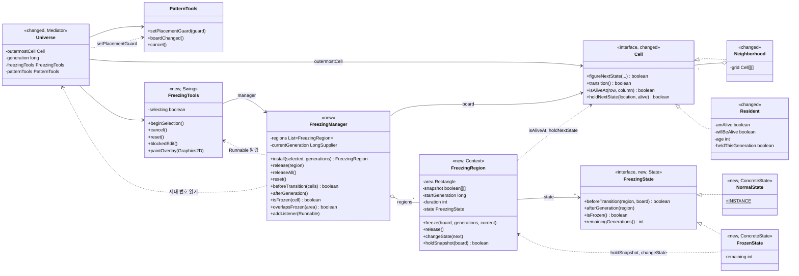
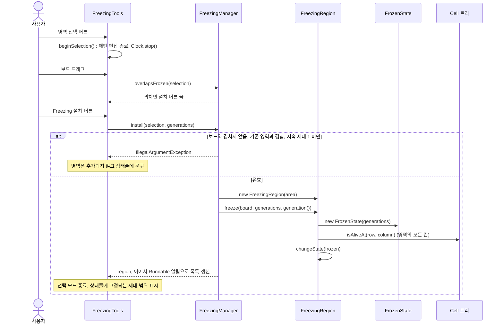
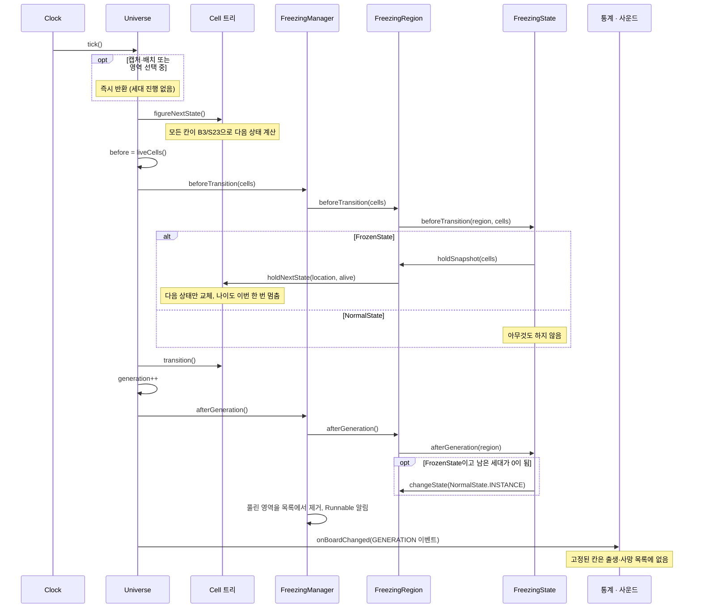
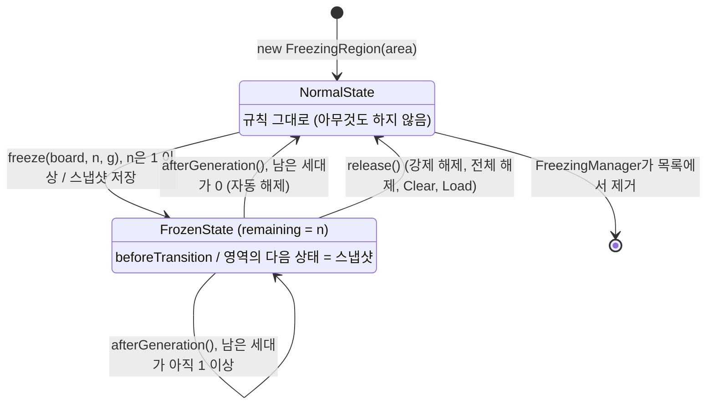
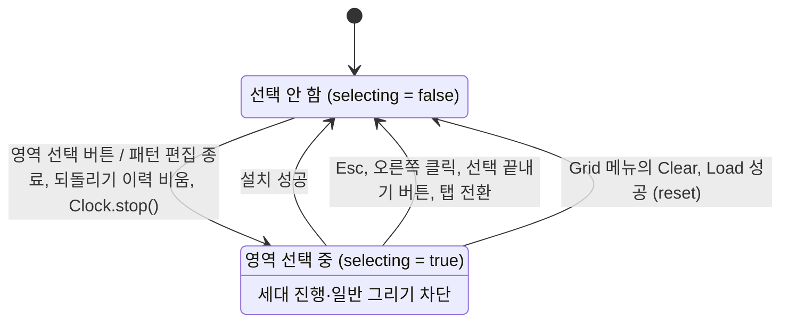

# Freezing: 설계 패턴 후보, 설계 결정, 다이어그램

- 코드 기준: dev `838182c` (PR #7 병합 후)
- 결정의 근거 기록: [PR #7](https://github.com/mckimR1972/DP_team_project/pull/7) 본문 6~7절, [../FREEZING.md](../FREEZING.md) 5·7·8절
- 관련 문서: [유스케이스와 요약](usecase-and-summary.md), [변경 상세](changes.md)

## 1. 설계 패턴 후보

### 1.1 고정이라는 동작을 어떤 구조로 표현할까

풀어야 할 문제: 영역은 “고정 중”과 “고정 아님” 두 가지로 동작이 다르고, 고정은 정해진 세대가 지나면 **아무도 건드리지 않아도** 끝나야 한다.

| 후보 | 구조 | 장점 | 단점 | 판단 |
| --- | --- | --- | --- | --- |
| `boolean frozen` 플래그와 `if` | 영역이 플래그와 남은 세대를 갖고 메서드마다 분기 | 가장 간단하다. 타입이 늘지 않는다 | 상태 확인이 `beforeTransition`, `afterGeneration`, `isFrozen`, `remainingGenerations`에 반복된다. 상태가 늘면 모든 메서드를 고친다 | 제외 |
| Strategy | 규칙 객체를 바꿔 끼운다(고정 규칙 / 일반 규칙) | 규칙을 통째로 바꿀 수 있다. 색 순환(`CellColorPolicy`)과 같은 모양이다 | 고정은 규칙의 종류가 아니라 시간이 지나면 스스로 끝나는 상태다. “언제 일반 규칙으로 돌아가는가”를 규칙 바깥(관리자나 `Universe`)에서 세고 바꿔 줘야 한다 | 제외 |
| **State** | 영역(Context)이 현재 상태 객체에 일을 넘기고, 상태 객체가 다음 상태로의 전환을 결정한다 | 상태별 동작과 전환 조건이 상태 클래스 안에 있다. 영역 코드에 분기가 없다 | 타입이 3개 늘어난다(`FreezingState`, `NormalState`, `FrozenState`). `FrozenState`는 영역마다 새로 만든다 | **선택** |

### 1.2 고정을 세대 처리의 어디에 넣을까

| 후보 | 장점 | 단점 | 판단 |
| --- | --- | --- | --- |
| `Resident.figureNextState()` 안에서 고정 여부 확인 | 호출 한 번으로 끝난다 | 규칙 코드에 Freezing 분기가 섞인다. `Resident`는 자기 좌표를 몰라 영역 판단을 못 한다 | 제외 |
| `transition()` 뒤에 스냅샷으로 되돌리기 | `Cell`을 고치지 않는다 | 셀이 한 번 실제로 바뀌었다가 되돌아간다. 이벤트의 출생·사망 목록과 나이가 어긋난다 | 제외 |
| Observer 구독자(`BoardChangeListener`)로 만들어 이벤트를 받고 되돌리기 | 통계·사운드와 같은 방식이다 | 구독자는 보드를 바꾸면 안 된다는 계약을 어긴다. 통계·사운드가 되돌리기 전 상태를 받는다 | 제외 |
| **계산과 전이 사이에서 다음 상태만 교체** (Composite에 `holdNextState()` 추가) | 규칙 코드 그대로다. 셀이 한 번도 잘못 바뀌지 않는다. 이벤트가 저절로 맞는다 | `Cell`에 메서드 1개가 늘어 구현 3곳(`Neighborhood`, `Resident`, `DUMMY`)을 고친다 | **선택** |

### 1.3 모델의 변화를 화면에 어떻게 알릴까

| 후보 | 장점 | 단점 | 판단 |
| --- | --- | --- | --- |
| `FreezingManager`가 `FreezingTools`를 직접 호출 | 가장 간단하다 | 모델이 Swing 클래스에 의존한다. 화면 없이 테스트할 수 없다 | 제외 |
| 기존 `BoardChangeListener` 재사용 (Observer) | 통로가 하나다 | 그 이벤트는 “보드의 셀이 바뀌었다”는 뜻인데 설치·해제는 셀을 바꾸지 않는다. 통계가 필요 없는 재집계를 하고, 통계·사운드가 새 종류를 걸러 내도록 다른 사람의 코드를 고쳐야 한다 | 제외 |
| 전용 리스너 인터페이스 (Observer) | 이름으로 뜻이 드러난다 | 구독자에게 넘길 데이터가 없다. 구독자는 `manager.regions()`를 다시 읽으면 된다 | 제외 |
| **`Runnable` 콜백 (Observer의 가벼운 형태)** | JDK 타입만 쓴다. 모델에 Swing 코드가 없다 | 무엇이 바뀌었는지는 알려 주지 않아 화면이 목록 전체를 다시 읽는다 | **선택** |

### 1.4 기능 사이의 규칙을 어디에 둘까

고정된 영역에는 템플릿을 놓을 수 없고, 고정된 칸은 그릴 수 없고, 영역 선택을 시작하면 패턴 편집이 끝나야 한다.

| 후보 | 장점 | 단점 | 판단 |
| --- | --- | --- | --- |
| `FreezingTools`와 `PatternTools`가 서로를 참조 | 연결 코드가 짧다 | 한쪽을 고치면 다른 쪽도 고쳐야 한다. 한 기능만 빼고 컴파일할 수 없다 | 제외 |
| Chain of Responsibility (편집 요청을 여러 검사기가 차례로 확인) | 금지 규칙을 가진 기능이 늘어도 검사기만 추가한다 | 검사기가 지금은 Freezing 하나뿐이라 구조만 늘어난다 | 보류(금지 규칙을 가진 기능이 더 생기면 다시 본다) |
| **Mediator (`Universe`가 연결)** | 원본에서 이미 `Universe`가 Swing 이벤트와 Life 클래스 사이의 중재자다. `FreezingTools`는 `Runnable` 하나, `PatternTools`는 `Predicate` 하나만 안다 | 연결 규칙이 `Universe` 생성자에 모여 길어진다 | **선택** |

### 1.5 그 밖에 쓴 패턴

| 패턴 | 어디에 | 새로 만든 것인가 | 이유 |
| --- | --- | --- | --- |
| Composite | `Cell.holdNextState()` | 기존 구조에 메서드 1개 추가 | 영역이 보드의 중첩 구조를 몰라도 좌표 하나로 칸에 닿는다(1.2) |
| Singleton | `NormalState.INSTANCE` | 새로 만듦(이 클래스 하나의 범위) | `NormalState`는 필드가 없어 영역마다 만들 이유가 없다. `FrozenState`는 남은 세대를 가지므로 영역마다 만든다 |
| Memento | 스냅샷 읽기 | 처음 구현에서 쓰고 병합 뒤 뺌 | 처음에는 `createMemento()`로 보드 전체를 복사해 읽었다. `isAliveAt()`이 생긴 뒤 필요한 칸만 묻도록 바꿨다([changes.md](changes.md) 8절) |

다른 기능의 패턴(색의 Strategy, 템플릿의 Command, 통계·사운드의 Observer)은 구조를 바꾸지 않고 연결만 했다.

## 2. 설계 결정, 이유, 과정

### 결정 1. State 패턴으로 영역의 상태를 표현한다

- **문제.** 고정은 설치 뒤 N세대가 지나면 스스로 풀려야 한다. 강제 해제, Clear, Load로도 풀린다.
- **이유.** Strategy와 구조는 비슷하지만 전환의 주체가 다르다. 색 순환은 사용자가 메뉴에서 규칙을 갈아 끼우고, 규칙 객체는 스스로 바뀌지 않는다. Freezing은 풀릴 시점을 아는 것이 남은 세대를 세는 쪽이다. 그 카운트를 상태 객체가 가지면 전환도 상태 객체가 결정할 수 있다.
- **결과.** `FrozenState.afterGeneration()`이 `--remaining <= 0`이면 `region.changeState(NormalState.INSTANCE)`를 부른다. `FreezingRegion.beforeTransition()`과 `afterGeneration()`은 한 줄씩이고 둘 다 `state`에 넘기기만 한다.
- **감수한 비용.** 클래스 3개. 상태가 둘뿐인 지금은 플래그보다 코드가 많다.
- **상태 객체의 단위.** 셀마다가 아니라 영역마다 하나다. 셀마다 두면 4,096개 셀에 필드가 늘고 `Resident` 수정이 커진다. 영역 단위라서 영역별로 풀고 남은 세대를 표시하기 쉽다.

### 결정 2. 계산과 전이 사이에서 다음 상태만 바꾼다

- **문제.** 고정된 칸이 죽거나 태어나지 않게 하되, 바깥 칸은 고정된 칸을 평소처럼 이웃으로 세어야 한다.
- **이유.** `figureNextState()`가 끝난 시점에는 모든 칸이 다음 상태를 정해 두었지만 아직 바뀌지 않았다. 이때 고정된 칸의 다음 상태만 스냅샷 값으로 바꾸면, 모든 칸이 같은 이전 세대를 기준으로 계산된다는 Life의 전제가 유지된다. 전이 뒤에 되돌리는 방식은 칸이 실제로 한 번 바뀌므로 통계·사운드가 받는 출생·사망 목록에 고정된 칸이 섞인다.
- **결과.** 생존 판정 코드는 한 글자도 바뀌지 않았다. 이벤트를 만드는 코드도 고치지 않았는데 고정된 칸이 목록에서 빠진다.
- **감수한 비용.** `Cell` 인터페이스에 메서드가 하나 늘었다.

### 결정 3. 세대 번호는 `Universe`의 것을 읽는다

| 대안 | 장점 | 단점 |
| --- | --- | --- |
| `FreezingManager`와 `Universe`가 각자 센다 | 병합 전 코드 그대로 | 초기화 시점이 한 곳이라도 어긋나면 통계 탭과 Freezing 탭의 숫자가 달라진다 |
| `FreezingManager`가 `BoardChangeEvent`의 세대를 받아 기억 | 통계와 같은 방식 | 구독 등록이 필요하고, 이벤트 전에 불리는 `afterGeneration()`에서는 한 박자 늦은 값이다 |
| **`Universe`의 값을 읽는다** (선택) | 값이 한 곳에만 있다 | 생성자에 `LongSupplier` 하나 추가 |

### 결정 4. 고정된 칸은 나이도 멈춘다

| 대안 | 결과 |
| --- | --- |
| 나이를 계속 센다 | 고정 중에도 색이 바뀐다. “설치한 순간 그대로”와 다르다 |
| 풀릴 때 나이를 0으로 | 풀린 순간 색이 처음 색으로 튄다 |
| **고정 중에는 멈추고 풀리면 이어서 센다** (선택) | 고정 중 색이 그대로이고 풀린 뒤 자연스럽게 이어진다 |

### 결정 5. 그 밖의 결정

- **영역은 사각형.** 템플릿 배치 가드가 `Rectangle` 단위라 그대로 맞는다.
- **겹치는 영역은 거부.** 겹치면 어느 스냅샷이 우선인지, 하나가 먼저 풀릴 때 어떻게 되는지 정해야 한다. 요구사항에 없어서 막았다. 맞닿는 것은 허용한다.
- **설치·해제는 `BoardChangeEvent`를 보내지 않는다.** 셀이 하나도 바뀌지 않기 때문이다.
- **Freezing 탭은 세 번째.** 기존 테스트가 탭 0이 패턴 캡처, 탭 1이 통계라고 확인하므로 순서를 유지했다.
- **다시 그리기는 영역 자리만.** 색 순환에서 고친 화면 갱신 지연을 되살리지 않도록, 영역이 없으면 아무것도 요청하지 않는다.

### 과정

| 시점 | 커밋 | 한 일 |
| --- | --- | --- |
| 2026-11-11 | `ec3f314` | State 구조(`FreezingState` 등 6개 클래스)와 `Cell.holdNextState()`, 별도 Freezing 탭. 캡처 기능의 초기 커밋 위에서 작업 |
| 2026-11-11 | `93eaf3d` | 기본 오류 수정·JUnit·Gradle(PR #1) 반영 |
| 2026-11-20 | `feea0df` | dev(`d215c7a`) 병합. 색·캡처·드래그·사운드·통계와 통합하면서 결정 3·4를 내리고 스냅샷 읽기를 `isAliveAt()`으로 바꿈 |
| 2026-11-20 | `43c1b6f` | 모델 테스트와 통합 테스트를 JUnit으로 추가 |
| 2026-11-20 | `ec3a504`, `b36a569` | 문서 정리, 실제 `SoundEffects`와 함께 돌리는 테스트 |

결정 1·2는 첫 커밋부터 지금까지 바뀌지 않았다. 결정 3·4는 다른 기능이 dev에 들어온 뒤 병합 과정에서 생긴 충돌(세대 번호가 두 곳, 고정 중 색 변화)을 풀면서 내렸다.

## 3. 다이어그램

### 3.1 클래스 다이어그램

굵게 표시한 `«new»`는 Freezing이 추가한 타입, `«changed»`는 고친 기존 타입이다.

- `Universe ..> PatternTools : setPlacementGuard`는 `area -> freezingTools.manager().overlapsFrozen(area)`를 가드로 꽂는 한 줄이다.
- `FreezingManager`는 `Universe` 타입을 참조하지 않는다. 생성자에서 받은 `LongSupplier`(`() -> generation`)로 값만 읽는다.
- `PatternTools`와 `FreezingTools`는 서로를 참조하지 않는다. 둘을 아는 것은 `Universe`뿐이다(1.4).

### 3.2 시퀀스 다이어그램: 설치

유스케이스 UC-FZ-01의 기본 흐름과 예외 흐름이다.

지속 세대 검사는 `FrozenState` 생성자가 한다. `freeze()`가 스냅샷을 만들기 전에 `FrozenState`를 먼저 만들므로, 값이 잘못되면 영역이 목록에 들어가기 전에 예외가 난다.

### 3.3 시퀀스 다이어그램: 세대 하나의 처리

결정 2의 “계산과 전이 사이”와 결정 1의 “상태 객체가 전환을 결정”이 이 그림에 함께 나온다(UC-FZ-05).

### 3.4 상태 다이어그램: 영역 하나

`FreezingRegion.state`가 가리키는 객체의 변화다.

수치 예: 세대 10에 n = 5로 설치하면 remaining은 5다. 11·12·13·14·15세대 갱신에서 고정이 적용되고 갱신이 끝날 때마다 4·3·2·1·0이 된다. 15세대 갱신의 `afterGeneration()`에서 `NormalState`로 바뀌어 목록에서 빠지고, 16세대 갱신은 정상 규칙으로 계산한다(`FreezingModelTest`의 `e_installAtGenerationTenForFiveIsFrozenThroughFifteenAndFreeFromSixteen`).

### 3.5 상태 다이어그램: 화면의 영역 선택 모드

영역의 상태(3.4)와는 다른 객체다. `FreezingTools.selecting` 필드가 갖는 값이며 State 패턴으로 만든 것은 아니다.

