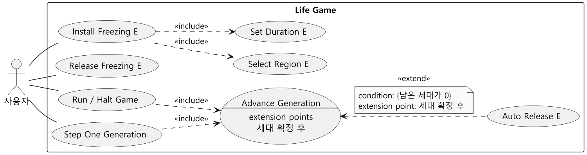
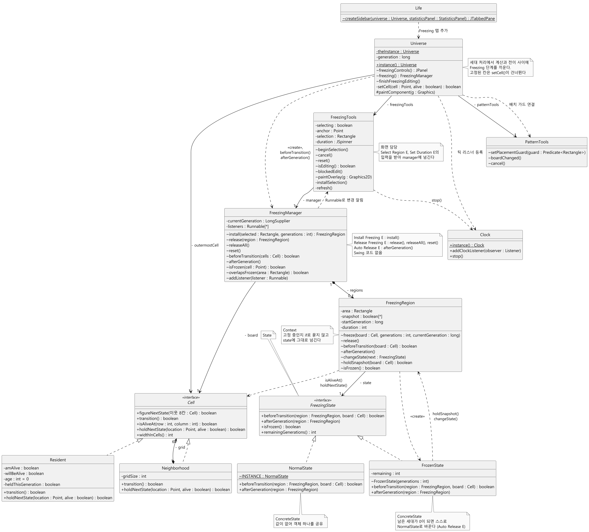

# Freezing 다이어그램

`.puml`이 원본이고 `.png`는 PlantUML로 그린 결과다. 코드 기준은 dev `838182c`.

다시 그리려면 이 폴더에서 `java -jar plantuml.jar -charset UTF-8 -tpng *.puml`을 실행한다. 클래스·유스케이스·상태 그림은 `!pragma layout smetana`를 써서 Graphviz 없이 그려진다.

## 유스케이스

## 클래스

## 시퀀스 (유스케이스별)

Select Region E

Set Duration E

Install Freezing E

Release Freezing E

Auto Release E

## 상태

영역 하나의 상태 (State 패턴)

화면의 영역 선택 모드

