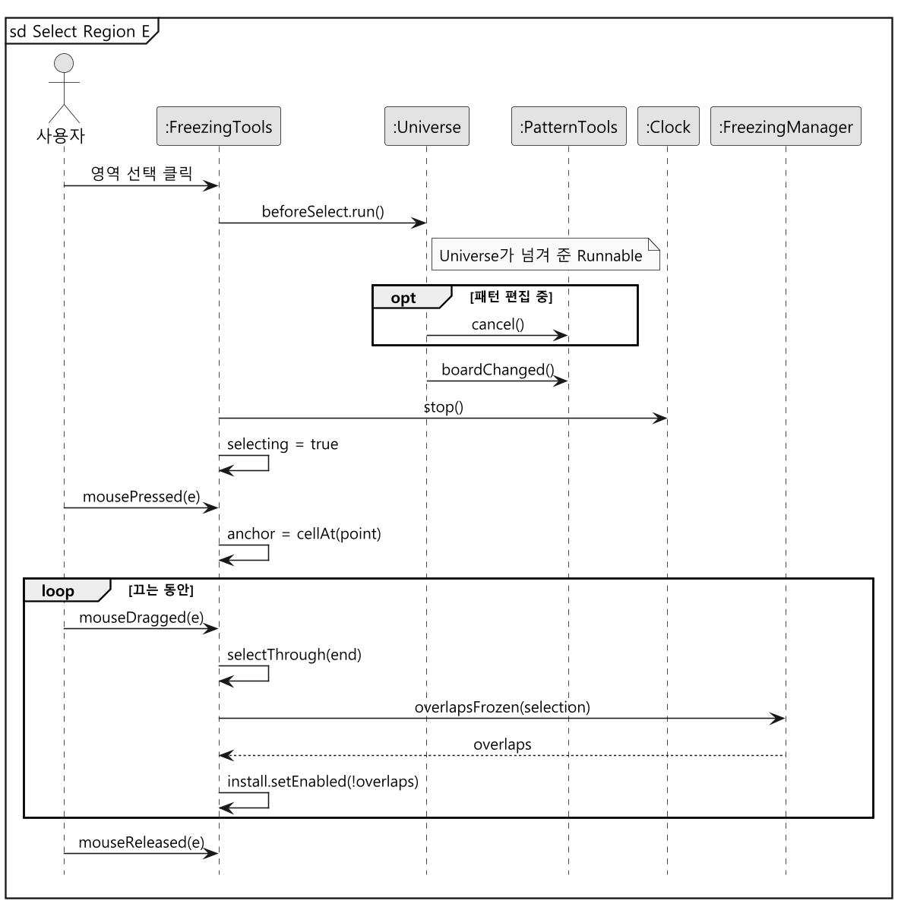
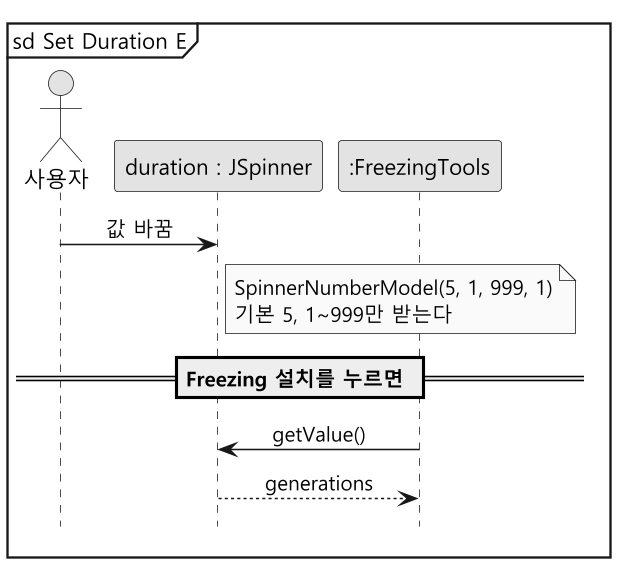
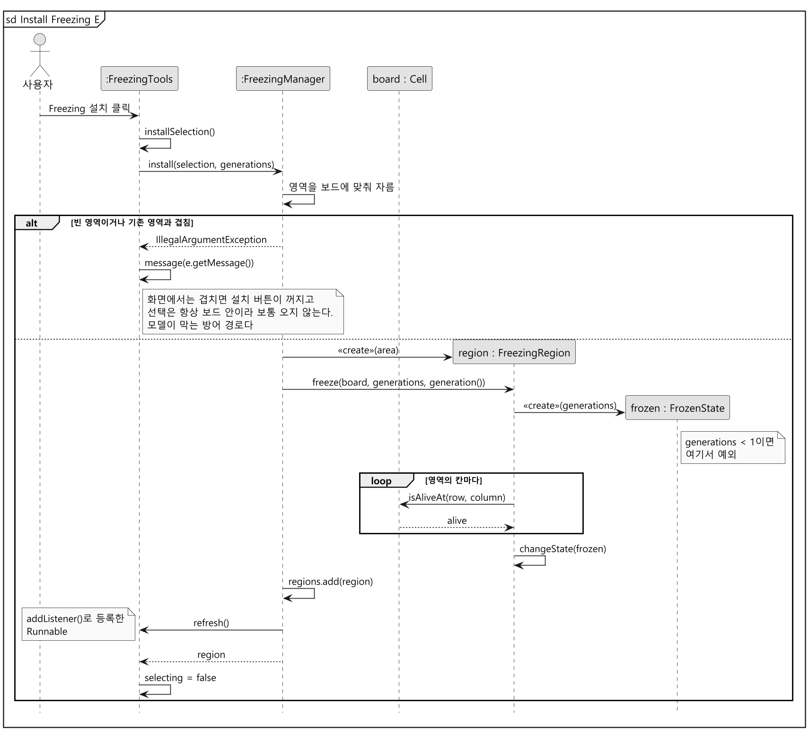
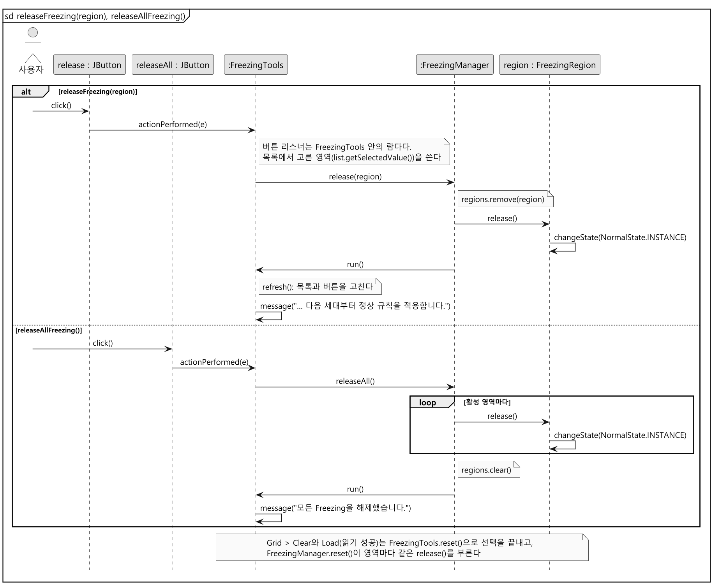
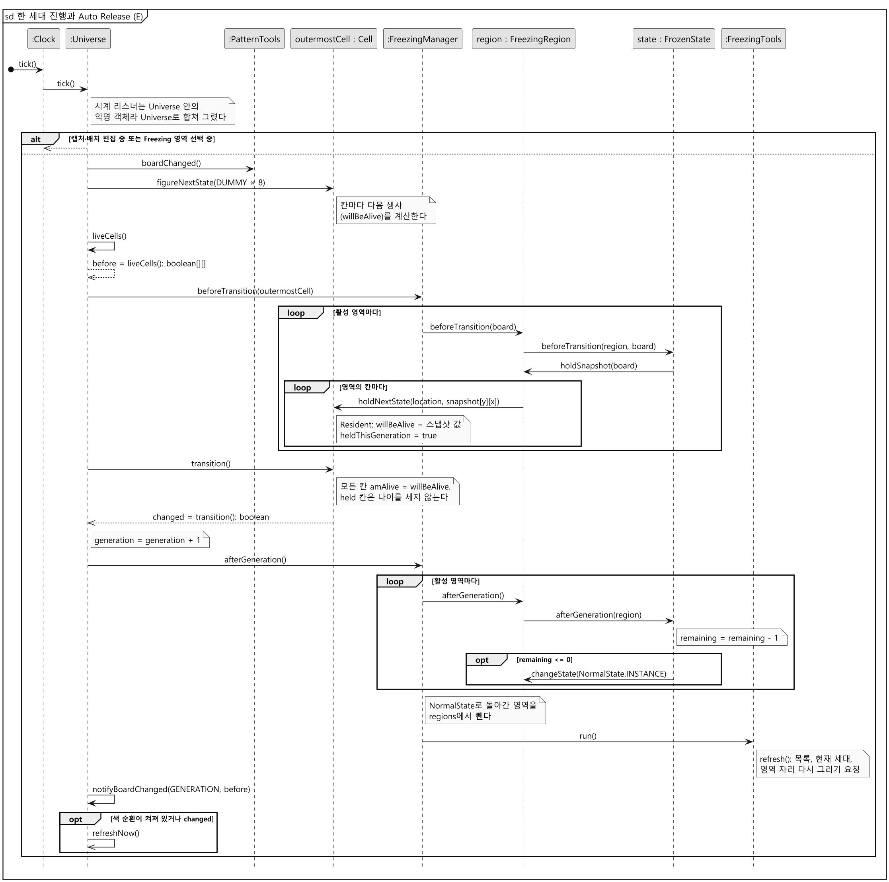
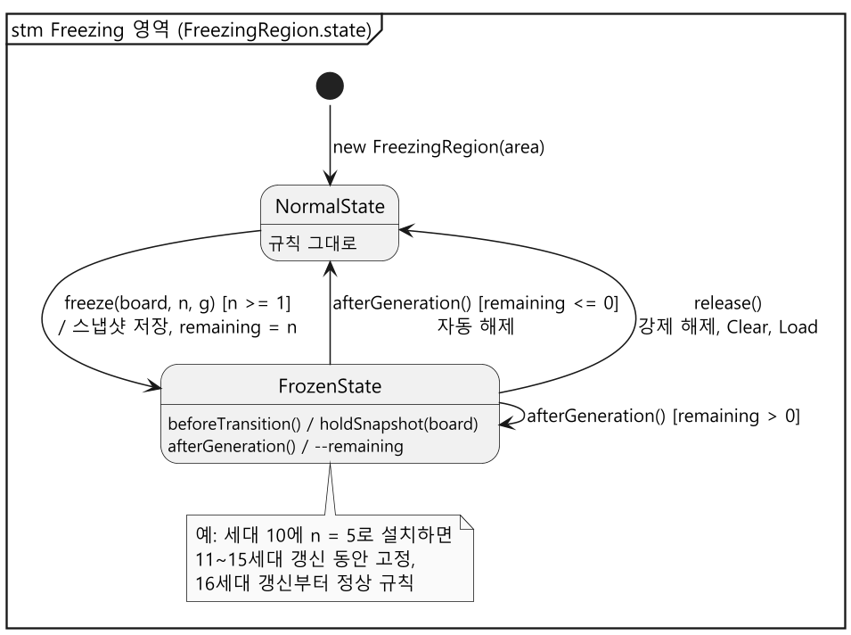
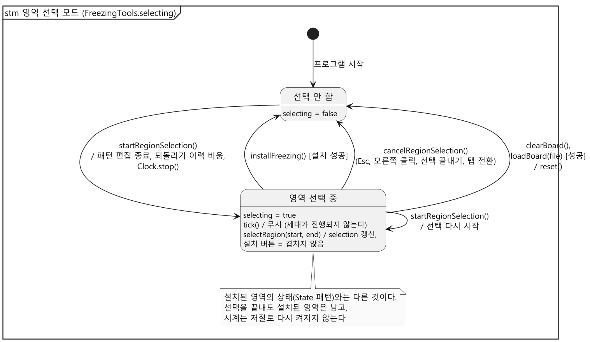

# Freezing 다이어그램

`.puml`이 원본이고 `.png`는 PlantUML로 그린 결과다. 코드 기준은 main `4dc39e6`(dev `cfba2ed`와 `src`가 같다). 유스케이스 그림은 #21에도 같은 파일로 들어 있다.

다시 그리려면 Graphviz를 설치한 뒤 이 폴더에서 `java -DPLANTUML_LIMIT_SIZE=8192 -jar plantuml.jar -charset UTF-8 -tpng *.puml`을 실행한다. 클래스 그림은 폭이 4096px을 넘어서 한도를 늘려야 잘리지 않는다.

## 문서에서 참조하는 위치

명세 문서는 그림을 직접 그리지 않고 이 폴더의 png를 참조한다.

| 그림 | 참조하는 문서 |
| --- | --- |
| `usecase-freezing.png` | [usecase-and-summary.md](../usecase-and-summary.md) |
| `class-freezing.png` | [FREEZING.md](../FREEZING.md) 3절, [design.md](../design.md) 결정 1 |
| `state-region.png` | [FREEZING.md](../FREEZING.md) 5절, [design.md](../design.md) 결정 1 |
| `sd-auto-release.png` | [FREEZING.md](../FREEZING.md) 4절, [design.md](../design.md) 결정 2 |
| `sd-select-region.png` | [design.md](../design.md) 1.4 |
| 나머지 시퀀스, `state-selection.png` | 이 문서 |

## 유스케이스

## 클래스

## 시퀀스 (유스케이스별)

Select Region E

Set Duration E

Install Freezing E

Release Freezing E

Auto Release E

## 상태

영역 하나의 상태 (State 패턴)

화면의 영역 선택 모드

