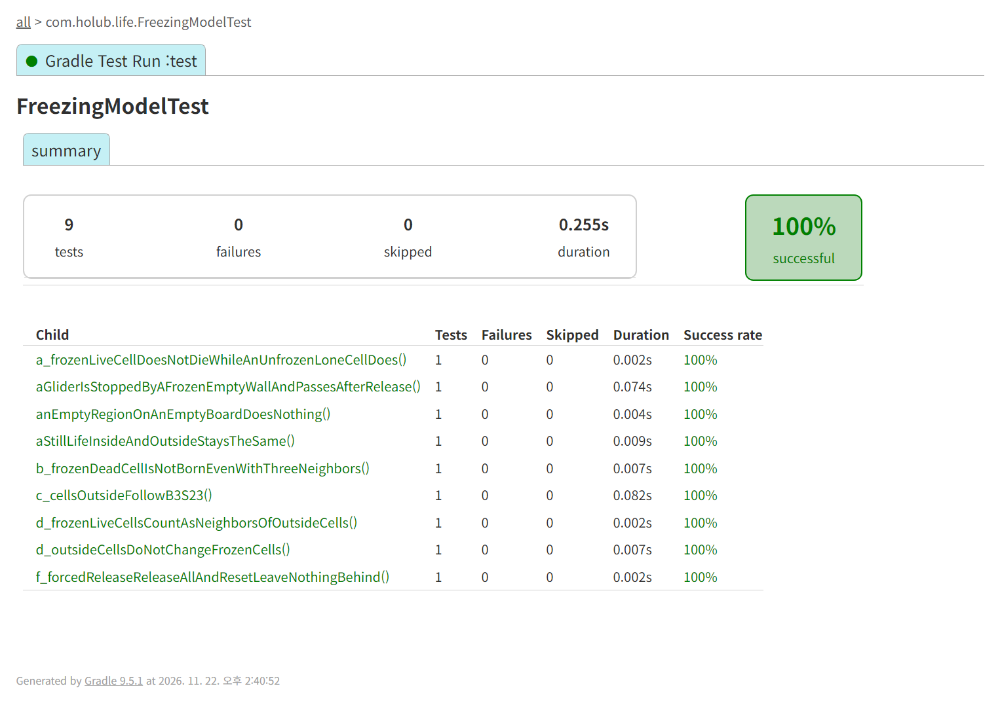
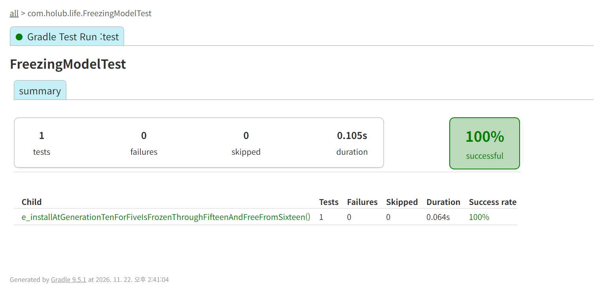
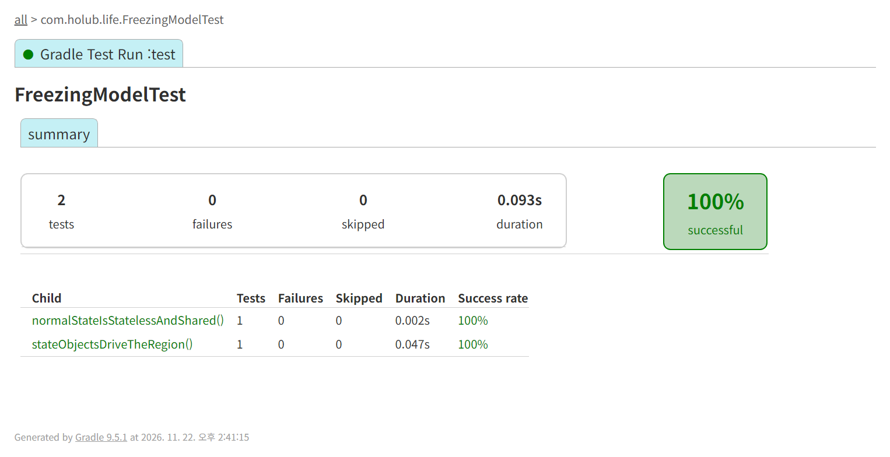
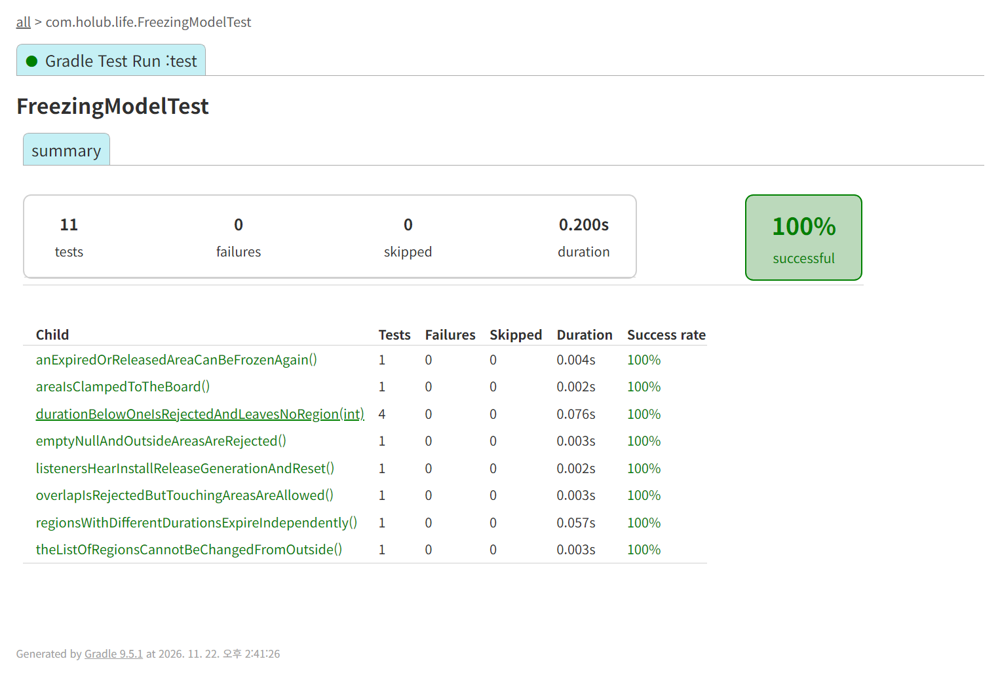
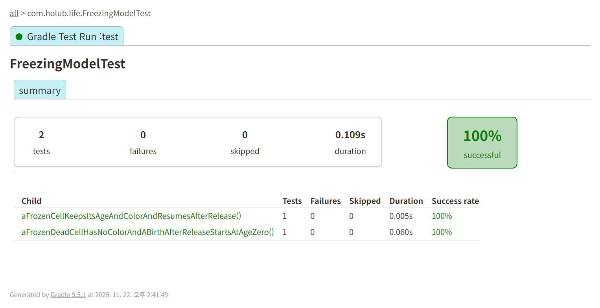
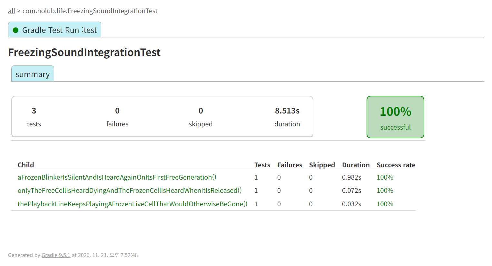

# Freezing 테스트 결과 화면

Gradle HTML 보고서(`build/reports/tests/test/`)를 브라우저로 열어 캡처했다.

- 실행: 2026-11-21, `.\gradlew.bat clean test --rerun-tasks --console=plain`
- 코드: main `4dc39e6`. 그 뒤 dev(`cfba2ed`, PR #24)는 테스트 파일을 기능별 폴더로 옮기기만 했고 테스트 클래스와 메서드는 같다
- 환경: Windows 11, JDK 17, Gradle 9.5.1

| 화면 | 내용 | 결과 |
| --- | --- | --- |
| [test-all.png](test-all.png) | Freezing JUnit 테스트를 포함한 전체 테스트 | 384개 통과, 실패 0 |
| test-freezing-model-1~7 | `FreezingModelTest` (모델만, Universe와 Swing 없이). 아래 표처럼 7개로 나눠 캡처 | 50개 통과 |
| [test-freezing-integration.png](test-freezing-integration.png) | `FreezingIntegrationTest` (실제 Universe에서 다른 기능과 함께) | 37개 통과 |
| [test-freezing-sound.png](test-freezing-sound.png) | `FreezingSoundIntegrationTest` (실제 SoundEffects와 함께) | 3개 통과 |

## FreezingModelTest 묶음별

`FreezingModelTest`는 Universe와 Swing 없이 보드(`Neighborhood` + `Resident`)와 `FreezingManager`만 만들어 시험한다. 세대 진행은 테스트 안의 `tick()`이 게임과 같은 순서(`figureNextState` → `beforeTransition` → `transition` → 세대 +1 → `afterGeneration`)로 부른다.

묶음별 화면은 2026-11-22에 같은 코드에서 `gradlew test --rerun --tests "com.holub.life.FreezingModelTest.<메서드>"`로 묶음에 속한 테스트만 실행한 결과다. 7개 묶음의 합은 50개로 전체 실행의 `FreezingModelTest`와 같다.

| 화면 | 묶음 | 확인하는 것 | 결과 |
| --- | --- | --- | --- |
| [1-rules](test-freezing-model-1-rules.png) | 기본 규칙 | 고정된 산 칸은 죽지 않고 죽은 칸은 태어나지 않음, 영역 밖은 B3/S23, 고정된 칸도 이웃으로 셈, 정물·빈 영역·글라이더, 해제·전체 해제·초기화 | 9개 통과 |
| [2-boundary](test-freezing-model-2-boundary.png) | 경계 수치 | 세대 10에 지속 5로 설치하면 11~15세대 고정, 15세대 뒤 해제, 16세대에 일반 규칙 | 1개 통과 |
| [3-state](test-freezing-model-3-state.png) | State 패턴 | Normal → Frozen → Normal 전환을 상태 객체가 스스로 함, `NormalState` 하나를 공유 | 2개 통과 |
| [4-install](test-freezing-model-4-install.png) | 설치 검사·영역 관리 | 지속 세대 1 미만(4건), 빈·null·보드 밖 영역, 경계에 맞춤, 겹침 거부와 맞닿음 허용, 다시 설치, 영역별 만료, 목록 보호, 변경 알림 | 11개 통과 |
| [5-composite](test-freezing-model-5-composite.png) | Composite (`holdNextState`) | 다음 상태만 바꿈, `DUMMY`는 무시, 모서리·블록 경계 1칸 영역(9건), 블록 4개에 걸친 영역, 보드 전체 | 13개 통과 |
| [6-color](test-freezing-model-6-color.png) | 색 순환 연동 | 고정 중 나이와 색이 멈추고 풀리면 이어서 셈, 고정된 죽은 칸은 색 없음 | 2개 통과 |
| [7-random](test-freezing-model-7-random.png) | 무작위 비교 | 무작위 보드 12종 × 250세대, 설치·해제를 섞어 독립 계산과 모든 칸의 생사·나이 비교 | 12개 통과 |

## 통합 테스트

