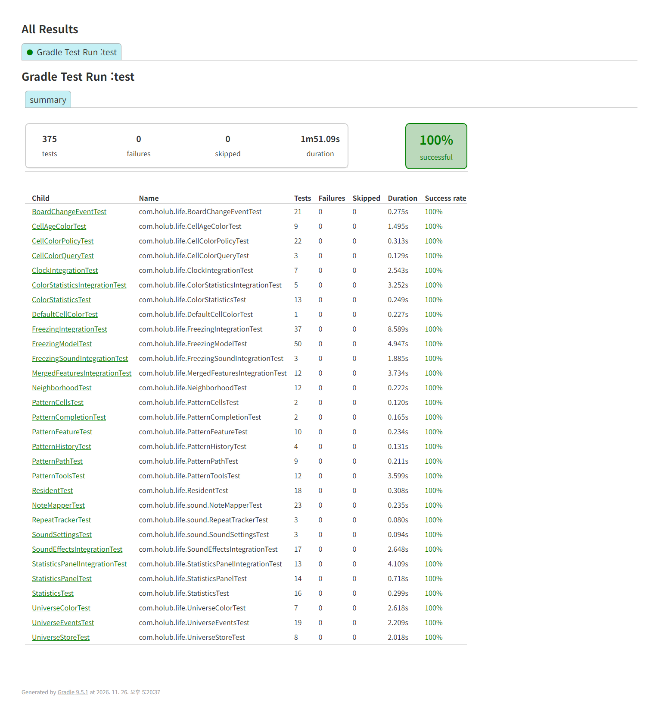
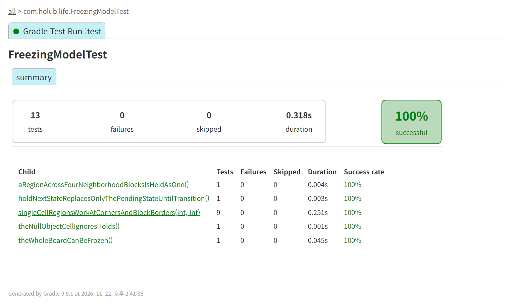
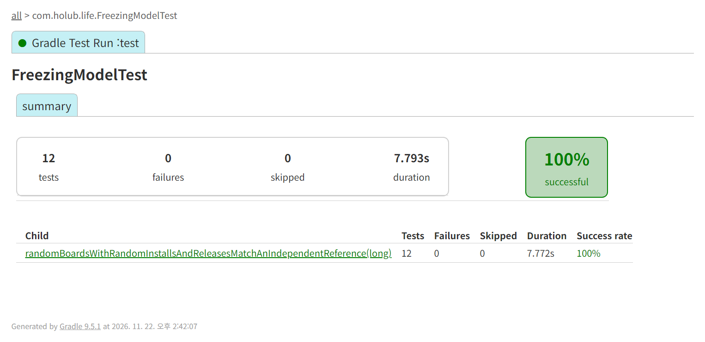
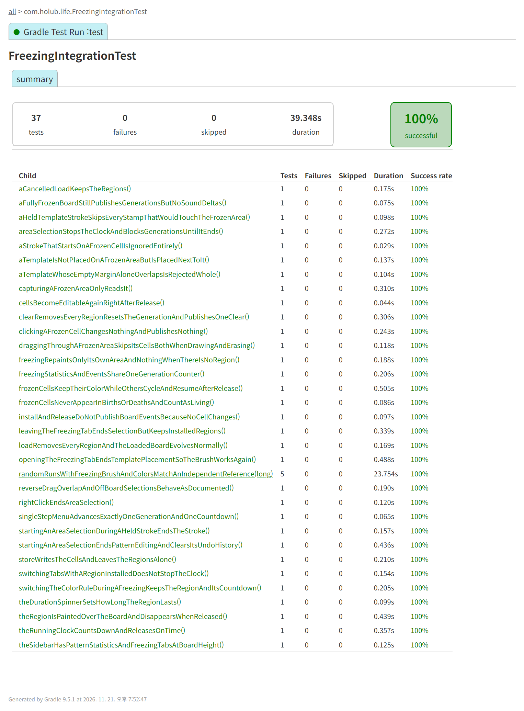

# Freezing 테스트 결과 보고서

Gradle HTML 보고서(`build/reports/tests/test/`)를 브라우저로 열어 캡처했다.

- 실행: 2026-11-21, `.\gradlew.bat clean test --rerun-tasks --console=plain`
- 코드: main `4dc39e6`. 그 뒤 dev(`cfba2ed`, PR #24)는 테스트 파일을 기능별 폴더로 옮기기만 했고 테스트 클래스와 메서드는 같다
- 환경: Windows 11, JDK 17, Gradle 9.5.1

| 화면 | 내용 | 결과 |
| --- | --- | --- |
| [test-all.png](test-all.png) | 회귀 확인: 기존 테스트 294개와 Freezing 테스트 90개를 함께 실행 | 384개 통과, 실패 0 |
| test-freezing-model-1~7 | `FreezingModelTest` (모델만, Universe와 Swing 없이). 아래 표처럼 7개로 나눠 캡처 | 50개 통과 |
| [test-freezing-integration.png](test-freezing-integration.png) | `FreezingIntegrationTest` (실제 Universe에서 다른 기능과 함께) | 37개 통과 |
| [test-freezing-sound.png](test-freezing-sound.png) | `FreezingSoundIntegrationTest` (실제 SoundEffects와 함께) | 3개 통과 |

## 회귀 테스트

## FreezingModelTest 묶음별

`FreezingModelTest`는 Universe와 Swing 없이 보드(`Neighborhood` + `Resident`)와 `FreezingManager`만 만들어 시험한다. 세대 진행은 테스트 안의 `tick()`이 게임과 같은 순서(`figureNextState` → `beforeTransition` → `transition` → 세대 +1 → `afterGeneration`)로 부른다.

묶음별 화면은 2026-11-22에 같은 코드에서 `gradlew test --rerun --tests "com.holub.life.FreezingModelTest.<메서드>"`로 묶음에 속한 테스트만 실행한 결과다. 7개 묶음의 합은 50개로 전체 실행의 `FreezingModelTest`와 같다. 1번 묶음(기본 규칙) 화면만 글라이더 테스트의 이름을 고친 뒤(#26) 2026-11-25에 같은 방법으로 다시 찍었다.

| 화면 | 묶음 | 확인하는 것 | 결과 |
| --- | --- | --- | --- |
| [1-rules](test-freezing-model-1-rules.png) | 기본 규칙 | 고정된 산 칸은 죽지 않고 죽은 칸은 태어나지 않음, 영역 밖은 B3/S23, 고정된 칸도 이웃으로 셈, 정물·빈 영역·글라이더, 해제·전체 해제·초기화 | 9개 통과 |
| [2-boundary](test-freezing-model-2-boundary.png) | 경계 수치 | 세대 10에 지속 5로 설치하면 11~15세대 고정, 15세대 뒤 해제, 16세대에 일반 규칙 | 1개 통과 |
| [3-state](test-freezing-model-3-state.png) | State 패턴 | Normal → Frozen → Normal 전환을 상태 객체가 스스로 함, `NormalState` 하나를 공유 | 2개 통과 |
| [4-install](test-freezing-model-4-install.png) | 설치 검사·영역 관리 | 지속 세대 1 미만(4건), 빈·null·보드 밖 영역, 경계에 맞춤, 겹침 거부와 맞닿음 허용, 다시 설치, 영역별 만료, 목록 보호, 변경 알림 | 11개 통과 |
| [5-composite](test-freezing-model-5-composite.png) | Composite (`holdNextState`) | 다음 상태만 바꿈, `DUMMY`는 무시, 모서리·블록 경계 1칸 영역(9건), 블록 4개에 걸친 영역, 보드 전체 | 13개 통과 |
| [6-color](test-freezing-model-6-color.png) | 나이 (색으로 읽음) | 고정 중 나이가 멈추고 풀리면 이어서 셈, 고정 중 죽어 있던 칸은 풀린 뒤 태어나면 나이 0. 간격 1인 색 규칙을 써서 칸의 색으로 나이를 읽음 | 2개 통과 |
| [7-random](test-freezing-model-7-random.png) | 무작위 비교 | 무작위 보드 12종 × 250세대, 설치·해제를 섞어 독립 계산과 모든 칸의 생사·나이 비교 | 12개 통과 |

## 기본 규칙 테스트 결과

| Child | 실행 수 | 확인하는 것 |
| --- | --- | --- |
| `a_frozenLiveCellDoesNotDieWhileAnUnfrozenLoneCellDoes()` | 1 | 혼자 있는 산 셀 두 개 중 하나만 고정하면, 고정된 셀은 3세대 동안 살아 있고 고정하지 않은 셀은 원래 규칙대로 죽는다 |
| `aGliderIsStoppedByAFrozenEmptyWallAndStaysStoppedAfterRelease()` | 1 | 글라이더가 오는 길에 비어 있는 세로줄을 60세대 고정하면, 그 줄에는 셀이 태어나지 않고 줄 너머로 넘어가는 셀도 없다. 글라이더는 벽 앞에서 부서져 2×2 블록이 되고, 벽이 풀린 뒤 40세대(61~100세대) 동안에도 블록이 그대로라 줄을 넘어가지 않는다 |
| `anEmptyRegionOnAnEmptyBoardDoesNothing()` | 1 | 빈 보드에 빈 영역을 고정해도 셀이 생기지 않고, 지속 세대가 지나면 영역 목록이 빈다 |
| `aStillLifeInsideAndOutsideStaysTheSame()` | 1 | 블록(정물)을 하나는 고정하고 하나는 그대로 두면, 고정 중과 풀린 뒤 모두 판이 처음과 같다 |
| `b_frozenDeadCellIsNotBornEvenWithThreeNeighbors()` | 1 | 원래 규칙이라면 태어날 죽은 칸(이웃 3개)을 고정하면 4세대 동안 태어나지 않는다 |
| `c_cellsOutsideFollowB3S23()` | 1 | 고정된 블링커는 멈춰 있고, 영역 밖의 블링커는 세대마다 가로·세로로 원래 규칙대로 바뀐다 |
| `d_frozenLiveCellsCountAsNeighborsOfOutsideCells()` | 1 | 고정된 산 셀 두 개와 자유 셀 하나가 이웃인 바깥 칸이 태어난다. 고정된 셀도 이웃으로 센다 |
| `d_outsideCellsDoNotChangeFrozenCells()` | 1 | 이웃이 8개라 원래는 죽을 산 셀을 고정하면 8세대 동안 살아 있다. 바깥 셀이 고정된 셀을 바꾸지 못한다 |
| `f_forcedReleaseReleaseAllAndResetLeaveNothingBehind()` | 1 | 영역 하나 해제, 모두 해제, 초기화 뒤 목록과 고정 여부가 모두 비고, 풀린 셀은 바로 다음 세대에 원래 규칙을 따른다. 모르는 영역이나 null을 해제해도 오류가 없다 |

합계 9개.

## 경계 수치 테스트 결과

| Child | 실행 수 | 확인하는 것 |
| --- | --- | --- |
| `e_installAtGenerationTenForFiveIsFrozenThroughFifteenAndFreeFromSixteen()` | 1 | 세대 10에 지속 5로 설치하면 설치 세대 10, 11~15세대 동안 고정(남은 세대 5→1), 15세대 뒤 `NormalState`로 바뀌어 목록에서 빠지고, 16세대에 원래 규칙으로 죽는다 |

합계 1개.

## State Pattern 구조 테스트 결과

| Child | 실행 수 | 확인하는 것 |
| --- | --- | --- |
| `normalStateIsStatelessAndShared()` | 1 | 고정 전 두 영역은 같은 `NormalState` 객체를 함께 쓰고, 고정하면 영역마다 다른 `FrozenState` 객체를 가진다 |
| `stateObjectsDriveTheRegion()` | 1 | `NormalState`일 때는 세대 처리가 아무것도 하지 않는다. `freeze()` 뒤 `FrozenState`가 남은 세대를 세다가 0이 되면 스스로 영역을 `NormalState`로 바꾼다. 강제 해제한 영역은 이후 세대에 반응하지 않는다 |

합계 2개.

## Freezing 영역 설치 테스트 결과

| Child | 실행 수 | 확인하는 것 |
| --- | --- | --- |
| `anExpiredOrReleasedAreaCanBeFrozenAgain()` | 1 | 만료되거나 해제된 자리에 다시 설치할 수 있고, 다시 설치하면 새 영역 객체가 생긴다 |
| `areaIsClampedToTheBoard()` | 1 | 보드 밖으로 넘친 영역은 보드 안 부분으로 잘린다. 오른쪽 아래와 왼쪽 위 모서리 두 경우를 확인한다 |
| `durationBelowOneIsRejectedAndLeavesNoRegion(int)` | 4 | 지속 세대 0, −1, −100, `Integer.MIN_VALUE`는 모두 `IllegalArgumentException`이고, 영역이 남지 않는다 |
| `emptyNullAndOutsideAreasAreRejected()` | 1 | null 영역, 너비나 높이가 0인 영역, 보드와 겹치지 않는 영역은 설치를 거부한다 |
| `listenersHearInstallReleaseGenerationAndReset()` | 1 | 설치, 세대 진행, 해제, 초기화 때 리스너가 한 번씩 불린다. 풀 영역이 없는 모두 해제와 거부된 설치는 알리지 않는다 |
| `overlapIsRejectedButTouchingAreasAreAllowed()` | 1 | 활성 영역과 한 칸이라도 겹치면 거부하고, 변만 맞닿으면 허용한다. `overlapsFrozen()`과 `isFrozen()`도 같은 기준으로 답한다 |
| `regionsWithDifferentDurationsExpireIndependently()` | 1 | 지속 세대 1, 3, 6인 영역 세 개가 각자의 세대에 따로 풀린다 |
| `theListOfRegionsCannotBeChangedFromOutside()` | 1 | 바깥에서 영역 목록을 비우거나, 돌려받은 사각형을 고쳐도 실제 영역이 바뀌지 않는다 |

합계 11개.

## Cell 계층 Composite Pattern 구조 테스트 결과

| Child | 실행 수 | 확인하는 것 |
| --- | --- | --- |
| `aRegionAcrossFourNeighborhoodBlocksIsHeldAsOne()` | 1 | 8×8 블록 네 개가 만나는 모서리의 블링커를 5×5 영역으로 고정하면 7세대 동안 그대로이고, 풀리면 다시 회전한다 |
| `holdNextStateReplacesOnlyThePendingStateUntilTransition()` | 1 | `holdNextState()`는 다음 생사만 바꾸고 지금 생사는 그대로 둔다. 이미 같은 값이면 false를 돌려주고, 바꾼 효과는 한 세대에만 적용된다 |
| `singleCellRegionsWorkAtCornersAndBlockBorders(int, int)` | 9 | 1×1 영역을 보드 네 모서리 (0,0), (63,0), (0,63), (63,63), 블록 경계 (7,7), (8,8), (7,8), 큰 블록 경계 (31,32), 안쪽 (56,55)에 설치하면 4세대 동안 살아 있다가 풀린 뒤 죽는다 |
| `theNullObjectCellIgnoresHolds()` | 1 | 보드 바깥을 뜻하는 `Cell.DUMMY`는 `holdNextState()`를 받아도 아무것도 하지 않고 false를 돌려준다 |
| `theWholeBoardCanBeFrozen()` | 1 | 무작위로 40%를 살린 64×64 보드 전체를 5세대 고정하면 판이 그대로이고, 풀린 첫 세대는 원래 규칙으로 직접 계산한 결과와 같다 |

합계 13개.

## 나이 Test

| Child | 실행 수 | 확인하는 것 |
| --- | --- | --- |
| `aFrozenCellKeepsItsAgeAndColorAndResumesAfterRelease()` | 1 | 나이 2인 블록을 3세대 고정하면 나이 2에 머물고, 자유 블록은 나이 3~5로 늘어난다. 풀린 뒤에는 멈춘 나이 2에서 이어서 3이 된다 |
| `aFrozenDeadCellHasNoColorAndABirthAfterReleaseStartsAtAgeZero()` | 1 | 고정 중 죽어 있던 칸은 색이 없고, 풀린 첫 세대에 태어나면 나이 0에서 시작한다 |

합계 2개.

## Random Test

| Child | 실행 수 | 확인하는 것 |
| --- | --- | --- |
| `randomBoardsWithRandomInstallsAndReleasesMatchAnIndependentReference(long)` | 12 | 시드 1, 2, 3, 5, 8, 13, 21, 34, 55, 89, 144, 233으로 만든 무작위 보드에서 250세대 동안 설치, 강제 해제, 모두 해제를 무작위로 섞고, 매 세대 모든 칸의 생사와 나이를 따로 짠 계산과 비교한다 |

합계 12개.

## 통합 테스트

