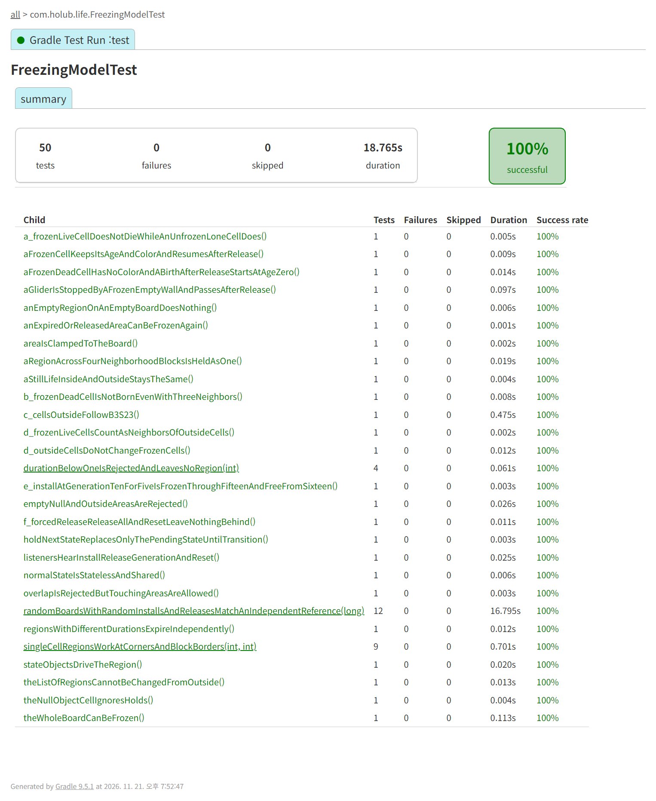

# Freezing 테스트 결과 화면

Gradle HTML 보고서(`build/reports/tests/test/`)를 브라우저로 열어 캡처했다.

- 실행: 2026-11-21, `.\gradlew.bat clean test --rerun-tasks --console=plain`
- 코드: main `4dc39e6` (dev `838182c`와 같은 내용)
- 환경: Windows 11, JDK 17, Gradle 9.5.1

| 화면 | 내용 | 결과 |
| --- | --- | --- |
| [test-all.png](test-all.png) | 전체 테스트 | 384개 통과, 실패 0 |
| [test-freezing-model.png](test-freezing-model.png) | `FreezingModelTest` (모델만, Universe와 Swing 없이) | 50개 통과 |
| [test-freezing-integration.png](test-freezing-integration.png) | `FreezingIntegrationTest` (실제 Universe에서 다른 기능과 함께) | 37개 통과 |
| [test-freezing-sound.png](test-freezing-sound.png) | `FreezingSoundIntegrationTest` (실제 SoundEffects와 함께) | 3개 통과 |

