# 영역별 세대 고정 (Freezing)

사용자가 보드에서 고른 사각형 영역을, 사용자가 정한 세대 수 동안 설치한 순간의 모습 그대로 고정하는 확장 기능이다. 원본 Life Game에서는 보드 전체가 항상 같은 규칙으로 진화해서, 한 구조를 그대로 둔 채 주변이 어떻게 반응하는지 실험할 수 없다. 이 기능은 영역마다 진화를 잠시 멈춰, 고정된 구조가 바깥에 주는 영향을 관찰하게 한다.

## 1. 기능 명세

### 1.1 기능 개요

사용자가 영역별로 고정할 세대 수를 지정할 수 있는 기능을 추가했다. 사이드바의 Freezing 탭에서 지속 세대 n을 정하고 보드에서 영역을 끌어 고른 뒤 설치하면, 지금 세대가 g일 때 g+1세대부터 g+n세대까지 그 영역 안의 셀은 바뀌지 않는다.

- 고정된 영역 안에서 살아 있는 셀은 죽지 않고, 죽은 셀은 태어나지 않는다.
- 영역 바깥은 원본 규칙(B3/S23)대로 진화한다. 고정된 살아 있는 셀은 바깥 셀의 이웃으로 센다. 영향은 한 방향이라, 고정된 셀은 바깥에 영향을 주지만 바깥 셀은 고정된 셀을 바꾸지 못한다.
- n세대가 지나면 저절로 풀리고, 버튼으로 언제든 풀 수 있다. 풀린 셀은 그 순간의 생사 그대로 다음 세대부터 원본 규칙을 따른다.
- 영역은 여러 개 둘 수 있고 영역마다 지속 세대가 다를 수 있다. 서로 겹칠 수는 없고 맞닿는 것은 된다.

영역이 하나도 없으면 프로그램은 Freezing을 붙이기 전과 똑같이 동작한다.

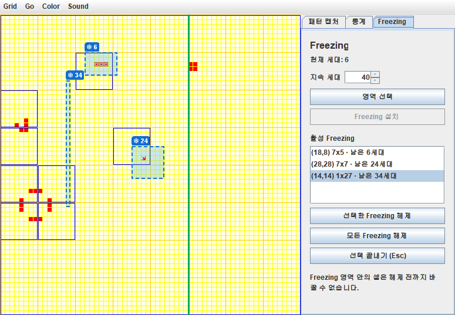

| 화면 표시 | 뜻 |
| --- | --- |
| 반투명 하늘색 배경과 파란 점선 테두리 | 고정된 영역 |
| 영역 위의 파란 배지 `❄ n` | 남은 세대 수 |
| 살아 있는 셀 안의 하늘색 테두리 | 고정된 살아 있는 셀 |
| 회색 점선 | 지금 끌고 있는 선택 영역 |
| 빨간 점선 | 활성 영역과 겹쳐 설치할 수 없는 선택 |

| 구분 | 내용 |
| --- | --- |
| 새로 만든 것 | 영역 하나의 상태를 나타내는 `FreezingRegion`(Context)과 `FreezingState`, `NormalState`, `FrozenState`(State 패턴), 영역 목록을 관리하는 `FreezingManager`, Freezing 탭 화면 `FreezingTools` |
| 고친 원본 클래스 | `Cell` 계층(`Cell`, `Neighborhood`, `Resident`): 좌표로 칸 하나의 다음 생사만 바꾸는 `holdNextState()`를 더했다<br>`Universe`: 틱 처리의 계산과 확정 사이, 세대 증가 뒤에 Freezing 단계를 넣고, 다른 기능과의 규칙(편집 차단, 배치 제한, 초기화)을 연결했다<br>`Life`: 사이드바에 Freezing 탭을 더했다 |
| 바꾸지 않은 것 | 생사 규칙 계산, 저장 파일 형식, 기존 메뉴 항목과 동작, 다른 확장 기능의 클래스 |

### 1.2 유스케이스

<a id="usecase"></a>

확장 유스케이스는 과제 안내문의 규칙대로 이름 끝에 `(E)`를 붙였다. 유스케이스와 관계는 팀 전체 유스케이스 다이어그램에서 Freezing 줄에 있는 것을 그대로 떼어 왔다. 그림에는 Freezing 유스케이스 네 개와, 이들이 맞물리는 원본 유스케이스(Edit Cells, Run / Halt Game, Step One Generation, Advance Generation, Clear Board, Store / Load Board)를 그렸다. 캡처·템플릿 기능의 Place Template(E)는 Protect Frozen Region(E)가 확장하는 대상이라 이름과 확장 지점만 두었다.

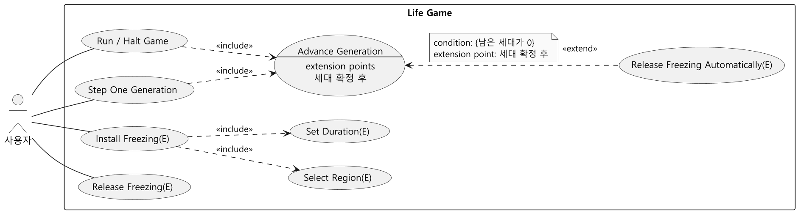

| 유스케이스 | 시작하는 곳 | 다른 유스케이스와의 관계 | 내용 |
| --- | --- | --- | --- |
| Install Freezing(E) | Freezing 탭의 지속 세대 입력 칸, 영역 선택, 보드에서 끌기, Freezing 설치 | | 지속 세대를 정하고 영역을 골라, 그 영역을 정한 세대 수 동안 고정한다 |
| Release Freezing(E) | Freezing 탭의 선택한 Freezing 해제, 모든 Freezing 해제 | Clear Board("판을 비운 후"), Store / Load Board("불러온 후")를 «extend» | 남은 세대를 기다리지 않고 고정을 푼다 |
| Keep Region Frozen(E) | 세대가 진행될 때마다 | Advance Generation("다음 세대 계산 후", "세대 확정 후")을 «extend» (조건: 고정 영역이 있음) | 고정 영역의 다음 생사를 설치 순간 그대로 두고, 남은 세대를 세어 다 되면 푼다 |
| Protect Frozen Region(E) | 셀을 클릭하거나 끌 때, 템플릿을 놓을 때 | Edit Cells("셀 변경 전"), Place Template(E)("배치 전")를 «extend» | 고정된 셀이 편집이나 템플릿 배치로 바뀌지 않게 막는다 |

- Advance Generation은 원본에서 한 세대를 계산하고 확정하는 부분이다. Run / Halt Game(Go 메뉴의 속도 선택)과 Step One Generation(Go > Tick (Single Step))이 모두 이것을 «include»한다. Keep Region Frozen(E)는 이 공통 부분에 붙으므로 Run과 Step에 따로 그리지 않았다.
- Keep Region Frozen(E)는 확장 지점 두 곳에 붙는다. "다음 세대 계산 후"에서 고정 영역의 다음 생사를 설치 순간의 생사로 바꾸고, "세대 확정 후"에서 남은 세대를 1 줄여 0이 된 영역을 푼다(자동 해제). 자동 해제는 따로 유스케이스로 떼지 않고 이 유스케이스의 마지막 단계로 적었다. 남은 세대를 세는 일과 푸는 일이 같은 시점에 같은 객체(`FrozenState`)에서 일어나기 때문이다.
- 지속 세대를 정하는 일과 영역을 고르는 일은 따로 유스케이스로 떼지 않고 Install Freezing(E)의 단계로 적었다. 사용자가 그것만으로 끝내는 목표가 아니라 설치하려고 거치는 단계다.
- Release Freezing(E)는 사용자가 직접 시작하기도 하고(User goal), Grid > Clear와 Grid > Load가 끝난 뒤 남은 영역이 있으면 «extend»로 함께 일어나기도 한다. 어느 쪽이든 영역을 푸는 방법은 같다.
- Protect Frozen Region(E)는 고른 셀이나 템플릿 자리가 고정 영역과 겹칠 때만 일어나므로 «extend»다. 끌어서 그리기(Draw Cells by Dragging(E))는 Edit Cells를 확장하는 다른 기능이라 그림에 넣지 않았지만, 끄는 동안 지나가는 칸도 Edit Cells의 "셀 변경 전"을 거치므로 같은 검사를 받는다.

각 명세는 유스케이스 이름, 범위, 수준, 주 행위자, 사전 조건, 메인 성공 시나리오, 대체 시나리오, 연관 요구사항 순서로 적었다.

- 수준은 사용자가 직접 이루려는 목표(User goal)와, 다른 유스케이스 안에서 일어나는 부분(Subfunction)으로 나눴다.
- Subfunction 유스케이스의 주 행위자는 그것을 포함하는 쪽(확장이면 확장 대상) 유스케이스의 주 행위자를 따랐다.
- 시나리오는 버튼 같은 화면 조작 대신 사용자의 의도와 시스템이 하는 일로 적었다. 버튼 이름은 위 표에, 클래스 사이의 메시지는 3.3절의 시퀀스 다이어그램에 있다.

Advance Generation은 원본 유스케이스지만, Freezing 유스케이스가 붙는 자리(확장 지점)를 보이려고 먼저 적었다. 확장 지점은 번호 없이 단계 사이에 적었다.

| 유스케이스 이름 | Advance Generation |
| --- | --- |
| 범위 | Life Game |
| 수준 | Subfunction (Run / Halt Game, Step One Generation이 «include») |
| 주 행위자 | 사용자 (포함하는 Run / Halt Game, Step One Generation의 주 행위자를 따른다) |
| 사전 조건 | 캡처·배치 편집 중이거나 Freezing 영역을 고르는 중이 아니다 |
| 메인 성공 시나리오 | 1. 시스템이 원본 규칙대로 판 전체의 다음 세대 생사를 계산한다.<br>extension point: 다음 세대 계산 후<br>2. 시스템이 다음 세대를 확정하고 세대 수를 1 늘린다.<br>extension point: 세대 확정 후<br>3. 시스템이 바뀐 판을 보여 준다. |
| 대체 시나리오 | 사전 조건을 만족하지 않는다(편집 중이거나 영역을 고르는 중):<br>&emsp;1. 시스템이 세대를 진행하지 않는다. 남은 세대도 줄지 않는다. |
| 연관 요구사항 | FR-4, FR-5, NFR-1, NFR-2 |

| 유스케이스 이름 | Install Freezing(E) |
| --- | --- |
| 범위 | Life Game |
| 수준 | User goal |
| 주 행위자 | 사용자 |
| 사전 조건 | 없음. 게임이 돌고 있을 때도 멈춰 있을 때도 쓸 수 있다(영역을 고르기 시작하면 게임이 멈춘다) |
| 메인 성공 시나리오 | 1. 사용자가 고정할 세대 수 n을 정한다.<br>2. 시스템이 n을 다음 설치에 쓸 지속 세대로 보여 준다.<br>3. 사용자가 영역을 고르기 시작하겠다고 요청한다.<br>4. 시스템이 진행 중인 캡처·배치 편집을 끝내고 배치 되돌리기 기록을 지운 뒤, 게임을 멈추고 영역 선택 모드로 들어간다.<br>5. 사용자가 보드에서 한 칸을 누르고 끌어 사각형의 두 모서리를 정한다.<br>6. 시스템이 끄는 동안 사각형과, 활성 영역과 겹치는지(설치할 수 있는지)를 보여 준다.<br>7. 사용자가 고른 영역을 고정하겠다고 요청한다.<br>8. 시스템이 영역을 보드 경계에 맞추고, 영역 안 모든 칸의 생사를 기록한다.<br>9. 시스템이 지금 세대 g와 지속 세대 n을 기록하고 영역을 고정 상태로 만든다.<br>10. 시스템이 영역 선택을 끝내고, 고정된 영역과 남은 세대 n, 고정되는 세대(g+1 ~ g+n)를 보여 준다. |
| 대체 시나리오 | 1a. 사용자가 값을 바꾸지 않는다:<br>&emsp;1. 시스템이 처음 값 5를 쓴다.<br>1b. 1~999 밖의 값이다:<br>&emsp;1. 시스템이 받지 않고 이전 값을 유지한다.<br>5a. 보드 밖에서 누른다:<br>&emsp;1. 시스템이 선택을 시작하지 않는다.<br>5b. 반대 방향(오른쪽 아래에서 왼쪽 위)으로 끈다:<br>&emsp;1. 시스템이 같은 사각형으로 정한다.<br>5c. 보드 밖으로 끈다:<br>&emsp;1. 시스템이 가장 가까운 가장자리 칸에 맞춘다.<br>4-7a. 사용자가 선택을 그만둔다(Esc, 오른쪽 클릭, 선택 끝내기, 다른 탭으로 전환):<br>&emsp;1. 시스템이 영역 선택 모드를 끝낸다. 설치된 영역은 그대로이고 게임은 저절로 다시 돌지 않는다. 유스케이스가 끝난다.<br>7a. 고른 영역이 활성 영역과 겹친다:<br>&emsp;1. 시스템이 설치를 받지 않는다(화면의 설치 버튼이 꺼져 있다). 맞닿는 것은 허용한다.<br>8a. 고른 영역이 보드와 겹치지 않거나 비어 있다:<br>&emsp;1. 시스템이 "보드 안의 영역을 선택하세요."를 보여 주고 아무것도 바꾸지 않는다.<br>9a. 지속 세대가 1 미만이다:<br>&emsp;1. 시스템이 "지속 세대는 1 이상이어야 합니다."를 보여 주고 아무것도 바꾸지 않는다. 화면의 입력 칸은 1~999만 받으므로 모델을 직접 부를 때만 일어난다. |
| 연관 요구사항 | FR-1, FR-2, FR-3, FR-4, FR-7, FR-10, NFR-4 |

예: 지금 세대가 10일 때 지속 세대 5로 설치하면 11~15세대 동안 고정되고, 16세대부터 원본 규칙으로 계산한다.

| 유스케이스 이름 | Release Freezing(E) |
| --- | --- |
| 범위 | Life Game |
| 수준 | User goal. Clear Board, Store / Load Board에서는 Subfunction («extend») |
| 주 행위자 | 사용자 |
| 사전 조건 | 활성 영역이 하나 이상 있다 |
| 메인 성공 시나리오 | 1. 사용자가 활성 영역 목록에서 영역 하나를 고른다.<br>2. 사용자가 그 영역의 고정을 풀겠다고 요청한다.<br>3. 시스템이 영역을 고정 아님 상태로 바꾸고 목록에서 뺀다.<br>4. 시스템이 남은 영역 목록을 보여 주고, 풀린 영역은 다음 세대부터 원본 규칙을 따른다고 알린다. |
| 대체 시나리오 | 1a. 모든 영역을 풀겠다고 요청한다:<br>&emsp;1. 시스템이 모든 활성 영역을 같은 방식으로 풀고 빈 목록을 보여 준다.<br>2a. 고른 영역이 없다:<br>&emsp;1. 시스템이 요청을 받지 않는다(해제 버튼이 꺼져 있다).<br>*a. Clear Board의 확장 지점 "판을 비운 후", 또는 Store / Load Board의 확장 지점 "불러온 후"(불러오기에 성공한 경우)에서 시작한다:<br>&emsp;1. 시스템이 영역을 고르는 중이면 선택을 끝낸다.<br>&emsp;2. 시스템이 모든 활성 영역을 풀고 빈 목록을 보여 준다. 판과 세대 수는 확장 대상 유스케이스가 이미 바꿨다. |
| 연관 요구사항 | FR-6, FR-9 |

| 유스케이스 이름 | Keep Region Frozen(E) |
| --- | --- |
| 범위 | Life Game |
| 수준 | Subfunction (Advance Generation의 확장 지점 "다음 세대 계산 후", "세대 확정 후"에서 «extend») |
| 주 행위자 | 사용자 (확장 대상인 Advance Generation의 주 행위자를 따른다) |
| 사전 조건 | 활성 영역이 하나 이상 있다(확장 조건) |
| 메인 성공 시나리오 | extension point: 다음 세대 계산 후<br>1. 시스템이 활성 영역 안 칸마다, 방금 계산한 다음 생사를 설치 순간의 생사로 바꾼다.<br>2. 시스템이 그 칸의 나이를 이번 세대에 세지 않는다.<br>extension point: 세대 확정 후<br>3. 시스템이 활성 영역마다 남은 세대를 1 줄인다.<br>4. 시스템이 남은 세대가 0이 된 영역을 고정 아님 상태로 바꾸고 목록과 화면에서 없앤다(자동 해제). |
| 대체 시나리오 | 4a. 남은 세대가 0이 된 영역이 없다:<br>&emsp;1. 시스템이 남은 세대만 줄이고 영역을 그대로 둔다.<br>영역마다 지속 세대가 다르면 각자 따로 풀린다. |
| 연관 요구사항 | FR-4, FR-5, FR-7, NFR-1, NFR-2 |

| 유스케이스 이름 | Protect Frozen Region(E) |
| --- | --- |
| 범위 | Life Game |
| 수준 | Subfunction (Edit Cells의 확장 지점 "셀 변경 전", Place Template(E)의 확장 지점 "배치 전"에서 «extend») |
| 주 행위자 | 사용자 (확장 대상인 Edit Cells, Place Template(E)의 주 행위자를 따른다) |
| 사전 조건 | 고른 셀이 활성 영역 안에 있다, 또는 놓으려는 템플릿의 사각형이 활성 영역과 겹친다(확장 조건) |
| 메인 성공 시나리오 | 1. 시스템이 그 셀을 바꾸지 않는다.<br>2. 시스템이 고정된 셀은 해제 전까지 바꿀 수 없다고 알린다. |
| 대체 시나리오 | 1a. Edit Cells에서 고정된 칸을 눌러 획을 시작했다:<br>&emsp;1. 시스템이 그 획 전체를 무시한다(이어서 끌어도 아무 칸도 바뀌지 않는다).<br>1b. Edit Cells에서 바깥에서 시작한 끌기가 영역을 지나간다:<br>&emsp;1. 시스템이 영역 안 칸만 건너뛰고 바깥 칸은 계속 그리거나 지운다.<br>1c. Place Template(E)에서 템플릿 사각형이 영역과 겹친다(빈 여백만 겹쳐도 해당한다):<br>&emsp;1. 시스템이 그 자리에 배치하지 않고, 영역과 겹친다고 알린다.<br>&emsp;2. 누른 채 끌어 반복 배치하는 중이면 겹치는 자리만 건너뛰고 나머지 자리에는 배치한다. |
| 연관 요구사항 | FR-8 |

### 1.3 고정 규칙

```math
\mathrm{alive}_{t+1}(x) = \begin{cases} \mathrm{snapshot}_R(x) & \text{if } x \in R \text{ and } R \text{ is frozen at } t+1 \\ \mathrm{B3/S23}(x, t) & \text{otherwise} \end{cases}
```

```math
R \text{ is frozen at generation } t \iff g_R + 1 \le t \le g_R + n_R
```

- R은 영역, snapshot은 설치한 순간의 생사, g는 설치한 세대, n은 지속 세대다.
- B3/S23(x, t)는 t세대의 이웃으로 계산한 원본 규칙의 결과다. 이웃에는 고정된 셀도 그대로 들어간다. 고정된 셀의 생사는 바뀌지 않으므로 바깥 셀은 늘 설치 순간의 생사를 이웃으로 본다.
- 고정된 셀은 고정된 동안 나이를 세지 않는다. 그래서 색 순환을 켜 두면 고정한 순간의 색을 유지하고, 풀리면 멈췄던 나이에서 이어서 센다(4.5절).
- 지속 세대는 1~999이고 처음 값은 5다. 999세대는 Fast(30 ms)로 약 30초다.

### 1.4 요구사항

**기능 요구사항**

| ID | 요구사항 | 유스케이스 |
| --- | --- | --- |
| FR-1 | 영역 선택을 시작하면 게임이 멈추고, 보드를 끌어 사각형 영역을 고른다. 반대 방향으로 끌어도 같은 사각형이고, 보드 밖으로 끌면 가장자리 칸에 맞춘다. 고르는 동안 세대가 진행되지 않고 일반 그리기도 되지 않는다 | Install Freezing(E) |
| FR-2 | 지속 세대는 1~999이고 처음 값은 5다. 이미 설치된 영역에는 적용하지 않는다 | Install Freezing(E) |
| FR-3 | 설치하면 그 순간 영역 안 모든 칸(살아 있는 칸과 죽은 칸)의 생사를 기록하고, 지금 세대가 g이면 g+1 ~ g+n세대 동안 고정한다 | Install Freezing(E) |
| FR-4 | 고정된 동안 영역 안의 살아 있는 셀은 죽지 않고 죽은 셀은 태어나지 않는다. 영역 밖은 원본 규칙대로 진화하고, 고정된 살아 있는 셀은 바깥 셀의 이웃으로 센다 | Keep Region Frozen(E) |
| FR-5 | 지속 세대가 지나면 영역이 저절로 풀리고, 그 영역의 셀은 다음 세대부터 원본 규칙을 따른다 | Keep Region Frozen(E) |
| FR-6 | 선택한 영역 하나, 또는 모든 영역의 고정을 바로 풀 수 있다 | Release Freezing(E) |
| FR-7 | 영역을 여러 개 둘 수 있고 영역마다 지속 세대가 다를 수 있다. 활성 영역과 겹치는 영역은 설치할 수 없고 맞닿는 것은 된다 | Install Freezing(E), Keep Region Frozen(E) |
| FR-8 | 고정된 셀은 클릭이나 드래그로 바꿀 수 없다. 템플릿은 사각형이 활성 영역과 겹치면 배치를 거부한다 | Protect Frozen Region(E) (Edit Cells, Place Template(E)를 확장) |
| FR-9 | Grid > Clear와 Grid > Load(읽기 성공)는 모든 영역을 없앤다. Load를 취소하면 영역은 그대로다. Store는 영역을 저장하지 않는다 | Release Freezing(E) (Clear Board, Store / Load Board를 확장) |
| FR-10 | 고정된 영역, 남은 세대, 고정된 살아 있는 셀, 고르는 중인 사각형, 겹쳐서 설치할 수 없는 선택을 보드 위에 구분해 보여 준다(1.1절 표) | Install Freezing(E) |

**비기능 요구사항**

| ID | 요구사항 | 기준 |
| --- | --- | --- |
| NFR-1 | 생사 규칙 계산 코드가 바뀌지 않고, 영역이 없으면 Freezing을 붙이기 전과 같게 동작한다 | `Resident.figureNextState()`를 고치지 않는다. 원본 동작을 검사하는 기존 테스트가 Freezing 때문에 고친 곳 없이 통과한다 |
| NFR-2 | 통계·사운드·색 순환과 어긋나지 않는다 | 세대 번호가 한 곳에만 있다. 고정된 셀은 출생·사망 목록에 들어가지 않고 생존 수에는 들어간다. 고정된 셀은 나이와 색이 멈춘다 |
| NFR-3 | 고정 규칙은 게임 창 없이 테스트할 수 있다 | `FreezingManager`, `FreezingRegion`, 상태 클래스에 Swing 코드가 없다 |
| NFR-4 | 다른 확장 기능의 클래스를 고치지 않는다 | `PatternTools`, `BoardEditor`, `PlacePatternCommand`, `Statistics`, `StatisticsPanel`, `BoardChangeEvent`, `SoundEffects`, `CellColorPolicy`와 구현들, `Clock`이 Freezing 병합 전과 같다 |
| NFR-5 | 색 순환에서 고친 화면 갱신 지연을 되살리지 않는다 | 영역이 없으면 Freezing이 다시 그리기를 요청하지 않고, 있으면 영역 자리만 요청한다 |
| NFR-6 | 저장 파일 형식을 바꾸지 않는다 | Freezing 정보는 저장하지 않는다. 기존 .life 파일을 그대로 읽는다 |

### 1.5 기존 기능에 미치는 영향

다음 세대의 생사는 원본 규칙대로 계산한 뒤, 활성 영역 안의 칸만 확정 직전에 설치 순간의 생사로 바뀐다. 영역이 없으면 이 단계는 아무것도 하지 않으므로 결과가 Freezing을 붙이기 전과 같다(NFR-1).

| 기존 기능 | 영역이 없을 때 | 영역이 있을 때 |
| --- | --- | --- |
| 마우스 클릭과 드래그 그리기 | 변화 없음 | 고정된 셀은 바뀌지 않는다. 고정된 셀에서 시작한 획은 무시하고, 바깥에서 시작한 획은 영역 안 칸만 건너뛴다 |
| Go > Tick, Halt, Agonizing·Slow·Medium·Fast | 변화 없음 | 그대로 동작한다. Tick 한 번에 남은 세대가 정확히 1 준다. 영역을 고르는 동안에는 세대가 진행되지 않는다 |
| Grid > Clear | 변화 없음 | 모든 영역이 없어지고 세대가 0이 된다 |
| Grid > Store / Load | 변화 없음 | Store는 셀만 저장한다. Load에 성공하면 모든 영역이 없어진다 |
| 템플릿 배치와 되돌리기 | 변화 없음 | 사각형이 영역과 겹치면 배치를 거부한다. 영역을 고르기 시작하면 배치 되돌리기 기록을 지운다 |
| 색 순환 | 변화 없음 | 고정된 셀은 나이와 색이 멈춘다 |
| 통계와 사운드 | 변화 없음 | 고정된 셀은 출생·사망 목록에 없다. 살아 있으면 생존 수에는 들어간다 |

사이드바에는 패턴 캡처, 통계 뒤에 Freezing 탭이 생긴다. 메뉴는 바뀌지 않는다.

## 2. 기존 코드에서 바뀐 부분

원본 클래스 중 `Cell`, `Neighborhood`, `Resident`, `Universe`, `Life`를 고쳤다. 원본은 Holub 코드 그대로다. 아래 표의 "Freezing 전"과 코드의 `-` 줄은 Freezing을 붙이기 직전의 코드이고, 그중 Holub 원본에 없던 것(셀의 나이, 통계·사운드 이벤트, 캡처·배치 편집 중 틱 건너뛰기)은 다른 기능이 더한 것이다. Holub 코드의 오류를 고친 내용은 [원본 코드 대비 개선 사항](../original-improvements.md)에 있다.

### 2.1 Cell 계층: 좌표로 다음 생사만 바꾼다

| 부분 | Freezing 전 | 바뀐 뒤 |
| --- | --- | --- |
| `Cell` | 다음 생사는 `figureNextState()`만 정한다 | `holdNextState(location, alive)`를 선언했다. `Cell.DUMMY`는 아무것도 하지 않고 false를 돌려준다<br>이유: 영역이 보드의 중첩 구조(8×8 블록 두 단계)를 몰라도 좌표 하나로 칸에 닿게 한다(4.2절) |
| `Neighborhood` | | `holdNextState()`를 좌표가 속한 하위 셀에 넘기기만 한다. 블록의 활성 표시(`amActive`)는 건드리지 않는다<br>이유: 다음 생사가 실제로 바뀌는 칸은 방금 `figureNextState()`가 "변화 있음"으로 계산한 블록에만 있어, 그 블록은 이미 활성이다 |
| `Resident`의 `holdNextState()` | | `willBeAlive`만 바꾸고 `heldThisGeneration`을 켠다. 이웃이 이번 세대에 읽는 `amAlive`는 건드리지 않는다 |
| `Resident.transition()` | 다음 생사로 바꾸고 나이를 정한다 | `heldThisGeneration`이 켜진 칸은 나이를 세지 않고, 확정한 뒤 끈다<br>이유: 고정된 셀은 나이와 색도 멈춰야 한다(4.5절) |

생사를 계산하는 `figureNextState()`는 한 줄도 바꾸지 않았다.

**실제 코드 변화**

`Cell.java`: 인터페이스에 메서드를 하나 선언하고, 보드 바깥을 뜻하는 `DUMMY`(Null Object)는 아무것도 하지 않게 했다.

```diff
 	void clear();

+	/** [Freezing] Override the next state that the most recent
+	 *  {@link #figureNextState} computed for the unitary cell at
+	 *  <code>location</code> ... @return true if the override changed the pending next state.
+	 */
+	boolean holdNextState( Point location, boolean alive );
 ...
 		public boolean	 transition()		{return false;			  }
+		public boolean	 holdNextState(Point p, boolean a)	{return false;}
```

`Neighborhood.java`: 좌표가 속한 하위 셀에 좌표를 바꿔 넘긴다. `isAliveAt()`, `colorAt()`과 같은 방식이다.

```diff
+	public boolean holdNextState(Point location, boolean alive)
+	{	int subcellWidth = grid[0][0].widthInCells();
+		return grid[location.y / subcellWidth][location.x / subcellWidth]
+				.holdNextState( new Point( location.x % subcellWidth,
+										   location.y % subcellWidth ), alive );
+	}
```

`Resident.java`: 다음 생사(`willBeAlive`)만 바꾸고, 그 세대에는 나이를 세지 않는다.

```diff
 	private int		age			= 0;	// 연속으로 살아남은 세대 수 (태어나면 0)
+	private boolean heldThisGeneration = false;	// [Freezing] 이번 전이에서는 나이도 멈춘다
 ...
 	public boolean transition()
 	{	boolean changed = amAlive != willBeAlive;
-		age = (amAlive && willBeAlive) ? age + 1 : 0;
+		if( !heldThisGeneration )			// [Freezing] 고정된 셀은 나이와 색도 그대로 둔다
+			age = (amAlive && willBeAlive) ? age + 1 : 0;
+		heldThisGeneration = false;
 		amAlive = willBeAlive;
 		return changed;
 	}

+	public boolean holdNextState(Point location, boolean alive)
+	{	assert location.x == 0 && location.y == 0;
+		boolean overridden = willBeAlive != alive;
+		willBeAlive = alive;
+		heldThisGeneration = true;
+		return overridden;
+	}
```

### 2.2 Universe: 틱 처리와 기능 사이의 연결

| 단계 | Freezing 전 | 바뀐 뒤 |
| --- | --- | --- |
| 틱을 건너뛰는 조건 | 캡처·배치 편집 중 | Freezing 영역을 고르는 중일 때도 건너뛴다<br>이유: 고르는 동안 판이 바뀌면 사용자가 본 모습과 기록되는 스냅샷이 달라진다 |
| 계산과 확정 사이 | 없음 | `freezing.beforeTransition(outermostCell)`: 활성 영역마다 다음 생사를 스냅샷으로 바꾼다<br>이유: 셀이 한 번도 잘못 바뀌지 않아 이벤트와 나이가 저절로 맞는다(4.2절) |
| 세대 증가 뒤 | 통계·사운드에 `GENERATION` 이벤트 | 그 전에 `freezing.afterGeneration()`: 남은 세대를 줄이고 0이 된 영역을 푼다 |

**실제 코드 변화: 틱 처리** (`Universe.java`의 시계 리스너)

```diff
 			{	public void tick()
-				{	if (patternTools.isEditing()) return;
+				{	if (patternTools.isEditing() || freezingTools.isEditing()) return;
 					patternTools.boardChanged();
 					outermostCell.figureNextState
 						   ( Cell.DUMMY,Cell.DUMMY,Cell.DUMMY,Cell.DUMMY,
 							 Cell.DUMMY,Cell.DUMMY,Cell.DUMMY,Cell.DUMMY
 						   );
 					boolean[][] before = liveCells();

+					// [Freezing] 규칙 계산(figureNextState)과 전이(transition)는
+					// 그대로 두고, 그 사이에서 각 Freezing 영역이 자기 State에
+					// 물어 다음 상태를 스냅샷으로 되돌린다.
+					FreezingManager freezing = freezingTools.manager();
+					freezing.beforeTransition( outermostCell );
+
 					// 바뀌는 셀이 없어도 매 틱 불러야 멈춘 패턴도 나이를 먹는다
 					boolean changed = outermostCell.transition();

 					// 같은 완료 이벤트를 통계와 사운드에 전달한다.
+					// 고정된 셀은 before와 같으므로 출생·사망 목록에 들어가지 않는다.
 					generation++;
+					freezing.afterGeneration();			// [Freezing] 남은 세대 감소, 0이면 Frozen -> Normal
 					notifyBoardChanged(BoardChangeEvent.Kind.GENERATION, before);
```

그 밖에 `Universe` 생성자와 메뉴 처리에서 Freezing과 다른 기능을 연결했다. 연결은 모두 `Universe`에만 있고, 기능끼리는 서로를 모른다(4.4절).

| 연결 | 내용 |
| --- | --- |
| `FreezingTools` 생성 | 세대 번호를 읽는 람다(`() -> generation`)와, 영역 선택을 시작할 때 캡처·배치 편집을 끝내고 되돌리기 기록을 지우는 람다를 넘긴다 |
| 템플릿 배치 가드 | `patternTools.setPlacementGuard(area -> freezingTools.manager().overlapsFrozen(area))` |
| 브러시 | 고정된 셀에서 시작한 획은 무시하고, 획이 지나가는 고정된 칸은 건너뛴다 |
| Grid > Clear, Load | 보드를 바꾼 뒤 `freezingTools.reset()`으로 선택을 끝내고 모든 영역을 없앤다 |
| Esc | 켜져 있는 편집 모드(Freezing 영역 선택, 또는 캡처·배치)를 끝낸다 |
| 그리기 | `paintComponent()`가 셀을 그린 뒤 `freezingTools.paintOverlay()`로 영역을 그린다 |

**실제 코드 변화: 연결** (`Universe.java`)

생성자에서 `FreezingTools`를 만들고 배치 가드와 Esc를 연결한다.

```diff
 	private final PatternTools patternTools;
+	private final FreezingTools freezingTools;	// [Freezing]
 ...
+		freezingTools = new FreezingTools( this,
+			new FreezingManager( outermostCell, () -> generation ),
+			() -> {	if (patternTools.isEditing()) patternTools.cancel();
+					patternTools.boardChanged();
+				  } );
+		patternTools.setPlacementGuard( area -> freezingTools.manager().overlapsFrozen(area) );
+
+		// [Freezing] Esc ends whichever editing mode is on.
+		getInputMap(WHEN_IN_FOCUSED_WINDOW).put(KeyStroke.getKeyStroke("ESCAPE"), "cancel-editing");
+		getActionMap().put("cancel-editing", new AbstractAction()
+		{	public void actionPerformed(ActionEvent e)
+			{	if (freezingTools.isEditing()) freezingTools.cancel();
+				else patternTools.cancel();
+			}
+		});
```

브러시: 영역을 고르는 중에는 그리지 않고, 고정된 셀에서는 획을 시작하지 않으며, 획이 지나가는 고정된 칸은 건너뛴다.

```diff
 			public void mousePressed(MouseEvent e)
 			{	lastCell = null;
-				if (patternTools.isEditing() || !SwingUtilities.isLeftMouseButton(e)
+				if (patternTools.isEditing() || freezingTools.isEditing()
+                        || !SwingUtilities.isLeftMouseButton(e)
                         || !contains(e.getPoint())) return;
 				lastCell	= cellAt( e.getPoint() );
+				if (freezingTools.manager().isFrozen(lastCell))	// [Freezing] no stroke starts on a frozen cell
+				{	freezingTools.blockedEdit();
+					lastCell = null;
+					return;
+				}
 ...
 			public void mouseDragged(MouseEvent e)
-			{	if (lastCell == null || patternTools.isEditing()) return;
+			{	if (lastCell == null || patternTools.isEditing() || freezingTools.isEditing()) return;
 ...
 	private boolean setCell( Point cell, boolean alive )
 	{	if( outermostCell.isAliveAt(cell.y, cell.x) == alive )
 			return false;
+		if( freezingTools.manager().isFrozen(cell) )	// [Freezing] a drag skips frozen cells
+		{	freezingTools.blockedEdit();
+			return false;
+		}
```

Grid > Clear와 Load는 보드를 바꾼 뒤 Freezing을 초기화하고, 그리기는 셀 다음에 영역을 그린다.

```diff
 					outermostCell.clear();
                     generation = 0;
+                    freezingTools.reset();				// [Freezing]
                     notifyBoardChanged(BoardChangeEvent.Kind.CLEAR);
 ...
         outermostCell.transfer(memento, new Point(0, 0), Cell.LOAD);
         generation = 0;
+        freezingTools.reset();				// [Freezing]
         notifyBoardChanged(BoardChangeEvent.Kind.LOAD);
 ...
 		outermostCell.redraw(g, panelBounds, true);		//{=Universe.redraw1}
+		if (freezingTools != null) freezingTools.paintOverlay((Graphics2D) g);	// [Freezing]
 		drawPlayhead( g );
```

사이드바가 쓰는 접근자도 더했다. 처음에는 테스트용 접근자 `freezing()`도 있었지만, 테스트에서만 쓰여 지웠다(5.2절).

```diff
+	JPanel freezingControls() { return freezingTools.controls(); }	// [Freezing]
+
+    /** [Freezing] Finish a hidden area selection when the sidebar switches to another tool. */
+    void finishFreezingEditing() { freezingTools.cancel(); }
```

### 2.3 Life: 사이드바 탭

`Life.createSidebar()`가 패턴 캡처, 통계 뒤에 Freezing 탭을 세 번째로 더한다. 기존 두 탭의 순서는 바꾸지 않았다. Freezing 탭을 떠나면 진행 중인 영역 선택을 끝낸다.

**실제 코드 변화** (`Life.java`)

```diff
         tabs.addTab("패턴 캡처", patterns);
         tabs.addTab("통계", statisticsPanel);
+        JPanel freezing = universe.freezingControls();
+        tabs.addTab("Freezing", freezing);
         tabs.addChangeListener(event -> {
             if (tabs.getSelectedComponent() != patterns) universe.finishPatternEditing();
+            if (tabs.getSelectedComponent() != freezing) universe.finishFreezingEditing();
         });
```

### 2.4 새로 만든 클래스

| 클래스 | 하는 일 |
| --- | --- |
| `FreezingState` | 영역 하나의 상태 인터페이스. 세대 처리의 두 시점(`beforeTransition`, `afterGeneration`)에 할 일과, 고정 중인지, 남은 세대를 정한다 |
| `NormalState` | 고정 아님. 아무것도 하지 않는다. 필드가 없어 `INSTANCE` 하나를 함께 쓴다 |
| `FrozenState` | 고정 중. 남은 세대(`remaining`)를 가지고, 확정 전에 스냅샷을 적용하며, 남은 세대가 0이 되면 영역을 `NormalState`로 바꾼다 |
| `FreezingRegion` | 사각형 영역, 스냅샷, 현재 상태를 가진다. 남은 세대는 상태 객체(`FrozenState`)가 센다. 세대 처리를 현재 상태 객체에 넘긴다 |
| `FreezingManager` | 활성 영역 목록. 설치 검사(빈 영역, 겹침, 지속 세대), 해제, 초기화, 세대 처리 단계를 맡는다. Swing 코드가 없다 |
| `FreezingTools` | Freezing 탭 화면, 영역 선택(끌기), 보드 위 표시 |

**핵심 코드** (새 파일 529줄 중 State 패턴과 세대 처리 부분 발췌)

`FreezingRegion`(Context)은 세대 처리를 현재 상태 객체에 그대로 넘기고, 상태를 바꾸는 곳은 `changeState()` 하나다.

```java
private FreezingState state = NormalState.INSTANCE;

boolean beforeTransition(Cell board) { return state.beforeTransition(this, board); }
void afterGeneration() { state.afterGeneration(this); }

void changeState(FreezingState next) { state = next; }

/** Forced release: Frozen -> Normal. */
void release() { changeState(NormalState.INSTANCE); }
```

`FrozenState`(ConcreteState)는 스냅샷을 적용하고, 남은 세대가 0이 되면 스스로 영역을 `NormalState`로 바꾼다. `NormalState`의 두 메서드는 아무것도 하지 않는다.

```java
@Override public boolean beforeTransition(FreezingRegion region, Cell board) {
    return region.holdSnapshot(board);
}

@Override public void afterGeneration(FreezingRegion region) {
    if (--remaining <= 0) region.changeState(NormalState.INSTANCE);   // Frozen -> Normal
}
```

`FreezingManager`는 틱 처리가 부르는 두 단계를 영역마다 넘기고, 풀린 영역을 목록에서 뺀 뒤 화면에 알린다.

```java
boolean beforeTransition(Cell cells) {
    boolean overridden = false;
    for (FreezingRegion r : regions) overridden |= r.beforeTransition(cells);
    return overridden;
}

void afterGeneration() {
    for (FreezingRegion r : regions) r.afterGeneration();
    regions.removeIf(r -> !r.isFrozen());
    changed();
}
```

| 정한 것 | 이유 |
| --- | --- |
| 상태 객체는 셀마다가 아니라 영역마다 하나다 | 4,096개 셀에 필드를 달지 않고, 영역 단위로 풀고 남은 세대를 보여 주기 쉽다 |
| `FrozenState`는 만들 때 지속 세대가 1 미만이면 거부한다 | 잘못된 지속 세대로 고정된 영역이 생기지 않게, 스냅샷을 찍기 전에 막는다 |
| `FreezingManager`는 세대 번호를 세지 않고 `LongSupplier`로 `Universe`의 값을 읽는다 | 통계와 Freezing 탭의 세대 번호가 어긋날 수 없다(4.5절) |
| 목록은 밖에서 바꿀 수 없게 돌려준다(`Collections.unmodifiableList`) | 영역은 설치와 해제로만 늘고 준다 |

### 2.5 다른 기능과 맞물린 부분

| 기능 | 그 기능의 패턴 | 맞물린 곳 | 지금 상태 | 그 기능 코드 수정 |
| --- | --- | --- | --- | --- |
| 통계 | Observer (`BoardChangeListener`) | 세대 번호, 출생·사망 수, 생존 수 | 세대 번호는 `Universe` 하나. 고정은 이벤트를 만들기 전에 끝나므로 고정된 셀은 출생·사망 목록에 없다. 설치·해제는 셀을 바꾸지 않아 이벤트를 보내지 않는다 | 없음 |
| 사운드 | Observer, Command | 세대마다 받는 출생·사망 좌표 | 통계와 같은 이벤트를 받으므로 고정된 셀은 소리를 내지 않는다. 재생선은 고정된 살아 있는 셀을 계속 연주한다 | 없음 |
| 색 순환 | Strategy (`CellColorPolicy`) | 셀의 나이와 색 | 고정된 셀은 나이가 멈추고, 풀리면 이어서 센다 | `Resident.transition()`에 조건 하나 |
| 캡처·템플릿 | Command (`PlacePatternCommand`), 배치 가드 | 템플릿 배치, 되돌리기 | 캡처 쪽이 열어 둔 `setPlacementGuard`에 연결했다. 가드는 `BoardEditor.place()` 안에서 검사해 누른 채 반복 배치도 우회하지 못한다. 영역 선택을 시작하면 되돌리기 기록을 지운다 | 없음 |
| 드래그 그리기 | `Universe`의 브러시 | 고정된 셀 편집 | 브러시가 고정된 셀을 건너뛴다 | `Universe` 브러시에 검사 두 곳 |
| Tick 수정 | `Clock` | 한 세대 진행 | 실행 중 Tick을 누르면 멈추고 한 세대만 진행하며, 남은 세대가 정확히 1 준다 | 없음 |
| 사이드바 | `Life.createSidebar()` | 탭 | Freezing 탭을 세 번째로 더했다 | `Life`에 세 줄 |

### 2.6 원본 설계 패턴과 맞물린 부분

이 기능은 원본의 패턴을 바꾸지 않고 그 안에 들어갔다.

| 원본 패턴 | 원본 코드 | 이 기능과의 관계 |
| --- | --- | --- |
| Composite | `Cell`, `Neighborhood`, `Resident` | `holdNextState()`를 Component에 더해, 블록을 거쳐 Leaf(Resident)까지 좌표로 내려간다. `isAliveAt()`, `colorAt()`과 같은 길이다 |
| Mediator | `Universe` (원본 주석: Swing 이벤트와 Life 클래스 사이의 중재자) | 기능 사이의 규칙(배치 가드, 편집 차단, 초기화, Esc)을 모두 `Universe`에 두었다(4.4절) |
| Observer | `Clock`의 리스너 | 틱 처리는 `Universe`가 시계에 등록한 리스너다. 새 리스너를 만들지 않고 기존 리스너에 단계를 더했다 |
| Singleton | `Universe`, `Clock` | 영역 선택을 시작할 때 `Clock.instance().stop()`으로 게임을 멈춘다 |
| Memento | `Cell.createMemento()`, `transfer()` | 처음 구현은 스냅샷을 찍을 때 `createMemento()`로 보드 전체를 복사해 읽었다. `isAliveAt()`이 생긴 뒤 필요한 칸만 묻도록 바꿨다 |

## 3. 구조와 동작(UML 다이어그램)

설계 순서대로 다이어그램을 둔다. 유스케이스(1.2절)로 정한 사용자 목표에서 시스템 시퀀스 다이어그램으로 시스템 연산을 뽑고, 연산 계약으로 각 연산이 끝난 뒤의 상태를 정한다. 이어서 시퀀스 다이어그램으로 객체 사이의 메시지를 그리고, 거기에 나온 클래스와 관계를 클래스 다이어그램으로 모은다. 상태에 따라 동작이 달라지는 영역과 영역 선택 모드는 마지막에 상태 다이어그램으로 그렸다.

그림은 모두 [diagram/](diagram/) 폴더의 png이고, 같은 이름의 `.puml`이 원본이다.

### 3.1 시스템 시퀀스 다이어그램

게임을 블랙박스로 보면, 이 기능이 새로 만든 시스템 연산은 일곱이고, 원본이나 다른 기능의 연산 가운데 사후 조건이 바뀐 것이 다섯이다. 시스템 시퀀스 다이어그램은 유스케이스마다 한 장씩 그렸고, 그린 규칙은 다음과 같다.

- 이벤트 이름은 버튼 이름이 아니라 사용자의 의도로 적었다.
- 반환은 화면 모습이 아니라 사용자가 받는 정보로 적었다.
- 다른 유스케이스를 확장하는 경우(«extend»)는 확장 대상 유스케이스의 시스템 연산을 그리고, 그 연산의 결과 중 이 기능이 바꾼 부분을 적었다.
- 세대를 넘기는 시계는 게임 안에 있으므로 입력으로 그리지 않았다. 게임이 돌고 있는 동안 세대 간격마다 보여 주는 부분은 시스템에서 사용자로 가는 출력만 loop로 그렸다.

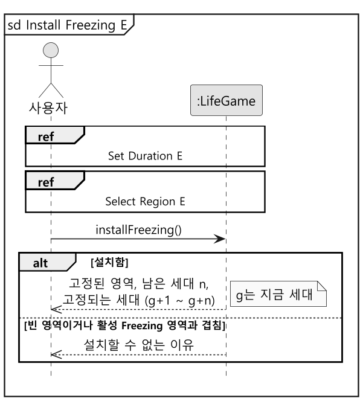

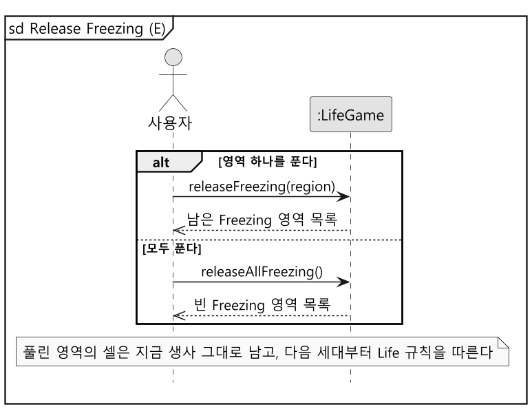

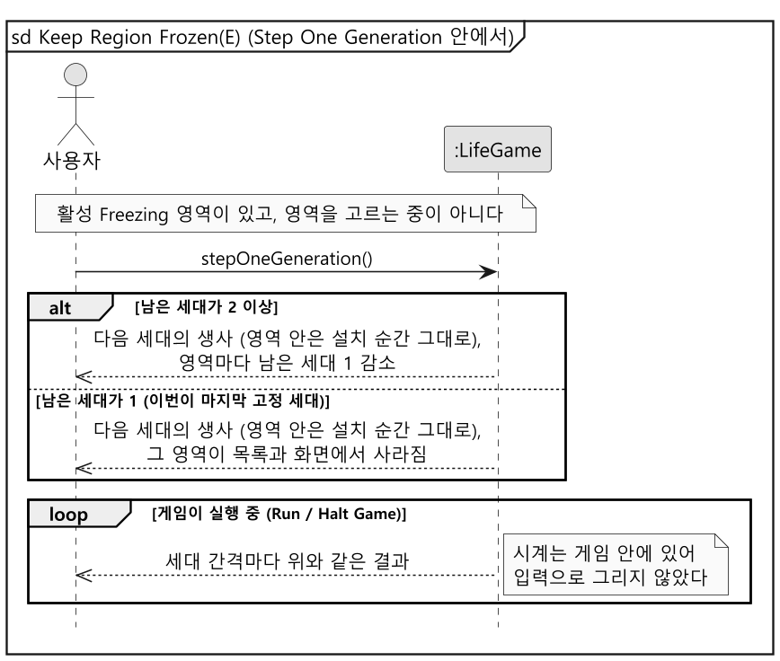

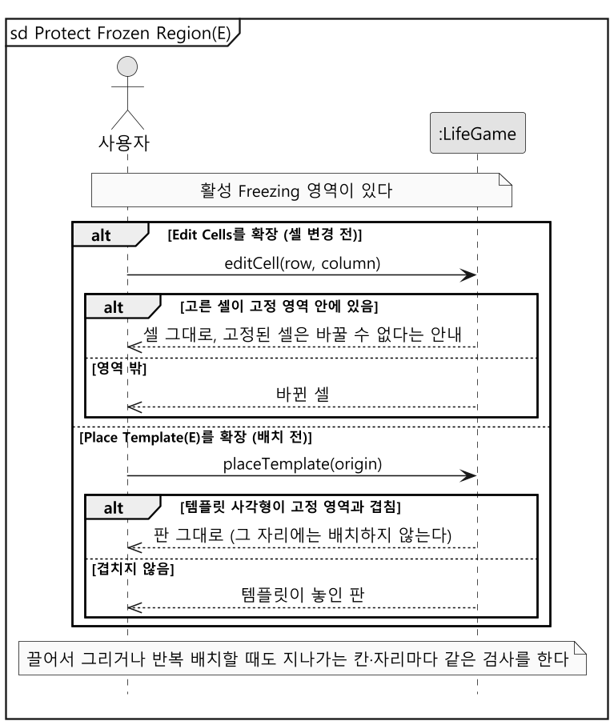

| 시스템 연산 | 실제 입력 | 유스케이스 | 이 기능과의 관계 |
| --- | --- | --- | --- |
| `setFreezingDuration(n)` | Freezing 탭 > 지속 세대 입력 칸 | Install Freezing(E) | 새로 생김 |
| `startRegionSelection()` | Freezing 탭 > 영역 선택 | Install Freezing(E) | 새로 생김 |
| `selectRegion(start, end)` | 보드에서 누르고 끌고 놓기 | Install Freezing(E) | 새로 생김 |
| `cancelRegionSelection()` | Esc, 오른쪽 클릭, 선택 끝내기 (Esc), 다른 탭으로 전환 | Install Freezing(E) | 새로 생김 |
| `installFreezing()` | Freezing 탭 > Freezing 설치 | Install Freezing(E) | 새로 생김 |
| `releaseFreezing(region)` | 활성 Freezing 목록에서 고르고 선택한 Freezing 해제 | Release Freezing(E) | 새로 생김 |
| `releaseAllFreezing()` | 모든 Freezing 해제 | Release Freezing(E) | 새로 생김 |
| `clearBoard()` | Grid > Clear | Release Freezing(E) (Clear Board를 확장) | 원본 연산이고 사후 조건이 바뀜 |
| `loadBoard(file)` | Grid > Load | Release Freezing(E) (Store / Load Board를 확장) | 원본 연산이고 사후 조건이 바뀜 |
| `stepOneGeneration()` | Go > Tick (Single Step) | Keep Region Frozen(E) (Advance Generation을 확장) | 원본 연산이고 사후 조건이 바뀜 |
| `editCell(row, column)` | 보드 클릭, 끌기 | Protect Frozen Region(E) (Edit Cells를 확장) | 원본 연산이고 사후 조건이 바뀜 |
| `placeTemplate(origin)` | 템플릿 배치 모드에서 보드 클릭, 끌기 | Protect Frozen Region(E) (Place Template(E)를 확장) | 캡처·템플릿 기능의 연산이고 사후 조건이 바뀜 |

### 3.2 연산 계약

3.1절의 시스템 연산마다 연산 계약을 적었다. 사후 조건은 객체의 상태 변화만 적는다. 화면을 다시 그리는 것과 상태줄 문구는 넣지 않았다. `FreezingTools`의 `selecting`, `selection`은 화면 객체의 속성이지만, 틱 처리와 브러시가 이 값을 보고 동작을 바꾸므로 함께 적었다. 원본이나 다른 기능의 연산(CO8~CO12)은 이 기능이 더하거나 바꾼 사후 조건만 적었다.

**CO1: setFreezingDuration(n)**

- Operation: `setFreezingDuration(n: 정수)`
- Cross References: Install Freezing(E)
- Preconditions: 1 ≤ n ≤ 999
- Postconditions:
  - 지속 세대 입력 값이 n이 되었다 (속성 변경)

이 값은 다음 `installFreezing()`이 읽을 뿐 모델 객체에 연관되지 않는다. 그래서 이 연산의 시퀀스 다이어그램은 따로 그리지 않았다(3.3.3절 그림의 `duration.getValue()`가 읽는 곳이다).

**CO2: startRegionSelection()**

- Operation: `startRegionSelection()`
- Cross References: Install Freezing(E)
- Preconditions: 없음
- Postconditions:
  - 캡처·배치 편집 중이었다면 끝났다 (속성 변경)
  - `BoardEditor`의 배치 되돌리기 기록이 비었다 (연관 해제)
  - 시계(`Clock`)가 돌고 있었다면 멈췄다 (속성 변경)
  - `FreezingTools.selecting`이 true가 되었다 (속성 변경)
  - `FreezingTools.selection`이 null이 되었다 (속성 변경)

**CO3: selectRegion(start, end)**

- Operation: `selectRegion(start: 칸, end: 칸)`
- Cross References: Install Freezing(E)
- Preconditions:
  - `FreezingTools.selecting`이 true다
  - start가 보드 안의 칸이다
- Postconditions:
  - `FreezingTools.selection`이 start와 end(보드 밖이면 가장 가까운 가장자리 칸)를 두 모서리로 하는 사각형이 되었다 (속성 변경)

설치할 수 있는지(활성 영역과 겹치지 않는지)는 상태 변화가 아니라 사용자에게 보여 주는 정보라 사후 조건에 넣지 않았다.

**CO4: cancelRegionSelection()**

- Operation: `cancelRegionSelection()`
- Cross References: Install Freezing(E)
- Preconditions: `FreezingTools.selecting`이 true다 (false이면 아무것도 바뀌지 않는다)
- Postconditions:
  - `FreezingTools.selecting`이 false가 되었다 (속성 변경)
  - `FreezingTools.selection`이 null이 되었다 (속성 변경)

**CO5: installFreezing()**

- Operation: `installFreezing()`
- Cross References: Install Freezing(E)
- Preconditions:
  - `FreezingTools.selection`이 있다
  - selection을 보드에 맞춘 사각형 area가 비어 있지 않다
  - area가 활성 `FreezingRegion`의 영역과 겹치지 않는다
  - 지속 세대 입력 값 n이 1 이상이다
- Postconditions:
  - `FreezingRegion` 인스턴스 r이 생성되었다 (인스턴스 생성)
  - r.area가 area가 되었다 (속성 변경)
  - r.snapshot이 area 안 각 칸의 지금 생사(`Resident.amAlive`)가 되었다 (속성 변경)
  - `FrozenState` 인스턴스 f가 생성되었고 f.remaining이 n이 되었다 (인스턴스 생성, 속성 변경)
  - r이 f와 연관되었다 (연관 형성, r.state)
  - `FreezingManager`가 r과 연관되었다 (연관 형성, regions)
  - `FreezingTools.selecting`이 false, `selection`이 null이 되었다 (속성 변경)

사전 조건을 어기면 `FreezingManager.install()`이 `IllegalArgumentException`을 던지고 위 사후 조건은 하나도 일어나지 않는다. 셀과 세대 수는 바뀌지 않는다.

**CO6: releaseFreezing(region)**

- Operation: `releaseFreezing(region: FreezingRegion)`
- Cross References: Release Freezing(E)
- Preconditions: region이 `FreezingManager`의 활성 영역이다
- Postconditions:
  - `FreezingManager`와 region의 연관이 끊어졌다 (연관 해제)
  - region과 `FrozenState`의 연관이 끊어지고 `NormalState.INSTANCE`와 연관되었다 (연관 해제, 연관 형성)

**CO7: releaseAllFreezing()**

- Operation: `releaseAllFreezing()`
- Cross References: Release Freezing(E)
- Preconditions: 활성 영역이 하나 이상 있다
- Postconditions:
  - 모든 활성 영역 r에 대해 CO6의 사후 조건이 일어났다

CO6과 CO7은 셀을 바꾸지 않는다. 풀린 영역의 셀은 지금 생사 그대로 다음 세대부터 원본 규칙을 따른다.

**CO8: clearBoard()**

- Operation: `clearBoard()`
- Cross References: Clear Board, Release Freezing(E)
- Preconditions: 없음
- Postconditions (이 기능이 더한 것):
  - `FreezingTools.selecting`이 true였다면 CO4의 사후 조건이 일어났다
  - 모든 활성 영역 r에 대해 CO6의 사후 조건이 일어났다

**CO9: loadBoard(file)**

- Operation: `loadBoard(file: 파일)`
- Cross References: Store / Load Board, Release Freezing(E)
- Preconditions: 없음
- Postconditions (이 기능이 더한 것, 파일을 읽는 데 성공했을 때만):
  - `FreezingTools.selecting`이 true였다면 CO4의 사후 조건이 일어났다
  - 모든 활성 영역 r에 대해 CO6의 사후 조건이 일어났다

파일을 고르지 않았거나 읽지 못하면 판과 영역 모두 그대로다.

**CO10: stepOneGeneration()**

- Operation: `stepOneGeneration()`
- Cross References: Step One Generation, Advance Generation, Keep Region Frozen(E)
- Preconditions:
  - 캡처·배치 편집 중이 아니다
  - `FreezingTools.selecting`이 false다
- Postconditions:
  - 시계(`Clock`)가 돌고 있었다면 멈췄다 (속성 변경)
  - 세대 수(`Universe.generation`)가 1 늘었다 (속성 변경)
  - 활성 영역 밖의 모든 Resident c의 c.amAlive가 원본 규칙에 따른 다음 세대의 생사가 되었다 (속성 변경)
  - 활성 영역 r 안의 모든 Resident c의 c.amAlive가 r.snapshot의 값이 되었고, c.age는 바뀌지 않았다 (속성 변경)
  - 모든 활성 영역의 `FrozenState.remaining`이 1 줄었다 (속성 변경)
  - remaining이 0이 된 영역 r은 `NormalState.INSTANCE`와 연관되고, `FreezingManager`와의 연관이 끊어졌다 (연관 형성, 연관 해제)

넷째부터 마지막까지가 Keep Region Frozen(E)다. 넷째는 확장 지점 "다음 세대 계산 후", 다섯째와 여섯째는 "세대 확정 후"에서 일어나고, 여섯째가 자동 해제다. 시계가 세대 간격마다 보내는 틱도 "시계가 멈췄다"를 뺀 같은 사후 조건을 만든다. 영역 밖 셀의 나이 계산은 색 순환 기능의 사후 조건이라 여기 적지 않았다.

**CO11: editCell(row, column)**

- Operation: `editCell(row: 정수, column: 정수)`
- Cross References: Edit Cells, Protect Frozen Region(E)
- Preconditions: 캡처·배치 편집 중이나 Freezing 영역을 고르는 중이 아니다
- Postconditions (이 기능이 바꾼 것):
  - 칸 (row, column)이 활성 영역 안에 있으면 어떤 Resident의 amAlive와 age도 바뀌지 않았다
  - 끄는 동안 지나간 칸 가운데 활성 영역 안의 칸은 바뀌지 않았다. 획을 활성 영역 안에서 시작했으면 그 획으로는 아무 칸도 바뀌지 않았다

**CO12: placeTemplate(origin)**

- Operation: `placeTemplate(origin: 칸)`
- Cross References: Place Template(E), Protect Frozen Region(E)
- Preconditions: 템플릿 배치 모드다
- Postconditions (이 기능이 바꾼 것):
  - origin에 놓을 템플릿의 사각형이 활성 영역과 겹치면 어떤 Resident도 바뀌지 않았고, 배치 되돌리기 기록에 아무것도 더해지지 않았다
  - 누른 채 끌어 반복 배치할 때는 지나간 자리마다 위 조건을 따로 적용한다

### 3.3 시퀀스 다이어그램

3.2절의 연산마다 객체 사이의 메시지를 그렸다. 그림에서 정한 표기는 다음과 같다.

- 필드에 값을 넣는 것은 메시지가 아니라서 해당 객체 옆 노트로 적었다.
- 반환은 점선 화살표에 `변수 = 메서드(): 타입`으로 적었다. 반환값을 쓰지 않는 호출은 반환을 생략했다.
- 객체 생성은 생성되는 객체 머리로 가는 점선 화살표(`new(...)`)로 그렸다.
- `repaint()`와 `refreshNow()`는 다시 그리기 요청만 넣고 바로 돌아오므로 비동기 메시지(열린 화살촉)로 그렸다.
- 버튼, 마우스, 시계의 리스너는 그것을 만든 클래스 안의 람다나 익명 객체라 그 클래스로 합쳐 그렸다. Swing이 부르는 리스너는 시작점이 있는 메시지(found message)로 그렸다.
- `FreezingManager`가 `FreezingTools`에 알리는 `run()`은 `addListener(this::refresh)`로 등록한 `Runnable`이다(4.3절).

#### 3.3.1 영역 선택 시작

시스템 연산 `startRegionSelection()`(CO2)의 상호작용이다. Install Freezing(E)의 3~4단계다.

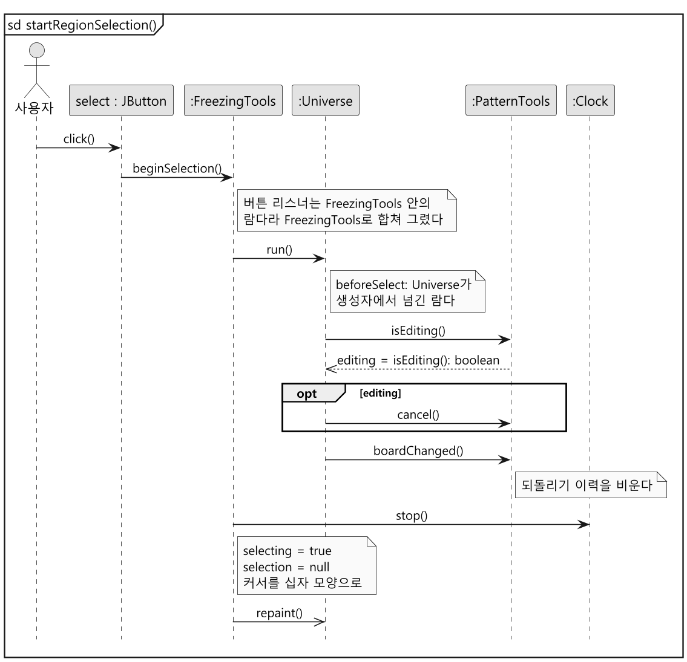

1. 영역 선택 버튼을 누르면 `FreezingTools.beginSelection()`이 불린다.
2. `Universe`가 넘긴 람다(`beforeSelect`)가 캡처·배치 편집 중이면 끝내고(`cancel()`), 배치 되돌리기 기록을 지운다(`boardChanged()`). 고정할 자리에 방금 놓은 템플릿을 나중에 되돌려 고정된 셀이 지워지는 일을 막는다.
3. 시계를 멈추고 `selecting`을 켠다. 이때부터 틱과 브러시가 동작하지 않는다.

#### 3.3.2 영역 고르기

시스템 연산 `selectRegion(start, end)`(CO3)의 상호작용이다. Install Freezing(E)의 5~6단계다. 사용자의 누르기, 끌기, 놓기가 마우스 이벤트 세 가지로 들어온다.

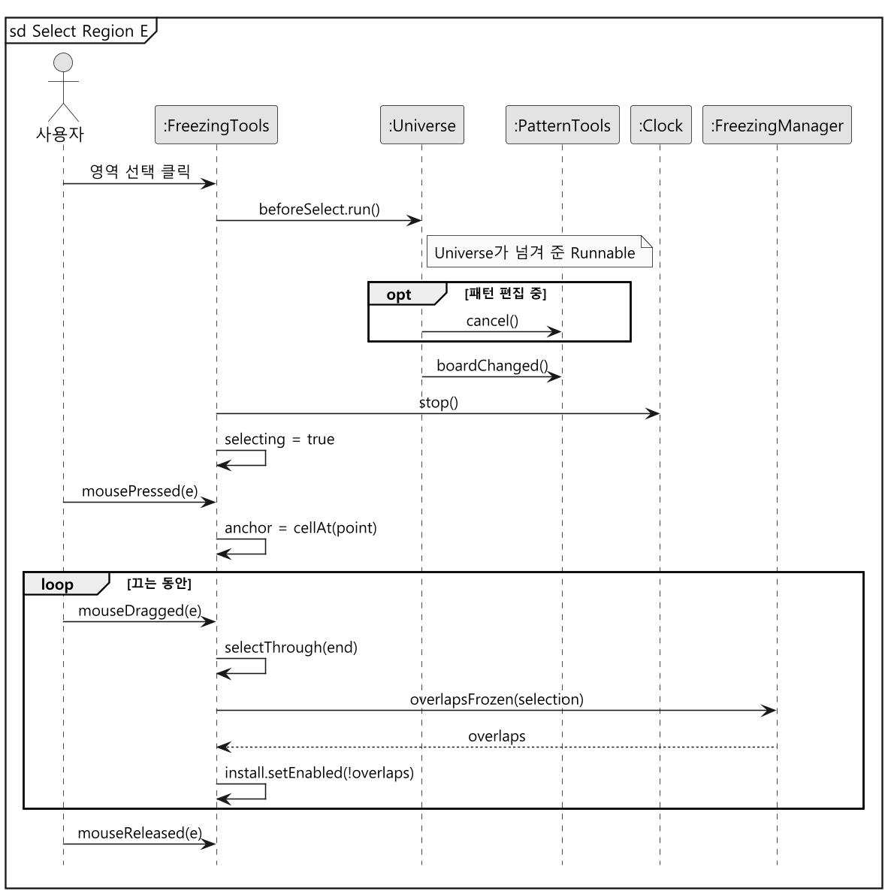

1. 누르면 그 칸을 한 모서리(`anchor`)로 정한다. 보드 밖이면 선택을 시작하지 않고, 오른쪽 버튼이면 선택을 끝낸다(CO4).
2. 끄는 동안과 놓을 때 `selectThrough()`가 지금 칸을 다른 모서리로 하는 사각형을 만든다. 보드 밖은 가장자리 칸에 맞춘다.
3. `selectThrough()`는 매번 `FreezingManager.overlapsFrozen()`으로 활성 영역과 겹치는지 물어 설치 버튼을 켜거나 끈다. 겹치면 선택이 빨간 점선으로 그려진다.

#### 3.3.3 설치

시스템 연산 `installFreezing()`(CO5)의 상호작용이다. Install Freezing(E)의 7~10단계다.

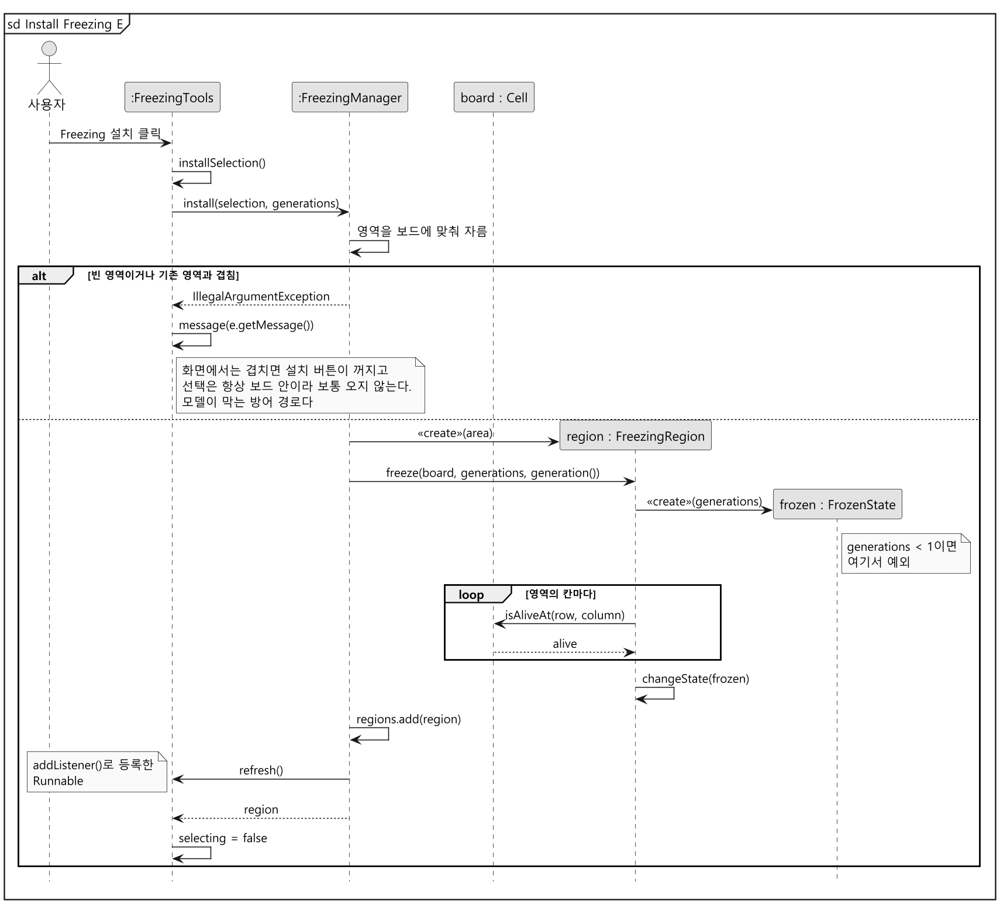

1. 설치 버튼을 누르면 `FreezingTools`가 지속 세대 입력 칸의 값을 읽어 `FreezingManager.install(selection, generations)`을 부른다.
2. `FreezingManager`가 선택을 보드에 맞추고 빈 영역과 겹침을 검사한다. 어기면 `IllegalArgumentException`을 던지고, `FreezingTools`가 그 문구를 상태줄에 보여 준다.
3. `FreezingRegion`을 만들고 `freeze(board, generations)`를 부른다.
4. `freeze()`가 먼저 `FrozenState`를 만든다. 지속 세대가 1 미만이면 여기서 예외가 나, 스냅샷을 찍기 전에 멈춘다. 이어서 영역 안 칸마다 `isAliveAt()`으로 생사를 읽어 스냅샷에 넣고, 상태를 `FrozenState`로 바꾼다(Normal → Frozen).
5. 목록에 넣고 `FreezingTools`에 알린 뒤, 선택 모드를 끝낸다.

#### 3.3.4 해제

시스템 연산 `releaseFreezing(region)`(CO6)과 `releaseAllFreezing()`(CO7)의 상호작용이다. Release Freezing(E)를 사용자가 직접 시작하는 경우다.

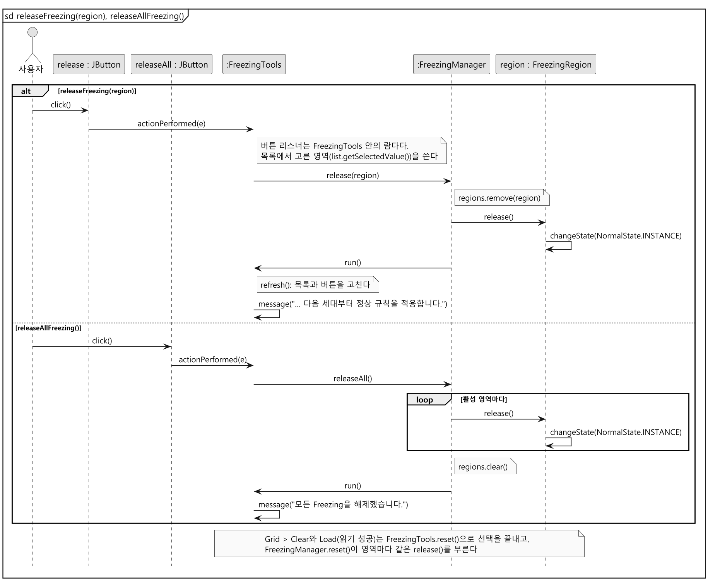

1. 선택한 Freezing 해제는 목록에서 고른 영역 하나를 목록에서 빼고 `release()`로 `NormalState`로 바꾼다.
2. 모든 Freezing 해제는 활성 영역마다 같은 `release()`를 부르고 목록을 비운다.
3. 둘 다 셀은 건드리지 않는다.

#### 3.3.5 판 비우기와 불러오기 뒤의 해제

시스템 연산 `clearBoard()`(CO8)와 `loadBoard(file)`(CO9) 가운데 Release Freezing(E)가 확장하는 부분이다.

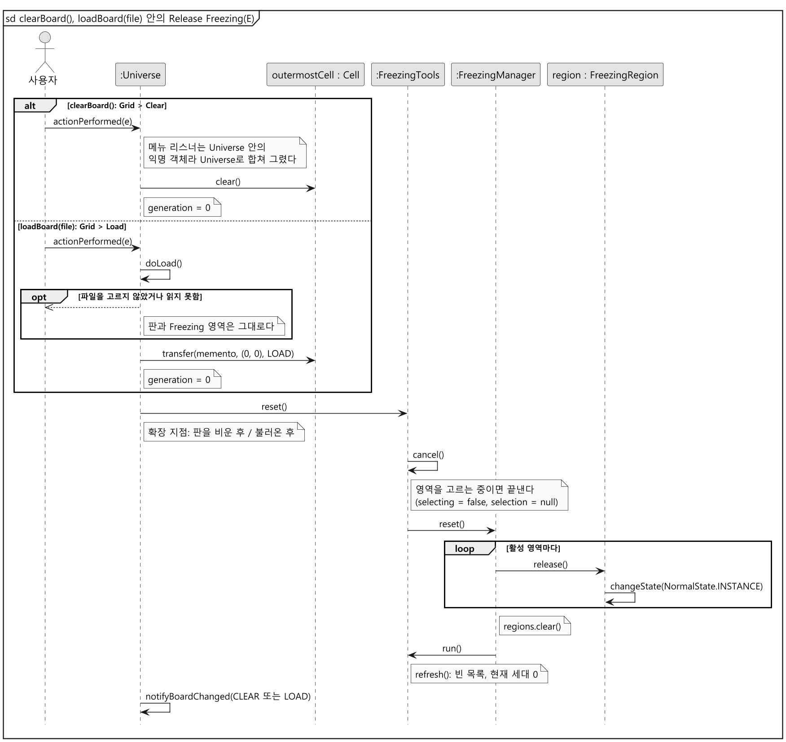

1. Grid > Clear는 판을 비우고 세대 수를 0으로 만든다. Grid > Load는 파일을 읽어 판을 바꾸고 세대 수를 0으로 만든다. 파일을 고르지 않았거나 읽지 못하면 여기서 끝나고 영역은 그대로다.
2. 확장 지점("판을 비운 후", "불러온 후")에서 `Universe`가 `FreezingTools.reset()`을 부른다.
3. `reset()`은 영역을 고르는 중이면 선택을 끝내고(`cancel()`), `FreezingManager.reset()`이 활성 영역마다 3.3.4절과 같은 `release()`를 부른 뒤 목록을 비운다.

#### 3.3.6 한 세대 진행과 영역 고정 유지

시스템 연산 `stepOneGeneration()`(CO10)과, 시계가 세대 간격마다 보내는 틱의 상호작용이다. Keep Region Frozen(E)는 이 그림의 `beforeTransition()`(확장 지점 "다음 세대 계산 후")과 `afterGeneration()`(확장 지점 "세대 확정 후") 부분이다.

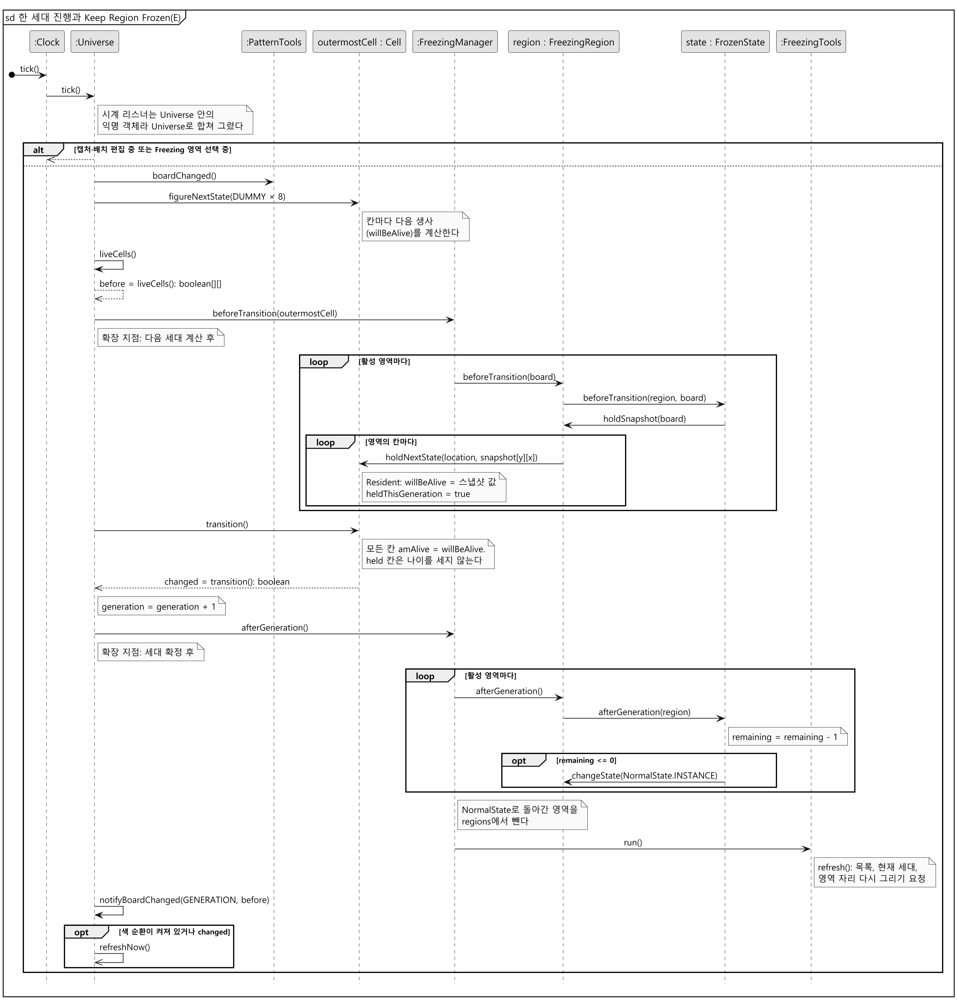

1. Go > Tick 메뉴나 Swing 타이머가 `Clock.tick()`을 부르고, 시계가 `Universe`의 틱 리스너를 부른다.
2. 캡처·배치 편집 중이거나 영역을 고르는 중이면 여기서 끝난다. 남은 세대도 줄지 않는다.
3. 배치 되돌리기 기록을 지우고, `figureNextState()`로 모든 칸의 다음 생사를 원본 규칙대로 계산한다. 이어서 확정 전의 판을 복사해 둔다(통계 기능).
4. `beforeTransition()`: 활성 영역마다 `FrozenState`가 `holdSnapshot()`을 불러, 영역 안 칸마다 `holdNextState()`로 다음 생사를 스냅샷 값으로 바꾼다.
5. `transition()`: 모든 칸이 다음 생사를 확정한다. 4에서 바꾼 칸은 나이를 세지 않는다. 세대 수를 1 늘린다.
6. `afterGeneration()`: 활성 영역마다 `FrozenState`가 남은 세대를 1 줄이고, 0이 되면 스스로 영역을 `NormalState`로 바꾼다(자동 해제). `FreezingManager`가 `NormalState`로 돌아간 영역을 목록에서 빼고 `FreezingTools`에 알린다.
7. `GENERATION` 이벤트로 통계와 사운드에 알린다. 고정된 칸은 3에서 복사한 판과 같으므로 출생·사망 목록에 들어가지 않는다.
8. 색 순환이 켜져 있거나 바뀐 셀이 있으면 `refreshNow()`로 다시 그리기를 요청한다.

원본과 다른 단계 중 이 기능이 더한 것은 2의 영역 선택 조건, 4, 6이다.

#### 3.3.7 편집과 배치 막기

시스템 연산 `editCell(row, column)`(CO11)과 `placeTemplate(origin)`(CO12) 가운데 Protect Frozen Region(E)가 확장하는 부분이다.

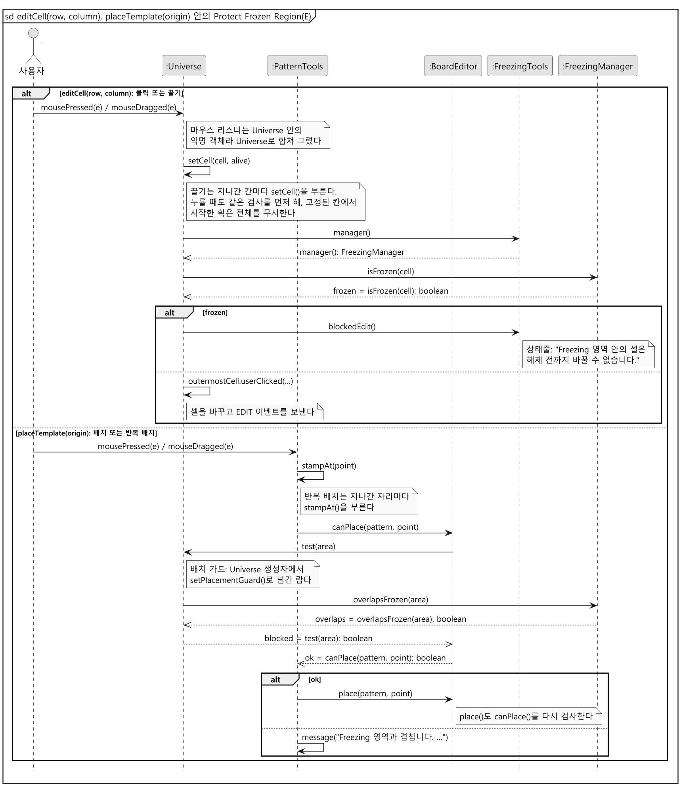

1. 셀을 클릭하거나 끌면 `Universe`의 마우스 리스너가 칸마다 `setCell()`을 부른다. 확장 지점 "셀 변경 전"에서 `FreezingManager.isFrozen(cell)`로 고정된 칸인지 묻고, 그렇다면 칸을 바꾸지 않고 `FreezingTools.blockedEdit()`로 안내한다. 누를 때도 같은 검사를 먼저 해, 고정된 칸에서 시작한 획은 전체를 무시한다.
2. 템플릿을 놓으면 `PatternTools.stampAt()`이 `BoardEditor.canPlace()`를 부르고, `canPlace()`가 배치 가드를 묻는다. 배치 가드는 `Universe` 생성자에서 `setPlacementGuard()`로 넘긴 람다이고, `FreezingManager.overlapsFrozen(area)`를 부른다(확장 지점 "배치 전").
3. 겹치면 그 자리에 배치하지 않고 상태줄에 알린다. `place()`도 안에서 `canPlace()`를 다시 검사하므로, 누른 채 끌어 반복 배치할 때도 자리마다 같은 검사를 받는다.

### 3.4 클래스 다이어그램

3.3절 시퀀스 다이어그램에 나온 클래스와 메시지를 모두 한 장에 모았다. 위에서 아래로 틱이 흘러가는 순서(`Life` → `Universe` → `FreezingTools` → `FreezingManager` → `FreezingRegion` → 상태 객체)로 놓았고, 아래쪽 왼편이 State 패턴, 오른편이 원본 Composite(`Cell` 계층)다. 멤버는 Freezing 기능과 관련된 것만 적었다.

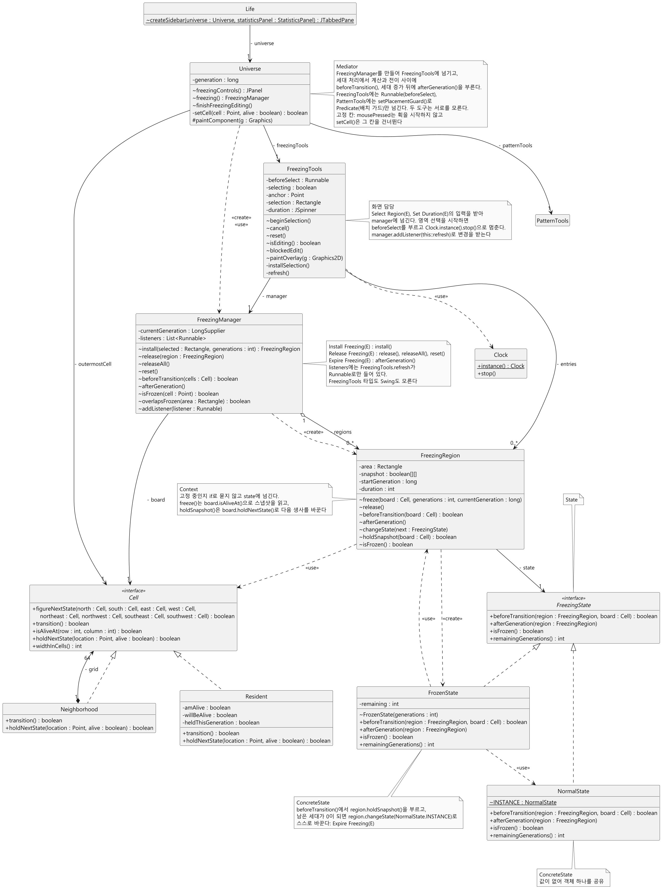

그림을 그린 규칙은 다음과 같다.

- 연관은 양쪽 끝에 다중성을 적고, 역할 이름은 가시성 기호 없이 코드의 필드 이름만 적었다.
- 다른 담당 기능의 클래스(`PatternTools`, `BoardEditor`)는 이름만 두었다.
- `FrozenState`와 `NormalState`는 `FreezingState`의 연산 네 개를 모두 구현한다. 같은 연산을 반복하지 않으려고 각 칸에는 고유 멤버만 적었다.
- 패턴의 역할은 스테레오타입이 아니라 노트에 적었다. «interface»는 인터페이스라는 뜻이라 그대로 두었다.
- `Cell`의 원본 연산 `figureNextState()`는 매개변수가 여덟 개라 그림에서 뺐다. 3.3.6절 시퀀스 다이어그램에 나온다.

| 클래스 | 원본에서의 역할 | 이 기능에서의 역할 |
| --- | --- | --- |
| `Life` | 창과 메뉴를 만든다 | 사이드바에 Freezing 탭을 세 번째로 더한다(`createSidebar()`) |
| `Universe` | Singleton, Mediator. 판을 그리고 시계 틱을 받는다 | `FreezingManager`를 만들어 `FreezingTools`에 넘기고, 틱마다 계산과 전이 사이에 `beforeTransition()`, 세대 증가 뒤에 `afterGeneration()`을 부른다. 브러시(`setCell()`)가 고정된 칸을 건너뛰게 한다 |
| `Clock` | 세대 간격마다 틱을 보낸다 | 영역 선택을 시작할 때 `FreezingTools`가 멈춘다(`stop()`) |
| `PatternTools`, `BoardEditor` | 캡처·템플릿 기능 | 영역 선택을 시작하면 편집을 끝내고, 배치 가드로 고정 영역과 겹치는 배치를 막는다 |
| `FreezingTools` | (없음) | Freezing 탭과 보드 위 표시. 지속 세대 입력(`duration`), 영역 선택(`selecting`, `selection`), 설치·해제 버튼, Observer의 구독자(`refresh()`) |
| `FreezingManager` | (없음) | 영역 목록과 세대 처리 단계. 설치·해제·초기화, 편집·배치를 막는 검사(`isFrozen()`, `overlapsFrozen()`). Observer의 Subject(`listeners`). Swing 코드가 없다 |
| `FreezingRegion` | (없음) | State 패턴의 Context. 영역과 스냅샷을 갖고, 고정 여부를 묻지 않고 `state`에 넘긴다 |
| `FreezingState` | (없음) | State |
| `FrozenState`, `NormalState` | (없음) | ConcreteState. `FrozenState`는 남은 세대(`remaining`)를 세다가 0이 되면 `NormalState`로 바꾼다. `NormalState`는 값이 없어 `INSTANCE` 하나를 함께 쓴다 |
| `Cell` (인터페이스) | Composite의 Component | `holdNextState()`를 더했다 |
| `Neighborhood` | Composite. 8×8 칸을 가진 블록 | `holdNextState()`를 하위 셀에 넘긴다 |
| `Resident` | Composite의 Leaf. 셀 하나 | 다음 생사를 스냅샷 값으로 바꾸고, 그 세대에는 나이를 세지 않는다(`heldThisGeneration`) |

관계는 코드의 필드와 호출을 따라 그렸다.

| 관계 | 종류 | 근거 |
| --- | --- | --- |
| `Life` "1" → "1" `Universe` (`universe`) | 연관 | `Life`의 필드 |
| `Universe` "1" → "1" `FreezingTools` (`freezingTools`), `PatternTools` (`patternTools`), `Cell` (`outermostCell`) | 연관 | `Universe`의 필드 |
| `Universe` ⇢ `FreezingManager` | 의존 («create», «use») | 생성자에서 만들어 `FreezingTools`에 넘기고, 틱과 브러시에서 `freezingTools.manager()`로 꺼내 부른다. 필드로 갖지는 않는다 |
| `PatternTools` "1" → "1" `BoardEditor` (`editor`) | 연관 | `PatternTools`의 필드 |
| `FreezingTools` "1" → "1" `FreezingManager` (`manager`) | 연관 | `FreezingTools`의 필드 |
| `FreezingTools` "1" → "0..*" `FreezingRegion` (`entries`) | 연관 | 화면 목록에 보여 주는 영역들 |
| `FreezingTools` ⇢ `Clock` | 의존 («use») | 영역 선택을 시작할 때 `Clock.instance().stop()` |
| `FreezingManager` "1" ◇→ "0..*" `FreezingRegion` (`regions`) | 공유 집합 | 영역 목록은 `FreezingManager`가 갖지만, `FreezingTools`의 `entries`도 같은 영역 객체를 참조한다. 영역은 매니저를 모르므로 한쪽 방향이다 |
| `FreezingManager` "0..1" → "1" `Cell` (`board`) | 연관 | 설치할 때 스냅샷을 찍을 판 |
| `FreezingRegion` "0..*" → "1" `FreezingState` (`state`) | 연관 | `NormalState.INSTANCE` 하나를 여러 영역이 함께 가리키므로 영역 쪽은 0..* |
| `FreezingRegion` ⇢ `FrozenState` | 의존 («create») | `freeze()`가 `new FrozenState(generations)`로 만든다 |
| `FreezingRegion` ⇢ `Cell` | 의존 («use») | `freeze()`와 `holdSnapshot()`이 매개변수로 받은 판을 쓴다 |
| `FrozenState` ⇢ `FreezingRegion` | 의존 («use») | 매개변수로 받은 영역의 `holdSnapshot()`, `changeState()`를 부른다 |
| `FrozenState`, `NormalState` ⇢▷ `FreezingState` | 실현 | `implements FreezingState` |
| `Neighborhood`, `Resident` ⇢▷ `Cell` | 실현 | `implements Cell` |
| `Neighborhood` "1" ◆ "64" `Cell` (`grid`) | 합성 | `Neighborhood`가 자기 칸 64개를 직접 만들고, 칸은 다른 블록과 함께 쓰이지 않는다 |

- `FreezingManager`는 `FreezingTools`를 모르고 `Runnable` 목록만 가진다. 화면 없이 테스트할 수 있다(NFR-3).
- `PatternTools`와 `FreezingTools`는 서로를 모른다. `PatternTools`는 배치 가드 `Predicate<Rectangle>` 하나, `FreezingTools`는 선택 시작 때 부를 `Runnable`(`beforeSelect`) 하나만 받는다. 둘을 아는 것은 `Universe`뿐이다.

### 3.5 상태 다이어그램

#### 3.5.1 영역 하나의 상태

`FreezingRegion.state`가 가리키는 상태 객체의 변화다. State 패턴으로 만든 부분이다.

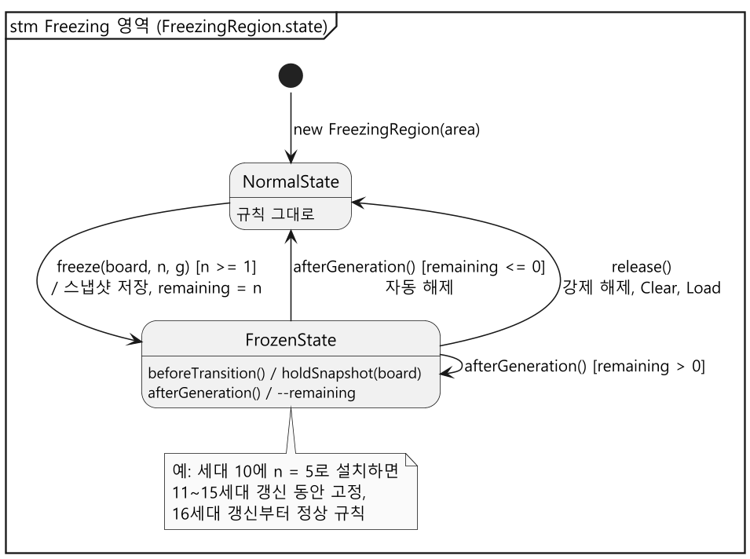

- 영역은 만들어질 때 `NormalState`이고, `freeze()`로 `FrozenState`가 된다. 지속 세대 n은 1 이상이어야 하고, 이때 스냅샷을 저장한다.
- `FrozenState`인 동안에는 세대마다 `beforeTransition()`에서 영역 안 칸의 다음 생사를 스냅샷으로 바꾼다(Keep Region Frozen(E)의 "다음 세대 계산 후").
- 전환 조건도 상태 객체 안에 있다. `FrozenState`가 남은 세대를 세다가 0이 되면 스스로 `region.changeState(NormalState.INSTANCE)`를 부른다(Keep Region Frozen(E)의 "세대 확정 후", 자동 해제). `release()`는 남은 세대와 상관없이 바로 바꾼다(Release Freezing(E): 하나 해제, 모두 해제, Clear, Load).
- `NormalState`로 돌아간 영역은 `FreezingManager`가 목록에서 빼므로 다시 쓰이지 않는다. 같은 자리를 다시 고정하면 새 영역이 생긴다.

#### 3.5.2 영역 선택 모드

`FreezingTools.selecting` 값의 변화다. 영역의 상태(3.5.1절)와는 다른 것이고, State 패턴으로 만들지 않았다.

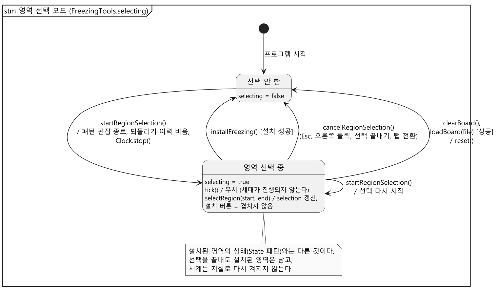

- `startRegionSelection()`, `selectRegion()`, `installFreezing()`, `cancelRegionSelection()`, `clearBoard()`, `loadBoard()`는 3.1절의 시스템 연산이다. `tick()`은 Go > Tick과 시계 양쪽에서 오는 틱이다.
- 영역 선택 중에는 틱을 무시해 세대가 진행되지 않고, 브러시도 동작하지 않는다.
- 선택을 끝내도 시계는 저절로 다시 켜지지 않는다. 캡처·배치 편집을 끝낼 때와 같은 규칙이다.

## 4. 설계 패턴과 설계 결정

Freezing을 만들며 내린 주요 설계 결정과, 적용한 설계 패턴과 설계 원칙이다. 결정마다 고른 것을 먼저 요약하고, 고민한 설계 문제와 대안의 비교는 각 절에 둔다. 원본 코드에 있던 설계 패턴과 이 기능이 어떻게 맞물리는지는 2.6절에 있다.

| 결정 | 고른 것 | 고른 이유 | 절 |
| --- | --- | --- | --- |
| 고정을 표현하는 구조 | State (`FreezingRegion`과 `NormalState`, `FrozenState`) | 고정은 시간이 지나면 스스로 끝나는 상태라, 전환을 상태 객체가 결정한다 | 4.1 |
| 고정을 적용하는 시점 | 계산과 확정 사이에서 다음 생사만 바꾼다 (Composite에 `holdNextState()`) | 생사 규칙 코드를 그대로 두고, 셀이 한 번도 잘못 바뀌지 않는다 | 4.2 |
| 모델이 화면에 알리는 방법 | `Runnable` 콜백 (Observer의 가벼운 형태) | 모델에 Swing 코드가 없어 화면 없이 테스트한다 | 4.3 |
| 기능 사이의 규칙을 두는 곳 | `Universe` (Mediator) | 기능끼리 서로를 모르게 한다 | 4.4 |
| 세대 번호와 고정된 셀의 나이 | `Universe`의 세대 번호를 읽고, 고정된 셀은 나이를 멈춘다 | 통계·색 순환과 어긋나지 않는다 | 4.5 |

적용한 설계 원칙(SOLID)은 4.6절에, 알려진 한계와 남은 일은 4.7절에 있다.

### 4.1 고정을 표현하는 구조 (State 패턴)

**설계 문제**

영역은 "고정 중"과 "고정 아님" 두 가지로 동작이 다르다. 고정 중이면 세대마다 스냅샷을 적용하고 남은 세대를 세며, 고정 아님이면 아무것도 하지 않는다. 그리고 고정은 정해진 세대가 지나면 아무도 건드리지 않아도 끝나야 한다. 이 두 동작과 전환을 어디에 둘지 정해야 했다.

**비교한 방법**

| 선택지 | 내용 | 판단 |
| --- | --- | --- |
| State | 영역(Context)이 현재 상태 객체에 일을 넘기고, 상태 객체가 다음 상태로의 전환을 결정한다 | 선택 |
| 플래그와 `if` | 영역이 `boolean frozen`과 남은 세대를 가지고 메서드마다 분기한다 | 차선책 |
| Strategy | 규칙 객체(고정 규칙, 일반 규칙)를 바꿔 끼운다 | 제외 |

**선택한 구조: State**

| 역할 | 클래스 | 이 코드에서 하는 일 |
| --- | --- | --- |
| Context | `FreezingRegion` | 영역, 스냅샷과 현재 상태를 가진다. `beforeTransition()`과 `afterGeneration()`을 현재 상태에 그대로 넘긴다 |
| State | `FreezingState` | 세대 처리의 두 시점에 할 일, 고정 중인지, 남은 세대를 정한다 |
| ConcreteState | `NormalState`, `FrozenState` | `NormalState`는 아무것도 하지 않는다. `FrozenState`는 스냅샷을 적용하고 남은 세대를 세다가 0이 되면 Context를 `NormalState`로 바꾼다 |

State를 고른 이유는 다음과 같다.

- **상태별 동작이 한 클래스에 모인다.** 고정 중의 동작(스냅샷 적용, 카운트다운)은 `FrozenState`에만 있다. `FreezingRegion`에는 "고정 중인가"를 묻는 분기가 없다.
- **전환 조건이 상태 안에 있다.** 풀릴 시점을 아는 것은 남은 세대를 세는 쪽이다. 그 카운트를 상태 객체가 가지므로 전환도 상태 객체가 결정한다. `FrozenState.afterGeneration()`이 `--remaining <= 0`이면 `region.changeState(NormalState.INSTANCE)`를 부른다.
- **상태가 늘어도 영역 코드를 고치지 않는다.** 예를 들어 "고정 전에 몇 세대 기다리기" 같은 상태는 새 ConcreteState 하나로 더한다(OCP).

**차선책(플래그와 `if`)과의 대조**

- 플래그는 타입이 늘지 않고 상태가 둘뿐인 지금은 코드도 가장 짧다.
- 대신 고정 여부를 묻는 분기가 `beforeTransition`, `afterGeneration`, `isFrozen`, `remainingGenerations` 네 곳에 반복되고, 상태가 늘면 네 곳을 모두 고쳐야 한다. 남은 세대가 고정 아님일 때도 필드로 남아, 0인지 의미 없는 값인지 따로 정해야 한다.

**Strategy를 제외한 이유**

Strategy와 State는 구조가 비슷하지만 전환의 주체가 다르다. 색 순환의 Strategy는 사용자가 메뉴에서 규칙을 갈아 끼우고, 규칙 객체는 스스로 바뀌지 않는다. Freezing의 고정은 사용자가 골라 끼우는 규칙의 종류가 아니라, 시간이 지나면 스스로 끝나는 상태다. Strategy로 만들면 "언제 일반 규칙으로 돌아가는가"를 규칙 바깥(`FreezingManager`나 `Universe`)에서 세고 바꿔 줘야 한다.

**상태 객체의 단위와 공유**

- 상태 객체는 셀마다가 아니라 영역마다 하나다. 셀마다 두면 4,096개 셀에 필드가 늘고 `Resident` 수정이 커진다. 영역 단위라서 영역별로 풀고 남은 세대를 보여 주기 쉽다.
- `NormalState`는 필드가 없어 영역마다 만들 이유가 없으므로 `NormalState.INSTANCE` 하나를 함께 쓴다(이 클래스 범위의 Singleton). `FrozenState`는 남은 세대를 가지므로 영역마다 새로 만든다.

**비용**

- 타입이 셋(`FreezingState`, `NormalState`, `FrozenState`) 늘었다. 상태가 둘뿐인 지금은 플래그보다 코드가 많다.

### 4.2 고정을 적용하는 시점 (계산과 확정 사이)

**설계 문제**

고정된 칸이 죽거나 태어나지 않게 하되, 바깥 칸은 고정된 칸을 평소처럼 이웃으로 세어야 한다. 원본의 세대 처리는 모든 칸이 다음 생사를 계산(`figureNextState()`)한 뒤 한꺼번에 확정(`transition()`)하는 두 단계다. 이 흐름의 어디에서 고정을 적용할지 정해야 했다.

**비교한 방법**

| 선택지 | 장점 | 단점 | 판단 |
| --- | --- | --- | --- |
| 계산과 확정 사이에서 다음 생사만 바꾼다 (Composite에 `holdNextState()` 추가) | 생사 규칙 코드 그대로. 셀이 한 번도 잘못 바뀌지 않아 이벤트와 나이가 저절로 맞는다 | `Cell`에 메서드가 하나 늘어 구현 세 곳(`Neighborhood`, `Resident`, `DUMMY`)을 고친다 | 선택 |
| 고정된 칸은 계산을 건너뛴다 (`Resident.figureNextState()` 안에서 확인) | 고정된 칸의 계산을 아낀다 | `Resident`는 자기 좌표를 몰라 영역을 판단할 수 없다. 규칙 코드에 Freezing 분기가 섞인다 | 제외 |
| 확정 뒤에 스냅샷으로 되돌린다 | `Cell`을 고치지 않는다 | 셀이 한 번 실제로 바뀌었다 돌아간다. 통계·사운드가 받는 출생·사망 목록과 나이가 어긋난다 | 제외 |
| `BoardChangeListener` 구독자로 만들어 이벤트를 받고 되돌린다 | 통계·사운드와 같은 방식 | 구독자는 보드를 바꾸면 안 된다는 계약을 어긴다. 통계·사운드가 되돌리기 전 상태를 받는다 | 제외 |

**선택과 이유**

`figureNextState()`가 끝난 시점에는 모든 칸이 다음 생사를 정해 두었지만 아직 바뀌지 않았다. 이때 고정된 칸의 다음 생사만 스냅샷 값으로 바꾸면 다음이 모두 지켜진다.

- 모든 칸이 같은 이전 세대를 기준으로 계산된다는 Life의 전제가 그대로다. 바깥 칸은 고정된 칸의 지금 생사(`amAlive`)를 이웃으로 읽는다.
- 생사 규칙 코드는 한 글자도 바뀌지 않았다(NFR-1).
- 고정된 칸은 확정 전후가 같으므로, 이벤트를 만드는 코드를 고치지 않아도 출생·사망 목록에서 빠진다(NFR-2).

**계산을 건너뛰지 않은 이유**

고정된 칸만 계산을 건너뛰는 쪽은 계산을 아끼는 것처럼 보이지만 다음 문제가 있다.

- **셀이 자기 위치를 모른다.** 계산은 `Neighborhood`가 하위 셀에 재귀로 내려보내고, `Resident`는 이웃 여덟 칸만 받는다. 건너뛰려면 좌표와 영역 정보를 계산 경로 전체에 넘기도록 `Cell`의 계산 메서드를 바꿔야 한다.
- **건너뛰어도 덮어쓰기는 필요하다.** 건너뛴 칸의 `willBeAlive`에는 지난 세대의 값이 남아 있어, 확정 전에 결국 "다음 생사 = 지금 생사"로 맞춰야 한다. 지금의 `holdNextState()`가 하는 일과 같다.
- **블록 최적화가 어긋날 수 있다.** `Neighborhood`는 계산하면서 블록에 변화가 있는지(`amActive`)를 함께 정하고, 변화가 없는 블록은 다음 세대에 계산을 생략한다. 블록 안 일부 칸만 계산을 건너뛰면 이 판단이 실제와 달라질 수 있다.

**비용**

- `Cell` 인터페이스에 메서드가 하나 늘었다.
- `Resident`에 "이번 세대에 고정되었는가"(`heldThisGeneration`) 필드가 하나 늘었다. 나이를 멈추는 데 쓴다(4.5절).

### 4.3 모델이 화면에 알리는 방법 (Observer)

**설계 문제**

영역이 설치·해제되거나 세대가 지나면 Freezing 탭의 목록, 버튼, 현재 세대, 보드 위 배지가 바뀌어야 한다. 그런데 `FreezingManager`가 화면을 직접 고치면 모델이 Swing에 묶여 화면 없이 테스트할 수 없다.

**비교한 방법**

| 선택지 | 장점 | 단점 | 판단 |
| --- | --- | --- | --- |
| `Runnable` 콜백 (Observer의 가벼운 형태) | JDK 타입만 쓴다. 모델에 Swing 코드가 없다 | 무엇이 바뀌었는지 알려 주지 않아 화면이 목록 전체를 다시 읽는다 | 선택 |
| `FreezingManager`가 `FreezingTools`를 직접 호출 | 가장 간단하다 | 모델이 Swing 클래스에 의존한다 | 제외 |
| 기존 `BoardChangeListener` 재사용 | 통로가 하나다 | 그 이벤트는 "보드의 셀이 바뀌었다"는 뜻인데 설치·해제는 셀을 바꾸지 않는다. 통계가 필요 없는 재집계를 하고, 통계·사운드가 새 종류를 걸러 내도록 다른 사람의 코드를 고쳐야 한다(NFR-4) | 제외 |
| 전용 리스너 인터페이스 | 이름으로 뜻이 드러난다 | 구독자에게 넘길 데이터가 없다. 구독자는 `manager.regions()`를 다시 읽으면 된다 | 제외 |

**선택과 이유**

`FreezingManager`(Subject)는 `Runnable` 목록만 가지고, 영역 목록이 바뀔 때마다 모두 부른다. `FreezingTools`(구독자)는 `addListener(this::refresh)`로 등록해 목록과 버튼을 다시 그린다. 통계가 계산(`Statistics`)과 화면(`StatisticsPanel`)을 `Consumer` 콜백으로 나눈 것과 같은 생각이다. 그래서 `FreezingModelTest`는 `Universe`도 Swing도 없이 돈다(NFR-3).

`refresh()`는 영역이 있던 자리와 있는 자리만 다시 그리게 요청한다. 영역이 없으면 아무것도 요청하지 않아, 색 순환에서 고친 화면 갱신 지연([color-gen 문서](../color-gen/))을 되살리지 않는다(NFR-5).

### 4.4 기능 사이의 규칙을 두는 곳 (Mediator)

**설계 문제**

고정된 영역에는 템플릿을 놓을 수 없고, 고정된 칸은 그릴 수 없고, 영역 선택을 시작하면 캡처·배치 편집이 끝나야 한다. 이 규칙은 Freezing과 다른 기능 사이에 걸쳐 있어 어느 쪽에 둘지 정해야 했다.

**비교한 방법**

| 선택지 | 장점 | 단점 | 판단 |
| --- | --- | --- | --- |
| `Universe`가 연결 (Mediator) | 원본에서 이미 `Universe`가 Swing 이벤트와 Life 클래스 사이의 중재자다. `FreezingTools`는 `Runnable` 하나, `PatternTools`는 `Predicate` 하나만 안다 | 연결 규칙이 `Universe` 생성자에 모여 길어진다 | 선택 |
| `FreezingTools`와 `PatternTools`가 서로를 참조 | 연결 코드가 짧다 | 한쪽을 고치면 다른 쪽도 고쳐야 한다. 한 기능만 빼고 컴파일할 수 없다 | 제외 |
| Chain of Responsibility (편집 요청을 여러 검사기가 차례로 확인) | 금지 규칙을 가진 기능이 늘어도 검사기만 더한다 | 검사기가 지금은 Freezing 하나뿐이라 구조만 늘어난다 | 보류 |

**선택과 이유**

| 규칙 | 연결하는 곳 |
| --- | --- |
| 고정 영역에 템플릿 배치 금지 | `Universe` 생성자: `setPlacementGuard(...)` |
| 영역 선택 시작 → 캡처·배치 편집 종료, 되돌리기 기록 지움 | `Universe` 생성자: `FreezingTools`에 넘기는 `Runnable` |
| 고정된 칸 그리기 금지 | `Universe`의 브러시 |
| Clear, Load → Freezing 초기화 | `Universe`의 메뉴 처리 |
| Esc → 켜져 있는 편집 모드 종료 | `Universe`의 키 바인딩 |
| 탭 전환 → 숨겨진 영역 선택 종료 | `Life.createSidebar()` |

규칙이 모두 `Universe`와 `Life`에 있어, 통계나 사운드처럼 한 기능을 빼도 나머지는 그대로 컴파일된다. 배치 가드는 캡처 담당자가 이 기능과 맞추려고 `BoardEditor`에 열어 둔 연결 지점이라 캡처 기능 코드를 고치지 않았다(NFR-4). Chain of Responsibility는 금지 규칙을 가진 기능이 더 생기면 다시 본다.

### 4.5 세대 번호와 고정된 셀의 나이

**세대 번호를 누가 가질까**

| 선택지 | 장점 | 단점 | 판단 |
| --- | --- | --- | --- |
| `Universe`의 값을 읽는다 | 값이 한 곳에만 있다 | 생성자에 `LongSupplier` 하나 추가 | 선택 |
| `FreezingManager`와 `Universe`가 각자 센다 | 병합 전 코드 그대로 | 초기화 시점이 한 곳이라도 어긋나면 통계 탭과 Freezing 탭의 숫자가 달라진다 | 제외 |
| `BoardChangeEvent`의 세대를 받아 기억 | 통계와 같은 방식 | 구독 등록이 필요하고, 이벤트 전에 불리는 `afterGeneration()`에서는 한 박자 늦은 값이다 | 제외 |

병합 전 `FreezingManager`는 세대 카운터를 따로 가졌다. 병합 후 `Universe`에도 카운터가 생겨 둘이 어긋날 수 있었으므로, `FreezingManager`의 카운터를 없애고 `Universe`의 값을 읽게 했다(`new FreezingManager(outermostCell, () -> generation)`). 통계 탭의 세대, Freezing 탭의 현재 세대와 설치할 때 상태줄에 보이는 고정 세대 범위(g+1 ~ g+n)가 항상 같은 숫자에서 나온다.

**고정된 셀의 나이**

| 선택지 | 결과 | 판단 |
| --- | --- | --- |
| 고정 중에는 멈추고 풀리면 이어서 센다 | 고정 중 색이 그대로이고, 풀린 뒤 자연스럽게 이어진다 | 선택 |
| 나이를 계속 센다 | 고정 중에도 색이 바뀐다. "설치한 순간 그대로"와 다르다 | 제외 |
| 풀릴 때 나이를 0으로 | 풀린 순간 색이 처음 색으로 튄다 | 제외 |

`holdNextState()`가 불린 칸은 바로 다음 `transition()` 한 번 동안 나이를 세지 않는다. 색 규칙(`CellColorPolicy`)은 건드리지 않았다. 나이가 그대로이므로 어떤 규칙을 쓰든 색이 그대로다. 예를 들어 나이 0인 블록 두 개 중 하나를 10세대 고정하면, 10세대 뒤 고정된 블록은 빨강, 다른 블록은 파랑이다.

### 4.6 적용한 설계 원칙 (SOLID)

| 원칙 | 적용한 곳 | 적용한 이유 |
| --- | --- | --- |
| Single Responsibility Principle (SRP) | 고정 규칙은 `FreezingManager`·`FreezingRegion`·상태 클래스가, 탭 화면과 보드 위 표시는 `FreezingTools`가 맡는다. 생사 계산은 원본 `Resident`에 그대로 둔다 | 화면을 고쳐도 고정 규칙을, 고정 규칙을 고쳐도 생사 계산을 건드리지 않게 하려고 |
| Open-Closed Principle (OCP) | 상태가 늘면 `FreezingState` 구현 하나를 더한다. `FreezingRegion`과 `FreezingManager`는 고치지 않는다 | 영역 코드에 상태 분기를 쌓지 않으려고 |
| Dependency Inversion Principle (DIP) | `FreezingRegion`은 구체 상태가 아니라 `FreezingState`로 일을 넘긴다. `FreezingManager`는 화면 대신 `Runnable`, 세대 번호는 `LongSupplier`에 의존한다 | 모델을 화면과 `Universe` 없이 테스트하려고(NFR-3) |
| Interface Segregation Principle (ISP) | `PatternTools`에는 `Predicate<Rectangle>` 하나, `FreezingTools`에는 `Runnable` 하나만 넘긴다 | 두 도구가 상대의 다른 메서드에 의존하지 않게 하려고 |

- DIP에는 예외가 있다. `FreezingRegion`은 처음 상태로 `NormalState.INSTANCE`를, `freeze()`에서 `FrozenState`를 직접 만든다. 상태 전환이 이 두 곳에서만 일어나므로 팩토리를 따로 두지 않았다.

### 4.7 알려진 한계와 남은 일

**알려진 한계**

- **Freezing 정보는 저장하지 않는다.** Grid > Store로 저장하고 다시 읽으면 영역은 없다(NFR-6).
- **영역은 사각형만 된다.** 템플릿 배치 가드가 사각형 단위라 그대로 맞지만, 다른 모양은 고정할 수 없다.
- **겹치는 영역은 만들 수 없다.** 겹치면 어느 스냅샷이 우선인지, 하나가 먼저 풀릴 때 어떻게 되는지 정해야 한다. 요구사항에 없어서 막았다.
- **실제 스피커의 소리는 확인하지 못했다.** 어떤 음이 예약되는지는 실제 `SoundEffects`로 테스트했다(5.3절).

**남은 일**

- 금지 규칙을 가진 기능이 더 생기면 편집 금지를 Chain of Responsibility로 바꾸는 것을 다시 본다(4.4절).
- 캡처·통계·색 순환 문서에 "Freezing은 아직 병합 전"이라고 적힌 문장은 각 문서 담당자가 갱신한다.

**설계 과정**

| 순서 | 한 일 |
| --- | --- |
| 1 | State 구조(`FreezingState` 등 클래스 여섯 개)와 `Cell.holdNextState()`, 별도 Freezing 탭. 캡처 기능의 초기 구현 위에서 작업 |
| 2 | 기본 오류 수정·JUnit·Gradle 반영 |
| 3 | 다른 기능과 병합. 색·캡처·드래그·사운드·통계와 통합하면서 4.5절의 두 결정을 내리고 스냅샷 읽기를 `isAliveAt()`으로 바꿈 |
| 4 | 모델 테스트와 통합 테스트를 JUnit으로 추가 |
| 5 | 문서 정리, 실제 `SoundEffects`와 함께 돌리는 테스트 |

4.1절과 4.2절의 결정은 처음 구현부터 지금까지 바뀌지 않았다. 4.5절의 결정은 다른 기능과 병합하는 과정에서 생긴 충돌(세대 번호가 두 곳, 고정 중 색 변화)을 풀면서 내렸다.

## 5. 테스트

### 5.1 실행 결과

전체 테스트는 다음 명령으로 돌린다.

```
./gradlew test
```

지금 코드 기준으로 전체 375개 테스트가 모두 통과한다. 이 중 Freezing 기능의 테스트는 90개다. 결과 화면은 [evidence/](evidence/README.md)에 있다.

| 테스트 클래스 | 메서드 수 | 실행 수 | 대상 |
| --- | --- | --- | --- |
| `FreezingModelTest` | 28 | 50 | 모델만 (`Universe`와 Swing 없이, 자체 보드에서) |
| `FreezingIntegrationTest` | 33 | 37 | 실제 `Universe`에서 다른 기능과 함께 |
| `FreezingSoundIntegrationTest` | 3 | 3 | 실제 `SoundEffects`와 함께 |
| 합계 | 64 | 90 | |

실행 수는 입력값을 바꿔 여러 번 돌리는 테스트를 입력값마다 따로 센 수다.

Freezing 외 다른 기능의 테스트 285개도 모두 통과한다. 기존 테스트 코드에서 고친 것은 `MergedFeaturesIntegrationTest`의 탭 개수 단언 한 곳(2 → 3, Freezing 탭 확인 한 줄 추가)뿐이다.

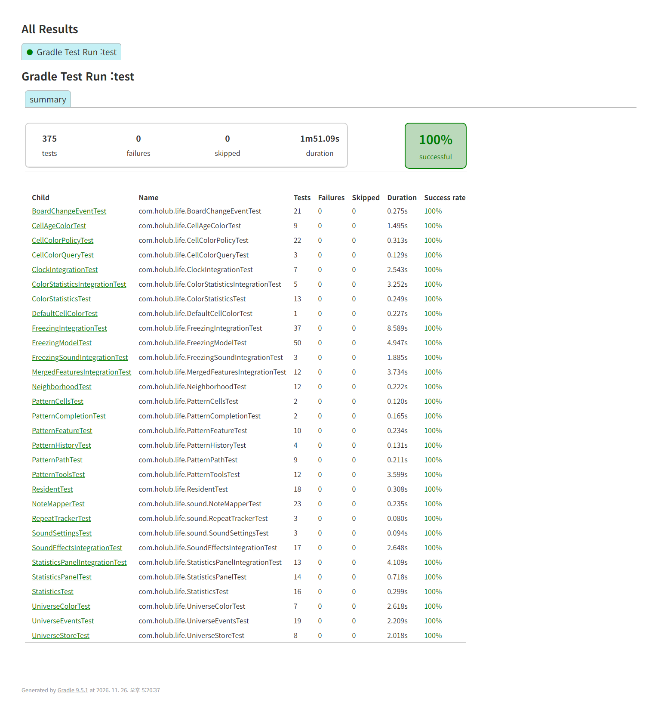

### 5.2 JUnit 테스트를 만드는 방법

- **모델은 자체 보드에서 돌린다.** `FreezingModelTest`는 `Neighborhood(8, Neighborhood(8, Resident))`로 보드를 만들고, `Universe`의 틱 리스너와 같은 순서(계산 → `beforeTransition()` → 확정 → 세대 증가 → `afterGeneration()`)로 세대를 넘기는 도우미를 쓴다. 그래서 Swing 없이 고정 규칙만 확인한다(NFR-3).
- **나이는 간격 1인 색 규칙으로 읽는다.** `CyclingColorPolicy(1, 색 7개)`를 쓰면 살아 있는 셀의 색으로 나이를 알 수 있어, 게임 코드에 나이를 읽는 메서드를 넣지 않았다.
- **통합 테스트는 실제 `Universe`를 쓴다.** Mockito가 `MenuSite`를 대신해 `Universe`가 등록한 메뉴 콜백을 받아 두고, 테스트가 그 콜백(Go > Tick, Grid > Clear 등)을 직접 부른다. 시계는 실제 `Clock`이다. Load와 Store의 파일 선택 창은 Mockito로 `Files`를 대신한다. Swing 조작은 이벤트 스레드에서 한다.
- **독립 계산과 비교한다.** 무작위 비교 테스트는 고정 규칙(1.3절)을 따로 짠 계산과, 매 세대 모든 칸의 생사와 나이를 비교한다.
- **테스트 전용 메서드를 `src/`에 넣지 않았다.** 테스트는 Freezing 관리자를 `LifeTestSupport.freezing()`으로 얻는다. 이 도우미는 게임 코드가 쓰는 `Universe`의 `freezingTools` 필드와 `FreezingTools.manager()`를 거친다. 영역의 상태 객체도 게임 코드가 쓰는 `state` 필드를 리플렉션으로 읽는다. 처음 구현에 있던 테스트 전용 접근자(`Universe.freezing()`, `FreezingRegion.startGeneration()`·`duration()`·`state()`)는 점검에서 찾아 지웠다.

### 5.3 테스트 케이스와 요구사항

Freezing 테스트 메서드 64개(실행 수 90개)를 묶음별로 정리했다.

**`FreezingModelTest`: 모델만**

| 확인하려는 것 | 테스트 | 요구사항 |
| --- | --- | --- |
| 고정 규칙 | `a_frozenLiveCellDoesNotDieWhileAnUnfrozenLoneCellDoes`, `b_frozenDeadCellIsNotBornEvenWithThreeNeighbors`, `c_cellsOutsideFollowB3S23`, `d_frozenLiveCellsCountAsNeighborsOfOutsideCells`, `d_outsideCellsDoNotChangeFrozenCells` | FR-4 |
| 세대 경계 | `e_installAtGenerationTenForFiveIsFrozenThroughFifteenAndFreeFromSixteen` | FR-3, FR-5 |
| 해제와 초기화 | `f_forcedReleaseReleaseAllAndResetLeaveNothingBehind` | FR-6, FR-9 |
| State 패턴 | `stateObjectsDriveTheRegion`, `normalStateIsStatelessAndShared` | FR-5 |
| 설치 검사 | `durationBelowOneIsRejectedAndLeavesNoRegion`(4가지), `emptyNullAndOutsideAreasAreRejected`, `areaIsClampedToTheBoard`, `overlapIsRejectedButTouchingAreasAreAllowed`, `anExpiredOrReleasedAreaCanBeFrozenAgain` | FR-2, FR-3, FR-7 |
| 여러 영역과 알림 | `regionsWithDifferentDurationsExpireIndependently`, `theListOfRegionsCannotBeChangedFromOutside`, `listenersHearInstallReleaseGenerationAndReset` | FR-7, NFR-3 |
| Composite | `holdNextStateReplacesOnlyThePendingStateUntilTransition`, `theNullObjectCellIgnoresHolds`, `singleCellRegionsWorkAtCornersAndBlockBorders`(9가지), `aRegionAcrossFourNeighborhoodBlocksIsHeldAsOne`, `theWholeBoardCanBeFrozen` | FR-4 |
| 패턴 | `aStillLifeInsideAndOutsideStaysTheSame`, `anEmptyRegionOnAnEmptyBoardDoesNothing`, `aGliderIsStoppedByAFrozenEmptyWallAndStaysStoppedAfterRelease` | FR-4, FR-5 |
| 나이 (색으로 읽음) | `aFrozenCellKeepsItsAgeAndColorAndResumesAfterRelease`, `aFrozenDeadCellHasNoColorAndABirthAfterReleaseStartsAtAgeZero` | NFR-2 |
| 무작위 비교 | `randomBoardsWithRandomInstallsAndReleasesMatchAnIndependentReference`(12가지): 무작위 보드 12종 × 250세대, 설치·해제를 섞어 모든 칸의 생사와 나이 비교 | FR-4, FR-5, FR-6 |

**`FreezingIntegrationTest`: 실제 `Universe`에서**

| 확인하려는 것 | 테스트 | 요구사항 |
| --- | --- | --- |
| 시계와 세대 번호 | `freezingStatisticsAndEventsShareOneGenerationCounter`, `singleStepMenuAdvancesExactlyOneGenerationAndOneCountdown`, `theRunningClockCountsDownAndReleasesOnTime` | FR-5, NFR-2 |
| 영역 선택 | `areaSelectionStopsTheClockAndBlocksGenerationsUntilItEnds`, `rightClickEndsAreaSelection`, `reverseDragOverlapAndOffBoardSelectionsBehaveAsDocumented`, `theDurationSpinnerSetsHowLongTheRegionLasts` | FR-1, FR-2, FR-7 |
| 통계·사운드 | `frozenCellsNeverAppearInBirthsOrDeathsAndCountAsLiving`, `aFullyFrozenBoardStillPublishesGenerationsButNoSoundDeltas`, `installAndReleaseDoNotPublishBoardEventsBecauseNoCellChanges` | NFR-2 |
| 색 순환 | `frozenCellsKeepTheirColorWhileOthersCycleAndResumeAfterRelease`, `switchingTheColorRuleDuringAFreezingKeepsTheRegionAndItsCountdown` | NFR-2 |
| 클릭과 드래그 | `clickingAFrozenCellChangesNothingAndPublishesNothing`, `draggingThroughAFrozenAreaSkipsItsCellsBothWhenDrawingAndErasing`, `aStrokeThatStartsOnAFrozenCellIsIgnoredEntirely`, `cellsBecomeEditableAgainRightAfterRelease` | FR-8 |
| 템플릿 | `aTemplateIsNotPlacedOnAFrozenAreaButIsPlacedNextToIt`, `aHeldTemplateStrokeSkipsEveryStampThatWouldTouchTheFrozenArea`, `aTemplateWhoseEmptyMarginAloneOverlapsIsRejectedWhole`, `startingAnAreaSelectionEndsPatternEditingAndClearsItsUndoHistory`, `startingAnAreaSelectionDuringAHeldStrokeEndsTheStroke`, `capturingAFrozenAreaOnlyReadsIt` | FR-1, FR-8 |
| 사이드바 | `theSidebarHasPatternStatisticsAndFreezingTabsAtBoardHeight`, `leavingTheFreezingTabEndsSelectionButKeepsInstalledRegions`, `openingTheFreezingTabEndsTemplatePlacementSoTheBrushWorksAgain`, `switchingTabsWithARegionInstalledDoesNotStopTheClock` | FR-1 |
| Clear, Load, Store | `clearRemovesEveryRegionResetsTheGenerationAndPublishesOneClear`, `loadRemovesEveryRegionAndTheLoadedBoardEvolvesNormally`, `aCancelledLoadKeepsTheRegions`, `storeWritesTheCellsAndLeavesTheRegionsAlone` | FR-9, NFR-6 |
| 그리기 | `theRegionIsPaintedOverTheBoardAndDisappearsWhenReleased`, `freezingRepaintsOnlyItsOwnAreaAndNothingWhenThereIsNoRegion` | FR-10, NFR-5 |
| 무작위 비교 | `randomRunsWithFreezingBrushAndColorsMatchAnIndependentReference`(5가지): 무작위 보드 5종 × 120세대, 색 순환을 켜고 설치·해제·클릭을 섞어 이벤트와 통계 값을 독립 계산과 비교 | FR-4, FR-8, NFR-2 |

**`FreezingSoundIntegrationTest`: 실제 `SoundEffects`와 함께**

| 확인하려는 것 | 테스트 | 요구사항 |
| --- | --- | --- |
| 고정된 블링커는 소리가 없고 풀린 첫 세대에 다시 난다 | `aFrozenBlinkerIsSilentAndIsHeardAgainOnItsFirstFreeGeneration` | NFR-2 |
| 자유 셀의 사망만 소리가 나고, 고정된 셀은 풀려서 죽을 때 난다 | `onlyTheFreeCellIsHeardDyingAndTheFrozenCellIsHeardWhenItIsReleased` | NFR-2 |
| 재생선이 고정된 살아 있는 셀을 계속 연주한다 | `thePlaybackLineKeepsPlayingAFrozenLiveCellThatWouldOtherwiseBeGone` | NFR-2 |

NFR-1은 Freezing 때문에 고친 곳 없이 통과하는 기존 테스트로, NFR-4는 다른 기능 클래스의 diff가 비어 있는 것으로 확인한다.

### 5.4 테스트가 실제로 오류를 잡는지와 실제 창 확인

**일부러 망가뜨린 사본**

통합 지점을 한 줄씩 망가뜨린 사본 16개에서 `FreezingModelTest`와 `FreezingIntegrationTest`를 돌렸다. 16개 모두에서 테스트가 실패했다.

| 망가뜨린 곳 | 실패한 테스트 수 |
| --- | ---: |
| 고정된 셀도 나이를 셈 | 19 |
| 브러시가 고정된 셀을 건너뛰지 않음 | 1 |
| 고정된 셀에서 획을 시작할 수 있음 | 1 |
| 템플릿 배치 가드를 연결하지 않음 | 3 |
| 세대 처리에서 스냅샷 적용 단계를 뺌 | 15 |
| 세대 처리에서 남은 세대 감소를 뺌 | 17 |
| Clear가 Freezing을 지우지 않음 | 26 |
| Load가 Freezing을 지우지 않음 | 1 |
| 영역 선택 중에도 세대가 진행됨 | 1 |
| 영역 선택 시작 때 되돌리기 기록을 남김 | 2 |
| Esc가 영역 선택을 끝내지 않음 | 1 |
| 탭을 떠나도 영역 선택이 안 끝남 | 1 |
| 세대마다 보드 전체를 다시 그림 | 1 |
| 영역을 화면에 그리지 않음 | 1 |
| Freezing이 세대 번호를 따로 가짐 | 7 |
| 남은 세대가 0이 돼도 풀리지 않음 | 7 |

이 검사를 하다가 필요 없는 코드를 하나 찾아 지웠다. `Neighborhood.holdNextState()`에 있던 "값이 바뀌면 블록을 활성으로 표시"하는 줄은 지워도 어떤 테스트도 실패하지 않았다. 다음 생사가 덮어써지는 블록은 이미 활성이라 이 줄이 하는 일이 없었다(2.1절).

**실제 창 확인**

빌드한 jar의 실제 창(`Life.main`)을 띄워 실제 메뉴, 시계, 사운드를 켠 채 시나리오를 끝까지 진행했다. 단계마다 상태를 검사했고 검사 30개가 모두 통과했다.

| 단계 | 한 일 | 확인한 것 |
| --- | --- | --- |
| 1. 그리기 | 클릭으로 블링커·블록·셀 하나, 드래그로 5칸 선, 템플릿으로 글라이더. Color > Cycle by Generation | 살아 있는 셀 18개 |
| 2. 설치 | 블링커 주변(12세대), 셀 하나 주변(30세대, 반대 방향 드래그), 글라이더 진로의 빈 세로줄(40세대) | 영역 3개. 겹치는 선택은 설치 버튼이 꺼짐 |
| 3. 편집 차단 | 고정된 셀 클릭, 영역을 가로지르는 드래그, 영역 위에 템플릿 | 고정된 셀 그대로. 드래그는 영역 밖만 그림. 템플릿은 영역 위에서 거부 |
| 4. 한 세대씩 | Go > Tick (Single Step) 6번 | 두 탭 모두 6세대. 남은 세대 6, 24, 34 |
| 5. 실행 | Go > Medium으로 12세대까지 돌리고 Halt | 첫 영역이 12세대에 해제. 고정된 셀은 빨강, 자유 블록은 파랑 |
| 6. 강제 해제와 초기화 | 선택한 Freezing 해제, Tick, Grid > Clear | 영역 1개 남음, 풀린 셀이 다음 세대에 죽음. Clear 뒤 셀 0개, 영역 0개, 세대 0 |

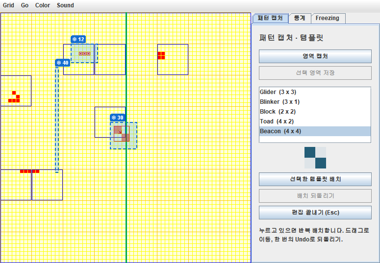

위 그림은 3단계에서 템플릿 미리보기가 고정 영역 위에서 빨간색으로 바뀐 화면이다. 초록 세로선은 사운드의 재생선이다.

**확인하지 않은 것:** 실제 스피커에서 나는 소리가 듣기에 맞는지, 사람이 직접 마우스로 끌 때의 느낌.

### 5.5 테스트 코드 예시

**예시 1. 세대 경계** (이 기능의 핵심 동작)

세대 10에 지속 세대 5로 설치하면 11~15세대에 고정되고 16세대부터 원본 규칙을 따르는지 보는 테스트다(FR-3, FR-5). 혼자 있는 셀은 원본 규칙으로는 다음 세대에 죽으므로, 고정이 정확히 몇 세대 동안 유지되는지 셀 하나로 알 수 있다.

```java
@Test
void e_installAtGenerationTenForFiveIsFrozenThroughFifteenAndFreeFromSixteen() {
    set(new int[] {10, 10});
    for (int g = 1; g <= 10; g++) tick();                      // the lone cell dies at generation 1
    set(new int[] {10, 10});                                   // put it back at generation 10
    FreezingRegion region = freezing.install(new Rectangle(10, 10, 1, 1), 5);
    assertEquals(5, region.remainingGenerations());
    for (int g = 11; g <= 15; g++) {
        assertTrue(region.isFrozen());
        assertEquals(16 - g, region.remainingGenerations());
        tick();
        assertEquals(g, freezing.generation());
        assertTrue(alive(10, 10), "must be frozen during generation " + g);
    }
    assertFalse(region.isFrozen(), "released after the 15th generation update");
    assertSame(NormalState.INSTANCE, stateOf(region));
    assertTrue(freezing.regions().isEmpty());
    tick();
    assertEquals(16, freezing.generation());
    assertFalse(alive(10, 10), "normal rules apply from generation 16");
}
```

**예시 2. State 패턴** (4.1절의 설계 결정)

상태 객체가 영역의 동작을 정하고, `FrozenState`가 스스로 영역을 `NormalState`로 바꾸는지 보는 테스트다.

```java
@Test
void stateObjectsDriveTheRegion() {
    FreezingRegion region = new FreezingRegion(new Rectangle(1, 1, 2, 2));
    assertSame(NormalState.INSTANCE, stateOf(region));
    assertFalse(region.isFrozen());
    assertEquals(0, region.remainingGenerations());
    assertFalse(region.beforeTransition(board), "NormalState must not touch the board");
    region.afterGeneration();
    assertSame(NormalState.INSTANCE, stateOf(region));

    region.freeze(board, 2);
    assertInstanceOf(FrozenState.class, stateOf(region));
    assertEquals(2, region.remainingGenerations());
    region.afterGeneration();
    assertTrue(region.isFrozen());
    assertEquals(1, region.remainingGenerations());
    region.afterGeneration();
    assertSame(NormalState.INSTANCE, stateOf(region), "FrozenState switches the context itself");

    region.freeze(board, 3);
    region.release();
    assertSame(NormalState.INSTANCE, stateOf(region));
    region.afterGeneration();                                  // a released region ignores later updates
    assertFalse(region.isFrozen());
}
```

## 6. Life Game 실행 방법

```
./gradlew classes
java -cp build/classes/java/main com.holub.life.Life
```

Windows PowerShell에서는 `./gradlew` 대신 `.\gradlew.bat`을 쓴다.

1. 판을 클릭해 블링커(가로 세 칸)를 하나 놓는다.
2. 사이드바의 Freezing 탭에서 지속 세대를 10으로 정한다.
3. 영역 선택을 누르고 블링커를 감싸도록 끈 뒤 Freezing 설치를 누른다.
4. Go > Medium을 고르면 블링커가 10세대 동안 움직이지 않고, 배지의 숫자가 줄다가 영역이 사라지면 다시 깜빡인다.
