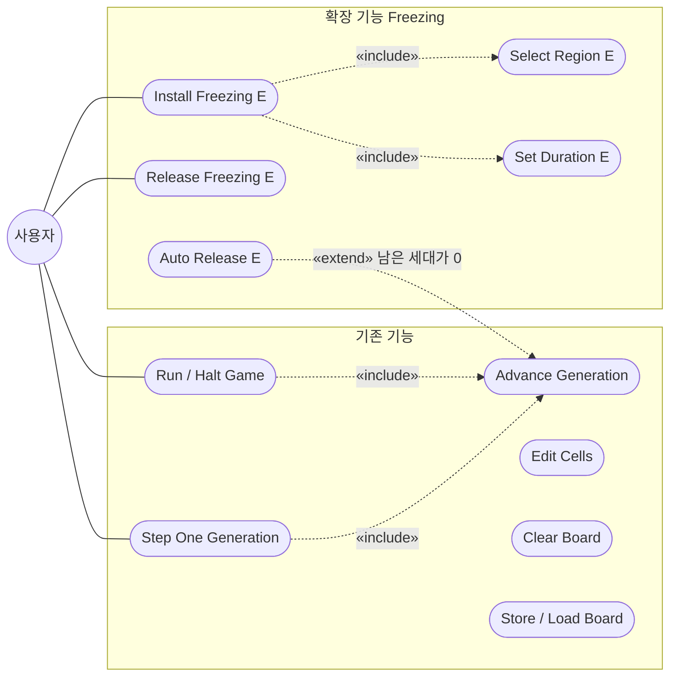

# Freezing: 유스케이스 명세와 변경 요약

- 코드 기준: dev `838182c` (PR #7 병합 후)
- 관련 문서: [변경 상세](changes.md), [설계 결정과 다이어그램](design.md), [통합 기록과 테스트](../FREEZING.md)

## 1. 유스케이스 명세

확장 유스케이스는 과제 안내문의 규칙대로 이름 끝에 `E`를 붙였다. 이름은 PR #7 본문의 유스케이스 그림과 같다.

- Advance Generation은 원본에서 한 세대를 계산하고 확정하는 부분이다. Run / Halt Game과 Step One Generation이 모두 포함하므로 Auto Release E는 이 공통 부분에 붙였다(색 순환 문서의 전체 유스케이스 그림과 같은 구조). PR #7 본문의 그림에서는 Run / Halt Game에 직접 붙어 있었다.
- Select Region E와 Set Duration E는 설치할 때마다 반드시 거치므로 «include»다. Auto Release E는 남은 세대가 0이 된 세대에만 일어나므로 «extend»다.
- Edit Cells, Clear Board, Store / Load Board는 Freezing이 동작을 제한하거나 초기화되는 기존 유스케이스다. 관계선은 긋지 않았고 아래 표의 “다른 유스케이스에 주는 영향”에 적었다.

| ID | 기능 이름 | 액터 | 기존 유스케이스와의 관계 |
| --- | --- | --- | --- |
| UC-FZ-01 | Install Freezing E | 사용자 | Select Region E, Set Duration E를 «include» |
| UC-FZ-02 | Select Region E | 사용자 | UC-FZ-01에 포함 |
| UC-FZ-03 | Set Duration E | 사용자 | UC-FZ-01에 포함 |
| UC-FZ-04 | Release Freezing E | 사용자 | |
| UC-FZ-05 | Auto Release E | (세대 진행) | Advance Generation을 «extend» (조건: 남은 세대가 0) |

### UC-FZ-01 Install Freezing E

| 항목 | 내용 |
| --- | --- |
| ID | UC-FZ-01 |
| 기능 이름 | Install Freezing E |
| 액터 | 사용자 |
| 목표 | 보드의 사각형 영역을 설치한 순간의 상태 그대로 N세대 동안 고정한다 |
| 진입 또는 트리거 | 사이드바 **Freezing** 탭의 **Freezing 설치** 버튼 |
| 사전 조건 | 영역이 선택되어 있다(UC-FZ-02). 선택 영역이 이미 고정된 영역과 겹치지 않는다. 지속 세대가 1 이상이다(UC-FZ-03) |
| 기본 흐름 | 1. 사용자가 지속 세대를 정한다(UC-FZ-03). 2. 사용자가 영역을 선택한다(UC-FZ-02). 3. 사용자가 **Freezing 설치**를 누른다. 4. `FreezingManager.install(selection, generations)`가 영역을 보드 경계에 맞추고, 빈 영역·겹침·지속 세대를 검사한다. 5. `FreezingRegion.freeze()`가 영역 안 모든 칸의 생사를 스냅샷으로 저장하고, 시작 세대와 지속 세대를 기록한 뒤 상태를 `FrozenState(n)`으로 바꾼다. 6. 영역이 활성 목록에 추가되고, 보드에 하늘색 배경·파란 점선 테두리·남은 세대 배지가 표시된다. 7. 영역 선택 모드가 끝나고 상태줄에 “(g+1 ~ g+n세대 고정)”이 나온다. |
| 대안·예외 | 4a. 선택 영역이 보드와 겹치지 않거나 비어 있다: `IllegalArgumentException("보드 안의 영역을 선택하세요.")`, 영역은 추가되지 않고 상태줄에 문구가 나온다. 4b. 기존 고정 영역과 겹친다: 화면에서는 선택이 빨간 점선으로 바뀌고 설치 버튼이 꺼져 있어 누를 수 없다. 모델을 직접 부르면 `IllegalArgumentException("이미 Freezing된 영역과 겹칩니다.")`. 맞닿는 것은 허용한다. 4c. 지속 세대가 1 미만이다: `IllegalArgumentException("지속 세대는 1 이상이어야 합니다.")`. 화면의 입력 칸은 1~999만 받는다. 3a. 영역을 선택하지 않고는 설치 버튼이 꺼져 있다. |
| 사후 조건 | 성공: 활성 영역이 하나 늘었다. 셀과 세대 번호는 바뀌지 않았다. `BoardChangeEvent`는 발생하지 않는다. 이후 세대 갱신마다 영역의 다음 상태가 스냅샷으로 유지된다. 실패: 영역 목록, 셀, 세대 모두 그대로다 |
| 다른 유스케이스에 주는 영향 | Edit Cells: 고정된 칸은 클릭·드래그로 바꿀 수 없다. 템플릿 배치: 사각형이 영역과 겹치면 그 배치를 거부한다. 색 순환: 고정된 칸은 나이와 색이 멈춘다. 통계·사운드: 고정된 칸은 출생·사망 목록에 없고 생존 수에는 포함된다 |

예: 현재 세대가 10일 때 지속 세대 5로 설치하면 11~15세대 갱신 동안 고정되고, 16세대 갱신부터 정상 규칙으로 계산한다.

### UC-FZ-02 Select Region E

| 항목 | 내용 |
| --- | --- |
| ID | UC-FZ-02 |
| 기능 이름 | Select Region E |
| 액터 | 사용자 |
| 목표 | 고정할 사각형 영역을 보드에서 고른다 |
| 진입 또는 트리거 | Freezing 탭의 **영역 선택** 버튼, 이어서 보드에서 왼쪽 버튼 드래그 |
| 사전 조건 | 게임 창이 떠 있다. 시계가 돌고 있든 멈춰 있든 상관없다 |
| 기본 흐름 | 1. 사용자가 **영역 선택**을 누른다. 2. 진행 중인 패턴 편집(캡처·배치)을 끝내고 배치 되돌리기 이력을 비운다. 3. 시계를 멈추고 영역 선택 모드로 들어간다. 커서가 십자 모양이 된다. 4. 사용자가 보드에서 드래그한다. 누른 칸과 현재 칸을 모서리로 하는 사각형이 회색 점선으로 표시된다. 5. 버튼을 놓으면 사각형이 확정되고, 겹치는 영역이 없으면 **Freezing 설치** 버튼이 켜진다. |
| 대안·예외 | 4a. 반대 방향(오른쪽 아래에서 왼쪽 위)으로 끌어도 같은 사각형이 된다. 4b. 보드 밖으로 끌면 가장 가까운 가장자리 칸에 맞춘다. 보드 밖에서 누르면 선택을 시작하지 않는다. 4c. 선택이 기존 고정 영역과 겹치면 빨간 점선으로 바뀌고 설치 버튼이 꺼진다. 취소: Esc, 오른쪽 클릭, **선택 끝내기 (Esc)** 버튼, 다른 탭으로 전환. 설치된 영역은 그대로 남는다. |
| 사후 조건 | 선택된 사각형이 있다. 선택 모드인 동안에는 세대가 진행되지 않고(Tick도 무시) 일반 클릭·드래그 그리기도 동작하지 않는다. 선택을 끝내도 시계는 저절로 다시 켜지지 않는다 |

### UC-FZ-03 Set Duration E

| 항목 | 내용 |
| --- | --- |
| ID | UC-FZ-03 |
| 기능 이름 | Set Duration E |
| 액터 | 사용자 |
| 목표 | 고정을 유지할 세대 수를 정한다 |
| 진입 또는 트리거 | Freezing 탭의 **지속 세대** 입력 칸 |
| 사전 조건 | 없음 |
| 기본 흐름 | 1. 사용자가 입력 칸의 값을 바꾼다(기본 5). 2. 다음 설치(UC-FZ-01) 때 이 값이 `install()`의 `generations`로 전달된다. |
| 대안·예외 | 1a. 입력 칸은 1~999 범위만 허용한다. |
| 사후 조건 | 이미 설치된 영역의 남은 세대는 바뀌지 않는다. 새로 설치하는 영역에만 적용된다 |

### UC-FZ-04 Release Freezing E

| 항목 | 내용 |
| --- | --- |
| ID | UC-FZ-04 |
| 기능 이름 | Release Freezing E |
| 액터 | 사용자 |
| 목표 | 남은 세대를 기다리지 않고 고정을 바로 푼다 |
| 진입 또는 트리거 | Freezing 탭의 **선택한 Freezing 해제**(목록에서 고른 영역 하나) 또는 **모든 Freezing 해제** |
| 사전 조건 | 활성 영역이 하나 이상 있다. 하나만 풀 때는 목록에서 영역을 골랐다 |
| 기본 흐름 | 1. 사용자가 목록에서 영역을 고르고 **선택한 Freezing 해제**를 누른다. 2. `FreezingManager.release(region)`이 영역을 목록에서 빼고 상태를 `NormalState`로 바꾼다. 3. 보드의 영역 표시가 사라지고 상태줄에 “다음 세대부터 정상 규칙을 적용합니다.”가 나온다. |
| 대안·예외 | 1a. **모든 Freezing 해제**: `releaseAll()`이 모든 영역을 같은 방식으로 푼다. 1b. 목록에서 고른 영역이 없으면 해제 버튼이 꺼져 있다. 영역이 하나도 없으면 전체 해제 버튼도 꺼져 있다. 2a. `Grid > Clear`와 `Grid > Load`(읽기 성공)는 `reset()`으로 모든 영역을 지운다. Load를 취소하면 영역은 그대로다. |
| 사후 조건 | 풀린 영역의 칸은 그 순간의 상태를 유지한 채 다음 세대 갱신부터 정상 규칙을 따른다. 클릭·드래그·템플릿 배치가 다시 가능하다. 멈췄던 나이는 이어서 센다. `BoardChangeEvent`는 발생하지 않는다(Clear·Load는 각각 `CLEAR`·`LOAD` 이벤트를 한 번 보낸다) |

### UC-FZ-05 Auto Release E

| 항목 | 내용 |
| --- | --- |
| ID | UC-FZ-05 |
| 기능 이름 | Auto Release E |
| 액터 | 없음(세대 진행이 일으킨다) |
| 목표 | 지속 세대가 지난 영역을 사용자의 조작 없이 푼다 |
| 진입 또는 트리거 | 세대가 하나 진행될 때(Go 메뉴의 속도 선택 또는 Tick (Single Step)) |
| 사전 조건 | 활성 영역이 하나 이상 있다. 캡처·배치·영역 선택 중이 아니다 |
| 기본 흐름 | 1. 시계가 `Universe`에 틱을 보낸다. 2. 모든 칸이 다음 상태를 계산한다(`figureNextState()`). 3. 고정 영역의 다음 상태를 스냅샷으로 바꾼다(`beforeTransition()` → `holdNextState()`). 4. 전이하고(`transition()`) 세대 번호를 1 올린다. 5. `afterGeneration()`에서 각 `FrozenState`가 남은 세대를 1 줄인다. 6. 남은 세대가 0이 된 `FrozenState`가 영역을 `NormalState`로 바꾸고, `FreezingManager`가 그 영역을 목록에서 뺀다. 7. `GENERATION` 이벤트가 통계와 사운드에 전달된다. |
| 대안·예외 | 1a. 캡처·배치 또는 영역 선택 중이면 틱을 건너뛴다. 남은 세대도 줄지 않는다. 6a. 남은 세대가 아직 1 이상이면 영역은 고정 상태로 남고 배지의 숫자만 줄어든다. 영역마다 지속 세대가 다르면 각자 따로 만료된다. |
| 사후 조건 | 만료된 영역은 목록과 화면에서 사라진다. 그 영역의 칸은 다음 세대 갱신부터 정상 규칙을 따른다 |

## 2. 확장된 기능과 설계 개선 요약

### 2.1 확장된 기능

| 기능 | 내용 |
| --- | --- |
| 영역 고정 | 사각형 영역 안에서 살아 있는 셀은 죽지 않고, 죽은 셀은 태어나지 않는다. 설치한 순간의 상태를 유지한다 |
| 한 방향 영향 | 영역 바깥은 기존 규칙(B3/S23)대로 진화한다. 고정된 살아 있는 셀은 바깥 셀의 이웃으로 세지만, 바깥 셀은 고정된 셀을 바꾸지 못한다 |
| 자동 해제 | 지속 세대(1~999, 기본 5)가 지나면 저절로 풀린다 |
| 강제 해제 | 선택한 영역 하나 또는 전체를 버튼으로 바로 푼다 |
| 여러 영역 | 영역을 여러 개 두고 영역마다 지속 세대를 다르게 줄 수 있다. 서로 겹칠 수는 없다 |
| Freezing 탭 | 사이드바 세 번째 탭. 지속 세대 입력, 영역 선택·설치·해제 버튼, 활성 영역 목록, 현재 세대 표시 |
| 보드 표시 | 반투명 하늘색 배경, 파란 점선 테두리, 남은 세대 배지(`❄ n`), 고정된 살아 있는 셀의 하늘색 테두리 |
| 편집 보호 | 고정된 칸은 클릭·드래그로 바꿀 수 없고, 템플릿은 영역과 겹치는 자리에 놓을 수 없다 |

기존 Life Game 기능(클릭 편집, Go·Grid 메뉴, 저장 파일 형식)은 바뀌지 않았다. 영역이 하나도 없으면 세대 처리 결과와 화면이 Freezing 병합 전과 같다.

### 2.2 설계 개선

| 개선 | 무엇을 어떻게 | 효과 |
| --- | --- | --- |
| 규칙 코드를 고치지 않는 고정 | 규칙 계산(`figureNextState()`)과 전이(`transition()`) 사이에 단계를 하나 끼우고, 고정된 칸의 “다음 상태”만 스냅샷으로 바꾼다 | 생존 판정 코드는 그대로다. 셀이 실제로 바뀌었다 돌아오는 일이 없어 통계·사운드의 출생·사망 목록이 저절로 맞는다 |
| 상태별 동작을 객체로 분리 (State) | 영역(`FreezingRegion`)이 현재 상태 객체(`NormalState` / `FrozenState`)에 세대 처리의 두 시점을 넘긴다. 남은 세대가 0이 되면 `FrozenState`가 스스로 `NormalState`로 바꾼다 | 영역 코드에 “고정 중인가”를 묻는 분기가 없다. 전환 시점을 바깥에서 관리하지 않는다 |
| 모델과 화면의 분리 | 규칙은 `FreezingManager`·`FreezingRegion`·상태 클래스가, 탭 화면과 보드 표시는 `FreezingTools`가 맡는다. 모델은 `Runnable` 콜백으로만 화면에 알린다 | 모델에 Swing 코드가 없어 `Universe`와 창 없이 테스트한다(`FreezingModelTest`) |
| 좌표로 칸에 닿는 길을 Composite에 추가 | `Cell.holdNextState(location, alive)`를 추가했다. `Neighborhood`는 하위 셀에 넘기고 `Resident`가 처리한다 | 영역이 보드의 중첩 구조(8×8 블록 두 단계)를 몰라도 된다. `isAliveAt()`, `colorAt()`과 같은 방식이다 |
| 세대 번호를 한 곳에서 | `FreezingManager`가 따로 세던 카운터를 없애고 `Universe`의 값을 `LongSupplier`로 읽는다 | 통계 탭의 세대와 Freezing 탭의 현재 세대가 어긋날 수 없다 |
| 기능 사이의 규칙은 `Universe`에 | 템플릿 배치 제한은 캡처 쪽이 열어 둔 `setPlacementGuard(Predicate<Rectangle>)`에, 영역 선택 시작 때의 패턴 편집 종료는 `Runnable` 하나에 연결했다 | `FreezingTools`와 `PatternTools`가 서로를 참조하지 않는다. 다른 기능의 클래스는 수정하지 않았다 |

### 2.3 변경 규모

`dev`(`d215c7a`, PR #16까지) 대비.

| 구분 | 파일 | 규모 |
| --- | --- | --- |
| 새 클래스 6개 | `FreezingState`, `NormalState`, `FrozenState`, `FreezingRegion`, `FreezingManager`, `FreezingTools` | 536줄 |
| 고친 기존 클래스 5개 | `Cell`(+13), `Neighborhood`(+13), `Resident`(+17 / −1), `Universe`(+51 / −3), `Life`(+3) | |
| 테스트 3개 | `FreezingModelTest`(50건), `FreezingIntegrationTest`(37건), `FreezingSoundIntegrationTest`(3건) | 90건 |
| 수정하지 않은 것 | `PatternTools`, `BoardEditor`, `PlacePatternCommand`, `Statistics`, `StatisticsPanel`, `BoardChangeEvent`, `SoundEffects`, `CellColorPolicy`와 구현들, `Clock` | |

변경 내용의 전후 비교는 [changes.md](changes.md), 패턴을 고른 이유와 과정은 [design.md](design.md)에 있다.
