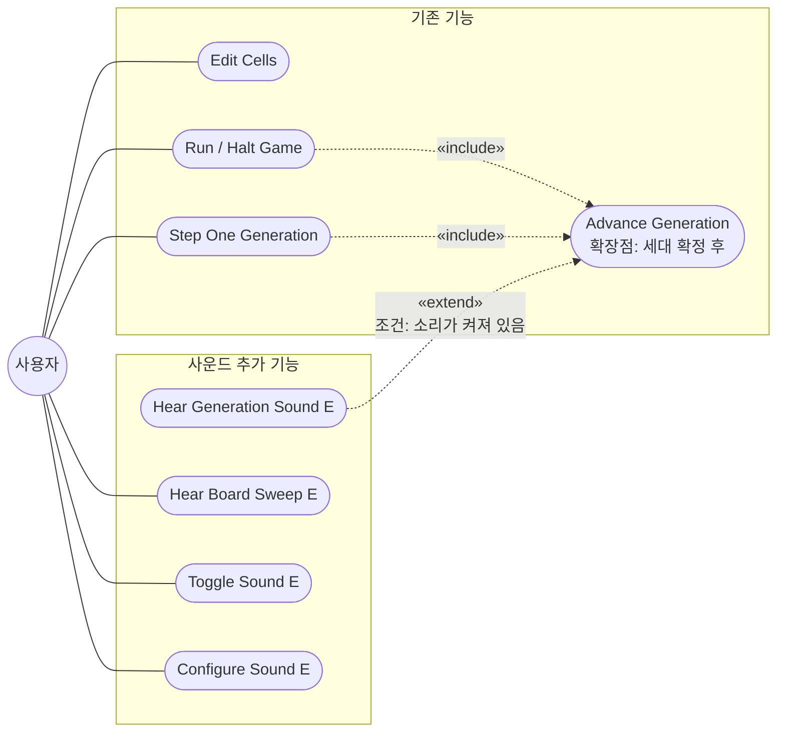

# 사운드 이펙트 기능 명세

판의 변화를 소리로 들려주는 확장 기능의 명세다. 유스케이스, 요구사항, 적용한 GoF 패턴과 검토했지만 적용하지 않은 패턴, 요구사항을 확인하는 JUnit 테스트를 정리했다. 구현 과정과 코드 비교는 [sound-effects.md](sound-effects.md)에 있다.

기준 코드는 통계(#10)와 Freezing(#7)까지 합쳐진 `dev`(`838182c`)다.

## 1. 개요

원래 Life Game은 판이 어떻게 바뀌는지 눈으로만 볼 수 있다. 이 기능은 같은 변화를 소리로도 들려준다. 패턴이 커지는지, 진동하는지, 사라지는지를 귀로 구분할 수 있고, 게임을 멈춰 둔 상태에서도 지금 판의 모양을 들어 볼 수 있다.

기능은 네 가지다.

- 세대 소리: 세대마다 생긴 셀은 화음으로, 사라진 셀은 타악기로 낸다.
- 재생선: 초록 세로선이 판을 왼쪽에서 오른쪽으로 계속 훑으면서 지나가는 자리의 산 셀을 연주하고, 그 밑에 저음 패드를 깐다.
- 켜고 끄기: `Sound` 메뉴의 `On`, `Off`.
- 설정: `Sound` → `Settings` 창에서 기능별 on/off와 악기 선택.

이번 범위에 넣지 않은 것은 설정 저장, 전체 음량 조절, MIDI 장치 선택, 소리 녹음·내보내기다.

## 2. 유스케이스

### 2.1 유스케이스 목록

기존 기능과 추가 기능을 나눠 적었다. 추가한 유스케이스는 이름 끝에 `E`를 붙였다. 기존 유스케이스 이름은 팀 전체 유스케이스 다이어그램과 같게 맞췄다.

| 구분 | 유스케이스 | 사운드와의 관계 |
|---|---|---|
| 기존 | Edit Cells | 편집한 판은 재생선이 다음 스텝부터 연주한다 |
| 기존 | Run / Halt Game | Advance Generation을 포함한다 |
| 기존 | Step One Generation | Advance Generation을 포함한다 |
| 기존 | Advance Generation | 확장점 "세대 확정 후"에서 Hear Generation Sound E가 확장한다 |
| 기존 | Clear Board, Store / Load Board | Clear와 Load로 바뀐 판은 재생선이 다음 스텝부터 연주한다 |
| 기존 | Exit Game | 관계 없음 |
| 추가 | Hear Generation Sound E | Advance Generation을 확장 (조건: 소리가 켜져 있음) |
| 추가 | Hear Board Sweep E | 사용자와 직접 연관. 게임 진행과 상관없이 동작 |
| 추가 | Toggle Sound E | 사용자와 직접 연관 |
| 추가 | Configure Sound E | 사용자와 직접 연관 |



### 2.2 유스케이스 명세

#### UC-S1 Hear Generation Sound E

| 항목 | 내용 |
|---|---|
| 액터 | 사용자 |
| 관계 | Advance Generation을 확장한다. 확장점은 "세대 확정 후", 조건은 소리가 켜져 있을 때 |
| 사전 조건 | MIDI 신시사이저가 열려 있다. `Sound`가 `On`이다 |
| 사후 조건 | 이번 세대의 소리가 예약된다. 세대를 진행하는 쪽은 소리가 끝날 때까지 기다리지 않는다 |

기본 흐름

1. Advance Generation이 한 세대를 확정한다.
2. 시스템은 이번 세대에 생긴 셀과 사라진 셀의 좌표를 사운드에 전달한다.
3. 시스템은 생긴 셀을 현재 코드에 맞는 5음 중에서 골라 최대 5음 화음을 만든다. 위쪽 셀일수록 높은 음이고, 열 위치는 좌우(pan)가 된다.
4. 시스템은 화음을 왼쪽 음부터 25ms 간격으로 내고, 각 음을 220ms 뒤에 끈다.
5. 사라진 셀이 있으면 60ms 뒤에 타악기를 한 번 친다. 많이 사라질수록 세게 치되 상한이 있다.

대안 흐름

- 2a. 생긴 셀도 사라진 셀도 없으면 소리를 내지 않는다. Freezing으로 고정된 셀은 변화 목록에 들어가지 않으므로 소리가 나지 않는다.
- 3a. 한 세대에 12개 이상 생기면 같은 화음을 한 옥타브 위에서 작게 한 번 더 낸다.
- 3b. 최근 8세대 안에 같은 변화가 있었으면 반복으로 보고 1/12씩 작게 낸다. 12번 반복되면 무음이 되고, 새로운 변화가 오면 원래 크기로 돌아간다.
- 3c. 직전 세대 소리를 낸 지 120ms가 안 지났으면 이번 세대는 건너뛴다(빠른 속도에서 소리가 뭉치지 않게).
- 3d. 이번 세대에 판이 전멸했으면 화음과 타악기 대신 마무리 화음 3음을 90ms 간격으로 낸다. 이후 빈 판의 세대에서는 다시 내지 않는다.
- 각 단계의 소리는 Configure Sound E에서 끈 항목이면 내지 않는다.

#### UC-S2 Hear Board Sweep E

| 항목 | 내용 |
|---|---|
| 액터 | 사용자 |
| 사전 조건 | MIDI 신시사이저가 열려 있다. `Sound`가 `On`이다. 게임이 실행 중이든 멈춰 있든 상관없다 |
| 사후 조건 | 재생선 위치가 판 위에 초록 선으로 표시된다 |

기본 흐름

1. 시스템은 150ms마다 재생선을 4열씩 오른쪽으로 옮기고 판 위에 초록 선을 그린다.
2. 시스템은 재생선이 지나는 4열 안의 산 셀로 최대 3음을 낸다. 4스텝마다 한 번은 더 세게 낸다.
3. 시스템은 산 셀 수에 맞춰 저음 패드의 세기를 조절한다. 셀이 많을수록 크게, 상한까지.
4. 16스텝(64열, 약 2.4초)을 돌면 처음으로 돌아가고 코드가 C → Am → F → G 순서로 바뀐다.

대안 흐름

- 1a. 사용자가 셀을 편집하거나, Clear, Load, 템플릿 배치·되돌리기를 하면 다음 스텝부터 바뀐 판을 연주한다.
- 2a. 재생선 구간에 산 셀이 없으면 그 스텝은 조용하다.
- 3a. 판이 비어 있으면 패드를 끈다. 재생선은 계속 움직인다.
- 1b. 설정에서 재생선을 끄면 선을 지우고 연주하지 않는다. 패드는 따로 켜고 끈다.

#### UC-S3 Toggle Sound E

| 항목 | 내용 |
|---|---|
| 액터 | 사용자 |
| 사전 조건 | 프로그램이 실행 중이다 |
| 사후 조건 | Off면 새 소리가 나지 않고 재생선이 사라진다. On이면 다음 스텝부터 다시 연주한다 |

기본 흐름

1. 사용자가 `Sound` → `Off`를 고른다.
2. 시스템은 세대 소리를 내지 않고, 다음 스텝에서 패드를 끄고 재생선을 지운다.
3. 사용자가 `Sound` → `On`을 고른다.
4. 시스템은 다음 스텝부터 현재 판을 연주한다.

대안 흐름

- 2a. Off인 동안에도 판이 바뀐 내용은 계속 받아 둔다. 그래서 On으로 바꾸면 그 사이에 편집한 판을 바로 연주한다.

#### UC-S4 Configure Sound E

| 항목 | 내용 |
|---|---|
| 액터 | 사용자 |
| 사전 조건 | MIDI 신시사이저가 열려 있다 |
| 사후 조건 | 바뀐 설정이 다음 소리부터 적용된다. 설정은 파일에 저장하지 않는다 |

기본 흐름

1. 사용자가 `Sound` → `Settings`를 고른다.
2. 시스템은 게임 창 오른쪽에 설정 창을 띄운다. 9개 항목마다 체크박스가 있고, 악기가 있는 5개 항목은 악기 선택 상자도 있다.
3. 사용자가 항목의 체크를 끈다. 시스템은 그 기능만 멈추고 나머지는 그대로 둔다.
4. 사용자가 악기를 바꾼다. 시스템은 다음 음부터 새 악기로 낸다. 패드는 누르고 있던 음을 끊고 다음 스텝에 새 악기로 다시 시작한다.

대안 흐름

- 2a. 설정 창은 모달이 아니다. 창을 띄워 둔 채로 게임을 진행하면서 소리가 바뀌는 것을 들을 수 있다.
- 2b. 창을 닫았다가 다시 열면 같은 창이 같은 값으로 뜬다.

설정 항목은 다음과 같다. 처음에는 모두 켜져 있고 악기는 목록의 첫 번째다.

| 항목 | 악기 |
|---|---|
| 생성음 | 마림바, 실로폰, 하프, 피아노 |
| 1. 코드 진행 | |
| 2. 스트럼 | |
| 3. 소멸 타악기 | 쉐이커, 하이햇, 카바사, 탬버린 |
| 4. 저음 패드 | 웜 패드, 스트링, 합창, 오르간 |
| 5. 대량 생성 악기 | 비브라폰, 글로켄슈필, 첼레스타, 튜블러 벨 |
| 6. 반복 페이드·마무리 | |
| 7. 작은 흔들림 | |
| 8. 재생선 | 칼림바, 뮤직박스, 하프, 기타 |

## 3. 요구사항

### 3.1 기능 요구사항

| ID | 요구사항 | 유스케이스 | 확인하는 테스트 |
|---|---|---|---|
| F1 | 세대마다 생긴 셀을 최대 5음 화음으로 낸다. 음은 현재 코드의 5음 안에서 고르고, 위쪽 셀일수록 높고, 열 위치는 좌우가 된다 | UC-S1 | `everyPitchIsInCMajor`, `higherOnTheBoardNeverSoundsLower`, `columnSetsStereoPosition`, `fullBoardStaysWithinVoiceLimitAndValidMidiRange`, `realBlinkerUpdatesStatisticsAndSchedulesBirthAndDeathSoundsOnce` |
| F2 | 화음은 왼쪽 음부터 25ms 간격으로 내고 각 음은 220ms 뒤에 끈다 | UC-S1 | `notesAreOrderedLeftToRightForStrumming`, `birthStrumNoteLengthsAndPercussionDelayRemainUnchanged` |
| F3 | 사라진 셀이 있으면 60ms 뒤 타악기를 한 번 친다. 많이 사라질수록 세지만 상한이 있다 | UC-S1 | `moreDeathsHitHarderUpToACap`, `birthStrumNoteLengthsAndPercussionDelayRemainUnchanged` |
| F4 | 12개 이상 생긴 세대는 한 옥타브 위 레이어를 더한다 | UC-S1 | `smallGenerationsHaveNoBurstLayer`, `burstLayerDoublesNotesAnOctaveHigherAndQuieter`, `largeBirthEventKeepsTheBurstLayer` |
| F5 | 변화가 없는 세대, 그리고 편집·Clear·Load·템플릿·색 변경은 세대 소리를 내지 않는다 | UC-S1 | `stableAndEmptyGenerationsNeverScheduleGenerationSounds`, `nonGenerationEventUpdatesSweepWithoutGenerationSounds`, `realColorMenuRefreshesStatisticsWithoutSchedulingGenerationSound` |
| F6 | 같은 변화가 반복되면 12번에 걸쳐 무음까지 줄이고, 새 변화가 오면 원래 크기로 돌아간다. 판이 전멸하면 마무리 화음을 한 번 낸다 | UC-S1 | `RepeatTrackerTest` 3개, `scalingLowersLoudnessOnly`, `endingChordIsAboveThePadOfTheSameChord`, `extinctionPlaysOneEndingAndLaterEmptyTicksStaySilent` |
| F7 | 재생선은 150ms마다 4열씩 움직이며 그 구간의 산 셀을 최대 3음으로 연주하고 판 위에 표시된다. 게임이 멈춰 있어도 동작하고 편집한 판을 반영한다 | UC-S2 | `sweepPlaysOnlyCellsInTheColumnBlock`, `sweepLimitsVoicesAndAccentsTheBeat`, `sweepOfAnEmptyBlockIsSilent`, `playheadIsDrawnOverTheBoardAndCanBeRemoved`, `initialSnapshotIsReadyBeforeTheFirstScheduledSweep` |
| F8 | 재생선이 한 바퀴 돌 때마다 코드가 C → Am → F → G로 바뀌고, 패드도 같은 코드를 따른다. 패드는 산 셀이 많을수록 커지고 빈 판이면 꺼진다 | UC-S2 | `sameCellChangesPitchAcrossTheProgression`, `progressionWrapsAround`, `padFollowsTheProgression`, `padGrowsWithLiveCellsUpToACapAndStopsOnAnEmptyBoard` |
| F9 | 세기 ±8, 타이밍 0~15ms의 작은 흔들림을 주고, 12% 확률로 한 옥타브 올린다 | UC-S1, UC-S2 | `humanizingKeepsNotesValidAndVariesThem`, `timingJitterStaysSmall` |
| F10 | `Sound` → `Off`면 소리와 재생선이 멈추고, `On`으로 바꾸면 Off 동안 바뀐 판을 연주한다 | UC-S3 | `disabledSoundStillReceivesEditsForTheNextSweep` |
| F11 | 설정 창에서 9개 항목을 하나씩 끄고, 5개 항목의 악기를 바꿀 수 있다 | UC-S4 | `SoundSettingsTest` 3개 |
| F12 | Freezing으로 고정된 셀은 세대 소리를 내지 않고, 풀린 첫 세대부터 다시 들린다. 재생선은 고정된 산 셀도 연주한다 | UC-S1, UC-S2 | `FreezingSoundIntegrationTest` 3개 |

### 3.2 비기능 요구사항과 제약

| ID | 요구사항 | 확인 방법 |
|---|---|---|
| N1 | 게임 로직(`Universe`, `Cell`)은 사운드 패키지를 몰라야 한다. 사운드를 빼도 게임은 그대로 동작한다 | 의존 방향이 `sound` → `life` 한쪽뿐이다. 게임 쪽에서 사운드를 부르는 곳은 `Life`의 `SoundEffects.install()` 한 줄이다 |
| N2 | 세대를 진행하는 Swing 이벤트 스레드는 소리 때문에 기다리면 안 된다 | 모든 음은 스케줄러에 예약만 한다. `birthStrumNoteLengthsAndPercussionDelayRemainUnchanged`가 예약 목록을 확인하고, `sweepUsesAnIndependentSnapshotOnItsWorkerThread`가 재생선이 다른 스레드에서 복사본만 읽는지 확인한다 |
| N3 | MIDI 신시사이저가 없는 환경에서도 게임이 정상 실행되어야 한다 | `missingMidiDeviceDoesNotPreventStatisticsFromAdvancing` |
| N4 | 기존 기능은 그대로 동작해야 한다 | 원래 있던 `ResidentTest` 18개, `NeighborhoodTest` 11개, `UniverseStoreTest` 3개가 그대로 통과한다 |
| N5 | 음을 고르는 규칙은 MIDI 장치와 화면 없이 테스트할 수 있어야 한다 | `NoteMapper`, `RepeatTracker`, `SoundSettings`는 MIDI와 Swing을 쓰지 않는다. 랜덤은 시드를 넣어 고정한다 |

## 4. 적용한 GoF 패턴

### 4.1 Observer: 판의 변화를 사운드에 알린다

| 역할 | 클래스 |
|---|---|
| Subject | `Universe` (`addBoardChangeListener()`, `removeBoardChangeListener()`) |
| Observer | `BoardChangeListener` (`onBoardChanged(BoardChangeEvent)`) |
| ConcreteObserver | `SoundEffects`, `Statistics` |

해결한 문제: 원래 `Universe`는 틱마다 판을 바꾸고 다시 그리기만 해서, 무엇이 바뀌었는지 밖에서 알 수 없었다. 그렇다고 `Universe`가 `SoundEffects`를 직접 부르면 게임 로직이 사운드에 묶이고, 기능이 늘 때마다 `Universe`를 고쳐야 한다.

적용 방식: `Universe`는 세대를 확정하거나 판이 바뀌면 이벤트를 만들어 등록된 리스너에게 보낸다. 이벤트에는 작업 종류, 세대 번호, 판의 복사본, 생긴 셀과 사라진 셀 좌표가 들어 있다(push 방식). `Universe`는 `BoardChangeListener` 인터페이스만 알고 그 뒤에 무엇이 있는지는 모른다.

설계가 바뀐 과정: 사운드를 처음 넣을 때(#3)는 `Universe.GenerationListener`라는 사운드용 인터페이스를 만들고, 구독자 관리는 Holub 코드의 `Publisher`를 썼다. 이후 통계 기능(#10)이 같은 세대 정보를 필요로 하면서, 두 기능이 같은 이벤트를 받도록 `BoardChangeListener`와 `BoardChangeEvent`로 합쳐졌다. 소리를 만드는 코드가 처음부터 `Universe`와 떨어져 있었기 때문에, 알림 방식이 바뀌었을 때 사운드 쪽에서 고친 곳은 `SoundEffects`의 수신부 30줄 정도였다. 음을 고르는 `NoteMapper`, `RepeatTracker`, `SoundSettings`는 바뀌지 않았다.

### 4.2 Command: 소리를 "나중에 실행할 요청"으로 만든다

| 역할 | 재생 예약 | `Sound` 메뉴 |
|---|---|---|
| Client | `SoundEffects` | `SoundEffects.createMenus()` |
| Command | `Runnable` (음 켜기, 음 끄기, 타악기, 악기 변경, 재생선 한 스텝) | `ActionListener` |
| Invoker | 단일 스레드 `ScheduledExecutorService` (`sound-notes` 스레드) | 메뉴 항목 |
| Receiver | `MidiChannel` | `SoundEffects` |

해결한 문제: 소리는 대부분 "조금 뒤에" 나야 한다. 화음은 25ms 간격, 타악기는 60ms 뒤, 음 끄기는 220ms 뒤, 재생선은 150ms마다다. 이걸 세대를 진행하는 이벤트 스레드에서 기다리면 화면과 입력이 같이 멈춘다(N2).

적용 방식: 할 일을 `Runnable` 객체로 만들어 실행 시간과 함께 스케줄러에 넣는다. 스레드 하나가 큐에서 시간 순서대로 꺼내 실행하므로, `MidiChannel`과 재생선 상태를 만지는 스레드가 하나로 정해진다. 그래서 채널에 따로 잠금을 걸지 않았다. 설정 창에서 악기를 바꿀 때도 채널을 직접 바꾸지 않고 `applyInstruments`를 명령으로 넣는다.

### 4.3 Composite 확장: 좌표로 셀 상태를 묻는다

| 역할 | 클래스 |
|---|---|
| Component | `Cell` (`isAliveAt(row, column)` 추가) |
| Composite | `Neighborhood` |
| Leaf | `Resident`, `Cell.DUMMY` |

해결한 문제: 소리를 만들려면 "r행 c열 셀이 살아 있는가"를 물어야 하는데, 원래 `Cell`에는 그런 연산이 없었다. 판은 8×8 `Neighborhood` 안에 8×8 `Neighborhood`가 들어 있는 트리라서, 호출하는 쪽이 이 구조를 알면 안 된다.

적용 방식: 기존 Composite 구조에 연산 하나를 더했다. `Neighborhood`는 좌표를 하위 격자 위치와 나머지로 나눠 하위 셀에 넘기고, `Resident`는 자기 상태를 답한다. `Universe`는 가장 바깥 셀에 한 번만 묻는다. 이 연산은 이후 드래그 그리기와 캡처·템플릿(`PatternCells`), 공통 이벤트의 판 복사(`liveCells()`)에서도 쓰이고 있다.

### 4.4 기존 패턴을 그대로 쓴 부분

`Sound` 메뉴는 Holub 코드의 `MenuSite`(Swing 메뉴를 감싸는 Facade)로 등록해서 기존 메뉴 코드를 고치지 않았다. `Universe`와 `Clock`은 원래 Singleton이며 사운드는 이 구조를 그대로 쓴다.

## 5. 검토했지만 적용하지 않은 GoF 패턴

| 패턴 | 검토한 곳 | 적용하지 않은 이유 |
|---|---|---|
| Strategy | 생성음, 타악기, 패드, 재생선을 각각 객체로 나누고 공통 인터페이스 뒤에 두는 방법 | 지금 `SoundEffects`에는 `settings.isOn(...)` 분기가 10곳 있어서 Strategy를 쓰면 이 분기가 없어진다. 하지만 기능들이 서로 독립적이지 않다. 현재 코드와 반복 페이드 값을 여러 기능이 같이 쓰고, 대량 생성 레이어는 생성음이 고른 화음을 받아 쓴다. 이 값들을 넘기는 인터페이스부터 정해야 해서 이번에는 남겨 두었다. 기능을 더 늘린다면 가장 먼저 적용할 후보다 |
| Strategy | 셀을 음으로 바꾸는 규칙(반음씩, 장음계, 코드별 5음)을 바꿔 끼우는 방법 | 규칙을 비교해 본 결과 코드별 5음 하나만 쓰기로 했다. 실행 중에 규칙을 바꾸는 기능이 없으므로 인터페이스를 둘 이유가 없었다 |
| State | 반복 페이드의 Full, Fading, Silent 상태와 Sound On/Off | 페이드 상태는 반복 횟수 하나와 `1 - 반복/12` 식으로 정해진다. 상태별로 하는 일이 다르지 않고 볼륨 값만 다르므로 상태 클래스를 3개 만들면 식 하나가 흩어질 뿐이다. On/Off도 `boolean` 하나다. 상태마다 동작이 크게 달라지는 Freezing 영역과는 경우가 다르다 |
| Decorator | 음 목록에 흔들림(`humanized`), 볼륨 조절(`scaled`), 대량 생성 레이어를 겹쳐 적용하는 부분 | 겹쳐 적용한다는 점은 Decorator와 비슷하다. 하지만 대상이 동작을 가진 객체가 아니라 음 값(`Note` record)의 목록이고, 적용 순서도 정해져 있다. 목록을 받아 새 목록을 돌려주는 메서드로 충분했다 |
| Mediator | `SoundEffects`가 `NoteMapper`, `RepeatTracker`, `SoundSettings`, MIDI 채널을 조율하는 구조 | Mediator는 동료 객체들이 서로 직접 부르지 않고 중재자를 통해 주고받게 하는 패턴이다. 여기서는 `NoteMapper`와 `RepeatTracker`가 서로를 부를 일이 처음부터 없고 `SoundEffects`도 모른다. 조율하는 쪽이 하나일 뿐 중재할 상호작용이 없다 |
| Singleton | `SoundEffects` | 프로그램 시작 때 `Life`에서 한 번만 만들면 되고 다른 곳에서 찾을 일이 없다. 전역 접근점을 두는 대신 `Universe`를 인자로 받아 의존 관계를 드러냈다 |
| Memento | 판 상태를 읽을 때 Load/Store용 `createMemento()`, `transfer()`를 다시 쓰는 방법 | `Cell`을 고치지 않아도 되는 장점이 있다. 하지만 Memento는 파일 입출력(`Storable`)까지 구현해야 하고, 칸 하나만 궁금해도 판 전체를 복사한다. `Neighborhood.transfer()`는 `activeEdges`를 바꾸기 때문에 저장용 경로를 매 틱 부르게 되는 문제도 있어서 `isAliveAt()`을 추가하는 쪽(4.3)을 골랐다 |

## 6. JUnit 테스트

### 6.1 테스트 구성

`./gradlew test`로 전체 테스트를 실행한다. 기준 코드에서 전체 384개가 모두 통과한다. 사운드와 관련된 테스트는 다음과 같다.

| 테스트 클래스 | 개수 | 대상 |
|---|---|---|
| `sound.NoteMapperTest` | 23 | 음 고르기 규칙 (MIDI·Swing 없음) |
| `sound.RepeatTrackerTest` | 3 | 반복 페이드 |
| `sound.SoundSettingsTest` | 3 | 설정 값 |
| `NeighborhoodTest` | 1 (사운드 관련) | `isAliveAt()` |
| `UniverseStoreTest` | 2 (사운드 관련) | 판 복사, 재생선 그리기 |
| `SoundEffectsIntegrationTest` | 17 | 실제 `Universe`·`Statistics`와 연결한 `SoundEffects`. MIDI와 스케줄러는 가짜로 바꿔 예약된 명령을 직접 실행한다. 통계 기능을 합칠 때 추가됨 |
| `FreezingSoundIntegrationTest` | 3 | Freezing과 함께 쓸 때. Freezing 기능을 합칠 때 추가됨 |

### 6.2 주요 테스트와 확인 내용

| 테스트 | 어떤 내용에 대한 테스트인가 | 확인 방법과 기대 결과 | 요구사항 |
|---|---|---|---|
| `NoteMapperTest.everyPitchIsInCMajor` | 여러 셀이 함께 생겨도 불협화음이 나지 않는지 | 코드 4개 × 64행에서 나오는 모든 음을 12로 나눈 나머지가 C장조 7음 안에 있다 | F1 |
| `NoteMapperTest.higherOnTheBoardNeverSoundsLower` | 판의 높이가 음 높이로 바뀌는지 | 코드 4개 각각에서 위쪽 행의 음이 바로 아래 행보다 낮지 않다 | F1 |
| `NoteMapperTest.fullBoardStaysWithinVoiceLimitAndValidMidiRange` | 셀이 아주 많이 생겨도 소리가 과하지 않은지 | 64×64 판 전체가 한꺼번에 생겨도 정확히 5음만 나오고, 세기는 1~127, 같은 음 중복이 없다 | F1 |
| `RepeatTrackerTest.oscillatorFadesToSilence` | 진동자처럼 같은 변화가 반복되면 조용해지는지 | 두 상태를 16세대 번갈아 넣는 동안 볼륨이 한 번도 커지지 않고 마지막에 0이 된다 | F6 |
| `SoundSettingsTest.turningOneFeatureOffLeavesTheOthersOn` | 설정 항목이 서로 독립적인지 | 스트럼을 꺼도 재생선은 켜진 상태 그대로다 | F11 |
| `NeighborhoodTest.isAliveAtFindsResidentThroughNestedNeighborhoods` | Composite에 추가한 `isAliveAt()`이 중첩된 판에서 좌표를 제대로 찾는지 | 2단계로 중첩된 판에서 클릭한 3행 2열만 `true`이고, 행과 열을 바꾼 2행 3열은 `false`다 | F1, F7 |
| `UniverseStoreTest.playheadIsDrawnOverTheBoardAndCanBeRemoved` | 재생선이 판 위에 표시되고 지워지는지 | 판을 이미지로 그려 재생선 위치의 픽셀이 초록색(0, 170, 80)이고, `-1`로 지우면 그 픽셀이 바뀐다 | F7 |
| `SoundEffectsIntegrationTest.realBlinkerUpdatesStatisticsAndSchedulesBirthAndDeathSoundsOnce` | 실제 세대 진행이 Observer를 거쳐 소리로 이어지는지 | 블링커를 그리는 동안은 예약이 없고, 한 틱 뒤 생성 화음이 나고 타악기는 정확히 한 번 친다. 같은 이벤트로 통계도 세대 1로 바뀐다 | F1, F3 |
| `SoundEffectsIntegrationTest.stableAndEmptyGenerationsNeverScheduleGenerationSounds` | 변화가 없는 세대는 조용한지 | 블록(2×2)만 있는 판과 빈 판에서 여러 틱을 진행해도 예약된 소리가 없다 | F5 |
| `SoundEffectsIntegrationTest.birthStrumNoteLengthsAndPercussionDelayRemainUnchanged` | 명령이 정해진 시간에 예약되는지 | 두 음의 시작이 0~15ms, 25~40ms이고 각각 220ms 뒤에 끄며, 타악기는 60ms에 예약된다 | F2, F3, N2 |
| `SoundEffectsIntegrationTest.extinctionPlaysOneEndingAndLaterEmptyTicksStaySilent` | 판이 전멸할 때 마무리 화음이 한 번만 나는지 | 마지막 셀이 죽는 틱에 3음이 0·90·180ms에 시작해 900ms씩 울리고, 그 뒤 빈 판의 틱에서는 아무것도 예약되지 않는다 | F6 |
| `SoundEffectsIntegrationTest.disabledSoundStillReceivesEditsForTheNextSweep` | Off 동안의 편집이 On 뒤에 반영되는지 | Off에서 셀을 그리면 재생선 스텝이 아무것도 예약하지 않고, On으로 바꾼 뒤 스텝에서는 그 셀을 재생선 채널로 연주한다 | F10 |
| `SoundEffectsIntegrationTest.missingMidiDeviceDoesNotPreventStatisticsFromAdvancing` | MIDI 장치가 없을 때 게임이 계속되는지 | 신시사이저를 얻을 때 예외가 나도 `install()`이 예외 없이 끝나고, 틱을 진행하면 통계가 세대 1로 바뀐다 | N3 |
| `FreezingSoundIntegrationTest.aFrozenBlinkerIsSilentAndIsHeardAgainOnItsFirstFreeGeneration` | 다른 확장 기능과 함께 쓸 때 소리가 맞게 나는지 | 3세대 동안 고정한 블링커는 그동안 조용하고, 풀린 첫 세대에 생성 화음과 타악기 한 번이 난다 | F12 |

### 6.3 테스트 코드 예시

명령이 정해진 시간에 예약되는지 보는 통합 테스트다. 스케줄러를 가짜로 바꿔 두었기 때문에 `jobs`에는 실제로 실행되지 않은 명령과 예약 시간이 쌓인다. 생긴 셀 2개와 사라진 셀 1개를 보내면 음 켜기·끄기 2쌍과 타악기 1개, 모두 5개가 예약되어야 한다.

```java
@Test void birthStrumNoteLengthsAndPercussionDelayRemainUnchanged() throws Exception {
    LifeTestSupport.onEdt(() -> {
        boolean[][] cells = new boolean[64][64]; cells[1][2] = cells[60][60] = true;
        sound.onBoardChanged(new BoardChangeEvent(GENERATION, 1, 64, cells,
                List.of(new Point(2, 1), new Point(60, 60)), List.of(new Point(3, 4)), LifeTestSupport.redColors(cells)));
        assertEquals(5, jobs.size());
        assertTrue(jobs.get(0).delay() >= 0 && jobs.get(0).delay() <= 15);
        assertEquals(220, jobs.get(1).delay() - jobs.get(0).delay());
        assertTrue(jobs.get(2).delay() >= 25 && jobs.get(2).delay() <= 40);
        assertEquals(220, jobs.get(3).delay() - jobs.get(2).delay());
        assertEquals(60, jobs.get(4).delay());
        runNotes();
        assertEquals(2, played.stream().filter(note -> note.channel() < 5).count());
        assertEquals(1, played.stream().filter(note -> note.channel() == 9 && note.pitch() == 82).count());
    });
}
```

### 6.4 JUnit으로 확인하지 않는 것

실제 장치에서 나는 음색과 음량, 설정 창에서 악기를 바꿨을 때 실제로 다르게 들리는지는 자동 테스트로 확인하기 어렵다. 이 부분은 프로그램을 실행해서 직접 확인한다.
