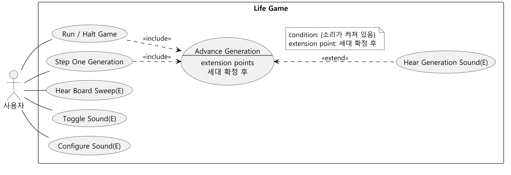
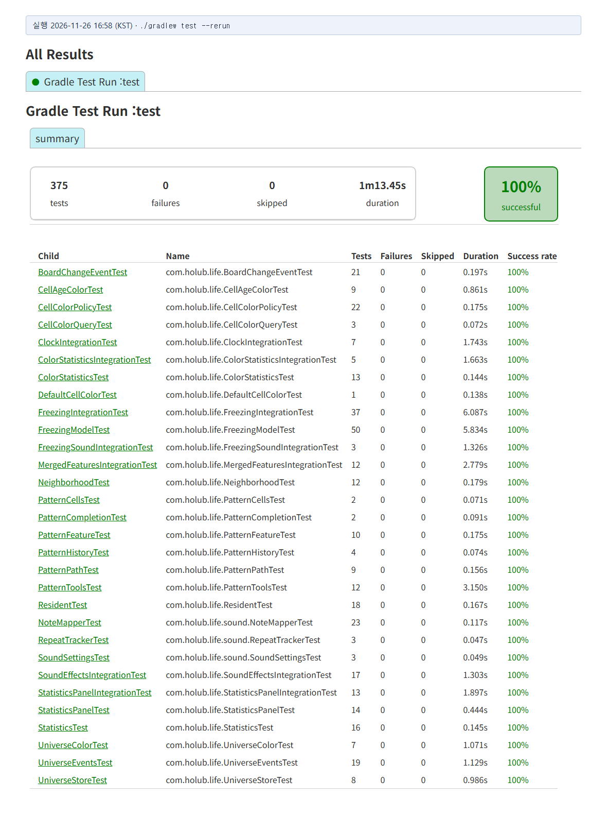

# 사운드 이펙트 기능 명세

판의 변화를 소리로 들려주는 확장 기능의 명세다. 기능 설명, 유스케이스, 요구사항, 적용한 패턴, 테스트 순서로 적었다. 구현 과정과 설계 결정은 [sound-effects.md](sound-effects.md), 다이어그램과 연산 계약은 [sound-uml.md](sound-uml.md)에 있다.

기준 코드는 통계(#10)와 Freezing(#7)을 합친 `dev`(`838182c`)다. 지금 `dev`(`cfba2ed`)도 소스 코드는 같고, 테스트와 문서만 기능별 폴더로 옮겨졌다. 이 문서의 테스트 파일 경로는 `cfba2ed` 기준이다.

## 1. 기능 개요

### 1.1 무엇이 달라지나

원래 Life Game은 판이 어떻게 바뀌는지 눈으로만 볼 수 있다. 이 기능은 같은 변화를 소리로도 들려준다. 패턴이 커지는지, 같은 모양을 되풀이하는지, 사라지는지를 귀로 구분할 수 있고, 게임을 멈춰 둔 상태에서도 지금 판의 모양을 들어 볼 수 있다.

| 기능 | 들리는 것·보이는 것 | 언제 |
|---|---|---|
| 세대 소리 | 새로 생긴 셀은 화음으로, 사라진 셀은 타악기로 들린다 | 세대가 넘어갈 때마다 |
| 재생선 | 초록 세로선이 판을 왼쪽에서 오른쪽으로 훑으며 선 아래의 산 셀을 연주한다. 밑에는 낮은 화음(패드)이 길게 깔린다 | 프로그램이 켜져 있는 동안 계속. 게임을 멈춰도 돈다 |
| 켜고 끄기 | `Sound` → `On`, `Off` | 사용자가 고를 때 |
| 설정 | `Sound` → `Settings` 창에서 기능별로 끄고 켜거나 악기를 바꾼다 | 사용자가 고를 때 |

### 1.2 사용해 보기

1. 프로그램을 실행하면 초록 세로선이 판 위를 왼쪽에서 오른쪽으로 움직인다. 판이 비어 있으면 소리는 나지 않는다.
2. 셀 몇 개를 클릭해 살린다. 초록 선이 그 셀을 지날 때 소리가 난다. 위쪽에 있는 셀일수록 높은 음이다.
3. 세로로 세 칸짜리 막대(블링커)를 그리고 `Go` → `Slow`를 고른다. 세대가 넘어갈 때마다 화음과 타악기 소리가 함께 난다.
4. 블링커는 두 모양을 계속 오가므로 같은 변화가 되풀이된다. 되풀이될수록 세대 소리가 작아지다가 조용해진다. 재생선과 패드 소리는 계속 난다.
5. `Sound` → `Off`를 고르면 새 소리가 더 나지 않고, 다음 스텝에 패드가 꺼지고 초록 선이 사라진다. 이미 예약된 음은 끝까지 울린다. `On`을 고르면 다시 돈다.
6. `Sound` → `Settings`를 고르면 게임 창 오른쪽에 설정 창이 뜬다. 창을 띄워 둔 채로 게임을 돌리면서 항목을 끄거나 악기를 바꿔 볼 수 있다.

### 1.3 한 세대에서 일어나는 일

세로 블링커(10열의 9~11행)가 한 세대 뒤 가로가 되는 경우를 예로 든다. 현재 코드가 C이고(코드 진행을 끄면 늘 C다) 작은 흔들림(1.4)을 끈 상태를 기준으로 했다. 시각은 사운드가 세대 이벤트를 받은 순간을 0으로 잰다.

- 생긴 셀: 10행 9열, 10행 11열
- 사라진 셀: 9행 10열, 11행 10열

| 시각 | 소리 | 이유 |
|---|---|---|
| 0ms | 미(E5) 건반을 누른다. 약간 왼쪽에서 들린다 | 생긴 두 셀은 같은 10행이라 같은 음이 되고, 하나만 남는다. 10행은 C 코드에서 미에 해당하고, 남은 셀이 9열이라 왼쪽으로 치우친다 |
| 60ms | 쉐이커를 한 번 친다 | 사라진 셀이 있으면 60ms 뒤에 타악기를 한 번 친다 |
| 220ms | 미 건반을 뗀다 | 생성음은 220ms 동안 울린다 |

작은 흔들림이 켜져 있으면 음의 시작과 끝이 0~15ms 늦어질 수 있고, 가끔 한 옥타브 위 음이 난다.

세대를 진행하는 쪽은 이 세 가지를 예약만 하고 바로 다음 일(화면 다시 그리기)로 넘어간다. 실제 소리는 사운드 전용 스레드가 예약한 시각에 낸다.

### 1.4 용어

| 용어 | 뜻 |
|---|---|
| MIDI 신시사이저 | 자바에 들어 있는 소프트웨어 악기. 프로그램은 "몇 번 건반을 얼마나 세게 누르고 언제 떼라"는 명령만 보낸다 |
| 세기 | 건반을 누르는 세기. 셀수록 소리가 크다(0~127) |
| 좌우 위치(pan) | 소리가 왼쪽·오른쪽 스피커 중 어디에서 들리는지(0~127) |
| 코드 | 함께 울리는 음의 묶음. C, Am, F, G 네 가지를 차례로 쓴다 |
| 5음 | 코드마다 정해 둔 음 5개. 셀은 이 5음 중 하나로만 소리 나기 때문에 어떤 셀이 함께 생겨도 크게 부딪히지 않는다 |
| 옥타브 | 어떤 음에서 같은 이름의 바로 위 음(도에서 다음 도)까지의 간격 |
| 스트럼 | 기타 줄을 긁듯 화음의 음을 조금씩 시간차를 두고 내는 것 |
| 패드 | 배경에 길게 깔리는 낮은 화음 |
| 작은 흔들림 | 같은 소리가 기계적으로 들리지 않게 세기와 시작 시각을 조금씩 바꾸고, 가끔 한 옥타브 올리는 것 |
| 세대와 스텝 | 세대는 게임 규칙이 한 번 적용되는 단위로, 간격은 `Go` 메뉴의 속도를 따른다. 스텝은 재생선이 한 칸(4열) 움직이는 단위로, 항상 150ms다 |

### 1.5 기존 기능에 미치는 영향

| 기존 기능 | 소리가 켜져 있을 때 | 꺼져 있거나 MIDI가 없을 때 |
|---|---|---|
| 셀 편집, Clear, Load | 바뀐 판을 재생선이 다음 스텝부터 연주한다. 세대 소리는 나지 않는다 | 원래와 같다 |
| 실행·정지, 한 세대 진행 | 세대마다 소리를 예약한다. 세대 진행은 소리를 기다리지 않는다 | 원래와 같다 |
| 속도 조절 | `Medium`(70ms)이나 `Fast`(30ms)처럼 세대가 120ms보다 빨리 넘어가면 일부 세대는 소리를 건너뛴다 | 원래와 같다 |
| Store, 종료 | 영향 없음 | 영향 없음 |

MIDI 신시사이저를 열 수 없는 환경에서는 `Sound disabled: ...` 한 줄만 출력하고, `Sound` 메뉴 없이 게임이 그대로 실행된다.

### 1.6 이번 범위에 넣지 않은 것

설정 저장(프로그램을 다시 켜면 처음 값으로 돌아간다), 전체 음량 조절, MIDI 장치 선택, 소리 녹음·내보내기, 셀 색에 따라 소리를 바꾸는 것.

## 2. 유스케이스

### 2.1 유스케이스 목록

기존 기능과 추가 기능을 나눠 적었다. 추가한 유스케이스는 이름 끝에 `(E)`를 붙였고, 기존 유스케이스 이름은 팀 전체 유스케이스 다이어그램과 같게 맞췄다.

| 구분 | 유스케이스 | 사운드와의 관계 |
|---|---|---|
| 기존 | Edit Cells | 편집한 판을 재생선이 다음 스텝부터 연주한다 |
| 기존 | Run / Halt Game | Advance Generation을 포함한다 |
| 기존 | Step One Generation | Advance Generation을 포함한다 |
| 기존 | Advance Generation | 확장점 "세대 확정 후"에서 Hear Generation Sound(E)가 확장한다 |
| 기존 | Clear Board, Store / Load Board | Clear와 Load로 바뀐 판을 재생선이 다음 스텝부터 연주한다 |
| 기존 | Exit Game | 관계 없음 |
| 추가 (UC-S1) | Hear Generation Sound(E) | Advance Generation을 확장한다. 조건은 소리가 켜져 있을 때다 |
| 추가 (UC-S2) | Hear Board Sweep(E) | 사용자와 직접 연관. 게임 진행과 상관없이 동작한다 |
| 추가 (UC-S3) | Toggle Sound(E) | 사용자와 직접 연관 |
| 추가 (UC-S4) | Configure Sound(E) | 사용자와 직접 연관 |



그림 원본은 [diagram/usecase.puml](diagram/usecase.puml)이다. 시스템 경계는 "Life Game" 상자 하나다. 기존 유스케이스는 사운드와 «include»·«extend»로 이어지는 Run / Halt Game, Step One Generation, Advance Generation만 그렸다. Edit Cells, Clear Board, Store / Load Board, Exit Game은 사운드와 이런 관계가 없어서 위 표에만 적었다. 그림에 있는 관계는 이렇다.

- «include»: 게임을 실행하면(Run / Halt Game) 틱마다, Step One Generation을 고르면 한 번 세대가 진행된다(Advance Generation). 할 때마다 반드시 따라오는 일이라 include로 그렸다. Halt는 세대 진행을 멈추기만 한다.
- «extend»: 세대가 확정된 뒤(확장점 "세대 확정 후") 소리가 켜져 있을 때만 Hear Generation Sound(E)가 끼어든다. 소리가 꺼져 있어도 세대 진행에는 아무 문제가 없어서 extend로 그렸다.
- Hear Generation Sound(E)는 사용자가 직접 시작하는 일이 아니라 세대 진행에 붙어서 일어나서, 사용자와 선으로 잇지 않았다.
- Hear Board Sweep(E)는 게임 진행과 관계없이 150ms 타이머로 돌아서 기존 유스케이스와 include·extend 관계가 없다.

### 2.2 유스케이스 명세

기본 흐름은 아무 문제가 없을 때의 순서이고, 대안 흐름은 그중 한 단계에서 갈라지는 경우다. 대안 흐름의 1a는 기본 흐름 1단계에서 갈라지는 첫 번째 경우다.

#### UC-S1 Hear Generation Sound(E)

| 항목 | 내용 |
|---|---|
| 목표 | 세대마다 판이 어떻게 바뀌었는지 소리로 듣는다 |
| 액터 | 사용자 |
| 시작 | Advance Generation이 한 세대를 확정했을 때 (확장점 "세대 확정 후") |
| 사전 조건 | MIDI 신시사이저가 열려 있다. `Sound`가 `On`이다 |
| 사후 조건 | 이번 세대의 소리가 예약된다. 세대를 진행하는 쪽은 소리가 끝날 때까지 기다리지 않는다 |

기본 흐름

1. 시스템은 이번 세대에 생긴 셀과 사라진 셀의 좌표를 사운드에 전달한다.
2. 시스템은 생긴 셀마다 음을 정한다. 위쪽 셀일수록 높은 음이고, 음은 현재 코드의 5음 중 하나다. 셀의 열 위치는 좌우 위치가 된다.
3. 같은 음이 되는 셀은 하나로 합친다. 남은 음이 5개보다 많으면 낮은 음부터 높은 음까지 고르게 5개를 고른다.
4. 시스템은 고른 음을 왼쪽 음부터 25ms 간격으로 내고, 각 음을 220ms 뒤에 끈다.
5. 사라진 셀이 있으면 60ms 뒤에 타악기를 한 번 친다. 많이 사라질수록 세게 치되 상한이 있다.

대안 흐름

- 1a. 생긴 셀도 사라진 셀도 없으면 소리를 내지 않는다. 블록처럼 멈춘 모양이나 빈 판이 여기에 해당한다. Freezing으로 고정된 셀은 바뀌지 않은 것으로 보므로 소리를 내지 않는다.
- 1b. 이번 세대에 판이 전멸했으면(생긴 셀이 없고 산 셀도 남지 않음) 화음과 타악기 대신 마무리 화음 3음을 90ms 간격으로 낸다. 그 뒤 빈 판의 세대는 1a에 따라 조용하다. 설정의 "반복 페이드·마무리"가 켜져 있을 때만 일어난다.
- 1c. 사운드는 변화가 있었던 세대를 최근 8개까지 기록해 둔다. 이번 변화가 그 기록 안에 있으면 되풀이로 본다. 되풀이가 이어질 때마다 화음과 타악기를 1/12씩 작게 내고, 12번째부터는 소리를 내지 않는다. 새로운 변화가 오면 원래 크기로 돌아간다. 이것도 "반복 페이드·마무리"가 켜져 있을 때만 일어나고, 소리나 이 항목이 꺼져 있는 동안의 세대는 기록하지 않는다. Clear나 Load는 기록을 지우지 않으므로, 같은 자리에 같은 진동자를 다시 그리면 처음부터 작게 들릴 수 있다.
- 1d. 직전 세대 소리를 낸 지 120ms가 지나지 않았으면 이번 세대는 건너뛴다. 빠른 속도에서 소리가 뭉치지 않게 하려고 넣었다.
- 3a. 한 세대에 12개 이상 생기면 같은 화음을 한 옥타브 위에서 조금 작게 한 번 더 낸다.
- 4a. 작은 흔들림이 켜져 있으면 음마다 시작이 0~15ms 늦어지고 세기가 조금씩 달라지며, 가끔 한 옥타브 위 음이 섞인다.
- 4b. 설정에서 끈 항목은 UC-S4의 설정 항목 표대로 동작이 바뀐다. 예를 들어 스트럼을 끄면 음 사이의 25ms 간격 없이 내고, 코드 진행을 끄면 늘 C 코드의 5음을 쓴다.

#### UC-S2 Hear Board Sweep(E)

| 항목 | 내용 |
|---|---|
| 목표 | 게임을 멈춰 둔 상태에서도 지금 판의 모양을 소리로 듣는다 |
| 액터 | 사용자 |
| 시작 | 프로그램이 시작되면 150ms마다 저절로 진행한다 |
| 사전 조건 | MIDI 신시사이저가 열려 있다. `Sound`가 `On`이다. 게임이 실행 중이든 멈춰 있든 상관없다 |
| 사후 조건 | 재생선 위치가 판 위에 초록 선으로 표시되고, 선 아래 산 셀의 소리가 예약된다 |

기본 흐름

1. 150ms마다 시스템은 재생선을 4열 오른쪽으로 옮기고 그 자리에 초록 선을 그린다.
2. 시스템은 재생선이 지나는 4열 안의 산 셀로 최대 3음을 낸다. 4스텝에 한 번은 조금 더 세게 내서 박자가 느껴지게 한다.
3. 시스템은 현재 코드의 패드를 낸다. 산 셀이 많을수록 크게 내되 상한이 있다.
4. 16스텝(64열, 약 2.4초)을 돌면 처음으로 돌아가고, 코드가 C → Am → F → G 순서로 바뀐다. 생성음과 재생선이 쓰는 5음도 함께 바뀐다.

대안 흐름

- 1a. 사용자가 셀을 편집하거나(Edit Cells, Draw Cells by Dragging(E)) Clear, Load, 템플릿 배치·되돌리기(Place Template(E), Undo Placement(E))를 하면 다음 스텝부터 바뀐 판을 연주한다.
- 1b. 설정에서 재생선을 끄면 선을 지우고 연주하지 않는다. 패드는 따로 켜고 끈다.
- 2a. 재생선이 지나는 4열에 산 셀이 없으면 그 스텝은 조용하다.
- 3a. 판이 비어 있거나 설정에서 패드를 끄면 패드를 끈다. 재생선은 계속 움직인다.
- 4a. 설정에서 코드 진행을 끄면 코드는 C에 머문다.

#### UC-S3 Toggle Sound(E)

| 항목 | 내용 |
|---|---|
| 목표 | 소리를 잠시 끄거나 다시 켠다 |
| 액터 | 사용자 |
| 시작 | 사용자가 `Sound` 메뉴에서 `Off` 또는 `On`을 고른다 |
| 사전 조건 | MIDI 신시사이저가 열려 있다. 열 수 없으면 `Sound` 메뉴가 생기지 않는다 |
| 사후 조건 | Off면 새 소리를 예약하지 않고, 다음 스텝에 패드를 끄고 재생선을 지운다. 이미 예약된 음은 예정대로 울리고 꺼진다. On이면 다음 스텝부터 다시 연주한다 |

기본 흐름

1. 사용자가 `Sound` → `Off`를 고른다.
2. 시스템은 세대 소리를 더 내지 않고, 다음 스텝에서 패드를 끄고 재생선을 지운다. 재생선 위치와 코드는 그 자리에서 멈춘다.
3. 사용자가 `Sound` → `On`을 고른다.
4. 시스템은 다음 스텝부터 멈췄던 자리에서 현재 판을 연주한다.

대안 흐름

- 2a. Off인 동안에도 판이 바뀐 내용은 계속 받아 둔다. 그래서 On으로 바꾸면 그 사이에 편집한 판을 바로 연주한다.
- 2b. Off를 고르기 전에 이미 예약된 음은 예정대로 울리고 꺼진다.

#### UC-S4 Configure Sound(E)

| 항목 | 내용 |
|---|---|
| 목표 | 기능별로 소리를 끄거나 악기를 바꿔 원하는 소리로 맞춘다 |
| 액터 | 사용자 |
| 시작 | 사용자가 `Sound` → `Settings`를 고른다 |
| 사전 조건 | MIDI 신시사이저가 열려 있다 |
| 사후 조건 | 바뀐 설정이 다음 소리부터 적용된다. 설정은 파일에 저장하지 않으므로 프로그램을 다시 켜면 처음 값으로 돌아간다 |

기본 흐름

1. 시스템은 게임 창 오른쪽에 설정 창을 띄운다. 9개 항목마다 체크박스가 있고, 악기를 고를 수 있는 5개 항목에는 선택 상자도 있다.
2. 사용자가 항목의 체크를 끈다. 시스템은 그 항목만 아래 표처럼 바꾸고 나머지는 그대로 둔다.
3. 사용자가 악기를 바꾼다. 시스템은 다음 음부터 새 악기로 낸다. 패드는 누르고 있던 음을 끊고 다음 스텝에 새 악기로 다시 시작한다.

대안 흐름

- 1a. 설정 창은 모달 창이 아니라서, 띄워 둔 채로 게임을 진행하며 바뀐 소리를 바로 들을 수 있다. 메뉴는 열려 있는 동안 게임이 멈추기 때문에 메뉴 대신 창으로 만들었다.
- 1b. 창을 닫았다가 다시 열면 같은 창이 같은 값으로 뜬다.

처음에는 모든 항목이 켜져 있고, 악기는 목록의 첫 번째다.

| 항목 | 끄면 | 고를 수 있는 악기 |
|---|---|---|
| 생성음 | 생긴 셀의 화음을 내지 않는다. 12개 이상 생겼을 때 겹치는 한 옥타브 위 화음은 5번 항목으로 따로 켜고 끈다 | 마림바, 실로폰, 하프, 피아노 |
| 1. 코드 진행 | 코드가 C에 머문다 | |
| 2. 스트럼 | 음 사이의 25ms 간격을 없앤다. 작은 흔들림이 켜져 있으면 음마다 0~15ms 차이는 남는다 | |
| 3. 소멸 타악기 | 사라진 셀의 타악기를 치지 않는다 | 쉐이커, 하이햇, 카바사, 탬버린 |
| 4. 저음 패드 | 패드를 끈다 | 웜 패드, 스트링, 합창, 오르간 |
| 5. 대량 생성 악기 | 12개 이상 생겨도 한 옥타브 위 화음을 겹치지 않는다 | 비브라폰, 글로켄슈필, 첼레스타, 튜블러 벨 |
| 6. 반복 페이드·마무리 | 되풀이돼도 작아지지 않고, 판이 전멸해도 마무리 화음을 내지 않는다 | |
| 7. 작은 흔들림 | 세기와 시작 시각을 흔들지 않고, 옥타브도 올리지 않는다 | |
| 8. 재생선 | 초록 선을 지우고 재생선 음을 내지 않는다. 패드는 따로 켜고 끈다 | 칼림바, 뮤직박스, 하프, 기타 |

## 3. 요구사항

기능 요구사항(F)은 시스템이 무엇을 하는지, 비기능 요구사항(N)은 구조·반응성·실행 환경처럼 어떻게 동작해야 하는지다. 요구사항마다 확인하는 테스트를 함께 적었다. 테스트 내용은 6장에 있다.

### 3.1 기능 요구사항

| ID | 요구사항 | 유스케이스 | 확인하는 테스트 |
|---|---|---|---|
| F1 | 세대마다 생긴 셀을 최대 5음 화음으로 낸다. 음은 현재 코드의 5음 안에서 고르고, 위쪽 셀일수록 높으며, 열 위치는 좌우 위치가 된다 | UC-S1 | `everyPitchIsInCMajor`, `higherOnTheBoardNeverSoundsLower`, `columnSetsStereoPosition`, `fullBoardStaysWithinVoiceLimitAndValidMidiRange`, `realBlinkerUpdatesStatisticsAndSchedulesBirthAndDeathSoundsOnce` |
| F2 | 화음은 왼쪽 음부터 25ms 간격으로 내고, 각 음은 220ms 뒤에 끈다. 작은 흔들림이 켜져 있으면 시작이 0~15ms 늦어질 수 있다 | UC-S1 | `notesAreOrderedLeftToRightForStrumming`, `birthStrumNoteLengthsAndPercussionDelayRemainUnchanged` |
| F3 | 사라진 셀이 있으면 60ms 뒤 타악기를 한 번 친다. 많이 사라질수록 세지만 상한이 있다 | UC-S1 | `moreDeathsHitHarderUpToACap`, `birthStrumNoteLengthsAndPercussionDelayRemainUnchanged` |
| F4 | 12개 이상 생긴 세대는 한 옥타브 위 화음을 조금 작게 겹친다 | UC-S1 | `smallGenerationsHaveNoBurstLayer`, `burstLayerDoublesNotesAnOctaveHigherAndQuieter`, `largeBirthEventKeepsTheBurstLayer` |
| F5 | 변화가 없는 세대와, 세대 진행이 아닌 판 변경(편집·Clear·Load·템플릿·색 변경)은 세대 소리를 내지 않는다 | UC-S1 | `stableAndEmptyGenerationsNeverScheduleGenerationSounds`, `nonGenerationEventUpdatesSweepWithoutGenerationSounds`, `realColorMenuRefreshesStatisticsWithoutSchedulingGenerationSound` |
| F6 | 같은 변화가 되풀이되면 12번에 걸쳐 무음까지 줄이고, 새 변화가 오면 원래 크기로 돌아간다. 판이 전멸하면 마무리 화음을 한 번 낸다 | UC-S1 | `RepeatTrackerTest` 3개, `scalingLowersLoudnessOnly`, `endingChordIsAboveThePadOfTheSameChord`, `extinctionPlaysOneEndingAndLaterEmptyTicksStaySilent` |
| F7 | 재생선은 150ms마다 4열씩 움직이며 그 구간의 산 셀을 최대 3음으로 연주하고, 판 위에 초록 선으로 보인다. 게임이 멈춰 있어도 동작하고 편집한 판을 반영한다 | UC-S2 | `sweepPlaysOnlyCellsInTheColumnBlock`, `sweepLimitsVoicesAndAccentsTheBeat`, `sweepOfAnEmptyBlockIsSilent`, `playheadIsDrawnOverTheBoardAndCanBeRemoved`, `initialSnapshotIsReadyBeforeTheFirstScheduledSweep` |
| F8 | 재생선이 한 바퀴 돌 때마다 코드가 C → Am → F → G로 바뀌고 패드도 같은 코드를 따른다. 패드는 산 셀이 많을수록 커지고 빈 판이면 꺼진다 | UC-S2 | `sameCellChangesPitchAcrossTheProgression`, `progressionWrapsAround`, `padFollowsTheProgression`, `padGrowsWithLiveCellsUpToACapAndStopsOnAnEmptyBoard` |
| F9 | 작은 흔들림은 세기를 ±8, 시작을 0~15ms 바꾸고, 12% 확률로 한 옥타브 올린다 | UC-S1, UC-S2 | `humanizingKeepsNotesValidAndVariesThem`, `timingJitterStaysSmall` |
| F10 | `Sound` → `Off`면 새 소리를 예약하지 않고 다음 스텝에 패드와 재생선을 멈춘다. 이미 예약된 음은 예정대로 끝난다. `On`으로 바꾸면 Off 동안 바뀐 판을 연주한다 | UC-S3 | `disabledSoundStillReceivesEditsForTheNextSweep` |
| F11 | 설정 창에서 9개 항목을 하나씩 끄고, 5개 항목의 악기를 바꿀 수 있다 | UC-S4 | `SoundSettingsTest` 3개 |
| F12 | Freezing으로 고정된 셀은 세대 소리를 내지 않고, 풀린 첫 세대부터 다시 들린다. 재생선은 고정된 산 셀도 연주한다 | UC-S1, UC-S2 | `FreezingSoundIntegrationTest` 3개 |

### 3.2 비기능 요구사항

| ID | 요구사항 | 확인 방법 |
|---|---|---|
| N1 | 게임 로직(`Universe`, `Cell`)은 사운드 패키지를 몰라야 한다. 사운드를 빼도 게임은 그대로 동작한다 | `Universe`와 `Cell` 계층은 사운드 패키지를 import하지 않는다. 게임 쪽에서 사운드를 아는 곳은 프로그램 시작점인 `Life`의 `SoundEffects.install()` 한 줄뿐이라, 이 호출을 빼면 소리만 빠진다 |
| N2 | 세대를 진행하는 Swing 이벤트 스레드는 소리 때문에 기다리면 안 된다 | 모든 음은 스케줄러에 예약만 한다. `birthStrumNoteLengthsAndPercussionDelayRemainUnchanged`가 예약 목록을 확인하고, `sweepUsesAnIndependentSnapshotOnItsWorkerThread`가 재생선이 다른 스레드에서 판의 복사본만 읽는지 확인한다 |
| N3 | MIDI 신시사이저가 없는 환경에서도 게임이 정상 실행되어야 한다 | `missingMidiDeviceDoesNotPreventStatisticsFromAdvancing` |
| N4 | 기존 기능이 그대로 동작해야 한다 | 사운드 작업 전에 있던 테스트(기본 오류를 고칠 때 만든 `ResidentTest` 18개, `NeighborhoodTest` 11개, `UniverseStoreTest` 3개)가 그대로 통과한다 |
| N5 | 음을 고르는 규칙은 MIDI 장치와 화면 없이 테스트할 수 있어야 한다 | `NoteMapper`, `RepeatTracker`, `SoundSettings`는 MIDI와 Swing을 쓰지 않는다. 테스트에서는 랜덤에 시드를 넣어 결과를 고정한다 |

## 4. 적용한 GoF 패턴

| 패턴 | 어디에 | 해결한 문제 |
|---|---|---|
| Observer | `Universe` → `BoardChangeListener` → `SoundEffects` | 게임 로직이 사운드를 모르는 채로 판의 변화를 알린다 |
| Command | `Runnable` → `ScheduledExecutorService` → `MidiChannel` | 시간차가 필요한 소리를, 화면을 맡은 스레드가 기다리지 않고 낸다 |
| Composite (기존 구조 확장) | `Cell`, `Neighborhood`, `Resident`의 `isAliveAt()` | 여러 겹으로 나뉜 판에서 좌표 하나의 생사를 묻는다 |

### 4.1 Observer: 판의 변화를 사운드에 알린다

원래 `Universe`는 틱마다 판을 바꾸고 다시 그리기만 해서, 무엇이 바뀌었는지 밖에서 알 수 없었다. 그렇다고 `Universe`가 `SoundEffects`를 직접 부르면 게임 로직이 사운드에 묶이고, 기능이 늘 때마다 `Universe`를 고쳐야 한다.

| 역할 | 클래스 |
|---|---|
| Subject | `Universe` (`addBoardChangeListener()`, `removeBoardChangeListener()`) |
| Observer | `BoardChangeListener` (`onBoardChanged(BoardChangeEvent)`) |
| ConcreteObserver | `SoundEffects`, `Statistics` |

그래서 `Universe`가 세대를 확정하거나 판이 바뀔 때 이벤트를 만들어 등록된 리스너에게 보내게 했다. 이벤트에는 작업 종류, 세대 번호, 판의 복사본, 생긴 셀과 사라진 셀의 좌표가 들어 있어서 받는 쪽이 판을 다시 읽을 필요가 없다(push 방식). `Universe`는 `BoardChangeListener` 인터페이스만 알고, 그 뒤에 누가 있는지는 모른다.

`SoundEffects`가 `Clock`을 직접 구독하는 방법도 봤다. `Universe`를 고치지 않아도 되지만, 구독 순서 때문에 바뀌기 전의 판을 보게 되고 무엇이 바뀌었는지도 사운드가 따로 계산해야 했다. 방법별 비교는 [sound-effects.md](sound-effects.md) 5.1절에 있다.

대신 변화를 찾으려고 틱마다 판(64×64)을 전이 전과 후에 한 번씩 읽는다. 화면을 다시 그리는 것보다 훨씬 가벼워서 그대로 뒀다. 또 리스너는 Swing 이벤트 스레드에서 불리기 때문에 오래 걸리면 화면이 같이 멈춘다. 4.2의 Command 구조는 이 때문에 필요했다.

처음(#3)에는 사운드 전용 인터페이스 `Universe.GenerationListener`를 두고, 구독 관리는 Holub 코드의 `Publisher`를 썼다. 통계 기능(#10)도 같은 세대 정보가 필요해서, 두 기능이 같은 이벤트를 받도록 `BoardChangeListener`와 `BoardChangeEvent`로 합쳐졌다. 소리를 만드는 코드가 처음부터 `Universe`와 떨어져 있어서 이때 사운드 쪽에서 고친 곳은 `SoundEffects`의 수신부 30줄 정도였고, `NoteMapper`, `RepeatTracker`, `SoundSettings`는 그대로였다.

### 4.2 Command: 소리를 예약 명령으로 만든다

소리는 대부분 조금 뒤에 나야 한다. 화음은 25ms 간격, 타악기는 60ms 뒤, 음 끄기는 220ms 뒤, 재생선은 150ms마다다. 이걸 세대를 진행하는 이벤트 스레드에서 기다리면 그동안 화면과 입력이 같이 멈춘다(N2).

| 역할 | 재생 예약 | `Sound` 메뉴 |
|---|---|---|
| Client | `SoundEffects` | `SoundEffects.createMenus()` |
| Command | `Runnable` (음 켜기, 음 끄기, 타악기, 악기 변경, 재생선 한 스텝) | `ActionListener` |
| Invoker | 단일 스레드 `ScheduledExecutorService` (`sound-notes` 스레드) | 메뉴 항목 |
| Receiver | `MidiChannel` | `SoundEffects` |

그래서 할 일을 `Runnable` 객체로 만들어 실행할 시각과 함께 스케줄러에 넣고, 스레드 하나가 시각 순서대로 꺼내 실행하게 했다. 요청을 객체로 만들어서 요청하는 쪽과 실행하는 쪽을 떼어 놓는 구조가 Command와 같다. 이미 난 소리는 되돌릴 일이 없어서 undo나 실행 이력은 두지 않았고, 명령마다 클래스를 만들지 않고 람다로 썼다.

`Thread.sleep()`으로 기다리는 방법은 코드가 가장 단순하지만 화면이 멈춘다. 소리마다 새 스레드를 만들면 기다리지는 않지만, 여러 스레드가 같은 `MidiChannel`을 건드려 켜기와 끄기 순서가 꼬일 수 있다. 자바의 `Sequencer`는 미리 만든 악보를 재생하는 방식이라 세대마다 달라지는 입력을 바로 반영하기 어렵다([sound-effects.md](sound-effects.md) 5.3절).

스케줄러가 바쁘면 실행 시각이 몇 ms 밀릴 수 있지만 효과음에서는 들리지 않는 정도였다. 그리고 설치할 때 악기를 처음 정하는 한 번을 빼면 `MidiChannel`과 재생선 상태는 이 스레드에서만 만지기 때문에, 채널에 잠금을 따로 걸지 않아도 됐다. 설정 창에서 악기를 바꿀 때도 채널을 직접 바꾸지 않고 `applyInstruments`를 명령으로 넣는다.

### 4.3 Composite 확장: 좌표로 셀 상태를 묻는다

소리를 만들려면 r행 c열 셀이 살아 있는지 물어야 하는데, 원래 `Cell`에는 그런 연산이 없었다. 판은 8×8 `Neighborhood` 안에 다시 8×8 `Neighborhood`가 들어 있는 트리라서, 묻는 쪽이 이 구조를 몰라도 되게 해야 했다.

| 역할 | 클래스 |
|---|---|
| Component | `Cell` (`isAliveAt(row, column)` 추가) |
| Composite | `Neighborhood` |
| Leaf | `Resident`, `Cell.DUMMY` |

그래서 기존 Composite 구조에 연산 하나를 더했다. `Neighborhood`는 좌표를 나눠 어느 하위 칸인지 찾고, 그 칸 안의 좌표로 바꿔 넘긴다. `Resident`는 자기 상태를 답한다. `Universe`는 가장 바깥 셀에 한 번만 물으면 되고, 판이 몇 겹인지 몰라도 된다.

`Cell`을 고치지 않는 방법도 두 가지 있었다. Load/Store에 쓰는 Memento를 다시 쓰는 방법은 5장에 적었다. `Universe`가 `boolean[][]`을 따로 들고 있는 방법은 클릭·Clear·Load·세대 진행 때마다 실제 셀과 맞춰 줘야 하고, 한 곳만 빠져도 소리와 화면이 어긋난다.

대신 `Cell` 구현 3개(`Neighborhood`, `Resident`, `Cell.DUMMY`)를 모두 고쳐야 했고, 칸 하나를 읽을 때마다 바깥 `Neighborhood`, 안쪽 `Neighborhood`, `Resident` 순서로 호출이 세 번 이어진다. 판이 64×64라 부담은 작았다.

이 연산은 나중에 다른 기능에서도 쓰게 됐다. 드래그 그리기, 캡처·템플릿(`PatternCells`), Freezing 영역의 상태 저장(`FreezingRegion`), 공통 이벤트의 판 복사(`Universe.liveCells()`)가 모두 `isAliveAt()`으로 셀 상태를 읽는다.

### 4.4 기존 패턴을 그대로 쓴 부분

`Sound` 메뉴는 Holub 코드의 `MenuSite`(Swing 메뉴를 감싸는 Facade)로 등록해서 기존 메뉴 코드를 고치지 않았다. `Universe`와 `Clock`은 원래 Singleton이며, 사운드는 이 구조를 그대로 쓴다.

## 5. 검토했지만 적용하지 않은 GoF 패턴

| 패턴 | 검토한 곳 | 적용하지 않은 이유 | 다시 검토할 조건 |
|---|---|---|---|
| Strategy | 생성음, 타악기, 패드, 재생선을 각각 객체로 나눠 공통 인터페이스 뒤에 두기 | 지금 `SoundEffects`에는 기능마다 켜졌는지 확인하는 `settings.isOn(...)` 분기가 10곳 있고, Strategy를 쓰면 이 분기가 없어진다. 하지만 기능들이 서로 독립적이지 않다. 현재 코드와 반복 페이드 값을 여러 기능이 같이 쓰고, 대량 생성 레이어는 생성음이 고른 화음을 받아 쓴다. 이 값을 주고받는 인터페이스부터 정해야 해서 이번에는 남겨 두었다 | 소리 기능을 더 늘릴 때. 가장 먼저 적용할 후보다 |
| Strategy | 셀을 음으로 바꾸는 규칙(반음씩, 장음계, 코드별 5음)을 바꿔 끼우기 | 규칙을 비교해 보고 코드별 5음 하나만 쓰기로 했다. 실행 중에 규칙을 바꾸는 기능이 없으므로 바꿔 끼울 틀을 둘 이유가 없었다 | 사용자가 음계를 고르는 기능을 넣을 때 |
| State | 반복 페이드의 상태(원래 크기, 작아지는 중, 무음)와 Sound On/Off | 페이드 상태는 되풀이 횟수 하나와 `1 - 되풀이 횟수/12` 식으로 정해진다. 상태마다 하는 일이 다르지 않고 볼륨 값만 다르므로, 상태 클래스를 3개 만들면 식 하나가 흩어질 뿐이다. On/Off도 `boolean` 하나다. 상태마다 동작이 크게 달라지는 Freezing 영역과는 경우가 다르다 | 상태마다 하는 일이 달라질 때 |
| Decorator | 음 목록에 흔들림(`humanized`), 볼륨 조절(`scaled`), 대량 생성 레이어를 겹쳐 적용하는 부분 | 겹쳐 적용한다는 점은 Decorator와 비슷하다. 하지만 대상이 동작을 가진 객체가 아니라 음 값(`Note`)의 목록이고, 적용 순서도 정해져 있다. 목록을 받아 새 목록을 돌려주는 메서드로 충분했다 | 사용자가 효과를 골라 순서를 바꿔 쌓을 수 있게 할 때 |
| Mediator | `SoundEffects`가 `NoteMapper`, `RepeatTracker`, `SoundSettings`, MIDI 채널을 조율하는 구조 | Mediator는 서로 직접 부르던 객체들이 중재자를 거쳐 주고받게 하는 패턴이다. 여기서는 `NoteMapper`와 `RepeatTracker`가 서로를 부를 일이 처음부터 없다. 조율하는 쪽이 하나일 뿐 중재할 상호작용이 없다 | 이 객체들이 서로 값을 주고받아야 할 때 |
| Singleton | `SoundEffects` | 프로그램 시작 때 `Life`에서 한 번만 만들면 되고, 다른 곳에서 찾을 일이 없다. 전역 접근점을 두는 대신 `Universe`를 인자로 받아 무엇에 의존하는지 드러냈다 | 다른 기능이 사운드에 직접 요청해야 할 때 |
| Memento | 판 상태를 읽을 때 Load/Store용 `createMemento()`, `transfer()`를 다시 쓰기 | `Cell`을 고치지 않아도 되는 장점이 있다. 하지만 Memento는 파일 입출력(`Storable`)까지 구현해야 하고, 칸 하나만 궁금해도 판 전체를 복사한다. `Neighborhood.transfer()`가 `activeEdges`를 바꾸기 때문에 저장할 때만 쓰던 경로를 매 틱 부르게 되는 문제도 있어서, `isAliveAt()`을 추가하는 쪽(4.3)을 골랐다 | 설정 저장이나 되돌리기를 넣을 때 (판 읽기가 아니라 설정 쪽) |

## 6. JUnit 테스트

### 6.1 실행과 결과

저장소 루트에서 `./gradlew test`를 실행한다. 2026-11-24 18:59(KST)에 `docs/sound-spec`(`c51e59b`, 소스·테스트는 `dev` `cfba2ed`와 같음)에서 `./gradlew test --rerun`으로 다시 실행해 전체 384개가 모두 통과했다. 캡처 맨 위에도 실행 날짜와 커밋을 적었다.



사운드와 관련된 테스트는 52개다. 사운드만 다루는 테스트 클래스 4개에 46개가 있고, 기존 클래스에 사운드용으로 더한 테스트와 Freezing과 함께 보는 테스트가 6개다.

| 구분 | 테스트 클래스 | 개수 | 대상 |
|---|---|---|---|
| 사운드 | [`NoteMapperTest`](../../test/sound/com/holub/life/sound/NoteMapperTest.java) | 23 | 음 고르기 규칙. MIDI와 화면 없이 확인한다 |
| 사운드 | [`RepeatTrackerTest`](../../test/sound/com/holub/life/sound/RepeatTrackerTest.java) | 3 | 반복 페이드 |
| 사운드 | [`SoundSettingsTest`](../../test/sound/com/holub/life/sound/SoundSettingsTest.java) | 3 | 설정 값 |
| 사운드 | [`SoundEffectsIntegrationTest`](../../test/sound/com/holub/life/SoundEffectsIntegrationTest.java) | 17 | 실제 `Universe`·`Statistics`와 연결한 `SoundEffects`. MIDI, 스케줄러, 메뉴 등록은 테스트용 가짜로 바꿨다. 통계 기능을 합칠 때 추가됐다 |
| 관련 | [`NeighborhoodTest`](../../test/original/com/holub/life/NeighborhoodTest.java) | 12개 중 1 | `isAliveAt()` |
| 관련 | [`UniverseStoreTest`](../../test/original/com/holub/life/UniverseStoreTest.java) | 8개 중 2 | 판 복사, 재생선 그리기 |
| 관련 | [`FreezingSoundIntegrationTest`](../../test/integration/com/holub/life/FreezingSoundIntegrationTest.java) | 3 | Freezing과 함께 쓸 때. Freezing 기능을 합칠 때 추가됐다 |

### 6.2 주요 테스트와 확인 내용

사운드 관련 테스트 가운데 요구사항을 대표하는 14개를 골랐다. 무엇을 확인하는지에 따라 네 묶음으로 나눴다.

#### 음을 고르는 규칙

어떤 판에서도 고른 음이 정해진 범위를 벗어나지 않는지 본다.

| 테스트 | 어떤 내용에 대한 테스트인가 | 확인 방법과 기대 결과 | 요구사항 |
|---|---|---|---|
| `NoteMapperTest.everyPitchIsInCMajor` | 고른 음이 모두 C장조 음계 안에 있는지. 여러 셀이 함께 생겨도 덜 부딪히게 하려고 5음을 C장조 안에서 고른 설계가 지켜지는지 본다 | 셀 하나씩, 코드 4개 × 64행에서 고른 음을 12로 나눈 나머지가 C장조 7음 중 하나다 | F1 |
| `NoteMapperTest.higherOnTheBoardNeverSoundsLower` | 판의 높이가 음 높이로 바뀌는지 | 코드 4개 각각에서 위쪽 행의 음이 바로 아래 행의 음보다 낮지 않다 | F1 |
| `NoteMapperTest.fullBoardStaysWithinVoiceLimitAndValidMidiRange` | 셀이 아주 많이 생겨도 소리가 과하지 않은지 | 64×64 판 전체가 한꺼번에 생겨도 정확히 5음만 나오고, 세기는 1~127이며, 같은 음이 겹치지 않는다 | F1 |

#### 되풀이와 설정

같은 변화가 되풀이되면 소리가 줄어드는지, 설정 항목끼리 서로 영향을 주지 않는지 본다.

| 테스트 | 어떤 내용에 대한 테스트인가 | 확인 방법과 기대 결과 | 요구사항 |
|---|---|---|---|
| `RepeatTrackerTest.oscillatorFadesToSilence` | 진동자처럼 같은 변화가 되풀이되면 조용해지는지 | 두 변화를 16세대 동안 번갈아 넣는 동안 볼륨이 한 번도 커지지 않고 마지막에 0이 된다 | F6 |
| `SoundSettingsTest.turningOneFeatureOffLeavesTheOthersOn` | 설정 항목이 서로 독립적인지 | 스트럼을 꺼도 재생선은 켜진 상태 그대로다 | F11 |

#### 게임과의 연결

실제 게임 동작에 사운드가 맞게 반응하는지 본다.

| 테스트 | 어떤 내용에 대한 테스트인가 | 확인 방법과 기대 결과 | 요구사항 |
|---|---|---|---|
| `NeighborhoodTest.isAliveAtFindsResidentThroughNestedNeighborhoods` | Composite에 추가한 `isAliveAt()`이 여러 겹으로 나뉜 판에서 좌표를 제대로 찾는지 | 두 겹으로 나뉜 판에서 클릭한 3행 2열만 `true`이고, 행과 열을 바꾼 2행 3열은 `false`다 | F1, F7 |
| `UniverseStoreTest.playheadIsDrawnOverTheBoardAndCanBeRemoved` | 재생선이 판 위에 보이고 지워지는지 | 판을 이미지로 그려 재생선 자리의 픽셀이 초록색(0, 170, 80)이고, `-1`로 지우면 그 픽셀이 바뀐다 | F7 |
| `SoundEffectsIntegrationTest.realBlinkerUpdatesStatisticsAndSchedulesBirthAndDeathSoundsOnce` | 실제 세대 진행이 Observer를 거쳐 소리로 이어지는지 | 블링커를 그리는 동안은 예약이 없다. 한 틱 뒤 생성 화음이 나고 타악기는 정확히 한 번 친다. 같은 이벤트로 통계도 세대 1로 바뀐다 | F1, F3 |
| `SoundEffectsIntegrationTest.stableAndEmptyGenerationsNeverScheduleGenerationSounds` | 변화가 없는 세대는 조용한지 | 블록(2×2)만 있는 판과 빈 판에서 여러 틱을 진행해도 예약된 소리가 없다 | F5 |
| `SoundEffectsIntegrationTest.birthStrumNoteLengthsAndPercussionDelayRemainUnchanged` | 명령이 정해진 시각에 예약되는지 | 두 음의 시작이 0~15ms, 25~40ms이고 각각 220ms 뒤에 끄며, 타악기는 60ms에 예약된다(6.3) | F2, F3, N2 |
| `SoundEffectsIntegrationTest.extinctionPlaysOneEndingAndLaterEmptyTicksStaySilent` | 판이 전멸할 때 마무리 화음이 한 번만 나는지 | 마지막 셀이 죽는 틱에 3음이 0·90·180ms에 시작해 900ms씩 울리고, 그 뒤 빈 판의 틱에서는 아무것도 예약되지 않는다 | F6 |
| `SoundEffectsIntegrationTest.disabledSoundStillReceivesEditsForTheNextSweep` | Off 동안의 편집이 On 뒤에 반영되는지 | Off에서 셀을 그리면 재생선 스텝이 아무것도 예약하지 않고, On으로 바꾼 뒤 스텝에서는 그 셀을 재생선 채널로 연주한다 | F10 |
| `SoundEffectsIntegrationTest.missingMidiDeviceDoesNotPreventStatisticsFromAdvancing` | MIDI 장치가 없을 때 게임이 계속되는지 | 신시사이저를 얻을 때 예외가 나도 `install()`이 예외 없이 끝나고, 틱을 진행하면 통계가 세대 1로 바뀐다 | N3 |

#### 다른 기능과 함께

다른 확장 기능과 같이 써도 소리가 맞게 나는지 본다.

| 테스트 | 어떤 내용에 대한 테스트인가 | 확인 방법과 기대 결과 | 요구사항 |
|---|---|---|---|
| `FreezingSoundIntegrationTest.aFrozenBlinkerIsSilentAndIsHeardAgainOnItsFirstFreeGeneration` | Freezing과 함께 쓸 때 소리가 맞게 나는지 | 3세대 동안 고정한 블링커는 그동안 조용하고, 풀린 첫 세대에 생성 화음과 타악기 한 번이 난다 | F12 |

### 6.3 테스트 코드 예시

명령이 정해진 시각에 예약되는지 보는 통합 테스트다. 이 테스트는 실제 스케줄러 대신 가짜 스케줄러를 쓴다. 가짜 스케줄러는 명령을 실행하지 않고, 받은 명령과 예약 시각을 `jobs` 목록에 쌓아 두기만 한다. 그래서 소리를 듣지 않고도 몇 ms 뒤에 무엇을 하기로 했는지 숫자로 확인할 수 있다.

생긴 셀 2개와 사라진 셀 1개를 담은 세대 이벤트를 보내면, 음 켜기·끄기 2쌍과 타악기 1개, 모두 5개가 예약되어야 한다.

```java
@Test void birthStrumNoteLengthsAndPercussionDelayRemainUnchanged() throws Exception {
    LifeTestSupport.onEdt(() -> {
        boolean[][] cells = new boolean[64][64]; cells[1][2] = cells[60][60] = true;
        sound.onBoardChanged(new BoardChangeEvent(GENERATION, 1, 64, cells,
                List.of(new Point(2, 1), new Point(60, 60)), List.of(new Point(3, 4)), LifeTestSupport.redColors(cells)));
        assertEquals(5, jobs.size());
        assertTrue(jobs.get(0).delay() >= 0 && jobs.get(0).delay() <= 15);
        assertEquals(220, jobs.get(1).delay() - jobs.get(0).delay());
        assertTrue(jobs.get(2).delay() >= 25 && jobs.get(2).delay() <= 40);
        assertEquals(220, jobs.get(3).delay() - jobs.get(2).delay());
        assertEquals(60, jobs.get(4).delay());
        runNotes();
        assertEquals(2, played.stream().filter(note -> note.channel() < 5).count());
        assertEquals(1, played.stream().filter(note -> note.channel() == 9 && note.pitch() == 82).count());
    });
}
```

앞의 네 예약은 음 두 개의 켜기·끄기이고, 마지막이 타악기다. 음의 시작 시각은 작은 흔들림이 더해지기 때문에 범위로 확인한다. 둘째 음이 25~40ms인 것은 스트럼 간격 25ms에 흔들림 0~15ms가 따로 더해져서다. 음 길이(220ms)와 타악기 시각(60ms)은 정확한 값으로 확인한다. 끝으로 예약을 실제로 실행해 생성음 채널(0~4번)에서 음 2개, 타악기 채널(9번)에서 쉐이커(82번) 한 번이 나는지 본다.

### 6.4 JUnit으로 확인하지 않는 것

자동 테스트로 확인하지 않는 것은 세 가지다.

- 실제 장치에서 나는 음색과 음량, 설정 창에서 악기를 바꿨을 때 실제로 다르게 들리는지
- 여러 음이 함께 날 때 실제로 어울리게 들리는지. 테스트는 각 음이 C장조 안에 있는지까지만 본다
- `Off`를 고를 때 이미 예약돼 있던 음이 예정대로 끝나는지

악기 20개가 모두 소리를 내는지, 빈 판과 `Off` 뒤에 조용한지, 재생선과 패드를 끄면 멈추는지는 신시사이저 출력을 따로 받아 확인했다([sound-effects.md](sound-effects.md) 6.5절).
