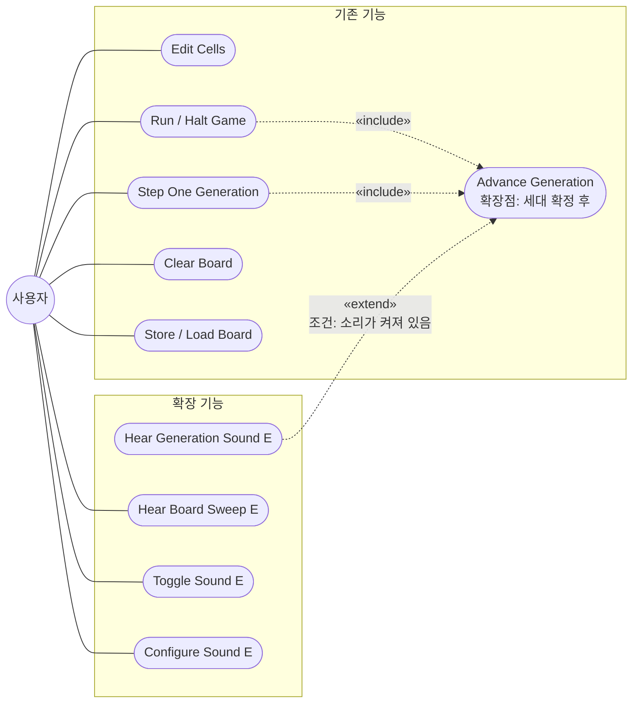
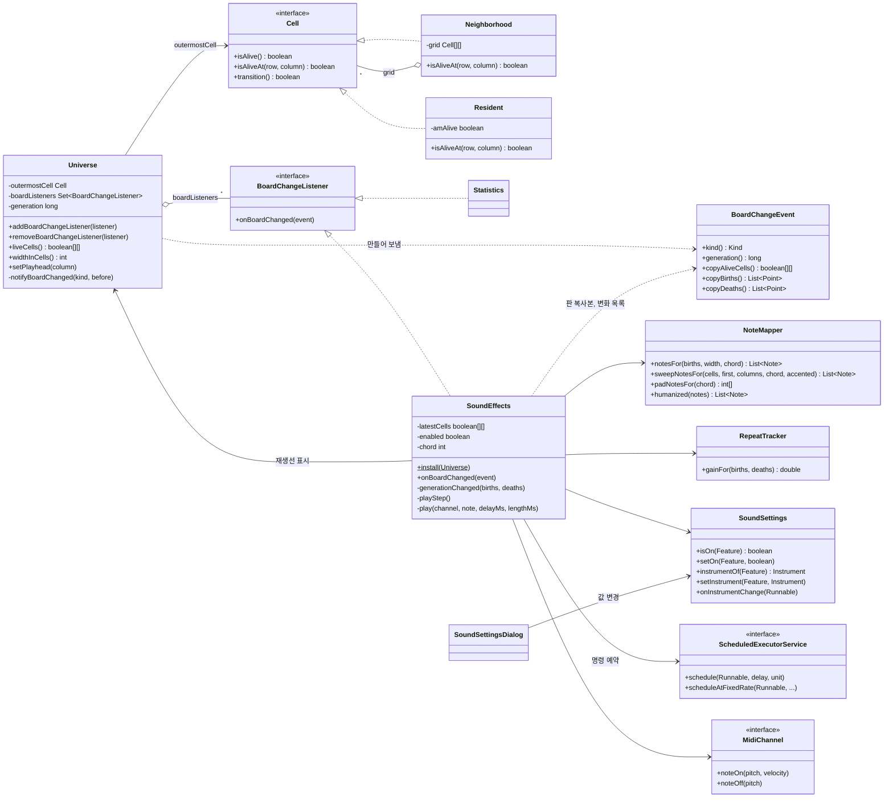
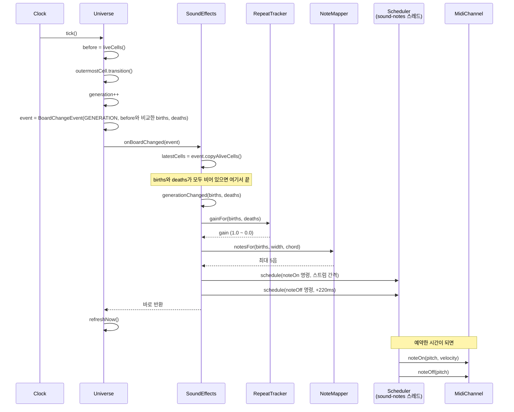
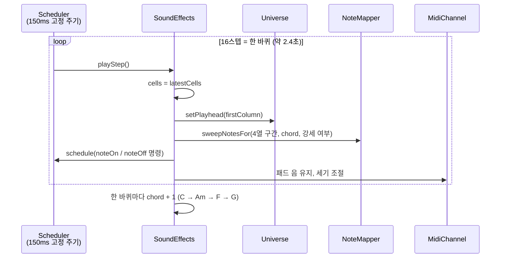
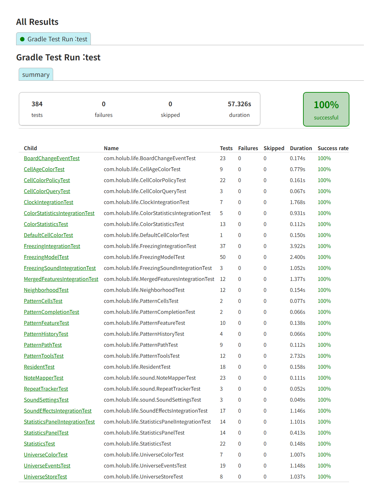
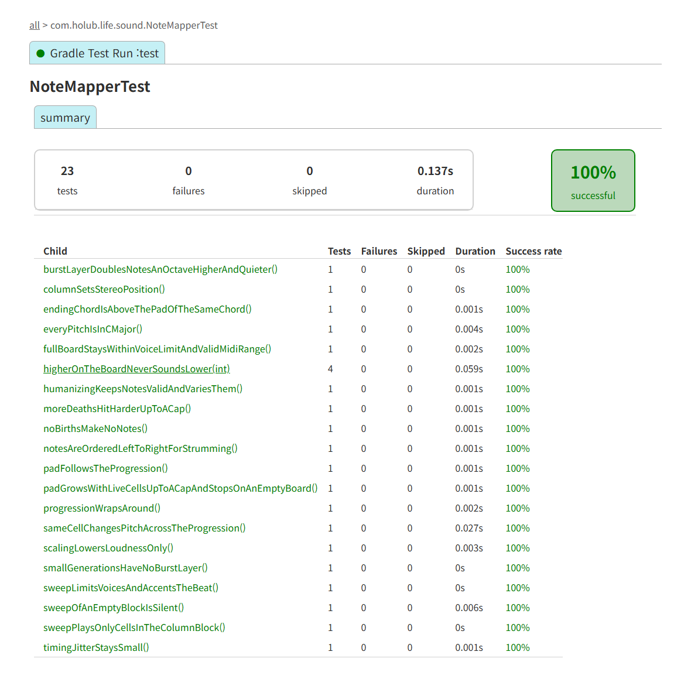
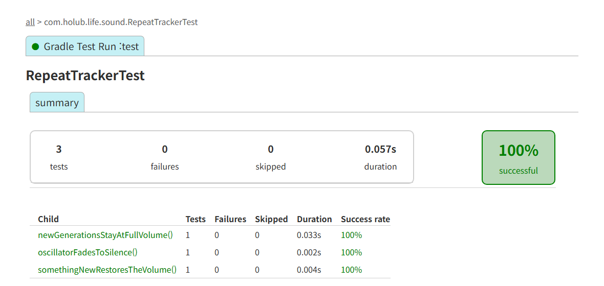
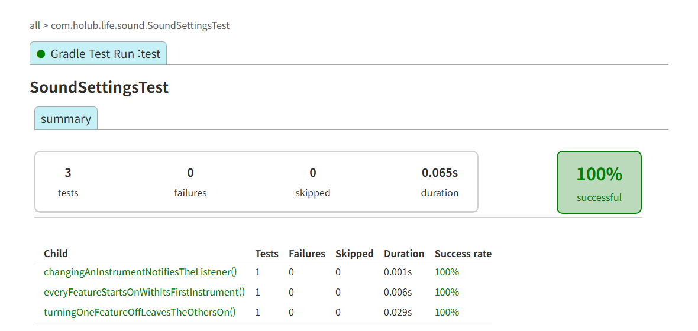

# 사운드 이펙트

게임판의 변화를 소리로 들려주는 확장 기능이다. [이슈 #2](https://github.com/mckimR1972/DP_team_project/issues/2)에서 범위를 정하고 `feature/sound-effects` 브랜치에서 작업한 뒤 [PR #3](https://github.com/mckimR1972/DP_team_project/pull/3)으로 `dev`에 합쳤다.

사운드 코드는 `src/com/holub/life/sound` 패키지에 모았다. 기존 코드에서 고친 곳은 `Universe`, `Cell`, `Neighborhood`, `Resident`, `Life` 다섯 파일이다.

처음에는 사운드 전용 리스너(`Universe.GenerationListener`)로 세대 변화를 받았다. 이후 통계 기능([PR #10](https://github.com/mckimR1972/DP_team_project/pull/10))을 합치면서 통계와 사운드가 같은 이벤트(`BoardChangeEvent`)를 받도록 바뀌었다. 이 문서는 바뀐 뒤의 `dev`(`838182c`) 코드를 기준으로 설명하고, 처음 구조는 바뀐 과정을 설명할 때만 함께 적었다. 유스케이스 명세와 요구사항은 [sound-effects-spec.md](sound-effects-spec.md)에 있다.

## 1. 기능 요약

셀이 새로 생기면 화음이, 사라지면 타악기 소리가 난다. 그와 별도로 초록색 재생선이 판을 왼쪽에서 오른쪽으로 계속 훑으면서 지나가는 자리의 산 셀을 연주하고, 그 밑에서 저음 패드가 현재 코드를 깔아 준다. 재생선과 패드는 세대 진행과 상관없이 돌기 때문에 게임을 멈춰 둬도 지금 판이 어떤 소리인지 들을 수 있다.

메뉴는 `Sound` 아래 `On`, `Off`, `Settings` 세 개다. `Settings`를 누르면 게임 창 오른쪽에 설정 창이 뜨고, 여기서 9개 항목을 하나씩 끄거나 악기를 바꿀 수 있다.

기존 기능(셀 편집, 실행/정지, 속도 조절, Clear, Load/Store)은 바꾸지 않았다. MIDI 신시사이저를 열 수 없는 환경에서는 `Sound disabled: ...`만 출력하고 게임은 소리 없이 그대로 실행된다.

### 1.1 유스케이스

확장한 유스케이스는 이름 끝에 `E`를 붙였다. 기존 유스케이스 이름은 팀 전체 유스케이스 그림과 같게 맞췄고, 유스케이스별 상세 흐름은 [sound-effects-spec.md](sound-effects-spec.md) 2장에 있다.



| 유스케이스 | 내용 |
|---|---|
| Hear Generation Sound E | 세대마다 생긴 셀은 화음, 사라진 셀은 타악기로 들린다. 세대를 확정한 뒤(Advance Generation의 확장점) 소리가 켜져 있으면 동작한다. |
| Hear Board Sweep E | 재생선이 판을 반복해서 훑으며 산 셀을 연주한다. 게임이 멈춰 있어도 동작한다. |
| Toggle Sound E | `Sound` 메뉴에서 소리 전체를 켜고 끈다. 끄면 재생선도 사라진다. |
| Configure Sound E | 설정 창에서 기능별 on/off와 악기를 바꾼다. |

### 1.2 소리를 정하는 규칙

- 판의 세로 64행을 C3부터 3옥타브(15음)로 나눠서, 위쪽 셀일수록 높은 음을 낸다. 열 위치는 스테레오 좌우(pan 0~127)로 바꾼다.
- 음계는 현재 코드에 어울리는 5음만 쓴다. 어떤 셀들이 동시에 생겨도 불협화음이 나지 않게 하려고 이렇게 했다.
- 코드는 C → Am → F → G 순서로 돈다. 재생선이 한 바퀴(16스텝, 약 2.4초) 돌 때마다 다음 코드로 넘어간다.
- 셀이 아무리 많이 생겨도 한 세대에 최대 5음만 내고, 음이 많을수록 한 음의 세기를 낮춘다.
- 속도를 Fast로 두면 틱이 너무 촘촘해서 소리가 뭉친다. 그래서 세대 소리 사이에 최소 120ms 간격을 두고, 그보다 빨리 온 세대는 건너뛴다.

### 1.3 설정 항목

모든 항목은 켜진 상태로 시작하고, 악기는 목록의 첫 번째가 기본값이다. 설정은 파일로 저장하지 않는다.

| 항목 | 동작 | 악기 |
|---|---|---|
| 생성음 | 새로 생긴 셀을 화음으로 낸다 (최대 5음) | 마림바, 실로폰, 하프, 피아노 |
| 1. 코드 진행 | C → Am → F → G. 끄면 C로 고정 | |
| 2. 스트럼 | 화음을 왼쪽 음부터 25ms 간격으로 친다. 끄면 동시에 | |
| 3. 소멸 타악기 | 셀이 사라지면 60ms 뒤에 친다. 많이 사라질수록 세게 | 쉐이커, 하이햇, 카바사, 탬버린 |
| 4. 저음 패드 | 현재 코드의 저음을 계속 낸다. 산 셀이 많을수록 크게, 빈 판이면 꺼짐 | 웜 패드, 스트링, 합창, 오르간 |
| 5. 대량 생성 악기 | 한 세대에 12개 이상 생기면 한 옥타브 위 소리를 겹친다 | 비브라폰, 글로켄슈필, 첼레스타, 튜블러 벨 |
| 6. 반복 페이드·마무리 | 같은 변화가 반복되면 12번에 걸쳐 무음까지 줄인다. 판이 전멸하면 마무리 화음 | |
| 7. 작은 흔들림 | 세기 ±8, 타이밍 0~15ms를 랜덤으로 준다. 12% 확률로 한 옥타브 위 | |
| 8. 재생선 | 4열씩 이동하며 산 셀을 연주한다. 최대 3음, 4스텝마다 강세 | 칼림바, 뮤직박스, 하프, 기타 |

## 2. 기존 코드에서 바뀐 부분

### 2.1 Universe: 세대가 바뀐 내용을 밖으로 알림

원래 `Universe`는 클럭 틱마다 `transition()`을 호출하고 화면을 다시 그리기만 했다. 어떤 셀이 생기고 사라졌는지 밖에서 알 방법이 없었다. 그래서 전이 전에 판을 저장해 두고, 판이 바뀌었으면 이전 판과 비교해서 생긴 셀과 사라진 셀을 리스너에게 넘기도록 했다.

```java
// 원본 Holub 코드
if( outermostCell.transition() )
    refreshNow();

// 사운드 작업 후 (커밋 fbf6dab 기준)
boolean[][] before = liveCells();
if( outermostCell.transition() )
{   refreshNow();
    publishChanges( before );   // 이전 판과 비교해서 생성/소멸 좌표 발행
}
```

`publishChanges()`는 64×64 판을 한 번 돌면서 `before`에는 없고 지금은 있는 칸을 `births`, 반대인 칸을 `deaths`에 넣은 뒤 `Universe.GenerationListener` 구독자에게 보냈다. 구독자 관리는 Holub 코드에 있던 `com.holub.tools.Publisher`를 그대로 썼다. 좌표는 `java.awt.Point`로 넘기고 `x`가 열, `y`가 행이다.

통계 기능도 같은 세대 정보가 필요해지면서 이 부분은 [PR #10](https://github.com/mckimR1972/DP_team_project/pull/10)에서 공통 이벤트로 바뀌었다. 지금 `dev`의 틱 처리는 다음과 같다(Freezing 처리는 생략).

```java
boolean[][] before = liveCells();
boolean changed = outermostCell.transition();
generation++;
notifyBoardChanged( BoardChangeEvent.Kind.GENERATION, before );  // 통계와 사운드에 같은 이벤트
```

`notifyBoardChanged()`는 전이 후 판을 한 번 읽어 `BoardChangeEvent`를 만든다. 이벤트에는 작업 종류(`kind()`), 세대 번호, 판의 복사본(`copyAliveCells()`), 생긴 셀(`copyBirths()`)과 사라진 셀(`copyDeaths()`), 통계용 색 목록이 들어 있다. 세대 진행뿐 아니라 셀 편집, Clear, Load, 템플릿 배치·되돌리기, 색 규칙 변경 때도 이벤트를 보내고, 생긴 셀과 사라진 셀 목록은 세대 진행(`GENERATION`)일 때만 채운다. 리스너는 `addBoardChangeListener()`로 등록하고, 등록하는 순간 현재 판을 담은 `INITIAL` 이벤트를 한 번 받는다. `GenerationListener`와 `publishChanges()`는 이때 없어졌다.

사운드 작업에서 `Universe`에 추가한 메서드 중 지금도 쓰는 것은 다음과 같다.

- `liveCells()`: 판 전체를 `[행][열]` 순서의 `boolean[][]`로 복사해서 돌려준다. 지금은 이벤트를 만들 때 쓴다.
- `widthInCells()`: 판 한 변의 셀 수.
- `setPlayhead(int column)`: 해당 열 왼쪽에 폭 3픽셀짜리 초록 세로선을 그린다. `-1`이면 지운다. 판 전체가 아니라 이전 선과 새 선 자리만 `repaint()`한다.

### 2.2 Cell 계층: 좌표로 셀 상태 묻기

`Universe`가 판을 읽으려면 "r행 c열 셀이 살아 있는가"를 물을 수 있어야 하는데, 원래 `Cell` 인터페이스에는 그런 연산이 없었다. `isAlive()`는 "이 블록 안에 산 셀이 하나라도 있는가"를 묻는 것이라 용도가 다르다. 그래서 `Cell`에 `isAliveAt(row, column)`을 추가했다.

```java
// Cell
boolean isAliveAt( int row, int column );

// Neighborhood: 좌표를 하위 격자 위치와 나머지로 나눠서 해당 하위 셀에 넘긴다
public boolean isAliveAt(int row, int column)
{   int subcellWidth = grid[0][0].widthInCells();
    return grid[row / subcellWidth][column / subcellWidth]
                .isAliveAt( row % subcellWidth, column % subcellWidth );
}

// Resident: 자기 자신이므로 (0, 0)만 유효
public boolean isAliveAt(int row, int column)
{   assert row==0 && column==0;
    return amAlive;
}
```

`Cell.DUMMY`는 항상 `false`를 돌려준다. 인터페이스에 메서드가 하나 늘었으므로 앞으로 `Cell`을 새로 구현하는 클래스는 이것도 구현해야 한다. 이 메서드는 나중에 드래그 그리기와 캡처·템플릿 기능(`PatternCells`)에서도 셀 상태를 읽는 데 쓰이고 있다.

### 2.3 Life: 사운드 붙이기

`Life` 생성자에 한 줄을 추가했다.

```java
SoundEffects.install( Universe.instance() );
```

게임 쪽에서 사운드 패키지를 아는 곳은 여기뿐이다. 이 줄과 import를 지우면 소리만 빠지고 나머지 게임은 그대로다. `install()`은 신시사이저를 열고, `Universe`에 리스너로 등록해 `INITIAL` 이벤트로 현재 판을 받은 다음, 재생선 실행을 예약하고 `Sound` 메뉴를 단다.

### 2.4 새로 만든 클래스

| 클래스 | 하는 일 | MIDI·Swing 의존 |
|---|---|---|
| `SoundEffects` | `BoardChangeListener` 구현. 재생 예약, MIDI 채널 제어, 재생선 진행, `Sound` 메뉴 등록 | 둘 다 사용 |
| `NoteMapper` | 셀 좌표를 음(높이, 좌우, 세기)으로 바꾼다. 화음 선택, 재생선 음, 패드 음, 흔들림 계산 | 없음 |
| `RepeatTracker` | 최근 8세대의 변화를 기억해 두고, 같은 변화가 다시 오면 볼륨(gain)을 1/12씩 줄인다 | 없음 |
| `SoundSettings` | 기능별 on/off와 선택한 악기를 들고 있다 | 없음 |
| `SoundSettingsDialog` | 설정 창. 항목마다 체크박스와 악기 선택 상자 | Swing |

`SoundEffects`만 `public`이고 나머지는 패키지 안에서만 보인다. 의존 방향은 `sound` → `life` 한쪽뿐이라서 `Universe`는 사운드 패키지를 import하지 않는다.

## 3. 구조와 동작

### 3.1 클래스 다이어그램



### 3.2 세대 사운드가 나는 과정

클럭 틱은 Swing 이벤트 스레드에서 처리된다. `SoundEffects`는 이 스레드에서 이벤트를 받지만 소리를 직접 내지 않고, "언제 무엇을 할지"만 스케줄러에 넣은 뒤 바로 돌아온다. 같은 이벤트를 `Statistics`도 받는데 그림에서는 생략했다.



### 3.3 재생선

재생선은 클럭과 상관없이 스케줄러가 150ms마다 `playStep()`을 실행해서 움직인다. 한 스텝에 4열씩, 16스텝이면 64열을 다 돈다.

판은 `Universe`에 직접 묻지 않고, 마지막으로 받은 이벤트의 복사본(`latestCells`)을 읽는다. 이벤트는 세대 진행뿐 아니라 편집, Clear, Load, 템플릿 때도 오기 때문에 게임이 멈춰 있어도 바뀐 판이 다음 스텝에 반영된다. `latestCells`는 `volatile` 참조이고, 이벤트가 올 때마다 새 배열로 통째로 바뀌며 한번 넣은 배열은 고치지 않는다. 그래서 스케줄러 스레드는 한 스텝 동안 처음 읽은 배열 하나를 안전하게 쓸 수 있다.



### 3.4 반복 페이드

진동자처럼 같은 변화가 계속 반복되면 세대 소리가 점점 작아진다. `RepeatTracker`는 births와 deaths로 만든 해시값을 최근 8개까지 기억해 두고, 새 값이 그 안에 있으면 반복으로 본다. 재생선과 패드는 이 상태와 관계없이 계속 나기 때문에 진동자만 남은 판도 완전히 조용해지지는 않는다.


판이 전멸한 세대의 마무리 화음은 상태가 아니라 그 세대에 한 번 하는 동작이라서, 상태 다이어그램에서는 상태로 두지 않고 노트로 적었다. 나머지 UML은 [sound-uml.md](sound-uml.md)에 있다.

### 3.5 다른 기능과 맞물리는 부분

사운드는 판의 변화를 `BoardChangeEvent`로만 받기 때문에, 다른 기능이 판을 바꿀 때 어떤 이벤트를 보내는지가 곧 사운드와의 연결 방식이다. 기능마다 정리하면 다음과 같다.

| 기능 | 사운드가 받는 것 | 결과 | 확인한 테스트 |
|---|---|---|---|
| 통계 | 같은 `GENERATION` 이벤트 (등록 순서상 통계가 먼저 받음) | 통계 탭의 세대·탄생·사망 수와 그 세대에 나는 소리가 같은 변화에서 나온다 | `realBlinkerUpdatesStatisticsAndSchedulesBirthAndDeathSoundsOnce` |
| Freezing | 고정된 셀은 전이 전후가 같아서 births·deaths에 들어가지 않는다 | 고정된 셀은 세대 소리를 내지 않고, 풀린 첫 세대부터 다시 들린다. 재생선은 판 복사본을 읽으므로 고정된 산 셀도 연주한다 | `FreezingSoundIntegrationTest` 3개 |
| 색 순환 | 색 규칙을 바꾸면 `COLOR_POLICY_CHANGED` 이벤트 | 세대 소리는 나지 않고 재생선이 읽는 판만 갱신된다. 이벤트에 든 색 목록은 사운드가 쓰지 않는다 | `realColorMenuRefreshesStatisticsWithoutSchedulingGenerationSound` |
| 캡처·템플릿 | 배치는 `TEMPLATE`, 되돌리기는 `TEMPLATE_UNDO` 이벤트 | 세대 소리 없이 다음 재생선 스텝부터 바뀐 판을 연주한다. 캡처·배치 편집 중에는 세대가 진행되지 않으므로 세대 소리도 없다 | `nonGenerationEventUpdatesSweepWithoutGenerationSounds` |
| 드래그 그리기 | 셀이 실제로 바뀐 마우스 입력마다 `EDIT` 이벤트 | 그리는 동안은 조용하고, 그린 셀을 재생선이 바로 연주한다 | `nonGenerationEventUpdatesSweepWithoutGenerationSounds`, `disabledSoundStillReceivesEditsForTheNextSweep` |

색을 소리에 반영할지(예: 셀 색에 따라 악기나 음높이를 바꾸기)는 팀에서 기능 간 조합을 정리할 때 색 기능 코드를 보고 정하기로 했던 항목이다. 지금 구현에는 넣지 않았고, 사운드는 셀이 살아 있는지만 본다.

## 4. 적용한 설계 패턴

### 4.1 Observer

| 역할 | 클래스 |
|---|---|
| Subject | `Universe` (`addBoardChangeListener()`, `removeBoardChangeListener()`) |
| Observer | `BoardChangeListener` |
| ConcreteObserver | `SoundEffects`, `Statistics` |

`Universe`가 판의 변화를 발행하고 `SoundEffects`가 받는다. `Universe`는 `BoardChangeListener` 인터페이스만 알고 누가 듣고 있는지는 모른다. 그래서 사운드를 빼도 게임은 그대로 돌고, 다른 기능이 같은 정보가 필요하면 리스너로 등록만 하면 된다.

처음(#3)에는 사운드 전용 `GenerationListener`를 두고 구독 관리는 Holub 코드의 `Publisher`를 썼다. `Clock`이 이미 같은 방식으로 리스너를 관리하고 있어서 같은 구조를 따랐다. 통계 기능이 같은 정보를 필요로 하자 두 기능이 같은 이벤트를 받도록 `BoardChangeListener`로 합쳐졌다(#10). 소리를 만드는 코드가 처음부터 `Universe`와 떨어져 있었기 때문에, 이때 사운드 쪽에서 고친 곳은 `SoundEffects`의 수신부 30줄 정도였고 `NoteMapper`, `RepeatTracker`, `SoundSettings`는 그대로였다.

이벤트에는 생긴 셀과 사라진 셀 목록, 판의 복사본을 같이 실어 보낸다(push 방식). 알림만 보내고 리스너가 판을 다시 읽게 하면(pull 방식) 리스너마다 이전 판을 따로 들고 있다가 비교해야 한다. 이전 판은 원래 `Universe`만 갖고 있으니 비교도 `Universe`에서 한 번만 하는 게 낫다.

재생선은 처음에는 pull 방식이었다. 게임이 멈춰 있어도 판을 읽어야 해서 스케줄러 스레드가 150ms마다 `universe.liveCells()`를 직접 불렀다. 그런데 이러면 이벤트 스레드가 셀을 바꾸는 동안 다른 스레드가 같은 `Cell` 트리를 읽게 된다. 공통 이벤트로 바뀌면서 편집, Clear, Load 때도 이벤트가 오게 되었으므로, 재생선도 마지막 이벤트의 복사본을 읽는 push 방식으로 바뀌었다. 판을 읽는 스레드와 바꾸는 스레드가 겹치지 않게 된 것이 이 변경의 이점이다.

남은 결합도 있다. Subject는 Observer를 모르지만 `SoundEffects`는 재생선을 그리려고 `Universe.setPlayhead()`를 직접 부른다. 이벤트에는 통계만 쓰는 색 목록과 `COLOR_POLICY_CHANGED` 종류도 들어 있어서, 통계 쪽 요구로 이벤트가 바뀌면 사운드도 영향을 받을 수 있다. 또 리스너는 Swing 이벤트 스레드에서 불리기 때문에 오래 걸리면 화면과 입력이 같이 멈춘다. 이 조건 때문에 아래 Command 구조가 필요했다.

### 4.2 Command

| 역할 | 재생 예약 | `Sound` 메뉴 |
|---|---|---|
| Client | `SoundEffects` | `SoundEffects.createMenus()` |
| Command | `Runnable` 람다 (음 켜기, 음 끄기, 타악기, 악기 변경, 재생선 한 스텝) | `ActionListener` 람다 |
| Invoker | 단일 스레드 `ScheduledExecutorService` (`sound-notes` 스레드) | 메뉴 항목 |
| Receiver | `MidiChannel` | `SoundEffects` |

소리는 대부분 "지금"이 아니라 "조금 뒤에" 나야 한다. 화음은 25ms 간격으로 퍼뜨리고, 타악기는 60ms 늦게 치고, 모든 음은 220ms(재생선은 400ms) 뒤에 꺼야 한다. 재생선은 150ms마다 한 스텝씩 가야 한다. 이걸 이벤트 스레드에서 기다리면서 처리할 수는 없으니, 할 일을 객체로 만들어 실행 시간과 함께 큐에 넣고 스케줄러 스레드가 시간에 맞춰 꺼내 실행하게 했다.

```java
private void play( MidiChannel channel, NoteMapper.Note note,
                   int delayMs, int lengthMs )
{   noteScheduler.schedule
    (   () ->
        {   channel.controlChange( PAN_CONTROLLER, note.pan() );
            channel.noteOn( note.pitch(), note.velocity() );
        },
        delayMs, TimeUnit.MILLISECONDS
    );
    noteScheduler.schedule( () -> channel.noteOff( note.pitch() ),
                            delayMs + lengthMs, TimeUnit.MILLISECONDS );
}
```

큐 하나를 스레드 하나가 순서대로 처리하는 모양이라 수업에서 본 Active Object와 구조가 비슷하다. 이 구조 덕분에 동기화도 단순해졌다. `MidiChannel`, 재생선 위치(`step`), 지금 누르고 있는 패드 음(`padNotes`)은 스케줄러 스레드에서만 만지기 때문에 잠금이 필요 없다. 설정 창에서 악기를 바꿀 때도 이벤트 스레드가 채널을 직접 건드리지 않고 `noteScheduler.execute(this::applyInstruments)`로 명령을 넣는다. 두 스레드가 같이 쓰는 객체는 `SoundSettings` 하나뿐이라 여기만 `synchronized`로 막았고, 메뉴에서 바꾸는 `enabled`, 코드 위치 `chord`, 이벤트로 받은 판 `latestCells`는 `volatile`로 두었다.

Command 클래스를 따로 만들지 않고 람다로 썼다. 지나간 소리를 되돌릴 일이 없으니 undo나 이력은 필요 없었고, 명령마다 클래스를 만들면 파일만 늘어난다고 판단했다.

### 4.3 Composite (기존 구조 확장)

| 역할 | 클래스 |
|---|---|
| Component | `Cell` |
| Composite | `Neighborhood` |
| Leaf | `Resident`, `Cell.DUMMY` |

판은 원래 8×8 `Neighborhood` 안에 8×8 `Neighborhood`가 들어 있는 Composite 구조다. 여기에 `isAliveAt()`를 추가하면서 같은 구조를 따랐다. `Neighborhood`는 좌표를 나눠서 하위 셀에 넘기고, `Resident`는 자기 상태를 답한다. `Universe`는 `outermostCell.isAliveAt(row, column)`만 부르면 되고, 판이 몇 단계로 중첩돼 있는지 알 필요가 없다.

대신 칸 하나를 읽을 때마다 바깥 `Neighborhood`, 안쪽 `Neighborhood`, `Resident` 순서로 세 번 호출이 이어진다. 세대 알림 때문에 틱마다 판(4096칸)을 두 번 읽게 되지만, 화면을 다시 그리는 비용에 비하면 작아서 그대로 두었다.

### 4.4 기존 구조를 그대로 쓴 부분

`Sound` 메뉴는 Holub 코드의 `MenuSite.addLine()`으로 등록했다. `MenuSite`가 Swing 메뉴 바를 감싸는 Facade 역할을 하고 있어서 `JMenuBar`를 직접 건드리지 않았고, 기존 메뉴 코드도 고치지 않았다. `SoundEffects.install()`도 MIDI 신시사이저를 열고, 채널을 나누고, 스케줄러를 만들고, 메뉴를 다는 과정을 한 메서드 뒤에 숨겨서 `Life`는 한 줄만 알면 된다.

`Universe`와 `Clock`은 원래 Singleton이다. `SoundEffects`는 Singleton으로 만들지 않았다. 프로그램 시작 시 `Life`에서 한 번 만들면 충분하고, 다른 곳에서 전역으로 찾을 일이 없다. `Universe`를 인자로 받으니까 무엇에 의존하는지도 코드에 드러난다.

### 4.5 설계 원칙

`Universe`는 사운드가 아니라 `BoardChangeListener`라는 인터페이스에 의존한다. 새로운 리스너가 생겨도 `Universe`를 고치지 않고 등록만 하면 되므로 변경에는 닫혀 있고 확장에는 열려 있다. 실제로 통계 기능은 같은 인터페이스로 등록해서 붙었다.

`SoundEffects` 하나에 다 넣지 않고 바뀌는 이유별로 클래스를 나눴다. 음 고르는 규칙이 바뀌면 `NoteMapper`, 반복 판단 기준이 바뀌면 `RepeatTracker`, 설정 항목이 바뀌면 `SoundSettings`만 고치면 된다. 이렇게 나눈 덕에 `NoteMapper`, `RepeatTracker`, `SoundSettings`는 MIDI 장치와 화면 없이 테스트할 수 있다(6장).

## 5. 고민했던 설계 결정

### 5.1 게임 변화를 사운드에 어떻게 알릴까

| 방법 | 장점 | 문제 |
|---|---|---|
| `Universe`가 `SoundEffects`를 직접 호출 | 가장 간단하다 | 게임 로직이 사운드에 의존한다. 다른 기능을 붙일 때마다 `Universe`를 고쳐야 한다 |
| `SoundEffects`가 `Clock`을 직접 구독 | `Universe`를 안 고쳐도 된다 | `Publisher.subscribe()`가 새 구독자를 목록 맨 앞에 넣는다. 나중에 등록한 사운드가 `Universe`보다 먼저 불려서 바뀌기 전의 판을 보게 된다. 무엇이 바뀌었는지도 사운드 쪽에서 계산해야 한다 |
| `Resident`가 상태가 바뀔 때 알림 | 바뀐 셀을 정확히 안다 | `Resident`는 자기 좌표를 모른다. 좌표를 넣으려면 셀 생성 구조를 다 바꿔야 하고, 셀마다 호출이 생긴다 |
| `Universe`가 비교한 결과를 발행 | 비교 코드가 한 곳에 있고, 리스너 추가가 쉽다 | 틱마다 판 전체를 한 번 더 읽는다 |

마지막 방법을 골랐다. 판을 더 읽는 비용은 64×64 배열 두 번 정도라 화면을 다시 그리는 것보다 훨씬 작았다. 이 결정은 이후 통계와 함께 쓰는 공통 이벤트(#10)로 그대로 넓혀졌다. 비교는 여전히 `Universe`에서 한 번만 하고, 리스너는 결과만 받는다.

### 5.2 판 상태를 어떻게 읽을까

`Cell`을 고치지 않는 방법으로는 Holub 코드의 Load/Store용 Memento(`createMemento()`, `transfer()`)를 쓰는 것이 있다. 이걸로 산 셀 목록을 받을 수는 있지만, Memento는 `Storable`이라 파일 입출력 메서드까지 구현해야 하고, 칸 하나만 궁금해도 판 전체를 복사한다. 또 `Neighborhood.transfer()`는 `activeEdges`를 바꾸기 때문에, 저장할 때만 쓰던 경로를 게임 진행 중에 매 틱 부르게 된다.

`Universe`가 따로 `boolean[][]`을 들고 있는 방법도 있었다. `Cell`은 안 고쳐도 되지만 클릭, Clear, Load, 세대 진행이 있을 때마다 실제 셀과 맞춰 줘야 한다. 한 군데라도 빠지면 소리와 화면이 어긋난다.

결국 `Cell`에 `isAliveAt()`를 추가했다. `Cell` 구현 3개(`Neighborhood`, `Resident`, `DUMMY`)를 모두 고쳐야 하지만, 셀 상태의 원본이 한 곳에만 있고 기존 Composite 구조를 그대로 따라가면 된다.

### 5.3 음을 시간차를 두고 어떻게 낼까

- 틱을 처리하는 스레드에서 `Thread.sleep()`으로 기다리기: 코드는 가장 단순하다. 하지만 틱이 이벤트 스레드에서 돌기 때문에 기다리는 동안 화면과 입력이 같이 멈추고, Fast 속도에서는 게임이 눈에 띄게 느려진다.
- `javax.sound.midi.Sequencer`: 타이밍은 정확하다. 그런데 미리 만든 악보를 재생하는 방식이라 세대마다 달라지는 입력이나 설정 변경을 바로 반영하기 어렵다.
- 소리마다 새 스레드: 기다리지는 않지만 스레드가 계속 생기고, 여러 스레드가 같은 `MidiChannel`을 건드려서 noteOn과 noteOff 순서가 꼬일 수 있다.
- 단일 스레드 스케줄러에 명령 예약: 실행 시간이 몇 ms 밀릴 수는 있다.

마지막 방법으로 했다. 몇 ms 정도의 오차는 효과음에서는 들리지 않았고, 채널을 만지는 스레드가 하나로 정해져서 동기화 문제도 같이 해결됐다(4.2).

### 5.4 설정 화면을 어디에 둘까

`Sound` 메뉴에 체크 항목을 늘어놓는 방법은 기존 메뉴 방식과 맞고 창도 늘지 않는다. 그런데 `Clock`은 메뉴가 열려 있는 동안 틱을 멈춘다(`menuIsActive()`). 설정을 바꾸면서 소리가 어떻게 달라지는지 들어 볼 수가 없다. 악기 선택처럼 여러 개 중 하나를 고르는 항목도 메뉴로는 표시하기 불편했다.

모달 대화상자도 떠 있는 동안 게임 창을 만질 수 없어서 같은 문제가 있다. 그래서 모달이 아닌 별도 창(`SoundSettingsDialog`)으로 만들고 게임 창 오른쪽에 붙여 띄웠다. 닫으면 숨기기만 하고, 다시 열면 같은 창을 보여 준다.

### 5.5 셀을 어떤 음으로 바꿀까

행마다 반음씩 올리면 계산은 단순한데, 여러 셀이 한꺼번에 생길 때 불협화음이 심하다. 장음계 7음에 고정하면 훨씬 낫지만 같은 판은 늘 같은 소리라 금방 지루해진다.

그래서 코드마다 어울리는 5음을 따로 두고 코드 진행에 맞춰 바꿨다. 같은 모양이라도 코드가 바뀌면 다르게 들리고, 어떤 셀 조합이든 그 순간의 코드 안에 있는 음만 나온다. 5음은 모두 C장조 음계 안에 있어서 코드가 바뀌는 순간에도 튀는 음이 없다.

### 5.6 통계와 같은 이벤트를 쓸까, 따로 둘까

통계 기능을 합칠 때(#10) 판 변화를 받는 통로가 둘이 되었다. 사운드는 `GenerationListener`로 생성·소멸 좌표(`List<Point>`)를 받았고, 통계는 `BoardChangeListener`로 판 전체(`BitSet`)를 받아 직전 판과 직접 비교했다. 이 통합은 통계 담당이 진행했고, 사운드 쪽 수신부 변경도 그때 함께 들어갔다.

| 방법 | 장점 | 문제 |
|---|---|---|
| 두 통로를 그대로 둔다 | 사운드와 통계 코드를 고치지 않아도 된다 | `Universe`가 알림 경로 두 개를 따로 관리하고, 생성·소멸 비교를 사운드 쪽과 통계 쪽에서 두 번 한다. 자료 구조도 달라서 두 기능이 본 변화가 같다는 보장이 없다 |
| 하나의 이벤트로 합친다 | 비교는 `Universe`에서 한 번만 하고, 두 기능이 같은 세대 번호와 같은 변화 목록을 받는다. 편집·Clear·Load 때도 이벤트가 와서 재생선이 판을 직접 읽지 않아도 된다 | 사운드가 쓰지 않는 값(색 목록, `COLOR_POLICY_CHANGED`)도 이벤트에 들어 있어서, 이벤트가 바뀌면 사운드도 영향을 받을 수 있다 |

하나로 합치는 쪽을 골랐다. 사운드 쪽에서는 수신부만 바꾸면 됐고(4.1), 이전 판과 비교하는 일을 `Universe`에 두기로 한 처음 결정(5.1)과도 맞는다.

### 5.7 아직 정리하지 못한 부분

지금 `SoundEffects` 안에는 `settings.isOn(...)`으로 기능마다 분기하는 곳이 10군데 있다. 생성음, 타악기, 패드, 재생선 등을 각각 객체로 나눠 공통 인터페이스 뒤에 두면(Strategy) 분기는 없어질 것이다. 문제는 이 기능들이 서로 독립적이지 않다는 점이다. 현재 코드(`chord`)와 반복 페이드 값(`gain`)을 여러 기능이 같이 쓰고, 생성음에서 고른 화음을 대량 생성 레이어가 다시 받아 쓴다. 인터페이스를 정하려면 이 값들을 어떻게 넘길지부터 정해야 해서, 이번에는 동작을 먼저 맞추고 이 정리는 남겨 두었다.

## 6. 테스트

### 6.1 실행 결과

```
./gradlew test
```

현재 `dev`(`838182c`) 기준으로 전체 384개 테스트가 모두 통과한다. 이 중 사운드와 관련된 테스트는 다음과 같다.

| 테스트 클래스 | 개수 | 비고 |
|---|---|---|
| `sound.NoteMapperTest` | 23 | 사운드 작업(#3)에서 작성 |
| `sound.RepeatTrackerTest` | 3 | 사운드 작업(#3)에서 작성 |
| `sound.SoundSettingsTest` | 3 | 사운드 작업(#3)에서 작성 |
| `NeighborhoodTest` | 12 | 기존 11개 + `isAliveAt` 1개 |
| `UniverseStoreTest` | 8 | 기존 3개 + 사운드용 2개 (나머지 3개는 드래그 그리기) |
| `ResidentTest` | 18 | 기존 그대로 |
| `SoundEffectsIntegrationTest` | 17 | 통계 기능을 합칠 때(#10) 추가. 실제 `Universe`, `Statistics`와 연결한 `SoundEffects` |
| `FreezingSoundIntegrationTest` | 3 | Freezing 기능을 합칠 때(#7) 추가. 고정된 셀과 소리 |

사운드 작업(#3)에서 추가한 테스트는 32개다. 원래 있던 테스트 32개(`ResidentTest` 18, `NeighborhoodTest` 11, `UniverseStoreTest` 3)는 코드를 고친 뒤에도 그대로 통과해서 기존 동작이 깨지지 않았음을 확인했다. PR #3의 커밋은 하나씩 따로 빌드하고 테스트를 돌려서, 중간 커밋에서도 실패가 없게 했다. 이후 다른 기능을 합치면서 `SoundEffects`를 실제로 실행하는 통합 테스트 20개가 더해졌다.










### 6.2 화면과 MIDI 없이 테스트하기

`NoteMapper`, `RepeatTracker`, `SoundSettings`는 MIDI 장치도 Swing도 쓰지 않는다. 음을 고르는 규칙이 이 객체들 안에 있기 때문에 소리를 실제로 듣지 않고도 "음계를 벗어나지 않는다", "진동자는 결국 조용해진다" 같은 걸 숫자로 확인할 수 있다.

랜덤이 들어가는 부분(작은 흔들림)은 `NoteMapper(Random)` 생성자로 시드를 넣어서 매번 같은 결과가 나오게 했다. `Universe` 쪽 테스트는 공용 준비 코드(`LifeTestSupport`)가 `MenuSite`를 Mockito로 바꿔 창을 띄우지 않고 실행한다. 통합 테스트는 여기에 더해 신시사이저와 스케줄러를 가짜로 바꾸고, 예약된 명령과 예약 시간을 목록에 모아 두었다가 직접 실행해서 확인한다.

### 6.3 테스트 케이스와 목적

| 확인하려는 것 | 테스트 | 확인 내용 |
|---|---|---|
| 불협화음이 나지 않는다 | `everyPitchIsInCMajor` | 코드 4개 × 64행 전부에서 C장조 밖의 음이 없다 |
| 판의 위치가 소리에 반영된다 | `higherOnTheBoardNeverSoundsLower` (코드 4개) | 위쪽 행이 아래 행보다 낮은 음을 내지 않는다 |
| | `columnSetsStereoPosition` | 맨 왼쪽 열은 pan 0, 맨 오른쪽 열은 127 |
| | `notesAreOrderedLeftToRightForStrumming` | 스트럼을 위해 음이 왼쪽부터 정렬된다 |
| 코드 진행 | `sameCellChangesPitchAcrossTheProgression` | 같은 셀도 코드가 바뀌면 음이 달라진다 |
| | `progressionWrapsAround` | G 다음은 다시 C |
| | `padFollowsTheProgression` | 패드도 같은 진행을 따른다 |
| 소리가 너무 커지지 않는다 | `fullBoardStaysWithinVoiceLimitAndValidMidiRange` | 판 전체가 한꺼번에 생겨도 정확히 5음, 세기 1~127, 중복 음 없음 |
| | `padGrowsWithLiveCellsUpToACapAndStopsOnAnEmptyBoard` | 패드는 산 셀이 많을수록 커지다가 상한에서 멈추고, 빈 판이면 0 |
| | `moreDeathsHitHarderUpToACap` | 타악기도 같은 방식으로 상한이 있다 |
| 없어야 할 때는 소리가 없다 | `noBirthsMakeNoNotes`, `sweepOfAnEmptyBlockIsSilent` | 생긴 셀이 없거나 재생선 구간이 비어 있으면 음 없음 |
| | `smallGenerationsHaveNoBurstLayer` | 11개 이하로 생기면 대량 생성 레이어 없음 |
| 재생선 | `sweepPlaysOnlyCellsInTheColumnBlock` | 지금 지나가는 4열 안의 셀만 연주한다 |
| | `sweepLimitsVoicesAndAccentsTheBeat` | 최대 3음, 박자 첫 스텝이 더 세다 |
| | `UniverseStoreTest.playheadIsDrawnOverTheBoardAndCanBeRemoved` | 판을 이미지로 그려서 재생선 위치의 픽셀이 초록색인지, `-1`로 지우면 그 픽셀이 바뀌는지 본다 |
| 대량 생성 레이어 | `burstLayerDoublesNotesAnOctaveHigherAndQuieter` | 12개 이상이면 한 옥타브 위, 같은 좌우 위치, 더 작은 소리 |
| 작은 흔들림 | `humanizingKeepsNotesValidAndVariesThem` | 시드 42로 500번 돌려서 세기가 52~68 안에서 실제로 달라지고, 음은 원래 음 또는 한 옥타브 위만 나온다 |
| | `timingJitterStaysSmall` | 지연이 0~15ms 안이다 |
| 반복 페이드와 마무리 | `RepeatTrackerTest` 3개 | 새로운 변화는 볼륨 1.0 유지, 두 상태를 오가는 진동자는 결국 0, 조용해진 뒤 새 변화가 오면 바로 1.0 |
| | `scalingLowersLoudnessOnly` | 볼륨을 줄여도 음 높이와 좌우는 그대로 |
| | `endingChordIsAboveThePadOfTheSameChord` | 마무리 화음은 같은 코드 패드보다 두 옥타브 위 |
| 설정 | `SoundSettingsTest` 3개 | 처음엔 모두 켜짐 + 첫 번째 악기, 스트럼을 꺼도 재생선은 그대로, 악기를 바꾸면 리스너가 딱 한 번 불림 |
| 게임 쪽 변경 | `NeighborhoodTest.isAliveAtFindsResidentThroughNestedNeighborhoods` | 2단계로 중첩된 판에서 클릭한 (3, 2)만 살아 있고, 행과 열을 바꾼 (2, 3)은 `false` |
| | `UniverseStoreTest.liveCellsSnapshotIsIndexedByRowThenColumn` | 스냅샷이 `[행][열]` 순서다 |
| 실제 세대와 연결 (통합) | `realBlinkerUpdatesStatisticsAndSchedulesBirthAndDeathSoundsOnce` | 블링커를 그리는 동안은 예약이 없고, 한 틱 뒤 생성 화음과 타악기 한 번이 예약된다 |
| | `stableAndEmptyGenerationsNeverScheduleGenerationSounds` | 블록만 있는 판과 빈 판은 틱을 진행해도 조용하다 |
| | `nonGenerationEventUpdatesSweepWithoutGenerationSounds` (작업 종류 7개) | 편집, Clear, Load, 템플릿, 색 변경 등은 세대 소리 없이 재생선 판만 바꾼다 |
| 예약 시간 (통합) | `birthStrumNoteLengthsAndPercussionDelayRemainUnchanged` | 스트럼 25ms, 음 길이 220ms, 타악기 60ms로 예약된다 |
| | `extinctionPlaysOneEndingAndLaterEmptyTicksStaySilent` | 전멸한 틱에 마무리 화음 3음이 한 번만 예약되고 그 뒤 빈 판은 조용하다 |
| 켜고 끄기와 스레드 (통합) | `disabledSoundStillReceivesEditsForTheNextSweep` | Off 동안 편집한 판을 On 뒤 재생선이 연주한다 |
| | `initialSnapshotIsReadyBeforeTheFirstScheduledSweep` | 재생선 첫 스텝 전에 `INITIAL` 이벤트로 판을 받아 둔다 |
| | `sweepUsesAnIndependentSnapshotOnItsWorkerThread` | 재생선이 다른 스레드에서 이벤트의 복사본만 읽는다 |
| MIDI 없는 환경 (통합) | `missingMidiDeviceDoesNotPreventStatisticsFromAdvancing` | 신시사이저를 열 수 없어도 `install()`이 예외 없이 끝나고 게임은 계속 진행된다 |
| Freezing과 함께 (통합) | `FreezingSoundIntegrationTest` 3개 | 고정된 블링커는 조용하다가 풀린 첫 세대에 들리고, 재생선은 고정된 산 셀도 연주한다 |

### 6.4 테스트 코드 예시

불협화음이 나지 않는지 보는 테스트다. 코드 4개와 64행을 모두 돌면서 나오는 음이 C장조 7음 안에 있는지 확인한다. 실패하면 어느 코드의 몇 번째 행인지 메시지로 나온다.

```java
@Test
void everyPitchIsInCMajor()
{   Set<Integer> cMajor = Set.of( 0, 2, 4, 5, 7, 9, 11 );
    for( int chord = 0; chord < CHORDS; ++chord )
        for( int row = 0; row < WIDTH; ++row )
            assertTrue( cMajor.contains(pitchAt(row, chord) % 12),
                        "chord " + chord + " row " + row );
}
```

진동자가 결국 조용해지는지 보는 테스트다. A와 B 두 상태를 번갈아 넣으면서 볼륨이 한 번도 커지지 않고 16세대 안에 0이 되는지 본다.

```java
@Test
void oscillatorFadesToSilence()
{   RepeatTracker tracker = new RepeatTracker();
    double gain = 1;
    for( int i = 0; i < 16; ++i )
    {   double next = tracker.gainFor( i % 2 == 0 ? A : B,
                                       i % 2 == 0 ? B : A );
        assertTrue( next <= gain );
        gain = next;
    }
    assertEquals( 0.0, gain );
}
```

`isAliveAt()`이 중첩된 판에서 좌표를 제대로 찾아가는지 보는 테스트다. 행과 열을 바꿔 넣는 실수를 잡으려고 (2, 3)이 `false`인지도 같이 확인한다.

```java
@Test
void isAliveAtFindsResidentThroughNestedNeighborhoods() {
    Neighborhood board = new Neighborhood(2, new Neighborhood(2, new Resident()));

    // 40픽셀 판에서 셀 하나가 10픽셀. 3행 2열을 클릭한다.
    board.userClicked(new Point(25, 35), new Rectangle(0, 0, 40, 40));

    assertTrue(board.isAliveAt(3, 2));
    assertFalse(board.isAliveAt(2, 3));
}
```

### 6.5 직접 실행해서 확인한 것

실제 소리는 JUnit으로 확인하기 어려워서, 신시사이저 출력을 오디오 스트림으로 받아 따로 확인했다.

- 설정 창의 악기 20개가 모두 소리를 낸다.
- 빈 판일 때와 `Sound` → `Off`를 누른 뒤에는 조용하다.
- 게임을 멈춰도 재생선 소리가 난다.
- 설정 창에서 재생선이나 저음 패드를 끄면 그 소리가 멈춘다.

### 6.6 테스트가 없는 부분

사운드 작업(#3) 때는 `SoundEffects`와 세대 변화 발행에 JUnit 테스트가 없었다. `SoundEffects`는 실제 `Synthesizer`와 시간에 맞춰 도는 스케줄러를 쓰기 때문에 테스트하려면 둘 다 가짜로 바꿀 방법이 필요했다. 이 부분은 통계 기능을 합칠 때 `SoundEffectsIntegrationTest`가 신시사이저와 스케줄러를 Mockito로 바꿔 채웠고, 이벤트 발행은 `UniverseEventsTest`가 확인한다.

지금 남은 것은 실제 장치에서 나는 소리다. 음색, 음량, 악기를 바꿨을 때 실제로 다르게 들리는지는 자동 테스트로 확인할 수 없어서 6.5처럼 직접 확인해야 한다.

## 7. GitHub 작업 기록

- 이슈: [#2 사운드 이펙트 확장 기능 추가](https://github.com/mckimR1972/DP_team_project/issues/2) (유스케이스와 완료 조건 정리)
- PR: [#3 사운드 이펙트 확장 기능 추가](https://github.com/mckimR1972/DP_team_project/pull/3) (`feature/sound-effects` → `dev`)

기능을 한 번에 올리지 않고, 게임 쪽 준비 작업부터 소리 기능 하나씩 순서대로 커밋했다. 각 커밋은 따로 빌드하고 테스트를 통과한 상태로 올렸다.

| 커밋 | 날짜 | 내용 |
|---|---|---|
| `b284a24` | 11-10 | `Cell` 컴포지트에 `isAliveAt` 추가 |
| `8c0c164` | 11-12 | `Universe`에 살아 있는 셀 스냅샷(`liveCells`) 추가 |
| `fbf6dab` | 11-13 | 세대마다 생성/소멸한 셀 발행 (`GenerationListener`) |
| `2838837` | 11-14 | 생성된 셀을 마림바 화음으로 재생 |
| `8e5955d` | 11-14 | C-Am-F-G 코드 진행 |
| `3c84117` | 11-14 | 화음을 왼쪽 음부터 스트럼 |
| `80218d5` | 11-15 | 셀이 사라질 때 쉐이커 소리 |
| `dd026d2` | 11-15 | 저음 패드 |
| `088d56a` | 11-15 | 대량 생성 시 비브라폰 레이어 |
| `2afc122` | 11-15 | 음 세기와 타이밍에 작은 변화 |
| `5ae793a` | 11-15 | 판 위에 재생선 그리기 |
| `11e48e0` | 11-15 | 재생선이 판을 훑으며 연주 |
| `c9a9aca` | 11-16 | 반복되는 세대는 페이드, 전멸하면 마무리 화음 |
| `d786bc6` | 11-16 | 기능별 사운드 설정 창 |

이후 사운드 코드에 영향을 준 변경은 다른 기능 PR에서 있었다.

- [#10 통계 기능](https://github.com/mckimR1972/DP_team_project/pull/10): 사운드 구독을 `BoardChangeListener`로 바꾸고 재생선이 이벤트의 판 복사본을 읽게 했다. `SoundEffectsIntegrationTest` 추가.
- [#7 Freezing](https://github.com/mckimR1972/DP_team_project/pull/7): 사운드 코드는 바꾸지 않았고 `FreezingSoundIntegrationTest`를 추가했다.

문서는 [#15](https://github.com/mckimR1972/DP_team_project/pull/15)에서 처음 올렸고, [#19](https://github.com/mckimR1972/DP_team_project/pull/19)에서 기능 명세를 더하면서 위 변경에 맞게 고쳤다.

## 8. 실행 방법

```
./gradlew compileJava
java -cp build/classes/java/main com.holub.life.Life
```

`Go` 메뉴에서 속도를 고르면 게임이 시작되고 세대 소리가 난다. 재생선은 실행하자마자 돌기 시작한다.
