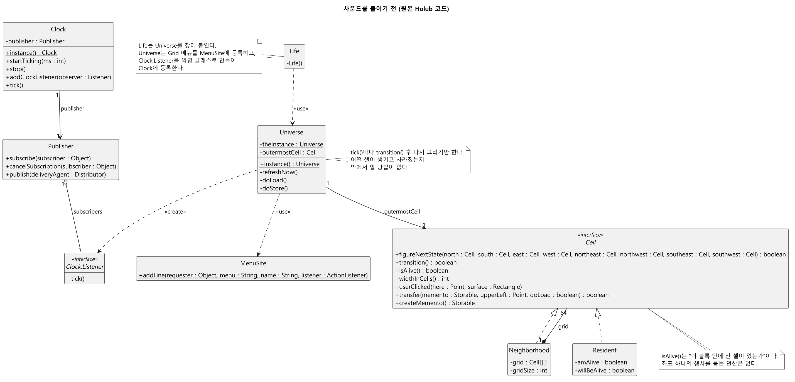
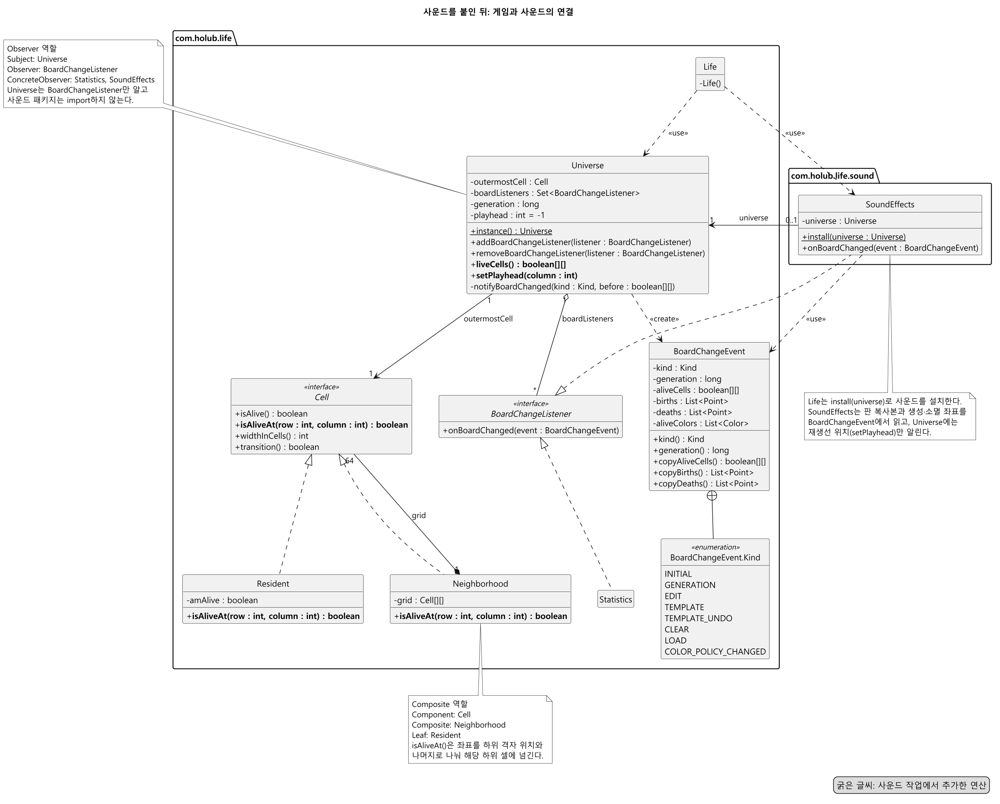
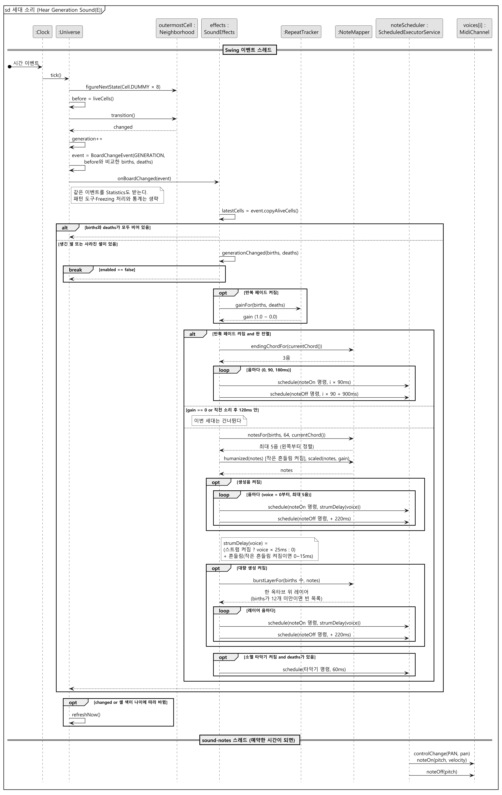
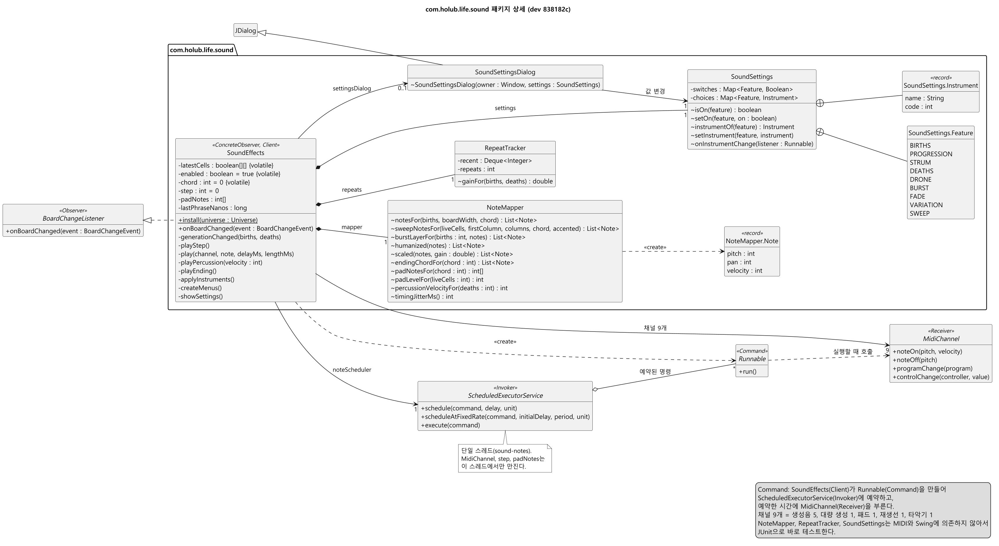
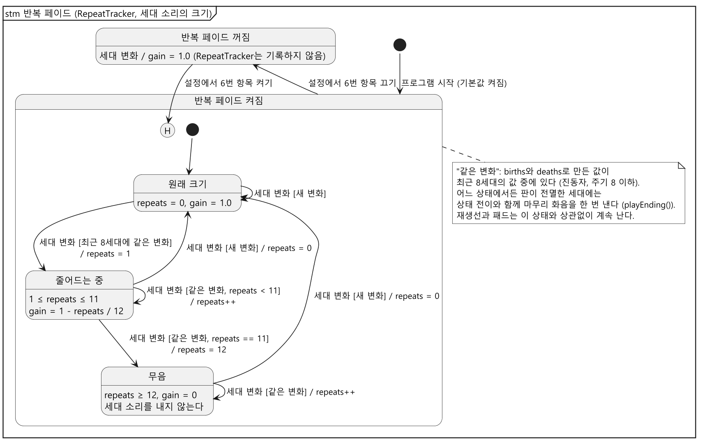
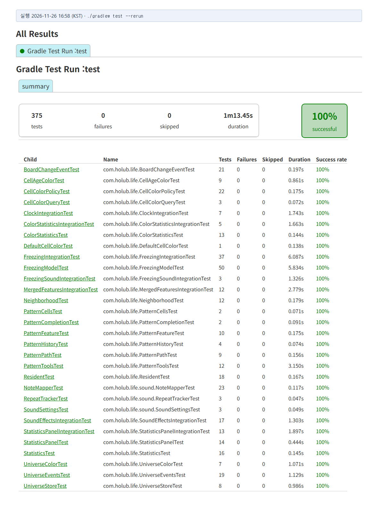
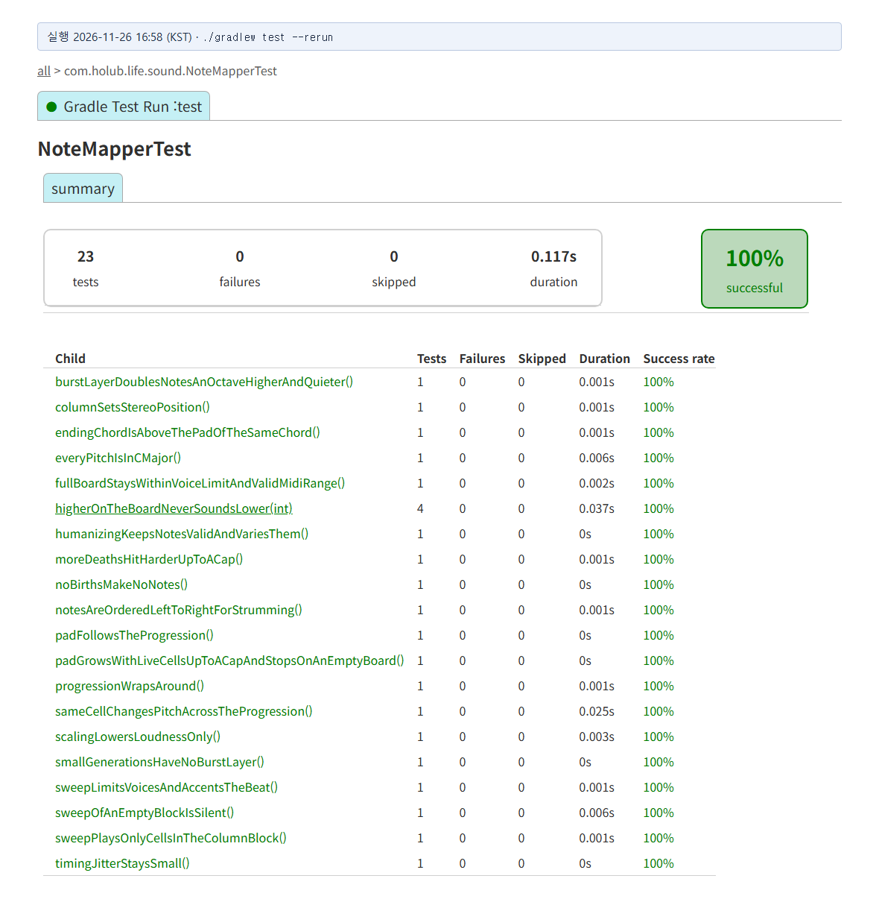
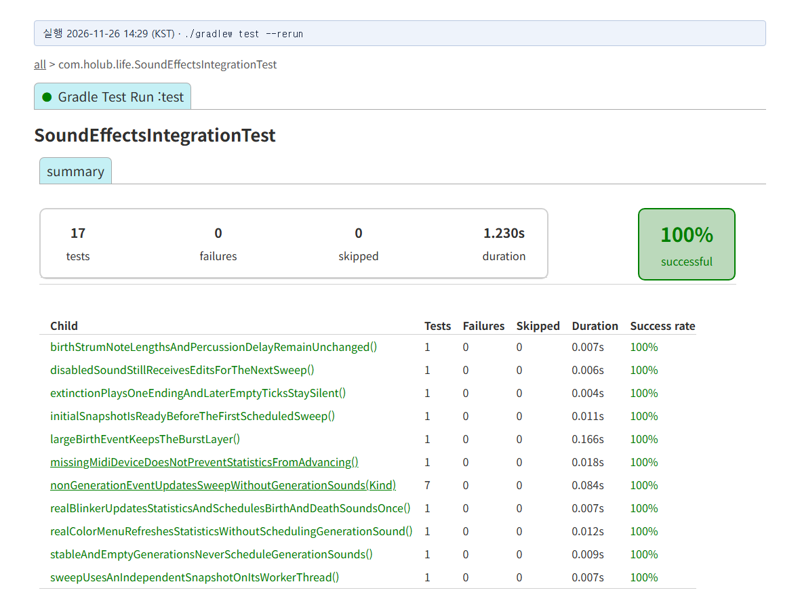
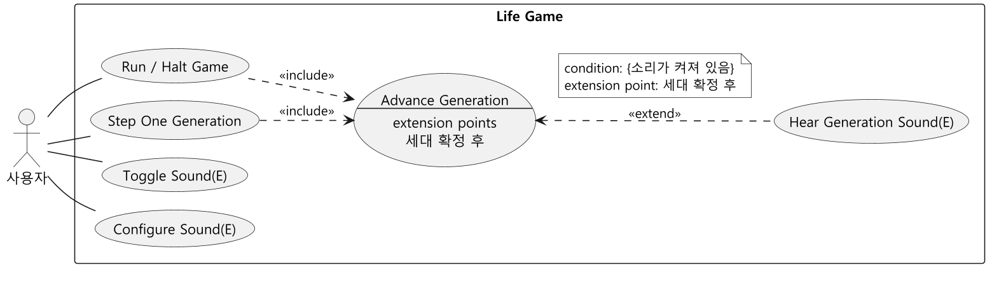

# 사운드 이펙트

담당: 한호석

## 1. 기능 목적과 동작

원래 Life Game은 판이 어떻게 바뀌는지 눈으로만 볼 수 있다. 사운드 이펙트는 같은 변화를 소리로도 들려준다. 세대가 넘어갈 때 새로 생긴 셀은 화음으로, 사라진 셀은 타악기로 들린다. 이와 별도로 초록 재생선이 판을 왼쪽에서 오른쪽으로 계속 훑으면서 지나가는 자리의 산 셀을 연주한다. 그래서 패턴이 커지는지, 같은 모양을 되풀이하는지, 사라지는지를 귀로 구분할 수 있고, 게임을 멈춰 둔 상태에서도 지금 판의 모양을 들을 수 있다.

표 S-1. 사운드 이펙트 유스케이스

| 유스케이스 | 동작 |
|---|---|
| Hear Generation Sound(E) | 세대가 확정되면 생긴 셀을 최대 5음 화음으로 왼쪽 음부터 25ms 간격으로 내고, 사라진 셀이 있으면 60ms 뒤 타악기를 한 번 친다. 위쪽 셀일수록 높은 음이고, 열 위치는 좌우 위치가 된다. Advance Generation의 확장점 "세대 확정 후"에서 소리가 켜져 있을 때만 일어난다 |
| Toggle Sound(E) | `Sound` 메뉴의 `On`, `Off`로 소리 전체를 켜고 끈다. 켜져 있는 동안 재생선이 150ms마다 4열씩 움직이며 그 구간의 산 셀을 최대 3음으로 연주하고, 밑에는 현재 코드의 저음 패드를 깐다. 게임이 멈춰 있어도 돈다 |
| Configure Sound(E) | `Sound` → `Settings` 창에서 9개 항목을 하나씩 끄고, 5개 항목의 악기를 바꾼다. 모달 창이 아니라서 창을 띄워 둔 채 게임을 진행할 수 있다 |

음높이는 판의 세로 64행을 C3부터 3옥타브(15음)로 나눠 정한다. 한 옥타브 안에서는 현재 코드에 맞춘 5음만 쓰고, 코드는 재생선이 한 바퀴(16스텝, 약 2.4초) 돌 때마다 C → Am → F → G 순서로 바뀐다.

10열에 세로로 놓인 블링커가 가로로 바뀌는 세대를 예로 들면 이렇다(코드는 C, 작은 흔들림은 끈 경우). 10행 9열과 10행 11열에 셀이 생기고 9행과 11행의 셀이 사라진다. 생긴 두 셀은 같은 행이라 한 음(미, E5)으로 합쳐지고, 남은 9열 셀의 좌우 값 18(0이 맨 왼쪽, 127이 맨 오른쪽)에 따라 왼쪽에서 들린다. 60ms 뒤에는 쉐이커가 한 번 울리고, 220ms 뒤 음이 꺼진다. 블링커는 두 모양을 계속 오가므로 같은 변화가 되풀이되고, Slow(150ms) 속도에서는 2초쯤 지나면 세대 소리가 들리지 않는다. 재생선과 패드는 그 뒤에도 계속 난다.

MIDI 신시사이저를 열 수 없는 환경에서는 `Sound disabled: ...` 한 줄만 출력하고, `Sound` 메뉴 없이 게임이 그대로 실행된다.

## 2. 기존 코드 대비 변경점

### 2.1 원본 구조에서 막힌 곳



그림 S-1. 사운드를 붙이기 전 클래스 구조 (Holub 원본 코드)

Holub 원본의 `Universe`는 `Clock.Listener`로 틱을 받아 `outermostCell.transition()`을 부르고 화면을 다시 그리기만 한다. 사운드를 붙이려고 보니 어떤 셀이 생기고 사라졌는지 밖에 알리는 통로도, r행 c열 셀이 살아 있는지 묻는 연산도 없었다. `Cell` 주석에 따르면 `isAlive()`는 "이 블록 안에 산 셀이 하나라도 있는가"를 묻는 연산이라 소리를 정하는 데는 쓸 수 없었다. r행 c열을 묻는 연산은 드래그 그리기 기능이 `isAliveAt()`으로 더해 두어서, 사운드는 그것을 그대로 썼다(3.3).

### 2.2 바꾼 곳

표 S-2. 기존 코드에서 바꾼 곳과 새로 만든 클래스

| 대상 | 변경 |
|---|---|
| `Universe` | 전이 전 판을 저장해 두었다가 전이 후 판과 비교해, 생긴 셀과 사라진 셀을 리스너에게 알린다. 재생선을 그리는 `setPlayhead()`를 더했다 |
| `Life` | 생성자에 `SoundEffects.install(universe);` 한 줄을 더했다 |
| 새 패키지 `com.holub.life.sound` | `SoundEffects`(리스너, 재생 예약, 메뉴), `NoteMapper`(셀을 음으로 바꾸기), `RepeatTracker`(반복 판단), `SoundSettings`(설정 값), `SoundSettingsDialog`(설정 창) |

`Cell`, `Neighborhood`, `Resident`는 고치지 않았다. 판의 셀을 좌표로 읽을 때는 `isAliveAt(row, column)`을 쓴다(3.3).

틱 처리는 이렇게 바뀌었다.

```java
// 원본 Holub 코드
if( outermostCell.transition() )
    refreshNow();

// 사운드 작업 후 (변화 발행을 처음 더했을 때)
boolean[][] before = liveCells();
if( outermostCell.transition() )
{   refreshNow();
    publishChanges( before );   // 이전 판과 비교해서 생성/소멸 좌표 발행
}
```

통계 기능을 합칠 때 이 알림은 통계와 사운드가 함께 받는 공통 이벤트로 바뀌었다. 지금 코드의 틱 처리는 다음과 같다(Freezing 처리와 화면 갱신은 생략).

```java
boolean[][] before = liveCells();
boolean changed = outermostCell.transition();
generation++;
notifyBoardChanged( BoardChangeEvent.Kind.GENERATION, before );  // 통계와 사운드에 같은 이벤트
```



그림 S-2. 사운드를 붙인 뒤 게임과 사운드의 연결

게임 패키지(`com.holub.life`)에서 사운드 패키지로 가는 선은 `Life`가 `install()`을 부르는 의존 하나뿐이다. `Universe`는 `BoardChangeListener` 인터페이스만 알고 사운드 패키지를 import하지 않는다. 반대로 사운드에서 게임으로 가는 연관도 재생선 위치를 알리는 `setPlayhead()` 하나다. 굵은 글씨는 사운드 작업에서 더한 연산이다. `Cell` 계층의 `isAliveAt()`은 드래그 그리기 기능이 더한 연산이라 굵게 쓰지 않았고, 사운드는 `liveCells()`에서 이것을 쓴다.

## 3. 적용한 설계 패턴과 원칙

### 3.1 Observer: 판의 변화를 알리는 통로

가장 먼저 정해야 했던 것은 `Universe`의 변화를 사운드가 어떻게 알게 할지였다. `Universe`가 `SoundEffects`를 직접 부르면 간단하지만, 게임 로직이 사운드 패키지에 묶이고 기능이 늘 때마다 `Universe`를 고쳐야 한다. `Universe`를 건드리지 않으려고 `SoundEffects`가 `Clock`을 직접 구독하는 방법도 따져 봤다. 그런데 Holub의 `Publisher.subscribe()`는 새 구독자를 목록 맨 앞에 넣는다. 나중에 등록한 사운드가 `Universe`보다 먼저 불리니, 사운드는 늘 바뀌기 전의 판을 보게 된다. 무엇이 바뀌었는지도 사운드가 이전 판을 따로 들고 계산해야 했다.

그래서 이전 판을 가진 `Universe`가 전이 전후를 한 번 비교하고, 그 결과를 등록된 리스너에게 보내게 했다. `Universe`가 Subject, `BoardChangeListener`가 Observer, `SoundEffects`와 통계 기능의 `Statistics`가 ConcreteObserver다. 알리는 쪽이 `Universe` 하나뿐이라 추상 Subject는 따로 두지 않았다. 이벤트에 생긴 셀, 사라진 셀, 판의 복사본을 실어 보내므로(push 방식) 받는 쪽은 판을 다시 읽지 않는다.

이 구조가 실제로 도움이 된 것은 통계 기능을 합칠 때였다. 사운드 전용이던 `GenerationListener`가 통계와 함께 쓰는 `BoardChangeListener`와 `BoardChangeEvent`로 바뀌었다(통합 작업은 통계 담당이 했다). 그런데도 사운드 쪽에서 고친 곳은 `SoundEffects`의 수신부 30줄 정도였고, `NoteMapper`, `RepeatTracker`, `SoundSettings`는 그대로였다. 재생선이 판을 읽는 방식도 이때 바뀌었다. 처음에는 sound-notes 스레드가 150ms마다 `universe.liveCells()`를 직접 불렀는데, 그러면 이벤트 스레드가 셀을 바꾸는 동안 다른 스레드가 같은 `Cell` 트리를 읽게 된다. 편집, Clear, Load 때도 이벤트가 오게 되면서 재생선은 마지막 이벤트의 복사본(`latestCells`)을 읽도록 바뀌었고, 판을 읽는 스레드와 바꾸는 스레드가 겹치지 않게 됐다.

대신 틱마다 64×64 판을 전이 전과 후에 한 번씩 읽는다. 화면을 다시 그리는 비용보다 작아서 그대로 두었다. 그리고 리스너는 Swing 이벤트 스레드에서 불리기 때문에 리스너가 오래 걸리면 화면도 같이 멈춘다.

### 3.2 Command: 소리를 예약 명령으로 만들기

소리는 대부분 지금이 아니라 조금 뒤에 나야 한다. 화음은 25ms 간격으로 퍼지고, 타악기는 60ms 뒤에 치고, 생성음은 220ms 뒤에 꺼야 하며, 재생선은 150ms마다 움직인다. 이걸 이벤트 스레드에서 기다리면 그동안 화면과 입력이 멈춘다. 그래서 할 일을 `Runnable` 명령으로 만들어 실행할 시각과 함께 단일 스레드 `ScheduledExecutorService`에 넣고, 리스너는 바로 돌아오게 했다.

표 S-3. Command 역할

| 역할 | 클래스 |
|---|---|
| Client | `SoundEffects` |
| Command | `Runnable` |
| ConcreteCommand | 음 켜기·끄기와 타악기 람다, `applyInstruments`(악기 변경)와 `playStep`(재생선 한 스텝) 메서드 참조 |
| Invoker | 단일 스레드 `ScheduledExecutorService` (`sound-notes` 스레드) |
| Receiver | `MidiChannel` (악기 변경과 재생선 한 스텝은 `SoundEffects`의 메서드를 거쳐 부른다) |

음 하나를 내는 코드는 켜기와 끄기를 각각 명령으로 예약하고 끝난다.

```java
private void play( MidiChannel channel, NoteMapper.Note note,
                   int delayMs, int lengthMs )
{   noteScheduler.schedule
    (   () ->
        {   channel.controlChange( PAN_CONTROLLER, note.pan() );
            channel.noteOn( note.pitch(), note.velocity() );
        },
        delayMs, TimeUnit.MILLISECONDS
    );
    noteScheduler.schedule( () -> channel.noteOff( note.pitch() ),
                            delayMs + lengthMs, TimeUnit.MILLISECONDS );
}
```

스레드를 하나로 정한 것도 따로 고민한 부분이다. 소리마다 새 스레드를 만들어도 기다리지는 않지만, 여러 스레드가 같은 `MidiChannel`을 건드려 켜기와 끄기 순서가 꼬일 수 있다. 설치할 때 생성자에서 악기를 처음 정하는 한 번을 빼면 `MidiChannel`, 재생선 위치(`step`), 누르고 있는 패드 음(`padNotes`)은 sound-notes 스레드에서만 만지게 했고, 그래서 채널에는 잠금을 걸지 않았다. 설정 창에서 악기를 바꿀 때도 이벤트 스레드가 채널을 직접 바꾸지 않고 `noteScheduler.execute(this::applyInstruments)`로 명령을 넣는다. 두 스레드가 함께 쓰는 값은 따로 막았다. 설정 값을 담은 `SoundSettings`는 `synchronized`로, 켜짐 여부 `enabled`, 코드 위치 `chord`, 이벤트로 받은 판 `latestCells`는 `volatile`로 두었다.

이미 난 소리는 되돌릴 일이 없어서 undo나 실행 이력은 두지 않았고, 명령마다 클래스를 만들지 않고 람다로 썼다. 스케줄러가 바쁘면 실행이 몇 ms 밀릴 수 있지만 효과음에서는 들리지 않는 정도였다.



그림 S-3. 한 세대의 소리가 예약되고 실행되는 과정

위 구간은 이벤트 스레드에서 한 틱 안에 일어나는 일이다. `SoundEffects`는 `schedule()`만 하고 돌아오므로 `Universe`는 소리를 기다리지 않고 `refreshNow()`로 넘어간다. 실제 `noteOn`, `noteOff`는 아래 구간처럼 sound-notes 스레드가 예약한 시각에 실행한다. 안쪽 `alt`의 세 칸은 판이 전멸했을 때(마무리 화음), 반복으로 무음이 됐거나 직전 소리와 120ms 안일 때(건너뜀), 그 밖의 경우(생성음, 대량 생성 레이어, 타악기)다.

### 3.3 Composite 재사용: 좌표로 셀 상태 묻기

판은 8×8 `Neighborhood` 안에 다시 8×8 `Neighborhood`가 들어 있는 Composite 구조다. 소리를 정하려면 r행 c열이 살아 있는지 물어야 하는데, 묻는 쪽이 판이 몇 겹인지 알게 하고 싶지 않았다. 드래그 그리기 기능이 이 구조를 그대로 따라 `Cell`에 `isAliveAt()`을 더해 두어서, 사운드는 판을 복사하는 `Universe.liveCells()`에서 이 연산을 그대로 썼다. `Neighborhood`는 좌표를 하위 칸 위치와 나머지로 나눠 넘기고, `Resident`는 자기 상태를 답한다.

```java
public boolean isAliveAt(int row, int column)
{   int subcellWidth = grid[0][0].widthInCells();
    return grid[row / subcellWidth][column / subcellWidth]
                .isAliveAt( row % subcellWidth, column % subcellWidth );
}
```

역할은 `Cell`이 Component, `Neighborhood`가 Composite, `Resident`가 Leaf다. 판 바깥의 이웃을 대신하는 `Cell.DUMMY`는 트리에 들어가지 않지만 `Cell`을 구현하므로 항상 `false`를 돌려준다. 칸 하나를 읽을 때마다 바깥 `Neighborhood`, 안쪽 `Neighborhood`, `Resident` 순서로 호출이 세 번 이어지지만, 판이 4096칸이라 부담은 작았다. 이 연산은 사운드 말고도 캡처·템플릿(`PatternCells`)과 Freezing 영역 저장(`FreezingRegion`)에서 쓰인다.

### 3.4 설계 원칙

`Universe`는 사운드가 아니라 `BoardChangeListener` 인터페이스에 의존한다. 지금 이벤트에 담긴 정보로 충분한 기능이라면 `Universe`를 고치지 않고 리스너로 등록만 하면 되므로, 이 범위에서는 확장에 열려 있고 변경에 닫혀 있다. 다만 이벤트에 없는 정보가 필요하면 이벤트와 `Universe`를 고쳐야 한다. 통계 기능을 합칠 때는 판 전체와 셀 색처럼 사운드 이벤트에 없던 정보가 필요해서 `BoardChangeEvent`를 새로 만들고 `Universe`의 알림 코드를 고쳤다.

사운드 패키지 안은 바뀌는 이유별로 나눴다. 음을 고르는 규칙은 `NoteMapper`, 반복 판단은 `RepeatTracker`, 설정 항목은 `SoundSettings`가 맡고, MIDI와 Swing을 다루는 일은 `SoundEffects`와 `SoundSettingsDialog`에만 있다. 그래서 앞의 세 클래스는 MIDI 장치와 화면 없이 단위 테스트할 수 있다(6.2).



그림 S-4. 사운드 패키지 클래스 구조

`NoteMapper`, `RepeatTracker`, `SoundSettings` 사이에는 선이 없고, 셋 중 어느 것도 `MidiChannel`이나 `JDialog`와 이어져 있지 않다. Command 역할은 그림의 범례에 적었다.

## 4. 검토한 대안과 선택 근거

### 4.1 변화를 사운드에 어떻게 알릴까

표 S-4. 변화 알림 방식 비교

| 방법 | 장점 | 문제 |
|---|---|---|
| `Universe`가 `SoundEffects`를 직접 호출 | 가장 간단하다 | 게임 로직이 사운드에 의존하고, 기능을 붙일 때마다 `Universe`를 고쳐야 한다 |
| `SoundEffects`가 `Clock`을 직접 구독 | `Universe`를 고치지 않는다 | `Publisher`가 새 구독자를 앞에 넣어서 사운드가 바뀌기 전의 판을 본다. 변화 계산도 사운드가 따로 해야 한다 |
| `Resident`가 상태가 바뀔 때 알림 | 바뀐 셀을 정확히 안다 | `Resident`는 자기 좌표를 모른다. 좌표를 넣으려면 셀을 만드는 구조를 다 바꿔야 하고, 셀마다 호출이 생긴다 |
| `Universe`가 비교한 결과를 발행 (선택) | 비교가 한 곳에 있고 리스너를 더하기 쉽다 | 틱마다 판을 전이 전과 후에 한 번씩 읽는다 |

### 4.2 판 상태를 어떻게 읽을까

표 S-5. 판 상태를 읽는 방식 비교

| 방법 | 장점 | 문제 |
|---|---|---|
| Load/Store용 Memento(`createMemento()`)를 다시 쓰기 | 이미 있는 저장 경로를 그대로 쓴다 | 부를 때마다 판 전체를 산 셀 목록(`LinkedList`)으로 복사하고, 칸 하나를 물을 때도 그 목록을 처음부터 찾는다. `Neighborhood.transfer()`가 `activeEdges`를 바꿔서, 저장할 때만 쓰던 경로를 매 틱 부르게 된다 |
| `Universe`가 `boolean[][]`을 따로 보관 | 셀 트리를 거치지 않고 배열만 읽는다 | 클릭, Clear, Load, 세대 진행 때마다 실제 셀과 맞춰야 하고, 한 곳만 빠져도 소리와 화면이 어긋난다 |
| `isAliveAt()` 쓰기 (선택) | 셀 상태의 원본이 한 곳이고 기존 Composite 구조를 따른다. 사운드 쪽에서 `Cell` 계층을 고치지 않는다 | 칸 하나를 읽을 때마다 호출이 세 번 이어진다 |

### 4.3 소리의 시간차를 어떻게 낼까

표 S-6. 시간차를 내는 방식 비교

| 방법 | 장점 | 문제 |
|---|---|---|
| 이벤트 스레드에서 `Thread.sleep()` | 코드가 가장 단순하다 | 기다리는 동안 화면과 입력이 멈추고, Fast 속도에서는 게임이 눈에 띄게 느려진다 |
| `javax.sound.midi.Sequencer` | 타이밍이 정확하다 | 미리 만든 악보를 재생하는 방식이라 세대마다 달라지는 입력과 설정 변경을 바로 반영하기 어렵다 |
| 소리마다 새 스레드 | 기다리지 않는다 | 스레드가 계속 생기고, 여러 스레드가 같은 채널을 건드려 noteOn과 noteOff 순서가 꼬일 수 있다 |
| 단일 스레드 스케줄러에 명령 예약 (선택) | 기다리지 않고, 채널을 만지는 스레드가 하나로 정해진다 | 실행이 몇 ms 밀릴 수 있다 |

### 4.4 설정 화면을 어디에 둘까

처음에는 `Sound` 메뉴에 체크 항목을 늘어놓는 방법이 기존 메뉴 방식과 가장 잘 맞아 보였다. 그런데 `Clock`은 메뉴가 열려 있는 동안 틱을 건너뛴다(`menuIsActive()`). 설정을 바꾸면서 소리가 어떻게 달라지는지 들어 볼 수 없고, 악기처럼 여럿 중 하나를 고르는 항목도 메뉴로는 다루기 불편했다. 모달 대화상자도 떠 있는 동안 게임 창을 만질 수 없어서 같은 문제가 있다. 그래서 모달이 아닌 별도 창(`SoundSettingsDialog`)을 게임 창 오른쪽에 붙여 띄우고, 닫으면 숨기기만 해서 다시 열 때 같은 값이 보이게 했다.

### 4.5 셀을 어떤 음으로 바꿀까

행마다 반음씩 올리는 방법은 계산이 단순하지만 여러 셀이 한꺼번에 생길 때 불협화음이 심했다. 장음계 7음에 고정하면 훨씬 나았지만 같은 판은 늘 같은 소리라서 금방 지루해졌다. 그래서 코드마다 어울리는 5음을 따로 두고 코드 진행에 맞춰 바꿨다. 같은 모양이라도 코드가 바뀌면 다르게 들리고, 5음은 모두 C장조 안에 있어서 코드가 바뀌는 순간에도 튀는 음이 없다.

### 4.6 통계와 같은 이벤트를 쓸까

통계 기능을 합칠 때 판의 변화를 받는 통로가 둘이 되었다. 사운드는 생성·소멸 좌표를 받았고, 통계는 판 전체를 받아 직전 판과 따로 비교했다. 두 통로를 그대로 두면 비교를 두 번 하고, 두 기능이 본 변화가 같다는 보장도 없다. 그래서 하나의 이벤트로 합쳤다. 비교는 `Universe`에서 한 번만 하고, 편집·Clear·Load 때도 이벤트가 와서 재생선이 판을 직접 읽지 않아도 된다. 사운드가 쓰지 않는 색 목록과 `COLOR_POLICY_CHANGED` 종류가 이벤트에 함께 들어가게 된 것은 감수했다.

### 4.7 적용하지 않은 패턴

표 S-7. 검토했지만 적용하지 않은 패턴

| 패턴 | 검토한 곳 | 적용하지 않은 이유 | 다시 검토할 조건 |
|---|---|---|---|
| Strategy | 소리를 내는 기능 5개(생성음, 대량 생성, 소멸 타악기, 패드, 재생선)를 각각 객체로 나눠 공통 인터페이스 뒤에 두기 | `SoundEffects`에는 설정을 확인하는 분기가 10곳 있는데, 기능을 객체로 나눠도 그중 5곳만 목록을 도는 확인 한 줄로 바뀌고 코드 진행, 스트럼, 반복 페이드, 작은 흔들림에 걸린 5곳은 남는다. 대량 생성은 생성음이 고른 화음을 받아 쓰고, 악기를 적용하는 방식도 기능마다 다르다(채널 악기 바꾸기, 패드는 누르던 음을 끊고 바꾸기, 타악기는 악기 번호를 건반 번호로 쓰기). 이 값과 방식을 담을 인터페이스부터 정해야 하는데, 기능이 5개로 정해져 있어서 적용하지 않았다 | 소리를 내는 기능을 새로 추가할 때. MIDI 채널 16개 중 9개(생성음 5개, 나머지 네 기능 1개씩)를 쓰고 있어서 채널 배정도 같이 정해야 한다 |
| State | 반복 페이드(원래 크기, 줄어드는 중, 무음), Sound On/Off, 코드 진행 | 그림 S-5처럼 페이드의 세 상태는 하는 일이 같고 소리 크기(gain = 1 - 반복 횟수/12)만 다르다. On/Off는 `boolean` 하나이고, 코드 진행은 5음과 패드 화음 표에서 한 줄을 고르는 인덱스 하나다. 상태마다 동작이 달라지는 Freezing 영역은 팀에서 State 패턴으로 구현했다 | 상태마다 하는 일이 달라질 때 |
| Singleton | `SoundEffects` | `Universe`와 `Clock`은 Singleton이지만, 사운드는 `Life`에서 한 번 만들면 되고 다른 곳에서 찾을 일이 없다. 전역 접근점을 두는 대신 `install(universe)`로 무엇에 의존하는지 드러냈다 | 다른 기능이 사운드에 직접 요청해야 할 때 |



그림 S-5. 반복 페이드의 상태와 소리 크기

## 5. UML·코드 근거

- 그림: S-1~S-5에 넣었다. 재생선·설치·설정 변경 시퀀스, 켜짐과 꺼짐·코드 진행 상태, 시스템 시퀀스 다이어그램과 연산 계약은 저장소의 `docs/sound-effects/sound-uml.md`에 있다.
- 코드: `src/com/holub/life/sound/`의 5개 클래스. 기존 코드는 `Universe`, `Life` 두 파일을 고쳤다.

## 6. 테스트

### 6.1 결과

2026-11-26에 `./gradlew test --rerun`으로 전체 375개가 모두 통과했다(그림 S-6). 이 중 사운드와 관련된 테스트는 52개다.

표 S-8. 사운드 관련 테스트

| 구분 | 테스트 클래스 | 개수 | 대상 |
|---|---|---|---|
| 모델 | `NoteMapperTest` | 23 | 음 고르기 규칙 |
| 모델 | `RepeatTrackerTest` | 3 | 반복 페이드 |
| 모델 | `SoundSettingsTest` | 3 | 설정 값 |
| 기존 클래스 | `NeighborhoodTest` | 12개 중 1 | `isAliveAt()` (드래그 그리기 기능에서 작성. 사운드가 판을 읽을 때 쓴다) |
| 기존 클래스 | `UniverseStoreTest` | 8개 중 2 | 판 복사, 재생선 그리기 |
| 통합 | `SoundEffectsIntegrationTest` | 17 | 실제 `Universe`, `Statistics`와 연결한 `SoundEffects` (통계 기능을 합칠 때 추가) |
| 통합 | `FreezingSoundIntegrationTest` | 3 | Freezing과 함께 쓸 때 (Freezing 기능을 합칠 때 추가) |

사운드 작업 전에 있던 테스트 32개(`ResidentTest` 18, `NeighborhoodTest` 11, `UniverseStoreTest` 3)는 `Universe`를 고치고 사운드를 붙인 뒤에도 그대로 통과했다. 사운드를 붙여도 기존 동작이 깨지지 않았다는 근거다.

### 6.2 UI와 분리한 모델 테스트

`NoteMapper`, `RepeatTracker`, `SoundSettings`는 MIDI와 Swing을 쓰지 않는다. 그래서 소리를 듣지 않고도 "음계를 벗어나지 않는다", "진동자는 결국 조용해진다" 같은 규칙을 숫자로 확인할 수 있다. 작은 흔들림처럼 난수가 들어가는 부분은 `NoteMapper(Random)` 생성자로 시드를 넣어 결과를 고정했다.

아래 테스트는 코드 4개와 64행을 모두 돌면서 고른 음을 12로 나눈 나머지가 C장조 7음 안에 있는지 본다. 여러 셀이 함께 생겨도 덜 부딪히게 하려고 5음을 C장조 안에서 고른 설계가 지켜지는지 확인하는 테스트다. 실패하면 어느 코드의 몇 번째 행인지 메시지로 나온다.

```java
@Test
void everyPitchIsInCMajor()
{   Set<Integer> cMajor = Set.of( 0, 2, 4, 5, 7, 9, 11 );
    for( int chord = 0; chord < CHORDS; ++chord )
        for( int row = 0; row < WIDTH; ++row )
            assertTrue( cMajor.contains(pitchAt(row, chord) % 12),
                        "chord " + chord + " row " + row );
}
```

### 6.3 가짜 MIDI와 스케줄러로 하는 통합 테스트

`SoundEffectsIntegrationTest`는 실제 `Universe`와 `Statistics`에 `SoundEffects`를 붙이고, MIDI 신시사이저, 스케줄러, 메뉴 등록만 Mockito로 바꾼다. 가짜 스케줄러는 명령을 실행하지 않고 명령과 예약 시각을 `jobs` 목록에 쌓는다. 재생선 스텝은 받아 두었다가 테스트가 원할 때 `sweepStep.run()`으로 한 번씩 돌린다. 가짜 채널은 `noteOn`을 `played` 목록에 적는다. 그래서 150ms를 기다리거나 소리를 듣지 않고도 언제 무엇을 내기로 했는지 확인할 수 있다. 소리를 예약 명령으로 만든 Command 구조가 있어서 가능한 방법이다.

아래 테스트는 생긴 셀 2개와 사라진 셀 1개가 담긴 세대 이벤트를 보내고 예약을 확인한다. 음 켜기·끄기 2쌍과 타악기 1개, 모두 5개가 예약되어야 한다.

```java
@Test void birthStrumNoteLengthsAndPercussionDelayRemainUnchanged() throws Exception {
    LifeTestSupport.onEdt(() -> {
        boolean[][] cells = new boolean[64][64]; cells[1][2] = cells[60][60] = true;
        sound.onBoardChanged(new BoardChangeEvent(GENERATION, 1, 64, cells,
                List.of(new Point(2, 1), new Point(60, 60)), List.of(new Point(3, 4)), LifeTestSupport.redColors(cells)));
        assertEquals(5, jobs.size());
        assertTrue(jobs.get(0).delay() >= 0 && jobs.get(0).delay() <= 15);
        assertEquals(220, jobs.get(1).delay() - jobs.get(0).delay());
        assertTrue(jobs.get(2).delay() >= 25 && jobs.get(2).delay() <= 40);
        assertEquals(220, jobs.get(3).delay() - jobs.get(2).delay());
        assertEquals(60, jobs.get(4).delay());
        runNotes();
        assertEquals(2, played.stream().filter(note -> note.channel() < 5).count());
        assertEquals(1, played.stream().filter(note -> note.channel() == 9 && note.pitch() == 82).count());
    });
}
```

음의 시작 시각에는 작은 흔들림(0~15ms)이 더해지므로 범위로 확인한다. 둘째 음이 25~40ms인 것은 스트럼 간격 25ms에 흔들림이 따로 더해져서다. 음 길이는 끄기 시각에서 켜기 시각을 빼서 확인하므로 흔들림이 지워져 정확히 220ms가 되고, 타악기는 흔들림 없이 60ms다. 끝으로 예약을 실제로 실행해 생성음 채널(0~4번)에서 음 2개, 타악기 채널(9번)에서 쉐이커(82번) 한 번이 나는지 본다.

### 6.4 대표 테스트와 목적

표 S-9. 대표 테스트

| 테스트 | 만든 목적 | 확인 내용 |
|---|---|---|
| `NoteMapperTest.higherOnTheBoardNeverSoundsLower` | 판의 높이가 음 높이로 바뀌는지 | 코드 4개 각각에서 위쪽 행의 음이 바로 아래 행의 음보다 낮지 않다 |
| `NoteMapperTest.fullBoardStaysWithinVoiceLimitAndValidMidiRange` | 셀이 아주 많이 생겨도 소리가 과하지 않은지 | 64×64 판 전체가 한꺼번에 생겨도 정확히 5음만 나오고, 세기는 1~127이며, 같은 음이 겹치지 않는다 |
| `RepeatTrackerTest.oscillatorFadesToSilence` | 진동자처럼 같은 변화가 되풀이되면 조용해지는지 | 두 변화를 16세대 동안 번갈아 넣는 동안 볼륨이 한 번도 커지지 않고 마지막에 0이 된다 |
| `SoundSettingsTest.turningOneFeatureOffLeavesTheOthersOn` | 설정 항목이 서로 독립적인지 | 스트럼을 꺼도 재생선은 켜진 상태 그대로다 |
| `NeighborhoodTest.isAliveAtFindsResidentThroughNestedNeighborhoods` | 사운드가 판을 읽을 때 쓰는 `isAliveAt()`이 여러 겹 판에서 좌표를 제대로 찾는지 | 두 겹으로 나뉜 판에서 클릭한 3행 2열만 `true`이고, 행과 열을 바꾼 2행 3열은 `false`다 |
| `UniverseStoreTest.playheadIsDrawnOverTheBoardAndCanBeRemoved` | 재생선이 판 위에 보이고 지워지는지 | 판을 이미지로 그려 재생선 자리의 픽셀이 초록색(0, 170, 80)이고, `-1`로 지우면 그 픽셀이 바뀐다 |
| `SoundEffectsIntegrationTest.realBlinkerUpdatesStatisticsAndSchedulesBirthAndDeathSoundsOnce` | 실제 세대 진행이 Observer를 거쳐 소리로 이어지는지 | 블링커를 그리는 동안은 예약이 없다. 한 틱 뒤 생성 화음이 나고 타악기는 정확히 한 번 친다. 같은 이벤트로 통계도 세대 1로 바뀐다 |
| `SoundEffectsIntegrationTest.stableAndEmptyGenerationsNeverScheduleGenerationSounds` | 변화가 없는 세대는 조용한지 | 블록(2×2)만 있는 판과 빈 판에서 여러 틱을 진행해도 예약된 소리가 없다 |
| `SoundEffectsIntegrationTest.extinctionPlaysOneEndingAndLaterEmptyTicksStaySilent` | 판이 전멸할 때 마무리 화음이 한 번만 나는지 | 마지막 셀이 죽는 틱에 3음이 0·90·180ms에 시작해 900ms씩 울리고, 그 뒤 빈 판의 틱에서는 아무것도 예약되지 않는다 |
| `SoundEffectsIntegrationTest.disabledSoundStillReceivesEditsForTheNextSweep` | Off 동안 편집한 판이 On 뒤에 반영되는지 | Off에서 셀을 그리면 재생선 스텝이 아무것도 예약하지 않고, On으로 바꾼 뒤 스텝에서는 그 셀을 재생선 채널로 연주한다 |
| `SoundEffectsIntegrationTest.missingMidiDeviceDoesNotPreventStatisticsFromAdvancing` | MIDI 장치가 없어도 게임이 계속되는지 | 신시사이저를 얻을 때 예외가 나도 `install()`이 예외 없이 끝나고, 틱을 진행하면 통계가 세대 1로 바뀐다 |
| `FreezingSoundIntegrationTest.aFrozenBlinkerIsSilentAndIsHeardAgainOnItsFirstFreeGeneration` | Freezing과 함께 쓸 때 소리가 맞게 나는지 | 3세대 동안 고정한 블링커는 그동안 조용하고, 풀린 첫 세대에 생성 화음과 타악기 한 번이 난다 |

### 6.5 결과 화면



그림 S-6. 전체 테스트 결과 (2026-11-26 16:58 실행, 화면 맨 위에 실행 날짜와 명령을 적었다)



그림 S-7. UI와 분리한 모델 테스트 `NoteMapperTest` 결과



그림 S-8. 통합 테스트 `SoundEffectsIntegrationTest` 결과

### 6.6 자동 테스트로 확인하지 않은 것

실제 장치에서 나는 음색과 음량, 여러 음이 함께 날 때 어울리게 들리는지, `Off`를 고를 때 이미 예약된 음이 끝까지 울리는지, 설정 창의 체크박스와 선택 상자가 설정 값을 바꾸는지는 JUnit으로 확인하지 않았다. 이 부분은 신시사이저 출력을 오디오 스트림으로 받아 직접 확인했다. 설정 창의 악기 20개가 모두 소리를 내는지, 빈 판일 때와 `Off`를 누른 뒤 조용한지, 게임을 멈춰도 재생선 소리가 나는지, 설정 창에서 재생선이나 저음 패드를 끄면 그 소리가 멈추는지를 봤다.

## 7. 담당

담당: 한호석

사운드 패키지 전체, `Universe`의 첫 변화 발행 구조(`GenerationListener`)와 재생선 표시(`setPlayhead()`), 사운드 작업에서 추가한 테스트 31개(`NoteMapperTest` 23, `RepeatTrackerTest` 3, `SoundSettingsTest` 3, `UniverseStoreTest` 2), 사운드 문서(설계 문서, 기능 명세, UML)를 맡았다. 통합 테스트 20개(`SoundEffectsIntegrationTest` 17, `FreezingSoundIntegrationTest` 3)는 통계와 Freezing 기능을 합칠 때 더해졌다.

---

# 공통 장의 사운드 부분

팀 보고서의 공통 장(유스케이스, 기능 간 연동, 테스트, 결론) 가운데 사운드에 해당하는 내용이다.

## 유스케이스 (사운드 부분)

확장 유스케이스는 Hear Generation Sound(E), Toggle Sound(E), Configure Sound(E) 세 개다. Hear Generation Sound(E)는 Advance Generation의 확장점 "세대 확정 후"에 extend로 붙고, 조건은 소리가 켜져 있는 것이다. Run / Halt Game과 Step One Generation이 Advance Generation을 include하는 구조는 색 순환, Freezing, 통계와 같다. 나머지 두 유스케이스는 사용자와 직접 이어진다. 재생선은 소리가 켜져 있는 동안 150ms 타이머로 계속 도는 동작이라 유스케이스를 따로 두지 않고 Toggle Sound(E)에 묶었다.



그림 S-9. 사운드 이펙트 유스케이스 (팀 전체 유스케이스 다이어그램의 사운드 부분)

## 기능 간 연동 (사운드 부분)

사운드는 판의 변화를 `BoardChangeEvent`로만 받는다. 그래서 다른 기능이 판을 바꿀 때 어떤 이벤트를 보내는지가 곧 사운드와의 연결 방식이다.

표 S-10. 다른 기능과 사운드가 맞물리는 곳

| 기능 | 사운드가 받는 것 | 결과 | 확인한 테스트 |
|---|---|---|---|
| 통계 | 같은 `GENERATION` 이벤트 (등록 순서상 통계가 먼저 받음) | 통계 탭의 세대·탄생·사망 수와 그 세대에 나는 소리가 같은 변화에서 나온다 | `realBlinkerUpdatesStatisticsAndSchedulesBirthAndDeathSoundsOnce` |
| Freezing | 고정된 셀은 전이 전후가 같아서 생긴 셀·사라진 셀 목록에 들어가지 않는다 | 고정된 셀은 세대 소리를 내지 않고, 풀린 첫 세대부터 다시 들린다. 재생선은 판 복사본을 읽으므로 고정된 산 셀도 연주한다 | `FreezingSoundIntegrationTest` 3개 |
| 색 순환 | 색 규칙을 바꾸면 `COLOR_POLICY_CHANGED` 이벤트 | 세대 소리는 나지 않고 재생선이 읽는 판만 갱신된다 | `realColorMenuRefreshesStatisticsWithoutSchedulingGenerationSound` |
| 캡처·템플릿 | 배치는 `TEMPLATE`, 되돌리기는 `TEMPLATE_UNDO` 이벤트 | 세대 소리 없이 다음 재생선 스텝부터 바뀐 판을 연주한다 | `nonGenerationEventUpdatesSweepWithoutGenerationSounds` |
| 드래그 그리기 | 셀이 실제로 바뀐 마우스 입력마다 `EDIT` 이벤트 | 그리는 동안은 조용하고, 그린 셀을 재생선이 바로 연주한다 | `nonGenerationEventUpdatesSweepWithoutGenerationSounds` |

판을 읽는 `isAliveAt()`은 드래그 그리기 기능이 `Cell`에 더한 연산이다. 사운드는 공통 이벤트의 판 복사(`Universe.liveCells()`)에서 이것을 쓰고, 캡처·템플릿과 Freezing 영역 저장도 같은 연산으로 셀 상태를 읽는다.

## 테스트 수행 내역 (사운드 부분)

사운드 작업 전에 있던 테스트 32개(`ResidentTest` 18, `NeighborhoodTest` 11, `UniverseStoreTest` 3)가 사운드 작업 뒤에도 그대로 통과했다. 사운드 관련 테스트 52개 중 46개는 사운드만 다루고, 6개는 기존 클래스(`NeighborhoodTest`, `UniverseStoreTest`)에서 사운드가 쓰는 연산을 확인하는 테스트와 Freezing과 함께 보는 테스트다. 통계와의 연동은 `SoundEffectsIntegrationTest`, Freezing과의 연동은 `FreezingSoundIntegrationTest`에서 확인한다. 2026-11-26 실행에서 전체 375개가 통과했다.

## 결론 (사운드 부분)

게임 쪽에서 사운드를 아는 곳은 `Life`의 `install()` 한 줄뿐이라, 이 줄을 빼면 소리만 빠지고 게임은 그대로 돈다. 통계와 같은 이벤트로 합칠 때 사운드 쪽은 수신부 30줄 정도만 고쳤고, 판을 읽을 때는 `isAliveAt()`을 그대로 써서 `Cell` 계층을 고치지 않았다. 소리를 예약 명령으로 만든 덕분에 소리의 타이밍도 장치 없이 숫자로 테스트할 수 있었다.

한계도 있다. 소리를 내는 기능을 새로 더하려면 지금은 `SoundEffects`를 고쳐야 한다(Strategy를 적용하지 않음). 설정은 파일에 저장하지 않아 프로그램을 다시 켜면 처음 값으로 돌아간다. Medium(70ms)이나 Fast(30ms) 속도에서는 세대 소리 사이 최소 간격(120ms) 때문에 일부 세대의 소리를 건너뛴다. Clear나 Load는 반복 기록을 지우지 않아서, 같은 자리에 같은 진동자를 다시 그리면 처음부터 작게 들리거나 아예 들리지 않을 수 있다. `SoundEffects`는 재생선을 그리려고 `Universe.setPlayhead()`를 직접 부르고, 이벤트에 통계용 값이 들어 있어서 통계 쪽 변경이 사운드에 영향을 줄 수 있다. 실제 음색과 어울림은 자동 테스트로 확인할 수 없어서 직접 들어 확인했다.
