# 사운드 이펙트 UML

사운드 이펙트 기능의 클래스, 시퀀스, 상태 다이어그램과 시스템 연산의 연산 계약이다. 기준은 통계와 Freezing 기능까지 합친 지금 코드이고, 유스케이스와 요구사항은 [sound-effects-spec.md](sound-effects-spec.md), 설계 결정과 테스트는 [sound-effects.md](sound-effects.md)에 있다.

그림 원본(`.puml`)과 PNG는 [`docs/sound-effects/diagram/`](diagram/)에 있다. 유스케이스 다이어그램(`usecase.png`)은 기능 명세 2장에서 쓴다.

## 1. 클래스 다이어그램

### 1.1 사운드를 붙이기 전

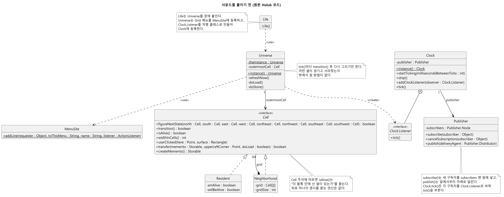

원본에서 `Universe`는 `Clock.Listener`로 틱을 받아 `transition()`을 하고 다시 그리기만 한다. 어떤 셀이 생기고 사라졌는지 밖에 알리는 통로가 없고, `Cell`에는 좌표 하나의 생사를 묻는 연산도 없다. 사운드를 붙이려면 이 두 가지가 필요했다.

### 1.2 사운드를 붙인 뒤: 게임과 사운드의 연결

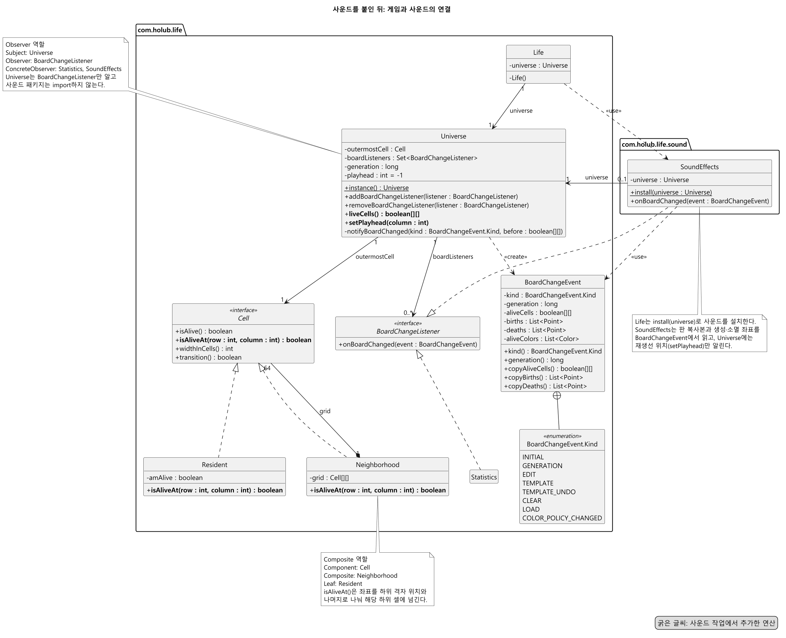

바뀐 부분은 두 곳이다.

- Observer: `Universe`(Subject)가 `BoardChangeListener`(Observer) 목록을 갖고, 판이 바뀔 때마다 `BoardChangeEvent`를 만들어 보낸다. `SoundEffects`와 `Statistics`가 ConcreteObserver다. `Universe`는 사운드 패키지를 import하지 않는다. 게임 쪽에서 사운드를 아는 곳은 시작점인 `Life`가 `install()`을 부르는 한 곳뿐이다.
- Composite 확장: `Cell`(Component)에 `isAliveAt(row, column)`을 추가하고 `Neighborhood`(Composite)와 `Resident`(Leaf)가 구현했다.

두 패턴의 역할은 그림의 노트에 적었다. `Statistics`는 통계 기능의 클래스라서 이름만 그렸다.

`Life`의 `universe` 필드, `Universe`의 `boardListeners`·`generation`·`addBoardChangeListener()`·`removeBoardChangeListener()`·`notifyBoardChanged()`, 그리고 `BoardChangeEvent`는 통계 기능을 합칠 때 생긴 것이다. 사운드가 설치되고(`install(universe)`) 판 변화를 받는 통로라서 남겼고, 등록과 해제는 Observer에서 Subject가 하는 일이라 함께 그렸다. 이벤트의 세대 번호(`generation`)와 색 목록(`aliveColors`)은 통계가 쓰는 값이고, 사운드는 종류(`kind()`), 판 복사본(`copyAliveCells()`), 생긴 셀(`copyBirths()`), 사라진 셀(`copyDeaths()`)만 읽는다.

`SoundEffects`에서 `Universe`로 가는 연관은 재생선을 판 위에 그리기(`setPlayhead`) 위한 것이다. 판의 상태는 `Universe`에 묻지 않고 이벤트로만 받는다.

### 1.3 사운드 패키지 상세

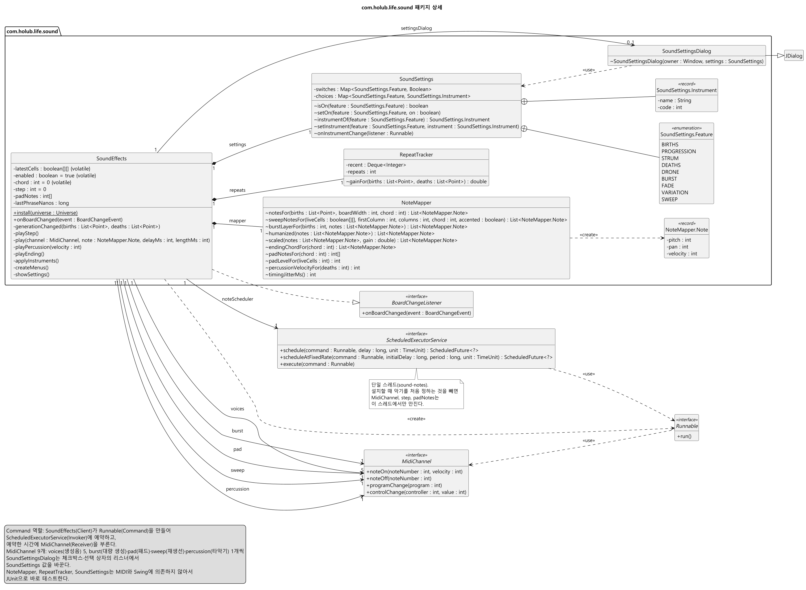

`SoundEffects`가 음 고르기(`NoteMapper`), 반복 판단(`RepeatTracker`), 설정 값(`SoundSettings`)을 각각 하나씩 갖고 일을 맡긴다. 이 셋은 MIDI와 Swing을 모르기 때문에 단위 테스트를 바로 할 수 있다.

Command 패턴의 역할은 그림의 범례에 적었다. `SoundEffects`(Client)가 음 켜기·끄기, 타악기, 악기 변경, 재생선 한 스텝을 `Runnable`(Command)로 만들고, 단일 스레드 `ScheduledExecutorService`(Invoker)가 예약한 시간에 실행해 `MidiChannel`(Receiver)을 부른다.

`{volatile}`이 붙은 세 필드(`latestCells`, `enabled`, `chord`)는 Swing 이벤트 스레드와 사운드 스레드가 함께 읽는 값이다. `step`과 `padNotes`는 사운드 스레드에서만 쓰므로 표시가 없다.

## 2. 시퀀스 다이어그램

### 2.1 사운드 설치

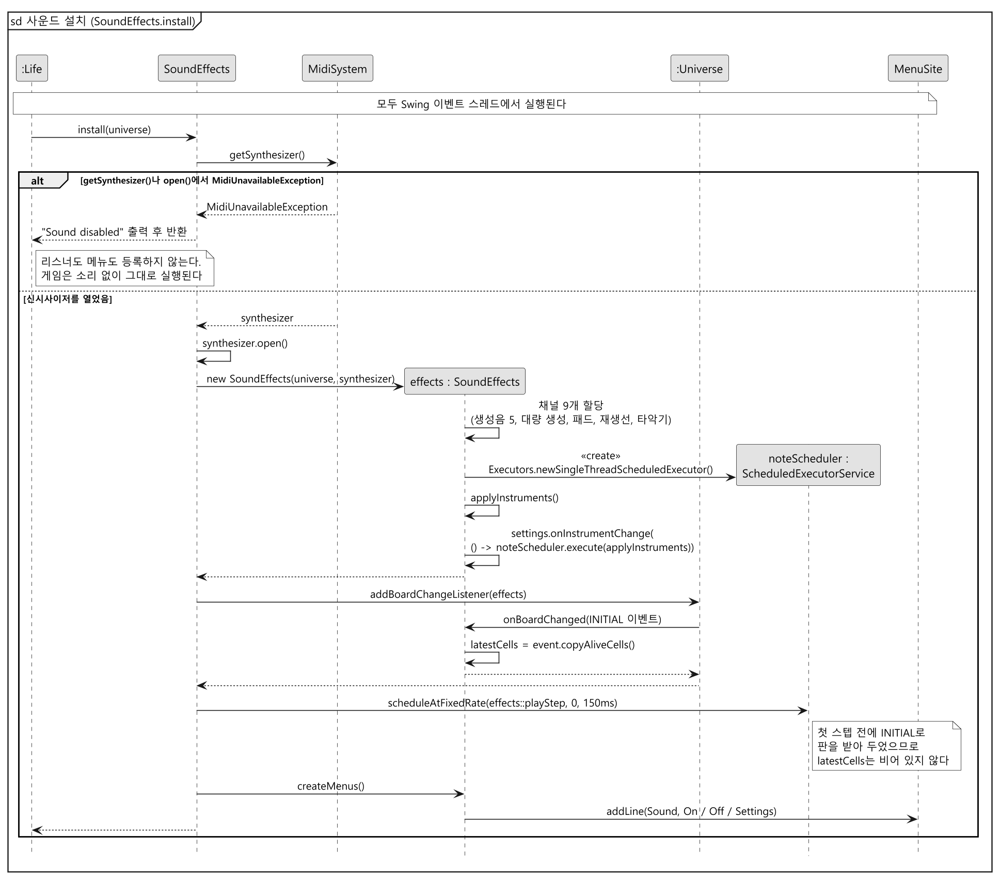

순서가 중요한 곳은 리스너 등록과 재생선 예약이다. `addBoardChangeListener()`는 등록하는 순간 현재 판을 담은 `INITIAL` 이벤트를 보내 준다. 이걸 먼저 받은 다음에 재생선을 예약하기 때문에, 첫 `playStep()`이 실행될 때 `latestCells`가 이미 채워져 있다. 신시사이저를 열 수 없으면 리스너도 메뉴도 등록하지 않고 끝나서 게임은 소리 없이 그대로 돈다.

### 2.2 세대 소리

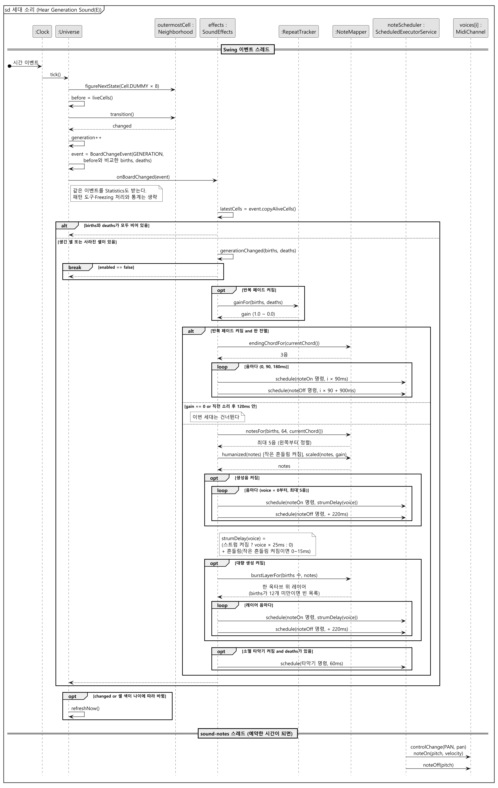

윗부분은 Swing 이벤트 스레드에서 한 틱 안에 일어나는 일이다. `SoundEffects`는 소리를 직접 내지 않고 명령을 예약만 하고 바로 돌아오므로, `Universe`는 소리 때문에 기다리지 않고 `refreshNow()`로 넘어간다. 실제 `noteOn`, `noteOff`는 아랫부분처럼 sound-notes 스레드가 예약한 시간에 실행한다.

`alt`의 세 갈래가 유스케이스 UC-S1의 대안 흐름과 같다. 판이 전멸하면 마무리 화음, 볼륨이 0이거나 직전 소리와 너무 가까우면 건너뛰기, 그 밖에는 생성음·대량 생성 레이어·타악기다.

### 2.3 재생선 한 스텝

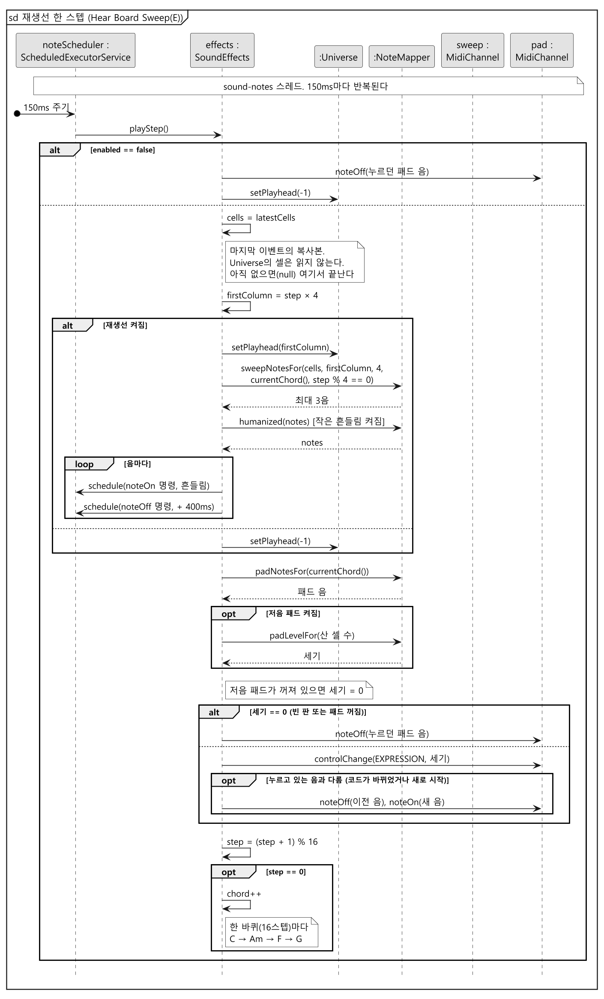

150ms마다 sound-notes 스레드에서 실행된다. 판은 `latestCells`(마지막 이벤트의 복사본)에서 읽고 `Universe`의 셀은 건드리지 않는다. 그래서 이벤트 스레드가 셀을 바꾸는 중에도 두 스레드가 같은 `Cell` 트리를 동시에 읽지 않는다. 16스텝이 지나면 `chord`가 바뀌어 다음 코드로 넘어간다.

### 2.4 설정 창에서 악기 바꾸기

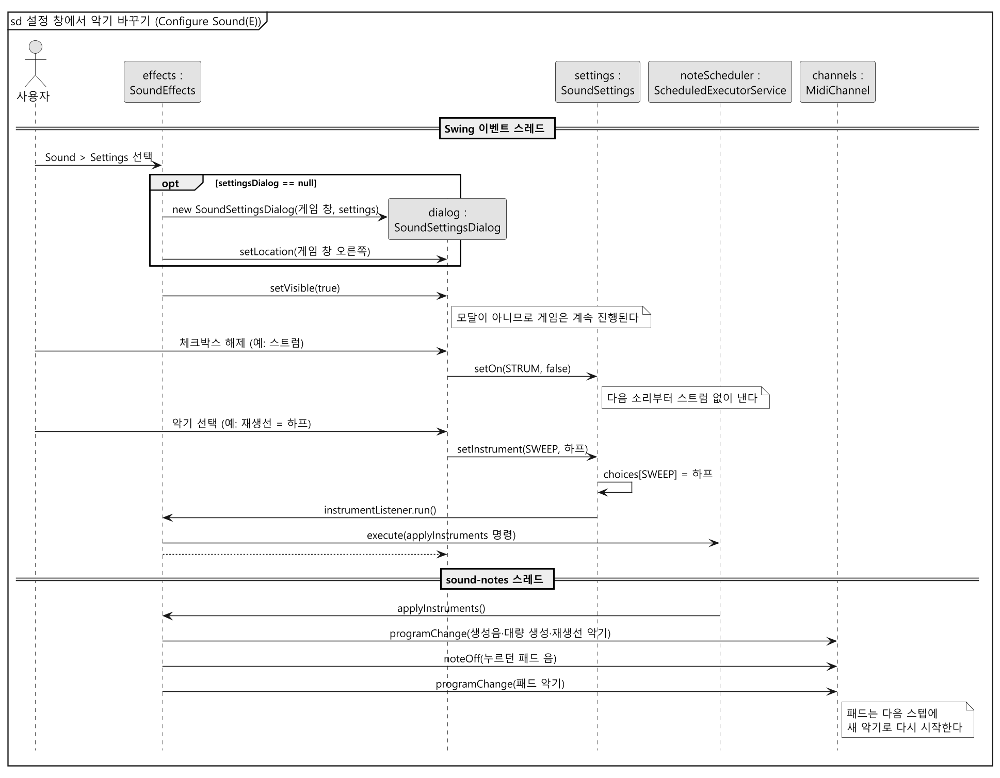

설정 창은 이벤트 스레드에서 동작하지만, 설치할 때 악기를 처음 정하는 한 번(2.1)을 빼면 `MidiChannel`은 사운드 스레드에서만 만지기로 정했다. 그래서 악기를 바꾸면 채널을 바로 바꾸지 않고 `applyInstruments`를 명령으로 만들어 스케줄러에 넣는다. 체크박스는 `SoundSettings`의 값만 바꾸고, 다음 소리를 낼 때 그 값을 읽는다.

## 3. 상태 다이어그램

### 3.1 사운드 켜짐과 꺼짐

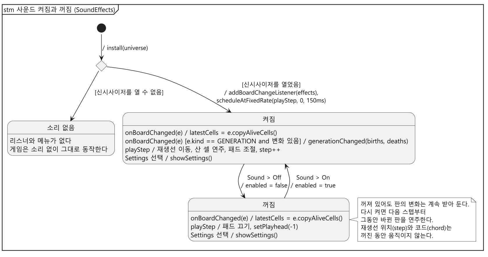

사운드 기능의 상태다. 신시사이저를 열지 못하면 `SoundEffects` 객체가 만들어지지 않고 '소리 없음'에 머문다. 꺼져 있어도 이벤트는 계속 받아 `latestCells`를 바꿔 두기 때문에, 다시 켜면 그 사이에 편집한 판을 바로 연주한다. 꺼진 동안에는 `playStep`이 패드를 끄고 재생선을 지운 뒤 바로 끝나므로 재생선 위치와 코드는 그대로 멈춰 있다.

### 3.2 반복 페이드

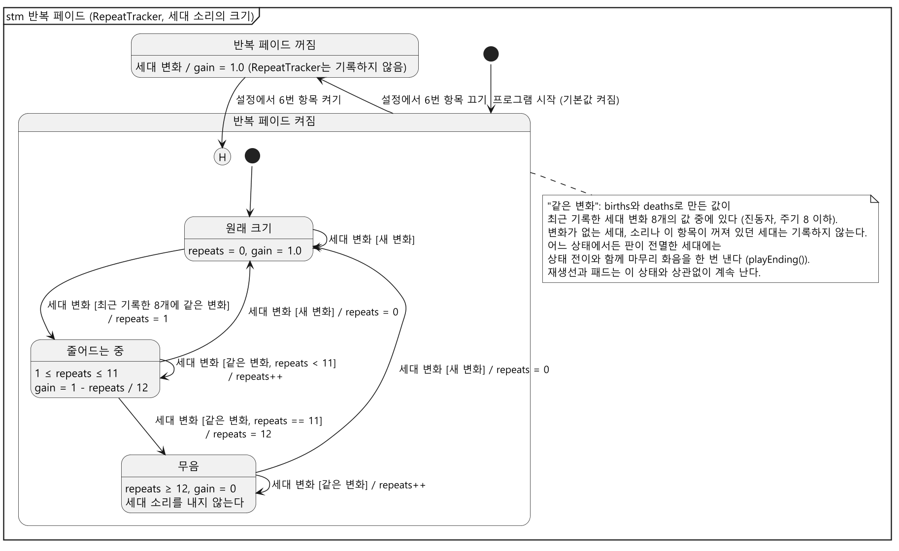

`RepeatTracker`의 상태와 그에 따른 세대 소리의 크기(gain)다. 최근 기록한 8개의 세대 변화 안에 같은 변화가 있었으면 반복으로 보고 `repeats`를 늘린다. 12번이 되면 무음이 되고, 새로운 변화가 오면 바로 원래 크기로 돌아간다. 설정에서 반복 페이드를 끄면 `RepeatTracker`를 거치지 않고, 다시 켜면 끄기 전 상태에서 이어 간다(얕은 이력 H).

### 3.3 코드 진행

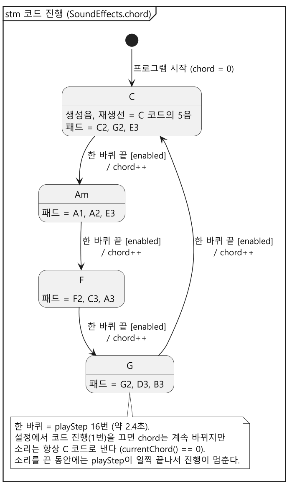

재생선이 한 바퀴(16스텝) 돌 때마다 C → Am → F → G 순서로 바뀐다. 상태마다 생성음과 재생선이 고르는 5음, 패드 음이 달라진다. 설정에서 코드 진행을 끄면 `chord` 값은 계속 바뀌지만 소리는 C로 고정된다.

## 4. 시스템 시퀀스 다이어그램과 연산 계약

### 4.1 시스템 시퀀스 다이어그램

게임을 블랙박스(`:LifeGame`)로 보고, 사용자가 소리를 듣고 설정을 바꾼 뒤 껐다 켜는 시나리오를 그렸다. 시계의 틱과 재생선 타이머는 시스템 밖에서 오는 시간 이벤트로 표시했다.

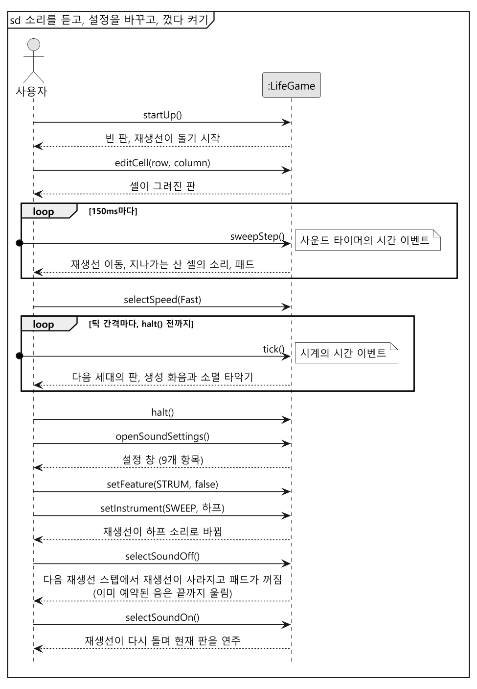

### 4.2 시스템 연산

| 시스템 연산 | 실제 입력 | 이 기능과의 관계 |
|---|---|---|
| `startUp()` | 프로그램 실행 | 원본에 있던 연산. 사운드 설치가 더해짐 |
| `tick()` | 시계의 틱, Go > Tick | 원본에 있던 연산. 사운드 관련 사후 조건이 더해짐 |
| `sweepStep()` | 사운드 타이머 (150ms) | 새로 생김 |
| `editCell()` 등 판 편집 연산 | 클릭·드래그, Grid > Clear, Grid > Load, 템플릿 배치·되돌리기 | 원본 또는 다른 기능의 연산. 사운드 관련 사후 조건이 더해짐 |
| `selectSoundOff()` | Sound > Off | 새로 생김 |
| `selectSoundOn()` | Sound > On | 새로 생김 |
| `openSoundSettings()` | Sound > Settings | 새로 생김 |
| `setFeature(feature, on)` | 설정 창 체크박스 | 새로 생김 |
| `setInstrument(feature, instrument)` | 설정 창 악기 선택 상자 | 새로 생김 |

### 4.3 연산 계약

사후 조건은 객체의 상태 변화(인스턴스 생성, 속성 변경, 연관 형성)만 적었다. 화면을 다시 그리거나 실제로 소리가 나는 것은 상태 변화가 아니므로 넣지 않았고, 대신 소리를 낼 명령이 스케줄러에 예약된 것을 연관의 형성으로 적었다. 이하 `effects`는 설치된 `SoundEffects`, `settings`는 그 `SoundSettings`, `scheduler`는 그 `noteScheduler`다.

#### CO1 `startUp()`

| 항목 | 내용 |
|---|---|
| Cross References | Hear Board Sweep(E), Toggle Sound(E), Configure Sound(E) |
| Preconditions | 없음 |
| Postconditions | MIDI 신시사이저를 열 수 있었으면: `SoundEffects` 인스턴스 `effects`가 생성되었다. `effects`가 `Universe.boardListeners`와 연관되었다. `effects.latestCells`가 시작 시점 판의 복사본이 되었다. `effects.enabled`가 true, `effects.chord`와 `effects.step`이 0이 되었다. `SoundSettings` 인스턴스 `settings`가 생성되어 `effects`와 연관되었고, 9개 기능이 모두 켜짐, 악기는 각 목록의 첫 번째가 되었다. `playStep` 명령이 150ms 주기로 `scheduler`와 연관되었다. Sound 메뉴 항목 3개가 등록되었다. 열 수 없었으면: `SoundEffects` 인스턴스가 생성되지 않았고 `Universe.boardListeners`에 사운드가 없다 |

#### CO2 `tick()`

| 항목 | 내용 |
|---|---|
| Cross References | Run / Halt Game, Step One Generation, Advance Generation, Hear Generation Sound(E) |
| Preconditions | 캡처·배치 편집이나 Freezing 영역 선택 중이 아니다. `effects`가 설치되어 있다 |
| Postconditions | (원본의 세대 전이에 더해) `effects.latestCells`가 틱 후 판의 복사본으로 바뀌었다. 생긴 셀이나 사라진 셀이 있고 `effects.enabled`가 true인 경우: 반복 페이드가 켜져 있으면 `RepeatTracker.recent`에 이번 변화의 값이 더해졌고(8개를 넘으면 가장 오래된 값이 빠짐), `repeats`가 같은 변화면 1 늘고 아니면 0이 되었다. 판이 전멸했고 반복 페이드가 켜져 있으면 마무리 화음 명령 6개(켜기 3, 끄기 3)가 `scheduler`와 연관되었다. 그 밖에 gain이 0보다 크고 직전 소리 후 120ms가 지났으면 `effects.lastPhraseNanos`가 현재 시각이 되었고, 생성음의 켜기·끄기 명령이 음마다 한 쌍씩(최대 5쌍) `scheduler`와 연관되었다. 12개 이상 생겼으면 대량 생성 레이어 명령 쌍이, 사라진 셀이 있으면 60ms 뒤의 타악기 명령 1개가 더 연관되었다(각 기능이 켜져 있을 때). 생긴 셀도 사라진 셀도 없으면 `latestCells` 말고는 바뀐 것이 없다 |

#### CO3 `sweepStep()`

| 항목 | 내용 |
|---|---|
| Cross References | Hear Board Sweep(E) |
| Preconditions | `effects.latestCells`가 null이 아니다 |
| Postconditions | `effects.enabled`가 true인 경우: `Universe.playhead`가 `step × 4`가 되었다(재생선이 꺼져 있으면 -1). 그 4열 안의 산 셀로 고른 음마다 켜기·끄기 명령 한 쌍(최대 3쌍)이 `scheduler`와 연관되었다. `effects.padNotes`가 현재 코드의 패드 음이 되었다(패드 세기가 0이면 빈 배열). `effects.step`이 `(step + 1) % 16`이 되었고, 0이 되었으면 `effects.chord`가 1 늘었다. `effects.enabled`가 false인 경우: `effects.padNotes`가 빈 배열, `Universe.playhead`가 -1이 되었다. `step`과 `chord`는 바뀌지 않았다 |

#### CO4 판 편집 연산 (`editCell()`, `dragCells()`, `clearBoard()`, `loadBoard()`, `placeTemplate()`, `undoPlacement()`)

| 항목 | 내용 |
|---|---|
| Cross References | Edit Cells, Clear Board, Store / Load Board, Place Template(E), Undo Placement(E), Hear Board Sweep(E) |
| Preconditions | 각 연산의 원래 사전 조건. `effects`가 설치되어 있다 |
| Postconditions | (각 연산의 원래 사후 조건에 더해) `effects.latestCells`가 편집 후 판의 복사본으로 바뀌었다. 소리 명령은 `scheduler`와 연관되지 않았다 |

#### CO5 `selectSoundOff()`

| 항목 | 내용 |
|---|---|
| Cross References | Toggle Sound(E) |
| Preconditions | `effects`가 설치되어 있다 |
| Postconditions | `effects.enabled`가 false가 되었다 |

재생선이 사라지고 패드가 꺼지는 것은 이 연산이 아니라 다음 `sweepStep()`의 사후 조건(CO3)이다.

#### CO6 `selectSoundOn()`

| 항목 | 내용 |
|---|---|
| Cross References | Toggle Sound(E) |
| Preconditions | `effects`가 설치되어 있다 |
| Postconditions | `effects.enabled`가 true가 되었다 |

#### CO7 `openSoundSettings()`

| 항목 | 내용 |
|---|---|
| Cross References | Configure Sound(E) |
| Preconditions | `effects`가 설치되어 있다 |
| Postconditions | `effects.settingsDialog`가 없었으면 `SoundSettingsDialog` 인스턴스 `d`가 생성되어 `effects.settingsDialog`와 연관되었다(`d`는 `settings`를 필드로 갖지 않고, 체크박스와 선택 상자의 리스너가 `settings`를 쓴다). 설정 창이 보이는 상태가 되었다 |

#### CO8 `setFeature(feature, on)`

| 항목 | 내용 |
|---|---|
| Cross References | Configure Sound(E) |
| Preconditions | 설정 창이 열려 있다 |
| Postconditions | `settings.switches[feature]`가 `on`이 되었다. 다른 기능의 값은 바뀌지 않았다 |

#### CO9 `setInstrument(feature, instrument)`

| 항목 | 내용 |
|---|---|
| Cross References | Configure Sound(E) |
| Preconditions | 설정 창이 열려 있다. `feature`는 악기가 있는 기능(생성음, 소멸 타악기, 저음 패드, 대량 생성 악기, 재생선)이고 `instrument`는 그 기능의 악기 목록 중 하나다 |
| Postconditions | `settings.choices[feature]`가 `instrument`가 되었다. `applyInstruments` 명령 1개가 `scheduler`와 연관되었다. 그 명령이 실행되면 각 채널의 악기가 현재 선택으로 바뀌고 `effects.padNotes`가 빈 배열이 된다 |

## 5. 다시 그리기

PlantUML 1.2026.10 JAR(팀 공용 버전, SHA-256은 [캡처 도식 안내](../capture/diagrams/README.md)와 같음)로 로컬에서 그렸다. 클래스·상태·유스케이스 다이어그램은 `!pragma layout smetana`를 써서 Graphviz 없이 그려진다. 저장소 루트에서 실행한다.

```powershell
java -Djava.awt.headless=true -jar C:\tools\plantuml-1.2026.10.jar -tpng -charset UTF-8 docs/sound-effects/diagram/*.puml
```
