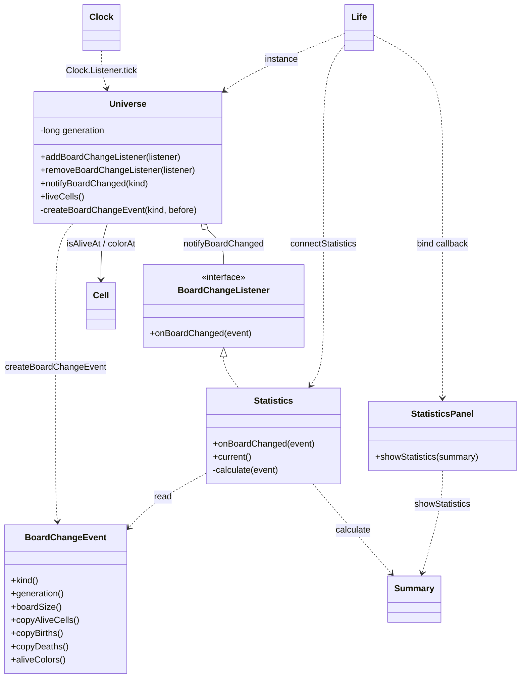
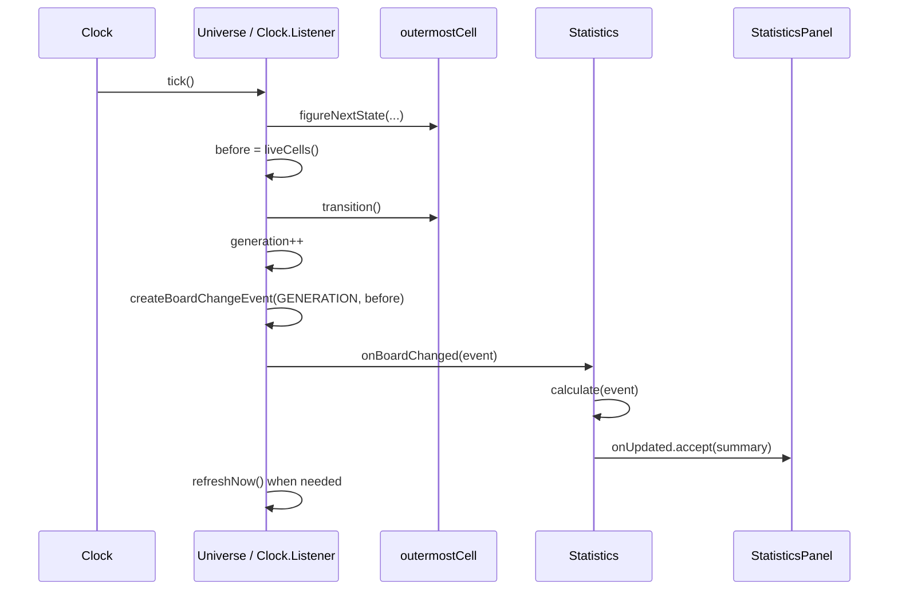

# 통계 기능 설계 및 구현 기록

기준: 2026-11-18 `feature/statistics`의 현재 코드. `8eb1dfe`까지의 커밋과 이후 추가한 색상 통계·패널 변경을 포함한다. 통계 설계, 기존 기능과의 통합, 검증 결과를 이 문서에서 관리한다.

1. [기능 개요와 구현 범위](#overview)
2. [현재 설계 구조](#structure)
3. [기본 통계와 공통 이벤트 구현](#events)
4. [기존 기능과의 통합 및 충돌 해결](#integration)
5. [색상별 통계 확장](#colors)
6. [통계 패널 구현과 화면 연결](#panel)
7. [주요 설계 결정과 적용 이유](#decisions)
8. [테스트와 검증 결과](#tests)
9. [주요 변경 이력](#history)

<a id="overview"></a>
## 기능 개요와 구현 범위

게임판의 작업이 끝났을 때 완료 상태를 받아 현재 세대, 생존 셀 수·비율, 이번 세대 탄생·사망 수, 색상별 생존 셀 수·비율을 오른쪽 통계 탭에 표시한다.

세대 진행뿐 아니라 클릭·드래그, 템플릿 배치·Undo, Clear, Load 성공, 색상 정책 변경에도 갱신한다. 패턴 캡처·템플릿·색상·사운드는 기존 구현과 연결하며, 통계가 셀의 생사·나이·색 결정 규칙이나 Undo 이력을 관리하지 않는다. 프리즈는 현재 브랜치의 연동 범위에 포함하지 않는다.

<a id="structure"></a>
## 현재 설계 구조

`Universe`가 Subject이며, `Statistics`는 `BoardChangeListener`를 구현해 완료 이벤트를 받는다. 이벤트 객체는 데이터를 전달하고, Statistics가 집계하며, StatisticsPanel이 결과를 표시한다.

아래 표와 다이어그램은 **통계 기능의 구현과 연결에 필요한 범위**를 보여준다. Life·Clock·Cell 등 기존 클래스도 연결 관계를 설명하기 위해 포함한다. 다른 Observer와의 공통 이벤트 연결은 [기존 기능과의 통합](#integration)에서 설명한다.

### 클래스와 주요 메서드

| 클래스 | 책임과 주요 메서드 |
| --- | --- |
| [BoardChangeListener](../src/com/holub/life/BoardChangeListener.java) | `onBoardChanged(event)`로 완료 상태를 수신하는 공통 인터페이스. |
| [BoardChangeEvent](../src/com/holub/life/BoardChangeEvent.java) | 작업 종류·세대·판 크기·생존 배열·탄생/사망 좌표·생존 셀 색을 보관한다. 배열·좌표는 방어적 복사로 보호한다. |
| [Universe](../src/com/holub/life/Universe.java) | `addBoardChangeListener()`·`removeBoardChangeListener()`로 구독 관리. `liveCells()`로 상태 수집, `createBoardChangeEvent(kind, before)`로 이벤트 구성, `notifyBoardChanged()`로 발행한다. 기존 익명 `Clock.Listener.tick()` 안에서 세대를 진행한다. |
| [Statistics](../src/com/holub/life/Statistics.java) | `onBoardChanged()` → `calculate()`로 집계하고 콜백에 결과를 전달한다. `current()`는 최근 결과를 `Optional<Summary>`로 반환한다. 이전 게임판은 보관하지 않는다. |
| `Statistics.Summary`·`Statistics.ColorCount` | Statistics 안의 record. Summary는 기본 통계와 `List<ColorCount>`를, ColorCount는 색·개수·백분율을 담는다. 결과 목록은 수정할 수 없다. |
| [StatisticsPanel](../src/com/holub/life/StatisticsPanel.java) | `showStatistics(summary)`로 값·색상 행을 표시한다. 게임판 조회, 이벤트 구독, 통계 계산을 하지 않는다. |
| [Life](../src/com/holub/life/Life.java) | `createSidebar()`로 공용 탭, `createContent()`로 창 배치를 구성한다. `connectStatistics()`에서 계산과 화면을 연결하고, `dispose()`에서 통계 구독을 해제한다. |
| [Clock](../src/com/holub/life/Clock.java)·[Cell](../src/com/holub/life/Cell.java) 계층 | Clock은 Swing Timer로 진행 시점을 알린다. Cell의 `isAliveAt(row, column)`·`colorAt(row, column)`으로 생존·색을 조회한다. |

`new Statistics(panel::showStatistics)`의 콜백 타입은 **JDK의 `java.util.function.Consumer<Summary>`**다. 별도로 만든 인터페이스가 아니며, Statistics는 구체적인 StatisticsPanel 타입에 의존하지 않는다.

### 클래스 다이어그램



Clock의 화살표는 Universe 안에서 등록한 익명 `Clock.Listener`를 간략히 표시한 것이다. Universe가 Clock.Listener를 직접 구현하는 구조는 아니다. `Summary`는 `Statistics.Summary`를 가리킨다.

### 세대 진행 시퀀스

아래는 패턴 편집 중이 아닌 정상 진행 한 번에서 **통계 계산과 화면 갱신에 이르는 경로**다. 보드 진행·이벤트 전달·통계 화면 갱신은 EDT에서 순서대로 실행된다. 다른 Observer의 수신 흐름은 이 다이어그램에서 생략했다.



<a id="events"></a>
## 기본 통계와 공통 이벤트 구현

### 이벤트의 입력 계약

```java
BoardChangeEvent(Kind kind, long generation, int boardSize,
                boolean[][] aliveCells, List<Point> births,
                List<Point> deaths, List<Color> aliveColors)
```

| 조회 메서드 | 의미 |
| --- | --- |
| `kind()` | `INITIAL`, `GENERATION`, `EDIT`, `TEMPLATE`, `TEMPLATE_UNDO`, `CLEAR`, `LOAD`, `COLOR_POLICY_CHANGED`. |
| `generation()`·`boardSize()` | 완료 시점 세대 번호와 정사각형 판 한 변의 셀 수. 기본 판은 64×64다. |
| `copyAliveCells()` | 완료 상태의 `boolean[행][열]`. 현재 생존 수와 사운드 재생선의 입력이다. |
| `copyBirths()`·`copyDeaths()` | 한 세대 전후의 탄생·사망 `List<Point>`. `Point.x=열`, `Point.y=행`이다. |
| `aliveColors()` | 살아 있는 셀들의 표시 색 `List<Color>`. 좌표별 조회용이 아닌 색상 집계용이며, 길이는 생존 수와 같다. |

배열의 각 행과 좌표 목록의 Point까지 생성·조회 시 복사한다. 색 목록은 `List.copyOf()`로 보관한다. 생성자는 크기·세대·좌표 범위·중복·탄생/사망과 완료 상태의 일치·색 목록 길이 등을 검사한다. `GENERATION`은 세대 번호가 1 이상이어야 하며, 다른 종류의 탄생·사망 목록은 비어 있어야 한다.

### 작업별 발행 시점

| 완료 작업 | 이벤트와 세대 번호 | 통계의 탄생·사망 표시 |
| --- | --- | --- |
| 새 리스너 등록 | 새 구독자에게만 `INITIAL`, 현재 번호 | `—` |
| 자동 진행·단일 진행 | `transition()` 완료 후 `GENERATION`, 1 증가 | 실제 탄생·사망 수. 변화가 없으면 `0 / 0` |
| 클릭·일반 드래그 | 실제 변경이 있는 마우스 이벤트 처리 후 `EDIT`, 유지 | `—` |
| 템플릿 배치·Undo | 기존 완료 신호에서 `TEMPLATE`·`TEMPLATE_UNDO`, 유지 | `—` |
| Clear·Load 성공 | 초기화·복원 완료 후 `CLEAR`·`LOAD`, 0 | `—` |
| Color 메뉴 정책 변경 | `COLOR_POLICY_CHANGED`, 유지 | 같은 세대의 직전 Summary에 있던 표시 유지 |
| 캡처 선택·무변경 배치·Load 취소/읽기 실패·Store | 발행 없음 | 유지 |

공개 `notifyBoardChanged(kind)`는 **이미 끝난 편집·복원의 알림**이다. 보드를 변경하거나 세대를 진행시키지 않으며, 이전 상태 없이 `GENERATION`을 호출하면 예외를 발생시킨다. 정상 세대는 tick 안에서 이전 상태를 확보한 뒤 비공개 `notifyBoardChanged(GENERATION, before)`로 발행한다.

등록은 중복을 막고 즉시 INITIAL을 보낸다. 발행 중에는 리스너 목록의 복사본을 사용하므로 구독 변경은 다음 전체 발행부터 반영된다. Observer는 콜백에서 게임판을 다시 수정하지 않는 계약을 따른다.

### 집계 책임과 계산식

Universe는 세대 전후 상태를 한 번 비교하여 탄생·사망 좌표를 만든다. Statistics는 다음 계산을 담당한다.

| 통계 | 계산 |
| --- | --- |
| 현재 세대 | 이벤트의 `generation()` |
| 생존 셀 수 | 완료 배열의 `true` 개수 |
| 생존 비율 | 생존 수 ÷ `(boardSize × boardSize)` × 100 |
| 이번 세대 탄생·사망 | `GENERATION`의 탄생·사망 목록 크기 |
| 색상별 개수·비율 | 같은 색을 묶은 개수, 해당 개수 ÷ 전체 생존 수 × 100 |

Summary의 `hasGenerationDelta=false`일 때 births/deaths의 0은 내부 자리표시 값이며, 화면은 `—`로 표시한다. 편집·템플릿 배치 수를 자연적인 세대 탄생 수에 섞지 않는다. 정책만 바꾸면 생사와 세대가 그대로이므로 같은 세대의 직전 변화량을 유지한다. 이때 보관하는 것은 **최근 Summary 하나**이며 이전 보드나 Undo 이력이 아니다.

### Swing Timer와 EDT

통계는 진행 후 보드를 읽어 UI까지 갱신하므로, 도중에 클릭·세대 변경이 끼어들지 않도록 보드 변경 → 상태 수집 → 발행 → 화면 갱신을 EDT에서 순차 실행한다. 초기 통계 구현에서 Clock을 Swing Timer로 변경했고, dev 병합 때에는 dev도 이미 Swing Timer를 사용하고 있어 그 구현을 유지했다.

EDT는 모든 작업 스레드를 자동으로 정렬하는 기능이 아니다. 현재 게임의 UI 입력과 Clock 콜백을 같은 스레드에서 처리하는 방식이다. MIDI 예약 실행기는 별도로 동작하며, 실제 보드 대신 이벤트에서 받은 독립 스냅샷을 읽는다. 오래 걸리는 작업을 EDT에 추가하면 화면이 멈출 수 있으므로 이 실행 경계를 유지해야 한다.

<a id="integration"></a>
## 기존 기능과의 통합 및 충돌 해결

두 작업의 기준을 구분한다. 먼저 통계 브랜치 `4021231`에 **당시 dev `a480113`**를 병합하여 `4a49d0a`에서 충돌을 해결했다. 이후 `8eb1dfe`에서 두 구독 경로를 하나로 바꿨다. 아래의 dev는 실시간 원격 상태가 아니라 이 병합 기준을 뜻한다.

### dev 병합에서 해결한 실제 충돌

병합 양쪽 부모와 공통 조상을 비교하면 충돌 파일은 다음 7개다. 모든 충돌이 기능 차이는 아니며, 주석·import가 겹친 경우도 포함한다.

| 파일 | 충돌한 내용 | 해결한 방식 |
| --- | --- | --- |
| `Universe.java` | 통계의 `this::advanceOneGeneration` 연결·알림과 dev의 익명 tick 본문·색상·패턴 편집·사운드·드래그 처리가 겹쳤다. | **dev의 tick 본문을 유지하고 advanceOneGeneration은 제거**했다. 편집 중 진행 차단, 매 세대 transition, 색상별 화면 갱신을 유지하면서 세대 증가와 통계 알림을 추가했다. 편집·복원 경로도 완료 후 통계 알림이 나가도록 연결했다. |
| `Life.java` | 통계 전용 탭 배치와 dev의 패턴 도구를 EAST에 직접 붙이는 코드가 겹쳤다. | `createSidebar()`에서 실제 패턴 패널과 통계를 한 JTabbedPane에 넣고 `createContent()`로 배치했다. `SoundEffects.install()`·EDT 초기화·통계 연결/해제를 함께 유지했다. |
| `Clock.java` | 양쪽 모두 Swing Timer였으나 타이머 재사용·초기 지연·EDT 밖 tick 처리 방식이 달랐다. | dev 구현을 유지했다. 실행 시 기존 타이머를 중지하고 새 타이머를 만들며, EDT 밖 tick은 `invokeLater()`로 넘긴다. 통계 쪽의 EDT 밖 호출 예외 기대도 이 동작에 맞췄다. |
| `Neighborhood.java` | LOAD 후 활성화 코드에 dev의 `oneLastRefreshRequired=true`가 추가되어 있었다. | `amActive=true`, `activeEdges.add(Direction.ALL)`, 마지막 화면 갱신 플래그를 함께 유지했다. 복원 후 경계 셀 재계산과 표시를 모두 보장하려는 처리다. |
| `Cell.java` | 양쪽에서 같은 `isAliveAt(row, column)`을 추가했지만 설명 주석이 달랐다. | 기존 dev 선언 하나로 정리했다. 통계용 조회를 중복 추가하지 않았다. |
| `NeighborhoodTest.java` | 중첩 셀 조회 테스트가 양쪽에 있고 주석이 달랐다. | dev 테스트를 유지하여 행·열이 뒤바뀌지 않는 조회를 계속 검증했다. |
| `UniverseStoreTest.java` | 통계 쪽 테스트 초기화와 dev의 드래그·생존 배열·재생선 검사에 필요한 import가 겹쳤다. | 새 검사들을 보존하고 초기화·Clear·Store를 `LifeTestSupport`로 통일했다. UI 조작/그리기는 EDT에서 수행하고 실제 Clock·저장 경로를 사용하도록 정리했다. |

Universe에서 연결한 세부 경로는 다음과 같다.

| 경로 | 통계 연결 후 동작 |
| --- | --- |
| `Clock.Listener.tick()` | 패턴 편집 중이면 반환 → Undo 이력 무효화 → 다음 상태 계산 → 매 세대 transition → 세대 증가·알림 → 기존 조건으로 다시 그리기. 생존 상태가 같은 블록도 나이가 증가한다. |
| 일반 드래그의 `setCell()` | 기존 셀 변경 처리를 유지하고 반환형을 `void`에서 `boolean`으로 바꿨다. 실제 변경 여부를 모아 마우스 처리 후 EDIT를 보내고 무변경 알림은 생략한다. 보드 밖 누르기도 제외했다. |
| 템플릿 배치·Undo | PatternTools가 이미 내보내던 `TEMPLATE`·`TEMPLATE_UNDO` PropertyChange를 Universe에서 구독한다. 템플릿 드래그는 완료 신호에서 한 번 알리고, 캡처 선택 자체는 보드 변경으로 세지 않는다. |
| 패턴 탭을 떠날 때 | `Life.createSidebar()` → `Universe.finishPatternEditing()` → 기존 `PatternTools.cancel()`로 숨겨진 편집을 끝낸다. 일반 실행 상태에서는 불필요하게 Clock을 멈추지 않는다. |
| `doLoad()` | 통계 쪽의 “파일 읽기를 끝낸 뒤 보드 교체”를 유지했다. 성공 시 dev의 편집 취소·Undo 무효화도 수행하고 복원 후 세대 0·LOAD를 발행한다. 취소·읽기 실패 시 기존 판과 통계를 유지한다. |
| Clear·Store·그리기 | Clear는 활성 편집 취소·이력 무효화·판 지우기 후 세대 0·CLEAR를 발행한다. Store는 상태 변경 알림이 없다. 셀·패턴 오버레이·사운드 재생선의 기존 그리기를 함께 유지했다. |

이 병합 커밋에서는 사운드의 GenerationListener와 통계의 BoardChangeListener를 일단 함께 유지했다. 그 다음 변경이 아래 공통 이벤트 전환이다.

### 공통 이벤트 전환의 변경 전후

| 위치 | 병합 직후 `4a49d0a` | 공통 이벤트 전환 `8eb1dfe` 이후 |
| --- | --- | --- |
| Universe의 구독·발행 | 사운드는 `GenerationListener`·`addGenerationListener()`·`generationPublisher`·`publishChanges(before)`, 통계는 BoardChangeListener. | 사운드 전용 항목을 제거하고 `addBoardChangeListener()`·`removeBoardChangeListener()`·`notifyBoardChanged()`로 통일. |
| 세대 전 상태 수집 | 사운드는 `figureNextState()`의 변화 예상 결과에 따라 before를 수집하고 변화가 있을 때 발행했다. | 매 정상 세대 transition 직전에 `liveCells()`로 before를 확보하고, 완료 후 `notifyBoardChanged(GENERATION, before)`를 호출한다. |
| 현재 상태 자료구조 | 사운드는 `boolean[][]`·`List<Point>`, 통계 이벤트는 BitSet. | 현재 판은 `boolean[][]`, 탄생·사망은 `List<Point>`로 공유한다. `captureAliveCells()`의 BitSet 수집 경로를 제거했다. |
| 탄생·사망 계산 | 사운드 발행부와 Statistics가 각각 상태를 비교했다. | `Universe.createBoardChangeEvent(kind, before)`가 진행 전후를 한 번 비교한다. Statistics는 전달받은 목록의 크기를 집계한다. |
| Statistics의 이전 상태 | 이전 BitSet·판 크기·세대 번호를 저장하고 연속 세대인지 확인했다. | 이전 판 비교 필드를 제거했다. 완성된 이벤트 자체에 변화량이 있으므로 첫 GENERATION 수신도 집계할 수 있다. |
| 이벤트 내용 | 통계용 현재 상태만 전달했다. | 완료 배열과 탄생·사망 좌표를 같은 이벤트에 담는다. 이후 색상 확장에서 생존 색 목록을 추가했다. |

현재 세대 진행 진입점은 여전히 **Universe 생성자에서 등록한 익명 tick 본문**이다. 공통 이벤트 전환을 위해 advanceOneGeneration을 다시 도입하지 않았다.

### 사운드 담당자에게 해당하는 변경

사운드 기능 자체는 팀원의 기존 구현이다. 통계와의 공통 이벤트 전환 과정에서 사운드 패키지의 [SoundEffects.java](../src/com/holub/life/sound/SoundEffects.java)만 연결을 수정했다. 다음 표가 실제 변경 지점이며, 음 생성 알고리즘 전체를 다시 구현한 것이 아니다.

| 위치 | 변경 전 → 변경 후 |
| --- | --- |
| 클래스 선언·import | `implements Universe.GenerationListener` → `implements BoardChangeListener`, 공통 이벤트 import 추가. |
| `install()`의 등록 | `addGenerationListener(effects)` → `addBoardChangeListener(effects)`. 등록 즉시 INITIAL을 받는다. |
| 재생선 예약 위치 | 생성자에서 예약 → install에서 **등록 후** 예약. 지연 0·주기 150ms는 유지하며 첫 실행 전에 상태를 확보한다. |
| 필드·새 수신 메서드 | `volatile boolean[][] latestCells`와 `onBoardChanged(event)` 추가. 모든 이벤트에서 배열을 갱신한 뒤 GENERATION이고 변화 목록이 있을 때만 기존 처리를 호출한다. |
| `generationChanged()` | 외부 수신용 public → 내부 처리용 private. `mapper.notesFor()`의 판 크기 입력만 `universe.widthInCells()`에서 `latestCells.length`로 바꿨다. |
| `playStep()` | `universe.liveCells()` 직접 조회 → `latestCells`를 지역 변수에 한 번 읽고 사용. null이면 종료한다. |
| `boardDiedOut()` | 실제 보드 재조회 → `countLive(latestCells)`로 완료 스냅샷에서 전멸 여부를 확인한다. |

INITIAL·편집·템플릿·Undo·Clear·Load·색상 정책 변경에서는 재생선용 상태만 갱신한다. 변화 없는 세대도 효과음을 생략한다. Off 중에도 상태는 갱신하므로 다시 On으로 바꾸면 최신 배치를 연주한다. 전멸 화음은 실제 사망이 생긴 세대에 기존 조건대로 처리하고, 뒤따르는 빈 세대마다 반복하지 않는다.

`latestCells`는 이벤트가 돌려준 복사본이며 저장 후 원소를 수정하지 않는다. 다음 이벤트에서 참조 전체를 교체하고 재생선은 한 스텝 동안 같은 참조를 사용한다. `volatile`은 이 참조 전달에 쓰이며 배열 원소를 임의로 수정해도 안전하게 만드는 장치는 아니다.

`NoteMapper`·`RepeatTracker`·`SoundSettings`·`SoundSettingsDialog`, 음 선택·반복 감쇠·타악기·스트럼·음 종료 로직은 유지했다. Life의 `SoundEffects.install(universe)` 호출도 같다. 사운드의 Universe 참조는 재생선 표시와 설정 창 소유자 조회에 계속 사용한다.

담당자 문서/테스트에서는 구독 이름과 수신 메서드를 위 표에 맞춘다. 직접 `generationChanged()`를 호출하던 테스트는 완료 상태가 담긴 `onBoardChanged(event)` 입력으로 바꾼다. 현재 생성자는 색 목록까지 요구하지만 사운드가 그 목록을 사용할 필요는 없다.

<a id="colors"></a>
## 색상별 통계 확장

### 기존 색상 결정 방식

Resident는 생존 여부와 `age`를 가지고, 공유 `CellColorPolicy`에 `colorOf(age)`를 요청하여 그린다. 셀마다 최종 Color 필드를 저장하는 구조가 아니다. 새로 태어난 셀의 나이는 0이며, 매 transition에서 계속 살아 있는 셀의 나이가 증가한다.

기본 순환 정책은 10세대 간격으로 **빨강 → 파랑(`#0072B2`) → 초록(`#009E73`)**을 반복한다. 나이 0~9는 빨강, 10~19는 파랑, 20~29는 초록, 30~39는 다시 빨강이다. FixedColorPolicy는 나이와 무관하게 지정 색을 반환한다. 통계는 이 규칙을 복제하거나 나이를 색으로 다시 환산하지 않고 **현재 정책이 반환한 색**을 집계한다.

### 추가·확장한 메서드와 데이터

| 위치 | 변경 전 | 현재 구현 |
| --- | --- | --- |
| `Cell.colorAt(row, column)` | 색을 외부에서 조회하는 공통 메서드 없음. | 표시 색 조회 계약 추가. 죽은 셀과 DUMMY는 null. |
| `Resident.colorAt()` | redraw 안에서 정책으로 색을 결정했다. | 살아 있으면 같은 `colorPolicy.colorOf(age)`를 반환한다. 조회로 나이를 늘리거나 정책을 바꾸지 않는다. |
| `Neighborhood.colorAt()` | 생존 조회만 제공했다. | 행·열을 하위 셀의 좌표로 변환해 재귀 위임한다. 통계는 중첩 구조를 알 필요가 없다. |
| `Universe.createBoardChangeEvent()` | 완료 배열과 탄생·사망 목록 구성. | 완료 배열에서 살아 있는 위치만 `outermostCell.colorAt()`으로 읽어 `List<Color>`를 추가한다. |
| `BoardChangeEvent` | 생성자 6개 인자, 색 데이터 없음. | 마지막 인자로 `List<Color>`와 `aliveColors()` 추가. null·생존 수와 다른 길이를 거부하고 목록을 보호한다. |
| `Universe.useColorPolicy()` | 정책 교체 후 repaint. | 정책 교체 후 `COLOR_POLICY_CHANGED` 발행 추가. 세대·나이는 유지한다. |
| `Statistics.calculate()`·Summary | 기본 통계만 집계. | 같은 Color 값별 개수와 생존 수 대비 비율을 계산하고 불변 `List<ColorCount>`로 전달한다. |
| `StatisticsPanel.showStatistics()` | 기본 통계만 표시. | 색 견본·이름·개수·비율 행을 함께 갱신한다. |

예를 들어 4×4 판에 살아 있는 셀이 4개이고 빨강 2개·파랑 1개·초록 1개라면, 생존 비율은 **25%**, 색 비율은 **50%·25%·25%**다. 두 비율의 분모가 다르다. 빈 판은 색 목록이 비어 있으므로 0으로 나누지 않는다.

색 목록에 좌표는 필요하지 않다. 통계는 색의 분포만 사용하며, 셀의 위치는 기존 생존 배열로 전달된다. 같은 RGB 값으로 만들어진 별도 Color 객체도 같은 색으로 묶는다. 사운드는 색 데이터를 읽지 않고 기존 GENERATION 필터를 사용하므로 이 확장에서 사운드 소스 수정은 없다.

**유지한 부분:** CellColorPolicy·FixedColorPolicy·CyclingColorPolicy, Resident의 transition·redraw 본문은 변경하지 않았다. 이 색상 통계 작업에서 패턴/템플릿 소스와 Life·Clock도 변경하지 않았다. 셀 나이 복원 정책이나 템플릿 Undo 구현을 통계에 추가하지 않았다.

<a id="panel"></a>
## 통계 패널 구현과 화면 연결

Life가 `new Statistics(panel::showStatistics)`를 만들고 Universe에 등록한다. INITIAL을 즉시 받으므로 게임을 진행하기 전에도 화면에 현재 상태가 나타난다. 탭이 숨겨져 있어도 통계는 갱신하며, `Life.dispose()`에서 통계 리스너를 해제한다.

공용 JTabbedPane은 Life가 소유한다. 현재는 `패턴 캡처`와 `통계`를 같은 탭 컨테이너에 넣는다. 다른 기능은 여기에 `addTab()`으로 연결하며 StatisticsPanel 안에 별도 탭 컨테이너를 만들지 않는다. `createContent()`는 탭 추가 후 전체 선호 폭과 보드 높이 512px를 기준으로 중앙 보드·오른쪽 탭을 배치한다.

| 표시 항목 | 현재 규격 |
| --- | --- |
| 패널 | 선호 크기 258×512, 내부 여백 14px. 전체 사이드바 폭은 공용 탭의 선호 크기를 반영한다. |
| 제목·항목·값·설명 | 제목 16pt 굵게, 항목 13pt, 값 14pt 굵게, 안내 12pt. |
| 행과 간격 | 기본 통계·색상 행에 공통 `statisticRow()` 적용. 행 높이 22px, 행 사이 6px. 제목·구분선 주변도 공통 간격으로 정리했다. |
| 구역 | 기본 생존 통계 / 이번 세대 탄생·사망 / 색상 통계 사이에 구분선. 변화량 안내는 두 줄로 표시한다. |
| 숫자 | 비율은 소수 둘째 자리, 비교 대상이 없는 변화량은 `—`. |
| 색상 행 | 현재 존재하는 색만 빨강 → 파랑 → 초록 순서로 표시하고, 다른 색은 뒤에 RGB 순으로 배치한다. 개수 변화로 순서가 바뀌지 않는다. 사라진 색은 제거한다. |
| 추가 색·빈 판 | 기본 3색을 넘으면 색 목록 영역만 세로 스크롤한다. 임의 색은 색상값으로 표시하며 빈 판에는 생존 셀이 없다는 안내를 표시한다. |

계산 결과의 색 목록 순서와 UI 순서를 분리했다. Statistics는 색별로 집계하고, 패널이 표시 순서·이름·폰트·간격을 결정한다. 운영체제의 기본 Swing 스타일은 유지한다.

<a id="decisions"></a>
## 주요 설계 결정과 적용 이유

| 설계 문제와 대안 | 선택과 이유 |
| --- | --- |
| Universe에서 통계/사운드를 직접 호출할지, 리스너로 연결할지 | **Observer**를 사용한다. Universe는 구체적인 기능 대신 BoardChangeListener에 알리고 두 기능이 서로를 참조하지 않는다. |
| GenerationListener와 BoardChangeListener를 각각 유지할지 | 하나의 완료 상태를 **공통 이벤트로 한 번 구성**한다. 종류에 따라 Observer가 필요한 처리를 선택하므로 서로 다른 발행 경로와 입력 계약을 줄인다. |
| 통계가 이전 판을 저장해 비교할지, 이미 필요한 전후 비교를 공유할지 | 사운드도 탄생·사망 좌표를 필요로 하므로 **Universe에서 실제 세대 전후 차이를 계산**한다. Statistics는 생존·변화 개수·비율·색상 집계를 맡는다. 수신 이력 누락 때문에 첫 세대 비교를 못 하는 문제도 줄인다. |
| BitSet을 계속 사용할지, 기존 사운드 자료구조를 공유할지 | **boolean[][]와 List<Point>를 재사용**하여 변환 경로를 없앤다. 모든 정보를 하나의 리스트로 바꾼 것은 아니며, 현재 판과 변화 좌표를 용도에 맞게 구분한다. |
| 통계가 직접 색상 정책/나이를 읽을지, 이벤트로 색을 받을지 | **List<Color>를 전달**한다. 색 규칙은 기존 Strategy에 남기고 Statistics는 값만 집계한다. 색 좌표나 별도 색상판 모델은 필요하지 않다. |
| 별도 advanceOneGeneration으로 추출할지, dev의 tick을 유지할지 | **기존 tick 유지**를 선택했다. 팀원들이 사용하는 편집 차단·나이 갱신·화면 처리 위치를 보존하면서 알림을 연결한다. 메서드 추출 자체가 잘못된 것은 아니지만 이번 통합에서 변경 범위를 줄였다. |
| 백그라운드 Timer와 별도 동기화를 사용할지, UI와 진행을 같은 스레드에 둘지 | **Swing Timer·EDT**를 사용한다. 현재 규모에서 보드 변경·집계·표시 순서를 이해하기 쉽다. 사운드 예약은 별도 스레드에 유지하고 복사된 상태만 전달한다. |

Cell의 조회는 기존 **Composite**를 확장한 것이며, 색 결정은 팀원이 구현한 **Strategy**를 재사용한다. 색상 통계에 새 Strategy를 도입한 것은 아니다. Summary와 콜백은 계산과 표시의 책임을 나누며, Consumer를 별도 설계 패턴으로 주장하지 않는다.

현재 작업은 통계·표시·구독 책임을 분리한 범위다. Universe에 보드/UI 조정이 남아 있고 Cell에도 그리기 메서드가 있으므로 게임 전체가 완전한 MVC로 분리되었다고 보지는 않는다.

<a id="tests"></a>
## 테스트와 검증 결과

2026-11-18 현재 코드에 대해 실행한 결과는 **JUnit 293개 통과, 실패·오류·건너뜀 0**이다. 별도 Swing 검사도 **17개 통과**했다. 이번 문서 정리는 소스·테스트를 변경하지 않았으며 아래 결과는 직전 전체 검증 기록이다.

```bash
./gradlew test --rerun-tasks --no-daemon --console=plain
./gradlew patternUiTest --no-daemon --console=plain
```

Gradle 9.5.1·Java toolchain 17·JUnit Jupiter 6.0.3을 사용한다. JUnit 실행 결과는 로컬 `build/reports/tests/test/index.html`에서 확인한다. `patternUiTest`의 17개는 293개에 포함하지 않는다. 기존 기본 오류 수정 회귀 검사도 전체 테스트에 포함하여 확인했다.

| 검증 범위 | JUnit 수 |
| --- | ---: |
| 기본 규칙·저장·Clock·Universe 이벤트 | 63 |
| 기존 색상 정책·나이·색 조회 | 42 |
| 패턴·템플릿·Undo | 39 |
| 사운드 계산·공통 이벤트 연동 | 46 |
| 통계 계산·패널·색상 통계 | 91 |
| 기존 기능과 통계의 병합 연동 | 12 |
| 합계 | **293** |

<details>
<summary>JUnit 클래스별 실행 수와 확인한 내용</summary>

아래 수는 매개변수별 실행을 포함한다. 테스트 파일은 [test/com/holub/life](../test/com/holub/life)에 있으며 마지막 세 클래스는 그 아래 `sound` 패키지에 있다.

| 클래스 | 수 | 주요 검증 |
| --- | ---: | --- |
| ResidentTest | 18 | 이웃 수별 상태 변화와 transition 반환값. |
| NeighborhoodTest | 12 | 하위 생존 여부와 중첩 좌표 조회. |
| UniverseStoreTest | 8 | 저장 좌표 중복 방지, 드래그 생성·삭제·경계, 생존 배열의 행/열, 재생선 표시/제거. |
| ClockIntegrationTest | 6 | 자동/단일 진행, 중지, 간격, 메뉴 열림, EDT 밖 tick의 EDT 전달. |
| UniverseEventsTest | 19 | INITIAL·중복 등록/해제·같은 이벤트 전달·실제 클릭·안정/빈 판 세대·Clear·Load 성공/실패/취소·Store 무알림·EDT 계약. |
| CellColorPolicyTest | 22 | 고정/순환 색상 정책과 입력 검증. |
| CellAgeColorTest | 9 | 나이 증가/초기화와 Life 규칙 유지. 독립 기준 계산으로 32개 초기 판을 각각 100세대 비교. |
| DefaultCellColorTest | 1 | 기본 색상 정책. |
| UniverseColorTest | 7 | Color 메뉴·안정 패턴의 나이/화면·기존 규칙. |
| CellColorQueryTest | 3 | 죽은 셀/DUMMY의 null, 반복 조회로 나이 불변, 중첩 행·열 변환. |
| PatternCellsTest | 2 | 행/열 좌표·중복 편집·범위 검사. |
| PatternCompletionTest | 2 | 배치·Undo 완료 신호. |
| PatternFeatureTest | 10 | 배치·캡처·규칙 유지. 무작위 12개 판을 각각 30세대 기준 계산과 비교. |
| PatternHistoryTest | 4 | 패턴 Undo 이력과 복원. |
| PatternPathTest | 9 | 드래그 경로·경계 처리. |
| PatternToolsTest | 12 | 편집 모드·조작·패턴 처리. |
| BoardChangeEventTest | 23 | 입력 검증, 배열/Point 방어적 복사, 이벤트 종류별 변화 목록 계약. |
| StatisticsTest | 22 | 초기/세대/편집/복원 입력의 집계, 비율, 비교 가능 여부, 콜백·최근 결과. |
| StatisticsPanelTest | 14 | 값·두 자리 비율·—/0 구분, 색상 행 순서/제거, 제목·값 폰트·행 간격. |
| StatisticsPanelIntegrationTest | 14 | 실제 등록·EDT 갱신·공용 탭·숨겨진 탭·Load·큰 값/색 목록 배치. |
| ColorStatisticsTest | 13 | 색 목록 보호/길이 검증, 같은 색 묶기, 생존 수 기준 비율, 빈 판, Summary 보호, 정책 변경 시 기존 변화량 유지. |
| ColorStatisticsIntegrationTest | 5 | 실제 보드의 색 경계·혼합 나이·정지 중 정책 교체·블링커/편집/Clear·초기 등록. |
| MergedFeaturesIntegrationTest | 12 | 실제 드래그·템플릿·Undo·탭 전환·Clear/Load·세대 진행과 통계의 연결. |
| SoundEffectsIntegrationTest | 17 | 실제 SoundEffects 설치·이벤트 수신과 통계의 공동 동작, MIDI/예약 경계는 대역 사용. |
| NoteMapperTest | 23 | 음 선택·화음·위치·재생선 매핑. |
| RepeatTrackerTest | 3 | 반복 패턴 감지. |
| SoundSettingsTest | 3 | 기능별 On/Off·초기 악기·악기 변경 콜백. |

</details>

<details>
<summary>핵심 기대 결과와 실제 연동 범위</summary>

| 시나리오 | 기대 결과 — 모두 통과 |
| --- | --- |
| 안정된 4셀 블록 | 생존 4개를 유지하고 세대·나이가 증가한다. 나이 9→10, 19→20, 29→30에서 패널 색도 정책과 같이 바뀐다. |
| 서로 10세대 차이로 배치한 블록 3개 | 빨강·파랑·초록 4개씩, 생존 셀 기준 각각 약 33.33%. |
| 4×4 판에서 생존 4개, 그중 빨강 2개 | 전체 생존 비율 25%, 빨강 비율 50%. |
| 블링커 | 자연적인 탄생·사망 2개씩. 색상 검사에서는 새 셀 2개의 빨강과 생존 셀 1개의 파랑을 66.67%·33.33%로 표시한다. |
| 정지 중 색상 정책 변경 | 세대·나이·생존 상태를 유지하고 색상 집계만 갱신한다. 같은 세대의 탄생/사망 표시를 유지하며 효과음은 새로 예약하지 않는다. |
| 템플릿 드래그·Undo·그다음 세대 | 드래그 완료 시 한 번 알림, Undo 후 복원된 상태 집계, 이후 정상 세대 변화 집계. 실제 PatternTools 경로를 사용한다. |
| Load 실패·취소 / 성공 | 실패·취소는 판/통계 유지. 성공은 복원 완료 상태와 세대 0을 표시한다. |
| 사운드 등록 직후 재생선 | INITIAL 수신 후 예약하므로 첫 스텝부터 현재 판을 사용한다. |
| 사운드 Off 중 편집 후 On | Off 중에도 최신 배열을 받아 이후 재생선이 새 배치를 사용한다. |
| 사운드 안정 판·전멸 | 무변화 세대의 효과음 생략. 실제 전멸의 마무리 화음은 유지하고 뒤따르는 빈 세대에는 반복하지 않는다. |
| 사운드 예약 규칙 | 스트럼 기본 25ms와 지터, 생성음 220ms, 타악기 60ms, 마무리 화음의 0/90/180ms 시작 및 900ms 길이, 대량 탄생 레이어를 유지한다. |

StatisticsTest·ColorStatisticsTest 등 계산 단위 테스트는 **이벤트를 직접 만들어** 전달한다. 이벤트 이름이 TEMPLATE_UNDO라고 해서 실제 Undo 조작까지 수행한 검사는 아니다. 실제 배치/복원 경로는 MergedFeaturesIntegrationTest·패널 통합 검사에서 별도로 확인한다.

MergedFeaturesIntegrationTest의 사운드 수신 확인에는 기록용 리스너를 쓴다. 실제 SoundEffects 설치까지 연결하는 검사는 SoundEffectsIntegrationTest이며, MIDI 장치·채널·예약 실행기·메뉴 등록 UI를 대역으로 제어한다. 7종류의 비세대 이벤트 수신 검사 등 일부 입력은 직접 구성하고, 블링커·색상 메뉴 등의 검사는 실제 Universe 경로를 사용한다.

</details>

<details>
<summary>별도 Swing 검사 17개와 검증의 한계</summary>

`patternUiTest`는 별도 JVM에서 Swing 컴포넌트를 만들고 MouseEvent·버튼 동작으로 다음 항목을 확인한다.

| 번호 | 확인 항목 |
| --- | --- |
| 1–4 | 512×512 보드 배치, 기본 템플릿 배치, 범위 초과 배치 무변경, 캡처 선택 중 판 유지. |
| 5–8 | 저장 버튼 활성화, 실제 입력 창을 통한 저장/라이브러리 재조회, 역방향 선택의 영역/셀 수, 캡처 패턴 재배치. |
| 9–12 | 배치 Undo, Esc 후 일반 그리기, 수동 편집의 Undo 무효화, 단일 세대 진행. |
| 13–17 | 판 밖 선택 경계 제한, 우클릭 취소, 드래그 연속 배치, 편집 중 tick 차단, 한 스트로크 Undo 복원. |

임시 패턴 저장소를 사용하므로 사용자 템플릿은 변경하지 않는다. 생성된 확인 이미지는 `build/life-selection.png`, `build/life-placement.png`, `build/life-template-drag.png`, `build/life-template-drag-undo.png`이며 Git 추적 대상이 아니다.

이 검사는 운영체제 마우스를 직접 조작하는 수동 시연과는 다르다. 실제 MIDI 장치의 음색·음량 청음 및 설정 창 수동 조작은 검증하지 않았다. 현재 브랜치에 없는 프리즈 기능이나 다른 OS의 외형까지 검증한 결과로 해석하지 않는다.

</details>

<a id="history"></a>
## 주요 변경 이력

<details>
<summary>기능·통합 단위 변경 기록</summary>

현재 구조는 위 본문을 기준으로 한다. 아래는 의미 있는 변경 단위만 남긴 이력이며, 이전 인터페이스를 현재 사용법으로 제시하는 내용은 아니다.

| 시점·커밋 | 변경 |
| --- | --- |
| 2026-11-11 `2aeff06` | BoardChangeEvent·BoardChangeListener·Statistics 도입. 최초에는 현재 BitSet을 받고 Statistics가 이전 상태를 보관해 비교했다. |
| 2026-11-11 `e6a58db` | Universe 구독·상태 수집·기본 알림 및 세대 진행 연결, Clock의 Swing Timer 적용. 당시 사용한 advanceOneGeneration은 이후 dev 병합에서 제거했다. |
| 2026-11-17 `4021231` | StatisticsPanel과 Life 연결, 통계 탭·공용 탭 배치 기반·화면 검증 추가. |
| 2026-11-17 `4a49d0a` | 당시 dev `a480113` 병합. 7개 충돌 파일을 해결하고 색상·패턴·사운드·통계를 함께 연결했다. 사운드/통계 구독 경로는 이 시점에 별개였다. |
| 2026-11-18 `8eb1dfe` | BoardChangeListener로 구독 통일. 현재 배열·탄생/사망 좌표를 공유하고 Statistics의 이전 판 비교를 제거했다. 사운드는 완료 스냅샷을 사용하도록 연결했다. |
| 2026-11-18 이번 변경 | colorAt·생존 색 목록·정책 변경 이벤트·색상별 통계 추가. 패널의 색 순서·간격·폰트 통일 및 관련 테스트 확장. 전체 JUnit 293개와 별도 Swing 17개 통과. |
| 2026-11-18 문서 정리 | 사운드 통합 설명을 본 문서에 합치고 별도 문서는 삭제했다. 다이어그램은 통계 범위로 정리하고 현재 계약, 실제 충돌 해결, 색상 확장, 검증 결과를 구분했다. |

</details>
