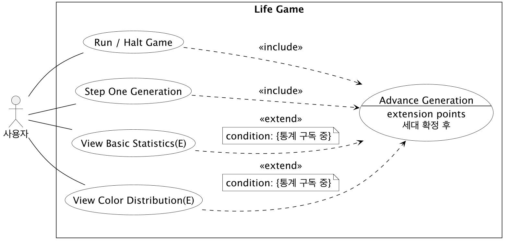
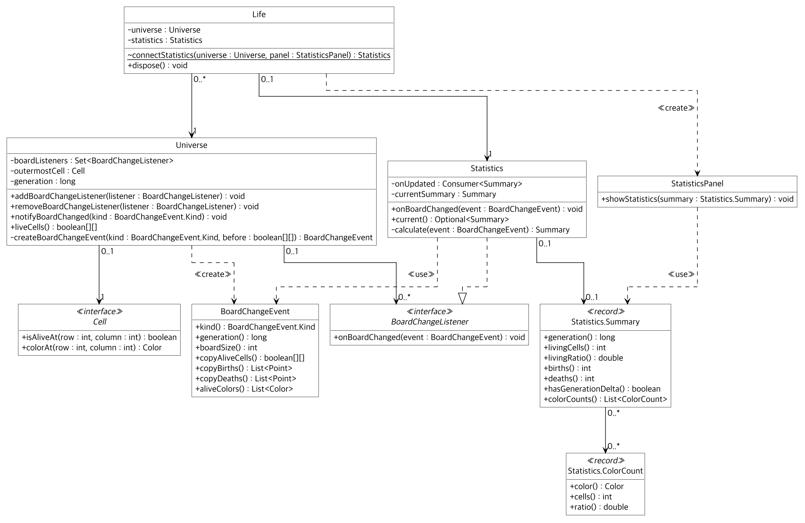
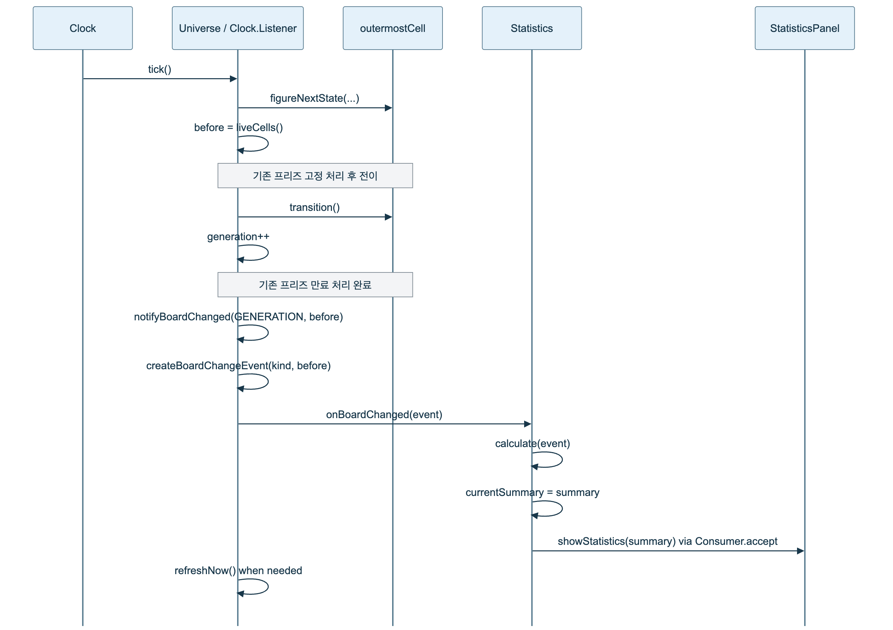
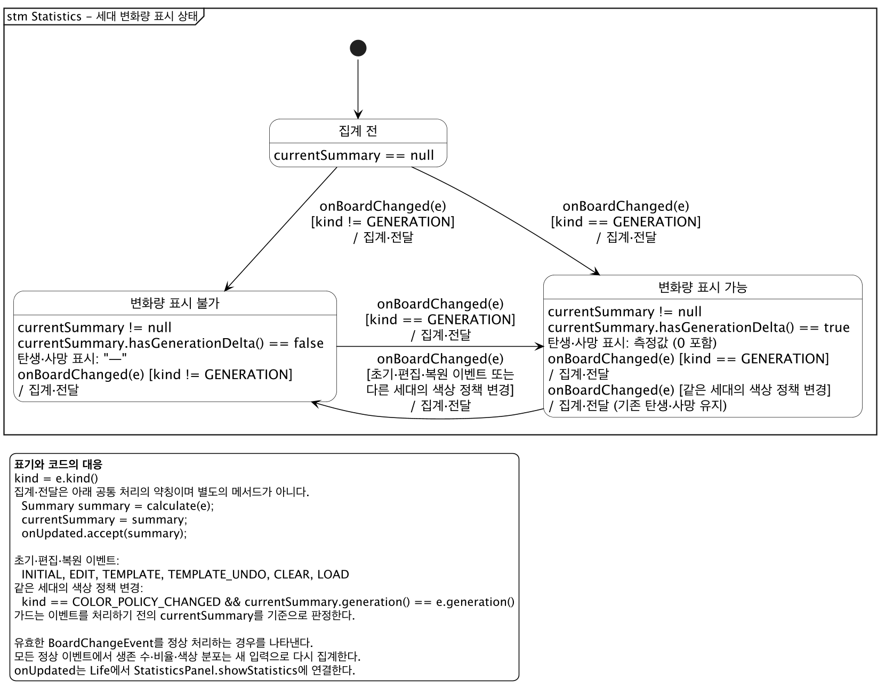
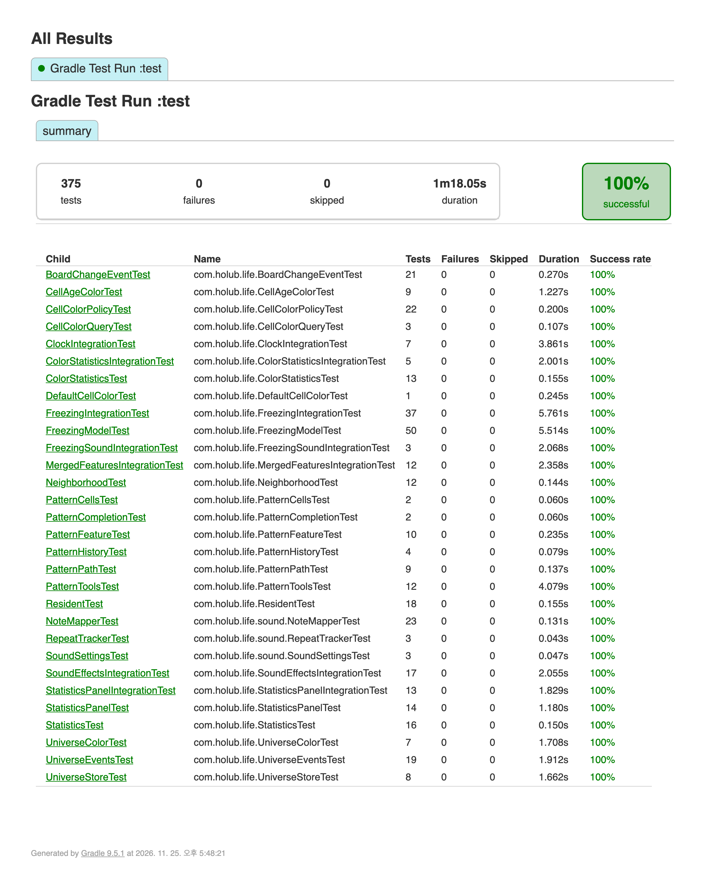

# 통계 기능 설계 및 구현

1. [기능 개요 및 명세](#overview)
2. [기존 코드에서 변경된 부분](#changes)
3. [구조와 동작](#structure)
4. [설계 패턴과 설계 결정](#decisions)
5. [테스트](#tests)

<a id="overview"></a>
## 1. 기능 개요 및 명세

### 1.1 기능의 목적과 제공하는 통계

기존 Life Game은 셀의 생존 상태를 게임판에 그리지만, 현재 세대나 생존 규모, 한 세대 동안 일어난 변화량을 수치로 보여주지 않는다. 통계 기능은 게임판의 작업이 끝난 상태를 받아 **현재 세대, 생존 셀 수·비율, 이번 세대 탄생·사망 수, 색상별 생존 셀 수·비율**을 오른쪽 통계 탭에 표시한다.

사용자가 별도의 조회 버튼을 누를 필요 없이 세대 진행·편집·복원·색상 정책 변경 후 결과가 갱신된다. 계산과 화면 표시를 각각 `Statistics`와 `StatisticsPanel`로 분리하고, `Universe`의 완료 이벤트를 구독하도록 구성했다.

### 1.2 통계 항목별 계산 및 표시 규칙

**한 세대 진행**은 현재 게임판을 기준으로 각 셀의 다음 생존 상태를 계산하고, 그 결과를 게임판에 반영하는 과정이다. 초기 판을 0세대로 보고 이 과정이 완료될 때마다 세대 번호를 1씩 늘린다. 셀을 직접 편집하거나 템플릿을 배치하는 동작은 세대 진행이 아니므로 번호를 늘리지 않는다. 판을 지우거나 파일에서 불러오면 번호를 0으로 되돌린다.

**생존 배열**은 게임판의 각 칸이 살아 있는지를 행·열 순서로 기록한 2차원 배열이다. 살아 있는 칸은 `true`, 죽은 칸은 `false`로 표현한다. **탄생·사망**은 한 세대 진행 전후에 각각 죽음→생존, 생존→죽음으로 바뀐 셀을 뜻한다. 편집으로 추가·삭제한 셀 수와는 구분한다.

| 항목 | 계산 기준 | 표시 규칙 |
| --- | --- | --- |
| 현재 세대 | 마지막 초기화·불러오기 이후 완료된 세대 진행 횟수 | 초기값 0. 셀 배치가 그대로여도 정상 세대가 진행되면 1 증가한다. |
| 생존 셀 수 | 완료된 게임판에서 살아 있는 칸 수 | 프리즈로 고정된 생존 셀도 포함한다. |
| 생존 비율 | 생존 수 ÷ 전체 칸 수 × 100 | 전체 칸 수는 판 한 변의 셀 수의 제곱이다. 소수 둘째 자리까지 표시한다. |
| 세대 탄생·사망 | 직전 한 세대의 전후 상태를 비교한 변화 수 | 측정된 변화가 없으면 `0`, 초기 상태 표시·편집·복원 후에는 `—`로 표시한다. |
| 색상별 셀 수 | 살아 있는 셀의 표시 색을 같은 색 값끼리 묶은 개수 | 현재 존재하는 색만 표시한다. 기본 색은 빨강 → 파랑 → 초록 순서를 유지한다. |
| 색상별 비율 | 해당 색의 생존 수 ÷ 전체 생존 수 × 100 | 소수 둘째 자리까지 표시한다. 빈 판에서는 색상 행 대신 생존 셀이 없다는 안내를 표시한다. |

예를 들어 4×4 판에 빨강 2개·파랑 1개·초록 1개가 살아 있으면, 생존 비율은 `4/16 = 25%`이고 색상별 비율은 `2/4 = 50%`, `1/4 = 25%`, `1/4 = 25%`다. **전체 생존 비율과 색상별 비율은 분모가 다르다.** 각 색 비율을 반올림하여 표시하므로 화면상 합계는 99.99%처럼 100%와 조금 다를 수 있다.

### 1.3 갱신 시점과 예외 상황

통계는 작업이 완료된 상태를 담은 `BoardChangeEvent`를 받아 갱신한다. 이벤트의 종류는 `BoardChangeEvent.Kind`로 구분하며, Statistics는 이에 따라 현재 상태를 집계하고 세대 변화량의 표시 여부를 결정한다.

| 작업 | 전달 이유를 나타내는 종류·세대 번호 | 통계 반영 |
| --- | --- | --- |
| 통계 연결 | 초기 상태 전달(`INITIAL`), 현재 번호 | 새 구독자에게만 현재 판을 즉시 전달한다. 탄생·사망은 `—`로 표시한다. |
| 세대 진행 | 자동 진행·Single Step의 세대 진행 완료(`GENERATION`), 번호 1 증가 | 완료 상태와 해당 세대의 탄생·사망을 집계한다. 안정된 판·빈 판도 정상 세대가 진행되면 갱신한다. |
| 직접 편집 | 클릭·일반 드래그의 직접 편집 완료(`EDIT`), 번호 유지 | 생존 수·색상 분포를 갱신하고 세대 변화량은 `—`로 바꾼다. |
| 템플릿·Undo | 배치 완료(`TEMPLATE`)·배치 취소 완료(`TEMPLATE_UNDO`), 번호 유지 | 배치·복원 결과를 집계한다. 편집으로 바뀐 셀 수를 세대 탄생·사망에 섞지 않는다. |
| Clear·Load | 성공 시 판 지우기 완료(`CLEAR`)·불러오기 완료(`LOAD`), 번호 0 | 초기화·복원된 판을 집계하고 세대 변화량을 지운다. |
| 색상 정책 | 표시 색 규칙 교체 완료(`COLOR_POLICY_CHANGED`), 번호 유지 | 색상 분포를 갱신한다. 같은 세대의 직전 집계 결과가 있으면 탄생·사망 표시 상태를 유지한다. |
| 프리즈 진행 | 고정 처리까지 반영된 세대 진행 완료(`GENERATION`) | 실제 생존 상태와 표시 색을 집계한다. 고정되어 생사가 유지된 셀은 탄생·사망 목록에 들어가지 않는다. |

**최초 연결 시에는 INITIAL로 현재 상태를 표시한다.** 예를 들어 12세대에 리스너를 등록하면 세대 번호 12와 그때의 판을 전달하며, 판이나 세대 번호를 초기화하지 않는다. 현재 상태를 처음 보여주는 알림이므로 탄생·사망은 `—`로 표시한다.

**템플릿 배치가 끝나면 다음 세대를 기다리지 않고 통계를 갱신한다.** 드래그는 마우스를 놓아 한 번의 배치를 완료할 때 이벤트를 한 번 전달한다. 정지 중에도 생존 수·색상 분포가 즉시 반영되며, 세대 번호는 유지하고 탄생·사망은 `—`로 표시한다. 이후 한 세대를 진행하면 배치된 판을 기준으로 해당 세대의 탄생·사망을 계산한다.

캡처·프리즈 영역 선택, 프리즈 설치·수동 해제 자체, 상태 변화가 없거나 차단된 편집, Load 취소·읽기 실패, Store에서는 이벤트를 발행하지 않고 기존 통계를 유지한다. 패턴 편집 또는 프리즈 영역 선택 중에는 세대 진행 자체도 차단된다.

통계 탭이 숨겨져 있어도 구독과 갱신은 유지되므로, 다시 열면 최신 결과를 볼 수 있다.

<a id="use-cases"></a>
### 1.4 유스케이스와 기능 요구사항

통계 조회는 전체 유스케이스 다이어그램에 맞춰 `View Statistics(E)`로 나타냈다. 아래 그림은 통계 조회와 세대 진행의 관계를 나타낸다.



[다이어그램 PNG](diagrams/statistics-use-cases.png)

| 항목 | 내용 |
| --- | --- |
| 유스케이스 | `View Statistics(E)` |
| 목표 | 현재 세대와 게임판의 생존 규모·세대 변화량·색상 분포를 확인한다. |
| 행위자 | 사용자 |
| 사전 조건 | 게임이 실행 중이고 통계 기능이 연결되어 있다. 세대 진행 중과 정지 중 모두 조회할 수 있다. |
| 기본 흐름 | ① 사용자가 통계 탭을 선택한다.<br>② 시스템이 최신 통계 결과를 보여준다.<br>③ 이후 세대 진행이나 게임판 변경이 완료되면 시스템이 결과를 갱신한다.<br>④ 사용자가 갱신된 값을 확인한다. |
| 대체 상황 | 최초 연결·편집·복원 후에는 탄생·사망을 `—`로 표시한다. 빈 판에서는 색상 행 대신 생존 셀이 없다는 안내를 표시한다. |
| 사후 조건 | 사용자가 현재 게임판에 대응하는 통계 결과를 확인한다. |
| 유스케이스 관계 | 세대 진행에 따른 갱신은 `Advance Generation`의 ‘세대 확정 후’ 확장 지점에서 수행하며 `«extend»`로 나타낸다. 확장 조건은 ‘통계 구독 중’이다. |

통계는 탭 선택과 관계없이 갱신되므로, 탭을 열면 이미 갱신된 결과를 확인한다. 계산·표시 규칙은 1.2절, 작업별 갱신 시점과 예외 상황은 1.3절, 세대 진행 후 내부 처리 순서는 3.3절에서 설명한다.

<a id="changes"></a>
## 2. 기존 코드에서 변경된 부분

통계 기능은 기존 게임판 처리에 완료 알림을 연결하고, 수집한 상태의 집계와 화면 표시를 별도 클래스로 추가했다. 아래에서 **원본**은 기능 확장 전 Holub 코드를 뜻한다. 다른 팀 기능에서 추가한 메서드를 사용하는 경우에는 해당 절에서 출처와 재사용 범위를 밝힌다.

### 2.1 Universe: 작업 완료 상태 수집과 통계 알림

원본 Universe는 게임판을 진행하고 화면을 갱신했지만, 통계를 위한 세대 번호와 작업 완료 알림은 제공하지 않았다. 통계 기능에서는 **완료 상태를 이벤트로 구성하고 구독자에게 전달하는 경로**를 추가했다. 핵심은 이벤트를 만드는 `createBoardChangeEvent()`와 이를 발행하는 `notifyBoardChanged()`다.

**세대 번호와 알림 시점 추가**

게임판 전체의 세대 번호를 저장하는 `long generation` 필드를 추가하고, 정상 전이가 끝날 때 1씩 증가시키도록 했다. 아래는 현재 tick에서 세대 번호를 증가시키고 완료 알림을 보내는 부분이다. 프리즈 후처리는 알림이 기존 작업을 모두 마친 뒤 발생한다는 순서만 나타낸다.

```java
generation++;
freezing.afterGeneration();
notifyBoardChanged(BoardChangeEvent.Kind.GENERATION, before);
```

색상 기능에서 이미 정상 세대마다 전이하도록 바꾼 흐름을 활용하므로, 생존 배치가 같아도 세대 번호와 통계는 갱신된다. 통계 알림도 `transition()`의 변화 여부 반환값으로 제한하지 않는다. Clear·Load 성공 시에는 generation을 0으로 되돌린다.

전이 전 배열인 `before`는 사운드 기능의 `before = liveCells()` 방식을 재사용하며, 통합 시 매 정상 세대 확보하도록 연결했다. `liveCells()`와 그 안에서 사용하는 `Cell.isAliveAt()` 역시 사운드에서 추가한 메서드다. 통계는 이 조회 경로를 이용해 완료 시점의 상태도 수집한다.

**notifyBoardChanged(): 완료 이벤트를 구독자에게 전달**

<a id="integration"></a>
통계와 사운드가 하나의 `BoardChangeListener` 인터페이스로 게임판 변경을 구독하도록 통합했다. Universe는 통계나 사운드의 구체 클래스를 직접 호출하지 않고, 등록된 구독자에게 동일한 `BoardChangeEvent`를 전달한다.

```java
private void notifyBoardChanged(BoardChangeEvent.Kind kind, boolean[][] before) {
    requireEventDispatchThread();
    Objects.requireNonNull(kind, "kind");
    if (boardListeners.isEmpty()) return;

    BoardChangeEvent event = createBoardChangeEvent(kind, before);
    for (BoardChangeListener listener : boardListeners.toArray(new BoardChangeListener[0])) {
        listener.onBoardChanged(event);
    }
}
```

`boardListeners`는 추가한 리스너 집합이다. 알릴 대상이 있으면 이벤트를 한 번 구성하고 모든 구독자에게 전달한다. 전달 중 등록·해제에 영향을 받지 않도록 리스너 목록의 복사본을 순회한다. 구독 관리와 외부 작업의 완료 연결을 위해 다음 메서드를 추가했다.

| 메서드 | 입력·처리·결과 |
|---|---|
| `addBoardChangeListener()` | 리스너를 집합에 등록하고 새 구독자에게만 현재 상태의 INITIAL을 즉시 전달한다. 중복 등록이면 다시 전달하지 않는다. 게임을 진행하기 전에도 통계 화면을 채울 수 있다. |
| `removeBoardChangeListener()` | 전달받은 리스너를 집합에서 제거하여 이후 발행에서 제외한다. 이미 없는 리스너를 해제해도 문제없다. Life의 창 해제 처리에서 사용한다. |
| `notifyBoardChanged(kind)` | 편집·복원 등 이전 상태가 필요 없는 작업의 완료를 알리는 공개 메서드다. 비공개형에 before=null을 전달한다. 판을 변경하거나 세대를 진행시키는 명령은 아니며, 실제 전이 전 배열이 필요한 GENERATION은 거부한다. |
| `notifyBoardChanged(kind, before)` | 세대 진행에서는 실제 전이 전 배열을 받는 비공개 발행 경로다. 이벤트 구성 후 각 리스너의 onBoardChanged를 호출하며, 공개형도 내부적으로 이 경로를 사용한다. |

등록·해제·발행은 `requireEventDispatchThread()`로 EDT 실행 여부를 검사한다. 상태 수집부터 화면 갱신까지 같은 실행 흐름에서 처리하는 이유는 4.2절의 상태 일관성 결정에서 설명한다.

**createBoardChangeEvent(): 완료 상태와 통계 입력 구성**

이 메서드는 **작업 후 생존 배열인 after를 수집하고**, 종류·세대 번호·판 크기·탄생 및 사망 좌표·생존 셀의 색을 BoardChangeEvent에 담도록 추가했다. after는 notifyBoardChanged 본문이 아니라, 그 안에서 호출하는 createBoardChangeEvent에서 만든다.

기존 사운드의 이벤트 발행부는 전이 후 각 셀을 isAliveAt으로 직접 조회하며 before와 비교했다. 별도의 after 배열은 없었고 탄생·사망 좌표만 전달했다. 통계는 현재 생존 수와 색상 분포도 필요하므로, **완료 판을 배열로 확보해 비교와 이벤트 전달에 함께 사용**하도록 변경했다.

```java
private BoardChangeEvent createBoardChangeEvent(BoardChangeEvent.Kind kind, boolean[][] before) {
    boolean[][] after = liveCells();
    List<Point> births = new ArrayList<>();
    List<Point> deaths = new ArrayList<>();
    List<Color> aliveColors = new ArrayList<>();
    for (int row = 0; row < after.length; row++) {
        for (int column = 0; column < after.length; column++) {
            if (after[row][column]) aliveColors.add(outermostCell.colorAt(row, column));
            if (kind == BoardChangeEvent.Kind.GENERATION) {
                if (after[row][column] && !before[row][column]) births.add(new Point(column, row));
                else if (!after[row][column] && before[row][column]) deaths.add(new Point(column, row));
            }
        }
    }
    return new BoardChangeEvent(kind, generation, after.length, after,
            births, deaths, aliveColors);
}
```

`liveCells()`가 완료 상태를 담은 새 배열을 반환하고 after가 이를 보관한다. GENERATION이면 before와 after의 같은 위치를 비교해 탄생·사망 좌표를 만든다. 배열은 `[행][열]`, Point는 `(열, 행)` 순서다. 셀 편집·템플릿 배치·불러오기 등 세대 진행(`GENERATION`) 이외의 이벤트에서는 작업 완료 상태를 전달한다. 세대 진행에 따른 탄생·사망을 계산하지 않으므로 `before`가 필요 없고, 탄생·사망 좌표 목록은 비어 있다.

현재 살아 있는 위치에서는 `colorAt()`으로 표시 색을 읽어 `aliveColors`에 하나씩 담는다. 색 조회의 추가는 2.2절에서 설명한다. **이벤트에는 after와 비교 결과를 전달하고 before는 전달하지 않는다.** Statistics는 이 입력으로 생존 수·비율·변화량·색별 분포를 집계한다. createBoardChangeEvent는 데이터를 구성하고, 구독자 호출은 notifyBoardChanged가 담당한다.

**편집·복원에도 같은 완료 알림 연결**

세대 진행 외에도 기존 작업이 끝난 지점에 공개 `notifyBoardChanged(kind)` 호출을 추가했다. 클릭·일반 드래그는 실제 셀 변경을 확인한 뒤 호출하며, 템플릿은 기존 배치·Undo 완료 신호를 Universe에서 받아 같은 발행 경로로 연결했다. Clear·Load는 초기화·복원이 성공한 뒤, 색상 정책은 교체한 뒤 알리도록 했다.

Load 취소·읽기 실패와 Store 처리에는 통계 알림을 추가하지 않았다. 각 작업에 대응하는 이벤트 종류와 통계 표시 결과는 1.3절에 정리했다.

### 2.2 Cell 계층: 통계에 필요한 색상 조회 추가

**표시 색을 외부에서 조회하는 메서드 추가**

통계 추가 전에는 Resident가 화면을 그릴 때 표시 색을 구했지만, 외부에서 특정 위치의 색을 읽을 메서드는 없었다. 색상별 통계를 위해 Cell 계층에 `colorAt(row, column)`을 추가하고, 기존 색 결정 호출을 재사용하도록 구현했다.

```java
// 통계 추가 전: 기존 색상 기능이 redraw()에서 사용하던 코드
g.setColor(amAlive ? colorPolicy.colorOf(age) : DEAD_COLOR);

// 통계에서 추가한 Cell의 조회 계약
Color colorAt(int row, int column);

// 통계에서 추가한 Resident의 조회 구현
public Color colorAt(int row, int column) {
    assert row == 0 && column == 0;
    return amAlive ? colorPolicy.colorOf(age) : null;
}
```

기존 redraw의 색 지정은 유지한다. 새 colorAt도 같은 `colorPolicy.colorOf(age)`를 사용하므로, 통계가 읽는 색과 화면에 그리는 색이 일치한다. 정책과 나이 처리는 색상 기능의 구현을 재사용하고, 통계에서는 조회 계약과 각 Cell의 구현을 추가했다.

| 클래스 | 추가·변경한 메서드와 동작 |
|---|---|
| `Cell` | `colorAt(row, column)`을 선언했다. 해당 위치의 표시 색을 반환하며 죽은 셀은 null로 표현한다. Cell.DUMMY의 구현도 null을 반환한다. |
| `Neighborhood` | colorAt을 구현했다. 하위 셀 한 변의 크기로 행·열을 나눈 몫은 하위 셀 선택에, 나머지는 그 셀 내부의 좌표에 사용하여 조회를 위임한다. 좌표 변환은 기존 isAliveAt 방식을 활용한다. |
| `Resident` | colorAt을 구현했다. 단일 셀이므로 지역 좌표 (0,0)을 확인하고 생존 중이면 정책의 색을, 죽어 있으면 null을 반환한다. 조회 과정에서 나이·생존 상태를 변경하지 않는다. |

Universe는 2.1절의 이벤트 구성에서 **살아 있는 위치에만 colorAt을 호출**하고 결과를 `List<Color> aliveColors`에 담는다. 빨강·빨강·파랑인 세 셀이 있으면 색 목록도 세 항목이며, 색별 개수·비율은 Statistics에서 계산한다. 따라서 색 결정 규칙을 통계에 복제하거나 셀마다 별도 색 필드를 추가할 필요가 없다.

**색상 정책 교체 후 통계 갱신 연결**

기존 `Universe.useColorPolicy()`는 정책을 교체하고 게임판을 다시 그렸다. 여기에 COLOR_POLICY_CHANGED 알림을 추가하여, 게임이 정지해 있을 때 정책을 바꾸어도 통계가 현재 표시 색을 다시 집계하도록 했다.

```java
// 통계 연결 전
private void useColorPolicy(CellColorPolicy policy) {
    Resident.setColorPolicy(policy);
    repaint();
}

// 통계 연결 후
private void useColorPolicy(CellColorPolicy policy) {
    Resident.setColorPolicy(policy);
    notifyBoardChanged(BoardChangeEvent.Kind.COLOR_POLICY_CHANGED);
    repaint();
}
```

추가한 호출은 정책 교체 이후의 색을 이벤트에 담도록 한다. 세대 번호를 늘리거나 게임판을 전이시키지는 않는다. 같은 세대의 탄생·사망 표시를 유지하는 처리는 2.5절의 Statistics가 담당한다.

<a id="panel"></a>
### 2.3 Life: 통계 연결과 탭 배치

원본 `Life`는 창 중앙에 Universe를 직접 붙였으며 통계를 생성하거나 연결하는 코드는 없었다. 통계 확장에서는 **패널 생성 → 탭 배치 → 집계 객체 연결**을 창 초기화에 추가했다. 기존 도구 화면과 함께 사용할 수 있도록 통계 패널을 공용 탭에 넣되, 통계의 생성과 구독은 Life에서 한 번 수행하도록 했다.

```java
// 원본 창 구성 중 게임판을 붙이는 부분
getContentPane().setLayout(new BorderLayout());
getContentPane().add(Universe.instance(), BorderLayout.CENTER);

// 현재 창 구성 중 통계 생성·배치·연결 부분
universe = Universe.instance();
StatisticsPanel statisticsPanel = new StatisticsPanel();
JTabbedPane tabs = createSidebar(universe, statisticsPanel);
setContentPane(createContent(universe, tabs));
statistics = connectStatistics(universe, statisticsPanel);
```

새 `createSidebar()`에서 `tabs.addTab("통계", statisticsPanel)`로 패널을 추가하고, `createContent()`에서 게임판 오른쪽에 탭을 배치한다. 실제 통계 구독은 새로 추가한 `connectStatistics()`에서 수행한다.

```java
Statistics statistics = new Statistics(panel::showStatistics);
universe.addBoardChangeListener(statistics);
return statistics;
```

`panel::showStatistics`는 집계 결과가 준비되면 실행할 동작이다. Statistics는 이를 Java 표준 인터페이스인 `Consumer<Summary>`로 받아 저장하고, `accept(summary)`로 실행한다. 이때 `panel.showStatistics(summary)`가 호출된다. 따라서 Statistics가 패널 클래스를 직접 생성하거나 참조할 필요가 없다.

| 메서드 | 입력·처리·결과 |
|---|---|
| `createSidebar()` | Universe와 통계 패널을 받아 공용 JTabbedPane에 통계 탭을 추가한다. 다른 도구 패널은 기존 제공 메서드로 가져오고, 기존 탭 전환 처리와 함께 구성한다. |
| `createContent()` | Universe를 BorderLayout.CENTER에, 전달받은 탭을 EAST에 배치한다. 모든 탭을 추가한 뒤 필요한 너비를 계산하고 높이를 게임판에 맞춘다. 탭의 내용·선택·리스너는 유지한다. |
| `connectStatistics()` | 패널 표시 콜백과 연결한 Statistics를 생성해 Universe에 등록하고 반환한다. 등록 중 INITIAL이 전달되어 창을 열기 전에 최초 통계가 계산된다. |
| `dispose()` | 통계 리스너를 해제한 뒤 기존 JFrame의 창 해제 처리를 호출하도록 확장했다. 연결한 Statistics는 Life의 필드에 보관해 해제할 때 사용한다. |

Life는 연결한 Statistics를 필드에 보관해 창 해제 시 같은 객체를 구독에서 제거한다. 탭 전환은 구독과 분리되어 있으므로 통계 탭이 숨겨져 있어도 집계와 표시 값은 최신 상태로 유지된다.

### 2.4 BoardChangeListener·BoardChangeEvent: 공통 알림 계약 추가

통계가 게임판 완료 상태를 받을 수 있도록 **수신 인터페이스인 BoardChangeListener와 전달 객체인 BoardChangeEvent**를 새로 정의했다. 이 계약을 통해 Universe는 Statistics의 계산 메서드를 직접 알지 않아도 완료 상태를 전달할 수 있다. 현재는 사운드도 같은 계약을 구독한다.

```java
@FunctionalInterface
public interface BoardChangeListener {
    void onBoardChanged(BoardChangeEvent event);
}
```

Universe가 `onBoardChanged(event)`를 호출하면 Statistics가 전달된 데이터를 집계한다. BoardChangeEvent의 생성자는 작업 종류·세대 번호·판 크기·생존 배열·변화 좌표·색 목록을 받아 검사하고 보관한다. 전달 객체의 필드와 조회 메서드는 다음과 같다.

| 필드 | 담는 내용과 조회 방법 |
|---|---|
| `kind` | 작업 종류를 `kind()`로 읽는다. 종류별 의미와 표시 결과는 1.3절에 정의했다. |
| `generation` | 완료 시점의 게임판 세대 번호를 `generation()`으로 읽는다. 이벤트나 Statistics가 이 값을 독립적으로 증가시키지는 않는다. |
| `boardSize` | 판 한 변의 셀 수를 `boardSize()`로 읽는다. 기본 판은 64이며 전체 칸 수는 64×64다. 픽셀 크기가 아니다. |
| `aliveCells` | 완료 후 생존 배열을 `copyAliveCells()`로 받는다. 배열은 `[행][열]` 순서이며 Statistics가 생존 수를 세는 입력이다. |
| `births`·`deaths` | GENERATION의 탄생·사망 좌표를 `copyBirths()`·`copyDeaths()`로 받는다. Statistics는 각 목록의 크기로 이번 세대의 변화량을 구한다. 비세대 이벤트에서는 빈 목록이다. |
| `aliveColors` | `aliveColors()`로 생존 셀의 색 목록을 받는다. 같은 색도 셀 수만큼 반복되며, 좌표·나이나 색별 집계 결과는 포함하지 않는다. |

생성자는 판 크기와 배열 모양, 좌표 범위·중복, 이벤트 종류에 맞는 변화 목록, 생존 수와 색 목록 길이의 일치를 검사한다. 전달 데이터가 잘못된 상태로 집계에 사용되지 않도록 생성 시점에 검증한다.

배열과 좌표는 저장할 때 복사하며, `copyAliveCells()`·`copyBirths()`·`copyDeaths()`에서도 복사본을 반환한다. `aliveColors()`는 수정 불가능한 목록을 반환한다. 따라서 호출자가 조회 결과를 수정해도 이벤트가 보관한 완료 상태는 유지된다. 상세 조건과 복사 범위는 3.6절에 정리했다.

### 2.5 Statistics: 이벤트를 통계 결과로 변환

원본에는 생존 수·변화량·색상 분포를 계산해 전달하는 통계 객체가 없었다. 이를 위해 **이벤트를 입력으로 받아 Summary를 만드는 Statistics**를 추가했다. Universe가 전달한 완료 상태를 집계하고 결과 콜백을 호출하므로, 계산을 검증할 때 실제 게임판이나 Swing 화면을 생성할 필요가 없다.

BoardChangeListener를 구현한 수신 메서드는 다음과 같다.

```java
public void onBoardChanged(BoardChangeEvent event) {
    Objects.requireNonNull(event, "event");
    Summary summary = calculate(event);
    currentSummary = summary;
    onUpdated.accept(summary);
}
```

`calculate()`는 전달받은 배열에서 생존 셀을 세고, 세대 이벤트에 담긴 좌표 목록의 크기로 탄생·사망 수를 구한다. 기본 집계 부분은 다음과 같다.

```java
int livingCells = 0;
for (boolean[] row : event.copyAliveCells()) {
    for (boolean alive : row) if (alive) livingCells++;
}
double totalCells = (double) event.boardSize() * event.boardSize();
boolean hasGenerationDelta = event.kind() == BoardChangeEvent.Kind.GENERATION;
int births = hasGenerationDelta ? event.copyBirths().size() : 0;
int deaths = hasGenerationDelta ? event.copyDeaths().size() : 0;
```

생존 비율은 `livingCells * 100.0 / totalCells`로 계산해 결과에 담는다. 색 목록은 같은 색 값끼리 묶어 개수를 구하고, 전체 생존 수를 분모로 색별 비율을 계산한다. 실제 게임판 재조회나 전후 비교 없이 이벤트 하나에 담긴 완료 상태와 변화 좌표를 사용한다.

| 메서드·필드 | 입력·처리·결과 |
|---|---|
| `onBoardChanged()` | 받은 이벤트를 calculate에 전달하고, 반환된 Summary를 currentSummary에 저장한 뒤 `onUpdated.accept(summary)`로 전달한다. |
| `calculate()` | 이벤트의 생존 배열·판 크기·변화 좌표·색 목록을 읽어 기본 통계와 색상별 통계를 계산하고 Summary를 반환한다. 이벤트 종류에 따라 세대 변화량의 유효 여부도 정한다. |
| `currentSummary` | 가장 최근의 집계 결과 하나를 보관한다. 색상 정책만 바뀐 경우 직전 세대 변화량을 유지하는 데도 사용한다. 게임판 배열이나 Undo 이력을 보관하지 않는다. |
| `onUpdated` | 생성자로 받은 Consumer 콜백을 보관하는 필드다. Life는 패널의 showStatistics를 연결하고, 계산 테스트는 결과 수집 동작을 연결한다. `accept(summary)`가 준비된 집계 결과를 전달한다. |

계산 결과는 Statistics 내부의 `Summary`와 `ColorCount` record에 담는다. 별도 최상위 클래스 파일이 아니라 집계 결과를 구성하는 내부 타입이다.

| 결과 값 | 의미와 화면에서의 사용 |
|---|---|
| `generation` | 이벤트에서 받은 세대 번호다. 패널의 현재 세대에 표시한다. |
| `livingCells`·`livingRatio` | 현재 생존 수와 전체 칸 수 대비 백분율이다. livingRatio는 0~1 값이 아니라 0~100 값이다. |
| `births`·`deaths` | 이벤트 좌표 목록의 크기를 계산한 정수다. 이벤트에서는 위치 목록이지만 Summary에서는 표시할 개수다. |
| `hasGenerationDelta` | 탄생·사망을 유효한 세대 변화량으로 표시할지 나타낸다. true일 때 0은 측정된 변화량이고, false일 때 내부 값 0은 패널에서 `—`로 표시한다. |
| `colorCounts` | 색상별 ColorCount 목록이다. 각 항목의 `color`는 색, `cells`는 그 색의 생존 수, `ratio`는 전체 생존 수 대비 백분율이다. |

예를 들어 이벤트의 색 목록이 `[빨강, 빨강, 파랑]`이면 결과에는 빨강 2개·약 66.67%, 파랑 1개·약 33.33%를 담는다. **BoardChangeEvent는 완료 상태를, Summary는 그 상태를 집계한 결과를 전달한다.**

같은 세대의 COLOR_POLICY_CHANGED는 새 생사 변화가 아니므로, 기존 currentSummary가 있으면 탄생·사망 수와 hasGenerationDelta를 유지하고 색상 결과를 다시 계산한다. 기존 결과가 없거나 세대 번호가 다르면 이 보존 규칙을 적용하지 않는다. 색상 빈도를 계산하는 코드는 3.4절에서 설명한다.

### 2.6 StatisticsPanel: 계산 결과를 통계 화면에 표시

원본 화면에는 통계를 수치로 표시하는 영역이 없었다. 이를 위해 **Summary의 값을 통계 탭에 표시하는 StatisticsPanel**을 추가했다. 기본 통계 레이블과 색상별 행을 만들고, 갱신 시에는 계산이 끝난 값을 받아 표시 형식만 적용한다.

화면 갱신의 진입점인 `showStatistics()`는 다음과 같다.

```java
public void showStatistics(Statistics.Summary summary) {
    requireEventDispatchThread();
    Objects.requireNonNull(summary, "summary");
    generation.setText(Long.toString(summary.generation()));
    livingCells.setText(Integer.toString(summary.livingCells()));
    livingRatio.setText(formatPercentage(summary.livingRatio()));
    births.setText(summary.hasGenerationDelta()
            ? Integer.toString(summary.births()) : UNAVAILABLE);
    deaths.setText(summary.hasGenerationDelta()
            ? Integer.toString(summary.deaths()) : UNAVAILABLE);
    showColors(summary);
}
```

탄생·사망은 숫자가 0인지보다 **유효한 세대 변화량인지**를 먼저 확인한다. 측정된 변화가 없으면 0으로 표시하고, 비교할 수 없는 결과는 UNAVAILABLE에 저장한 `—`로 표시한다. 패널이 보드나 이벤트를 다시 읽지 않고 Summary만으로 표시를 결정하도록 구현했다.

| 메서드 | 입력·처리·결과 |
|---|---|
| `showStatistics()` | Summary를 받아 세대·생존 수·생존 비율을 표시하고, 탄생·사망은 유효 여부에 따라 숫자 또는 `—`로 바꾼다. 마지막으로 showColors를 호출한다. |
| `showColors()` | 이전 색상 행을 지우고 ColorCount 목록으로 색 견본·이름·개수·비율을 구성한다. 빈 목록이면 생존 셀이 없다는 안내로 바꾸며, 행 구성이 끝나면 레이아웃과 화면을 갱신한다. |
| `colorOrder()`·`colorName()` | 기본 색을 빨강→파랑→초록 순서와 한글 이름으로 표시한다. 그 밖의 색은 색상값 순서로 뒤에 놓고 16진수 색상값을 이름으로 사용한다. 실제 셀의 색을 결정하는 메서드는 아니다. |
| `formatPercentage()` | 이미 백분율인 값을 소수 둘째 자리의 문자열로 만든다. Locale.ROOT를 사용하여 실행 환경에 관계없이 같은 숫자 형식을 유지한다. |
| `statisticRow()` | 항목 이름·값 컴포넌트를 받아 좌우로 배치하고 행 높이와 정렬을 맞춘다. 기본 통계와 색상 행에 같은 배치 규칙을 사용한다. |

생성자는 세로 BoxLayout 안에 기본 통계·세대 변화량·색상 분포 영역을 구성한다. `statisticRow()`와 공통 간격·글꼴 상수로 기본 통계와 색상 행의 형식을 맞추고, 구분선으로 영역을 나눴다. 색상 목록은 세 행 높이의 스크롤 영역으로 구성해 색이 늘어도 패널 전체 높이가 계속 커지지 않도록 했다.

공용 탭에 넣을 수 있도록 선호 크기를 258×512로 정하고 최종 배치는 Life에 맡겼다. 생성자와 showStatistics는 EDT 실행 여부를 검사하여 Swing 컴포넌트의 생성·갱신 조건을 유지한다.

<a id="structure"></a>
## 3. 구조와 동작

### 3.1 클래스 다이어그램

통계 연결, 이벤트 전달, 집계 결과의 보관·표시에 필요한 클래스와 주요 멤버를 나타낸다. 속성과 연산에는 타입을 적고, 참조를 보관하는 연관에는 양 끝의 다중성과 대상 필드 이름을 표시했다. 점선의 «create»와 «use»는 각각 생성과 사용 의존을, 인터페이스로 향하는 빈 삼각형 점선은 구현 관계를 나타낸다.



[PNG 이미지](diagrams/statistics-classes.png)

Life는 Statistics와 StatisticsPanel을 생성·연결하고, Universe의 메서드를 호출해 통계 구독을 등록·해제한다. Universe는 BoardChangeListener 타입으로 구독자를 관리하고 완료 이벤트를 전달하며, Statistics가 이 인터페이스를 구현한다.

Statistics는 집계 결과를 Statistics.Summary에 보관하고, Summary는 색상별 결과인 Statistics.ColorCount 목록을 포함한다. Summary와 ColorCount는 Statistics 안에 선언한 record다. 화면 갱신은 Life가 연결한 Consumer 콜백으로 요청하므로 Statistics는 StatisticsPanel의 구체 타입에 의존하지 않는다.

### 3.2 게임 시작 시 통계 연결

2.3절의 connectStatistics 호출부터 최초 화면 표시까지는 다음 순서로 실행된다.

1. Life가 패널의 표시 콜백과 연결한 Statistics를 만들고 Universe에 등록한다.
2. Universe가 등록된 Statistics에 현재 상태의 INITIAL을 전달한다.
3. Statistics가 집계 결과를 저장하고 콜백을 실행하여 패널을 갱신한다.

등록 과정에서 이 호출이 끝나므로 게임을 한 세대도 진행하지 않은 상태에서도 창에 통계가 표시된다. 탭을 다시 열 때마다 구독을 새로 연결하지는 않는다.

### 3.3 세대 진행 후 통계 갱신

Clock이 진행 시점을 알리면 기존 익명 리스너의 `tick()`이 게임판을 전이시킨다. 아래는 편집 모드가 아닌 정상 세대 진행의 핵심 경로다. 프리즈의 내부 위임과 다른 Observer의 수신은 생략하되, 전후 상태를 수집하는 위치는 현재 코드 순서에 맞췄다.



[PNG 이미지](diagrams/statistics-sequence.png)

`transition()`은 정상 세대마다 호출한다. 생존 배치가 같은 안정 패턴도 셀 나이·색은 바뀔 수 있으므로 통계 알림을 생사 변화가 있는 경우에만 제한하지 않는다. 프리즈가 적용되면 고정까지 반영된 최종 상태를 비교하며, 화면 다시 그리기는 기존 조건을 따른다.

수신 후에는 2.5절의 `onBoardChanged()`가 집계 결과를 저장하고 표시 콜백을 호출한다. Universe의 알림부터 패널 갱신까지 같은 호출 흐름에서 완료되며, 계산과 표시 사이에는 Summary를 전달한다.

<a id="colors"></a>
### 3.4 색상별 집계와 정책 변경 반영

다음은 3.3의 갱신 과정에서 실행되는 `Statistics.calculate()`의 색상 집계 부분이다. `event.aliveColors()`는 Universe가 `colorAt()`으로 수집한 생존 셀의 색 목록으로, 색상 담당자가 구현한 `CellColorPolicy`의 구현체가 결정한 색을 사용한다. `livingCells`는 같은 메서드에서 먼저 계산한 전체 생존 셀 수다.

```java
Map<Color, Integer> counts = new TreeMap<>(Comparator.comparingInt(Color::getRGB));
for (Color color : event.aliveColors()) counts.merge(color, 1, Integer::sum);
List<ColorCount> colorCounts = new ArrayList<>();
for (Map.Entry<Color, Integer> entry : counts.entrySet()) {
    colorCounts.add(new ColorCount(entry.getKey(), entry.getValue(),
            entry.getValue() * 100.0 / livingCells));
}
```

`counts`에 색별 개수를 모으고, 각 개수를 전체 생존 셀 수로 나누어 백분율을 계산한다. 색·개수·비율을 담은 `ColorCount` 목록은 기본 통계와 함께 `Summary`에 포함되어 `StatisticsPanel`로 전달된다.

정지 중 정책을 바꾸면 Universe가 `COLOR_POLICY_CHANGED` 이벤트로 새 정책의 색 목록을 전달하고, Statistics가 같은 경로로 색상 분포를 다시 집계한다. 세대 번호는 바뀌지 않으며, 같은 세대의 직전 집계 결과가 있으면 탄생·사망 표시 상태도 유지한다.

<a id="statistics-state"></a>
### 3.5 통계 결과의 상태 전이

3.3절의 시퀀스 다이어그램은 한 번의 갱신 순서를 나타낸다. 아래 상태 다이어그램은 이벤트를 연속으로 받으면서 **최근 집계 결과의 탄생·사망 표시 가능 여부가 어떻게 바뀌는지**를 나타낸다. 별도 상태 클래스를 추가한 것이 아니라, `currentSummary`와 그 안의 `hasGenerationDelta` 값으로 구분한 상태다.



[PNG 이미지](diagrams/statistics-state.png)

| 상태 | 코드의 기준 | 의미 |
| --- | --- | --- |
| 집계 전 | `currentSummary == null` | 아직 이벤트를 받아 집계한 결과가 없다. |
| 변화량 표시 불가 | 결과가 있고 `hasGenerationDelta == false` | 현재 판의 통계는 제공하지만 탄생·사망은 `—`로 표시한다. |
| 변화량 표시 가능 | 결과가 있고 `hasGenerationDelta == true` | 해당 세대의 탄생·사망을 숫자로 표시한다. 측정값이 0인 경우도 포함한다. |

통계를 연결하면 `INITIAL`을 받아 ‘집계 전’에서 ‘변화량 표시 불가’ 상태로 전이한다. 이후 `GENERATION`을 받으면 ‘변화량 표시 가능’ 상태가 되어 해당 세대의 탄생·사망 수를 표시한다. 이미 표시 가능 상태였다면 상태를 유지하면서 새 세대의 측정값으로 갱신한다.

일반적인 연결 순서와 별개로, Statistics가 첫 입력으로 `GENERATION`을 받는 경우도 표현했다. 이벤트에 해당 세대의 변화 좌표가 포함되어 있으므로 이전 집계 결과 없이도 탄생·사망 수를 집계할 수 있다.

편집·배치·Undo·Clear·Load 이벤트를 받으면 ‘변화량 표시 불가’ 상태가 된다. 이미 해당 상태였다면 그대로 유지한다.

같은 세대의 `COLOR_POLICY_CHANGED`에서는 변화량 표시 상태와 탄생·사망 값을 유지하며 색상 분포를 갱신한다. 그림에서는 이를 내부 전이로 표현했다. 직전 편집으로 `—`가 된 경우에도 색상 변경만으로 이전 측정값을 다시 표시하지 않는다. 세대 번호가 다른 색상 정책 변경에는 보존 규칙을 적용하지 않으므로 ‘변화량 표시 불가’ 상태가 된다.

그림의 `집계·전달`은 `calculate()`로 계산한 Summary를 `currentSummary`에 저장하고 `onUpdated.accept(summary)`로 전달하는 공통 처리를 뜻한다. **표시 가능 여부는 세대 변화량에만 해당하며, ‘변화량 표시 가능’과 ‘변화량 표시 불가’ 상태 모두 생존 수·비율·색상 분포는 정상 이벤트마다 갱신한다.** 가드는 이벤트 처리 전의 결과를 기준으로 판단한다.

<a id="events"></a>
### 3.6 이벤트와 집계 결과의 데이터 계약

이벤트가 만족해야 할 입력 조건을 생성 시 검사하고, 이벤트와 집계 결과가 전달 후 외부에서 변경되지 않도록 보호한다.

| 검사 대상 | 지켜야 하는 조건 |
| --- | --- |
| 판 크기 | 양수 크기의 정사각형이고 모든 행의 길이가 boardSize와 일치해야 한다. 전체 칸 수가 정수 범위를 넘는 크기도 거부한다. |
| 변화 좌표 | 판 안의 중복 없는 좌표여야 한다. 탄생 위치는 완료 후 살아 있고 사망 위치는 죽어 있어야 한다. |
| 이벤트 종류 | GENERATION의 번호는 1 이상이다. 그 외 종류에는 탄생·사망 목록을 넣지 않는다. 모든 번호는 음수가 아니어야 한다. |
| 생존 색 | 길이가 완료 판의 생존 수와 같아야 하며 null 목록·색은 허용하지 않는다. |
| 결과 목록 | Summary의 색별 결과 목록은 외부에서 변경할 수 없도록 보관한다. |

이벤트는 생성 시 배열의 각 행과 좌표의 Point까지 복사한다. `copyAliveCells()`·`copyBirths()`·`copyDeaths()`도 복사본을 반환하므로 한 구독자가 받은 값을 수정해도 다른 구독자의 입력은 바뀌지 않는다. 색 목록은 `List.copyOf()`로 보호한다.

좌표와 완료 상태의 일치 여부는 이벤트가 검사하지만, 실제 전이 전 상태와의 차이를 계산하는 책임은 Universe에 있다. 이 이벤트는 작업 완료 결과의 전달 객체이며 복원을 실행하는 객체가 아니다.

<a id="decisions"></a>
## 4. 설계 패턴과 설계 결정

### 4.1 적용한 설계 패턴과 원칙

#### **Observer**: 게임판 변경을 수신 기능과 분리하여 전달

통계는 세대 진행뿐 아니라 편집·복원·색상 정책 변경이 완료될 때도 갱신되어야 한다. Universe가 수신 기능의 구체 메서드를 직접 호출하면 기능이 늘거나 호출 방식이 달라질 때 발행 코드도 함께 바뀐다. **Observer를 적용한 이유는 Universe가 수신 기능의 내부 처리를 몰라도 완료 상태를 전달할 수 있도록 하기 위해서다.** 통계가 읽어야 할 것은 변경이 끝난 판이므로, Clock의 진행 요청이 아니라 Universe의 작업 완료 알림을 구독하도록 했다.

통합 전에는 통계와 사운드가 각각 별도의 리스너 인터페이스로 Universe를 구독했다. 두 기능 모두 Observer를 사용했지만 필요한 정보가 달랐으므로, 기존 구독을 유지할지 공통 계약으로 맞출지 검토했다.

| 대안 | 장점 | 한계 |
| --- | --- | --- |
| 기능별 구독 유지 | 각 기능에 필요한 데이터만 전달하며 기존 연결을 유지할 수 있다. | 구독·발행 경로와 알림 시점을 기능별로 관리해야 한다. |
| 공통 구독 사용 | 같은 완료 이벤트를 공유하고 각 구독자가 필요한 정보를 선택한다. | 사용하지 않는 데이터도 받으며 공통 계약 변경 시 수신부를 함께 확인해야 한다. |

**최종적으로 같은 게임판의 완료 상태를 공유하는 두 기능의 구독을 `BoardChangeListener`와 `BoardChangeEvent`로 통일했다.** 알림 시점과 발행 경로를 하나로 관리하면서, 통계 계산과 음 생성은 서로 의존하지 않고 각 구독자에서 처리하도록 했다. 현재 구조에서 Observer의 역할은 다음과 같다.

| 역할 | 해당 클래스·인터페이스 | 실제 동작 |
| --- | --- | --- |
| **Subject** | `Universe` | 구독자를 등록·해제하고 게임판 작업이 완료되면 이벤트를 전달한다. |
| **Observer 인터페이스** | `BoardChangeListener` | 구독자가 구현할 `onBoardChanged(event)` 수신 메서드를 정의한다. |
| **구체 Observer** | `Statistics` | 인터페이스를 구현하여 이벤트를 받고, 통계를 계산해 `Summary`로 전달한다. |

Universe는 `notifyBoardChanged()`에서 이벤트 하나를 만든 뒤 등록된 구독자의 `onBoardChanged(event)`를 호출해 같은 이벤트를 전달한다.

#### **단일 책임 원칙**: 통계 계산과 화면 표시의 변경 이유 분리

통계 항목이나 계산 기준을 추가하는 작업과, 글꼴·간격·표시 순서를 바꾸는 작업은 수정 대상이 다르다. 계산과 표시를 한 클래스에 구현하면 두 종류의 변경을 모두 같은 클래스에서 처리해야 한다. 따라서 Statistics는 통계 계산을, StatisticsPanel은 계산 결과의 표시를 담당하도록 나누어 각각을 독립적으로 수정하고 검증할 수 있게 했다.

Statistics는 이벤트를 집계하여 `Summary`를 만들고, StatisticsPanel은 결과의 서식·정렬·배치를 담당하며, Life는 두 객체를 생성하고 연결한다. `Life.connectStatistics()`에서 `new Statistics(panel::showStatistics)`로 콜백을 전달하므로 Statistics는 구체 패널 타입에 의존하지 않는다. 테스트에서는 같은 위치에 `updates::add`를 전달하여 Swing 화면 없이 집계 결과를 검증한다.

#### 기존 **Composite·Strategy** 활용: 셀 구조와 색 결정 규칙 재사용

색상 통계를 위해 Universe가 중첩된 격자 구조를 직접 탐색하거나 Statistics가 색 결정 규칙을 다시 구현하면, 기존 셀 구조·색상 기능이 바뀔 때 통계도 함께 수정해야 한다. 이를 피하기 위해 **기존 Composite 구조에 조회 기능을 추가하고, 색상 담당자가 구현한 Strategy의 결과를 재사용했다.**

`Cell` 계층에 추가한 `colorAt()`은 Neighborhood가 해당 하위 셀에 조회를 위임하고 Resident가 자신의 표시 색을 반환하도록 한다. Resident는 그리기와 조회 모두에서 기존 `CellColorPolicy.colorOf(age)`를 사용한다. 따라서 Universe는 내부 격자 구성을 알 필요 없이 색을 수집하고, Statistics는 정책의 종류나 나이별 규칙을 몰라도 전달된 색을 집계할 수 있다. Composite와 색상 Strategy는 기존 구현을 활용한 것이며, 통계에서 추가한 부분은 색 조회와 집계 연결이다.

### 4.2 주요 설계 문제와 결정 과정

#### 탄생·사망 비교를 누가 담당할 것인가?

**고민한 문제:** 초기 Statistics는 현재 상태를 받아 이전 판과 비교했고, 사운드 발행부도 세대 전후를 비교했다. 같은 변화를 두 곳에서 계산하는 데다 통계에서는 편집·복원 후 비교 기준과 이벤트 수신 순서까지 관리해야 했다. 구독을 통일하면서 이 비교 책임도 공유할지 검토했다.

| 대안 | 장점 | 한계 |
| --- | --- | --- |
| 각 구독자가 비교 | 발행자는 현재 판만 전달하고 구독자가 필요한 차이를 계산한다. | 이전 판과 비교 기준을 각각 보관하며 탄생·사망 계산이 중복된다. |
| Universe가 비교 | 실제 전이 직전·직후를 한 번 비교하여 같은 변화 좌표를 공유한다. | 이벤트 구성에 비교 책임이 추가되며 세대 진행과 다른 작업을 구분해야 한다. |

**최종 선택과 이유:** Universe의 `createBoardChangeEvent()`에서 세대 전이 직전·직후의 판을 비교해 탄생·사망 좌표를 계산하고, 그 결과를 구독자에게 전달하도록 했다. 이 방식을 선택한 이유는 동일한 비교를 한 번만 수행하면서, 각 구독자가 이전 이벤트를 받았는지와 관계없이 해당 세대의 변화량을 사용할 수 있기 때문이다.

생존 상태는 `boolean[][]`, 탄생·사망 좌표는 `List<Point>`로 전달하도록 기존 사운드와 자료구조를 맞췄다. 이는 두 기능 사이의 자료구조 변환을 줄이고, 기존 사운드의 음 생성 로직을 유지하면서 같은 데이터를 사용하기 위한 선택이다.

#### 상태 수집 중 게임판 변경을 어떻게 막을 것인가?

**고민한 문제:** Universe는 통계용 이벤트를 만들 때 실제 판의 생존 상태와 색을 순회하여 수집한다. 별도 타이머 스레드가 세대 진행 후 판을 읽는 동안 EDT에서 셀 클릭을 처리하면, 수집 결과에 클릭 전후의 상태가 섞일 수 있다. 따라서 세대 진행·사용자 편집·상태 수집이 같은 판에 접근하는 순서를 조정해야 했다.

| 대안 | 처리 방식과 장점 | 한계 |
| --- | --- | --- |
| 별도 스레드와 잠금 | 세대 진행은 타이머 스레드, 사용자 입력은 EDT에서 처리한다. 판 변경과 상태 수집을 같은 잠금으로 보호하면서 세대 계산을 UI 스레드와 분리할 수 있다. | 세대 진행뿐 아니라 편집·복원·조회도 같은 잠금 규칙을 따라야 한다. 별도 스레드의 계산 결과를 화면에 표시할 때는 EDT로 전달해야 한다. |
| Swing Timer와 EDT | 타이머 콜백과 사용자 입력을 모두 EDT에서 순서대로 처리한다. 한 작업의 판 변경과 상태 수집 사이에 다른 입력 처리가 끼어들지 않도록 한다. | 세대 계산·집계·리스너 처리가 오래 걸리면 사용자 입력과 다음 tick도 기다려야 한다. |

**최종 선택과 이유:** Clock의 세대 진행을 Swing Timer로 실행하여 사용자 입력과 같은 EDT에서 처리하도록 했다. 현재 Swing 기반의 64×64 판에서는 이미 EDT에서 처리하는 클릭·메뉴 작업과 세대 진행을 한 스레드로 모으면, 각 변경 경로에 잠금을 맞추는 부담을 줄이고 화면 갱신도 같은 스레드에서 수행할 수 있다고 판단했다.

현재는 **보드 변경 → Universe의 상태 수집·이벤트 전달 → Statistics의 집계 → StatisticsPanel의 표시 값 갱신**이 같은 호출 흐름에서 끝난다. 리스너 호출은 별도 스레드를 만들지 않으므로, 이 처리를 마친 뒤 다음 입력이나 tick을 처리한다. 초기 통계 연결도 EDT에서 실행하며, Universe의 등록·해제·알림과 StatisticsPanel의 생성·갱신은 EDT 실행 여부를 검사한다. 이 방식은 관련 보드 변경 경로가 EDT에서 실행된다는 규칙을 전제로 한다.

#### 실제 표시 색을 통계에 어떻게 전달할 것인가?

**고민한 문제:** 생존 상태만으로는 현재 표시 색을 알 수 없고, 정지 중 색상 정책만 바뀌어도 색상 분포는 달라진다. 기존 색상 규칙을 재사용하되 Statistics가 보드·정책을 직접 조회하게 할지, 이벤트에 색을 담을지 결정해야 했다.

| 대안 | 장점 | 한계 |
| --- | --- | --- |
| Statistics가 직접 조회 | 이벤트에 색 목록을 추가하지 않아도 된다. | 보드·색상 정책에 의존하고 이벤트 수신 후 다시 조회하는 시점도 맞춰야 한다. |
| 이벤트로 색 목록 전달 | 완료 시점의 색과 생존 상태를 함께 집계하며 보드 없이 계산을 테스트할 수 있다. | 이벤트마다 색 목록을 구성하고 보호해야 한다. |

**최종 선택과 이유:** Universe가 작업 완료 상태를 수집할 때 `colorAt()`으로 생존 셀의 표시 색도 함께 조회하여 `BoardChangeEvent`에 담도록 했다. 이 방식을 선택한 이유는 생존 상태와 같은 시점의 색을 집계 입력으로 제공하면서, Statistics가 실제 게임판을 직접 조회하지 않도록 하기 위해서다.

따라서 Statistics는 Universe나 Cell에 접근하지 않고 전달된 색의 개수와 비율만 계산한다. 게임판이나 색상 정책을 준비할 필요 없이, 색 목록을 담은 이벤트만으로 집계 로직을 테스트할 수 있다.

전달 형식은 `List<Color>`를 사용했다. 색상별 집계에는 좌표 정보가 필요하지 않으므로 생존 셀당 색 하나를 담은 목록이면 충분하기 때문이다.

<a id="tests"></a>
## 5. 테스트

### 5.1 테스트 구성과 실행 환경

통계 기능의 주요 동작을 검증하는 대표 테스트 메서드 18개를 선정했다. 각 메서드의 작성 목적, 입력·조작, 기대 결과와 실행 결과를 정리하고, 전체 테스트 결과는 5.5에 제시한다.

| 테스트 클래스 | 검증 대상 | 실행 수 |
| --- | --- | ---: |
| StatisticsTest | 생존 수·비율·변화량·결과 전달 | 16 |
| BoardChangeEventTest | 입력 조건·좌표·방어적 복사 | 21 |
| ColorStatisticsTest | 색상별 집계·정책 변경 후 변화량 | 13 |
| StatisticsPanelTest | 숫자 서식·변화량 표시·색상 행 | 14 |
| StatisticsPanelIntegrationTest | 실제 게임 진행·편집·복원과 통계 화면 연결 | 13 |
| ColorStatisticsIntegrationTest | 셀 나이·색상 정책과 색 통계 연결 | 5 |
| 합계 | 통계 핵심 6개 클래스 | **82** |

Gradle 9.5.1, Java 17, JUnit Jupiter 6.0.3 환경에서 실행했다. 집계 로직은 UI 없이 독립적으로 검증하고, 화면 표시와 게임 연결은 창을 띄우지 않는 headless 환경에서 검사했다.

집계 결과는 테스트 내부에서 콜백으로 수집한다. 화면 통합 테스트는 실제 `Life.connectStatistics()` 연결을 유지하며, Mockito spy로 패널의 `showStatistics()`를 실제 실행하면서 전달된 Summary를 기록한다.

### 5.2 기본 집계와 이벤트 계약 검증

#### StatisticsTest — 기본 집계

이벤트를 직접 만들어 Statistics에 전달하며 실제 Universe·Clock·템플릿·Undo는 실행하지 않는다. 배열은 [행][열], Point는 (x=열, y=행)이다.

**TC01. 초기 상태 집계**

`initialSnapshotReportsPopulationAndSuppliedGeneration()`

- **작성 목적:** 통계 연결 시 받은 현재 세대와 생존 상태를 집계하고, 아직 계산하지 않은 세대 변화량을 구분하기 위해 작성했다.
- **입력·조작:** INITIAL, 세대 12, 4×4 판의 대각선 4셀을 살아 있는 상태로 전달한다.
- **기대 결과:** 세대 12·생존 4·생존 비율 25%. hasGenerationDelta는 false, 내부 탄생·사망 값은 0이다.
- **실행 결과:** 기대 결과와 일치하여 통과.

**TC02. 이전 이벤트 없이 변화량 집계**

`firstGenerationAlreadyContainsItsOwnDelta()`

- **작성 목적:** Statistics가 이전 판을 보관하거나 이전 이벤트를 받아야만 탄생·사망을 계산하는 구조가 되지 않았는지 확인한다.
- **입력·조작:** 첫 입력으로 GENERATION 9를 전달한다. 3×3 판의 [0][1]·[1][1]이 생존하고, 탄생 Point(1,0)·사망 Point(0,0)을 각각 1개 전달한다.
- **기대 결과:** 생존 2, 유효한 변화량 탄생 1·사망 1을 얻는다.
- **실행 결과:** 기대 결과와 일치하여 통과.

**TC03. 편집·복원 후 변화량 초기화**

`editingOrRestoringUpdatesPopulationAndClearsDelta()`

- **작성 목적:** 편집·템플릿·복원 결과에 이전 세대의 탄생·사망 수가 남지 않도록 확인한다.
- **입력·조작:** 먼저 탄생 2·사망 1인 GENERATION 5를 보낸다. 이어 EDIT·TEMPLATE·TEMPLATE_UNDO는 세대 5·생존 2, CLEAR는 세대 0·생존 0, LOAD는 세대 0·생존 2로 각각 실행한다.
- **기대 결과:** 각 입력의 세대·생존 수가 반영되고, 모든 경우 hasGenerationDelta=false·탄생 0·사망 0이 된다.
- **실행 결과:** 5개 입력 모두 기대 결과와 일치하여 통과.

#### BoardChangeEventTest — 이벤트 계약

입력 조건 검사와 외부 변경 방지를 구분한다. 예외 검사는 지정한 예외가 발생해야 통과한다.

**TC04. 이벤트 생성 시 복사**

`sourceRowsListsAndPointsCannotChangeEvent()`

- **작성 목적:** 이벤트를 만든 코드가 원본 데이터를 수정하더라도 이미 발행할 이벤트가 바뀌지 않는지 확인한다.
- **입력·조작:** 3×3 판의 [1][2] 생존, 탄생 Point(2,1)·사망 Point(0,2)로 이벤트를 만든다. 원본 배열의 값·행을 바꾸고 Point를 이동한 뒤 원본 목록을 비운다.
- **기대 결과:** 이벤트의 [1][2]는 생존 상태이고 원래 행 길이 3과 탄생·사망 좌표가 유지된다.
- **실행 결과:** 기대 결과와 일치하여 통과.

**TC05. 조회 결과의 외부 변경 방지**

`returnedRowsListsAndPointsAreIndependentForEveryObserver()`

- **작성 목적:** 한 구독자가 조회한 데이터를 수정해도 다른 구독자가 읽는 공통 이벤트에는 영향이 없는지 확인한다.
- **입력·조작:** 앞 사례와 같은 판·좌표로 이벤트를 만든다. 조회한 배열의 값·행과 반환된 Point·목록을 수정한 뒤 다시 조회한다.
- **기대 결과:** 생존 배열 전체와 탄생 Point(2,1)·사망 Point(0,2)가 원래 값과 같다.
- **실행 결과:** 기대 결과와 일치하여 통과.

**TC06. 잘못된 변화 좌표 거부**

`rejectsDuplicateOrInconsistentChanges()`

- **작성 목적:** 중복 좌표로 변화량이 부풀려지거나 완료된 판과 모순되는 이벤트가 집계에 사용되는 것을 막기 위해 작성했다.
- **입력·조작:** 2×2 판의 [0][1]만 생존시킨다. 탄생 중복, 사망 중복, 죽은 셀을 탄생으로 지정, 살아 있는 셀을 사망으로 지정하는 네 경우를 검사한다.
- **기대 결과:** 네 경우 모두 BoardChangeEvent 생성 시 IllegalArgumentException이 발생한다.
- **실행 결과:** 기대 결과와 일치하여 통과.

### 5.3 색상 집계와 화면 표시 검증

#### ColorStatisticsTest — 색상 집계

색 목록을 담은 이벤트를 직접 만든다. 실제 셀의 나이 증가나 색상 정책 실행은 포함하지 않는다.

**TC07. 전체 생존 비율과 색상 비율 구분**

`calculatesEachColorAgainstLivingCellsInsteadOfBoardArea()`

- **작성 목적:** 전체 생존 비율은 전체 칸 수, 색상 비율은 전체 생존 셀 수를 분모로 사용하는지 확인한다.
- **입력·조작:** 4×4 판에 빨강 2·파랑 1·초록 1의 색 목록을 가진 INITIAL 이벤트를 전달한다.
- **기대 결과:** 생존 4·전체 생존 비율 25%, 색상별 개수 2·1·1과 비율 50%·25%·25%. 색별 개수 합은 4, 비율 합은 100%이다.
- **실행 결과:** 기대 결과와 일치하여 통과.

**TC08. 빈 판의 색상 집계**

`emptyBoardRemovesPreviousColorsWithoutDividingByZero()`

- **작성 목적:** 생존 수가 0일 때 색상 비율 계산에 오류가 생기거나 이전 색상 결과가 남지 않는지 확인한다.
- **입력·조작:** 파랑 1셀의 INITIAL 이후 빈 판·빈 색 목록의 CLEAR를 전달한다.
- **기대 결과:** 생존 수·생존 비율은 0이고 색상별 결과 목록은 비어 있다.
- **실행 결과:** 기대 결과와 일치하여 통과.

**TC09. 색상만 바뀔 때 변화량 유지**

`policyChangePreservesTheLastGenerationDeltaWhileReplacingColors()`

- **작성 목적:** 같은 세대에서 색상 정책만 바꾼 경우 기존 세대의 탄생·사망을 초기화하지 않는지 확인한다.
- **입력·조작:** GENERATION 10에 파랑 2셀·탄생 1·사망 1을 전달한 뒤, 같은 세대의 COLOR_POLICY_CHANGED로 빨강 2셀을 전달한다.
- **기대 결과:** 세대 10·유효한 탄생 1·사망 1을 유지하고, 빨강 2개·100%로 갱신한다.
- **실행 결과:** 기대 결과와 일치하여 통과.

#### StatisticsPanelTest — 화면 표시

직접 만든 Summary를 실제 Swing 패널에 전달하고 레이블의 값·순서·색을 읽는다. 패널 생성과 갱신은 EDT에서 실행하며 Universe와 집계 계산은 연결하지 않는다.

**TC10. 변화량 미제공 표시**

`unavailableDeltaReplacesPreviouslyDisplayedCounts()`

- **작성 목적:** 편집 후에도 이전 탄생·사망 숫자가 화면에 남아 실제 세대 변화량으로 오해되지 않는지 확인한다.
- **입력·조작:** 생존 3·탄생 2·사망 2·hasGenerationDelta=true인 Summary 이후, 생존 4·hasGenerationDelta=false인 Summary를 전달한다.
- **기대 결과:** 생존 수는 4로, 탄생·사망 표시는 모두 —로 바뀐다.
- **실행 결과:** 기대 결과와 일치하여 통과.

**TC11. 측정된 0 표시**

`measuredZeroDeltaIsDisplayedAsZero()`

- **작성 목적:** 실제로 변화가 없었던 세대를 변화량 미제공 상태와 구분해서 표시하는지 확인한다.
- **입력·조작:** 생존 4·탄생 0·사망 0·hasGenerationDelta=true인 Summary를 전달한다.
- **기대 결과:** 탄생·사망 레이블에 모두 숫자 0이 표시된다.
- **실행 결과:** 기대 결과와 일치하여 통과.

**TC12. 색상 행 순서와 표시 갱신**

`keepsRedBlueGreenOrderAsColorsAppearAndCountsChange()`

- **작성 목적:** 집계 결과 목록의 순서나 색상 수가 바뀌어도 화면의 빨강→파랑→초록 순서를 유지하는지 확인한다.
- **입력·조작:** 빨강 4 → 파랑 1·빨강 3 → 초록 2·파랑 1·빨강 1 순서의 목록을 차례로 전달한다.
- **기대 결과:** 행은 빨강→파랑→초록 순서다. 두 번째 결과는 빨강 3개·75%, 파랑 1개·25%; 마지막은 빨강 1개·25%, 초록 2개·50%로 표시된다. 파랑 견본 색과 비율 기준 안내도 일치한다.
- **실행 결과:** 기대 결과와 일치하여 통과.

### 5.4 실제 게임판과 연결한 통합 검증

#### StatisticsPanelIntegrationTest — 게임 진행과 통계 화면

실제 Universe·Clock·Statistics·StatisticsPanel을 연결한다. 64×64 판에서 LifeTestSupport가 EDT로 마우스 이벤트를 전달하고 등록된 메뉴 ActionListener를 호출한다. Load는 파일 선택만 대체하고 임시 파일의 읽기·복원은 실제로 수행한다.

**TC13. 단일 세대 진행과 화면 연결**

`singleStepDisplaysActualBlinkerBirthsAndDeaths()`

- **작성 목적:** 기존 Single Step이 실제 판을 한 세대 진행하고, 완료 이벤트가 통계 화면까지 전달되는지 확인한다.
- **입력·조작:** 정지 상태에서 (행,열)=(7,7),(7,8),(7,9)에 블링커를 놓고 Go → Tick (Single Step)을 실행한다.
- **기대 결과:** 패널에 세대 1·생존 3·생존 비율 0.07%·탄생 2·사망 2가 표시된다.
- **실행 결과:** 기대 결과와 일치하여 통과.

**TC14. Load 직후와 다음 세대 통계**

`loadDisplaysRestoredBoardAndNextGenerationDelta()`

- **작성 목적:** 기존 파일 복원 기능이 유지되면서 통계가 즉시 갱신되고, 다음 세대는 복원된 판을 기준으로 집계되는지 확인한다.
- **입력·조작:** 임시 파일에 Point(7,7),(8,7),(9,7)을 저장한다. 기존 블록을 한 세대 진행한 뒤 Grid → Load로 파일을 읽고 tick을 한 번 실행한다.
- **기대 결과:** Load 직후 세대 0·생존 3·0.07%·탄생과 사망 —·빨강 3개 100%. 다음 tick 후 세대 1·생존 3·탄생 2·사망 2이다.
- **실행 결과:** 기대 결과와 일치하여 통과.

**TC15. 자동 진행과 EDT 화면 갱신**

`automaticTimerReachesTheDisplayOnEdt()`

- **작성 목적:** 자동 타이머의 세대 진행이 EDT에서 통계 화면까지 반영되는지 확인한다.
- **입력·조작:** 안정된 4셀 블록을 놓고 15ms 설정으로 자동 진행한다. 세대 레이블이 3이 되면 정지하며, 테스트 스레드는 최대 5초 기다린다.
- **기대 결과:** 제한 시간 안에 세대 3·생존 4·0.10%·탄생 0·사망 0을 표시한다. 타이머 간격의 정밀도는 검사 대상이 아니다.
- **실행 결과:** 기대 결과와 일치하여 통과.

#### ColorStatisticsIntegrationTest — 색상 정책과 통계 화면

실제 보드·색상 정책·이벤트·통계·패널을 연결한다. 순환 정책의 파랑은 #0072B2, 초록은 #009E73이다. 아래 검사는 프리즈를 설치하지 않은 판에서 수행한다.

**TC16. 생존 배치가 같은 경우의 색상 갱신**

`stablePopulationStillUpdatesColorsAtEachTenGenerationBoundary()`

- **작성 목적:** 셀의 생사 변화가 없더라도 나이에 따른 색 변화가 이벤트와 통계에 반영되는지 확인한다.
- **입력·조작:** 순환 정책을 선택하고 안정된 2×2 블록을 놓은 뒤 0~30세대를 진행하며 매 세대 확인한다.
- **기대 결과:** 0~9세대 빨강, 10~19 파랑, 20~29 초록, 30세대 빨강. 이벤트에는 해당 색 4개, 집계 결과에는 해당 색 4개·100%가 담긴다. 마지막 패널도 빨강 4개·100.00%이다.
- **실행 결과:** 기대 결과와 일치하여 통과.

**TC17. 여러 색상이 공존하는 경우의 집계**

`cellsWithDifferentAgesProduceThreeIndependentCounts()`

- **작성 목적:** 서로 다른 나이의 셀이 섞인 실제 판에서 세 색상의 수와 비율을 각각 계산하고 표시하는지 확인한다.
- **입력·조작:** 0·10·20세대에 서로 떨어진 4셀 블록을 하나씩 배치한다.
- **기대 결과:** 20세대·생존 12, 빨강·파랑·초록 각 4개·100/3%. 패널에는 각각 4개·33.33%가 표시된다.
- **실행 결과:** 기대 결과와 일치하여 통과.

**TC18. 정지 중 정책 변경 알림**

`switchingPolicyWhilePausedPublishesOnceWithoutAdvancingOrLosingDelta()`

- **작성 목적:** 실제 메뉴에서 색상 정책을 바꾸면 세대를 진행하지 않고 색상 통계가 즉시 갱신되는지 확인한다.
- **입력·조작:** 고정 빨강 정책에서 안정 블록을 10세대 진행하고, 정지 상태에서 순환 → 단색 → 순환 메뉴를 선택한다.
- **기대 결과:** 세대 10 유지, 파랑 4→빨강 4→파랑 4로 집계한다. 첫 변경은 COLOR_POLICY_CHANGED 1회이고 변화 좌표는 비어 있다. 탄생 0 표시를 유지하며 단색 전환 시 파랑 행을 제거한다.
- **실행 결과:** 기대 결과와 일치하여 통과.

### 5.5 대표 JUnit 코드와 실행 결과

**TC01 — UI와 분리한 집계 검사.** 패널 대신 `updates::add` 콜백으로 결과를 수집한다. 아래 `current()`는 테스트 클래스 안에서 수집 결과를 읽는 보조 메서드다.

```java
private final List<Statistics.Summary> updates = new ArrayList<>();
private final Statistics statistics = new Statistics(updates::add);

private Statistics.Summary current() {
    return updates.get(updates.size() - 1);
}

@Test void initialSnapshotReportsPopulationAndSuppliedGeneration() {
    statistics.onBoardChanged(event(INITIAL, 12, 4, 0, 5, 10, 15));
    assertEquals(12, current().generation());
    assertEquals(4, current().livingCells());
    assertEquals(25.0, current().livingRatio(), 0.000001);
    assertNoDelta();
}
```

**TC13 — 실제 게임과 화면 연결 검사.** `assertDisplay()`의 인수는 세대·생존 수·생존 비율·탄생·사망 순서다.

```java
@Test
void singleStepDisplaysActualBlinkerBirthsAndDeaths() throws Exception {
    LifeTestSupport.onEdt(() -> {
        connect();
        LifeTestSupport.click(7, 7);
        LifeTestSupport.click(7, 8);
        LifeTestSupport.click(7, 9);
        LifeTestSupport.select("Go", "Tick (Single Step)");
        assertDisplay("1", "3", "0.07%", "2", "2");
    });
}
```

**실행 결과.** 2026-11-26 전체 JUnit을 재실행한 결과, **30개 클래스·375회 실행 모두 통과**했다. 실패·오류·건너뜀은 모두 0이며, 통계 핵심 6개 클래스의 82회 실행이 포함되어 있다.

| 검증 범위 | 실행 수 | 확인 내용 |
| --- | ---: | --- |
| 기본 기능 | 64 | 기본 생사 규칙·저장·Universe 이벤트·자동 진행·배속 변경·Single Step. |
| 색상 | 42 | 기존 색상 정책·나이 경계·색 조회. |
| 패턴 | 39 | 캡처·템플릿 배치·드래그·Undo. |
| 사운드 | 46 | 음 선택·재생 상태·공통 이벤트 연결. |
| 통계 | 82 | 위 6개 클래스의 계산·데이터 계약·화면·게임 연결. |
| 기존 기능과 통계 연결 | 12 | 실제 템플릿 배치·Undo·탭 전환·Clear/Load 후 통계. |
| 프리즈 | 90 | 고정·해제·나이 유지와 통계·색상·사운드 연결. |
| 합계 | **375** | **모두 통과** |



*그림 5-1. 전체 JUnit 실행 결과. 실행일: 2026-11-26.*
