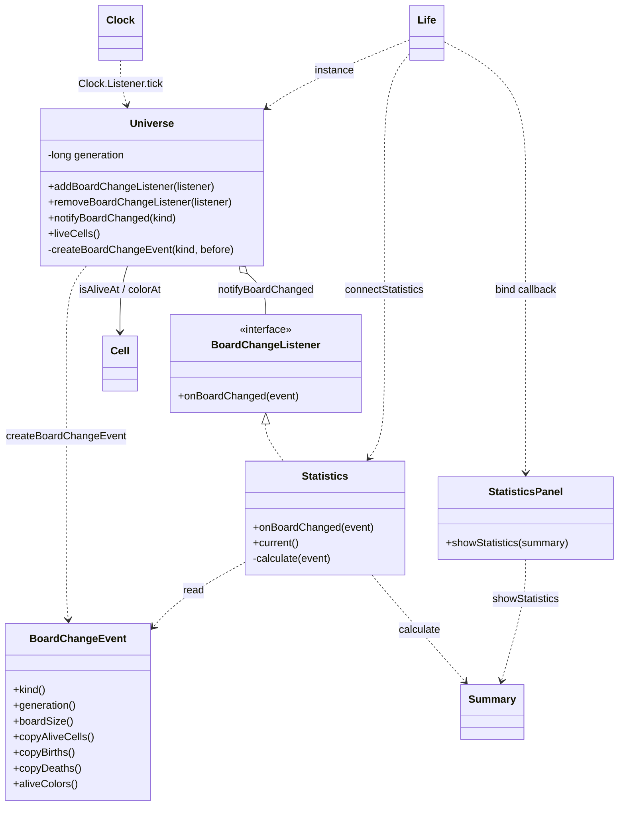
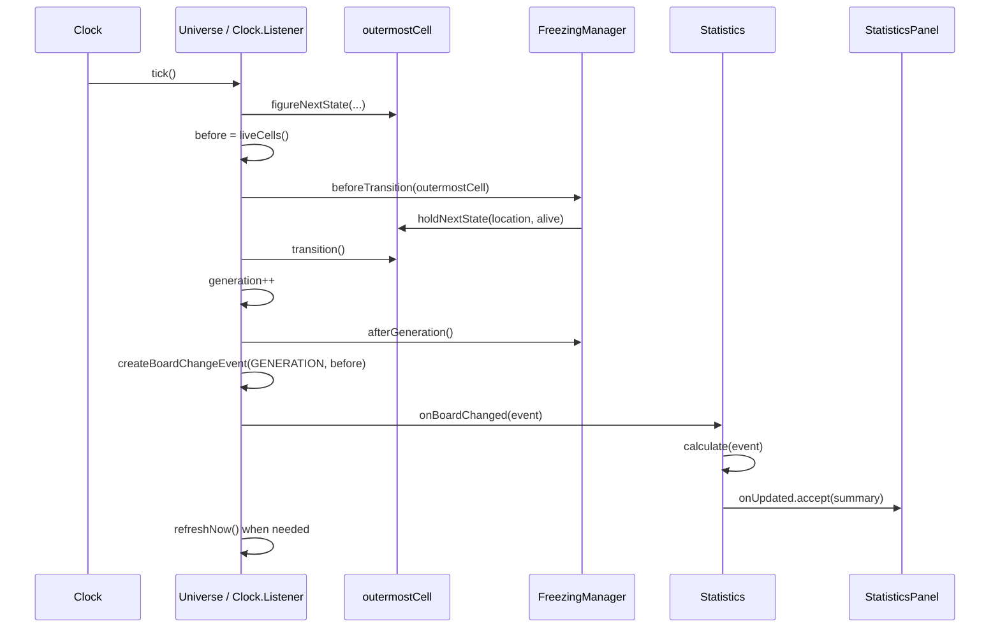

# 통계 기능 설계 및 구현

1. [기능 개요 및 명세](#overview)
2. [기존 코드에서 변경된 부분](#changes)
3. [구조와 동작](#structure)
4. [설계 패턴과 설계 결정](#decisions)
5. [테스트](#tests)

<a id="overview"></a>
## 1. 기능 개요 및 명세

### 1.1 기능의 목적과 제공하는 통계

기존 Life Game은 셀의 생존 상태를 게임판에 그리지만, 현재 세대나 생존 규모, 한 세대 동안 일어난 변화량을 수치로 보여주지 않는다. 통계 기능은 게임판의 작업이 끝난 상태를 받아 **현재 세대, 생존 셀 수·비율, 이번 세대 탄생·사망 수, 색상별 생존 셀 수·비율**을 오른쪽 통계 탭에 표시한다.

사용자가 별도의 조회 버튼을 누를 필요 없이 세대 진행·편집·복원·색상 정책 변경 후 결과가 갱신된다. 계산과 화면 표시를 각각 `Statistics`와 `StatisticsPanel`로 분리하고, `Universe`의 완료 이벤트를 구독하도록 구성했다.

### 1.2 통계 항목별 계산 및 표시 규칙

**한 세대 진행**은 현재 게임판을 기준으로 각 셀의 다음 생존 상태를 계산하고, 그 결과를 게임판에 반영하는 과정이다. 초기 판을 0세대로 보고 이 과정이 완료될 때마다 세대 번호를 1씩 늘린다. 셀을 직접 편집하거나 템플릿을 배치하는 동작은 세대 진행이 아니므로 번호를 늘리지 않는다. 판을 지우거나 파일에서 불러오면 번호를 0으로 되돌린다.

**생존 배열**은 게임판의 각 칸이 살아 있는지를 행·열 순서로 기록한 2차원 배열이다. 살아 있는 칸은 `true`, 죽은 칸은 `false`로 표현한다. **탄생·사망**은 한 세대 진행 전후에 각각 죽음→생존, 생존→죽음으로 바뀐 셀을 뜻한다. 편집으로 추가·삭제한 셀 수와는 구분한다.

| 항목 | 계산 기준 | 표시 규칙 |
| --- | --- | --- |
| 현재 세대 | 마지막 초기화·불러오기 이후 완료된 세대 진행 횟수 | 초기값 0. 셀 배치가 그대로여도 정상 세대가 진행되면 1 증가한다. |
| 생존 셀 수 | 완료된 게임판에서 살아 있는 칸 수 | 프리즈로 고정된 생존 셀도 포함한다. |
| 생존 비율 | 생존 수 ÷ 전체 칸 수 × 100 | 전체 칸 수는 판 한 변의 셀 수의 제곱이다. 소수 둘째 자리까지 표시한다. |
| 세대 탄생·사망 | 직전 한 세대의 전후 상태를 비교한 변화 수 | 측정된 변화가 없으면 `0`, 초기 상태 표시·편집·복원 후에는 `—`로 표시한다. |
| 색상별 셀 수 | 살아 있는 셀의 표시 색을 같은 색 값끼리 묶은 개수 | 현재 존재하는 색만 표시한다. 기본 색은 빨강 → 파랑 → 초록 순서를 유지한다. |
| 색상별 비율 | 해당 색의 생존 수 ÷ 전체 생존 수 × 100 | 소수 둘째 자리까지 표시한다. 빈 판에서는 색상 행 대신 생존 셀이 없다는 안내를 표시한다. |

예를 들어 4×4 판에 빨강 2개·파랑 1개·초록 1개가 살아 있으면, 생존 비율은 `4/16 = 25%`이고 색상별 비율은 `2/4 = 50%`, `1/4 = 25%`, `1/4 = 25%`다. **전체 생존 비율과 색상별 비율은 분모가 다르다.** 각 색 비율을 반올림하여 표시하므로 화면상 합계는 99.99%처럼 100%와 조금 다를 수 있다.

### 1.3 갱신 시점과 예외 상황

통계는 작업이 끝난 시점의 정보를 받아 갱신한다. 이를 위해 새로 정의한 `BoardChangeEvent`는 **현재 판의 상태와 어떤 작업 때문에 정보를 전달하는지를 담는 객체**다. 여기서 이벤트의 발행은 등록된 수신자의 메서드를 호출해 이 객체를 전달한다는 뜻이다. 구독은 이러한 알림을 받을 수신자를 Universe에 등록하는 과정이다.

완료 작업의 종류는 `BoardChangeEvent.Kind`로 구분한다. Statistics는 이 종류에 따라 현재 상태를 집계하고 세대 변화량의 표시 여부를 결정한다.

```java
public enum Kind {
    INITIAL, GENERATION, EDIT, TEMPLATE, TEMPLATE_UNDO, CLEAR, LOAD, COLOR_POLICY_CHANGED
}
```

| 작업 | 전달 이유를 나타내는 종류·세대 번호 | 통계 반영 |
| --- | --- | --- |
| 통계 연결 | 초기 상태 전달(`INITIAL`), 현재 번호 | 새 구독자에게만 현재 판을 즉시 전달한다. 탄생·사망은 `—`로 표시한다. |
| 세대 진행 | 자동 진행·Single Step의 세대 진행 완료(`GENERATION`), 번호 1 증가 | 완료 상태와 해당 세대의 탄생·사망을 집계한다. 안정된 판·빈 판도 정상 세대가 진행되면 갱신한다. |
| 직접 편집 | 클릭·일반 드래그의 직접 편집 완료(`EDIT`), 번호 유지 | 생존 수·색상 분포를 갱신하고 세대 변화량은 `—`로 바꾼다. |
| 템플릿·Undo | 배치 완료(`TEMPLATE`)·배치 취소 완료(`TEMPLATE_UNDO`), 번호 유지 | 배치·복원 결과를 집계한다. 편집으로 바뀐 셀 수를 세대 탄생·사망에 섞지 않는다. |
| Clear·Load | 성공 시 판 지우기 완료(`CLEAR`)·불러오기 완료(`LOAD`), 번호 0 | 초기화·복원된 판을 집계하고 세대 변화량을 지운다. |
| 색상 정책 | 표시 색 규칙 교체 완료(`COLOR_POLICY_CHANGED`), 번호 유지 | 색상 분포를 갱신한다. 같은 세대의 직전 집계 결과가 있으면 탄생·사망 표시 상태를 유지한다. |
| 프리즈 진행 | 고정 처리까지 반영된 세대 진행 완료(`GENERATION`) | 실제 생존 상태와 표시 색을 집계한다. 고정되어 생사가 유지된 셀은 탄생·사망 목록에 들어가지 않는다. |
| 무변경 작업 | 이벤트 없음 | 캡처·프리즈 영역 선택, 프리즈 설치·수동 해제 자체, 무변경·차단된 편집, Load 취소·읽기 실패, Store는 기존 통계를 유지한다. |

**템플릿 배치 후에는 다음 세대를 기다리지 않고 통계를 갱신한다.** 드래그 중에는 매 배치마다 알리지 않고, 마우스를 놓아 한 번의 배치를 끝낼 때 완료 이벤트를 한 번 전달한다. 예를 들어 빈 판에 생존 셀 5개가 생기도록 배치를 끝내면, 정지 상태에서도 생존 수는 즉시 5가 되고 색상별 개수·비율도 갱신된다. 세대 번호는 그대로이며 탄생·사망은 `—`로 표시한다. 이후 한 세대를 진행하면 배치된 판을 기준으로 그 세대의 탄생·사망을 계산한다.

**INITIAL은 게임판을 초기화하라는 명령이 아니다.** 예를 들어 12세대에 리스너를 등록하면 세대 번호 12와 그때의 판을 INITIAL로 전달한다. 현재 상태를 처음 보여주기 위한 알림이므로 이전 세대의 탄생·사망은 포함하지 않는다. 실제 판을 지우는 Clear와 역할이 다르다.

패턴 편집 또는 프리즈 영역 선택 중에는 기존 게임 처리에 따라 세대 진행을 차단한다. 통계 탭이 숨겨져 있어도 구독은 유지하므로 다시 열면 최신 결과를 볼 수 있다.

<a id="use-cases"></a>
### 1.4 유스케이스와 기능 요구사항

회색은 원본 Life Game의 주요 기능, 파란색은 통계 확장 기능이다. 이 그림은 기존 기능과 통계의 관계를 보여주며, 다른 팀원의 확장 유스케이스는 팀 전체 다이어그램에서 함께 표현한다.


[다이어그램 PNG](diagrams/statistics-use-cases.png)

| 구분 | 유스케이스 | 사용자 관점의 요구사항 |
| --- | --- | --- |
| 기존 | 셀 편집, 세대 진행, 실행 정지 | 배치를 편집하고 자동 또는 단일 세대 진행을 제어한다. |
| 기존 | 게임판 초기화, 저장, 불러오기 | 판을 지우거나 파일에 보관·복원한다. |
| 확장 | 기본 통계 확인 E | 현재 세대·생존 수·전체 판 대비 비율·해당 세대 탄생과 사망 수를 확인한다. |
| 확장 | 색상별 생존 분포 확인 E | 표시 색별 생존 수·전체 생존 셀 대비 비율과 빈 판 안내를 확인한다. |

실선은 사용자의 기능 참여를 의미하며 실행 순서를 나타내지 않는다. 두 통계 유스케이스는 같은 탭에서 함께 제공된다. 내부의 자동 갱신 흐름은 3장의 시퀀스 다이어그램으로 설명한다.

<a id="changes"></a>
## 2. 기존 코드에서 변경된 부분

통계 기능은 기존 게임판 처리에 완료 알림을 연결하고, 수집한 상태의 집계와 화면 표시를 별도 클래스로 추가했다. 아래에서 **원본**은 기능 확장 전 Holub 코드를 뜻한다. 다른 팀 기능에서 추가한 메서드를 사용하는 경우에는 해당 절에서 출처와 재사용 범위를 밝힌다.

### 2.1 Universe: 작업 완료 상태 수집과 통계 알림

원본 Universe는 게임판을 진행하고 화면을 갱신했지만, 통계를 위한 세대 번호와 작업 완료 알림은 제공하지 않았다. 통계 기능에서는 **완료 상태를 이벤트로 구성하고 구독자에게 전달하는 경로**를 추가했다. 핵심은 이벤트를 만드는 `createBoardChangeEvent()`와 이를 발행하는 `notifyBoardChanged()`다.

**세대 번호와 알림 시점 추가**

게임판 전체의 세대 번호를 저장하는 `long generation` 필드를 추가하고, 정상 전이가 끝날 때 1씩 증가시키도록 했다. 아래는 현재 tick에서 세대 번호를 증가시키고 완료 알림을 보내는 부분이다. 프리즈 후처리는 알림이 기존 작업을 모두 마친 뒤 발생한다는 순서만 나타낸다.

```java
generation++;
freezing.afterGeneration();
notifyBoardChanged(BoardChangeEvent.Kind.GENERATION, before);
```

색상 기능에서 이미 정상 세대마다 전이하도록 바꾼 흐름을 활용하므로, 생존 배치가 같아도 세대 번호와 통계는 갱신된다. 통계 알림도 `transition()`의 변화 여부 반환값으로 제한하지 않는다. Clear·Load 성공 시에는 generation을 0으로 되돌린다.

전이 전 배열인 `before`는 사운드 기능의 `before = liveCells()` 방식을 재사용하며, 통합 시 매 정상 세대 확보하도록 연결했다. `liveCells()`와 그 안에서 사용하는 `Cell.isAliveAt()` 역시 사운드에서 추가한 메서드다. 통계는 이 조회 경로를 이용해 완료 시점의 상태도 수집한다.

**notifyBoardChanged(): 완료 이벤트를 구독자에게 전달**

<a id="integration"></a>
기존 사운드 전용 `GenerationListener`·`publishChanges()` 경로를 공통 BoardChangeListener 구독으로 통합했다. Universe는 통계나 사운드의 구체 클래스를 호출하지 않고, 등록된 리스너에 동일한 BoardChangeEvent를 전달한다.

```java
private void notifyBoardChanged(BoardChangeEvent.Kind kind, boolean[][] before) {
    requireEventDispatchThread();
    Objects.requireNonNull(kind, "kind");
    if (boardListeners.isEmpty()) return;

    BoardChangeEvent event = createBoardChangeEvent(kind, before);
    for (BoardChangeListener listener : boardListeners.toArray(new BoardChangeListener[0])) {
        listener.onBoardChanged(event);
    }
}
```

`boardListeners`는 추가한 리스너 집합이다. 알릴 대상이 있으면 이벤트를 한 번 구성하고 모든 구독자에게 전달한다. 전달 중 등록·해제에 영향을 받지 않도록 리스너 목록의 복사본을 순회한다. 구독 관리와 외부 작업의 완료 연결을 위해 다음 메서드를 추가했다.

| 메서드 | 입력·처리·결과 |
|---|---|
| `addBoardChangeListener()` | 리스너를 집합에 등록하고 새 구독자에게만 현재 상태의 INITIAL을 즉시 전달한다. 중복 등록이면 다시 전달하지 않는다. 게임을 진행하기 전에도 통계 화면을 채울 수 있다. |
| `removeBoardChangeListener()` | 전달받은 리스너를 집합에서 제거하여 이후 발행에서 제외한다. 이미 없는 리스너를 해제해도 문제없다. Life의 창 해제 처리에서 사용한다. |
| `notifyBoardChanged(kind)` | 편집·복원 등 이전 상태가 필요 없는 작업의 완료를 알리는 공개 메서드다. 비공개형에 before=null을 전달한다. 판을 변경하거나 세대를 진행시키는 명령은 아니며, 실제 전이 전 배열이 필요한 GENERATION은 거부한다. |
| `notifyBoardChanged(kind, before)` | 세대 진행에서는 실제 전이 전 배열을 받는 비공개 발행 경로다. 이벤트 구성 후 각 리스너의 onBoardChanged를 호출하며, 공개형도 내부적으로 이 경로를 사용한다. |

등록·해제·발행은 `requireEventDispatchThread()`로 EDT 실행 여부를 검사한다. 상태 수집부터 화면 갱신까지 같은 실행 흐름에서 처리하는 이유는 4.4절에서 설명한다.

**createBoardChangeEvent(): 완료 상태와 통계 입력 구성**

이 메서드는 **작업 후 생존 배열인 after를 수집하고**, 종류·세대 번호·판 크기·탄생 및 사망 좌표·생존 셀의 색을 BoardChangeEvent에 담도록 추가했다. after는 notifyBoardChanged 본문이 아니라, 그 안에서 호출하는 createBoardChangeEvent에서 만든다.

기존 사운드의 publishChanges는 전이 후 각 셀을 isAliveAt으로 직접 조회하며 before와 비교했다. 별도의 after 배열은 없었고 탄생·사망 좌표만 전달했다. 통계는 현재 생존 수와 색상 분포도 필요하므로, **완료 판을 배열로 확보해 비교와 이벤트 전달에 함께 사용**하도록 변경했다.

```java
private BoardChangeEvent createBoardChangeEvent(BoardChangeEvent.Kind kind, boolean[][] before) {
    boolean[][] after = liveCells();
    List<Point> births = new ArrayList<>();
    List<Point> deaths = new ArrayList<>();
    List<Color> aliveColors = new ArrayList<>();
    for (int row = 0; row < after.length; row++) {
        for (int column = 0; column < after.length; column++) {
            if (after[row][column]) aliveColors.add(outermostCell.colorAt(row, column));
            if (kind == BoardChangeEvent.Kind.GENERATION) {
                if (after[row][column] && !before[row][column]) births.add(new Point(column, row));
                else if (!after[row][column] && before[row][column]) deaths.add(new Point(column, row));
            }
        }
    }
    return new BoardChangeEvent(kind, generation, after.length, after,
            births, deaths, aliveColors);
}
```

`liveCells()`가 완료 상태를 담은 새 배열을 반환하고 after가 이를 보관한다. GENERATION이면 before와 after의 같은 위치를 비교해 탄생·사망 좌표를 만든다. 배열은 `[행][열]`, Point는 `(열, 행)` 순서다. 비세대 작업은 전후 비교를 하지 않으므로 before가 없어도 되고 변화 좌표 목록은 비어 있다.

현재 살아 있는 위치에서는 `colorAt()`으로 표시 색을 읽어 `aliveColors`에 하나씩 담는다. 색 조회의 추가는 2.2절에서 설명한다. **이벤트에는 after와 비교 결과를 전달하고 before는 전달하지 않는다.** Statistics는 이 입력으로 생존 수·비율·변화량·색별 분포를 집계한다. createBoardChangeEvent는 데이터를 구성하고, 구독자 호출은 notifyBoardChanged가 담당한다.

**편집·복원에도 같은 완료 알림 연결**

세대 진행 외에도 기존 작업이 끝난 지점에서 공개 notifyBoardChanged를 호출하도록 연결했다. 클릭·일반 드래그는 실제 변경이 있을 때 EDIT를 발행하고, 템플릿의 기존 배치·Undo 완료 신호는 TEMPLATE·TEMPLATE_UNDO로 전달한다. Clear·Load는 초기화·복원이 성공한 뒤 알리며, 색상 정책 교체 후에는 COLOR_POLICY_CHANGED를 발행한다.

Load 취소·읽기 실패는 완료 이벤트를 보내지 않는다. Store는 판을 변경하지 않으므로 통계 알림을 추가하지 않았다. 이처럼 동일한 발행 경로를 사용하여 정지 중 편집·복원도 다음 세대를 기다리지 않고 통계에 반영한다. 작업별 표시 결과는 1.3절에 정리했다.

### 2.2 Cell 계층: 통계에 필요한 색상 조회 추가

**표시 색을 외부에서 조회하는 메서드 추가**

통계 추가 전에는 Resident가 화면을 그릴 때 표시 색을 구했지만, 외부에서 특정 위치의 색을 읽을 메서드는 없었다. 색상별 통계를 위해 Cell 계층에 `colorAt(row, column)`을 추가하고, 기존 색 결정 호출을 재사용하도록 구현했다.

```java
// 통계 추가 전: 기존 색상 기능이 redraw()에서 사용하던 코드
g.setColor(amAlive ? colorPolicy.colorOf(age) : DEAD_COLOR);

// 통계에서 추가한 Cell의 조회 계약
Color colorAt(int row, int column);

// 통계에서 추가한 Resident의 조회 구현
public Color colorAt(int row, int column) {
    assert row == 0 && column == 0;
    return amAlive ? colorPolicy.colorOf(age) : null;
}
```

기존 redraw의 색 지정은 유지한다. 새 colorAt도 같은 `colorPolicy.colorOf(age)`를 사용하므로, 통계가 읽는 색과 화면에 그리는 색이 일치한다. 정책과 나이 처리는 색상 기능의 구현을 재사용하고, 통계에서는 조회 계약과 각 Cell의 구현을 추가했다.

| 클래스 | 추가·변경한 메서드와 동작 |
|---|---|
| `Cell` | `colorAt(row, column)`을 선언했다. 해당 위치의 표시 색을 반환하며 죽은 셀은 null로 표현한다. Cell.DUMMY의 구현도 null을 반환한다. |
| `Neighborhood` | colorAt을 구현했다. 하위 셀 한 변의 크기로 행·열을 나눈 몫은 하위 셀 선택에, 나머지는 그 셀 내부의 좌표에 사용하여 조회를 위임한다. 좌표 변환은 기존 isAliveAt 방식을 활용한다. |
| `Resident` | colorAt을 구현했다. 단일 셀이므로 지역 좌표 (0,0)을 확인하고 생존 중이면 정책의 색을, 죽어 있으면 null을 반환한다. 조회 과정에서 나이·생존 상태를 변경하지 않는다. |

Universe는 2.1절의 이벤트 구성에서 **살아 있는 위치에만 colorAt을 호출**하고 결과를 `List<Color> aliveColors`에 담는다. 빨강·빨강·파랑인 세 셀이 있으면 색 목록도 세 항목이며, 색별 개수·비율은 Statistics에서 계산한다. 따라서 색 결정 규칙을 통계에 복제하거나 셀마다 별도 색 필드를 추가할 필요가 없다.

**색상 정책 교체 후 통계 갱신 연결**

기존 `Universe.useColorPolicy()`는 정책을 교체하고 게임판을 다시 그렸다. 여기에 COLOR_POLICY_CHANGED 알림을 추가하여, 게임이 정지해 있을 때 정책을 바꾸어도 통계가 현재 표시 색을 다시 집계하도록 했다.

```java
// 통계 연결 전
private void useColorPolicy(CellColorPolicy policy) {
    Resident.setColorPolicy(policy);
    repaint();
}

// 통계 연결 후
private void useColorPolicy(CellColorPolicy policy) {
    Resident.setColorPolicy(policy);
    notifyBoardChanged(BoardChangeEvent.Kind.COLOR_POLICY_CHANGED);
    repaint();
}
```

추가한 호출은 정책 교체 이후의 색을 이벤트에 담도록 한다. 세대 번호를 늘리거나 게임판을 전이시키지는 않는다. 같은 세대의 탄생·사망 표시를 유지하는 처리는 2.5절의 Statistics가 담당한다.

<a id="panel"></a>
### 2.3 Life: 통계 연결과 탭 배치

원본 `Life`는 창 중앙에 Universe를 직접 붙였으며 통계를 생성하거나 연결하는 코드는 없었다. 통계 확장에서는 **패널 생성 → 탭 배치 → 집계 객체 연결**을 창 초기화에 추가했다. 기존 도구 화면과 함께 사용할 수 있도록 통계 패널을 공용 탭에 넣되, 통계의 생성과 구독은 Life에서 한 번 수행하도록 했다.

```java
// 원본 창 구성 중 게임판을 붙이는 부분
getContentPane().setLayout(new BorderLayout());
getContentPane().add(Universe.instance(), BorderLayout.CENTER);

// 현재 창 구성 중 통계 생성·배치·연결 부분
universe = Universe.instance();
StatisticsPanel statisticsPanel = new StatisticsPanel();
JTabbedPane tabs = createSidebar(universe, statisticsPanel);
setContentPane(createContent(universe, tabs));
statistics = connectStatistics(universe, statisticsPanel);
```

새 `createSidebar()`에서 `tabs.addTab("통계", statisticsPanel)`로 패널을 추가하고, `createContent()`에서 게임판 오른쪽에 탭을 배치한다. 실제 통계 구독은 새로 추가한 `connectStatistics()`에서 수행한다.

```java
Statistics statistics = new Statistics(panel::showStatistics);
universe.addBoardChangeListener(statistics);
return statistics;
```

`panel::showStatistics`는 집계 결과가 준비되면 실행할 동작이다. Statistics는 이를 Java 표준 인터페이스인 `Consumer<Summary>`로 받아 저장하고, `accept(summary)`로 실행한다. 이때 `panel.showStatistics(summary)`가 호출된다. 따라서 Statistics가 패널 클래스를 직접 생성하거나 참조할 필요가 없다.

| 메서드 | 입력·처리·결과 |
|---|---|
| `createSidebar()` | Universe와 통계 패널을 받아 공용 JTabbedPane에 통계 탭을 추가한다. 다른 도구 패널은 기존 제공 메서드로 가져오고, 기존 탭 전환 처리와 함께 구성한다. |
| `createContent()` | Universe를 BorderLayout.CENTER에, 전달받은 탭을 EAST에 배치한다. 모든 탭을 추가한 뒤 필요한 너비를 계산하고 높이를 게임판에 맞춘다. 탭의 내용·선택·리스너는 유지한다. |
| `connectStatistics()` | 패널 표시 콜백과 연결한 Statistics를 생성해 Universe에 등록하고 반환한다. 등록 중 INITIAL이 전달되어 창을 열기 전에 최초 통계가 계산된다. |
| `dispose()` | 통계 리스너를 해제한 뒤 기존 JFrame의 창 해제 처리를 호출하도록 확장했다. 연결한 Statistics는 Life의 필드에 보관해 해제할 때 사용한다. |

Life는 연결한 Statistics를 필드에 보관해 창 해제 시 같은 객체를 구독에서 제거한다. 탭 전환은 구독과 분리되어 있으므로 통계 탭이 숨겨져 있어도 집계와 표시 값은 최신 상태로 유지된다.

### 2.4 BoardChangeListener·BoardChangeEvent: 공통 알림 계약 추가

통계가 게임판 완료 상태를 받을 수 있도록 **수신 인터페이스인 BoardChangeListener와 전달 객체인 BoardChangeEvent**를 새로 정의했다. 이 계약을 통해 Universe는 Statistics의 계산 메서드를 직접 알지 않아도 완료 상태를 전달할 수 있다. 현재는 사운드도 같은 계약을 구독한다.

```java
@FunctionalInterface
public interface BoardChangeListener {
    void onBoardChanged(BoardChangeEvent event);
}
```

Universe가 `onBoardChanged(event)`를 호출하면 Statistics가 전달된 데이터를 집계한다. BoardChangeEvent의 생성자는 작업 종류·세대 번호·판 크기·생존 배열·변화 좌표·색 목록을 받아 검사하고 보관한다. 전달 객체의 필드와 조회 메서드는 다음과 같다.

| 필드 | 담는 내용과 조회 방법 |
|---|---|
| `kind` | 작업 종류를 `kind()`로 읽는다. 종류별 의미와 표시 결과는 1.3절에 정의했다. |
| `generation` | 완료 시점의 게임판 세대 번호를 `generation()`으로 읽는다. 이벤트나 Statistics가 이 값을 독립적으로 증가시키지는 않는다. |
| `boardSize` | 판 한 변의 셀 수를 `boardSize()`로 읽는다. 기본 판은 64이며 전체 칸 수는 64×64다. 픽셀 크기가 아니다. |
| `aliveCells` | 완료 후 생존 배열을 `copyAliveCells()`로 받는다. 배열은 `[행][열]` 순서이며 Statistics가 생존 수를 세는 입력이다. |
| `births`·`deaths` | GENERATION의 탄생·사망 좌표를 `copyBirths()`·`copyDeaths()`로 받는다. Statistics는 각 목록의 크기로 이번 세대의 변화량을 구한다. 비세대 이벤트에서는 빈 목록이다. |
| `aliveColors` | `aliveColors()`로 생존 셀의 색 목록을 받는다. 같은 색도 셀 수만큼 반복되며, 좌표·나이나 색별 집계 결과는 포함하지 않는다. |

생성자는 판 크기와 배열 모양, 좌표 범위·중복, 이벤트 종류에 맞는 변화 목록, 생존 수와 색 목록 길이의 일치를 검사한다. 전달 데이터가 잘못된 상태로 집계에 사용되지 않도록 생성 시점에 검증한다.

배열과 좌표는 저장할 때 복사하며, `copyAliveCells()`·`copyBirths()`·`copyDeaths()`에서도 복사본을 반환한다. `aliveColors()`는 수정 불가능한 목록을 반환한다. 따라서 호출자가 조회 결과를 수정해도 이벤트가 보관한 완료 상태는 유지된다. 상세 조건과 복사 범위는 3.5절에 정리했다.

### 2.5 Statistics: 이벤트를 통계 결과로 변환

원본에는 생존 수·변화량·색상 분포를 계산해 전달하는 통계 객체가 없었다. 이를 위해 **이벤트를 입력으로 받아 Summary를 만드는 Statistics**를 추가했다. Universe가 전달한 완료 상태를 집계하고 결과 콜백을 호출하므로, 계산을 검증할 때 실제 게임판이나 Swing 화면을 생성할 필요가 없다.

BoardChangeListener를 구현한 수신 메서드는 다음과 같다.

```java
public void onBoardChanged(BoardChangeEvent event) {
    Objects.requireNonNull(event, "event");
    Summary summary = calculate(event);
    currentSummary = summary;
    onUpdated.accept(summary);
}
```

`calculate()`는 전달받은 배열에서 생존 셀을 세고, 세대 이벤트에 담긴 좌표 목록의 크기로 탄생·사망 수를 구한다. 기본 집계 부분은 다음과 같다.

```java
int livingCells = 0;
for (boolean[] row : event.copyAliveCells()) {
    for (boolean alive : row) if (alive) livingCells++;
}
double totalCells = (double) event.boardSize() * event.boardSize();
boolean hasGenerationDelta = event.kind() == BoardChangeEvent.Kind.GENERATION;
int births = hasGenerationDelta ? event.copyBirths().size() : 0;
int deaths = hasGenerationDelta ? event.copyDeaths().size() : 0;
```

생존 비율은 `livingCells * 100.0 / totalCells`로 계산해 결과에 담는다. 색 목록은 같은 색 값끼리 묶어 개수를 구하고, 전체 생존 수를 분모로 색별 비율을 계산한다. 실제 게임판 재조회나 전후 비교 없이 이벤트 하나에 담긴 완료 상태와 변화 좌표를 사용한다.

| 메서드·필드 | 입력·처리·결과 |
|---|---|
| `onBoardChanged()` | 받은 이벤트를 calculate에 전달하고, 반환된 Summary를 저장한 뒤 결과 콜백을 실행한다. 콜백에서 current를 조회해도 같은 최신 결과를 볼 수 있도록 저장을 먼저 한다. |
| `calculate()` | 이벤트의 생존 배열·판 크기·변화 좌표·색 목록을 읽어 기본 통계와 색상별 통계를 계산하고 Summary를 반환한다. 이벤트 종류에 따라 세대 변화량의 유효 여부도 정한다. |
| `currentSummary` | 가장 최근의 집계 결과 하나를 보관한다. 색상 정책만 바뀐 경우 직전 세대 변화량을 유지하는 데도 사용한다. 게임판 배열이나 Undo 이력을 보관하지 않는다. |
| `current()` | 최근 결과를 Optional로 반환한다. 첫 이벤트를 받기 전에는 비어 있다. 테스트나 결과 조회에서 패널을 거치지 않고 계산값을 확인할 수 있다. |
| `onUpdated` | 생성자로 받은 Consumer 콜백을 보관하는 필드다. Life는 패널의 showStatistics를 연결하고, 계산 테스트는 결과 수집 동작을 연결한다. `accept(summary)`가 준비된 집계 결과를 전달한다. |

계산 결과는 Statistics 내부의 `Summary`와 `ColorCount` record에 담는다. 별도 최상위 클래스 파일이 아니라 집계 결과를 구성하는 내부 타입이다.

| 결과 값 | 의미와 화면에서의 사용 |
|---|---|
| `generation` | 이벤트에서 받은 세대 번호다. 패널의 현재 세대에 표시한다. |
| `livingCells`·`livingRatio` | 현재 생존 수와 전체 칸 수 대비 백분율이다. livingRatio는 0~1 값이 아니라 0~100 값이다. |
| `births`·`deaths` | 이벤트 좌표 목록의 크기를 계산한 정수다. 이벤트에서는 위치 목록이지만 Summary에서는 표시할 개수다. |
| `hasGenerationDelta` | 탄생·사망을 유효한 세대 변화량으로 표시할지 나타낸다. true일 때 0은 측정된 변화량이고, false일 때 내부 값 0은 패널에서 `—`로 표시한다. |
| `colorCounts` | 색상별 ColorCount 목록이다. 각 항목의 `color`는 색, `cells`는 그 색의 생존 수, `ratio`는 전체 생존 수 대비 백분율이다. |

예를 들어 이벤트의 색 목록이 `[빨강, 빨강, 파랑]`이면 결과에는 빨강 2개·약 66.67%, 파랑 1개·약 33.33%를 담는다. **BoardChangeEvent는 완료 상태를, Summary는 그 상태를 집계한 결과를 전달한다.**

같은 세대의 COLOR_POLICY_CHANGED는 새 생사 변화가 아니므로, 기존 currentSummary가 있으면 탄생·사망 수와 hasGenerationDelta를 유지하고 색상 결과를 다시 계산한다. 기존 결과가 없거나 세대 번호가 다르면 이 보존 규칙을 적용하지 않는다. 색상 빈도를 계산하는 코드는 3.4절에서 설명한다.

### 2.6 StatisticsPanel: 계산 결과를 통계 화면에 표시

원본 화면에는 통계를 수치로 표시하는 영역이 없었다. 이를 위해 **Summary의 값을 통계 탭에 표시하는 StatisticsPanel**을 추가했다. 기본 통계 레이블과 색상별 행을 만들고, 갱신 시에는 계산이 끝난 값을 받아 표시 형식만 적용한다.

화면 갱신의 진입점인 `showStatistics()`는 다음과 같다.

```java
public void showStatistics(Statistics.Summary summary) {
    requireEventDispatchThread();
    Objects.requireNonNull(summary, "summary");
    generation.setText(Long.toString(summary.generation()));
    livingCells.setText(Integer.toString(summary.livingCells()));
    livingRatio.setText(formatPercentage(summary.livingRatio()));
    births.setText(summary.hasGenerationDelta()
            ? Integer.toString(summary.births()) : UNAVAILABLE);
    deaths.setText(summary.hasGenerationDelta()
            ? Integer.toString(summary.deaths()) : UNAVAILABLE);
    showColors(summary);
}
```

탄생·사망은 숫자가 0인지보다 **유효한 세대 변화량인지**를 먼저 확인한다. 측정된 변화가 없으면 0으로 표시하고, 비교할 수 없는 결과는 UNAVAILABLE에 저장한 `—`로 표시한다. 패널이 보드나 이벤트를 다시 읽지 않고 Summary만으로 표시를 결정하도록 구현했다.

| 메서드 | 입력·처리·결과 |
|---|---|
| `showStatistics()` | Summary를 받아 세대·생존 수·생존 비율을 표시하고, 탄생·사망은 유효 여부에 따라 숫자 또는 `—`로 바꾼다. 마지막으로 showColors를 호출한다. |
| `showColors()` | 이전 색상 행을 지우고 ColorCount 목록으로 색 견본·이름·개수·비율을 구성한다. 빈 목록이면 생존 셀이 없다는 안내로 바꾸며, 행 구성이 끝나면 레이아웃과 화면을 갱신한다. |
| `colorOrder()`·`colorName()` | 기본 색을 빨강→파랑→초록 순서와 한글 이름으로 표시한다. 그 밖의 색은 색상값 순서로 뒤에 놓고 16진수 색상값을 이름으로 사용한다. 실제 셀의 색을 결정하는 메서드는 아니다. |
| `formatPercentage()` | 이미 백분율인 값을 소수 둘째 자리의 문자열로 만든다. Locale.ROOT를 사용하여 실행 환경에 관계없이 같은 숫자 형식을 유지한다. |
| `statisticRow()` | 항목 이름·값 컴포넌트를 받아 좌우로 배치하고 행 높이와 정렬을 맞춘다. 기본 통계와 색상 행에 같은 배치 규칙을 사용한다. |

생성자는 세로 BoxLayout 안에 기본 통계·세대 변화량·색상 분포 영역을 구성한다. `statisticRow()`와 공통 간격·글꼴 상수로 기본 통계와 색상 행의 형식을 맞추고, 구분선으로 영역을 나눴다. 색상 목록은 세 행 높이의 스크롤 영역으로 구성해 색이 늘어도 패널 전체 높이가 계속 커지지 않도록 했다.

공용 탭에 넣을 수 있도록 선호 크기를 258×512로 정하고 최종 배치는 Life에 맡겼다. 생성자와 showStatistics는 EDT 실행 여부를 검사하여 Swing 컴포넌트의 생성·갱신 조건을 유지한다.

<a id="structure"></a>
## 3. 구조와 동작

`Universe`가 Subject이며, `Statistics`는 `BoardChangeListener`를 구현해 완료 이벤트를 받는다. 이벤트 객체는 데이터를 전달하고, Statistics가 집계하며, StatisticsPanel이 결과를 표시한다.

아래 표와 다이어그램은 **통계 기능의 구현과 연결에 필요한 범위**를 보여준다. Life·Clock·Cell 등 기존 클래스도 연결 관계를 설명하기 위해 포함한다. 다른 Observer와의 공통 이벤트 연결은 [기존 기능과의 통합](#integration)에서 설명한다.

### 클래스와 주요 메서드

| 클래스 | 책임과 주요 메서드 |
| --- | --- |
| [BoardChangeListener](../../src/com/holub/life/BoardChangeListener.java) | `onBoardChanged(event)`로 완료 상태를 수신하는 공통 인터페이스. |
| [BoardChangeEvent](../../src/com/holub/life/BoardChangeEvent.java) | 작업 종류·세대·판 크기·생존 배열·탄생/사망 좌표·생존 셀 색을 보관한다. 배열·좌표는 방어적 복사로 보호한다. |
| [Universe](../../src/com/holub/life/Universe.java) | `addBoardChangeListener()`·`removeBoardChangeListener()`로 구독 관리. `liveCells()`로 상태 수집, `createBoardChangeEvent(kind, before)`로 이벤트 구성, `notifyBoardChanged()`로 발행한다. 기존 익명 `Clock.Listener.tick()` 안에서 세대를 진행한다. |
| [Statistics](../../src/com/holub/life/Statistics.java) | `onBoardChanged()` → `calculate()`로 집계하고 콜백에 결과를 전달한다. `current()`는 최근 결과를 `Optional<Summary>`로 반환한다. 이전 게임판은 보관하지 않는다. |
| `Statistics.Summary`·`Statistics.ColorCount` | Statistics 안의 record. Summary는 기본 통계와 `List<ColorCount>`를, ColorCount는 색·개수·백분율을 담는다. 결과 목록은 수정할 수 없다. |
| [StatisticsPanel](../../src/com/holub/life/StatisticsPanel.java) | `showStatistics(summary)`로 값·색상 행을 표시한다. 게임판 조회, 이벤트 구독, 통계 계산을 하지 않는다. |
| [Life](../../src/com/holub/life/Life.java) | `createSidebar()`로 공용 탭, `createContent()`로 창 배치를 구성한다. `connectStatistics()`에서 계산과 화면을 연결하고, `dispose()`에서 통계 구독을 해제한다. |
| [Clock](../../src/com/holub/life/Clock.java)·[Cell](../../src/com/holub/life/Cell.java) 계층 | Clock은 Swing Timer로 진행 시점을 알린다. Cell의 `isAliveAt(row, column)`·`colorAt(row, column)`으로 생존·색을 조회한다. |

`new Statistics(panel::showStatistics)`의 콜백 타입은 **JDK의 `java.util.function.Consumer<Summary>`**다. 별도로 만든 인터페이스가 아니며, Statistics는 구체적인 StatisticsPanel 타입에 의존하지 않는다.

### 클래스 다이어그램



Clock의 화살표는 Universe 안에서 등록한 익명 `Clock.Listener`를 간략히 표시한 것이다. Universe가 Clock.Listener를 직접 구현하는 구조는 아니다. `Summary`는 `Statistics.Summary`를 가리킨다.

### 세대 진행 시퀀스

아래는 패턴 편집·프리즈 영역 선택이 끝나고, 활성 프리즈 영역이 있는 상태에서 한 세대를 진행하는 경로다. 보드 진행·이벤트 전달·통계 화면 갱신은 EDT에서 순서대로 실행된다. 프리즈 내부의 영역·State 객체 위임과 다른 Observer의 수신 흐름은 생략했다.



<a id="decisions"></a>
## 4. 설계 패턴과 설계 결정

통계 기능을 구현하고 팀 기능과 통합하면서 검토한 대안을 정리한다. 코드의 의존 관계·상태 관리·통합 범위를 기준으로 장단점을 비교하고 현재 구조를 선택한 이유를 설명한다.

### 공통 Observer 인터페이스와 이벤트

통계와 사운드는 같은 게임판의 완료 상태를 사용하지만, 통합 전에는 GenerationListener와 BoardChangeListener로 구독 경로가 나뉘어 있었다. 두 기능에 상태를 어떻게 전달할지 다음 방식을 비교했다.

| 대안 | 장점 | 단점 |
| --- | --- | --- |
| Universe에서 통계·사운드의 구체 메서드를 직접 호출 | 호출 대상과 순서가 코드에 드러나고 연결이 단순하다. | Universe가 각 기능의 타입과 호출 방법을 알아야 한다. 수신 기능을 추가하거나 제거할 때 발행부도 수정해야 한다. |
| 기능별 리스너와 이벤트 유지 | 각 기능에 맞는 입력을 정의할 수 있고, 기존 구독 코드를 그대로 사용할 수 있다. | 등록·해제·발행 경로를 각각 관리해야 한다. 상태 수집 시점과 이벤트 의미를 두 경로에서 계속 맞춰야 한다. |
| BoardChangeListener와 BoardChangeEvent로 통일 | 한 번 구성한 완료 이벤트를 함께 사용한다. Universe는 수신 기능의 구체 타입 대신 공통 인터페이스에 알린다. | 수신자가 사용하지 않는 데이터도 이벤트에 포함된다. 공통 이벤트의 형식이 바뀌면 생성 코드와 관련 테스트를 함께 확인해야 한다. |

**공통 인터페이스와 이벤트를 선택했다.** 두 기능 모두 현재 생존 상태와 세대 변화 정보를 사용하므로 완료 시점을 공유하는 편이 적합했다. Universe는 `notifyBoardChanged()`에서 같은 이벤트를 전달하고, Statistics는 통계를 집계한다. SoundEffects는 모든 이벤트로 재생선용 상태를 갱신하되, 효과음은 GENERATION의 탄생·사망이 있을 때만 처리한다. 각 기능이 이벤트 종류와 필요한 데이터를 선택하며 기존 음 생성 로직은 유지한다.

### 탄생·사망 비교의 위치와 자료구조

최초 통계 구현은 현재 BitSet을 받은 뒤 Statistics가 이전 판을 저장해 비교했다. 사운드와 통합할 때는 사운드 발행부에서도 같은 세대의 탄생·사망 좌표를 계산하고 있었다.

| 대안 | 장점 | 단점 |
| --- | --- | --- |
| Statistics가 이전 판을 보관하고 직접 비교 | 통계가 비교 기준을 자체 관리하며, 발행자는 현재 상태만 전달할 수 있다. | 이전 상태의 초기화·편집·복원·연속 세대 여부를 관리해야 한다. 사운드와 비교 계산이 중복되고, 이전 판 없이 첫 세대 이벤트만 받으면 변화량을 알 수 없다. |
| Universe에서 세대 전후를 비교해 결과 공유 | 실제 전이 직전·직후를 기준으로 한 번 비교한다. 통계와 사운드가 같은 탄생·사망 좌표를 사용한다. | Universe가 현재 상태뿐 아니라 변화 좌표까지 구성한다. 비세대 편집과 세대 변화의 입력 계약을 구분해야 한다. |

**Universe의 `createBoardChangeEvent()`에서 계산한 좌표를 공유하도록 선택했다.** Statistics에서는 이전 판 비교를 제거하고, 생존 수·비율·색상 분포와 전달받은 변화 목록의 크기를 집계한다. 첫 GENERATION에도 해당 세대의 변화 목록이 있으므로 이전 이벤트 수신 여부에 의존하지 않는다. 공개 편집 알림으로 GENERATION을 발행할 수 없도록 하여 전이 전 상태 없이 변화량을 만드는 것을 막는다.

자료구조도 기존 사운드 구현의 **현재 판 `boolean[][]`와 변화 좌표 `List<Point>`**에 맞췄다. BitSet은 비트 연산으로 상태 차이를 계산할 수 있지만, 당시 사운드에서 쓰던 배열·좌표 목록과 변환하거나 중복 관리해야 했다. 현재 구조는 그 변환을 줄이고 기존 음 생성 입력을 유지한다. 대신 배열과 가변 Point가 외부에서 수정되지 않도록 이벤트 생성·조회 시 방어적 복사를 하며, 복사에 따른 비용은 남는다.

### Swing Timer와 EDT

통계는 세대 진행이 끝난 보드를 읽고 화면에 표시한다. 보드를 읽는 도중 클릭이나 다른 세대 진행이 끼어들지 않도록 실행 경계를 정할 필요가 있었다.

| 대안 | 장점 | 단점 |
| --- | --- | --- |
| 별도 타이머 스레드에서 진행하고 동기화 | 세대 계산을 UI 스레드와 분리할 수 있다. | 세대 진행뿐 아니라 클릭·템플릿·복원·상태 수집에도 같은 동기화 기준이 필요하다. Swing 화면 갱신은 다시 EDT로 전달해야 한다. |
| Swing Timer로 진행하고 보드 작업을 EDT에서 처리 | UI 입력과 세대 진행이 같은 스레드에서 처리되어 변경·수집·알림·화면 갱신 순서를 유지하기 쉽다. | 집계와 리스너 처리가 길어지면 화면 응답과 다음 tick 처리가 늦어진다. 정확한 실시간 주기를 보장하는 방법은 아니다. |

**현재 보드 크기와 Swing UI 구조에서는 EDT로 통일하는 방식을 선택했다.** 초기 통계 구현에서 Swing Timer를 적용했고, dev 병합 시에는 dev에도 Swing Timer가 적용되어 있어 그 구현을 유지했다. Universe의 구독·상태 발행과 StatisticsPanel의 갱신도 EDT에서 수행한다.

사운드의 예약 실행기는 별도 스레드에 남겨 두되 실제 보드를 직접 읽는 대신 완료 이벤트에서 복사한 배열을 사용한다. 이 선택은 모든 스레드를 EDT가 자동으로 정렬한다는 의미가 아니다. 현재 보드 변경 경로를 EDT로 모은 것이며, 추후 무거운 처리를 추가하면 작업 분리와 스냅샷 전달을 다시 검토해야 한다.

### 세대 진행 메서드 추출과 기존 tick 유지

통계 브랜치에서는 `advanceOneGeneration()`으로 세대 진행을 분리했지만, 병합 대상 dev는 익명 `Clock.Listener.tick()` 안에서 색상·패턴·사운드를 함께 처리하고 있었다.

| 대안 | 장점 | 단점 |
| --- | --- | --- |
| advanceOneGeneration()으로 본문 추출 | 세대 진행에 이름을 붙이고 Clock 콜백을 짧게 만들 수 있다. 세대 진행 코드를 한 메서드에서 확인할 수 있다. | 통합 시 기존 기능의 처리 본문을 이동하고 팀원의 문서·테스트가 참조하는 위치를 맞춰야 한다. 메서드 추출만으로 Universe의 책임이 줄어드는 것은 아니다. |
| dev의 tick 본문 유지 | 팀 기능의 기존 처리 위치를 유지하면서 통계 연결을 추가할 수 있다. 통합 변경 범위가 작다. | 여러 기능의 조정 코드가 tick 안에 남고, 기능이 늘면 본문이 길어질 수 있다. |

**이번 통합에서는 기존 tick을 유지하고 `advanceOneGeneration()`을 제거했다.** 기존 편집 차단·매 세대 transition·색상 화면 갱신을 보존하면서 세대 번호와 완료 알림을 연결하는 것이 우선이었다. 이후 프리즈 담당자도 같은 경로에 고정 처리를 추가했고, 통계는 그 처리가 끝난 결과를 받는다. 당시 통합 범위와 팀 코드의 변경 부담을 기준으로 결정했으며, 세대 진행 메서드 추출은 이후 별도의 구조 개선으로 검토할 수 있다.

### 색상 정보 전달과 집계 책임

색상별 통계에는 살아 있는 셀의 표시 색이 필요하다. 색상 결정은 기존 CellColorPolicy가 담당하므로 통계에서 같은 규칙을 다시 작성하지 않도록 했다.

| 대안 | 장점 | 단점 |
| --- | --- | --- |
| Statistics가 셀의 나이·정책을 직접 조회 | 이벤트에 색 목록을 추가하지 않아도 된다. | Statistics가 셀 계층과 현재 정책의 조회 방법을 알아야 한다. 이벤트 수신 후 실제 보드를 다시 읽는 경우 완료 이벤트와 조회 시점을 맞춰야 한다. |
| 이벤트에 `List<Color>`로 표시 색 전달 | Statistics는 완료 시점의 색 값만 집계한다. 기존 정책을 바꾸어도 같은 조회 계약을 사용할 수 있다. | 이벤트마다 색 목록을 구성하고 보호해야 하며, 색을 사용하지 않는 Observer도 같은 이벤트를 받는다. |

**`colorAt()`으로 기존 정책이 결정한 색을 읽어 이벤트에 전달하는 방식을 선택했다.** Statistics는 같은 색을 묶어 개수와 생존 셀 대비 비율을 계산한다. 좌표별 색을 사용하는 기능이 아니므로 별도 색상판 대신 `List<Color>`를 사용한다. 정책 교체 때는 `COLOR_POLICY_CHANGED`를 발행하여 게임이 정지된 상태에서도 집계가 갱신되도록 했다.

### 설계 원칙과 적용 범위

Statistics는 계산 결과를 Summary로 만들고, StatisticsPanel은 표시 순서·이름·숫자 형식·배치를 담당한다. 계산식과 화면 배치가 서로 다른 이유로 변경되므로 책임을 나눈 것이다. `Consumer<Summary>` 콜백으로 연결하여 Statistics가 구체적인 StatisticsPanel 타입을 참조하지 않으며, 패널 없이도 집계 결과를 사용할 수 있다.

Cell의 조회는 기존 **Composite**를 확장한 것이며, 색 결정은 팀원이 구현한 **Strategy**를 재사용한다. 색상 통계에 새 Strategy를 도입한 것은 아니다. Consumer는 JDK의 콜백 인터페이스이며 별도 설계 패턴으로 주장하지 않는다.

현재 작업은 통계·표시·구독 책임을 분리한 범위다. Universe에 보드/UI 조정이 남아 있고 Cell에도 그리기 메서드가 있으므로 게임 전체가 완전한 MVC로 분리되었다고 보지는 않는다.

<a id="tests"></a>
## 5. 테스트

프리즈가 통합된 현재 코드(`92e1332`, 기능 기준 `838182c`)를 2026-11-22에 다시 실행한 결과는 **30개 테스트 클래스, JUnit 384개 통과, 실패·오류·건너뜀 0**이다. 이번 문서 수정에서는 소스와 테스트를 변경하지 않았다. 별도 데스크톱 Swing 검사 17개는 2026-11-18의 기존 검증 기록이며 이번에는 재실행하지 않았다.

```bash
./gradlew test --rerun-tasks --no-daemon --console=plain

# 별도 데스크톱 Swing 검사: 필요한 경우 따로 실행
./gradlew patternUiTest --no-daemon --console=plain
```

Gradle 9.5.1·Java toolchain 17·JUnit Jupiter 6.0.3을 사용한다. 위 명령의 기본 JUnit 보고서 경로는 `build/reports/tests/test/index.html`이다. 이번 확인에서는 기존 빌드 결과를 덮어쓰지 않도록 Gradle 초기화 스크립트로 빌드·보고서와 프로젝트 캐시를 임시 폴더에 분리하고, 같은 전체 `test` 작업을 오프라인으로 실행했다. `patternUiTest`의 17개는 JUnit 384개에 포함하지 않는다. 기존 기본 오류 수정 회귀 검사도 전체 테스트에 포함했다.

| 검증 범위 | JUnit 수 |
| --- | ---: |
| 기본 규칙·저장·Clock·Universe 이벤트 | 64 |
| 기존 색상 정책·나이·색 조회 | 42 |
| 패턴·템플릿·Undo | 39 |
| 사운드 계산·공통 이벤트 연동 | 46 |
| 통계 계산·패널·색상 통계 | 91 |
| 기존 기능과 통계의 병합 연동 | 12 |
| 프리즈 모델·기존 기능 및 사운드와의 연동 | 90 |
| 합계 | **384** |

### 통계 핵심 테스트의 대표 사례

통계와 밀접한 6개 클래스에서 **핵심 동작·경계값·예외를 보여주는 메서드 4개씩, 총 24개**를 골랐다. 6개 클래스의 전체 실행 수는 매개변수별 실행을 포함해 **91개**다. 아래 표는 현재 테스트 코드에서 선정한 대표 사례의 목적·실제 입력·기대 결과를 설명한다.

<details>
<summary>StatisticsTest — 대표 4개 메서드 · 클래스 전체 22회 실행</summary>

원본: [StatisticsTest](../../test/com/holub/life/StatisticsTest.java)

이벤트를 직접 만들어 Statistics에 전달하는 계산 단위 테스트다. 실제 Clock·Universe·템플릿·Undo는 실행하지 않는다. 아래 셀 번호 n은 한 변의 길이가 size일 때 행=n/size(정수 나눗셈), 열=n%size인 0부터 시작하는 번호다.

| 테스트 메서드 | 목적 | 입력·조작 | 기대 결과 |
| --- | --- | --- | --- |
| `initialSnapshotReportsPopulationAndSuppliedGeneration` | 초기 이벤트에 담긴 세대와 생존 수·비율을 집계한다. | INITIAL, 세대 12, 4×4 판의 셀 0·5·10·15 생존. | 세대 12, 생존 4, 비율 25%. 변화량은 미제공 상태이며 내부 탄생·사망 값은 0. |
| `emptyBoardHasZeroPopulationAndPercentage` | 빈 판의 집계와 변화량 상태를 확인한다. | INITIAL, 세대 0, 빈 4×4 판. | 생존 0, 비율 0%, 변화량 미제공. |
| `firstGenerationAlreadyContainsItsOwnDelta` | 이전 이벤트 없이도 전달된 변화 좌표를 집계한다. | 첫 입력으로 GENERATION 9. 3×3 판의 셀 1·4 생존. 탄생 목록에는 셀 번호 1, 사망 목록에는 셀 번호 0을 각각 1개 전달. | 생존 2, 유효한 변화량 탄생 1·사망 1. |
| `nonGenerationUpdatesPopulationAndClearsDisplayedDelta` | 비세대 이벤트 후에는 이전 변화량을 지우고 이후 세대의 새 변화량을 사용한다. | 6회: INITIAL·EDIT·TEMPLATE·TEMPLATE_UNDO·CLEAR·LOAD. 먼저 탄생 2·사망 1인 세대 이벤트를 보내고, 각 종류로 세대 0·생존 2를 전달한 뒤 다음 세대 이벤트를 보낸다. | 중간 결과는 세대 0·생존 2·변화량 미제공. 다음 GENERATION의 탄생 1·사망 1을 정상 집계한다. |

</details>

<details>
<summary>BoardChangeEventTest — 대표 4개 메서드 · 클래스 전체 23회 실행</summary>

원본: [BoardChangeEventTest](../../test/com/holub/life/BoardChangeEventTest.java)

이벤트 객체의 좌표 계약과 방어적 복사, 잘못된 변화 목록의 거부를 확인한다. 배열은 [행][열], Point는 (x=열, y=행)이다. 예외 검사는 지정한 예외가 발생해야 통과한다.

| 테스트 메서드 | 목적 | 입력·조작 | 기대 결과 |
| --- | --- | --- | --- |
| `retainsMetadataAndRowColumnCoordinates` | 세대 정보와 배열·Point 좌표의 방향을 보존한다. | GENERATION 42, 3×3 판의 [1][2] 생존, 탄생 Point(2,1), 사망 Point(0,2). | 종류·세대 42·판 크기 3과 생존 배열·두 좌표 목록이 입력과 같다. |
| `returnedRowsListsAndPointsAreIndependentForEveryObserver` | 한 수신자가 조회한 복사본을 바꾸어도 다음 조회에 영향을 주지 않는다. | 조회한 배열의 값·행을 바꾸고, 반환 목록의 Point를 이동하거나 목록을 비운다. | 다시 조회한 배열과 탄생·사망 좌표는 원래 값이다. |
| `rejectsCoordinatesOutsideEitherAxis` | 좌표가 판 밖이면 거부한다. | 2회: 3×3 판에서 사망 Point의 x 또는 y를 각각 -1·3으로 설정. | 두 축의 범위 초과 입력 모두 IllegalArgumentException. |
| `rejectsDuplicateOrInconsistentChanges` | 중복 좌표와 완료 상태에 모순되는 변화 좌표를 거부한다. | 탄생 좌표 중복, 사망 좌표 중복, 완료 후 죽은 셀을 탄생으로 지정, 살아 있는 셀을 사망으로 지정. | 네 경우 모두 IllegalArgumentException. |

</details>

<details>
<summary>ColorStatisticsTest — 대표 4개 메서드 · 클래스 전체 13회 실행</summary>

원본: [ColorStatisticsTest](../../test/com/holub/life/ColorStatisticsTest.java)

색 목록을 가진 이벤트를 직접 구성하여 집계와 입력 검증을 확인한다. 실제 셀 나이·색상 정책·화면은 실행하지 않는다. 단위 테스트의 Color.BLUE·Color.GREEN 같은 임의 색과 실제 순환 정책의 파랑·초록 값은 구분한다.

| 테스트 메서드 | 목적 | 입력·조작 | 기대 결과 |
| --- | --- | --- | --- |
| `calculatesEachColorAgainstLivingCellsInsteadOfBoardArea` | 전체 생존 비율과 색상별 비율의 분모를 구분한다. | 4×4 판에 빨강 2·파랑 1·초록 1의 생존 셀. | 생존 4·전체 비율 25%. 색 비율은 50%·25%·25%, 색별 개수 합 4·비율 합 100%. |
| `emptyBoardRemovesPreviousColorsWithoutDividingByZero` | 빈 판으로 바뀌면 이전 색을 지우고 안전하게 집계한다. | 파랑 1개 INITIAL 이후 빈 색 목록의 CLEAR. | 생존 수·전체 비율 0, 색상별 결과는 빈 목록. |
| `rejectsColorCountDifferentFromTheLivingCellCount` | 생존 수와 색 목록 길이가 일치해야 한다. | 2회: 생존 1개인데 색을 0개 또는 2개 전달. | 각각 IllegalArgumentException. |
| `policyChangePreservesTheLastGenerationDeltaWhileReplacingColors` | 같은 세대의 정책 변경은 기존 변화량을 보존한다. | GENERATION 10에 파랑 2개·탄생 1·사망 1을 전달한 뒤, 같은 세대의 COLOR_POLICY_CHANGED로 빨강 2개 전달. | 세대 10·유효한 탄생 1·사망 1 유지, 색은 빨강 2개·100%로 변경. |

</details>

<details>
<summary>StatisticsPanelTest — 대표 4개 메서드 · 클래스 전체 14회 실행</summary>

원본: [StatisticsPanelTest](../../test/com/holub/life/StatisticsPanelTest.java)

직접 구성한 Summary를 실제 Swing 패널에 전달하고 JLabel의 문자열·순서·색을 읽는다. 패널 생성과 갱신은 EDT에서 실행하며, Universe와 통계 계산은 연결하지 않는다. 비율 서식 검사의 Summary는 문자열 표시를 위한 입력이므로 생존 수로부터 해당 비율을 다시 계산하지 않는다.

| 테스트 메서드 | 목적 | 입력·조작 | 기대 결과 |
| --- | --- | --- | --- |
| `formatsPercentageToTwoDecimalPlaces` | 생존 비율을 소수 둘째 자리로 일관되게 표시한다. | 4회: 비율 0, 100, 12.3456, 0.0244140625를 Summary에 넣어 전달. | 각각 0.00%, 100.00%, 12.35%, 0.02%로 표시. |
| `unavailableDeltaReplacesPreviouslyDisplayedCounts` | 편집 등으로 변화량이 무효화되면 이전 탄생·사망 수를 지운다. | 탄생 2·사망 2·hasGenerationDelta=true인 결과 이후, 생존 4·hasGenerationDelta=false인 결과 전달. | 탄생·사망은 모두 —로 교체되고 생존 수는 4로 갱신. |
| `measuredZeroDeltaIsDisplayedAsZero` | 측정된 변화량 0과 변화량 미제공 표시를 구분한다. | 생존 4, 탄생·사망 0, hasGenerationDelta=true인 Summary. | 탄생·사망 모두 숫자 0으로 표시. |
| `keepsRedBlueGreenOrderAsColorsAppearAndCountsChange` | 색의 등장 순서·개수가 바뀌어도 빨강→파랑→초록 순서를 유지한다. | 빨강 4 → 목록 순서가 파랑 1·빨강 3 → 목록 순서가 초록 2·파랑 1·빨강 1인 결과를 차례로 전달. | 빨강이 첫 행이고 파랑·초록은 그 아래에 표시. 마지막 빨강 1개·25.00%, 초록 2개·50.00%. 파랑 견본 색과 전체 생존 셀 기준 안내도 일치. |

</details>

<details>
<summary>StatisticsPanelIntegrationTest — 대표 4개 메서드 · 클래스 전체 14회 실행</summary>

원본: [StatisticsPanelIntegrationTest](../../test/com/holub/life/StatisticsPanelIntegrationTest.java)

실제 Universe·Clock·Statistics·StatisticsPanel을 연결한다. 기본 판은 64×64이며, LifeTestSupport가 EDT에서 실제 마우스 이벤트와 등록된 메뉴 ActionListener를 호출한다. MenuSite의 메뉴 등록은 테스트용으로 대체하고 화면 값은 Swing 컴포넌트에서 읽는다. Load 검사에서는 파일 선택만 대체하며 임시 파일의 읽기·복원은 실제 경로를 사용한다.

| 테스트 메서드 | 목적 | 입력·조작 | 기대 결과 |
| --- | --- | --- | --- |
| `startupConnectionDisplaysInitialStateSynchronously` | 게임을 진행하기 전 등록 시점의 INITIAL이 화면까지 즉시 반영된다. | 빈 게임판에 Life.connectStatistics()로 통계와 패널 연결. | 연결 반환 직후 세대 0, 생존 0, 비율 0.00%, 탄생·사망 —. |
| `singleStepDisplaysActualBlinkerBirthsAndDeaths` | 실제 단일 세대 진행의 변화량이 패널까지 전달된다. | 정지 상태에서 (행,열)=(7,7),(7,8),(7,9)에 블링커를 놓고 Go → Tick (Single Step) 실행. | 세대 1, 생존 3, 비율 0.07%, 탄생 2·사망 2. 실행 중 Single Step의 정지 동작은 별도 Clock 테스트 범위다. |
| `loadDisplaysRestoredBoardAndNextGenerationDelta` | 복원 직후의 통계와 복원된 판을 기준으로 한 다음 세대 변화량을 확인한다. | 임시 파일에 Point(7,7),(8,7),(9,7)을 저장. 기존 블록을 한 세대 진행한 뒤 Grid → Load로 복원하고 tick 1회. | Load 직후 세대 0·생존 3·0.07%·변화량 —, 빨강 3개·100.00%. 다음 tick 후 세대 1·생존 3·탄생 2·사망 2. |
| `automaticTimerReachesTheDisplayOnEdt` | 자동 Timer의 세대 진행도 통계 화면까지 연결된다. | 안정된 4셀 블록과 패널을 연결해 15ms 설정으로 자동 실행. 세대 레이블이 3이 되면 정지하고 EDT 밖에서 최대 5초 대기. | 대기 시간 안에 도달하며 최종 세대 3·생존 4·0.10%·탄생 0·사망 0. 15ms 간격의 정확도를 측정하는 검사는 아니다. |

</details>

<details>
<summary>ColorStatisticsIntegrationTest — 대표 4개 메서드 · 클래스 전체 5회 실행</summary>

원본: [ColorStatisticsIntegrationTest](../../test/com/holub/life/ColorStatisticsIntegrationTest.java)

실제 보드·Clock·색상 정책·이벤트·Statistics·패널을 연결하며 보드 이벤트를 직접 만들지 않는다. 기본 순환 정책의 파랑은 #0072B2, 초록은 #009E73이다. 프리즈를 설치하지 않은 보드에서 나이 증가와 색상 집계를 확인한다.

| 테스트 메서드 | 목적 | 입력·조작 | 기대 결과 |
| --- | --- | --- | --- |
| `stablePopulationStillUpdatesColorsAtEachTenGenerationBoundary` | 생존 수가 일정해도 나이 경계에서 색상 집계가 바뀐다. | Color → Cycle by Generation 선택 후 안정된 2×2 블록을 놓고 0~30세대의 결과 확인. | 이벤트에는 해당 색 4개, Summary에는 그 색 4개·100%가 담긴다. 0~9세대 빨강, 10~19 파랑, 20~29 초록, 30세대 빨강. 마지막 패널은 빨강 4개·100.00%. |
| `cellsWithDifferentAgesProduceThreeIndependentCounts` | 서로 다른 나이의 셀을 동시에 색별 집계한다. | 0세대에 블록 1개, 10세대에 두 번째 블록, 20세대에 세 번째 블록 배치. 블록들은 서로 떨어져 있다. | 세대 20·생존 12. 나이 20의 초록, 나이 10의 파랑, 나이 0의 빨강이 각 4개·100/3%. 패널은 각 4개·33.33%. |
| `switchingPolicyWhilePausedPublishesOnceWithoutAdvancingOrLosingDelta` | 정지 중 정책 변경이 색상만 갱신하고 같은 세대의 변화량을 유지한다. | 고정 빨강 정책에서 안정 블록을 10세대 진행한 뒤 순환 → 단색 → 순환 메뉴 선택. | 첫 변경은 COLOR_POLICY_CHANGED 1회이며 이벤트 변화 목록은 비어 있다. 세대 10 유지, 파랑 4→빨강 4→파랑 4로 집계. 기존 탄생 0 표시 유지, 단색 전환 시 파랑 행 제거. |
| `newbornsAndSurvivorsAreCountedAfterTransitionAndClickRemovesOldColor` | 전이 후 새 셀과 생존 셀의 색을 구분하고 편집·Clear도 반영한다. | 검사용 1세대 주기 빨강/파랑 정책으로 블링커를 한 세대 진행. 이어 파란 중앙 셀을 클릭해 삭제하고 Grid → Clear 실행. | 진행 후 탄생·사망 각 2, 빨강 2개·66.67%, 파랑 1개·33.33%. 클릭 후 빨강 2개·100%와 탄생 —, 파랑 행 제거. Clear 후 색 목록이 비고 빈 판 안내 표시. |

</details>

### 전체 검증 범위와 연동 확인

<details>
<summary>JUnit 클래스별 실행 수와 확인한 내용</summary>

아래 수는 매개변수별 실행을 포함한다. 테스트 파일은 [test/com/holub/life](../../test/com/holub/life)에 있으며 마지막 세 클래스는 그 아래 `sound` 패키지에 있다.

| 클래스 | 수 | 주요 검증 |
| --- | ---: | --- |
| ResidentTest | 18 | 이웃 수별 상태 변화와 transition 반환값. |
| NeighborhoodTest | 12 | 하위 생존 여부와 중첩 좌표 조회. |
| UniverseStoreTest | 8 | 저장 좌표 중복 방지, 드래그 생성·삭제·경계, 생존 배열의 행/열, 재생선 표시/제거. |
| ClockIntegrationTest | 7 | 자동/단일 진행, 실행 중 Single Step 후 정지, 간격, 메뉴 열림, EDT 밖 tick의 EDT 전달. |
| UniverseEventsTest | 19 | INITIAL·중복 등록/해제·같은 이벤트 전달·실제 클릭·안정/빈 판 세대·Clear·Load 성공/실패/취소·Store 무알림·EDT 계약. |
| CellColorPolicyTest | 22 | 고정/순환 색상 정책과 입력 검증. |
| CellAgeColorTest | 9 | 나이 증가/초기화와 Life 규칙 유지. 독립 기준 계산으로 32개 초기 판을 각각 100세대 비교. |
| DefaultCellColorTest | 1 | 기본 색상 정책. |
| UniverseColorTest | 7 | Color 메뉴·안정 패턴의 나이/화면·기존 규칙. |
| CellColorQueryTest | 3 | 죽은 셀/DUMMY의 null, 반복 조회로 나이 불변, 중첩 행·열 변환. |
| PatternCellsTest | 2 | 행/열 좌표·중복 편집·범위 검사. |
| PatternCompletionTest | 2 | 배치·Undo 완료 신호. |
| PatternFeatureTest | 10 | 배치·캡처·규칙 유지. 무작위 12개 판을 각각 30세대 기준 계산과 비교. |
| PatternHistoryTest | 4 | 패턴 Undo 이력과 복원. |
| PatternPathTest | 9 | 드래그 경로·경계 처리. |
| PatternToolsTest | 12 | 편집 모드·조작·패턴 처리. |
| BoardChangeEventTest | 23 | 입력 검증, 배열/Point 방어적 복사, 이벤트 종류별 변화 목록 계약. |
| StatisticsTest | 22 | 초기/세대/편집/복원 입력의 집계, 비율, 비교 가능 여부, 콜백·최근 결과. |
| StatisticsPanelTest | 14 | 값·두 자리 비율·—/0 구분, 색상 행 순서/제거, 선호 크기·여백·제목 폰트, EDT·null 입력 계약. |
| StatisticsPanelIntegrationTest | 14 | 실제 등록·EDT 갱신·Load·큰 값/색 목록 배치. 공용 탭·숨겨진 탭 검사의 캡처/프리즈 탭은 배치용 JPanel 대역. |
| ColorStatisticsTest | 13 | 색 목록 보호/길이 검증, 같은 색 묶기, 생존 수 기준 비율, 빈 판, Summary 보호, 정책 변경 시 기존 변화량 유지. |
| ColorStatisticsIntegrationTest | 5 | 실제 보드의 색 경계·혼합 나이·정지 중 정책 교체·블링커/편집/Clear·초기 등록. |
| MergedFeaturesIntegrationTest | 12 | 실제 드래그·템플릿·Undo·탭 전환·Clear/Load·세대 진행과 통계의 연결. 프리즈 병합에서 공용 탭 개수와 세 번째 탭 확인을 보완했다. |
| FreezingModelTest | 50 | 프리즈 상태 전이·기간·영역·고정 상태·나이 유지와 해제 후 진행. |
| FreezingIntegrationTest | 37 | 실제 보드에서 세대 번호 공유, 고정 셀의 통계·색상, 편집 차단, 템플릿·탭·Clear/Load 연동. |
| FreezingSoundIntegrationTest | 3 | 실제 SoundEffects와 프리즈 연결. 고정 중 변화음 생략, 해제 후 변화음, 고정 셀의 재생선 연주. |
| SoundEffectsIntegrationTest | 17 | 실제 SoundEffects 설치·이벤트 수신과 통계의 공동 동작, MIDI/예약 경계는 대역 사용. |
| NoteMapperTest | 23 | 음 선택·화음·위치·재생선 매핑. |
| RepeatTrackerTest | 3 | 반복 패턴 감지. |
| SoundSettingsTest | 3 | 기능별 On/Off·초기 악기·악기 변경 콜백. |

</details>

<details>
<summary>다른 기능과의 연동 사례 및 검증 범위</summary>

| 시나리오 | 기대 결과 — 모두 통과 |
| --- | --- |
| 두 블록 중 하나만 10세대 프리즈 | 10세대에 고정 블록은 빨강 4개, 일반 블록은 파랑 4개. 이후 10세대 더 진행하면 파랑 4개·초록 4개. |
| 프리즈된 외톨이 셀 1개와 일반 블링커 | 고정 중 생존 4개·탄생/사망 2개씩. 해제 다음 세대는 생존 3개·탄생 2개·사망 3개. |
| 전체 판 프리즈 | 매 세대 번호를 늘리고 GENERATION을 발행하며 탄생·사망은 0. |
| 프리즈 설치·해제 자체 / 고정 영역 편집 차단 | 보드 상태가 그대로이면 공통 이벤트가 발생하지 않고 기존 통계를 유지한다. |
| 템플릿 드래그·Undo·그다음 세대 | 드래그 완료 시 한 번 알림, Undo 후 복원된 상태 집계, 이후 정상 세대 변화 집계. 실제 PatternTools 경로를 사용한다. |
| Load 실패·취소 | 판과 통계를 유지한다. 성공 시 복원·다음 세대 진행은 위 StatisticsPanelIntegrationTest의 대표 사례에서 설명한다. |
| 사운드 등록 직후 재생선 | INITIAL 수신 후 예약하므로 첫 스텝부터 현재 판을 사용한다. |
| 사운드 Off 중 편집 후 On | Off 중에도 최신 배열을 받아 이후 재생선이 새 배치를 사용한다. |
| 사운드 안정 판·전멸 | 무변화 세대의 효과음 생략. 실제 전멸의 마무리 화음은 유지하고 뒤따르는 빈 세대에는 반복하지 않는다. |

StatisticsTest·ColorStatisticsTest 등 계산 단위 테스트는 **이벤트를 직접 만들어** 전달한다. 이벤트 이름이 TEMPLATE_UNDO라고 해서 실제 Undo 조작까지 수행한 검사는 아니다. 실제 배치/복원 경로는 MergedFeaturesIntegrationTest·패널 통합 검사에서 별도로 확인한다.

MergedFeaturesIntegrationTest와 FreezingIntegrationTest의 사운드 수신 확인에는 기록용 리스너를 쓴다. 실제 SoundEffects 설치까지 연결하는 검사는 SoundEffectsIntegrationTest와 FreezingSoundIntegrationTest이며, MIDI 장치·채널·예약 실행기·메뉴 등록 UI를 대역으로 제어한다. 7종류의 비세대 이벤트 수신 검사 등 일부 입력은 직접 구성하고, 블링커·색상 메뉴·프리즈가 반영된 세대 등의 검사는 실제 Universe 경로를 사용한다.

프리즈 연동 테스트의 상세 목적과 구현은 담당 문서 [FREEZING.md](../FREEZING.md)를 참고한다. 여기서는 위 표의 통계 연동 결과와 전체 실행 수를 기록한다.

</details>

<details>
<summary>별도 Swing 검사 17개와 검증의 한계</summary>

`patternUiTest`는 별도 JVM에서 Swing 컴포넌트를 만들고 MouseEvent·버튼 동작으로 다음 항목을 확인한다.

| 번호 | 확인 항목 |
| --- | --- |
| 1–4 | 512×512 보드 배치, 기본 템플릿 배치, 범위 초과 배치 무변경, 캡처 선택 중 판 유지. |
| 5–8 | 저장 버튼 활성화, 실제 입력 창을 통한 저장/라이브러리 재조회, 역방향 선택의 영역/셀 수, 캡처 패턴 재배치. |
| 9–12 | 배치 Undo, Esc 후 일반 그리기, 수동 편집의 Undo 무효화, 단일 세대 진행. |
| 13–17 | 판 밖 선택 경계 제한, 우클릭 취소, 드래그 연속 배치, 편집 중 tick 차단, 한 스트로크 Undo 복원. |

임시 패턴 저장소를 사용하므로 사용자 템플릿은 변경하지 않는다. 생성된 확인 이미지는 `build/life-selection.png`, `build/life-placement.png`, `build/life-template-drag.png`, `build/life-template-drag-undo.png`이며 Git 추적 대상이 아니다.

이 별도 Swing 검사는 캡처·템플릿 조작에 대한 기존 기록이다. 프리즈 연동은 위 JUnit 결과로 확인했으며, 이번 문서 정리에서 데스크톱 수동 시연이나 별도 Swing 검사를 다시 실행하지 않았다. 실제 MIDI 장치의 음색·음량과 다른 OS의 외형은 자동 테스트 결과만으로 판단하지 않는다.

</details>
