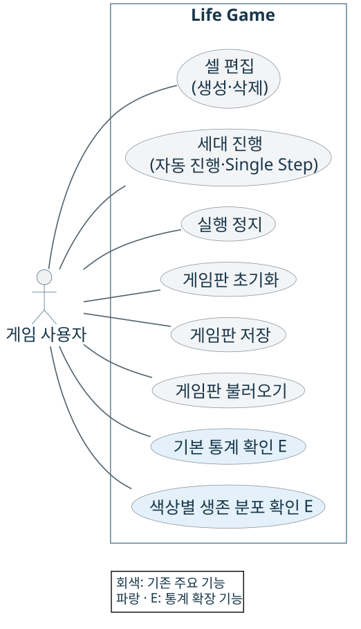
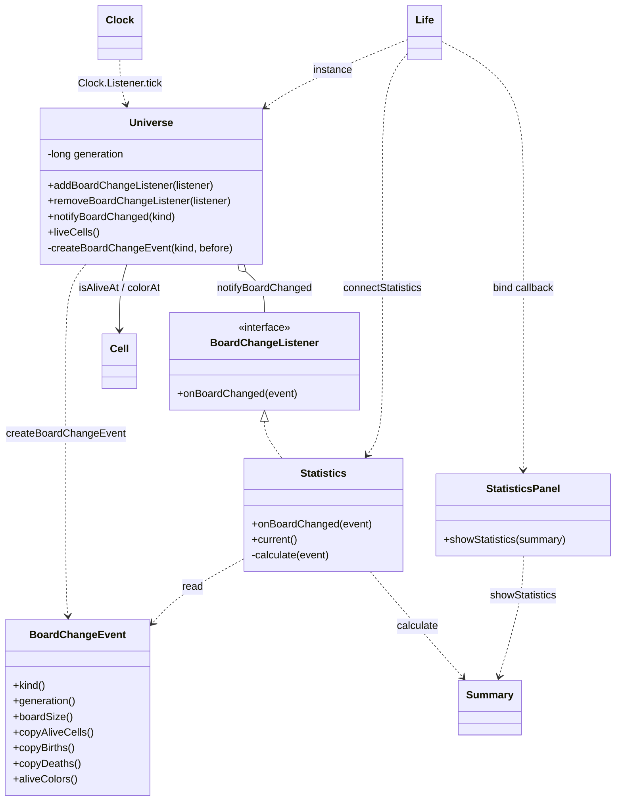
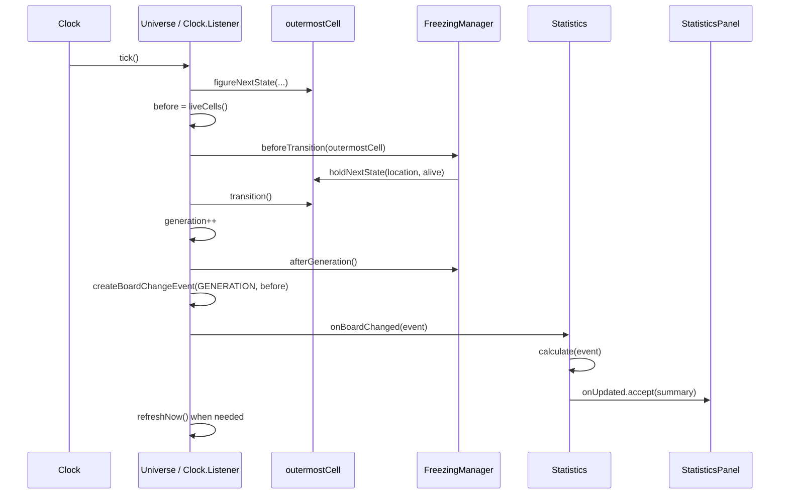

# 통계 기능 설계 및 구현

1. [기능 개요 및 명세](#overview)
2. [기존 코드에서 변경된 부분](#changes)
3. [구조와 동작](#structure)
4. [설계 패턴과 설계 결정](#decisions)
5. [테스트](#tests)

<a id="overview"></a>
## 1. 기능 개요 및 명세

게임판의 작업이 끝났을 때 완료 상태를 받아 현재 세대, 생존 셀 수·비율, 이번 세대 탄생·사망 수, 색상별 생존 셀 수·비율을 오른쪽 통계 탭에 표시한다.

세대 진행과 클릭·드래그, 템플릿 배치·Undo, Clear·Load 성공, 색상 정책 변경 후 갱신한다. 프리즈가 적용된 세대에는 고정 처리가 끝난 실제 생존 상태와 색상을 집계한다.

<a id="use-cases"></a>
### 기존 기능과 통계 확장 유스케이스

원본 Life Game의 주요 기능과 이번에 추가한 통계 기능을 함께 나타낸다. 회색은 기존 기능, 파란색은 통계 확장 기능이며, 과제 요구에 따라 확장된 유스케이스 이름에 **E**를 붙였다. 팀 전체 다이어그램에서는 다른 담당자의 확장 기능도 같은 Life Game 경계 안에 함께 표현할 수 있다.



[수정 가능한 PlantUML 원본](diagrams/statistics-use-cases.puml)

| 구분 | 유스케이스 | 사용자가 수행하거나 확인하는 내용 |
| --- | --- | --- |
| 기존 | 셀 편집 | 셀을 생성하거나 삭제하여 게임판의 배치를 바꾼다. |
| 기존 | 세대 진행 | 속도를 선택해 자동 진행하거나 Single Step으로 한 세대를 진행한다. |
| 기존 | 실행 정지 | 자동 세대 진행을 멈춘다. |
| 기존 | 게임판 초기화 | 게임판의 셀을 모두 지운다. |
| 기존 | 게임판 저장 | 현재 셀 배치를 파일로 저장한다. |
| 기존 | 게임판 불러오기 | 파일에 저장된 셀 배치를 복원한다. |
| 확장 | 기본 통계 확인 E | 현재 세대, 생존 셀 수·전체 판 대비 비율, 이번 세대 탄생·사망 수를 확인한다. 세대 변화량을 표시할 수 없는 경우에는 `—`를 확인한다. |
| 확장 | 색상별 생존 분포 확인 E | 현재 살아 있는 셀의 색상별 개수와 전체 생존 셀 대비 비율을 확인한다. 생존 셀이 없으면 빈 판 안내를 확인한다. |

실선은 게임 사용자가 해당 기능에 참여한다는 관계이며, 기능의 실행 순서를 나타내지 않는다. 세대 진행·편집 등 작업이 끝난 뒤 통계가 갱신되는 내부 흐름은 아래 시퀀스 다이어그램과 작업별 발행 시점에서 설명한다.

두 통계 기능은 같은 통계 탭에서 함께 제공되며, 별도의 실행 순서나 추가 조회 버튼이 없다. 게임 시작 시 현재 상태를 표시하고 보드 작업 완료 또는 색상 정책 변경에 따라 갱신한다. 탭이 숨겨져 있는 동안에도 통계는 갱신되므로 다시 열면 최신 결과를 확인할 수 있다.

<a id="changes"></a>
## 2. 기존 코드에서 변경된 부분

<a id="events"></a>
### 2.1 기본 통계와 공통 이벤트 구현

#### 이벤트의 입력 계약

```java
BoardChangeEvent(Kind kind, long generation, int boardSize,
                boolean[][] aliveCells, List<Point> births,
                List<Point> deaths, List<Color> aliveColors)
```

| 조회 메서드 | 의미 |
| --- | --- |
| `kind()` | `INITIAL`, `GENERATION`, `EDIT`, `TEMPLATE`, `TEMPLATE_UNDO`, `CLEAR`, `LOAD`, `COLOR_POLICY_CHANGED`. |
| `generation()`·`boardSize()` | 완료 시점 세대 번호와 정사각형 판 한 변의 셀 수. 기본 판은 64×64다. |
| `copyAliveCells()` | 완료 상태의 `boolean[행][열]`. 현재 생존 수와 사운드 재생선의 입력이다. |
| `copyBirths()`·`copyDeaths()` | 한 세대 전후의 탄생·사망 `List<Point>`. `Point.x=열`, `Point.y=행`이다. |
| `aliveColors()` | 살아 있는 셀들의 표시 색 `List<Color>`. 좌표별 조회용이 아닌 색상 집계용이며, 길이는 생존 수와 같다. |

배열의 각 행과 좌표 목록의 Point까지 생성·조회 시 복사한다. 색 목록은 `List.copyOf()`로 보관한다. 생성자는 크기·세대·좌표 범위·중복·탄생/사망과 완료 상태의 일치·색 목록 길이 등을 검사한다. `GENERATION`은 세대 번호가 1 이상이어야 하며, 다른 종류의 탄생·사망 목록은 비어 있어야 한다.

#### 작업별 발행 시점

| 완료 작업 | 이벤트와 세대 번호 | 통계의 탄생·사망 표시 |
| --- | --- | --- |
| 새 리스너 등록 | 새 구독자에게만 `INITIAL`, 현재 번호 | `—` |
| 자동 진행·단일 진행 | 프리즈 고정 처리와 `transition()` 완료, 세대 증가·프리즈 만료 처리 후 `GENERATION` | 최종 상태의 실제 탄생·사망 수. 고정된 셀은 변화량에 포함되지 않으며, 변화가 없으면 `0 / 0` |
| 클릭·일반 드래그 | 실제 변경이 있는 마우스 이벤트 처리 후 `EDIT`, 유지 | `—` |
| 템플릿 배치·Undo | 기존 완료 신호에서 `TEMPLATE`·`TEMPLATE_UNDO`, 유지 | `—` |
| Clear·Load 성공 | 판 초기화·복원 및 프리즈 영역 제거 후 `CLEAR`·`LOAD`, 0 | `—` |
| Color 메뉴 정책 변경 | `COLOR_POLICY_CHANGED`, 유지 | 같은 세대의 직전 Summary에 있던 표시 유지 |
| 프리즈 설치·수동 해제 자체 | 셀 상태를 바꾸지 않으므로 공통 보드 이벤트 발행 없음 | 유지 |
| 캡처·프리즈 영역 선택 자체, 무변경·차단된 편집, Load 취소/읽기 실패, Store | 발행 없음 | 유지 |

공개 `notifyBoardChanged(kind)`는 **이미 끝난 편집·복원의 알림**이다. 보드를 변경하거나 세대를 진행시키지 않으며, 이전 상태 없이 `GENERATION`을 호출하면 예외를 발생시킨다. 정상 세대는 tick 안에서 이전 상태를 확보한 뒤 비공개 `notifyBoardChanged(GENERATION, before)`로 발행한다.

등록은 중복을 막고 즉시 INITIAL을 보낸다. 발행 중에는 리스너 목록의 복사본을 사용하므로 구독 변경은 다음 전체 발행부터 반영된다. Observer는 콜백에서 게임판을 다시 수정하지 않는 계약을 따른다.

#### 집계 책임과 계산식

Universe는 세대 전후 상태를 한 번 비교하여 탄생·사망 좌표를 만든다. Statistics는 다음 계산을 담당한다.

| 통계 | 계산 |
| --- | --- |
| 현재 세대 | 이벤트의 `generation()` |
| 생존 셀 수 | 완료 배열의 `true` 개수 |
| 생존 비율 | 생존 수 ÷ `(boardSize × boardSize)` × 100 |
| 이번 세대 탄생·사망 | `GENERATION`의 탄생·사망 목록 크기 |
| 색상별 개수·비율 | 같은 색을 묶은 개수, 해당 개수 ÷ 전체 생존 수 × 100 |

Summary의 `hasGenerationDelta=false`일 때 births/deaths의 0은 내부 자리표시 값이며, 화면은 `—`로 표시한다. 편집·템플릿 배치 수를 자연적인 세대 탄생 수에 섞지 않는다. 정책만 바꾸면 생사와 세대가 그대로이므로 같은 세대의 직전 변화량을 유지한다. 이때 보관하는 것은 **최근 Summary 하나**이며 이전 보드나 Undo 이력이 아니다.

#### Swing Timer와 EDT

통계는 진행 후 보드를 읽어 UI까지 갱신하므로, 도중에 클릭·세대 변경이 끼어들지 않도록 보드 변경 → 상태 수집 → 발행 → 화면 갱신을 EDT에서 순차 실행한다. 초기 통계 구현에서 Clock을 Swing Timer로 변경했고, dev 병합 때에는 dev도 이미 Swing Timer를 사용하고 있어 그 구현을 유지했다.

현재 Single Step 메뉴는 자동 타이머를 먼저 멈춘 뒤 `tick()`을 한 번 호출한다. 이 수정은 프리즈 병합 전의 별도 변경 `d6555b8`이며, 실행 중 단일 진행 후 추가 세대가 발생하지 않는 회귀 테스트가 추가됐다.

EDT는 모든 작업 스레드를 자동으로 정렬하는 기능이 아니다. 현재 게임의 UI 입력과 Clock 콜백을 같은 스레드에서 처리하는 방식이다. MIDI 예약 실행기는 별도로 동작하며, 실제 보드 대신 이벤트에서 받은 독립 스냅샷을 읽는다. 오래 걸리는 작업을 EDT에 추가하면 화면이 멈출 수 있으므로 이 실행 경계를 유지해야 한다.

<a id="integration"></a>
### 2.2 기존 기능과의 통합 및 충돌 해결

통계 구현 당시에는 `4021231`에 **당시 dev `a480113`**를 병합하여 `4a49d0a`에서 충돌을 해결했고, 이후 `8eb1dfe`에서 사운드와 통계의 구독 경로를 통합했다. 아래 충돌 표는 이 과거 병합을 설명한다.

#### dev 병합에서 해결한 실제 충돌

병합 양쪽 부모와 공통 조상을 비교하면 충돌 파일은 다음 7개다. 모든 충돌이 기능 차이는 아니며, 주석·import가 겹친 경우도 포함한다.

| 파일 | 충돌한 내용 | 해결한 방식 |
| --- | --- | --- |
| `Universe.java` | 통계의 `this::advanceOneGeneration` 연결·알림과 dev의 익명 tick 본문·색상·패턴 편집·사운드·드래그 처리가 겹쳤다. | **dev의 tick 본문을 유지하고 advanceOneGeneration은 제거**했다. 편집 중 진행 차단, 매 세대 transition, 색상별 화면 갱신을 유지하면서 세대 증가와 통계 알림을 추가했다. 편집·복원 경로도 완료 후 통계 알림이 나가도록 연결했다. |
| `Life.java` | 통계 전용 탭 배치와 dev의 패턴 도구를 EAST에 직접 붙이는 코드가 겹쳤다. | `createSidebar()`에서 실제 패턴 패널과 통계를 한 JTabbedPane에 넣고 `createContent()`로 배치했다. `SoundEffects.install()`·EDT 초기화·통계 연결/해제를 함께 유지했다. |
| `Clock.java` | 양쪽 모두 Swing Timer였으나 타이머 재사용·초기 지연·EDT 밖 tick 처리 방식이 달랐다. | dev 구현을 유지했다. 실행 시 기존 타이머를 중지하고 새 타이머를 만들며, EDT 밖 tick은 `invokeLater()`로 넘긴다. 통계 쪽의 EDT 밖 호출 예외 기대도 이 동작에 맞췄다. |
| `Neighborhood.java` | LOAD 후 활성화 코드에 dev의 `oneLastRefreshRequired=true`가 추가되어 있었다. | `amActive=true`, `activeEdges.add(Direction.ALL)`, 마지막 화면 갱신 플래그를 함께 유지했다. 복원 후 경계 셀 재계산과 표시를 모두 보장하려는 처리다. |
| `Cell.java` | 양쪽에서 같은 `isAliveAt(row, column)`을 추가했지만 설명 주석이 달랐다. | 기존 dev 선언 하나로 정리했다. 통계용 조회를 중복 추가하지 않았다. |
| `NeighborhoodTest.java` | 중첩 셀 조회 테스트가 양쪽에 있고 주석이 달랐다. | dev 테스트를 유지하여 행·열이 뒤바뀌지 않는 조회를 계속 검증했다. |
| `UniverseStoreTest.java` | 통계 쪽 테스트 초기화와 dev의 드래그·생존 배열·재생선 검사에 필요한 import가 겹쳤다. | 새 검사들을 보존하고 초기화·Clear·Store를 `LifeTestSupport`로 통일했다. UI 조작/그리기는 EDT에서 수행하고 실제 Clock·저장 경로를 사용하도록 정리했다. |

통계 브랜치를 병합할 당시 연결한 세부 경로는 다음과 같다. 이후 프리즈 적용으로 달라진 경로는 아래 프리즈 통합 절에서 설명한다.

| 경로 | 통계 연결 후 동작 |
| --- | --- |
| `Clock.Listener.tick()` | 패턴 편집 중이면 반환 → Undo 이력 무효화 → 다음 상태 계산 → 매 세대 transition → 세대 증가·알림 → 기존 조건으로 다시 그리기. 생존 상태가 같은 블록도 나이가 증가한다. |
| 일반 드래그의 `setCell()` | 기존 셀 변경 처리를 유지하고 반환형을 `void`에서 `boolean`으로 바꿨다. 실제 변경 여부를 모아 마우스 처리 후 EDIT를 보내고 무변경 알림은 생략한다. 보드 밖 누르기도 제외했다. |
| 템플릿 배치·Undo | PatternTools가 이미 내보내던 `TEMPLATE`·`TEMPLATE_UNDO` PropertyChange를 Universe에서 구독한다. 템플릿 드래그는 완료 신호에서 한 번 알리고, 캡처 선택 자체는 보드 변경으로 세지 않는다. |
| 패턴 탭을 떠날 때 | `Life.createSidebar()` → `Universe.finishPatternEditing()` → 기존 `PatternTools.cancel()`로 숨겨진 편집을 끝낸다. 일반 실행 상태에서는 불필요하게 Clock을 멈추지 않는다. |
| `doLoad()` | 통계 쪽의 “파일 읽기를 끝낸 뒤 보드 교체”를 유지했다. 성공 시 dev의 편집 취소·Undo 무효화도 수행하고 복원 후 세대 0·LOAD를 발행한다. 취소·읽기 실패 시 기존 판과 통계를 유지한다. |
| Clear·Store·그리기 | Clear는 활성 편집 취소·이력 무효화·판 지우기 후 세대 0·CLEAR를 발행한다. Store는 상태 변경 알림이 없다. 셀·패턴 오버레이·사운드 재생선의 기존 그리기를 함께 유지했다. |

이 병합 커밋에서는 사운드의 GenerationListener와 통계의 BoardChangeListener를 일단 함께 유지했다. 그 다음 변경이 아래 공통 이벤트 전환이다.

#### 공통 이벤트 전환의 변경 전후

| 위치 | 병합 직후 `4a49d0a` | 공통 이벤트 전환 `8eb1dfe` 이후 |
| --- | --- | --- |
| Universe의 구독·발행 | 사운드는 `GenerationListener`·`addGenerationListener()`·`generationPublisher`·`publishChanges(before)`, 통계는 BoardChangeListener. | 사운드 전용 항목을 제거하고 `addBoardChangeListener()`·`removeBoardChangeListener()`·`notifyBoardChanged()`로 통일. |
| 세대 전 상태 수집 | 사운드는 `figureNextState()`의 변화 예상 결과에 따라 before를 수집하고 변화가 있을 때 발행했다. | 매 정상 세대 transition 직전에 `liveCells()`로 before를 확보하고, 완료 후 `notifyBoardChanged(GENERATION, before)`를 호출한다. |
| 현재 상태 자료구조 | 사운드는 `boolean[][]`·`List<Point>`, 통계 이벤트는 BitSet. | 현재 판은 `boolean[][]`, 탄생·사망은 `List<Point>`로 공유한다. `captureAliveCells()`의 BitSet 수집 경로를 제거했다. |
| 탄생·사망 계산 | 사운드 발행부와 Statistics가 각각 상태를 비교했다. | `Universe.createBoardChangeEvent(kind, before)`가 진행 전후를 한 번 비교한다. Statistics는 전달받은 목록의 크기를 집계한다. |
| Statistics의 이전 상태 | 이전 BitSet·판 크기·세대 번호를 저장하고 연속 세대인지 확인했다. | 이전 판 비교 필드를 제거했다. 완성된 이벤트 자체에 변화량이 있으므로 첫 GENERATION 수신도 집계할 수 있다. |
| 이벤트 내용 | 통계용 현재 상태만 전달했다. | 완료 배열과 탄생·사망 좌표를 같은 이벤트에 담는다. 이후 색상 확장에서 생존 색 목록을 추가했다. |
| SoundEffects의 구독·수신 | GenerationListener로 등록하고 generationChanged()로 수신. | BoardChangeListener로 등록하고 onBoardChanged(event)에서 종류와 변화 목록을 확인한 뒤 기존 음 생성 처리를 호출. |
| 재생선의 상태 조회 | 실제 게임판을 liveCells()로 직접 조회. | INITIAL 수신 후 재생선을 예약하고, 모든 완료 이벤트의 복사 배열을 latestCells에 보관해 재생선과 전멸 판단에 사용. |

현재 세대 진행 진입점은 여전히 **Universe 생성자에서 등록한 익명 tick 본문**이다. 공통 이벤트 전환을 위해 advanceOneGeneration을 다시 도입하지 않았다.

[SoundEffects](../../src/com/holub/life/sound/SoundEffects.java)의 연결은 공통 이벤트 계약에 맞췄다. 모든 이벤트로 재생선용 상태를 갱신하고, GENERATION이며 탄생·사망이 있을 때만 기존 음 생성 처리를 호출한다. 사운드가 Off인 동안에도 최신 상태를 받으며, 기존 음 선택·반복 감쇠·재생 예약 로직은 유지했다. 이벤트 수신 시 복사 배열의 참조를 volatile 필드에 저장하고 사운드 스레드는 그 배열을 읽는다. 저장 후 배열 원소는 수정하지 않는다.

프리즈 병합에서는 Statistics·StatisticsPanel·BoardChangeEvent·BoardChangeListener를 수정하지 않았다. Universe가 고정 처리를 끝낸 상태를 기존 GENERATION으로 전달하므로, 고정된 생존 셀도 생존 수에 포함되고 탄생·사망은 실제 변화만 집계한다. 프리즈 자체의 구현과 검증은 [FREEZING.md](../FREEZING.md)를 참고한다.

<a id="colors"></a>
### 2.3 색상별 통계 확장

#### 기존 색상 결정 방식

Resident는 생존 여부와 `age`를 가지고, 공유 `CellColorPolicy`에 `colorOf(age)`를 요청하여 그린다. 새로 태어난 셀의 나이는 0이며, 계속 살아남은 셀은 transition에서 나이가 증가한다. 현재 통합 코드에서는 프리즈로 고정된 셀만 나이 증가를 건너뛰고, 해제 후에는 멈춘 나이부터 이어서 증가한다.

기본 순환 정책은 셀의 나이를 기준으로 10세대마다 **빨강 → 파랑(`#0072B2`) → 초록(`#009E73`)**을 반복한다. 나이 0~9는 빨강, 10~19는 파랑, 20~29는 초록, 30~39는 다시 빨강이다. FixedColorPolicy는 나이와 무관하게 지정 색을 반환한다. 통계는 이 규칙을 복제하거나 나이를 색으로 다시 환산하지 않고 **현재 정책이 반환한 색**을 집계한다.

#### 추가·확장한 메서드와 데이터

| 위치 | 변경 전 | 현재 구현 |
| --- | --- | --- |
| `Cell.colorAt(row, column)` | 색을 외부에서 조회하는 공통 메서드 없음. | 표시 색 조회 계약 추가. 죽은 셀과 DUMMY는 null. |
| `Resident.colorAt()` | redraw 안에서 정책으로 색을 결정했다. | 살아 있으면 같은 `colorPolicy.colorOf(age)`를 반환한다. 조회로 나이를 늘리거나 정책을 바꾸지 않는다. |
| `Neighborhood.colorAt()` | 생존 조회만 제공했다. | 행·열을 하위 셀의 좌표로 변환해 재귀 위임한다. 통계는 중첩 구조를 알 필요가 없다. |
| `Universe.createBoardChangeEvent()` | 완료 배열과 탄생·사망 목록 구성. | 완료 배열에서 살아 있는 위치만 `outermostCell.colorAt()`으로 읽어 `List<Color>`를 추가한다. |
| `BoardChangeEvent` | 생성자 6개 인자, 색 데이터 없음. | 마지막 인자로 `List<Color>`와 `aliveColors()` 추가. null·생존 수와 다른 길이를 거부하고 목록을 보호한다. |
| `Universe.useColorPolicy()` | 정책 교체 후 repaint. | 정책 교체 후 `COLOR_POLICY_CHANGED` 발행 추가. 세대·나이는 유지한다. |
| `Statistics.calculate()`·Summary | 기본 통계만 집계. | 같은 Color 값별 개수와 생존 수 대비 비율을 계산하고 불변 `List<ColorCount>`로 전달한다. |
| `StatisticsPanel.showStatistics()` | 기본 통계만 표시. | 색 견본·이름·개수·비율 행을 함께 갱신한다. |

예를 들어 4×4 판에 살아 있는 셀이 4개이고 빨강 2개·파랑 1개·초록 1개라면, 생존 비율은 **25%**, 색 비율은 **50%·25%·25%**다. 두 비율의 분모가 다르다. 빈 판은 색 목록이 비어 있으므로 0으로 나누지 않는다.

색 목록에 좌표는 필요하지 않다. 통계는 색의 분포만 사용하며, 셀의 위치는 기존 생존 배열로 전달된다. 같은 RGB 값으로 만들어진 별도 Color 객체도 같은 색으로 묶는다. 사운드는 색 데이터를 읽지 않고 기존 GENERATION 필터를 사용하므로 이 확장에서 사운드 소스 수정은 없다.

색상 통계 작업(`4d6a9ac`)에서는 기존 색상 정책을 재사용하고 조회·이벤트 전달·집계·표시를 추가했다. 이후 프리즈 담당자가 Resident의 나이 갱신 조건을 확장했으며, 통계는 같은 `colorAt()` 조회 결과를 계속 사용한다.

<a id="panel"></a>
### 2.4 통계 패널 구현과 화면 연결

Life가 `new Statistics(panel::showStatistics)`를 만들고 Universe에 등록한다. INITIAL을 즉시 받으므로 게임을 진행하기 전에도 화면에 현재 상태가 나타난다. 탭이 숨겨져 있어도 통계는 갱신하며, `Life.dispose()`에서 통계 리스너를 해제한다.

공용 JTabbedPane은 Life가 소유하고, 현재 탭 순서는 **패턴 캡처 → 통계 → Freezing**이다. 탭 전환 시 숨겨지는 패턴 편집이나 프리즈 영역 선택을 종료하며, 설치된 프리즈 영역과 통계 구독은 유지한다. `createContent()`는 세 탭을 추가한 뒤 전체 선호 폭과 보드 높이 512px를 기준으로 중앙 보드·오른쪽 탭을 배치한다.

| 표시 항목 | 현재 규격 |
| --- | --- |
| 패널 | 선호 크기 258×512, 내부 여백 14px. 전체 사이드바 폭은 공용 탭의 선호 크기를 반영한다. |
| 제목·항목·값·설명 | 제목 16pt 굵게, 항목 13pt, 값 14pt 굵게, 안내 12pt. |
| 행과 간격 | 기본 통계·색상 행에 공통 `statisticRow()` 적용. 행 높이 22px, 행 사이 6px. 제목·구분선 주변도 공통 간격으로 정리했다. |
| 구역 | 기본 생존 통계 / 이번 세대 탄생·사망 / 색상 통계 사이에 구분선. 변화량 안내는 두 줄로 표시한다. |
| 숫자 | 비율은 소수 둘째 자리, 비교 대상이 없는 변화량은 `—`. |
| 색상 행 | 현재 존재하는 색만 빨강 → 파랑 → 초록 순서로 표시하고, 다른 색은 뒤에 RGB 순으로 배치한다. 개수 변화로 순서가 바뀌지 않는다. 사라진 색은 제거한다. |
| 추가 색·빈 판 | 기본 3색을 넘으면 색 목록 영역만 세로 스크롤한다. 임의 색은 색상값으로 표시하며 빈 판에는 생존 셀이 없다는 안내를 표시한다. |

계산 결과의 색 목록 순서와 UI 순서를 분리했다. Statistics는 색별로 집계하고, 패널이 표시 순서·이름·폰트·간격을 결정한다. 운영체제의 기본 Swing 스타일은 유지한다.

<a id="structure"></a>
## 3. 구조와 동작

`Universe`가 Subject이며, `Statistics`는 `BoardChangeListener`를 구현해 완료 이벤트를 받는다. 이벤트 객체는 데이터를 전달하고, Statistics가 집계하며, StatisticsPanel이 결과를 표시한다.

아래 표와 다이어그램은 **통계 기능의 구현과 연결에 필요한 범위**를 보여준다. Life·Clock·Cell 등 기존 클래스도 연결 관계를 설명하기 위해 포함한다. 다른 Observer와의 공통 이벤트 연결은 [기존 기능과의 통합](#integration)에서 설명한다.

### 클래스와 주요 메서드

| 클래스 | 책임과 주요 메서드 |
| --- | --- |
| [BoardChangeListener](../../src/com/holub/life/BoardChangeListener.java) | `onBoardChanged(event)`로 완료 상태를 수신하는 공통 인터페이스. |
| [BoardChangeEvent](../../src/com/holub/life/BoardChangeEvent.java) | 작업 종류·세대·판 크기·생존 배열·탄생/사망 좌표·생존 셀 색을 보관한다. 배열·좌표는 방어적 복사로 보호한다. |
| [Universe](../../src/com/holub/life/Universe.java) | `addBoardChangeListener()`·`removeBoardChangeListener()`로 구독 관리. `liveCells()`로 상태 수집, `createBoardChangeEvent(kind, before)`로 이벤트 구성, `notifyBoardChanged()`로 발행한다. 기존 익명 `Clock.Listener.tick()` 안에서 세대를 진행한다. |
| [Statistics](../../src/com/holub/life/Statistics.java) | `onBoardChanged()` → `calculate()`로 집계하고 콜백에 결과를 전달한다. `current()`는 최근 결과를 `Optional<Summary>`로 반환한다. 이전 게임판은 보관하지 않는다. |
| `Statistics.Summary`·`Statistics.ColorCount` | Statistics 안의 record. Summary는 기본 통계와 `List<ColorCount>`를, ColorCount는 색·개수·백분율을 담는다. 결과 목록은 수정할 수 없다. |
| [StatisticsPanel](../../src/com/holub/life/StatisticsPanel.java) | `showStatistics(summary)`로 값·색상 행을 표시한다. 게임판 조회, 이벤트 구독, 통계 계산을 하지 않는다. |
| [Life](../../src/com/holub/life/Life.java) | `createSidebar()`로 공용 탭, `createContent()`로 창 배치를 구성한다. `connectStatistics()`에서 계산과 화면을 연결하고, `dispose()`에서 통계 구독을 해제한다. |
| [Clock](../../src/com/holub/life/Clock.java)·[Cell](../../src/com/holub/life/Cell.java) 계층 | Clock은 Swing Timer로 진행 시점을 알린다. Cell의 `isAliveAt(row, column)`·`colorAt(row, column)`으로 생존·색을 조회한다. |

`new Statistics(panel::showStatistics)`의 콜백 타입은 **JDK의 `java.util.function.Consumer<Summary>`**다. 별도로 만든 인터페이스가 아니며, Statistics는 구체적인 StatisticsPanel 타입에 의존하지 않는다.

### 클래스 다이어그램



Clock의 화살표는 Universe 안에서 등록한 익명 `Clock.Listener`를 간략히 표시한 것이다. Universe가 Clock.Listener를 직접 구현하는 구조는 아니다. `Summary`는 `Statistics.Summary`를 가리킨다.

### 세대 진행 시퀀스

아래는 패턴 편집·프리즈 영역 선택이 끝나고, 활성 프리즈 영역이 있는 상태에서 한 세대를 진행하는 경로다. 보드 진행·이벤트 전달·통계 화면 갱신은 EDT에서 순서대로 실행된다. 프리즈 내부의 영역·State 객체 위임과 다른 Observer의 수신 흐름은 생략했다.



<a id="decisions"></a>
## 4. 설계 패턴과 설계 결정

통계 기능을 구현하고 팀 기능과 통합하면서 검토한 대안을 정리한다. 코드의 의존 관계·상태 관리·통합 범위를 기준으로 장단점을 비교하고 현재 구조를 선택한 이유를 설명한다.

### 공통 Observer 인터페이스와 이벤트

통계와 사운드는 같은 게임판의 완료 상태를 사용하지만, 통합 전에는 GenerationListener와 BoardChangeListener로 구독 경로가 나뉘어 있었다. 두 기능에 상태를 어떻게 전달할지 다음 방식을 비교했다.

| 대안 | 장점 | 단점 |
| --- | --- | --- |
| Universe에서 통계·사운드의 구체 메서드를 직접 호출 | 호출 대상과 순서가 코드에 드러나고 연결이 단순하다. | Universe가 각 기능의 타입과 호출 방법을 알아야 한다. 수신 기능을 추가하거나 제거할 때 발행부도 수정해야 한다. |
| 기능별 리스너와 이벤트 유지 | 각 기능에 맞는 입력을 정의할 수 있고, 기존 구독 코드를 그대로 사용할 수 있다. | 등록·해제·발행 경로를 각각 관리해야 한다. 상태 수집 시점과 이벤트 의미를 두 경로에서 계속 맞춰야 한다. |
| BoardChangeListener와 BoardChangeEvent로 통일 | 한 번 구성한 완료 이벤트를 함께 사용한다. Universe는 수신 기능의 구체 타입 대신 공통 인터페이스에 알린다. | 수신자가 사용하지 않는 데이터도 이벤트에 포함된다. 공통 이벤트의 형식이 바뀌면 생성 코드와 관련 테스트를 함께 확인해야 한다. |

**공통 인터페이스와 이벤트를 선택했다.** 두 기능 모두 현재 생존 상태와 세대 변화 정보를 사용하므로 완료 시점을 공유하는 편이 적합했다. Universe는 `notifyBoardChanged()`에서 같은 이벤트를 전달하고, Statistics는 통계를 집계한다. SoundEffects는 모든 이벤트로 재생선용 상태를 갱신하되, 효과음은 GENERATION의 탄생·사망이 있을 때만 처리한다. 각 기능이 이벤트 종류와 필요한 데이터를 선택하며 기존 음 생성 로직은 유지한다.

### 탄생·사망 비교의 위치와 자료구조

최초 통계 구현은 현재 BitSet을 받은 뒤 Statistics가 이전 판을 저장해 비교했다. 사운드와 통합할 때는 사운드 발행부에서도 같은 세대의 탄생·사망 좌표를 계산하고 있었다.

| 대안 | 장점 | 단점 |
| --- | --- | --- |
| Statistics가 이전 판을 보관하고 직접 비교 | 통계가 비교 기준을 자체 관리하며, 발행자는 현재 상태만 전달할 수 있다. | 이전 상태의 초기화·편집·복원·연속 세대 여부를 관리해야 한다. 사운드와 비교 계산이 중복되고, 이전 판 없이 첫 세대 이벤트만 받으면 변화량을 알 수 없다. |
| Universe에서 세대 전후를 비교해 결과 공유 | 실제 전이 직전·직후를 기준으로 한 번 비교한다. 통계와 사운드가 같은 탄생·사망 좌표를 사용한다. | Universe가 현재 상태뿐 아니라 변화 좌표까지 구성한다. 비세대 편집과 세대 변화의 입력 계약을 구분해야 한다. |

**Universe의 `createBoardChangeEvent()`에서 계산한 좌표를 공유하도록 선택했다.** Statistics에서는 이전 판 비교를 제거하고, 생존 수·비율·색상 분포와 전달받은 변화 목록의 크기를 집계한다. 첫 GENERATION에도 해당 세대의 변화 목록이 있으므로 이전 이벤트 수신 여부에 의존하지 않는다. 공개 편집 알림으로 GENERATION을 발행할 수 없도록 하여 전이 전 상태 없이 변화량을 만드는 것을 막는다.

자료구조도 기존 사운드 구현의 **현재 판 `boolean[][]`와 변화 좌표 `List<Point>`**에 맞췄다. BitSet은 비트 연산으로 상태 차이를 계산할 수 있지만, 당시 사운드에서 쓰던 배열·좌표 목록과 변환하거나 중복 관리해야 했다. 현재 구조는 그 변환을 줄이고 기존 음 생성 입력을 유지한다. 대신 배열과 가변 Point가 외부에서 수정되지 않도록 이벤트 생성·조회 시 방어적 복사를 하며, 복사에 따른 비용은 남는다.

### Swing Timer와 EDT

통계는 세대 진행이 끝난 보드를 읽고 화면에 표시한다. 보드를 읽는 도중 클릭이나 다른 세대 진행이 끼어들지 않도록 실행 경계를 정할 필요가 있었다.

| 대안 | 장점 | 단점 |
| --- | --- | --- |
| 별도 타이머 스레드에서 진행하고 동기화 | 세대 계산을 UI 스레드와 분리할 수 있다. | 세대 진행뿐 아니라 클릭·템플릿·복원·상태 수집에도 같은 동기화 기준이 필요하다. Swing 화면 갱신은 다시 EDT로 전달해야 한다. |
| Swing Timer로 진행하고 보드 작업을 EDT에서 처리 | UI 입력과 세대 진행이 같은 스레드에서 처리되어 변경·수집·알림·화면 갱신 순서를 유지하기 쉽다. | 집계와 리스너 처리가 길어지면 화면 응답과 다음 tick 처리가 늦어진다. 정확한 실시간 주기를 보장하는 방법은 아니다. |

**현재 보드 크기와 Swing UI 구조에서는 EDT로 통일하는 방식을 선택했다.** 초기 통계 구현에서 Swing Timer를 적용했고, dev 병합 시에는 dev에도 Swing Timer가 적용되어 있어 그 구현을 유지했다. Universe의 구독·상태 발행과 StatisticsPanel의 갱신도 EDT에서 수행한다.

사운드의 예약 실행기는 별도 스레드에 남겨 두되 실제 보드를 직접 읽는 대신 완료 이벤트에서 복사한 배열을 사용한다. 이 선택은 모든 스레드를 EDT가 자동으로 정렬한다는 의미가 아니다. 현재 보드 변경 경로를 EDT로 모은 것이며, 추후 무거운 처리를 추가하면 작업 분리와 스냅샷 전달을 다시 검토해야 한다.

### 세대 진행 메서드 추출과 기존 tick 유지

통계 브랜치에서는 `advanceOneGeneration()`으로 세대 진행을 분리했지만, 병합 대상 dev는 익명 `Clock.Listener.tick()` 안에서 색상·패턴·사운드를 함께 처리하고 있었다.

| 대안 | 장점 | 단점 |
| --- | --- | --- |
| advanceOneGeneration()으로 본문 추출 | 세대 진행에 이름을 붙이고 Clock 콜백을 짧게 만들 수 있다. 세대 진행 코드를 한 메서드에서 확인할 수 있다. | 통합 시 기존 기능의 처리 본문을 이동하고 팀원의 문서·테스트가 참조하는 위치를 맞춰야 한다. 메서드 추출만으로 Universe의 책임이 줄어드는 것은 아니다. |
| dev의 tick 본문 유지 | 팀 기능의 기존 처리 위치를 유지하면서 통계 연결을 추가할 수 있다. 통합 변경 범위가 작다. | 여러 기능의 조정 코드가 tick 안에 남고, 기능이 늘면 본문이 길어질 수 있다. |

**이번 통합에서는 기존 tick을 유지하고 `advanceOneGeneration()`을 제거했다.** 기존 편집 차단·매 세대 transition·색상 화면 갱신을 보존하면서 세대 번호와 완료 알림을 연결하는 것이 우선이었다. 이후 프리즈 담당자도 같은 경로에 고정 처리를 추가했고, 통계는 그 처리가 끝난 결과를 받는다. 당시 통합 범위와 팀 코드의 변경 부담을 기준으로 결정했으며, 세대 진행 메서드 추출은 이후 별도의 구조 개선으로 검토할 수 있다.

### 색상 정보 전달과 집계 책임

색상별 통계에는 살아 있는 셀의 표시 색이 필요하다. 색상 결정은 기존 CellColorPolicy가 담당하므로 통계에서 같은 규칙을 다시 작성하지 않도록 했다.

| 대안 | 장점 | 단점 |
| --- | --- | --- |
| Statistics가 셀의 나이·정책을 직접 조회 | 이벤트에 색 목록을 추가하지 않아도 된다. | Statistics가 셀 계층과 현재 정책의 조회 방법을 알아야 한다. 이벤트 수신 후 실제 보드를 다시 읽는 경우 완료 이벤트와 조회 시점을 맞춰야 한다. |
| 이벤트에 `List<Color>`로 표시 색 전달 | Statistics는 완료 시점의 색 값만 집계한다. 기존 정책을 바꾸어도 같은 조회 계약을 사용할 수 있다. | 이벤트마다 색 목록을 구성하고 보호해야 하며, 색을 사용하지 않는 Observer도 같은 이벤트를 받는다. |

**`colorAt()`으로 기존 정책이 결정한 색을 읽어 이벤트에 전달하는 방식을 선택했다.** Statistics는 같은 색을 묶어 개수와 생존 셀 대비 비율을 계산한다. 좌표별 색을 사용하는 기능이 아니므로 별도 색상판 대신 `List<Color>`를 사용한다. 정책 교체 때는 `COLOR_POLICY_CHANGED`를 발행하여 게임이 정지된 상태에서도 집계가 갱신되도록 했다.

### 설계 원칙과 적용 범위

Statistics는 계산 결과를 Summary로 만들고, StatisticsPanel은 표시 순서·이름·숫자 형식·배치를 담당한다. 계산식과 화면 배치가 서로 다른 이유로 변경되므로 책임을 나눈 것이다. `Consumer<Summary>` 콜백으로 연결하여 Statistics가 구체적인 StatisticsPanel 타입을 참조하지 않으며, 패널 없이도 집계 결과를 사용할 수 있다.

Cell의 조회는 기존 **Composite**를 확장한 것이며, 색 결정은 팀원이 구현한 **Strategy**를 재사용한다. 색상 통계에 새 Strategy를 도입한 것은 아니다. Consumer는 JDK의 콜백 인터페이스이며 별도 설계 패턴으로 주장하지 않는다.

현재 작업은 통계·표시·구독 책임을 분리한 범위다. Universe에 보드/UI 조정이 남아 있고 Cell에도 그리기 메서드가 있으므로 게임 전체가 완전한 MVC로 분리되었다고 보지는 않는다.

<a id="tests"></a>
## 5. 테스트

프리즈가 통합된 현재 코드(`92e1332`, 기능 기준 `838182c`)를 2026-11-22에 다시 실행한 결과는 **30개 테스트 클래스, JUnit 384개 통과, 실패·오류·건너뜀 0**이다. 이번 문서 수정에서는 소스와 테스트를 변경하지 않았다. 별도 데스크톱 Swing 검사 17개는 2026-11-18의 기존 검증 기록이며 이번에는 재실행하지 않았다.

```bash
./gradlew test --rerun-tasks --no-daemon --console=plain

# 별도 데스크톱 Swing 검사: 필요한 경우 따로 실행
./gradlew patternUiTest --no-daemon --console=plain
```

Gradle 9.5.1·Java toolchain 17·JUnit Jupiter 6.0.3을 사용한다. 위 명령의 기본 JUnit 보고서 경로는 `build/reports/tests/test/index.html`이다. 이번 확인에서는 기존 빌드 결과를 덮어쓰지 않도록 Gradle 초기화 스크립트로 빌드·보고서와 프로젝트 캐시를 임시 폴더에 분리하고, 같은 전체 `test` 작업을 오프라인으로 실행했다. `patternUiTest`의 17개는 JUnit 384개에 포함하지 않는다. 기존 기본 오류 수정 회귀 검사도 전체 테스트에 포함했다.

| 검증 범위 | JUnit 수 |
| --- | ---: |
| 기본 규칙·저장·Clock·Universe 이벤트 | 64 |
| 기존 색상 정책·나이·색 조회 | 42 |
| 패턴·템플릿·Undo | 39 |
| 사운드 계산·공통 이벤트 연동 | 46 |
| 통계 계산·패널·색상 통계 | 91 |
| 기존 기능과 통계의 병합 연동 | 12 |
| 프리즈 모델·기존 기능 및 사운드와의 연동 | 90 |
| 합계 | **384** |

### 통계 핵심 테스트의 대표 사례

통계와 밀접한 6개 클래스에서 **핵심 동작·경계값·예외를 보여주는 메서드 4개씩, 총 24개**를 골랐다. 6개 클래스의 전체 실행 수는 매개변수별 실행을 포함해 **91개**다. 아래 표는 현재 테스트 코드에서 선정한 대표 사례의 목적·실제 입력·기대 결과를 설명한다.

<details>
<summary>StatisticsTest — 대표 4개 메서드 · 클래스 전체 22회 실행</summary>

원본: [StatisticsTest](../../test/com/holub/life/StatisticsTest.java)

이벤트를 직접 만들어 Statistics에 전달하는 계산 단위 테스트다. 실제 Clock·Universe·템플릿·Undo는 실행하지 않는다. 아래 셀 번호 n은 한 변의 길이가 size일 때 행=n/size(정수 나눗셈), 열=n%size인 0부터 시작하는 번호다.

| 테스트 메서드 | 목적 | 입력·조작 | 기대 결과 |
| --- | --- | --- | --- |
| `initialSnapshotReportsPopulationAndSuppliedGeneration` | 초기 이벤트에 담긴 세대와 생존 수·비율을 집계한다. | INITIAL, 세대 12, 4×4 판의 셀 0·5·10·15 생존. | 세대 12, 생존 4, 비율 25%. 변화량은 미제공 상태이며 내부 탄생·사망 값은 0. |
| `emptyBoardHasZeroPopulationAndPercentage` | 빈 판의 집계와 변화량 상태를 확인한다. | INITIAL, 세대 0, 빈 4×4 판. | 생존 0, 비율 0%, 변화량 미제공. |
| `firstGenerationAlreadyContainsItsOwnDelta` | 이전 이벤트 없이도 전달된 변화 좌표를 집계한다. | 첫 입력으로 GENERATION 9. 3×3 판의 셀 1·4 생존. 탄생 목록에는 셀 번호 1, 사망 목록에는 셀 번호 0을 각각 1개 전달. | 생존 2, 유효한 변화량 탄생 1·사망 1. |
| `nonGenerationUpdatesPopulationAndClearsDisplayedDelta` | 비세대 이벤트 후에는 이전 변화량을 지우고 이후 세대의 새 변화량을 사용한다. | 6회: INITIAL·EDIT·TEMPLATE·TEMPLATE_UNDO·CLEAR·LOAD. 먼저 탄생 2·사망 1인 세대 이벤트를 보내고, 각 종류로 세대 0·생존 2를 전달한 뒤 다음 세대 이벤트를 보낸다. | 중간 결과는 세대 0·생존 2·변화량 미제공. 다음 GENERATION의 탄생 1·사망 1을 정상 집계한다. |

</details>

<details>
<summary>BoardChangeEventTest — 대표 4개 메서드 · 클래스 전체 23회 실행</summary>

원본: [BoardChangeEventTest](../../test/com/holub/life/BoardChangeEventTest.java)

이벤트 객체의 좌표 계약과 방어적 복사, 잘못된 변화 목록의 거부를 확인한다. 배열은 [행][열], Point는 (x=열, y=행)이다. 예외 검사는 지정한 예외가 발생해야 통과한다.

| 테스트 메서드 | 목적 | 입력·조작 | 기대 결과 |
| --- | --- | --- | --- |
| `retainsMetadataAndRowColumnCoordinates` | 세대 정보와 배열·Point 좌표의 방향을 보존한다. | GENERATION 42, 3×3 판의 [1][2] 생존, 탄생 Point(2,1), 사망 Point(0,2). | 종류·세대 42·판 크기 3과 생존 배열·두 좌표 목록이 입력과 같다. |
| `returnedRowsListsAndPointsAreIndependentForEveryObserver` | 한 수신자가 조회한 복사본을 바꾸어도 다음 조회에 영향을 주지 않는다. | 조회한 배열의 값·행을 바꾸고, 반환 목록의 Point를 이동하거나 목록을 비운다. | 다시 조회한 배열과 탄생·사망 좌표는 원래 값이다. |
| `rejectsCoordinatesOutsideEitherAxis` | 좌표가 판 밖이면 거부한다. | 2회: 3×3 판에서 사망 Point의 x 또는 y를 각각 -1·3으로 설정. | 두 축의 범위 초과 입력 모두 IllegalArgumentException. |
| `rejectsDuplicateOrInconsistentChanges` | 중복 좌표와 완료 상태에 모순되는 변화 좌표를 거부한다. | 탄생 좌표 중복, 사망 좌표 중복, 완료 후 죽은 셀을 탄생으로 지정, 살아 있는 셀을 사망으로 지정. | 네 경우 모두 IllegalArgumentException. |

</details>

<details>
<summary>ColorStatisticsTest — 대표 4개 메서드 · 클래스 전체 13회 실행</summary>

원본: [ColorStatisticsTest](../../test/com/holub/life/ColorStatisticsTest.java)

색 목록을 가진 이벤트를 직접 구성하여 집계와 입력 검증을 확인한다. 실제 셀 나이·색상 정책·화면은 실행하지 않는다. 단위 테스트의 Color.BLUE·Color.GREEN 같은 임의 색과 실제 순환 정책의 파랑·초록 값은 구분한다.

| 테스트 메서드 | 목적 | 입력·조작 | 기대 결과 |
| --- | --- | --- | --- |
| `calculatesEachColorAgainstLivingCellsInsteadOfBoardArea` | 전체 생존 비율과 색상별 비율의 분모를 구분한다. | 4×4 판에 빨강 2·파랑 1·초록 1의 생존 셀. | 생존 4·전체 비율 25%. 색 비율은 50%·25%·25%, 색별 개수 합 4·비율 합 100%. |
| `emptyBoardRemovesPreviousColorsWithoutDividingByZero` | 빈 판으로 바뀌면 이전 색을 지우고 안전하게 집계한다. | 파랑 1개 INITIAL 이후 빈 색 목록의 CLEAR. | 생존 수·전체 비율 0, 색상별 결과는 빈 목록. |
| `rejectsColorCountDifferentFromTheLivingCellCount` | 생존 수와 색 목록 길이가 일치해야 한다. | 2회: 생존 1개인데 색을 0개 또는 2개 전달. | 각각 IllegalArgumentException. |
| `policyChangePreservesTheLastGenerationDeltaWhileReplacingColors` | 같은 세대의 정책 변경은 기존 변화량을 보존한다. | GENERATION 10에 파랑 2개·탄생 1·사망 1을 전달한 뒤, 같은 세대의 COLOR_POLICY_CHANGED로 빨강 2개 전달. | 세대 10·유효한 탄생 1·사망 1 유지, 색은 빨강 2개·100%로 변경. |

</details>

<details>
<summary>StatisticsPanelTest — 대표 4개 메서드 · 클래스 전체 14회 실행</summary>

원본: [StatisticsPanelTest](../../test/com/holub/life/StatisticsPanelTest.java)

직접 구성한 Summary를 실제 Swing 패널에 전달하고 JLabel의 문자열·순서·색을 읽는다. 패널 생성과 갱신은 EDT에서 실행하며, Universe와 통계 계산은 연결하지 않는다. 비율 서식 검사의 Summary는 문자열 표시를 위한 입력이므로 생존 수로부터 해당 비율을 다시 계산하지 않는다.

| 테스트 메서드 | 목적 | 입력·조작 | 기대 결과 |
| --- | --- | --- | --- |
| `formatsPercentageToTwoDecimalPlaces` | 생존 비율을 소수 둘째 자리로 일관되게 표시한다. | 4회: 비율 0, 100, 12.3456, 0.0244140625를 Summary에 넣어 전달. | 각각 0.00%, 100.00%, 12.35%, 0.02%로 표시. |
| `unavailableDeltaReplacesPreviouslyDisplayedCounts` | 편집 등으로 변화량이 무효화되면 이전 탄생·사망 수를 지운다. | 탄생 2·사망 2·hasGenerationDelta=true인 결과 이후, 생존 4·hasGenerationDelta=false인 결과 전달. | 탄생·사망은 모두 —로 교체되고 생존 수는 4로 갱신. |
| `measuredZeroDeltaIsDisplayedAsZero` | 측정된 변화량 0과 변화량 미제공 표시를 구분한다. | 생존 4, 탄생·사망 0, hasGenerationDelta=true인 Summary. | 탄생·사망 모두 숫자 0으로 표시. |
| `keepsRedBlueGreenOrderAsColorsAppearAndCountsChange` | 색의 등장 순서·개수가 바뀌어도 빨강→파랑→초록 순서를 유지한다. | 빨강 4 → 목록 순서가 파랑 1·빨강 3 → 목록 순서가 초록 2·파랑 1·빨강 1인 결과를 차례로 전달. | 빨강이 첫 행이고 파랑·초록은 그 아래에 표시. 마지막 빨강 1개·25.00%, 초록 2개·50.00%. 파랑 견본 색과 전체 생존 셀 기준 안내도 일치. |

</details>

<details>
<summary>StatisticsPanelIntegrationTest — 대표 4개 메서드 · 클래스 전체 14회 실행</summary>

원본: [StatisticsPanelIntegrationTest](../../test/com/holub/life/StatisticsPanelIntegrationTest.java)

실제 Universe·Clock·Statistics·StatisticsPanel을 연결한다. 기본 판은 64×64이며, LifeTestSupport가 EDT에서 실제 마우스 이벤트와 등록된 메뉴 ActionListener를 호출한다. MenuSite의 메뉴 등록은 테스트용으로 대체하고 화면 값은 Swing 컴포넌트에서 읽는다. Load 검사에서는 파일 선택만 대체하며 임시 파일의 읽기·복원은 실제 경로를 사용한다.

| 테스트 메서드 | 목적 | 입력·조작 | 기대 결과 |
| --- | --- | --- | --- |
| `startupConnectionDisplaysInitialStateSynchronously` | 게임을 진행하기 전 등록 시점의 INITIAL이 화면까지 즉시 반영된다. | 빈 게임판에 Life.connectStatistics()로 통계와 패널 연결. | 연결 반환 직후 세대 0, 생존 0, 비율 0.00%, 탄생·사망 —. |
| `singleStepDisplaysActualBlinkerBirthsAndDeaths` | 실제 단일 세대 진행의 변화량이 패널까지 전달된다. | 정지 상태에서 (행,열)=(7,7),(7,8),(7,9)에 블링커를 놓고 Go → Tick (Single Step) 실행. | 세대 1, 생존 3, 비율 0.07%, 탄생 2·사망 2. 실행 중 Single Step의 정지 동작은 별도 Clock 테스트 범위다. |
| `loadDisplaysRestoredBoardAndNextGenerationDelta` | 복원 직후의 통계와 복원된 판을 기준으로 한 다음 세대 변화량을 확인한다. | 임시 파일에 Point(7,7),(8,7),(9,7)을 저장. 기존 블록을 한 세대 진행한 뒤 Grid → Load로 복원하고 tick 1회. | Load 직후 세대 0·생존 3·0.07%·변화량 —, 빨강 3개·100.00%. 다음 tick 후 세대 1·생존 3·탄생 2·사망 2. |
| `automaticTimerReachesTheDisplayOnEdt` | 자동 Timer의 세대 진행도 통계 화면까지 연결된다. | 안정된 4셀 블록과 패널을 연결해 15ms 설정으로 자동 실행. 세대 레이블이 3이 되면 정지하고 EDT 밖에서 최대 5초 대기. | 대기 시간 안에 도달하며 최종 세대 3·생존 4·0.10%·탄생 0·사망 0. 15ms 간격의 정확도를 측정하는 검사는 아니다. |

</details>

<details>
<summary>ColorStatisticsIntegrationTest — 대표 4개 메서드 · 클래스 전체 5회 실행</summary>

원본: [ColorStatisticsIntegrationTest](../../test/com/holub/life/ColorStatisticsIntegrationTest.java)

실제 보드·Clock·색상 정책·이벤트·Statistics·패널을 연결하며 보드 이벤트를 직접 만들지 않는다. 기본 순환 정책의 파랑은 #0072B2, 초록은 #009E73이다. 프리즈를 설치하지 않은 보드에서 나이 증가와 색상 집계를 확인한다.

| 테스트 메서드 | 목적 | 입력·조작 | 기대 결과 |
| --- | --- | --- | --- |
| `stablePopulationStillUpdatesColorsAtEachTenGenerationBoundary` | 생존 수가 일정해도 나이 경계에서 색상 집계가 바뀐다. | Color → Cycle by Generation 선택 후 안정된 2×2 블록을 놓고 0~30세대의 결과 확인. | 이벤트에는 해당 색 4개, Summary에는 그 색 4개·100%가 담긴다. 0~9세대 빨강, 10~19 파랑, 20~29 초록, 30세대 빨강. 마지막 패널은 빨강 4개·100.00%. |
| `cellsWithDifferentAgesProduceThreeIndependentCounts` | 서로 다른 나이의 셀을 동시에 색별 집계한다. | 0세대에 블록 1개, 10세대에 두 번째 블록, 20세대에 세 번째 블록 배치. 블록들은 서로 떨어져 있다. | 세대 20·생존 12. 나이 20의 초록, 나이 10의 파랑, 나이 0의 빨강이 각 4개·100/3%. 패널은 각 4개·33.33%. |
| `switchingPolicyWhilePausedPublishesOnceWithoutAdvancingOrLosingDelta` | 정지 중 정책 변경이 색상만 갱신하고 같은 세대의 변화량을 유지한다. | 고정 빨강 정책에서 안정 블록을 10세대 진행한 뒤 순환 → 단색 → 순환 메뉴 선택. | 첫 변경은 COLOR_POLICY_CHANGED 1회이며 이벤트 변화 목록은 비어 있다. 세대 10 유지, 파랑 4→빨강 4→파랑 4로 집계. 기존 탄생 0 표시 유지, 단색 전환 시 파랑 행 제거. |
| `newbornsAndSurvivorsAreCountedAfterTransitionAndClickRemovesOldColor` | 전이 후 새 셀과 생존 셀의 색을 구분하고 편집·Clear도 반영한다. | 검사용 1세대 주기 빨강/파랑 정책으로 블링커를 한 세대 진행. 이어 파란 중앙 셀을 클릭해 삭제하고 Grid → Clear 실행. | 진행 후 탄생·사망 각 2, 빨강 2개·66.67%, 파랑 1개·33.33%. 클릭 후 빨강 2개·100%와 탄생 —, 파랑 행 제거. Clear 후 색 목록이 비고 빈 판 안내 표시. |

</details>

### 전체 검증 범위와 연동 확인

<details>
<summary>JUnit 클래스별 실행 수와 확인한 내용</summary>

아래 수는 매개변수별 실행을 포함한다. 테스트 파일은 [test/com/holub/life](../../test/com/holub/life)에 있으며 마지막 세 클래스는 그 아래 `sound` 패키지에 있다.

| 클래스 | 수 | 주요 검증 |
| --- | ---: | --- |
| ResidentTest | 18 | 이웃 수별 상태 변화와 transition 반환값. |
| NeighborhoodTest | 12 | 하위 생존 여부와 중첩 좌표 조회. |
| UniverseStoreTest | 8 | 저장 좌표 중복 방지, 드래그 생성·삭제·경계, 생존 배열의 행/열, 재생선 표시/제거. |
| ClockIntegrationTest | 7 | 자동/단일 진행, 실행 중 Single Step 후 정지, 간격, 메뉴 열림, EDT 밖 tick의 EDT 전달. |
| UniverseEventsTest | 19 | INITIAL·중복 등록/해제·같은 이벤트 전달·실제 클릭·안정/빈 판 세대·Clear·Load 성공/실패/취소·Store 무알림·EDT 계약. |
| CellColorPolicyTest | 22 | 고정/순환 색상 정책과 입력 검증. |
| CellAgeColorTest | 9 | 나이 증가/초기화와 Life 규칙 유지. 독립 기준 계산으로 32개 초기 판을 각각 100세대 비교. |
| DefaultCellColorTest | 1 | 기본 색상 정책. |
| UniverseColorTest | 7 | Color 메뉴·안정 패턴의 나이/화면·기존 규칙. |
| CellColorQueryTest | 3 | 죽은 셀/DUMMY의 null, 반복 조회로 나이 불변, 중첩 행·열 변환. |
| PatternCellsTest | 2 | 행/열 좌표·중복 편집·범위 검사. |
| PatternCompletionTest | 2 | 배치·Undo 완료 신호. |
| PatternFeatureTest | 10 | 배치·캡처·규칙 유지. 무작위 12개 판을 각각 30세대 기준 계산과 비교. |
| PatternHistoryTest | 4 | 패턴 Undo 이력과 복원. |
| PatternPathTest | 9 | 드래그 경로·경계 처리. |
| PatternToolsTest | 12 | 편집 모드·조작·패턴 처리. |
| BoardChangeEventTest | 23 | 입력 검증, 배열/Point 방어적 복사, 이벤트 종류별 변화 목록 계약. |
| StatisticsTest | 22 | 초기/세대/편집/복원 입력의 집계, 비율, 비교 가능 여부, 콜백·최근 결과. |
| StatisticsPanelTest | 14 | 값·두 자리 비율·—/0 구분, 색상 행 순서/제거, 선호 크기·여백·제목 폰트, EDT·null 입력 계약. |
| StatisticsPanelIntegrationTest | 14 | 실제 등록·EDT 갱신·Load·큰 값/색 목록 배치. 공용 탭·숨겨진 탭 검사의 캡처/프리즈 탭은 배치용 JPanel 대역. |
| ColorStatisticsTest | 13 | 색 목록 보호/길이 검증, 같은 색 묶기, 생존 수 기준 비율, 빈 판, Summary 보호, 정책 변경 시 기존 변화량 유지. |
| ColorStatisticsIntegrationTest | 5 | 실제 보드의 색 경계·혼합 나이·정지 중 정책 교체·블링커/편집/Clear·초기 등록. |
| MergedFeaturesIntegrationTest | 12 | 실제 드래그·템플릿·Undo·탭 전환·Clear/Load·세대 진행과 통계의 연결. 프리즈 병합에서 공용 탭 개수와 세 번째 탭 확인을 보완했다. |
| FreezingModelTest | 50 | 프리즈 상태 전이·기간·영역·고정 상태·나이 유지와 해제 후 진행. |
| FreezingIntegrationTest | 37 | 실제 보드에서 세대 번호 공유, 고정 셀의 통계·색상, 편집 차단, 템플릿·탭·Clear/Load 연동. |
| FreezingSoundIntegrationTest | 3 | 실제 SoundEffects와 프리즈 연결. 고정 중 변화음 생략, 해제 후 변화음, 고정 셀의 재생선 연주. |
| SoundEffectsIntegrationTest | 17 | 실제 SoundEffects 설치·이벤트 수신과 통계의 공동 동작, MIDI/예약 경계는 대역 사용. |
| NoteMapperTest | 23 | 음 선택·화음·위치·재생선 매핑. |
| RepeatTrackerTest | 3 | 반복 패턴 감지. |
| SoundSettingsTest | 3 | 기능별 On/Off·초기 악기·악기 변경 콜백. |

</details>

<details>
<summary>다른 기능과의 연동 사례 및 검증 범위</summary>

| 시나리오 | 기대 결과 — 모두 통과 |
| --- | --- |
| 두 블록 중 하나만 10세대 프리즈 | 10세대에 고정 블록은 빨강 4개, 일반 블록은 파랑 4개. 이후 10세대 더 진행하면 파랑 4개·초록 4개. |
| 프리즈된 외톨이 셀 1개와 일반 블링커 | 고정 중 생존 4개·탄생/사망 2개씩. 해제 다음 세대는 생존 3개·탄생 2개·사망 3개. |
| 전체 판 프리즈 | 매 세대 번호를 늘리고 GENERATION을 발행하며 탄생·사망은 0. |
| 프리즈 설치·해제 자체 / 고정 영역 편집 차단 | 보드 상태가 그대로이면 공통 이벤트가 발생하지 않고 기존 통계를 유지한다. |
| 템플릿 드래그·Undo·그다음 세대 | 드래그 완료 시 한 번 알림, Undo 후 복원된 상태 집계, 이후 정상 세대 변화 집계. 실제 PatternTools 경로를 사용한다. |
| Load 실패·취소 | 판과 통계를 유지한다. 성공 시 복원·다음 세대 진행은 위 StatisticsPanelIntegrationTest의 대표 사례에서 설명한다. |
| 사운드 등록 직후 재생선 | INITIAL 수신 후 예약하므로 첫 스텝부터 현재 판을 사용한다. |
| 사운드 Off 중 편집 후 On | Off 중에도 최신 배열을 받아 이후 재생선이 새 배치를 사용한다. |
| 사운드 안정 판·전멸 | 무변화 세대의 효과음 생략. 실제 전멸의 마무리 화음은 유지하고 뒤따르는 빈 세대에는 반복하지 않는다. |

StatisticsTest·ColorStatisticsTest 등 계산 단위 테스트는 **이벤트를 직접 만들어** 전달한다. 이벤트 이름이 TEMPLATE_UNDO라고 해서 실제 Undo 조작까지 수행한 검사는 아니다. 실제 배치/복원 경로는 MergedFeaturesIntegrationTest·패널 통합 검사에서 별도로 확인한다.

MergedFeaturesIntegrationTest와 FreezingIntegrationTest의 사운드 수신 확인에는 기록용 리스너를 쓴다. 실제 SoundEffects 설치까지 연결하는 검사는 SoundEffectsIntegrationTest와 FreezingSoundIntegrationTest이며, MIDI 장치·채널·예약 실행기·메뉴 등록 UI를 대역으로 제어한다. 7종류의 비세대 이벤트 수신 검사 등 일부 입력은 직접 구성하고, 블링커·색상 메뉴·프리즈가 반영된 세대 등의 검사는 실제 Universe 경로를 사용한다.

프리즈 연동 테스트의 상세 목적과 구현은 담당 문서 [FREEZING.md](../FREEZING.md)를 참고한다. 여기서는 위 표의 통계 연동 결과와 전체 실행 수를 기록한다.

</details>

<details>
<summary>별도 Swing 검사 17개와 검증의 한계</summary>

`patternUiTest`는 별도 JVM에서 Swing 컴포넌트를 만들고 MouseEvent·버튼 동작으로 다음 항목을 확인한다.

| 번호 | 확인 항목 |
| --- | --- |
| 1–4 | 512×512 보드 배치, 기본 템플릿 배치, 범위 초과 배치 무변경, 캡처 선택 중 판 유지. |
| 5–8 | 저장 버튼 활성화, 실제 입력 창을 통한 저장/라이브러리 재조회, 역방향 선택의 영역/셀 수, 캡처 패턴 재배치. |
| 9–12 | 배치 Undo, Esc 후 일반 그리기, 수동 편집의 Undo 무효화, 단일 세대 진행. |
| 13–17 | 판 밖 선택 경계 제한, 우클릭 취소, 드래그 연속 배치, 편집 중 tick 차단, 한 스트로크 Undo 복원. |

임시 패턴 저장소를 사용하므로 사용자 템플릿은 변경하지 않는다. 생성된 확인 이미지는 `build/life-selection.png`, `build/life-placement.png`, `build/life-template-drag.png`, `build/life-template-drag-undo.png`이며 Git 추적 대상이 아니다.

이 별도 Swing 검사는 캡처·템플릿 조작에 대한 기존 기록이다. 프리즈 연동은 위 JUnit 결과로 확인했으며, 이번 문서 정리에서 데스크톱 수동 시연이나 별도 Swing 검사를 다시 실행하지 않았다. 실제 MIDI 장치의 음색·음량과 다른 OS의 외형은 자동 테스트 결과만으로 판단하지 않는다.

</details>
